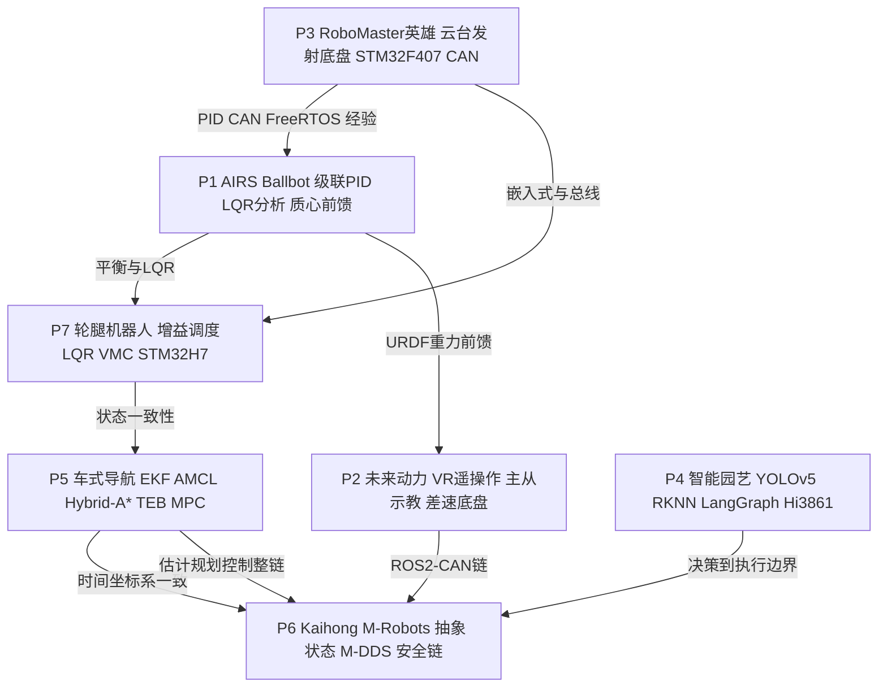

# 七个项目总览与技能矩阵：一条主线讲七个项目

> **一句话定位**：七个项目不是七个孤立的故事，而是同一条能力链——从**底层控制**出发，向上经过**估计与规划**、**感知与 AI**，最后落到**系统安全**。本章给你一张总图、一条叙事、一张技能矩阵、七段中英概述，以及项目之间的技术复用关系。

**本章学完你能……**

- 在 2 分钟内用一条主线把七个项目串成一个故事，并随时切换到任意一个项目的细节；
- 对 CV Skills 的每一项，说出它在哪些项目中用到、用到多深；
- 用 150 字左右的中文或英文概述任一项目；
- 讲清项目之间的技术复用（例如 P1/P7 的平衡控制同源、P2/P3 的 CAN 与 PID、P5/P7 的状态一致性、P4/P6 的"决策到执行的安全边界"）。

**前置知识**：[CV 逐条拆解](./01_CV逐条拆解.md)。

## 目录

1. 七个项目一张总图
2. 时间线
3. 一条主线讲七个项目
4. 技能 × 项目矩阵
5. 七个项目的 150 字概述（中英）
6. 项目间技术复用关系
7. 四条"跨项目母题"
8. 按面试官类型切换讲法，以及每个项目"最容易被追的一点"
9. 本章要点速记、自测题、相关链接

---

## 1. 七个项目一张总图

### 1.1 ASCII 总图：能力栈

```text
                ┌─────────────────────────────────────────────────────────┐
  系统安全层     │ P6 平台软件：统一设备抽象 / 状态管理 / M-DDS / 安全执行链 │
  (谁能让机器人动) │ P4 本地底线：Hi3861 泵状态机 + 规则快速路径 + 手动优先   │
                └───────────────▲─────────────────────────▲───────────────┘
                                │ 决策→执行的安全边界      │
                ┌───────────────┴─────────┐   ┌───────────┴───────────────┐
  感知与 AI 层   │ P4 YOLOv5/RKNN INT8     │   │ P4 LangGraph 决策链        │
                └───────────────▲─────────┘   └───────────▲───────────────┘
                                │ 结构化观测(置信度+时间戳)  │
                ┌───────────────┴─────────────────────────┴───────────────┐
  估计与规划层   │ P5 EKF/AMCL → Hybrid-A* → TEB → MPC                      │
                │ P2 约束 IK (MuJoCo/Mink)  P2 里程计                      │
                └───────────────▲─────────────────────────▲───────────────┘
                                │ 一致的状态                │ 连续的参考
                ┌───────────────┴─────────────────────────┴───────────────┐
  控制层         │ P1 级联PID+LQR分析+质心前馈   P7 增益调度LQR+VMC          │
                │ P3 云台/发射/底盘功率          P2 轮速PID/重力补偿/主从    │
                └───────────────▲─────────────────────────▲───────────────┘
                                │ 力矩/电流/速度指令        │ 电机反馈、IMU
                ┌───────────────┴─────────────────────────┴───────────────┐
  嵌入式与总线   │ STM32F407/H7 + FreeRTOS + CAN/FDCAN (P3, P7, P1, P2)    │
                └─────────────────────────────────────────────────────────┘
```

### 1.2 mermaid：项目关系图



> 箭头含义：左边项目积累的方法或经验被右边项目复用或进一步抽象，不代表时间先后严格如此（见时间线）。

---

## 2. 时间线

```text
2024                         2025                                      2026
05 06 07 08 09 10 11 12 | 01 02 03 04 05 06 07 08 09 10 11 12 | 01 02 03 04 05 06 07 ...
P4 ████████                                                         (2024.05–2024.08)
            P3 ██████████████████████████                           (2024.09–2025.05)
                                       P5 ██████████████████        (2025.06–2025.10)
                                                P1 █████████████████████ (2025.09–2026.03)
                                                      P7 ████████████████ (2025.11–2026.03)
                                                                  P2 ████████ (2026.03–2026.05)
                                                                           P6 ████████▶ (2026.06–至今)
```

| 编号 | 起止 | 类型 | 重叠说明 |
|---|---|---|---|
| P4 | 2024.05–2024.08 | 个人项目 | 最早，是 AI/系统线的起点 |
| P3 | 2024.09–2025.05 | 竞赛项目 | 嵌入式控制的起点；2025 年赛季 |
| P5 | 2025.06–2025.10 | 实验室项目 | 与 P1 起点（2025.09）有约一个月重叠 |
| P1 | 2025.09–2026.03 | 实习（AIRS） | 与 P7 重叠约 5 个月（2025.11–2026.03） |
| P7 | 2025.11–2026.03 | 实验室项目 | 与 P1 并行，平衡控制两条线交相印证 |
| P2 | 2026.03–2026.05 | 实习（未来动力） | 紧接 P1/P7 |
| P6 | 2026.06–至今 | 实习（深开鸿，在职） | 最新，唯一仍在进行 |

> **提示**：CV 把实习和项目分开列；叙事时可以按**能力层**而不是按日期讲，见下一节。若被问"你同时做 P1 和 P7，时间怎么分配？"——回答方向：P1 是全职实习，P7 是实验室项目，两者共享平衡控制的方法论，互为参照。具体时间安排 `【待你补全：P1 与 P7 重叠时期的日常分配】`。

---

## 3. 一条主线讲七个项目

### 3.1 主线一句话

> **"From making a single motor loop stable, to making a robot know where it is and where to go, to letting AI decisions reach actuators only through a safe, consistent system."**
> 中文：从让单个电机回路稳定，到让机器人知道自己在哪、要去哪，再到让 AI 决策只能通过安全、一致的系统到达执行器。

### 3.2 四段叙事（control → estimation/planning → perception/AI → system safety）

**第一段：控制（Control）——P3 → P1 → P7**
我从 RoboMaster 英雄机器人开始（P3），在 STM32 + FreeRTOS + CAN 上写云台级联 PID、发射机构的 PID→变增益→滑模、麦轮底盘的功率控制。这让我熟悉了"闭环在真实电机上的样子"：摩擦、饱和、延迟。后来在 AIRS（P1）面对不稳定的 ballbot：先用级联 PID 部署，当经验调参解释不了现象时，回到模型——四状态倒立摆 + LQR 分析——并加质心前馈。接着在实验室做轮腿机器人（P7），腿长会变，所以用增益调度 LQR 加 VMC。

**第二段：估计与规划（Estimation / Planning）——P5，延伸到 P2**
我意识到控制只是链的一环：车必须先知道自己在哪、该去哪（P5）。EKF/AMCL 融合 IMU、编码器与激光；Hybrid-A* 在运动学约束下规划；TEB 做局部避障；MPC 跟踪。在 P5 中最大的教训是：**位姿跳变常常来自时间、坐标系和运动方向不一致，而不是算法本身**。在 P2 中，我把同样的"约束 + 奇异性"思想用在了机械臂上：约束 IK 抑制奇异点附近的速度放大；里程计让差速底盘可用于自主模式。

**第三段：感知与 AI（Perception / AI）——P4**
我独立做了一个智能园艺系统（P4）：RK3588 上的 YOLOv5/RKNN INT8 推理、LangGraph 决策链、Hi3861 的泵状态机。关键体会：**模型的输出必须带置信度与时间戳，极端情况要有规则快速路径，设备端要有自己的底线**。

**第四段：系统安全（System safety）——P6**
在 Kaihong 的 M-Robots 平台（P6），我把这些经验抽象成平台能力：统一设备抽象让运动控制代码跨硬件复用；统一时间戳、坐标系、有效性检查让状态可信；任务计划必须经 action-proposal → policy-check → execution → state-feedback 才能让执行器动。

### 3.3 90 秒英文口述（直接可练）

> "My work follows one thread: make the loop stable, make the robot know where it is, and make sure any decision reaches the actuator safely.
> I started with control. On my university's RoboMaster hero robot I wrote the gimbal, launcher and chassis loops on an STM32 with FreeRTOS and CAN. Then at AIRS I worked on the balance of a ballbot with two arms: I deployed a cascaded PID, and when tuning alone could not explain what I saw, I went back to a linearised four-state model and used LQR to analyse the weights, and added centre-of-mass feedforward from the arm joints. In a lab project I extended that to a wheel-legged robot with gain-scheduled LQR and virtual model control.
> Next I looked at the chain around control. On a car-like robot I built localisation, planning and MPC tracking, and the biggest lesson was that pose jumps often come from inconsistent timing and frames, not from the algorithm. At Future Power I used constrained inverse kinematics for VR teleoperation of a dual-arm robot.
> Finally, perception and safety. I built a gardening system with YOLOv5 on RK3588, a LangGraph agent and a local pump state machine. Now at Kaihong I work on a platform where task plans pass through proposal, policy check, execution and state feedback before an actuator moves."
> 中文：我的工作有一条线——先让回路稳定，再让机器人知道自己在哪，最后确保任何决策都能安全地到达执行器。（依次：P3→P1→P7→P5→P2→P4→P6。）

> **面试要点**：这段话里每句都对应 CV 的 bullet，**不含任何实测数字**，因此是安全的。被追问某一句时，直接跳到对应项目的口述文档：[七个项目 30 秒/90 秒/3 分钟口述](../04_面试准备/03_项目口述总览/01_七个项目30秒_90秒_3分钟口述.md)。

---

## 4. 技能 × 项目矩阵

### 4.1 符号

- ● 深：亲手实现并在真机/真实系统上运行；
- ◐ 中：用到并能讲清；
- ○ 浅：配合或了解；
- — ：无依据，不要声称。

> **注意**：矩阵是**依据 CV**整理的。个别格子（带 `*`）是由技术栈推断，需要你自己确认并补充，见表后说明。

### 4.2 Control

| CV Skill | P1 | P2 | P3 | P4 | P5 | P6 | P7 |
|---|---|---|---|---|---|---|---|
| cascaded PID | ● 位置→姿态 | ◐ 轮速 PID | ● 云台/拨弹 | — | — | — | ◐* 腿长 PID（CV 写 leg-length PID） |
| gain-scheduled LQR | ○ 分析用 LQR | — | — | — | — | — | ● 按腿长调度 |
| VMC | — | — | — | — | — | — | ● |
| feedforward | ● 质心重力 | ◐ 重力补偿 | ◐* 功率估计前馈（功率缩放） | — | — | — | ● 力前馈 |
| sliding-mode | — | — | ◐ 发射机构 | — | — | — | — |
| MPC | — | — | — | — | ● | — | — |

### 4.3 Planning & navigation

| CV Skill | P1 | P2 | P3 | P4 | P5 | P6 | P7 |
|---|---|---|---|---|---|---|---|
| Hybrid-A* | — | — | — | — | ● | — | — |
| TEB | — | — | — | — | ◐ | — | — |
| EKF/AMCL | — | — | — | — | ● | — | — |
| Kalman / Mahony complementary filtering | ◐* | — | ◐* | — | ◐ | — | ◐* |
| odometry | — | ● | — | — | ● | ◐* | — |
| trajectory tracking | — | ◐ 末端跟踪 | ◐ 云台目标跟踪 | — | ● | — | ◐ 速度指令跟踪 |

### 4.4 Modelling and kinematics

| CV Skill | P1 | P2 | P3 | P4 | P5 | P6 | P7 |
|---|---|---|---|---|---|---|---|
| inverted-pendulum linearisation | ● 四状态 | — | — | — | — | — | ◐ |
| constrained IK | — | ● | — | — | — | — | — |
| closed-chain kinematics | — | — | — | — | — | — | ● |
| KDL / Pinocchio | ● Pinocchio | ● KDL | — | — | — | — | — |
| MuJoCo | — | ◐ MuJoCo/Mink | — | — | — | — | — |
| 车辆/轮系运动学（相关） | ● 三轮分配 | ● 差速 | ● 麦轮 | — | ● 车式 | — | ◐ |

### 4.5 Perception and AI

| CV Skill | P1 | P2 | P3 | P4 | P5 | P6 | P7 |
|---|---|---|---|---|---|---|---|
| YOLOv5 / RKNN edge inference | — | — | ○* 视觉目标作为输入 | ● | — | — | — |
| LangGraph decision chains | — | — | — | ◐ | — | — | — |
| multi-source time/frame alignment | ◐ | ◐* | — | ◐ 观测带时间戳 | ● | ● | ● 状态一致性 |

### 4.6 Software and embedded

| CV Skill | P1 | P2 | P3 | P4 | P5 | P6 | P7 |
|---|---|---|---|---|---|---|---|
| C | — | — | ● | ◐* Hi3861 | — | — | ● |
| C++ | ◐* | ◐* | — | — | ◐* | ● | — |
| Python | ○* | ◐* | — | ◐ | ○* | — | — |
| ROS / ROS2 | ● | ● ROS2 | — | — | ● | ● | — |
| Linux | ◐ | ◐ | — | ◐ | ◐ | ◐ | — |
| STM32 | — | — | ● F407 | — | — | — | ● H7 |
| FreeRTOS | — | — | ● | — | — | — | ● |
| CAN / FDCAN | ● | ● | ● | — | — | ○ | ● FDCAN |
| OpenHarmony | — | — | — | ● | — | ● | — |
| RK3588 | — | — | — | ● | — | — | — |
| Git | ◐ | ◐ | ◐ | ◐ | ◐ | ◐ | ◐ |

### 4.7 矩阵使用说明

1. **带 `*` 的格子是推断**，意思是：该项目的技术栈很可能用到，但 CV 没有逐项写明。面试官问"你在 P2 用 Python 做了什么？"时，你要先确认事实再答。凡无法确认的，说"mostly C++ for the nodes; Python for tools and quick scripts"之类是否属实要由你自己决定，不要凭矩阵硬答。【待你补全：C++/Python 在各项目的实际分工】
2. **P1 的 Kalman / Mahony**：CV Skills 列出了 Kalman/Mahony complementary filtering，但没有指明在哪个项目里。可能的落点：P3 的 AHRS（姿态航向）、P1/P7 的机体姿态。【待你补全：这两个滤波器各用在哪个项目、什么信号】
3. **P5 不用 C**：P5 以 ROS（C++/Python）为主，嵌入式 C 不是它的主体。
4. **P6 没有控制律**：P6 的"Control"是平台层的"运动指令映射与安全执行"，不是 PID/LQR。不要把它说成控制算法项目。
5. **P4 没有传统控制**：只有迟滞状态机，不要把它算作"PID"。

### 4.8 按深度统计：你最强的三条线

| 技能线 | 项目 | 说明 |
|---|---|---|
| 嵌入式实时控制 | P3、P7（+P1 的 CAN） | STM32 + FreeRTOS + CAN/FDCAN，最扎实 |
| 模型分析与线性控制 | P1、P7 | 四状态倒立摆、LQR、增益调度，有推荐信背书 |
| 估计—规划—跟踪整链 | P5 | 有推荐信背书，可展开最深 |

---

## 5. 七个项目的 150 字概述（中英）

> 每段中文约 150 字，英文约 80–100 词。只含 CV 有的事实，无实测数字。

### P1 AIRS ballbot 双臂平衡控制

**中文**：2025 年 9 月至 2026 年 3 月，我在 AIRS 负责三全向轮球形机器人（ballbot）的底盘动态平衡，机器人上身带两条手臂，手臂运动会持续改变质心。我用 IMU 与轮速构造状态，部署位置外环给出受限姿态给定、姿态内环输出、再经运动学分配到三轮的级联 PID；当经验调参不够时，我把系统线性化为四状态倒立摆，用 LQR 分析权重在稳定性与控制量之间的取舍，用作解释增益、定位状态异常和执行器饱和的模型参考；并用 URDF/Pinocchio 估计质心偏移做重力前馈，通过开关补偿验证，同时做了初始化、限幅和倒地恢复。

**English**: At AIRS I was responsible for the balance control of a three-omni-wheel ballbot with a dual-arm upper body. I deployed a cascaded PID — a position outer loop giving bounded attitude references to an attitude inner loop, allocated to three wheels. When tuning alone could not explain the behaviour, I modelled a linearised four-state inverted pendulum and used LQR to analyse the trade-off between stability and control effort, as a reference for interpreting gains and diagnosing saturation. I also added centre-of-mass feedforward from URDF/Pinocchio and built safeguards for initialisation, output limiting and fall recovery.

### P2 未来动力：VR 遥操作、主从示教、差速底盘

**中文**：2026 年 3 月至 5 月，我在未来动力做双臂与底盘控制，全部通过 ROS2-CAN 链在真机上验证。VR 遥操作中，我把手柄运动映射成末端目标，用 MuJoCo/Mink 求解带约束的逆运动学，在奇异点附近抑制关节速度放大；主从示教中，我用 URDF/KDL 建立动力学，做主臂重力补偿与从臂位置—速度跟踪，让人手拖动阻力很小而从臂同步；底盘上，我把速度指令经差速运动学转成轮速目标，用编码器反馈闭合 PID，并把轮运动积分进里程计，服务遥操作与自主两种模式。

**English**: At Future Power I worked on dual-arm and chassis control, validated on real hardware over a ROS2-CAN chain. For VR teleoperation I mapped controller motion to end-effector targets and solved constrained inverse kinematics with MuJoCo/Mink, suppressing velocity amplification near singularities. For leader–follower teaching I built dynamics from URDF/KDL, with gravity compensation on the leader and position–velocity tracking on the follower. On the base I used differential-drive kinematics, an encoder-based PID loop and odometry.

### P3 RoboMaster 英雄机器人

**中文**：2024 年 9 月至 2025 年 5 月，我负责学校战队英雄机器人的云台、发射与底盘控制回路，平台为 STM32F407、FreeRTOS 和 CAN。云台使用 IMU/AHRS 与电机反馈做 pitch/yaw 角度—速率级联 PID，把遥控与视觉目标转成连续姿态指令；发射机构有摩擦轮速度环和拨弹位置—速度双环，控制从 PID 迭代到变增益 PID 再到滑模，并利用弹速反馈追求连续发射稳定；底盘把速度分配到四个麦克纳姆轮，依据实时功率和缓冲能量反馈估计需求并缩放轮速。机器人在 2025 年全国总决赛获三等奖。

**English**: I owned the embedded control of our university team's hero robot on STM32F407, FreeRTOS and CAN. The gimbal used angle–rate cascaded PID from IMU/AHRS and motor feedback. The launcher had friction-wheel speed loops and a feeder position–velocity dual loop, which I iterated from PID to variable-gain PID to sliding-mode control using muzzle-velocity feedback. The chassis allocated velocity to four Mecanum wheels and scaled wheel speeds from power and buffer-energy feedback. The robot won third prize at the 2025 national final.

### P4 OpenHarmony 智能园艺系统

**中文**：2024 年 5 月至 8 月，我独立搭建了一个从视觉观测、决策到设备执行的完整闭环。RK3588 上用 YOLOv5/RKNN INT8 把摄像头帧转成带置信度和时间戳的结构化观测；服务端用 LangGraph 搭建环境与视觉事件的决策链，极端状态走规则快速路径，向执行层发出结构化建议或受约束请求；Hi3861 上实现由土壤湿度驱动的水泵状态机，起停阈值独立、手动优先；系统状态可追溯，并通过网页交互与设备端灌溉闭环。

**English**: In this personal project I built a full loop from vision to irrigation. On RK3588, a YOLOv5/RKNN INT8 chain turns camera frames into structured observations with confidence and timestamps. A LangGraph decision chain on the server combines environment and vision events, with a rule-based fast path for extreme states, and issues structured recommendations or constrained requests. On Hi3861 a soil-moisture-driven pump state machine uses separate start and stop thresholds and manual-priority override. Everything is unified into a traceable system state with a web interface.

### P5 车式移动机器人自主导航

**中文**：2025 年 6 月至 10 月，我负责一辆车式移动机器人从定位、规划到跟踪的整条算法链，并在真车上实现自主导航。定位用 EKF/AMCL 融合 IMU、轮编码器与 2D 激光雷达，处理时间、坐标系与运动方向不一致引起的漂移和位姿跳变，输出连续车辆状态；全局规划用 Hybrid-A*，考虑航向与运动学约束、车体足迹、最小转弯半径和障碍代价；局部用 TEB 在全局路径与局部代价地图约束下优化轨迹；跟踪用基于车式运动学模型的 MPC，在位置、航向、速度、转角约束下滚动求解。

**English**: I was responsible for the full algorithm chain on a car-like robot, from localisation to planning to tracking, and ran it on the real vehicle. EKF/AMCL fused IMU, wheel encoders and 2D LiDAR, and I handled drift and pose jumps caused by inconsistent timing, frames and motion direction. Hybrid-A* produced feasible global paths under footprint, turning-radius and obstacle-cost constraints; TEB optimised local trajectories as obstacles changed; and MPC on a car-like kinematic model tracked the plan under position, heading, speed and steering constraints.

### P6 深开鸿 M-Robots 平台软件

**中文**：2026 年 6 月起，我在深开鸿的 M-Robots 多机器人平台（OpenHarmony）做设备抽象与运动协调，独立开发并集成了设备抽象、状态管理、分布式协同和安全执行链。我用 C++ 建立传感器、执行器、控制器的统一能力模型，并把 ROS/ROS2 运动指令映射到底层驱动，实现运动控制代码跨硬件复用；统一多源感知与执行器反馈的时间戳、坐标系和有效性检查；通过 M-DDS 实现设备发现、能力注册、状态同步和任务分发，并让任务计划经动作提案、策略检查、执行、状态反馈链后才进入执行。

**English**: At Kaihong I work on device abstraction and motion coordination for the M-Robots multi-robot platform on OpenHarmony. I built a unified capability model for sensors, actuators and controllers in C++, and mapped ROS/ROS2 motion commands to low-level drivers so motion-control code can be reused across hardware. I standardised timestamps, frames and validity checks across sources, and implemented device discovery, capability registration, state synchronisation and task dispatch over M-DDS. Task plans are gated through an action-proposal, policy-check, execution and state-feedback chain.

### P7 可变腿长轮腿机器人

**中文**：2025 年 11 月至 2026 年 3 月，我在实验室负责轮腿平台的平衡控制算法与实机整定，目标是腿长变化时机体仍保持平衡并跟踪速度指令。我用 IMU、轮速与关节反馈构造机体俯仰与运动状态，按腿长调度 LQR 增益，把平衡与运动误差转成轮毂与髋关节力矩；用闭链运动学求虚拟腿长与姿态，用雅可比把支撑力和俯仰力矩映射到关节，腿长用 PID 加力前馈协调；在 STM32H7、FreeRTOS、FDCAN 链上集成，并把平衡异常追查到状态不一致、力矩限幅和触地切换。

**English**: In this lab project I was responsible for the balance control algorithms and on-robot tuning of a wheel-legged robot whose leg length changes. I built body-pitch and motion states from IMU, wheel-speed and joint feedback, scheduled LQR gains by leg length, and converted errors into wheel-hub and hip torques. Virtual model control used closed-chain kinematics and the Jacobian to map support force and pitch torque to the joints, with leg-length PID and force feedforward. I integrated everything on an STM32H7/FreeRTOS/FDCAN chain and traced anomalies to state inconsistency, torque limits and ground-contact transitions.

---

## 6. 项目间技术复用关系

### 6.1 复用矩阵（谁复用了谁）

| 复用主题 | 涉及项目 | 共性 | 差异 | 面试时怎么说 |
|---|---|---|---|---|
| **平衡控制 / 倒立摆 / LQR** | P1、P7 | 都是不稳定倒立摆类；都用线性化 + 状态反馈思想；都用 IMU + 轮速/关节反馈构造状态 | P1：LQR 用于**分析**，部署 PID 级联；P7：LQR **部署**，且增益随腿长调度；P1 有手臂扰动（质心前馈），P7 有腿长变化（增益调度 + VMC） | "On the ballbot, LQR was my analysis tool; on the wheel-legged robot, I deployed gain-scheduled LQR. Same model family, different role." |
| **CAN 与电机反馈** | P2、P3（+P1、P7） | 通过 CAN/FDCAN 向电机发送指令、读取反馈 | P3：STM32 直接下发；P2/P1：ROS2 节点经 ROS2-CAN 链；P7：FDCAN | "CAN is the common execution layer across my robots. I've used it directly on STM32 and through ROS2." |
| **PID** | P1、P2、P3、P7 | 反馈—误差—输出 | 层级不同：P3 角度—速率级联；P1 位置—姿态级联；P2 轮速环；P7 腿长 PID | PID 是所有项目的"底座"，LQR/MPC/滑模是在其上方或旁边的增强 |
| **状态一致性（时间、坐标系、有效性）** | P5、P6、P7（+P4） | 不一致的状态会让任何控制器出问题 | P5：定位跳变；P7：状态不一致导致平衡异常；P6：把它做成平台规范；P4：观测带时间戳 | 这是你跨项目最强的"洞察"，建议作为开场主线之一 |
| **决策到执行的安全边界** | P4、P6（+P1 的限幅和倒地恢复） | 上层决策不可信或不确定时，下层仍保证安全 | P4：规则快速路径 + 设备端状态机 + 手动优先；P6：四步安全链；P1：输出限幅与倒地恢复 | "The same principle at three scales: a limiter on one motor, a state machine on a pump, a policy-check chain on a platform." |
| **URDF 与模型驱动的前馈** | P1、P2 | 用 URDF 的惯量/几何算重力项 | P1：质心偏移 → roll/pitch 前馈；P2：臂的重力补偿 | 同一种方法在不同机构上的应用 |
| **雅可比** | P2、P7 | 速度/力的映射 | P2：IK 需要 $J^{+}$，关心奇异；P7：$\tau=J^\top F$，关心力映射 | 同一个矩阵的"正向用法"和"转置用法" |
| **运动学分配** | P1（三全向轮）、P2（差速）、P3（麦轮）、P5（车式） | 把车体速度/力映射到轮 | 轮系不同，矩阵不同 | 总结为"body command → actuator command" |
| **FreeRTOS 与实时** | P3、P7 | 任务、优先级、周期 | F407 vs H7 | 实时性是稳定性的前提 |
| **约束与优化** | P2（约束 IK）、P5（MPC、TEB） | 都是在约束下求最优 | IK：QP，每步求速度；MPC：滚动时域 | 都是"约束 + 代价"的求解，是 PS 里想补强的"optimisation" |

### 6.2 复用关系详解

**(1) P1/P7：平衡控制同源**

```text
              线性化倒立摆 (小角度)           增益来源
  P1  ballbot  x=[p, v, θ, θ̇]     ──► LQR 仅分析      → 解释已部署 PID 增益
  P7  轮腿     x=[...(含腿长相关参数)] ──► LQR 部署       → K(l) 按腿长调度
```
共同的教训是：**线性模型在平衡点附近有效；偏离（大倾角、触地切换、饱和）就要靠限幅、状态初始化与恢复策略兜底**。

**(2) P2/P3：CAN 与 PID**
P3 教会你"如何在 STM32 上用 FreeRTOS 稳定地周期性读写 CAN 电机"；P2 把这件事搬到 Linux/ROS2，上层多了一层桥接，要面对的是"ROS 回调时序 vs CAN 周期"的差异。

**(3) P5/P7：状态一致性**
P5 里位姿跳变的根因（时间、坐标系、运动方向不一致）与 P7 里"balance anomalies traced to state inconsistency"是同一类问题：**控制器是对状态的函数，状态错了，再好的算法也无用**。

**(4) P4/P6：决策到执行的安全边界**
P4 是小尺度原型：agent 只能提出建议或受约束请求，极端状态走规则路径，设备端有自己的状态机与手动优先。P6 是平台级抽象：任何任务计划要经 proposal → policy → execution → feedback。二者共享"上层可建议，下层可否决，状态可回传"的结构。

**(5) P5/P6：估计规划控制整链与平台**
P5 的"定位—规划—跟踪"每一环都依赖上一环输出的**连续、可信**状态；P6 则把这种可信性变成平台接口（统一时间戳、坐标系、有效性检查）。

---

## 7. 四条"跨项目母题"

这四条是你在回答任何开放式问题（"What did you learn?" "What is your biggest challenge?"）时可以反复使用的主题：

| 母题 | 一句话（英文） | 项目证据 |
|---|---|---|
| 模型 vs 经验 | "When tuning could no longer explain the behaviour, I went back to a model." | P1（LQR 分析）；Fu 信："arrived at the model by working it out for that particular robot" |
| 状态可信 | "A controller is only as good as the state it receives." | P5 跳变、P7 状态不一致、P6 状态管理 |
| 约束 | "Real systems are about constraints: torque limits, turning radius, singularities, power limits." | P1 限幅、P2 奇异、P3 功率、P5 转弯半径与 MPC 约束、P7 力矩限幅 |
| 安全边界 | "Keep a safe floor under any upper-layer decision." | P1 倒地恢复、P4 状态机、P6 四步链 |

> **面试要点**：每当你不知道怎么回答一个"开放问题"，就选一条母题，用一个项目举例，再带回你想补的理论。例如："What is the hardest problem you have solved?" → 母题"状态可信" → P5 位姿跳变 → 为什么想学更系统的状态估计理论。

---

## 8. 按面试官类型切换讲法，以及每个项目"最容易被追的一点"

### 8.1 同一条主线，三种讲法

面试官的背景不同，听同一个项目关心的东西也不同。下面是三种"切换方案"，事实不变，只换重点：

| 面试官类型 | 关心什么 | 讲法重点 | 开场项目 |
|---|---|---|---|
| 控制/机器人教授 | 模型是否正确、稳定性与约束、真机现象的解释 | 状态定义、线性化假设、为什么 LQR 只用于分析、饱和与触地切换的诊断 | P1、P7 |
| AI/CS 教授 | 系统设计、评估、失效模式、安全边界 | 观测的结构化（置信度、时间戳）、规则快速路径、四步安全链、统一状态 | P4、P6 |
| 招生/综合面试官 | 动机、沟通、成长、适配 | 从 P3 到 P6 的成长线，为什么读研，学校匹配 | 主线叙事 |

> **面试要点**：先用一句话判断对方更像哪一类，再决定把哪个项目放在最前面。拿不准时就用第 3 节的 90 秒主线，因为它覆盖了三类人关心的点。

### 8.2 每个项目"最容易被追的一点"

| 项目 | 最容易被追的一点 | 为什么容易被追 | 你要准备的一句话（英文骨架） |
|---|---|---|---|
| P1 | LQR 与 PID 的关系 | 推荐信第三段原句，且"部署 PID、分析用 LQR"看起来反直觉 | "LQR told me how the state weights trade stability against effort, so I could read my PID gains and see where saturation came from." |
| P2 | 奇异点附近怎样抑制速度放大 | PS 与 CV 都写了，且是经典 IK 问题 | "Near a singularity the Jacobian loses rank, so the joint velocity for a given end-effector velocity grows; I limited that by [你的机制]." `【待你补全】` |
| P3 | 为什么从 PID 迭代到滑模 | CV 写了完整迭代路径 | "Plain PID could not hold the muzzle velocity steady under the load disturbance of each shot, so I moved on to…" `【待你补全：真实现象】` |
| P4 | 规则快速路径与 Agent 的分工 | PS 多次引用，且是 AI 组的核心 | "Extreme states never wait for the agent: a rule fires first, and the device keeps its own safe state machine." |
| P5 | 位姿跳变的根因 | CV、推荐信、PS 都写了 | "The jumps came from timing, frames and motion-direction inconsistencies, so I fixed the data consistency before touching the filter." `【待你补全：具体事例】` |
| P6 | 策略检查具体检查什么 | 它是 AI 版 PS 的开篇 | "The policy check verifies that a proposed action is allowed in the current state before it reaches an actuator." `【待你补全：规则类别】` |
| P7 | 一个失衡案例的定位过程 | 学术推荐信原句 | "When balance failed I checked three things in turn: state consistency, torque limits and ground-contact transitions." `【待你补全：一个真实案例】` |

### 8.3 两个"系统性追问"：谁来回答

有两类问题不属于任何单个项目，而是针对你整个人：

1. **"Which project taught you the most?"**
   建议答 P1（因为"返回模型"这个习惯是它给的），再带出 P5/P6（状态一致性）。这样与 PS 的"想补理论"自然衔接。
2. **"If you could redo one project, what would you change?"**
   答案必须是真实的反思。可以从"更早做模型分析而不是纯调参"（P1、P7 的共同教训，与推荐信一致）或"更早统一时间戳与坐标系"（P5、P6）这类**方法层**的改进出发，再补一个你真实记得的具体点。`【待你补全：一个真实的"重做会改什么"】`

---

## 本章要点速记

1. 总主线：控制 → 估计/规划 → 感知/AI → 系统安全。
2. 时间线：P4 (2024.05–08) → P3 (2024.09–2025.05) → P5 (2025.06–10) → P1 (2025.09–2026.03) ∥ P7 (2025.11–2026.03) → P2 (2026.03–05) → P6 (2026.06–至今)。
3. 技能矩阵最强的三条线：嵌入式实时控制、模型分析与线性控制、估计—规划—跟踪整链。
4. P1 的 LQR 是分析，P7 的 LQR 是部署。
5. P6 不是控制项目，P4 没有传统控制。
6. 带 `*` 的矩阵格子是推断，需自己确认。
7. 四个复用关系：平衡同源；CAN+PID；状态一致性；决策到执行的安全边界。
8. 四条跨项目母题：模型 vs 经验；状态可信；约束；安全边界。
9. 90 秒口述不含实测数字，是安全的开场。
10. 被追问时，用母题 + 一个具体项目作答。

## 自测题

1. 请用一条主线在 90 秒内讲完七个项目，并说出每段对应的项目。（要点：控制→估计/规划→感知/AI→系统安全。）
2. P1 和 P7 在 LQR 上的角色有何不同？（要点：分析 vs 部署；P7 增益按腿长调度。）
3. P4 与 P6 的"安全边界"有何共性？（要点：上层建议、下层可否决、状态回传。）
4. P5 与 P7 的"状态一致性"如何联系？（要点：位姿跳变与平衡异常同一类问题。）
5. CV Skills 里"Kalman/Mahony complementary filtering"在哪个项目中用到？你需要补什么？（要点：CV 未指明，需要你确认。）
6. 用一个项目说明"约束"这条母题。（要点：P3 功率限制下缩放轮速；P2 奇异点；P5 MPC 约束。）

## 相关链接

- 上一篇：[02_PS与推荐信主线](./02_PS与推荐信主线.md)
- 下一篇：[04_口径与事实基线](./04_口径与事实基线.md)
- 项目入口：[P1](../01_项目课程/P1_AIRS球形机器人平衡控制/README.md)｜[P2](../01_项目课程/P2_未来动力双臂遥操作与差速底盘/README.md)｜[P3](../01_项目课程/P3_RoboMaster英雄机器人嵌入式控制/README.md)｜[P4](../01_项目课程/P4_OpenHarmony智能园艺系统/README.md)｜[P5](../01_项目课程/P5_车式移动机器人自主导航/README.md)｜[P6](../01_项目课程/P6_深开鸿M-Robots平台软件/README.md)｜[P7](../01_项目课程/P7_可变腿长轮腿机器人/README.md)
- 跨项目技术对比：[跨项目技术对比问答](../04_面试准备/03_项目口述总览/02_跨项目技术对比问答.md)
- 口述总览：[七个项目 30 秒/90 秒/3 分钟口述](../04_面试准备/03_项目口述总览/01_七个项目30秒_90秒_3分钟口述.md)
