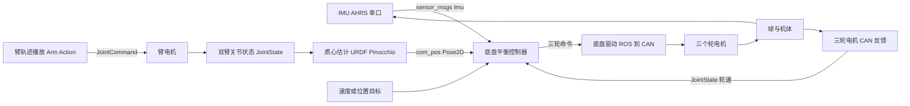

# 01 项目背景与系统总览

> **一句话定位**：先把 P1 这台机器人"看清楚"——它是什么、为什么站不住、要完成什么任务、硬件和软件怎么分层、数据怎样流动。后面所有章节（运动学、IMU、倒立摆、LQR、PID、前馈、安全闭环）都挂在这张总图上。

**本章学完你能：**

- 用 30 秒讲清 ballbot（球形平衡机器人）是什么，和两轮平衡车有什么不同；
- 解释"为什么它天生不稳定"，并估算失稳有多快（用一个简单公式）；
- 复述 CV 里 P1 的任务边界、你的职责边界、双臂为什么是难点；
- 画出传感器 → 状态处理 → 控制器 → 运动学分配 → CAN 电机 → 球和机身 → 传感器的闭环图；
- 说出真实源码里能确证的话题名、频率、节点（`/imu/data`、`/left/Arm/JointState`、`/com_pos` 等），并知道哪些信息 CV 和源码都没有、需要你自己补；
- 知道后面每一章讲什么、依赖哪些基础文档。

**前置知识**（读不懂时回头补）：

- 倒立摆直觉：[../../02_基础知识/02_力学与建模/03_倒立摆建模与线性化.md](../../02_基础知识/02_力学与建模/03_倒立摆建模与线性化.md)
- 反馈控制基础：[../../02_基础知识/04_控制理论/01_反馈控制与系统响应基础.md](../../02_基础知识/04_控制理论/01_反馈控制与系统响应基础.md)
- ROS 基本概念（话题、节点、服务）：[../../02_基础知识/09_机器人软件/04_ROS1_ROS2核心概念.md](../../02_基础知识/09_机器人软件/04_ROS1_ROS2核心概念.md)

**目录**

1. 什么是 ballbot
2. 为什么它站不住：失稳有多快
3. P1 的任务与职责边界
4. 整机怎么分层：机械、传感、计算、执行
5. 软件分层与闭环数据流
6. 三个控制目标与"成功"的判据
7. 真实源码给出的系统事实
8. 后续章节地图
9. 面试怎么问、怎么答
10. 本章要点速记 / 自测题 / 相关链接

---

## 1. 什么是 ballbot

**球形平衡机器人（ballbot）**：机器人只用**一个球**和地面接触，球由机体里的驱动轮带动；机体像一根"立在球上的杆"。三个小驱动轮压在球面上，彼此在水平面内相隔约 120°，通过摩擦带动球向任意方向滚动。

```text
 侧视（示意，非项目 CAD）                      俯视（示意）

      +-------------------+                         +y (左)
      |  机体: IMU/电池/  |                          ^
      |  控制器/双臂      |                 wheel2 (*)|
      +---+-----------+---+                          |
          |   小轮     |   <- 小驱动轮固定在机体上      O--------> +x (前)
           \  (3个)   /     压在球面上                |      (*) wheel1
            \   ___   /                     wheel3 (*)|
             \ /   \ /
              |  球  |                    三个小轮绕球心约隔 120 度
               \___/
        ===========●=========  地面 (球-地面只有一个接触点)
```

两处接触各管什么：

| 接触处 | 传递什么 | 出问题的现象 |
|---|---|---|
| 小轮 ↔ 球 | 电机经小轮用摩擦"拨动"球 | 小轮对球打滑：电机转了，球没跟上 |
| 球 ↔ 地面 | 球在地面上滚动，推动整台机器人 | 球对地打滑：球转了，机器人位移不对 |

**与两轮平衡车比：**

| 对比项 | 两轮平衡车 | ballbot |
|---|---|---|
| 稳定自由度 | 前后倾（pitch）一个方向 | 前后倾 + 左右倾，两个方向同时要稳 |
| 平移能力 | 前进/后退 + 转向（非完整约束） | 任意方向平移（全向），可原地转 |
| 接触 | 两个接触点，横向有被动支撑 | 一个接触点，没有任何被动支撑 |
| 驱动 | 两个轮子直接着地 | 三个轮子驱动球，球着地 |
| 稳定方式 | 一个平面内的倒立摆 | 两个正交平面的倒立摆 + 偏航，靠运动学耦合到三个电机 |

**公开背景（仅作聊天素材，引用前请自行打开原文核对）：** 业内较早的、广为引用的 ballbot 工作有 CMU 的 Lauwers、Kantor、Hollis 在 ICRA 2006 发表的 *A Dynamically Stable Single-Wheeled Mobile Robot with Inverse Mouse-Ball Drive*，以及 ETH 的 Rezero（约 2010 年）。本文档**未逐篇核对原文**，面试时若提到，请说"I recall the CMU ballbot work"，不要引用具体数据。

> **面试要点**：ballbot 的核心卖点是"全向 + 动态稳定"：人靠近时它可以像人一样小步挪动，不会被地面"卡住"；代价就是控制必须一刻不停。

---

## 2. 为什么它站不住：失稳有多快

**直觉：** 把一根扫帚立在手掌上。扫帚稍微偏一点，重力会让它偏得更多（正反馈）。要稳住它，手必须**往倾倒方向移动**去"接住"。机器人把手换成球。

**数学本质：** 倒立摆线性化后，倾角满足（后面第 04 章会严格推导）

$$\ddot\theta \approx \lambda^2\,\theta,\qquad \lambda=\sqrt{\frac{g}{l_{\text{eff}}}}$$

- $\theta$：机体倾角（rad），$l_{\text{eff}}$：等效摆长（m），$g=9.81\ \text{m/s}^2$；
- 解是 $\theta(t)=\theta_0\,e^{\lambda t}$：**偏差按指数增长**，开环不稳定。

**算一个量级（示意数值，非项目实测）：** 取 $l_{\text{eff}}=0.4\ \text{m}$，

$$\lambda=\sqrt{9.81/0.4}\approx 4.95\ \text{s}^{-1},\qquad t_{2}=\frac{\ln 2}{\lambda}\approx 0.14\ \text{s}$$

意思是：倾角每 0.14 秒翻一倍。对控制器的要求立刻清楚了：

- 控制频率至少要比 $\lambda$ 快一个数量级（几十到一百赫兹量级是常见做法）；
- 传感和滤波延迟必须小于几十毫秒，否则"接住"得太晚；
- 执行器出力有上限：倾得太多时，再大的增益也救不回来（后面讲"饱和"）。

> **注意**：上面的 0.4 m 是教学数字。你们机器人的质心高度、等效摆长，面试官可能会问，见 README 的"实机细节自查表"。

---

## 3. P1 的任务与职责边界

**CV 原文要点（Shenzhen Institute of AI and Robotics for Society，AIRS，Robotics Software Intern，Sep 2025 – Mar 2026）：**

- 对象：**三全向轮球形机器人（ballbot）+ 双臂上肢**；
- 你负责：**平衡控制的开发与实机整定**（"balance control development and on-robot tuning"）；
- 结果：双臂沿**固定轨迹**运动时，底盘仍能保持动态平衡。

四条 CV bullet 对应本教材的章节：

| CV bullet | 一句话 | 对应章节 |
|---|---|---|
| Cascaded balance control | IMU + 轮速 → 位置外环→有界姿态参考→姿态内环→三轮分配 | 02、03、06 |
| LQR modelling and analysis | 四状态倒立摆线性化 + LQR，分析权重的稳定性/控制量折中，作为 PID 整定与饱和定位的模型参照 | 04、05 |
| Centre-of-mass feedforward | URDF/Pinocchio 估计质心偏移 → roll/pitch 重力前馈，开关对比验证 | 07 |
| Hardware safety loop | ROS 状态处理 + CAN 电机执行 + 状态初始化/输出限幅/跌倒恢复 | 08、09 |

**导师（Chen Dansheng，AIRS 机器人开发工程师）的推荐信**对你的叙述是：先做级联 PID，再"返回模型分析"；推导四状态倒立摆并用 LQR 分析 position / velocity / tilt / tilt-rate 权重；这套分析被团队用来**解释已部署控制器的增益、定位状态异常、定位执行器饱和**；最终"底盘在两臂执行轨迹时保持动态平衡"。

**职责边界（面试时要说清楚）：**

| 属于你 | 属于团队其他人/其他模块（只作背景） |
|---|---|
| 平衡控制器设计、部署、整定 | 手臂电机驱动、灵巧手 SDK、LED、头部 |
| 状态初始化、限幅、跌倒保护 | 手臂动作脚本的编排（你用固定轨迹做实验） |
| LQR 建模与分析 | 机械结构与总体设计 |
| 质心估计与前馈（URDF/Pinocchio） | 底层电机固件 |

> **注意**：不要把手臂轨迹播放、灵巧手、LED 说成自己做的。源码目录里这些代码存在，只是"这台机器人的其它模块"。

**为什么双臂是难点：** 手臂一动，整机质心就跟着移动，重力对球的支撑点产生的倾覆力矩改变。同一个球轮动作，在手臂前伸和下垂时效果不同。控制器不能假设"质心永远在中线上"。

---

## 4. 整机怎么分层：机械、传感、计算、执行

下表把"能确证的"（来自源码目录）和"本项目取值"（实机细节，口径同 README）分开。

| 层 | 内容 | 依据 | 本项目取值 |
|---|---|---|---|
| 机械 | 球 + 三个小驱动轮 + 机体 + 双臂；每臂 4 个关节；每手 6 个自由度的灵巧手 | `arm_joint_num=4`、`hand_joint_num=6`（`arm_controller` 的 launch） | 球直径约 0.40 m、橡胶包覆空心球壳；全向轮直径约 0.10 m；整机约 32 kg |
| 姿态传感 | 带板载 AHRS 的 IMU，串口 921600 baud | `fdilink_ahrs` 的 launch 与驱动 | FDI 系列 AHRS 模块；输出约 100 Hz |
| 轮反馈 | 三轮电机的轮速/位置，经 CAN 到 ROS，话题 `/chassis_states_topic` | `arm_controller/README.md` | 电机内置编码器（约 14 位/转量级）；反馈约 100 Hz |
| 臂反馈 | `/left/Arm/JointState`、`/right/Arm/JointState` | `kinetic_compensation_node.py` | 臂关节状态反馈约 50 Hz |
| 计算 | 车载 Linux 主机，ROS1（catkin、`rospy`/`roscpp`）；脚本路径 `/home/nvidia/work/...` 提示是 NVIDIA 平台 | `start_service.sh` | NVIDIA Jetson 系列车载板卡（Ubuntu + ROS1） |
| 臂执行 | "钛虎"臂电机，CAN 总线 1 Mbit/s（`sudo ip link set can0 up type can bitrate 1000000`） | `arm_controller/README.md` | 钛虎关节电机，额定转矩按关节大小从数 N·m 到十几 N·m；CAN 1 Mbit/s |
| 轮执行 | 三个轮电机，ROS 驱动经 CAN 控制 | CV | 无刷电机 + 9:1 行星减速，轮端额定约 3 N·m、峰值约 6 N·m，轮端最高约 20 rad/s；速度模式 |

> **提示**：`chassis_controller/` 与 `chassis_driver/` 目录在你手上的源码快照里是**空的**。底盘控制器细节本教材按 CV + 通用工程知识讲解，凡涉及实机的具体数值，一律采用本项目统一取值（汇总于 [README](./README.md) 的“实机细节自查表”），例如控制主循环 100 Hz、外环参考上限 0.10 rad、跌倒阈值 0.5 rad。

---

## 5. 软件分层与闭环数据流

### 5.1 数据流图



读法：外圈是"物理闭环"（控制器 → 电机 → 球和机体 → 传感器 → 控制器）；左下是**手臂这条旁路**：手臂轨迹改变关节角，质心节点据此算出质心，再作为**前馈**注入控制器。

### 5.2 控制器内部的分层（典型结构，对应 CV）

```text
 目标(位置/速度)
      |
 [位置外环]  位置误差、速度误差  --->  有界的 roll/pitch 参考 (rad)
      |
 [姿态内环]  倾角误差 + IMU 角速度 --->  三轴控制量 (roll, pitch, yaw)
      |        + 质心重力前馈
 [运动学分配]  3x3 矩阵 J  --->  三个轮的命令
      |
 [限幅 + 滤波 + 安全检查]
      |
 [电机驱动 / 电机内环]  CAN  --->  三个轮电机
```

**时间尺度（越往下越快，这是级联设计的基本原则）：**

| 环 | 角色 | 典型相对带宽 | 本项目具体值 |
|---|---|---|---|
| 电机速度/电流环 | 把"命令"变成真实轮速/力矩 | 最快 | 驱动器内部电流环约 1 kHz、速度环约 500 Hz，闭环带宽约 20 Hz |
| 姿态内环 | 稳住倾角，抑制倾倒 | 中 | 100 Hz 执行，闭环带宽约 1 Hz |
| 位置外环 | 慢慢把机器人带到目标 | 最慢，一般比内环慢数倍 | 100 Hz 执行，闭环带宽约 0.15 Hz（内/外约 6~7 倍） |

第 06 章会专门讲"为什么外环要比内环慢"。

### 5.3 一个控制周期里发生什么

1. 各传感器消息异步到达，各自回调把最新值放进缓存；
2. 控制定时器触发，读取缓存，检查"数据是否齐全、是否新鲜、姿态是否在安全范围"；
3. 计算状态（倾角、角速度、由轮速推出的球/机体速度、积分得到的位置）；
4. 外环 → 内环 → 加质心前馈 → 乘 $J$ 分配到三个轮 → 限幅 → 滤波；
5. 发布命令，驱动经 CAN 送到电机；
6. 机器人动了，传感器给出新状态，进入下一周期。

> **注意**：第 2 步里"最新缓存"不等于"足够新"。数据年龄检查是安全闭环的重要部分，第 08 章展开。

---

## 6. 三个控制目标与"成功"的判据

**三个目标同时成立**（这也是为什么不能"只让轮子转到某个速度"）：

1. 到达目标**位置**（或跟随目标速度）；
2. 保持机体**姿态**（倾角小，不倒）；
3. 在手臂运动、人为轻推等**扰动**下仍然稳定。

**CV 给出的成功标准**是定性的：双臂执行固定轨迹时，底盘保持动态平衡。如果面试官追问"怎么量化"，用下面的**指标清单**回答（本项目取值，来自双臂前平举往复轨迹、每种状态重复 5 次的对比记录）：

| 指标 | 含义 | 本项目取值 |
|---|---|---|
| 倾角 RMS / 峰值 | 平衡质量 | 开前馈：RMS 约 0.010 rad、峰值约 0.026 rad（1.5°）；静止站立时 RMS 约 0.003 rad |
| 位置漂移 | 静止时飘了多远 | 静止 60 s 约 5 cm；带臂运动 30 s 约 0.10 m |
| 轮命令饱和占比 | 执行器余量 | 开前馈约 1%（关前馈约 6%） |
| 恢复时间 | 受扰后多久回稳 | 手推约 20 N 的瞬时扰动后，约 2~3 s 回到 ±0.01 rad 以内 |
| 前馈开/关对比 | 质心前馈的收益 | 倾角峰值 0.060 → 0.026 rad，RMS 0.022 → 0.010 rad（见第 07 章实验设计） |

---

## 7. 真实源码给出的系统事实

以下事实可以从你手上的 `项目源码/AIRS/` 确证（逐文件分析见第 10 章）：

| 事实 | 出处 |
|---|---|
| IMU 驱动是 `fdilink_ahrs`，串口波特率 921600，发布 `sensor_msgs/Imu`，launch 中话题为 `imu/data`、`frame_id` 为 `gyro_link` | `fdilink_ahrs/launch/ahrs_data.launch` |
| 驱动同时发布欧拉角 `/euler_angles`、磁力计 `/magnetic`、`/mag_pose_2d` 等 | `fdilink_ahrs/launch/ahrs_data.launch` |
| 臂关节状态话题 `/left/Arm/JointState`、`/right/Arm/JointState`；命令话题 `/left/Arm/JointCommand`、`/right/Arm/JointCommand` | `arm_controller/scripts/*.py` |
| 质心节点 `kinetic_compensation_node.py` 用 Pinocchio 读 URDF 计算质心，发布 `/com_pos`、`/com_vel`（`geometry_msgs/Pose2D` 的 x/y），默认 100 Hz | `kinetic_compensation.launch` |
| URDF 路径指向 `mujoco_rl_env/ballbotgym/assets/uni.urdf`（同一份模型也用于 MuJoCo 仿真环境） | `kinetic_compensation.launch` |
| 臂轨迹播放节点 50 Hz，三次样条插值，服务 `/Arm/Action` | `arm_trajectory.launch`、`arm_trajectory_node.py` |
| 臂工作空间遍历：Halton 序列采样、最大速度 0.2 rad/s、每点停留 2 秒，配合数据记录节点 100 Hz 存 CSV | `traversal_arm_node.py`、`data_collector_node.py` |
| 预设动作：`front_raise1–6`（前平举，幅度 0.78/1.0/1.57 rad，半周期 4 秒或 8 秒）、`greet`、`shake`、`hug`、`dish_up/down` 等 | `config/episodes/*.yaml` |

> **提示**：`front_raise1–6` 恰好构成"幅度 × 速度"的扫描，很适合做质心前馈的开关对比（第 07 章）。这是推断；本项目开/关对比用的是其中幅度与速度居中的一条前平举往复轨迹（单次 16 s：8 s 抬到约 0.78 rad，再用 8 s 放回），各重复 5 次。

---

## 8. 后续章节地图

| 章 | 主题 | 一句话 |
|---|---|---|
| 02 | 球形底盘几何与三轮运动学 | 球想怎么转 → 三个轮各转多快（含向量、点积、叉乘从零讲起） |
| 03 | IMU、AHRS 与姿态估计 | 倾角和角速度从哪来、坐标系和符号、偏置、滤波 |
| 04 | 倒立摆建模与线性化 | 从拉格朗日方程到四状态线性模型 |
| 05 | LQR 设计与分析 | Q、R、Riccati、折中、怎样当 PID 参照 |
| 06 | 级联 PID | 外环、内环、有界参考、抗积分饱和、整定流程 |
| 07 | 质心前馈补偿 | URDF/Pinocchio → 质心 → 重力前馈 → 开关对比 |
| 08 | ROS 与 CAN 安全执行闭环 | 初始化、限幅、跌倒、使能、时序 |
| 09 | 调试案例与故障排查 | 十几个典型故障：现象→原因→定位→处理 |
| 10 | 源码导读 | 逐文件逐函数读真实代码 |
| 11 | 教学仿真实验手册 | 自己在电脑上复现 LQR/PID 结论 |
| 99 | 英文面试口述与深挖问答 | 30 秒/90 秒/3 分钟口述，40+ 问答 |

**建议阅读顺序**：01 → 02 → 03 → 04 → 06 → 05 → 07 → 08 → 09 → 10 → 11 → 99。
（先读 06 再读 05，是因为 LQR 的价值要放在"已有一个 PID 控制器"的背景下才看得清。）

---

## 9. 面试怎么问、怎么答

**Q1. What is a ballbot, and why is it hard to control?**

> A ballbot balances on a single ball. Three omni wheels drive the ball, and the body behaves like an inverted pendulum on top of it. It is hard because it is unstable by itself — if the body tilts, gravity makes it tilt more — and there is only one contact point, so there is no passive support in any direction. The controller has to react within tens of milliseconds, in two tilt directions at the same time.

（中文要点：单球支撑、倒立摆、开环不稳定、只有一个接触点、两个方向同时稳、反应要快。）

**Q2. What was your role in the project?**

> I was responsible for the balance control of a three-omni-wheel ballbot with a dual-arm upper body: designing and deploying the cascaded controller, tuning it on the robot, and adding safeguards such as state initialisation, output limiting and fall detection. The arm drivers and hardware design belonged to other team members.

（中文要点：平衡控制开发与实机整定 + 安全保护；手臂驱动与结构是别人的。）

**Q3. Why do the arms matter for balance?**

> When the arms move, the whole centre of mass moves, so gravity creates a different tipping moment around the ball's contact point. I estimated the centre-of-mass offset from the arm joint angles using the URDF model with Pinocchio, and fed a gravity feedforward term into the balance controller.

**Q4（追问）. How fast does the robot fall if you do nothing?**

> For a simple inverted pendulum, the tilt grows like e to the power of lambda t, with lambda equal to the square root of g over the effective length. For an effective length of about 0.4 metres, which is just an illustrative number, the tilt doubles roughly every 0.14 seconds. That is why the control loop and the sensor delay have to be much faster than that.

（注意：这里的 0.4 m 要说明是示意值，不要说成实机数据。）

---

## 本章要点速记

1. ballbot = 一个球着地 + 三个小驱动轮拨球 + 机体当倒立摆；全向，但开环不稳定。
2. 失稳速度由 $\lambda=\sqrt{g/l_{\text{eff}}}$ 决定，量级是每 0.1~0.2 秒翻倍（示意值），所以闭环必须快。
3. CV 任务：三全向轮 ballbot + 双臂；你负责平衡控制开发与实机整定。
4. 四条 CV bullet = 级联 PID / LQR 分析 / 质心前馈 / 硬件安全闭环。
5. 手臂运动改变质心，是平衡控制的主要结构性扰动。
6. 控制链：传感器 → 状态处理 → 位置外环 → 姿态内环（+前馈）→ 运动学矩阵 → 限幅滤波 → CAN 电机。
7. 环的带宽顺序：电机内环 > 姿态内环 > 位置外环。
8. 源码能确证：fdilink IMU 驱动、臂话题、Pinocchio 质心节点；底盘控制器源码缺失，用 CV 和通用知识讲。

## 自测题

1. 为什么 ballbot 比两轮平衡车更难？（要点：两个方向同时稳、单接触点、无被动支撑。）
2. 倾角 $\theta$ 满足 $\ddot\theta=\lambda^2\theta$，解的形式是什么？为什么说开环不稳定？（$e^{\lambda t}$ 指数发散。）
3. 若 $l_{\text{eff}}=0.25$ m，倾角翻倍时间约多少？（$\lambda=\sqrt{39.24}\approx6.26$，$t_2\approx0.11$ s。）
4. 手臂前伸为什么会让机器人倾倒？（质心前移，重力力臂变化。）
5. 为什么说"最新缓存"不一定"足够新"？（异步消息，没有时间戳检查就可能用到旧数据。）

## 相关链接

- 下一章：[02_球形底盘几何与三轮运动学.md](./02_球形底盘几何与三轮运动学.md)
- 项目入口：[README.md](./README.md)
- 英文口述：[99_英文面试口述与深挖问答.md](./99_英文面试口述与深挖问答.md)
- 八股：[../../03_八股知识/03_机器人学/07_轮腿_球形机器人_机械臂专题八股.md](../../03_八股知识/03_机器人学/07_轮腿_球形机器人_机械臂专题八股.md)
- 工程化实践（频率、周期、优化与工程问题）：[20_工程化实践_频率周期与问题解决.md](./20_工程化实践_频率周期与问题解决.md)
