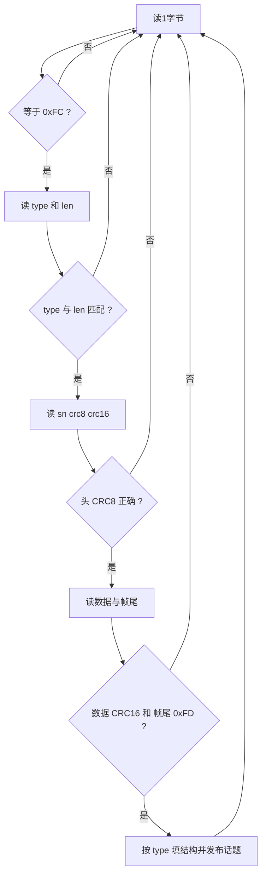

# 03 IMU、AHRS 与姿态估计

> **一句话定位**：平衡控制器要靠两个量活着——**机体倾角**和**倾角变化的快慢**。它们从 IMU/AHRS 来。本章讲清楚：这两个量怎么测、坐标系和正负号怎么定、偏置和滤波怎么影响平衡，以及源码 `fdilink_ahrs` 驱动逐段在做什么。

**本章学完你能：**

- 区分陀螺仪、加速度计、磁力计各测什么，各有什么毛病；
- 说清机体系/世界系，roll、pitch、yaw 的正方向，以及"roll 为正质心往哪边偏"；
- 手算四元数 → 欧拉角、一阶互补滤波一步、陀螺偏置的稳态影响；
- 看懂 `fdilink_ahrs` 的串口帧格式、CRC 校验、话题发布、`device_type=1` 的坐标变换；
- 解释"启动偏置/零点"为什么是状态初始化的一部分，以及一阶低通滤波的延迟代价；
- 回答"IMU 型号/频率/滤波/延迟"的面试追问（诚实边界见 README 自查表）。

**前置知识：**

- 坐标系与旋转：[../../02_基础知识/03_坐标变换与运动学/01_坐标系_旋转矩阵_齐次变换.md](../../02_基础知识/03_坐标变换与运动学/01_坐标系_旋转矩阵_齐次变换.md)
- 欧拉角与四元数：[../../02_基础知识/03_坐标变换与运动学/02_欧拉角_四元数_姿态表示.md](../../02_基础知识/03_坐标变换与运动学/02_欧拉角_四元数_姿态表示.md)
- 传感器与 IMU：[../../02_基础知识/05_状态估计/01_传感器_IMU_编码器_激光雷达.md](../../02_基础知识/05_状态估计/01_传感器_IMU_编码器_激光雷达.md)
- 互补滤波与 Mahony：[../../02_基础知识/05_状态估计/02_互补滤波与Mahony_AHRS.md](../../02_基础知识/05_状态估计/02_互补滤波与Mahony_AHRS.md)
- 时间同步与数据有效性：[../../02_基础知识/05_状态估计/06_时间同步_坐标系一致性与数据有效性.md](../../02_基础知识/05_状态估计/06_时间同步_坐标系一致性与数据有效性.md)

**目录**

1. 要解决的问题
2. 坐标系、角度与正方向
3. 传感器原理与误差
4. 姿态表示：四元数 ↔ 欧拉角（手算）
5. 融合：互补滤波、Mahony、EKF；P1 里到底是谁在融合
6. 真实代码：`fdilink_ahrs` 驱动逐段解读
7. 启动偏置与零点：状态初始化的一部分
8. 低通滤波与延迟的代价
9. 时间戳与数据新鲜度
10. 面试问答
11. 要点速记 / 自测题 / 链接

---

## 1. 要解决的问题

平衡内环的核心公式形如（第 06 章细讲）

$$u\ \propto\ K_p\,(\theta_{\text{ref}}-\theta)\ +\ K_d\,(0-\dot\theta)$$

所以必须有：

- $\theta$（roll、pitch）：机体偏离竖直多少；
- $\dot\theta$（陀螺角速度）：偏离在加速还是在回正。

另外，偏航 yaw 用来把机体系的速度旋到世界系（第 02 章里程），并让机器人"朝向保持"。

**要求：** 准（零点对）、快（延迟小）、稳（噪声不大）、连续（不能跳变）。后面每一节都在回答其中某一项。

---

## 2. 坐标系、角度与正方向

### 2.1 机体系与世界系

- **机体系（body frame）**：固连在机体上。本教材采用 **FLU**：$x$ 前（Forward），$y$ 左（Left），$z$ 上（Up）。
- **世界系（world frame）**：固连在地面。平衡控制只关心"竖直方向"，所以世界系的 $z$ 向上最重要。

常见的坐标系约定会让人晕：

| 约定 | $x$ | $y$ | $z$ | 典型使用 |
|---|---|---|---|---|
| ENU | 东 | 北 | 上 | ROS 世界系（REP-103） |
| NED | 北 | 东 | 下 | 航空 AHRS 常见 |
| FLU | 前 | 左 | 上 | ROS 机体系 |
| FRD | 前 | 右 | 下 | 航空机体系 |

很多 IMU 模块出厂输出是 FRD 机体 + NED 世界；ROS 需要 FLU + ENU（或类似），所以驱动里常有一段"坐标变换"。第 6 节会看到 `device_type=1` 就是这样一段。

### 2.2 roll / pitch / yaw 的定义与"质心往哪边偏"

采用 Z-Y-X（偏航-俯仰-横滚）欧拉角，每个角都用右手定则：

- **roll** $\varphi$：绕机体 $x$ 轴转；
- **pitch** $\theta$：绕机体 $y$ 轴转；
- **yaw** $\psi$：绕 $z$ 轴转。

关键推论（务必记住，质心前馈的正负号会用到）：

| 角为正 | 上方的质心（机体 $+z$）移向 | 推导 |
|---|---|---|
| pitch $\theta>0$ | **前方 $+x$** | $\hat y\times\hat z=\hat x$，绕 $+y$ 转，$+z$ 被带向 $+x$ |
| roll $\varphi>0$ | **右方 $-y$** | $\hat x\times\hat z=-\hat y$，绕 $+x$ 转，$+z$ 被带向 $-y$ |

所以：

- "前倾" = pitch 为正（质心在球的前方）；
- "向左倾" = roll 为**负**。这就是为什么外环里 `roll_d` 常带一个负号：**要往左（$+y$）走，需要负的 roll**。

> **面试要点**：当面试官问 "why is there a minus sign in the roll channel?"，答案是"the sign comes from the right-hand rule: positive roll tips the body towards −y, so a positive lateral error needs a negative roll reference"。

### 2.3 陀螺角速度与欧拉角速度

陀螺仪测的是**机体系下的角速度** $\boldsymbol\omega_b=[p,q,r]$，不是欧拉角的导数。二者关系（ZYX 欧拉角）：

$$\begin{bmatrix}p\\q\\r\end{bmatrix}=\begin{bmatrix}\dot\varphi-\dot\psi\sin\theta\\\dot\theta\cos\varphi+\dot\psi\cos\theta\sin\varphi\\-\dot\theta\sin\varphi+\dot\psi\cos\theta\cos\varphi\end{bmatrix}$$

倾角很小时（$\varphi,\theta\approx0$）：$p\approx\dot\varphi$，$q\approx\dot\theta$，$r\approx\dot\psi$。**这就是为什么平衡环可以直接把陀螺 $p,q$ 当 roll、pitch 的角速度反馈**——比"对角度做差分"又快又干净。

---

## 3. 传感器原理与误差

| 传感器 | 测什么 | 优点 | 主要毛病 |
|---|---|---|---|
| 陀螺仪 | 角速度 $\omega$ | 响应快、短期很准 | **零偏（bias）**、噪声；积分漂移 |
| 加速度计 | 比力（加速度 − 重力） | 静止时给出重力方向，所以能定 roll/pitch 且不漂 | 机器人加速/振动时混入真实加速度；噪声大 |
| 磁力计 | 地磁场方向 | 给出 yaw 的绝对参考 | 室内铁磁干扰严重；对电机、电池敏感 |

**陀螺零偏的威力（手算）：** 零偏 $b=0.01$ rad/s（约 0.57°/s，是消费级 MEMS 的合理量级，仅作示意）。如果只积分陀螺，10 秒后角度误差 $0.01\times10=0.1$ rad，约 5.7°。平衡机器人只能容忍零点几度，所以**必须用加速度计的重力方向做长期校正**。

**加速度计怎么给倾角：** 静止时，机体系下测得的比力 $\mathbf f=R^{\mathsf T}[0,0,g]^{\mathsf T}$。机体前倾（pitch $\theta$）时，$x_b=(\cos\theta,0,-\sin\theta)$，所以 $f_x=-g\sin\theta$，$f_z=g\cos\theta$：

$$\theta_{\text{acc}}=\operatorname{atan2}(-f_x,\ f_z)$$

例：$\theta=0.1$ rad，$f_x=-9.81\sin0.1=-0.979$，$f_z=9.81\cos0.1=9.76$，$\operatorname{atan2}(0.979,9.76)=0.1$ ✓。

> **注意**：ballbot 经常加速/减速（这正是它的运动方式），加速度计读数里混着真实加速度，直接拿来当倾角会错。所以融合滤波里加速度计只能"慢慢拉"，不能"主导"。

---

## 4. 姿态表示：四元数 ↔ 欧拉角（手算）

IMU/AHRS 通常直接输出单位四元数 $q=(w,x,y,z)$。为什么用四元数：没有欧拉角的万向节死锁，插值、乘法稳定；代价是不直观。

单位四元数转 Z-Y-X 欧拉角：

$$\varphi=\operatorname{atan2}\big(2(wx+yz),\ 1-2(x^2+y^2)\big)$$
$$\theta=\arcsin\big(2(wy-zx)\big)$$
$$\psi=\operatorname{atan2}\big(2(wz+xy),\ 1-2(y^2+z^2)\big)$$

**手算：** 绕 $y$ 轴转 $10^\circ$ 的四元数是 $q=(\cos5^\circ,0,\sin5^\circ,0)=(0.99619,\ 0,\ 0.08716,\ 0)$。

- $\varphi=\operatorname{atan2}(0,\ 1-2(0+0.00760))=0$；
- $\theta=\arcsin(2\times0.99619\times0.08716)=\arcsin(0.17365)=10^\circ$ ✓；
- $\psi=\operatorname{atan2}(0,\ 1-2(0.00760+0))=0$。

**对 ballbot 的意义：** 机体正常工作在 pitch、roll 小于 $\pm10^\circ$ 附近，远离 $\pm90^\circ$ 的奇异；欧拉角在这里是安全的。但偏航 yaw 会连续转圈，要处理 $\pm\pi$ 绕回（PID 里误差要 wrap 到 $[-\pi,\pi]$，第 06 章会提）。

> 四元数模长必须约等于 1。**状态初始化时要检查它**：全零的"空消息"会让后面的所有计算变成 NaN。

---

## 5. 融合：互补滤波、Mahony、EKF；P1 里到底是谁在融合

### 5.1 一阶互补滤波（最小可用版本）

思想：**高频信任陀螺，低频信任加速度计**。

$$\hat\theta_k=\alpha\,\big(\hat\theta_{k-1}+\omega_k\,\Delta t\big)+(1-\alpha)\,\theta_{\text{acc},k}$$

时间常数 $\tau_c=\dfrac{\alpha\,\Delta t}{1-\alpha}$：比 $\tau_c$ 慢的变化跟加速度计，比 $\tau_c$ 快的变化跟陀螺。

**手算一步（教学示例）：** $\alpha=0.98$，$\Delta t=0.01$ s，$\hat\theta_{k-1}=0.100$，陀螺 $\omega=0.05$ rad/s，加速度计角 $0.102$：

$$\hat\theta_k=0.98\,(0.100+0.05\times0.01)+0.02\times0.102=0.09849+0.00204=0.10053$$

时间常数 $\tau_c=0.98\times0.01/0.02=0.49$ s。

**偏置的稳态影响：** 陀螺常值零偏 $b$ 会让估计角在稳态偏离加速度计角 $b\,\tau_c$。取 $b=0.01$ rad/s：$0.01\times0.49=0.0049$ rad ≈ 0.28°。**看起来很小，但它是 05 章会算的那类"零点偏置"，会被控制器放大成位置漂移**（第 05 章 §7）。

### 5.2 Mahony 与 EKF（一句话区分）

- **Mahony 滤波**：在陀螺积分上加一个 PI 修正项，修正量来自"估计的重力方向"与"加速度计测得方向"的叉乘误差；本质是互补滤波的四元数/SO(3)版，且 PI 的 I 项能在线估计陀螺零偏；
- **EKF（扩展卡尔曼）**：把姿态与零偏放进状态，用协方差自动权衡模型与测量；更通用，但更重。

详见基础文档：[../../02_基础知识/05_状态估计/02_互补滤波与Mahony_AHRS.md](../../02_基础知识/05_状态估计/02_互补滤波与Mahony_AHRS.md)、[../../02_基础知识/05_状态估计/03_卡尔曼滤波与EKF.md](../../02_基础知识/05_状态估计/03_卡尔曼滤波与EKF.md)。

### 5.3 P1 里到底是谁在融合

> **重要的诚实边界。** 源码里的 `fdilink_ahrs` 驱动**只解析 IMU 模块通过串口送来的数据包**：IMU 数据包（陀螺、加速度、磁力、温度、气压）和 AHRS 数据包（模块内部算好的欧拉角、四元数）。四元数是**模块内部固件融合**的结果，不是 ROS 节点里算的。
>
> 所以关于 P1，你可以说：**"I used the IMU module's onboard AHRS orientation and gyro rates as the feedback"**；不要说"我在 P1 里自己写了 Mahony/EKF"（Mahony 互补滤波是你 P3 RoboMaster 的经历，见 CV 技能栏）。如果你在 P1 里确实另外写过滤波，请在 README 自查表补充，面试按你的真实情况说。

---

## 6. 真实代码：`fdilink_ahrs` 驱动逐段解读

文件：`项目源码/AIRS/Robot/fdilink_ahrs/`。README 标注驱动版本 `Deta-10-ros-v0.0.1`，udev 规则把设备别名为 `wheeltec_FDI_IMU_GNSS`，说明模块属于 FDI 系列 AHRS（带可选 GNSS），具体型号请你核对。

### 6.1 通信与启动参数（`launch/ahrs_data.launch`）

| 参数 | 值 | 含义 |
|---|---|---|
| `port` | `/dev/wheeltec_FDI_IMU_GNSS` | udev 别名，避免 `ttyUSB0/1` 乱跳 |
| `baud` | 921600 | 串口波特率 |
| `imu_topic` | `imu/data` | 发布 `sensor_msgs/Imu` |
| `imu_frame` | `gyro_link` | 消息的 `frame_id` |
| `device_type` | 1 | 1 = 作为"单独的 IMU，ROS 标准坐标"；0 = 原始坐标 |
| 其他话题 | `/mag_pose_2d`、`/euler_angles`、`/magnetic`、`/gps/fix`、`/system_speed`、`/NED_odometry` | 欧拉角、磁、GPS 等 |

`wheeltec_udev.sh` 为 CP2102、CH9102（两种驱动情形）、CH340 三种 USB 串口芯片各写了一条 udev 规则，把设备固定成同一个别名。**实用价值**：重启后设备号变了，节点不会再打不开串口。

### 6.2 数据帧格式（`include/fdilink_data_struct.h`、`ahrs_driver.h`）

```text
 0xFC | type | len | sn | crc8 | crc16_h | crc16_l |  data (len 字节)  | 0xFD
 帧头   数据类型 数据长 流水号 头校验  数据校验(高,低)                       帧尾
 <------------ 7 字节头 -------------->
```

- `type`：`0x40` IMU 包，`0x41` AHRS 包，`0x42` INS/GPS 包，`0x5C` 大地位置包；
- IMU 包数据 56 字节：陀螺 3 个 `float`（rad/s）、加速度计 3 个（m/s²）、磁力计 3 个（mG）、温度、气压、气压温度（各 `float`），再加 `int64` 时间戳（µs）；
- AHRS 包数据 48 字节：三轴角速度（RollSpeed/PitchSpeed/HeadingSpeed）、`Roll/Pitch/Heading`（rad）、四元数 `Qw,Qx,Qy,Qz`，`int64` 时间戳（µs）；
- 结构体用 `#pragma pack(1)`，保证按字节对齐，能从字节流直接按结构读。

### 6.3 解析流程（`ahrs_driver.cpp` 的 `processLoop`）



要点：

1. **逐字节找帧头**，丢掉半包/错位，不会因为一次错位永远错下去；
2. **两级校验**：头部 CRC8（对前 4 字节）、数据 CRC16（对数据区）+ 帧尾；任何一级失败都 `continue`，丢弃这一帧；
3. **流水号 `sn` 检查**：用来统计丢包（`sn_lost_`），只在调试时打印；
4. 串口超时 20 ms（`serial_timeout_`），打不开串口时节点直接 `exit(0)`——这是"启动失败要明显"的朴素做法。

### 6.4 发布什么（以 IMU 包分支为例）

收到 `0x40` IMU 包后发布 `sensor_msgs/Imu`：

- `header.stamp = ros::Time::now()`（**接收到时的 ROS 时间**，设备自带的 µs 时间戳没有被用）；
- `orientation`：来自**最近一次收到的 AHRS 包**的四元数（经 `device_type` 变换）；
- `angular_velocity`、`linear_acceleration`：来自这个 IMU 包。

**两个隐含事实（对平衡控制很重要）：**

1. 姿态与角速度来自**两种不同的包**，姿态可能比角速度**旧最多一个 AHRS 包周期**；
2. 刚启动、AHRS 包还没到时，四元数是全零，这条消息的姿态是无效的——**下游必须检查四元数模长**。

### 6.5 `device_type=1`：把 FRD/NED 变成 FLU 的那段变换

代码里：

```text
q_out = q_r * q_ahrs * q_rr
q_r  = Rz(pi) * Ry(pi)     (= 绕 x 轴转 pi)
q_rr = Rx(pi)
angular_velocity:    ( x, -y, -z )
linear_acceleration: ( x, -y, -z )
```

先看一个事实：绕 $x$ 轴转 $\pi$（180°）的旋转把 $(x,y,z)$ 变成 $(x,-y,-z)$。这段代码就是靠它在 FRD 与 FLU、NED 与 NWU 之间换坐标：

- **右乘 $q_{rr}$**：把"FLU 机体系的向量"变成"FRD 机体系的向量"（$y,z$ 取反）；
- 中间 $q_{ahrs}$：FRD 机体 → NED 世界；
- **左乘 $q_r$**：把 NED 世界 $(N,E,D)$ 变成 $(N,-E,-D)=(N,W,U)$，即"北-西-上"世界系；
- 陀螺和加速度计 $y,z$ 取反：FRD → FLU。

**手算验证：** 设模块水平、朝北、姿态为单位四元数，则 $q_{out}=R_x(\pi)\,I\,R_x(\pi)=R_x(2\pi)$ = 单位旋转 ✓（四元数差一个符号，物理上同一姿态）。再设模块在 FRD 下"抬头 $10^\circ$"（绕右轴正转 $+10^\circ$）：对 $R_y(10^\circ)$ 做 $R_x(\pi)$ 共轭得 $R_y(-10^\circ)$，在 FLU 下绕左轴转 $-10^\circ$，即"抬头"（pitch 为负，符合 §2.2：pitch 为正是前倾）✓。

> **注意**：这样得到的世界系是"北-西-上"，yaw=0 指向地磁北，与 REP-103 的 ENU（yaw=0 指东）差 90°。平衡控制只使用 roll/pitch 与"相对偏航"，所以影响不大；但如果你们把 yaw 绝对值用于导航，就要核对。

### 6.6 其他小件

- `imu_tf.cpp`：订阅 IMU，广播 `world → imu` 的 TF，位置来自参数。**这是可视化/调试用**，不进控制；它把位置参数声明成 `int`，会把小数截断；
- `magCalculateYaw`：倾斜补偿磁航向的函数，**定义了但这个循环里没调用**；
- INS/GPS 分支：发布 `NavSatFix` 与里程计，P1 平衡不需要。

---

## 7. 启动偏置与零点：状态初始化的一部分

**问题：** IMU 装在机体上难免有安装误差（比如倾 $0.5^\circ$）；机器人真正"平衡"的机械零点也不一定正好是 IMU 的 0°。如果把 IMU 读数的 0 当作目标，平衡点就错了。

**典型做法：** 使能（enable）时，等 IMU 数据有效，记录此刻的 roll、pitch（可选 yaw）作为**偏置（bias）**，之后用"读数 − 偏置"参与控制；yaw 则作为相对参考，使能时置零。这就是 CV 里 "state initialisation" 的核心内容之一（具体你们怎么做、什么时候采、采多少帧平均，是自查表的问题）。

**为什么这很重要（预告第 05 章的结论）：** 在全状态反馈下，倾角偏置 $b$ 会让机器人静止时"站"在一个有偏移的位置：

$$x_{ss}=-\frac{k_\theta}{k_x}\,b$$

教学示例（第 05 章同一模型）$k_\theta/k_x\approx11.5$ m/rad，所以 $1^\circ=0.01745$ rad 的偏置会引起约 $0.2$ m 的位置偏移。这是"状态异常 → 位置漂移"的典型因果链，也是推荐信中"用模型分析定位状态异常"的一个具体例子。

**注意事项：**

- 采样时机器人必须处于**已被扶稳**的静态；若在晃动时采样，偏置会带入这次晃动；
- 重新使能时是否重新采，要有明确规则（每次采 vs. 只在启动采），否则会"每次使能零点不同"；
- 偏置只修静态误差；陀螺零偏要靠 IMU 内部滤波或静止标定处理。

---

## 8. 低通滤波与延迟的代价

### 8.1 一阶低通

$$y_k=\alpha\,x_k+(1-\alpha)\,y_{k-1},\qquad \alpha=\frac{\Delta t}{\Delta t+\tau},\quad\tau=\frac{1}{2\pi f_c}$$

这正是真实源码 `arm_controller/scripts/filters.py` 中 `LowPassFilter` 的写法（`alpha = dt / (dt + tau)`，`tau = 1/(2π·cutoff)`）。

### 8.2 采样 100 Hz 时的取值表（计算值）

| 截止 $f_c$ | $\tau=1/(2\pi f_c)$ | $\alpha$（$\Delta t=0.01$ s） | 近似群延迟 |
|---|---|---|---|
| 0.8 Hz | 0.199 s | 0.048 | ≈0.2 s |
| 5 Hz | 0.032 s | 0.239 | ≈32 ms |
| 10 Hz | 0.016 s | 0.386 | ≈16 ms |
| 20 Hz | 0.008 s | 0.557 | ≈8 ms |
| 40 Hz | 0.004 s | 0.715 | ≈4 ms |

**含义：** 滤波越狠噪声越小，但延迟越大。回到第 01 章的数字：倾角约每 0.14 s 翻一倍（示意）。如果在平衡环里放了 0.2 s 延迟的滤波，等于闭环拿到的是"0.2 s 前的姿态"，高增益下会振荡甚至发散（第 05 章仿真会给出：教学模型在约 100~150 ms 纯延迟时就失稳）。

**经验规则：** 反馈信号的滤波截止，应比你想要的闭环带宽高 3~10 倍；对陀螺（用于 D 项）做轻度滤波以压噪声，对姿态本身尽量不再额外滤波。

> **提示（待你核对）：** 学习笔记中曾记录过一个"截止 0.8 Hz、100 Hz 采样、$\alpha\approx0.048$"的滤波配置。若你们实机的 IMU 角速度、轮速确实用了这个量级，是值得你在面试里主动讨论的地方（"我们意识到滤波延迟与闭环带宽的关系"）。**先核对真实配置再说，不要把它当作确定事实。**

---

## 9. 时间戳与数据新鲜度

1. 驱动用 `ros::Time::now()` 打戳，不是传感器时刻；串口、USB、系统调度会引入毫秒级不确定延迟；
2. 多路数据（IMU、轮速、臂关节）各自异步到达；控制定时器取"当时缓存里的最新值"；
3. 所以要有**数据年龄检查**：`now - stamp > 阈值` 视为过期（阈值你们是多少，自查表）；
4. 排查线索：`rostopic hz /imu/data`、`rostopic delay`（需要带 header）、驱动日志里的 "CRC error / head_len error / sn lost"。

更系统的讨论见基础文档 [时间同步、坐标系一致性与数据有效性](../../02_基础知识/05_状态估计/06_时间同步_坐标系一致性与数据有效性.md) 与本教材第 08 章。

---

## 10. 面试问答

**Q1. Which signals do you take from the IMU, and why those?**

> I use the roll and pitch angles for the posture error and the gyroscope rates for damping. The angle tells me how far the body is from upright, and the gyro rate tells me whether it is falling faster or recovering. Using the gyro directly is cleaner and faster than differentiating the angle.

（中文要点：角度给偏差，陀螺给阻尼；直接用陀螺比差分角度干净、延迟小。）

**Q2（追问）. How do you deal with gyro bias and mounting error?**

> The orientation comes from the IMU's onboard AHRS, which handles gyro bias internally. For the mounting error and the mechanical zero, I capture the roll and pitch offsets when the controller is enabled, with the robot held upright, and subtract them afterwards. If I did not, the robot would settle at a position offset, because the controller is balancing around a wrong zero.

**Q3. Does filtering the IMU signals cause problems?**

> Yes, every low-pass filter adds delay. For a first-order filter the delay is about one time constant, so a very low cutoff, like under a hertz, would put a fraction of a second of lag into a loop whose unstable pole is around a few radians per second. I keep the filtering on the gyro light and avoid extra filtering of the attitude angle.

**Q4（追问）. Why can the IMU message be inconsistent?**

> In the driver I read, the orientation comes from the AHRS packet and the angular rate from the IMU packet, so they can be one packet apart, and the timestamp is taken when the message is published, not when it was measured. For a 100 Hz loop that is small, but it is why I check data age and quaternion validity before enabling.

---

## 本章要点速记

1. 平衡环用两个量：roll/pitch 角（偏差）+ 陀螺角速度（阻尼）。
2. FLU 机体系：pitch>0 质心前移，roll>0 质心右移，所以"向左走需要负 roll"。
3. 小倾角下陀螺 $p,q\approx\dot\varphi,\dot\theta$，直接用陀螺做 D 项。
4. 陀螺积分会漂，加速度计会被运动污染，互补滤波/Mahony/EKF 做折中。
5. P1 的四元数来自 IMU 模块板载 AHRS，驱动只负责解析和坐标变换；不要说成自己写的滤波。
6. `fdilink_ahrs`：`0xFC…0xFD` 帧、CRC8+CRC16 两级校验、`device_type=1` 做 FRD/NED→FLU/NWU。
7. 启动偏置是状态初始化的核心；偏置 $b$ 会引起 $x_{ss}=-(k_\theta/k_x)b$ 的位置漂移。
8. 滤波有延迟：$\tau=1/(2\pi f_c)$；反馈滤波截止应高于闭环带宽数倍。
9. 时间戳用接收时间，需做数据年龄与四元数模长检查。

## 自测题

1. 绕 $x$ 轴正转（roll>0）时机体上方的质心去哪边？（右侧 $-y$。）
2. 陀螺零偏 0.02 rad/s，只积分 5 s，角度误差？（0.1 rad ≈ 5.7°。）
3. 互补滤波 $\alpha=0.99$，$\Delta t=0.005$ s，时间常数？（$0.99\times0.005/0.01=0.495$ s。）
4. $f_c=10$ Hz，$\Delta t=0.01$ s，$\alpha$？（$\tau=0.0159$，$\alpha=0.01/(0.01+0.0159)=0.386$。）
5. 为什么 `device_type=1` 里陀螺要取 $(x,-y,-z)$？（FRD 到 FLU，$y,z$ 轴反向。）

## 相关链接

- 上一章：[02_球形底盘几何与三轮运动学.md](./02_球形底盘几何与三轮运动学.md)　下一章：[04_倒立摆建模与线性化.md](./04_倒立摆建模与线性化.md)
- 源码导读（逐函数）：[10_源码导读.md](./10_源码导读.md)
- 故障案例（IMU 相关）：[09_调试案例与故障排查.md](./09_调试案例与故障排查.md)
- 八股：[../../03_八股知识/03_机器人学/03_状态估计与SLAM八股.md](../../03_八股知识/03_机器人学/03_状态估计与SLAM八股.md)
