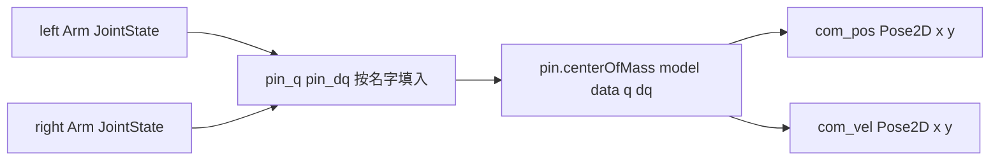

# 07 质心前馈补偿

> **一句话定位**：双臂一动，整机质心跟着动，机器人"真正的平衡点"也跟着动。质心前馈用 **URDF + Pinocchio** 根据臂的关节角实时算出质心偏移，把对应的 roll/pitch 重力补偿项**提前**加到平衡控制器里，让反馈环不用硬扛这个可预测的扰动。本章讲清原理、符号、数据链（对照 `arm_controller` 真实代码）、标定和"开关对比"验证实验。

**本章学完你能：**

- 手算整机质心，解释"为什么左右对称的两臂也能让前后质心移动"；
- 讲清 URDF 的 `inertial`、局部质心、关节角、旋转加平移 $\mathbf r^{\text{body}}=R\mathbf r^{\text{local}}+\mathbf p$ 如何一步步得到整机质心；
- 用右手定则推出重力矩方向，并解释前馈里"roll 取加号、pitch 取减号"的原因；
- 解释前馈为什么本质上是"平移平衡点"，以及为什么前馈增益通常**不等于**物理的 $Mgd$，要标定；
- 逐段读懂 `kinetic_compensation_node.py` 的数据链和它的局限（时间戳、关节顺序、速度分支等）；
- 估算"静态补偿够不够"（动态项占多少）；
- 设计并汇报一个"前馈开/关"对比验证实验（含指标、重复次数、威胁有效性的因素）。

**前置知识：**

- 机械臂动力学、重力补偿、URDF/KDL：[../../02_基础知识/03_坐标变换与运动学/06_机械臂动力学_重力补偿_URDF_KDL.md](../../02_基础知识/03_坐标变换与运动学/06_机械臂动力学_重力补偿_URDF_KDL.md)
- Pinocchio 工具链：[../../02_基础知识/09_机器人软件/06_MuJoCo_Pinocchio_KDL_工具链.md](../../02_基础知识/09_机器人软件/06_MuJoCo_Pinocchio_KDL_工具链.md)
- URDF 与 TF：[../../02_基础知识/09_机器人软件/07_URDF_TF_坐标系实践.md](../../02_基础知识/09_机器人软件/07_URDF_TF_坐标系实践.md)
- 前馈基础：[../../02_基础知识/04_控制理论/07_前馈_增益调度_限幅与饱和.md](../../02_基础知识/04_控制理论/07_前馈_增益调度_限幅与饱和.md)
- 第 04、06 章：[04_倒立摆建模与线性化.md](./04_倒立摆建模与线性化.md)、[06_级联PID控制.md](./06_级联PID控制.md)

**目录**

1. 问题：手臂为什么会让机器人倾倒
2. 质心：定义与手算
3. 从 URDF 和关节角到整机质心
4. 重力矩与前馈的符号
5. 前馈到底做了什么：两种等价解读与增益标定
6. 真实代码：`kinetic_compensation_node.py` 数据链
7. 静态补偿够不够：动态项估算
8. 验证实验：前馈开/关对比
9. 失败模式与排查
10. 面试问答 / 速记 / 自测 / 链接

---

## 1. 问题：手臂为什么会让机器人倾倒

球形底盘靠"质心在球的正上方"站立。手臂不动时，质心大致在中线上；手臂前伸，质心前移，**重力对支撑点产生一个前倾的力矩**。反馈控制器（PID）当然也能把它拉回来，但它只能"看到倾斜之后才反应"，于是会：

- 平衡点偏移：机器人要么靠积分慢慢适应，要么在手臂举起期间一直带着稳态偏差/位置漂移；
- 动态过程更晃：手臂动作期间，质心持续在变，反馈总在追赶。

**教学数值仿真**（第 04/05 章模型，质心水平偏移 $d=0.04$ m，无前馈）：稳态时球会被"推"到 $x\approx0.46$ m 才停下（因为全状态反馈在没有积分项的情形下必须靠位置偏移去平衡这个偏置）。这就是前馈要消掉的东西。

---

## 2. 质心：定义与手算

**定义：** 各部件质量为 $m_i$，质心位置为 $\mathbf r_i$（同一坐标系下），整机质心

$$\mathbf r_{\text{com}}=\frac{\sum_im_i\mathbf r_i}{\sum_im_i}$$

它是**质量加权平均**，不是"两只手位置的平均"，也不能把每根杆当同样质量。

### 2.1 手算 1：左右对称的两臂（笔记中的例子）

机身 8 kg 在 $[0,0,0.5]$，两臂各 1 kg 分别在 $[0.3,0.2,0.6]$ 与 $[0.3,-0.2,0.6]$：

$$x_{\text{com}}=\frac{8\cdot0+1\cdot0.3+1\cdot0.3}{10}=0.06\ \text{m},\quad y_{\text{com}}=\frac{0.2-0.2}{10}=0,\quad z_{\text{com}}=\frac{4+0.6+0.6}{10}=0.52\ \text{m}$$

两臂各前伸 30 cm，整机质心只前移 6 cm，因为机身更重。重力矩大小 $Mgx=10\times9.81\times0.06=5.886$ N·m。

把第二只臂移到 $[-0.3,-0.2,0.6]$（后伸）：$x_{\text{com}}=(0.3-0.3)/10=0$，$y_{\text{com}}=(0.2-0.2)/10=0$。**结论：**一前一后，前后质心可以抵消；"左右对称"并不保证前后不变（两臂同时前伸就不行）。

### 2.2 手算 2：本教材统一使用的教学参数（非项目实测）

球心为原点，$x$ 前、$y$ 左、$z$ 上。机身+电池 14 kg，质心 $[0,0,0.45]$；每臂等效 1.5 kg，质心距肩 0.25 m，肩关节在 $[0,\pm0.2,0.60]$；肩关节轴取 $-y$ 方向（正角度=向前平举，真实 URDF 的轴符号必须核对）。

臂的局部质心向量在下垂时是 $[0,0,-0.25]$。绕 $-y$ 轴转 $q$ 后：$[0.25\sin q,\ 0,\ -0.25\cos q]$。

| 臂姿态 | 臂质心（相对球心） | 整机质心 $[x,y,z]$ (m) | 重力矩 $Mgx$ | 平衡点倾角 $\arctan(x/z)$ |
|---|---|---|---|---|
| 双臂下垂 $q=0$ | $[0,\pm0.2,0.35]$ | $[0,\ 0,\ 0.432]$ | 0 | 0 |
| 双臂前平举 45° | $[0.177,\pm0.2,0.423]$ | $[0.031,\ 0,\ 0.445]$ | 5.20 N·m | 0.070 rad (4.0°) |
| 双臂前平举 90° | $[0.25,\pm0.2,0.60]$ | $[0.044,\ 0,\ 0.477]$ | **7.36 N·m** | **0.092 rad (5.3°)** |
| 仅左臂前平举 90° | — | $[0.022,\ 0,\ 0.454]$ | 3.68 N·m | 0.048 rad |
| 仅左臂侧平举 90°（质心 $y$ 移 +0.25 m） | $[0,0.45,0.60]$ | $y=0.022$ | 滚转方向 3.68 N·m | — |

**这张表说明三件事：**

1. 总质量 17 kg，两臂只占 3 kg，却能让质心前移 4.4 cm，重力矩 7.4 N·m；
2. 平衡点（质心在球心正上方所需的机体倾角）移动了 **5.3°**，已经接近姿态参考界限 0.1 rad（5.7°）。也就是说**如果没有前馈，反馈环要用掉几乎全部的姿态参考裕度去对付手臂**；
3. 单臂/双臂、前伸/侧伸分别影响 pitch 与 roll 通道，所以前馈是**二维**的（$x_{\text{com}}$、$y_{\text{com}}$）。

---

## 3. 从 URDF 和关节角到整机质心

### 3.1 URDF 里有什么

URDF（Unified Robot Description Format）用 XML 描述机器人。与质心相关的有：

```xml
<!-- 教学示例，非项目文件 -->
<link name="left_arm_link_2">
  <inertial>
    <origin xyz="0.0 0.0 -0.12" rpy="0 0 0"/>   <!-- 质心在本连杆坐标系中的位置 -->
    <mass value="0.8"/>                          <!-- 质量 kg -->
    <inertia ixx="..." iyy="..." izz="..." .../>   <!-- 绕质心的惯量张量 -->
  </inertial>
</link>
<joint name="left_arm_joint_2" type="revolute">
  <parent link="left_arm_link_1"/> <child link="left_arm_link_2"/>
  <origin xyz="0 0.05 0" rpy="0 0 0"/>            <!-- 关节相对父连杆的固定位姿 -->
  <axis xyz="0 -1 0"/>                            <!-- 关节轴方向 -->
</joint>
```

### 3.2 关节角怎么变成每个连杆的位置和朝向

每个连杆有自己的**局部坐标系**（贴在连杆上的三根箭头），连杆动，它的坐标系也跟着动。关节角 $q$ 决定连杆坐标系相对父连杆（最终相对机体）的位置 $\mathbf p_i(q)$ 和朝向 $R_i(q)$。Pinocchio（运动学树）的做法：从根往末端，逐个关节把"固定位姿 × 关节旋转"乘起来。

### 3.3 局部质心 → 机体系质心（你反复卡住的公式）

$$\boxed{\ \mathbf r_i^{\text{body}}=R_i(q)\,\mathbf r_{i,\text{local}}+\mathbf p_i(q)\ }$$

读法：$\mathbf r_{i,\text{local}}$ 是质心**相对连杆原点、用连杆自己的轴**写出的坐标；$R_i$ 把它**转到机体轴方向**；$\mathbf p_i$ 是连杆原点**相对机体原点**的位置；二者相加才是质心相对机体原点的位置。只乘 $R$ 会忘了连杆原点离机体多远；只加 $\mathbf p$ 会忘了连杆自己转了多少。

**手算（不转）：** $\mathbf p=[0.5,0,0.4]$，$\mathbf r_{\text{local}}=[0.2,0,0]$，$R=I$：$\mathbf r^{\text{body}}=[0.7,0,0.4]$。

**手算（转 90°）：** $\mathbf p=[1,0,0]$，$\mathbf r_{\text{local}}=[0.2,0,0]$，连杆绕 $z$ 轴转 90°：

$$R_z(90^\circ)=\begin{bmatrix}0&-1&0\\1&0&0\\0&0&1\end{bmatrix},\ \ R\mathbf r_{\text{local}}=[0,\ 0.2,\ 0],\ \ \mathbf r^{\text{body}}=[1,\ 0.2,\ 0]$$

**为什么要旋转：** 不是手臂"正在转"，而是**当前姿势**使连杆自己的轴与机体轴不同向。手臂静止举着，$R$ 依然不是单位阵。$R$ 来自关节角，速度才来自 $\dot q$。

对每个连杆都这样算，再做质量加权平均得到整机 $\mathbf r_{\text{com}}$。Pinocchio 的 `centerOfMass` 就是这一整套的实现（从 URDF 读质量与局部质心，用当前 $q$ 做正向运动学，再加权）。给了 $\dot q$ 时还能算质心速度 `vcom`。

### 3.4 一个最小的 Pinocchio 示例（教学，非项目源码）

```python
import numpy as np, pinocchio as pin

model = pin.buildModelFromUrdf("robot.urdf")      # 读 URDF
data  = model.createData()
q = np.zeros(model.nq)                             # 关节位置数组（顺序由模型决定！）
q[model.joints[model.getJointId("left_arm_joint_1")].idx_q] = 1.57   # 按名字找位置
com = pin.centerOfMass(model, data, q)             # 3 维质心，在模型根坐标系下
print(com[0], com[1])                              # 取 x, y
```

**两个容易错的点：** ① `q` 的顺序是模型定义的，ROS `JointState` 里的顺序不一定相同，**必须按名字映射**，否则会把"肩角"当成"肘角"；② 对简单的单自由度转动关节，位置索引 `idx_q` 和速度索引 `idx_v` 往往相同，但有浮动基或多自由度关节时就不同，速度数组要用 `idx_v`。

---

## 4. 重力矩与前馈的符号

### 4.1 重力矩

位置向量 $\mathbf r=[x,y,z]$（质心相对支撑点），重力 $\mathbf F=[0,0,-Mg]$。重力矩

$$\boldsymbol\tau_g=\mathbf r\times\mathbf F=\begin{bmatrix}-Mg\,y\\+Mg\,x\\0\end{bmatrix}$$

**右手定则逐步看（回答"为什么是负的"）：**

- 质心在左边（$y>0$）：食指指 $\mathbf r$（$+y$），中指指 $\mathbf F$（$-z$），拇指指向 $-x$。所以重力矩绕 **$-x$** 轴：直观上，重力把左侧往下拉，而绕 $+x$ 的正转动会把 $+y$ 侧抬起，所以"往下拉"就是负方向；
- 质心在前面（$x>0$）：食指 $+x$，中指 $-z$，拇指 $+y$：重力矩绕 $+y$，前倾，pitch 增大（与第 03 章一致）。

### 4.2 补偿方向

补偿要抵消重力矩：

$$\boldsymbol\tau_{\text{comp}}=-\boldsymbol\tau_g=\begin{bmatrix}+Mg\,y\\-Mg\,x\\0\end{bmatrix}$$

所以：

- **roll 通道**：补偿 $\propto+y_{\text{com}}$（加号）；
- **pitch 通道**：补偿 $\propto-x_{\text{com}}$（减号）。

这就是学习笔记里代码形如 `tau_roll += K*m*g*y_com; tau_pitch -= K*m*g*x_com;` 的原因。**注意**：加号不代表结果恒为正——质心在右边时 $y<0$，加上的就是负数。符号完全取决于坐标约定，换了 roll/pitch 的定义就要整体重新推。

> **提示：** "补偿方向为正的 roll 力矩"**不等于**"轮子往右转"或"机器人往右走"。它只是被加进 roll 通道，之后经运动学矩阵才变成各个轮子的命令（第 02 章）。

---

## 5. 前馈到底做了什么：两种等价解读与增益标定

### 5.1 解读 A：抵消一个可预测的扰动

反馈环把倾角误差变成控制量。手臂举起相当于给系统加了一个已知的重力矩扰动。前馈不等误差出现，**先**把对应控制量加上，反馈只处理剩下的。

### 5.2 解读 B：把"平衡点"挪到新位置（对 ballbot 更准确）

回到第 04 章：静止（$\ddot x=0,\ddot\theta=0$）时必须 $\tau=0$（否则球会加速），所以质心偏移 $d$ 时**真正的平衡点是机体后仰 $\theta_{eq}=-d/l$**，而不是 $\theta=0$。如果控制器的目标是 $\theta=0$，它就在往一个错误的零点上平衡。

在姿态环里加一个前馈项 $u_{ff}$，等价于把姿态环的零点从 0 挪到 $\Delta\theta=-u_{ff}/K_{p\theta}$：只要 $u_{ff}$ 的大小合适，新零点正好落在 $\theta_{eq}$ 上。

### 5.3 前馈的大小不是"$Mgd$"那么简单

教学数值仿真（$d=0.04$ m，基准 LQR 增益 $K_{p\theta}=46.1$，$Mgl=10$）：

| 前馈 | 静止时球的位置偏移 | 说明 |
|---|---|---|
| 无 | 0.461 m | 球被推到远处才平衡 |
| $u_{ff}=Mgd=0.4$（物理重力矩） | 0.361 m | 只改善约 22% |
| $u_{ff}=K_{p\theta}\,d/l=1.84$ | **0.0001 m** | 精确补偿 |

要精确补偿，需要 $u_{ff}=\dfrac{K_{p\theta}}{Mgl}\cdot Mgd$：即在"物理重力矩"基础上还要乘一个 $K_{p\theta}/(Mgl)$（这里 4.6）。原因：机器人**不能**靠电机给机体持续力矩去对抗重力（那会让球一直加速），只能靠改变倾角让重力矩自己归零。所以前馈在实际中是一个**带标定因子的增益** $K_{tff}$，而不是严格的物理量。

> **这也是为什么**学习笔记里的前馈系数是一个调出来的数（如快照中的 $K_{tff\_g}=1.01$，与本项目取值 $K_{tff}\approx1.0$ 一致），且 `tau_roll/tau_pitch` 的名字不能当 N·m 看：它们经过后续比例和运动学矩阵才变成轮命令。

### 5.4 增益标定方法（建议做法，非 CV 声称）

1. 手臂放到若干个**静态姿态** $p_k$（下垂、前平举 45°/90°、侧举……）；
2. 对每个姿态，Pinocchio 算出 $x_{\text{com},k},y_{\text{com},k}$；
3. 在**无前馈**时，让机器人站稳并记录**稳态下为了站稳所需的修正量**（例如稳态位置漂移、或稳态倾角，或积分项的平衡值）；
4. 对 $(Mg\,x_{\text{com}}, \text{修正量})$ 做线性回归，斜率就是 $K_{tff}$；
5. 打开前馈，复测稳态残差。

---

## 6. 真实代码：`kinetic_compensation_node.py` 数据链

文件：`项目源码/AIRS/Robot/arm_controller/scripts/kinetic_compensation_node.py`，launch：`launch/kinetic_compensation.launch`。

### 6.1 参数

| 参数 | launch 中的值 | 含义 |
|---|---|---|
| `model_path` | `$(find mujoco_rl_env)/ballbotgym/assets/uni.urdf` | URDF 路径（同一份模型用于 MuJoCo 仿真环境 `ballbotgym`） |
| `freq` | 100 | 发布频率 Hz |
| `arm_joint_num` | 4 | 每臂关节数 |
| `has_velocity` | true | JointState 是否带速度 |

### 6.2 流程



1. `pin.buildModelFromUrdf(model_path)` 建模型，`nq`/`nv` 数组全零；
2. 关节名按约定拼出：`left_arm_joint_1…4`、`right_arm_joint_1…4`，用 `model.getJointId(name)` 查位置索引（`idx_q`）；名字不在模型里就**被静默跳过**；
3. 订阅 `/left/Arm/JointState`、`/right/Arm/JointState`，回调只缓存最新消息；
4. 主循环（100 Hz）：两个消息都收到后，把位置写入 `pin_q`，把**速度也用同一组索引**写入 `pin_dq`；调用 `pin.centerOfMass`；
5. 发布 `/com_pos`（`Pose2D.x/y` = 质心 x/y）和 `/com_vel`（`vcom` 的 x/y）。

### 6.3 这份实现的局限（面试时展示你的理解深度）

| 局限 | 解释 | 改进 |
|---|---|---|
| `Pose2D` 没有 header | `/com_pos` 没有时间戳和坐标系声明，下游无法判断是否过期 | 改用带 header 的消息（如 `PointStamped`） |
| 左右臂异步 | 两个回调独立；主循环取"各自最新"，可能一个新一个旧 | 用 `message_filters` 近似同步，或在节点里检查时间差 |
| 速度索引复用位置索引 | 只对"单自由度转动关节、无浮动基"的模型成立 | 用 `idx_v` |
| 只写臂的关节 | 手（6 DOF）和其它关节保持 0，手部姿态变化的质心影响被忽略 | 若手重不可忽略则一起纳入 |
| `has_velocity=false` 分支 | 首帧访问 `None`、把标量赋给 `velocity`，逻辑有问题 | 修正后才可启用 |
| 只发布 x、y | z 不用于重力矩，合理 | — |
| 速度没被消费 | 学习笔记所记快照中底盘控制器订阅了 `/com_pos`，`/com_vel` 订阅被注释 | 若用速度前馈要自己验证 |
| 质心参考点 | 质心是模型根坐标系下的；与"支撑点"之间的偏移要在 URDF 里保证（根在球心/支撑点上方哪里） | 本项目取值：URDF 取自 MuJoCo 环境 `ballbotgym` 的 `uni.urdf`（最初由 CAD 导出），根坐标原点取在球心；质心到支撑点的偏移由 URDF 中球心到机体的固定变换保证 |
| 频率 | 单独 launch 100 Hz；学习笔记提到整机 launch 里臂与质心为 50 Hz | 以实机为准，见 README |

---

## 7. 静态补偿够不够：动态项估算

手臂加速时还有**惯性力**：臂的质心加速，其反作用力对球产生额外力矩。以教学参数估算（仅用于判断量级）：

固定轨迹 `front_raise4`（`0 → 1.57 rad → 0`，半周期 4 s，三次样条 `clamped`）的峰值关节角速度约 0.59 rad/s，峰值角加速度约 0.59 rad/s²（用 `CubicSpline` 实算）。

- 单臂质心切向加速度 $\approx0.25\times0.59=0.147$ m/s²；
- 两臂水平惯性力 $\approx2\times1.5\times0.147=0.44$ N；
- 作用高度约 0.6 m → 额外力矩 $\approx0.26$ N·m，对比静态的 7.36 N·m，仅 **3.6%**；
- `front_raise2/6/...`（半周期 8 s 的那些）峰值角加速度只有约 0.15 rad/s²，更小。

**结论：** 对这类慢速固定轨迹，**位置级（静态）补偿覆盖了 95% 以上**，这与"只用 `/com_pos` 不用速度"一致。但快速动作（`shake`、`greet` 里关节在 1 s 内来回摆）时动态项变大，需要加速度前馈或增大反馈裕度——这是诚实说明的局限。

---

## 8. 验证实验：前馈开/关对比

**CV 的说法：** "verified its effect by toggling compensation under fixed arm trajectories." **导师信的说法：** "comparing the balance response with compensation switched on and off under fixed arm trajectories."

### 8.1 设计

| 要素 | 建议 |
|---|---|
| 变量 | 前馈开 (ON) / 关 (OFF) |
| 固定条件 | 同一条臂轨迹、同一地面、同一电量区间、同一控制参数、同一初始状态（站稳静止） |
| 轨迹 | 慢/快 × 小/大：如 `front_raise` 系列（幅度 0.78/1.0/1.57 rad，半周期 4 s 或 8 s）；可加侧举、单臂 |
| 重复 | 每个条件至少 5 次；顺序交错（ON,OFF,OFF,ON,…）以消除疲劳/电量/热的趋势 |
| 记录 | rosbag：IMU（roll、pitch、陀螺）、轮命令/反馈、`/com_pos`、臂关节、控制器输出（含前馈项）、位置估计 |
| 安全 | 挂起/龙门架，限幅保守，急停，手扶；从小幅度开始 |

### 8.2 指标

| 指标 | 定义 | 为什么 |
|---|---|---|
| 倾角峰值 $\max\lvert\theta\rvert$ | roll、pitch 分别 | 最直观的平衡质量 |
| 倾角 RMS | 动作期间 | 整体晃动 |
| 稳态倾角/保持段偏移 | 手臂到位保持时 | 平衡点是否对 |
| 位置漂移 | 动作前后位置变化 | 没补偿会漂 |
| 轮命令饱和占比 | 命令贴限幅的时间比例 | 执行器余量 |
| 恢复时间 | 动作结束到 $\lvert\theta\rvert<$ 阈值 | 收敛速度 |

### 8.3 统计与汇报

- 对每个指标：ON/OFF 成对比较，报告均值 ± 标准差，以及相对变化百分比；
- 样本很少时用中位数和范围，不要做显著性夸大；
- **只汇报你真实测到的数字**；README 自查表给了空位，数字请自己从日志里补；
- 预期的**定性**结果（不是数字）：保持段的稳态倾角/位置偏移明显减小，动作期间的峰值倾角下降，饱和占比下降；快动作下收益变小（动态项）。

### 8.4 威胁有效性（面试官爱追问的）

1. 电量变化/电机发热改变响应 → 交错顺序、记录电压；
2. 两次间机器人起始状态不同 → 每次先站稳、重新初始化偏置（注意：重新采偏置也会改变结果）；
3. 前馈增益本身没标定好 → 先做 §5.4；
4. 质心模型误差（URDF 质量不准）→ 抽查静态姿态质心；
5. 同一人操作的偏差 → 脚本化触发轨迹（`rosservice call /Arm/Action "filename: 'front_raise4'"`，真实 README 里的命令）。

---

## 9. 失败模式与排查

| 现象 | 可能原因 | 排查 |
|---|---|---|
| 一抬手就往反方向倒（比不开前馈还糟） | 前馈**符号**反了 / roll-pitch 轴搞反 | 静态单臂前举，翻转符号看稳态倾角（第 09 章） |
| 补偿有效但不够 | 增益 $K_{tff}$ 偏小；URDF 质量偏小 | 静态标定（§5.4） |
| 补偿过头，反向漂 | 增益偏大；质量不对 | 同上 |
| 质心曲线跳变/抖动 | 左右臂时间不同步；关节映射错位；消息丢失 | 打印时间戳差；检查关节名映射 |
| 质心偏移始终为零 | `pin_q` 没被写入（名字不匹配被静默跳过） | 启动时断言所有关节名都找到 |
| 质心与现实不符 | URDF 的 `inertial` 不对（CAD 导出错误、缺少手/电缆质量）、根坐标不对 | 静态称重法抽查 |
| 前馈期间位置漂移但倾角小 | 参考点（支撑点）不在 URDF 根上 | 校准偏移 |
| 动作越快越差 | 动态项（加速度）未补偿 | 加速度/速度前馈或降低速度 |

---

## 10. 面试问答

**Q1. How did you estimate the centre-of-mass offset?**

> I built a Pinocchio model from the robot's URDF and ran a small ROS node that subscribes to the left and right arm joint states, fills the position vector by joint name, and calls the centre-of-mass function. It publishes the horizontal offset, x and y, at 100 hertz. The centre of mass is just the mass-weighted average of every link's local centre of mass, expressed in one frame through the forward kinematics.

**Q2（追问）. How is that fed into the controller, and what is the sign logic?**

> The offset times the total mass times g gives the gravity moment about the support point. I add a term in the roll channel proportional to the lateral offset and one in the pitch channel proportional to minus the forward offset, with a gain that I tuned. The signs come from the cross product r cross F: a forward offset produces a positive pitch moment, so the compensation is negative, and a left offset produces a negative roll moment, so the compensation is positive.

**Q3. Why is it a feedforward and not just left to the feedback loop?**

> The disturbance is predictable from the arm joint angles, so the feedforward can act before any tilt appears. For a ballbot there is an extra subtlety: the real balance point moves, because with the centre of mass shifted the body must lean back. The feedforward effectively shifts the attitude setpoint, which saves the feedback loop from using most of its tilt authority just to hold the arms up.

**Q4（追问）. How did you verify that the feedforward helps?**

> I ran the same fixed arm trajectories with the compensation switched on and off, repeating each condition several times in an interleaved order, and compared the peak and RMS tilt, the holding-phase offset, the position drift and the fraction of time the wheel commands were saturated. I'd rather not quote percentages from memory; the comparison showed the balance response improved with the feedforward on.

（注意：第 4 条的最后一句是**占位**——你若记得具体数字就报；不记得就如实说"improved"并说明可补发数据。不要编数。）

**Q5. What are the limits of this approach?**

> It is quasi-static: it uses the centre-of-mass position, not the arm acceleration. For slow trajectories the dynamic part is a few percent of the static moment by my estimate, but for fast arm motions it would matter. It also depends on the URDF masses and the frame of the model root, and the left and right joint states are not time-synchronised.

---

## 本章要点速记

1. $\mathbf r_{\text{com}}=\sum m_i\mathbf r_i/\sum m_i$；左右对称不保证前后不变。
2. $\mathbf r^{\text{body}}=R(q)\,\mathbf r^{\text{local}}+\mathbf p(q)$：旋转来自当前关节角，不是"正在转"。
3. Pinocchio：URDF 质量 + 关节角 → 正运动学 → 质量加权 → 质心（给 $\dot q$ 还有质心速度）。
4. 重力矩 $\boldsymbol\tau_g=\mathbf r\times\mathbf F$ → 补偿 $[+Mgy,\ -Mgx]$：roll 加、pitch 减。
5. 前馈等价于**平移平衡点**：$\Delta\theta=-u_{ff}/K_{p\theta}$；真正的平衡倾角 $\theta_{eq}=-d/l$。
6. 前馈增益不是纯物理量，需静态标定（线性回归）。
7. 教学数值：双臂前平举 90°，质心前移 4.4 cm，平衡点后移 5.3°，已逼近 0.1 rad 参考界。
8. 慢速固定轨迹的动态项约占静态的几个百分点；快动作需要更多。
9. 真实节点局限：`Pose2D` 无时间戳、左右异步、索引复用、只发布 x/y、速度不被使用。
10. 验证：同轨迹、ON/OFF 交错重复、成对比较多个指标；只报你测到的数。

## 自测题

1. 机身 10 kg 在 $x=0$，两臂各 2 kg 在 $x=0.25$ m，求 $x_{\text{com}}$。（$(2\times0.25\times2)/14=0.0714$ m。）
2. 质心在右侧（$y=-0.03$ m），$M=17$ kg，求补偿的 roll 项符号与大小。（$+Mgy=17\times9.81\times(-0.03)=-5.0$ N·m，负号。）
3. 为什么前馈系数通常不等于 1？（控制量不是物理 N·m；对 ballbot 要通过平移平衡点补偿，增益含 $K_{p\theta}/(Mgl)$ 因子；还有 URDF 误差。）
4. `JointState` 的关节顺序和 Pinocchio 不一致会怎样？（把肩角当肘角，质心错，前馈方向/大小全错。）
5. 为什么要交错 ON/OFF 的顺序？（消除电量、温度、操作者疲劳等随时间的趋势。）

## 相关链接

- 上一章：[06_级联PID控制.md](./06_级联PID控制.md)　下一章：[08_ROS_CAN安全执行闭环.md](./08_ROS_CAN安全执行闭环.md)
- 源码逐函数：[10_源码导读.md](./10_源码导读.md)
- 故障案例：[09_调试案例与故障排查.md](./09_调试案例与故障排查.md)
- 基础：[../../02_基础知识/03_坐标变换与运动学/06_机械臂动力学_重力补偿_URDF_KDL.md](../../02_基础知识/03_坐标变换与运动学/06_机械臂动力学_重力补偿_URDF_KDL.md)
