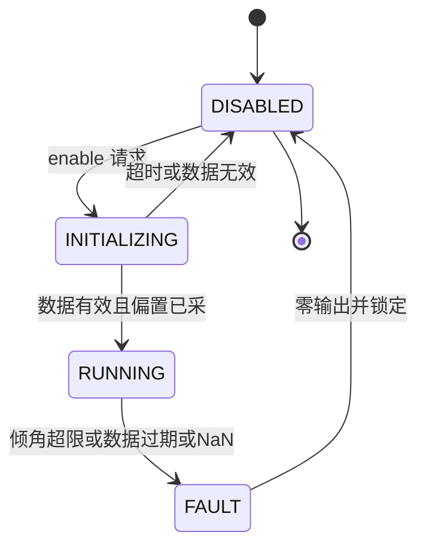

# 08 ROS 与 CAN 安全执行闭环

> **一句话定位**：控制算法算得再对，也要靠一条"可信的执行链"落到电机上。本章讲 CV 里 *Hardware safety loop* 的通用设计：状态处理、初始化、输出限幅、跌倒检测与恢复、使能逻辑、时序。具体阈值与行为以你的实机为准，标 **[FILL]**。

**本章学完你能：** 画出使能状态机；说清初始化清单；解释三层限幅；设计跌倒判据与恢复流程；讲清时序与数据新鲜度；诚实描述"我验证了什么"。

**前置：** [../../02_基础知识/08_嵌入式与通信/03_CAN_FDCAN与电机通信.md](../../02_基础知识/08_嵌入式与通信/03_CAN_FDCAN与电机通信.md)、[../../02_基础知识/05_状态估计/06_时间同步_坐标系一致性与数据有效性.md](../../02_基础知识/05_状态估计/06_时间同步_坐标系一致性与数据有效性.md)、[06_级联PID控制.md](./06_级联PID控制.md)

## 1. 执行链

```text
IMU/轮/臂 JointState --(ROS话题, 异步)--> 控制器缓存 --(定时器)--> 控制计算
  --> 限幅/滤波 --> 命令话题 --> 驱动节点 --> CAN帧 --> 电机内环 --> 球/机体
```

真实源码可见的做法（臂侧，可作安全设计的旁证）：`traversal_arm_node.py` 对关节做限位钳制并限制最大速度（0.2 rad/s），退出时连发 5 次零位命令；`arm_trajectory_node.py` 用 `is_playing` 拒绝并发请求、校验 YAML 首末点与时间戳单调；`data_collector_node.py` 用"持续 100 个采样都接近零位"才判定停止，避免瞬时误判。臂 CAN 起链：`ip link set can0 up type can bitrate 1000000`。

## 2. 使能状态机



原则：**默认失能；失败要明显；故障后锁定，需人工重新使能**。设计要点：使能等待超时后应当"失败回 DISABLED"，而不是"警告后继续使能"（后者是常见隐患，是否如此见 README 口径备忘 2）。

## 3. 状态初始化清单（enable 时）

1. 等待 IMU、轮反馈、（质心）全部到达，且四元数模长≈1、时间戳新鲜；
2. 在机器人被扶稳时采 roll/pitch 偏置（第 03 章）；yaw 置相对零；
3. 位置估计清零，目标位置=当前位置，目标速度=0（避免上电猛冲）；
4. 清 PID 积分、微分历史、各滤波器状态；
5. 先发零命令，再放开输出（可加输出斜坡）。

**[FILL]** 你们采多少帧、何时重采、重新使能是否重采。

## 4. 三层输出限幅

| 层 | 对象 | 目的 |
|---|---|---|
| 参考限幅 | 外环倾角参考 | 限加速度/保线性区（第 06 章） |
| 控制量限幅 | PID 输出、积分 | 防 windup |
| 命令限幅 | 三轮命令（整体 L2 缩放，保持方向，第 02 章）、可加斜率限制 | 保护电机，防阶跃冲击 |

限幅会削弱有效增益，降到约 $0.25K$ 以下就失稳（第 05 章），所以要**统计饱和占比**作为健康指标。

## 5. 跌倒检测与恢复

**判据（典型做法）：** $\lvert\varphi\rvert$ 或 $\lvert\theta\rvert$ 超过阈值（该阈值应小于"物理上不可恢复"的角，且大于正常最大倾角），并**去抖**（连续 N 个周期）；附加判据：命令连续饱和时间过长、数据过期、NaN。**[FILL 阈值、去抖、饱和判据]**

**触发后：** ① 立即输出零/制动命令并保持；② 重置控制器内部状态；③ 进入 FAULT 锁定；④ 记录原因与时间。注意：**重置内部状态不等于电机已停**，要沿"零命令→驱动队列→驱动超时→电机固件"整条路径核对，面试时只说你确实验证过的部分。

**恢复：** 人工把机器人扶正 → 确认姿态/速度在范围内、数据新鲜 → 重新使能（走第 3 节初始化）。ballbot 一般不能自行爬起，"恢复"指受控重启而非自主起立。

## 6. 时序与实时性

- 异步消息 + 定时器取最新缓存 ⇒ 必须做**数据年龄检查**（`now - stamp`）；
- 质心 `/com_pos` 是 `Pose2D`，无时间戳——只能靠节点频率与超时间接判断；
- 驱动只取最新命令并清旧队列，避免积压，但仍需**命令看门狗**（超时归零），否则失联时电机保持最后命令；
- 测量项：控制周期与抖动（`rostopic hz`、日志时间差）、传感→命令→电机的端到端延迟；预算表：IMU **[FILL]** + 滤波 **[FILL]** + 计算 **[FILL]** + CAN **[FILL]** + 电机环 **[FILL]**，总和应远小于 $1/\lambda$（第 05 章）。
- 真实源码注意：IMU 驱动用接收时刻打戳，姿态与角速度来自不同数据包。

## 7. 安全测试方法

龙门架/吊挂 → 低增益 → 单轴自检 → 限幅保守 → 逐步放开；每次改动跑同一回归；急停随手可及；记录 rosbag。

## 8. 面试问答

**Q1. Walk me through what happens when you enable the controller.**
> It stays disabled by default. On enable it waits for valid IMU and wheel data, captures the roll and pitch offsets with the robot held upright, resets integrators, filters and references to the current state, sends zero, and only then lets the outputs through, with limits on. If the data do not arrive, it should fail back to disabled.

**Q2. How do you detect a fall and what then?**
> I monitor roll and pitch against a threshold with debouncing, plus saturation and data-validity checks. On a fault the output goes to zero, the controller resets and latches, and a person must re-enable it after setting the robot upright. **[FILL threshold]**

**Q3. How do you know the motors really stop?**
> Resetting controller state is not enough; I trace zero command, driver behaviour and the motor's own timeout. I only claim what I verified.

**Q4. Why limit the whole wheel vector rather than each wheel?**
> To keep the ratio between wheels, hence the direction of the ball motion.

## 要点速记

默认失能；初始化五步；三层限幅；跌倒=判据+去抖+零输出+锁定；重置≠停机；数据年龄与看门狗；先验证再声称。

## 自测题

1. 为什么使能超时应回失能？（避免无数据运行。）2. 重置≠停机的含义？（内部状态与下游输出是两回事。）3. 为什么要去抖？（避免单帧毛刺误触发。）

## 链接

上一章 [07](./07_质心前馈补偿.md)　下一章 [09](./09_调试案例与故障排查.md)
