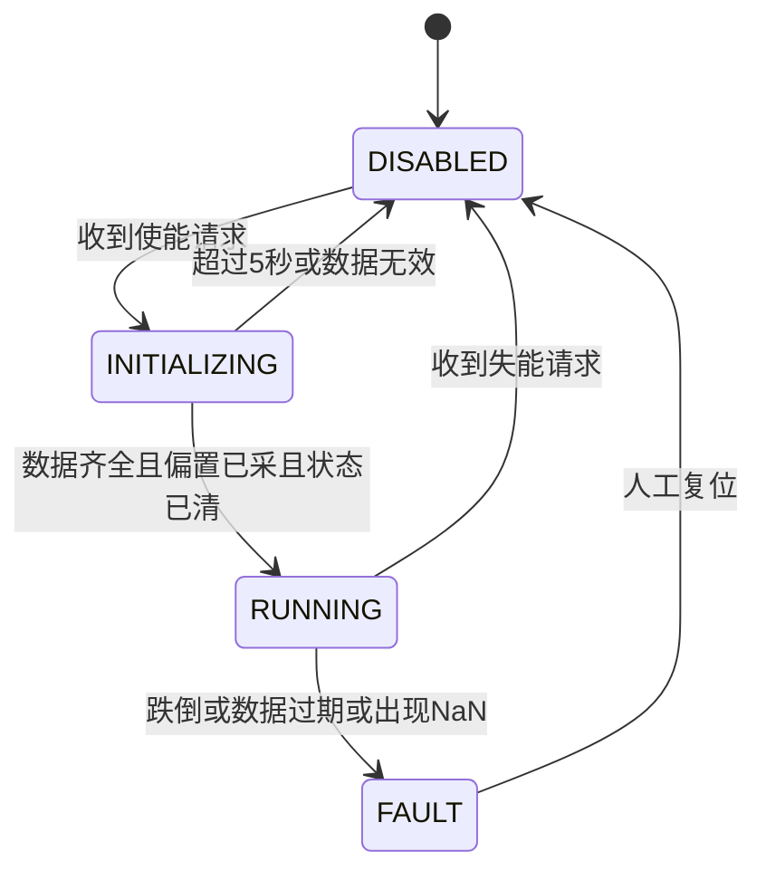
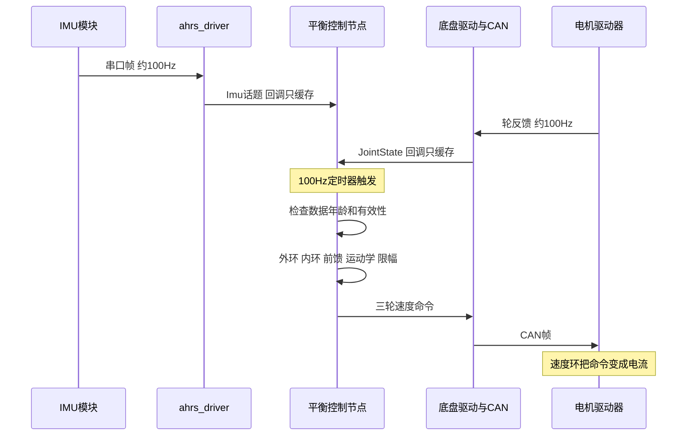

# 08 ROS 与 CAN 安全执行闭环

> **一句话定位**：控制算法算得再对，也要靠一条"可信的执行链"落到电机上。本章讲 CV 里 *Hardware safety loop*（ROS 状态处理 + CAN 电机执行 + 状态初始化、输出限幅、跌倒恢复）的完整设计：执行链长什么样、使能状态机怎么写、初始化清单每一步为什么、三层限幅如何互相配合、跌倒怎么判、怎么恢复、时序与延迟预算怎么算，以及"控制器置零"和"电机真的停了"之间还隔着哪几跳。

**本章学完你能：**

- 画出从 IMU / 轮反馈 / 臂关节状态到 CAN 电机命令的完整执行链，并说出每一跳的话题、周期、可能的故障；
- 默写使能状态机（DISABLED / INITIALIZING / RUNNING / FAULT），说清每条转移的守卫条件；
- 讲出初始化五步各自在防什么故障，并手算偏置采样的统计误差、输出斜坡的步长；
- 区分三层限幅（参考、控制量、命令），手算整体 $L_2$ 缩放，解释"限幅会削弱有效增益"；
- 设计跌倒判据（阈值、去抖、附加判据），手算去抖延时与倾角增长，说明为什么不自动重启；
- 说清数据有效性（年龄、NaN、四元数模长、丢帧容许）和延迟预算；
- 诚实地描述"我验证了什么、没验证什么"，不说"保证电机一定停"。

**前置：** [CAN / FDCAN 与电机通信](../../02_基础知识/08_嵌入式与通信/03_CAN_FDCAN与电机通信.md)、[时间同步、坐标系一致性与数据有效性](../../02_基础知识/05_状态估计/06_时间同步_坐标系一致性与数据有效性.md)、[06 级联 PID 控制](./06_级联PID控制.md)、[03 IMU 与姿态](./03_IMU_AHRS与姿态估计.md)。

**目录**

1. 要解决的问题：为什么要单独讲"执行链"
2. 符号、状态与统一取值
3. 执行链全景：每一跳做什么、会怎么坏
4. 使能状态机
5. 状态初始化：五步清单与手算
6. 三层输出限幅与饱和
7. 数据有效性：年龄、NaN、模长、丢帧
8. 跌倒检测：判据、去抖、触发后动作
9. 恢复：为什么是人工、受控、重新走初始化
10. 时序、延迟预算与总线负载
11. "重置不等于停机"：沿整条路径核对
12. 安全测试方法与回归清单
13. 常见错误与故障现象
14. 面试问答
15. 要点速记 / 自测题 / 链接

---

## 1. 要解决的问题：为什么要单独讲"执行链"

前面几章讲的是"算什么"：倾角参考、PID、前馈、运动学分配。可是平衡机器人有一个其他机器人没有的特点：**它在没有控制时会自己倒下，倒下的时间尺度是零点几秒**（第 01 章、第 05 章：教学模型的不稳定极点约 2.6 s⁻¹，README 量级约 4 rad/s，对应倾角每 0.17～0.27 s 翻倍）。这意味着：

1. 控制器一旦"不对"（数据没到、符号错、增益跳变、算出 NaN），**不是性能变差，而是几百毫秒内物理上的危险**：32 kg 的整机带着双臂压向地面，球滚出去，旁边的人和设备都在风险里；
2. 控制器一旦"停了"，机器人也不会"安静地待着"——电机如果还握着最后一个速度命令，它会继续转；
3. 测试期间机器人要反复使能、失能、跌倒、再使能。每一次"边沿"都是 bug 的高发点（第 09 章故事 2：重新使能瞬间猛冲）。

所以"硬件安全闭环"不是附加品，而是和控制算法并列的另一半。CV 里这一条写的是：

> *Integrated ROS state processing with CAN motor execution and implemented state initialisation, output limiting and fall-recovery safeguards, keeping the chassis balanced under arm motion.*

拆开就是三件事：**状态进来要干净**（ROS 状态处理 + 初始化）、**命令出去要有界**（限幅）、**出事要能收**（跌倒检测与恢复）。本章按这个顺序展开。

> **面试要点**：把它讲成"三道关"，比讲成"我加了几个 if"有说服力：入口关（数据有效、偏置对、状态清空），中间关（限幅、饱和监控），出口关（故障锁定、零输出、人工恢复）。

---

## 2. 符号、状态与统一取值

### 2.1 符号

| 符号 | 含义 | 单位 / 取值 |
|---|---|---|
| $\varphi,\ \theta$ | roll、pitch（扣除启动偏置后） | rad |
| $\omega_{g}$ | 陀螺角速度模值 | rad/s |
| $T_s$ | 控制周期 | 0.01 s（100 Hz） |
| $N_b$ | 偏置采样帧数 | 200 帧（约 2 s） |
| $\omega_{\text{still}}$ | 偏置采样时允许的陀螺模值 | 0.05 rad/s |
| $T_{\text{en}}$ | 使能等待超时 | 5 s |
| $\tau_{\text{IMU}},\ \tau_{\text{arm}}$ | 数据年龄阈值 | 50 ms、200 ms |
| $\theta_{\text{fall}},\ N_f$ | 跌倒角度阈值、去抖周期数 | 0.5 rad（约 28.6°）、5 个周期（50 ms） |
| $S$ | 三轮命令整体 $L_2$ 上限 | 约 8（轮端 rad/s 量级） |
| $T_{\text{wd}}$ | 驱动侧命令看门狗 | 100 ms |
| $T_{\text{fb}}$ | 轮反馈缺失判掉线 | 50 ms（5 帧） |

这些数就是 [README](./README.md) 实机细节自查表第 15～19 行的统一取值，99 号口述文件和第 09 章故事中的数字与此一致。**它们是本教材采用的设计取值，不是我替你测出来的实测**；你面试前应拿实机日志核对一遍，不符以日志为准。

### 2.2 四个运行状态

| 状态 | 输出 | 含义 |
|---|---|---|
| DISABLED | 零（只发零命令或不发） | 默认状态，上电即在此 |
| INITIALIZING | 零 | 收到使能请求，等数据、采偏置、清状态；最多 $T_{\text{en}}$ |
| RUNNING | 控制器输出（经限幅） | 正常平衡 |
| FAULT | 零，锁定 | 检测到跌倒或数据失效；只能经人工"复位—重新使能"离开 |

**设计原则（三句话）：** 默认失能；失败要明显（报警、日志、状态灯），不要静默带病运行；故障后锁定，需要人为确认才能再次使能。

---

## 3. 执行链全景：每一跳做什么、会怎么坏

```text
   ┌───────────┐ 串口921600 ┌────────────┐ /imu/data ┌──────────────────────────────┐
   │ IMU 模块   │───────────>│ fdilink    │──────────>│                              │
   │ (板载AHRS) │  ~100 Hz   │ ahrs_driver│           │  底盘平衡控制节点             │
   └───────────┘            └────────────┘           │  (100 Hz 定时器取最新缓存)     │
   ┌───────────┐  CAN 1Mbit/s ┌──────────┐ JointState │   - 状态处理/有效性/偏置      │
   │ 3个轮电机   │<───────────>│ 底盘驱动  │───────────>│   - 外环/内环/前馈           │
   │ (速度模式)  │ 反馈~100 Hz │ 节点     │<───────────│   - 运动学 J / 限幅 / 低通    │
   └───────────┘             └──────────┘  命令话题   │   - 使能状态机/跌倒检测       │
   ┌───────────┐ JointState  ┌──────────┐ /com_pos   │                              │
   │ 双臂电机   │──(~50 Hz)──>│ 质心节点  │───────────>│                              │
   └───────────┘             └──────────┘ (Pose2D)    └──────────────────────────────┘
```

逐跳说明（话题名中 `/imu/data`、`/left/Arm/JointState`、`/right/Arm/JointState`、`/com_pos`、`/chassis_states_topic` 来自 `fdilink_ahrs` 与 `arm_controller` 的 launch 和 README；轮命令话题名是典型命名，以实机为准）：

| 跳 | 周期 | 做什么 | 典型故障 |
|---|---|---|---|
| IMU → 串口 → `ahrs_driver` | 约 100 Hz，921600 baud | 找帧头、CRC8 + CRC16 + 帧尾三级校验（第 10 章），发布 `sensor_msgs/Imu` | 线缆被关节拉扯导致 CRC 错、丢帧；设备号变化（用 udev 别名解决） |
| 驱动 → 控制节点 | 异步 | 话题回调只缓存最新值 | 数据过期而不自知（时间戳是接收时刻） |
| 轮反馈 → 控制节点 | 约 100 Hz | `/chassis_states_topic`（`JointState`）：轮位置、速度 | CAN 丢帧、电机掉线 |
| 臂关节状态 → 质心节点 → `/com_pos` | 臂约 50 Hz，质心 50～100 Hz | `Pose2D` 无时间戳 | 左右臂异步、消息丢失 |
| 控制节点 → 命令话题 → 底盘驱动 → CAN | 100 Hz | 三轮速度命令打包成 CAN 帧 | 驱动无看门狗：控制节点死了轮子还转 |
| 电机固件 | 驱动器内部电流环约 1 kHz、速度环约 500 Hz | 把速度目标变成电流 | 固件自带超时是否生效，要单独验证 |

### 3.1 臂侧源码里的"安全写法"（旁证）

`项目源码/AIRS/Robot/arm_controller` 里虽然没有底盘控制器，却能看到同一个团队在臂这条链上的安全习惯。这些是**读码事实**，可作为"团队风格"的旁证，不要说成你写的底盘逻辑：

- `traversal_arm_node.py` 对每个插值点按关节限位钳制（`max(min_val, min(max_val, pos[i]))`），用 `max_speed`（launch 里 0.2 rad/s）限制最大关节速度；`cleanup()` 在退出时**连发 5 次零位命令，每次间隔 0.1 s**，确保命令真的送达；
- `arm_trajectory_node.py` 用 `is_playing` 拒绝并发请求（返回 `success=False`），读 YAML 后检查首末点必须含臂或手的关键字、每个点必须有 `timestamp`、每组关节数必须等于 `arm_joint_num`，时间戳不严格递增时先排序再去重；
- `data_collector_node.py` 把"关节都接近零位"这一条件放进长度 100 的 `deque`，要求队列里全为真才停止；
- 臂 CAN 的起链命令（`arm_controller/README.md` 与 `start_service.sh`）是 `sudo ip link set can0 down` 再 `sudo ip link set can0 up type can bitrate 1000000`：先 down 再 up，避免残留状态。

这几条合起来的共同点是：**限位、限速、拒绝并发、校验输入、退出归零、去抖**。底盘安全闭环的设计思路与它们同源。

---

## 4. 使能状态机



### 4.1 转移与守卫

| 转移 | 守卫条件 | 动作 |
|---|---|---|
| DISABLED → INITIALIZING | 使能请求（服务或按键）；当前不处于 FAULT 锁定 | 清标志、启动 $T_{\text{en}}$ 计时器、开始缓存 |
| INITIALIZING → RUNNING | IMU 与轮反馈都在 $\tau_{\text{IMU}}$ 内；臂/质心在 $\tau_{\text{arm}}$ 内；四元数模长 $\approx1$；偏置已采满 $N_b$ 帧且采样期陀螺安静；倾角 $<0.1$ rad | 状态清零（5.4 节）、先发零命令、启动输出斜坡 |
| INITIALIZING → DISABLED | 计时超过 $T_{\text{en}}=5$ s，或采样期反复被晃动打断 | **放弃使能**、回到失能、报警；需要重新请求 |
| RUNNING → FAULT | 跌倒判据成立；或 IMU/轮反馈数据过期；或任一状态量 NaN；或轮反馈缺失超过 $T_{\text{fb}}$ | 输出置零、控制器内部复位、锁定、记录原因与时间 |
| RUNNING → DISABLED | 失能请求 | 输出斜降为零后停止 |
| FAULT → DISABLED | 人工复位（且倾角 $<0.1$ rad、静止约 1 s） | 清故障标志 |

### 4.2 为什么"超时要回失能，而不是警告后继续"

这是本章最值得讲的设计点。假设使能请求来了，但 IMU 数据没到（串口线松了）。两种写法：

| 写法 | 行为 | 后果 |
|---|---|---|
| A：超时 → 警告 → 继续使能 | 没有偏置、四元数未初始化（第 03 章 §6.4：驱动里的 AHRS 缓冲在首包前内容不确定，常表现为全零）地跑控制 | 平衡零点错、公式里出现 NaN，可能一使能就冲出去 |
| B：超时 → 放弃 → 回 DISABLED → 报警 | 什么都不发生，操作员看到报警，检查线缆 | 无动作，最安全 |

本项目取 B。**必须诚实说明的一点**：学习笔记所记的快照代码里，使能等待超时后仍然置了使能标志（即 A 的写法），这是读笔记时发现的隐患；README 口径备忘第 2 条记着它。面试时的说法是："设计要求是失败回失能；我知道快照里这个分支是警告后继续，所以在安全清单里把它列为必须收紧的一项"，而不是"我们保证不会带病使能"。

---

## 5. 状态初始化：五步清单与手算

初始化发生在 INITIALIZING 状态。它的目标只有一个：**让控制器在 RUNNING 的第一个周期，面对的是一个"干净、自洽、静止"的世界**。

### 5.1 第 1 步：等数据

等待下列全部满足（最多 $T_{\text{en}}=5$ s）：

1. IMU 消息到达且年龄 $<50$ ms；
2. 四元数模长 $\sqrt{w^2+x^2+y^2+z^2}\in[0.99,1.01]$（未初始化的缓冲常为全零，模长为 0；即使是垃圾值，模长也几乎不可能落在 [0.99, 1.01]，所以都会被拦下，第 03 章）；
3. 三个轮的反馈到达且年龄 $<50$ ms；
4. 左、右臂关节状态与 `/com_pos` 到达，年龄 $<200$ ms（质心消息无时间戳，只能用"最近一次收到的本地时间"判断）。

**为什么臂的阈值放宽到 200 ms：** 臂关节状态约 50 Hz（周期 20 ms），质心是慢变量（质心节点输出还要过约 2 Hz 低通），对平衡的影响是"平移平衡点"，不是快速反馈，所以 200 ms（约 10 个周期）的新鲜度足够；而 IMU 与轮反馈直接在内环里，必须在 50 ms 内（100 Hz 下容许丢 4 帧）。

### 5.2 第 2 步：在"被扶稳"时采偏置

偏置 $b_\varphi,b_\theta$ 是使能时刻 roll、pitch 读数的均值，之后用"读数 − 偏置"参与控制。**本项目取值：** 采 $N_b=200$ 帧（100 Hz 下约 2 s）取均值；采样期间任一帧陀螺模值 $\omega_g>0.05$ rad/s，则丢弃整批重采；**每次重新使能都重采**。

**为什么要有这条规则（不要只背数字）：**

- 偏置采在晃动里，等于把"这一次扶得不稳"永久写进零点。第 09 章故事 1 就是这样：偏置多了 0.5°，机器人最终爬到 0.2 m 外才停。
- 重新使能要重采，是因为放置位置可能换了（斜坡、垫子），而且上一次的偏置可能本来就带了晃动。

**手算（教学示例）：** 设 roll、pitch 单帧读数噪声标准差 $\sigma=0.002$ rad（约 0.11°，示意值）。200 帧均值的标准误差 $\sigma/\sqrt{200}=0.002/14.14=1.4\times10^{-4}$ rad。第 05 章给出倾角偏置引起的稳态位置偏移是 $b/K_{px}$，所以残余漂移 $1.4\times10^{-4}/0.08=1.8\times10^{-3}$ m，约 2 mm，可以忽略。**真正的风险不是随机误差，而是"系统性偏置"**（扶得不稳）：0.5° = 0.0087 rad → 0.0087/0.08 ≈ 0.11 m。这就是为什么门限卡在"陀螺安静"，而不是"帧数够多"。（脚本见第 11 章 S7 节。）

**陀螺零偏怎么办：** 偏置只修倾角的静态误差。陀螺零偏由 IMU 模块内部的 AHRS 融合处理（第 03 章 §5.3），不在这里修。你不要说"我在初始化里标定了陀螺"。

### 5.3 第 3 步：目标位置 = 当前位置，目标速度 = 0

位置里程在 INITIALIZING 里清零（"当前位置"定义为 0），目标位置也置 0，`cmd_vel` 平滑后的目标速度置 0。如果不这样做：上一次跌倒时目标位置是 0.4 m、位置估计停在 0.0 m，使能的一瞬间外环得到 $e_x=0.4$ m，$\theta_{\text{ref}}=0.08\times0.4=0.032$ rad（再加速度项），内环立刻往前倒——这就是第 09 章故事 2 里"往前冲 0.3 m"的来源之一。

### 5.4 第 4 步：清所有"带记忆的量"

| 量 | 为什么要清 |
|---|---|
| 内环积分 $I_\theta$（$K_{i\theta}\approx2$，带限幅） | 上一次留下的积分会作为一个突然的力矩加进来 |
| 外环速度估计的低通状态（0.8 Hz） | 滤波历史里还是旧的速度 |
| 陀螺低通（约 25 Hz）、质心低通（约 2 Hz） | 滤波器里仍是上一次的数值，会混进第一个周期的输出 |
| 微分/差分历史（如有） | 否则第一个微分值是旧样本与新样本的差，出现脉冲 |
| 命令的上一周期值（斜率限制用） | 否则斜率限制以旧值为起点 |

一条统一的规则：**任何在两个周期之间保留信息的变量，都要在使能边沿重置。** 做法上建议写一个 `reset()` 函数，使能边沿和故障触发都调用它，而不是在各处分散地清。

### 5.5 第 5 步：先发零命令，再放开输出，并加斜坡

最后一步：先向驱动连续发送若干周期的零命令（让电机侧确认控制节点在线），然后把输出乘一个从 0 线性增长到 1 的系数，斜坡时长 0.3 s。

**手算：** 100 Hz 下 0.3 s = 30 个周期，每周期增益增量 $1/30=0.0333$。第 1 个周期输出是原值的 3.3%，第 15 个周期是 50%，第 30 个周期是 100%。这样即使前面几步有遗漏（比如残余的 0.01 rad 偏置），也不会在 10 ms 内变成一个阶跃命令。

```text
时间 t(s):   0        2.0            2.0+ε        2.3
状态:      INITIALIZING  ────────>  RUNNING      斜坡结束
采偏置:   ████████████(200帧)
零命令:                               ▁▁▁▁(若干周期)
输出增益:                              0 ───线性上升───> 1
```

---

## 6. 三层输出限幅与饱和

| 层 | 对象 | 方法 | 目的 |
|---|---|---|---|
| ① 参考限幅 | 外环输出的倾角参考 $\theta_{\text{ref}}$ | $\operatorname{clip}(\cdot,\pm0.10)$ rad | 有界加速度、保线性区（第 06 章） |
| ② 控制量限幅 | 内环 PID 输出、积分项 | 积分限幅（clamp）+ 输出限幅 | 防 windup，防止单个轴的输出爆掉 |
| ③ 命令限幅 | 三轮命令 | 整体 $L_2$ 缩放（上限约 8）+ 每周期斜率限制 | 保护电机，保持运动方向，防阶跃冲击 |

### 6.1 第③层的手算

**整体 $L_2$ 缩放：** 命令 $\mathbf s=[5,-6,3]$，$\|\mathbf s\|=\sqrt{25+36+9}=8.37>8$，缩放系数 $8/8.37=0.956$，结果 $[4.78,-5.74,2.87]$，范数恰为 8，方向不变。再看一个更猛的：$\mathbf s=[8,-9,4]$，$\|\mathbf s\|=12.69$，系数 0.630，结果 $[5.04,-5.67,2.52]$。注意：此时每个轮子都被削掉了 37%，不是"只削最大的那个"。

**斜率限制：** 每周期最多变化 0.5。从 0 变到 3 需要 $3/0.5=6$ 个周期，即 60 ms。它让命令的阶跃在 60 ms 内展开，和电机速度环（约 20 Hz 带宽，响应时间 50 ms 量级）匹配；再小的斜率限制会拖慢内环（延迟进环），再大就起不到作用。

### 6.2 限幅会削弱有效增益（为什么要统计饱和占比）

第 05 章的灵敏度表给出一个关键结论：把全部反馈增益同乘 0.2 会失稳，乘 0.3 则稳定（教学模型脚本复核：最大特征实部分别为 $+0.36$ 与 $-0.21$）。命令贴限幅时，等价于增益被"压扁"：大偏差时输出恒定，等效增益 $=u_{\max}/|e|$ 随偏差增大而减小。偏差大到等效增益低于 0.25～0.3 倍名义增益，就进入失稳区，倾角会加速增大——**这是饱和后倒得特别快的原因**。

所以安全闭环不只是"限幅"，还要**监控饱和**：

- 饱和占比（命令贴限幅的周期数 / 总周期数）作为每次回归测试的指标；本项目取值：前馈关闭时约 6%，开启后约 1%（第 07 章、README 第 23 行）；
- 附加跌倒判据：三轮命令连续贴限幅超过 0.5 s（50 个周期）视为"控制已经失效"，直接进入 FAULT；
- 注意"占比低"不等于"余量足"：一次推动中的瞬时饱和才致命，所以要同时记录峰值（第 09 章故事 4）。

### 6.3 积分限幅与反算

本项目的抗积分饱和是**积分限幅（clamp）+ 输出限幅**，输出贴限幅时不再继续累加积分；不是反算（back-calculation）。面试时按实情说"integral clamping"。（对照实验见第 11 章 S4：一个双积分器目标 1、输出限幅 0.5 的例子，不抗饱和的最大值 1.531，积分限幅 1.127，条件积分 1.249。）

---

## 7. 数据有效性：年龄、NaN、模长、丢帧

### 7.1 数据年龄

控制节点用 `now - stamp` 判断。注意 `fdilink_ahrs` 的 `header.stamp` 取的是 `ros::Time::now()`（驱动发布时刻），不是传感器采样时刻，所以"年龄"实际上是"驱动之后"的年龄：串口缓冲、USB 调度造成的延迟它看不到。这是为什么要同时用话题频率（`rostopic hz`）和 CRC 错误计数补充判断。

### 7.2 四个有效性检查

1. **年龄**：IMU 与轮反馈 $<50$ ms；臂/质心 $<200$ ms。
2. **NaN / Inf**：任一状态量（倾角、陀螺、轮速、质心）非有限数 → FAULT。
3. **四元数模长**：偏离 1 超过 1% → 视为无效。
4. **范围检查**：$|\varphi|,|\theta|<\pi/2$；轮速在电机量程内；质心偏移 $|x_{\text{com}}|,|y_{\text{com}}|<0.15$ m（URDF 估计范围远小于此，超了说明映射错或消息异常）。

### 7.3 丢帧容许的手算

IMU 100 Hz，周期 10 ms，年龄阈值 50 ms，所以容许**连续丢 4 帧**，第 5 帧还不到就进入 FAULT。假如单帧丢失概率 $p=1\%$ 且互相独立，连续丢 5 帧的概率是 $p^5=10^{-10}$，所以统计上误触发可忽略。实际丢帧并不独立（线缆松动会成串丢），这就是阈值要结合真实故障观察来定，而不是只靠概率。

---

## 8. 跌倒检测：判据、去抖、触发后动作

### 8.1 判据与阈值的由来

**主判据：** $|\varphi|>0.5$ rad **或** $|\theta|>0.5$ rad（约 28.6°），**连续 5 个周期（50 ms）**。

阈值怎么选：一个合理阈值必须同时满足两个夹逼条件。

- 下界：要**大于**正常运动中可能出现的最大倾角。本项目的参考上限是 0.10 rad，推一把（20～30 N）时倾角峰值约 0.15 rad（第 09 章故事 4），所以阈值至少要 3 倍于此；
- 上界：要**小于**"物理上不可恢复"的角。第 05 章的最大可恢复倾角随力矩上限增长（教学模型 $\theta_{\max}\approx0.11\,\tau_{\max}$）；以本项目命令限幅、电机能力估计，超过约 0.6 rad 基本救不回（此值为设计估计，不是实测）。

夹在 0.15 与 0.6 之间，取 0.5 rad：既留足余量，又在"还来得及切断输出、保护人和设备"的时刻触发。

### 8.2 去抖：为什么是 5 个周期

单帧 IMU 毛刺可能很大（第 09 章故事 5：单帧 0.3 rad 的尖峰）。不去抖则一个毛刺就让机器人倒。去抖 $N_f=5$ 周期的权衡：

| 去抖周期数 | 对毛刺 | 额外延迟 | 评价 |
|---|---|---|---|
| 1 | 不防 | 0 | 太敏感 |
| 3 | 防 1～2 帧毛刺 | 30 ms | 偏紧 |
| **5** | 防 4 帧以内毛刺 | **50 ms** | 本项目取值，和 4 帧丢帧容许一致 |
| 10 | 防 9 帧 | 100 ms | 太慢：倾角已增大约 $e^{4\times0.1}=1.5$ 倍 |

**脚本复核（第 11 章 S7）：** 序列"20 个 0.02 rad 中混一个 0.9 rad 的毛刺"不触发；序列"0.3→0.9 rad 线性上升"在第一个超阈值后的第 5 个样本触发。

**手算：延迟代价。** 倾角在不稳定极点 $\lambda\approx4$ s⁻¹ 下按 $e^{\lambda t}$ 增长，去抖 50 ms 内增大到 $e^{0.2}=1.22$ 倍：从刚过阈值的 0.5 rad 到 0.61 rad。仍在"可切断输出并让机器人倒下"的范围，不会因为去抖而失去保护意义。

### 8.3 附加判据

| 条件 | 阈值 | 说明 |
|---|---|---|
| 三轮命令连续贴限幅 | $>0.5$ s | 控制已经饱和失效，继续也救不回 |
| IMU 或轮反馈数据过期 | $>50$ ms | 控制回路"瞎"了 |
| 任一状态量 NaN / 四元数无效 | 立即 | 计算已不可信 |
| 轮反馈缺失 | $>50$ ms（5 帧） | 判电机掉线 |

### 8.4 触发后做什么

按时间顺序：

1. **同一周期内**：三轮命令置零（不是"控制器输出为零"，而是真的把零命令发到命令话题）；
2. **同一周期内**：调用 `reset()`，清积分、滤波、目标；
3. 状态 → FAULT，**锁定**，忽略后续的使能请求，直到人工复位；
4. 记录故障原因（哪个判据）、时间戳、触发前 1 s 的倾角和命令（环形缓冲区转储到日志）；
5. 状态灯/日志/终端打印醒目的报警。

> **注意**：第 4 步看起来像"额外功能"，其实对调试价值极大——任何一次跌倒都能回放"最后一秒发生了什么"，第 09 章的几个案例都是靠这类记录定位的。

---

## 9. 恢复：为什么是人工、受控、重新走初始化

**本项目取值：** 人工恢复。把机器人扶正（或由龙门架托住）→ 倾角 $<0.1$ rad 且静止约 1 s、数据新鲜 → 通过服务或按键重新使能 → 重新走第 5 节的初始化清单。**不自动重启。**

为什么不自动重启：

1. 跌倒的原因可能是传感器或接线问题（第 09 章故事 5）。自动重启会"掩盖"原因，下一次在更危险的状态下再倒；
2. 自动重启不知道周围有没有人；
3. ballbot 一般不能自行爬起，"恢复"指受控重启，而不是自主起立；球滚到什么位置、手臂在什么姿态，都需要人确认；
4. 复位流程应当是**幂等**的：人在任何时候按复位，系统都回到同一个干净状态。

**手臂也要处理：** 跌倒时臂轨迹如果仍在播放，应停止播放并让臂回零位（臂侧 `traversal_arm_node` 的做法是退出时连发零位命令）。重新使能前，臂回到零位或任务允许的姿态，因为质心前馈是以"当前臂姿态"为输入，姿态变了偏置也变（第 07 章）。

---

## 10. 时序、延迟预算与总线负载

### 10.1 一个周期里发生什么



### 10.2 端到端延迟预算（本项目取值，毫秒）

| 环节 | 典型 | 最坏 |
|---|---|---|
| IMU 采样与串口传输 | 5 | 10 |
| 驱动解析、滤波与缓存（含定时器相位） | 3 | 5 |
| 控制计算 | 1 | 2 |
| CAN 发送 | 1 | 2 |
| 电机速度环响应 | 5 | 6 |
| **合计** | **15** | **25** |

**如何用它判断是否安全：** 把总延迟和不稳定极点的时间尺度 $1/\lambda$ 比。README 量级 $\lambda\approx4$ rad/s，$1/\lambda=250$ ms；最坏延迟 25 ms 只占 10%，$\lambda T_d=4\times0.025=0.1$。教学模型里延迟到约 0.11～0.12 s 才失稳（第 11 章实验 4，$\lambda T_d\approx0.3$～$0.4$），所以实机有大约 5 倍余量。**但这个余量是被"慢路径滤波、快路径不滤"换来的**：若给陀螺或倾角加 0.8 Hz 低通（约 0.2 s 延迟），余量立刻消失（第 03 章 §8）。

**为什么 100 Hz 抖动 ±1 ms 可以接受：** 周期 10 ms，抖动占 10%，等效为偶发 1 ms 的额外延迟，远小于 25 ms 的预算；偶发 2 ms 同理。更值得警惕的是**连续多周期丢失**（定时器被阻塞超过 50 ms），那由数据年龄检查捕获。

### 10.3 CAN 总线负载手算

经典 CAN 8 字节标准帧约 111 bit（不含位填充），按最坏位填充估计 130 bit。1 Mbit/s 下每帧 111～130 µs。

- 轮：3 条命令 + 3 条反馈，100 Hz，共 600 帧/s，负载 $600\times130/10^6=7.8\%$；
- 臂：8 个关节命令 + 反馈，50 Hz，共 800 帧/s，负载 10.4%；
- 若所有节点挂同一条总线，合计约 18%。

本项目取值：臂与轮电机分在两条 CAN 通道上（臂 `can0`，轮 `can1`，均 1 Mbit/s），所以各自负载都在 10% 以内，远低于常见的 30%～50% 经验上限。即使合并也远没有到瓶颈。**教训**：这类系统的瓶颈通常不是总线带宽，而是**周期抖动、数据新鲜度和故障处理**。

### 10.4 看门狗时序

```text
控制节点:   cmd cmd cmd cmd ✕(进程被杀)
                              │
                              ├── t=0     最后一帧命令 v=0.4 m/s
驱动节点:                      ├── t=100 ms 命令看门狗超时 -> 轮速命令置零
电机固件:                      └── t≈110 ms 速度环把速度降到0
```

**手算滑行：** 最后命令速度 0.4 m/s 时，没有看门狗、驱动保持最后一帧 0.5 s 才被人发现，滑行约 $0.4\times0.5=0.2$ m；有 100 ms 看门狗约 $0.4\times0.1=0.04$ m（忽略电机减速过程，量级对比）。看门狗是**驱动侧**的职责，因为控制节点死了就无法自己置零。

---

## 11. "重置不等于停机"：沿整条路径核对

CV 里写的是 *fall-recovery safeguards*。面试官最容易追问的一句是：**"跌倒后你怎么保证电机停了？"** 正确的回答不是"我置零了"，而是列出整条路径，每一跳说清"设计要求—我验证过什么—没验证的是什么"。

| 跳 | 设计要求 | 怎么验证 | 风险 |
|---|---|---|---|
| ① 控制器内部 | 触发后输出变量置零，`reset()` | 单元测试/日志：触发周期输出为 0 | 只置内部变量，没发布出去 |
| ② 命令话题 | 同周期发布零命令 | `rostopic echo` 看到零；或 rosbag | 订阅端队列里还有旧命令 |
| ③ 驱动节点 | 只取最新命令并清旧队列；零命令立即转 CAN | 抓 `candump` 看零速帧 | 驱动按固定周期重发旧帧 |
| ④ 看门狗 | 控制节点被杀时，100 ms 内归零 | 实验：Ctrl-C 杀控制节点，用 `candump` 与轮子观察（第 09 章故事 6） | 驱动无看门狗 |
| ⑤ 电机固件 | 速度目标为 0 则停转；通信丢失有固件超时 | 拔 CAN 线实验（低速、悬空） | 固件超时默认值未知 |
| ⑥ 机械 | 球和机体物理上的减速 | 观察 | 惯性滑行 |

**诚实边界（务必记住）：**

1. 学习笔记所记快照里，跌倒分支的行为是**复位控制器状态并返回**，笔记认为它未必显式把轮命令置零；使能等待超时后仍会置使能。本章第 4、8 节写的是**设计要求**，它们比快照更严格。面试时说："the design requires zero output and a latched fault; I'm aware the snapshot I worked from only reset the controller state in the fall branch, so I treated explicit zero-command publication as a hardening item"。
2. 第④跳在臂侧源码里有旁证（退出连发 5 次零位命令），但底盘驱动的源码目录当前为空（`chassis_controller`、`chassis_driver`），所以你只能说**你亲自验证过的部分**。
3. 绝不要说"fail-safe guaranteed"。可说："defence in depth: the controller zeroes, the driver has a watchdog, and the motor driver has its own timeout; I verified the first two on the bench, and the third by pulling the cable at low speed with the robot off the ground"（后半句仅在你确实做过时才说）。

---

## 12. 安全测试方法与回归清单

### 12.1 三阶段测试

| 阶段 | 条件 | 做什么 |
|---|---|---|
| ① 悬空 | 球离地，机体吊起 | 单轴自检（第 02 章 §10）：只发 $\omega_z$、$\omega_y$、$\omega_x$，核对轮序与符号；测看门狗；测通信拔线 |
| ② 龙门架 | 球落地，龙门架吊带松弛保险；低增益、保守限幅 | 内环 → 外环 → 参考上限逐步放开（第 06 章 §10）；测使能/失能/重新使能 |
| ③ 落地 | 无龙门架（保险绳仍在），急停在手 | 推扰动、起步停车、臂轨迹；每次改参数跑同一套回归 |

急停：无线遥控急停 + 电源接触器，测试时始终有人手持。

### 12.2 回归清单（每次改参数或代码都跑）

1. 静止 60 s：位置漂移（约 5 cm 量级）、饱和占比；
2. 重新使能 10 次：倾角峰值 $<0.02$ rad；
3. 手推 20～30 N：倾角峰值、饱和占比、恢复时间；
4. 起步—停车：反向位移（非最小相位）、过冲；
5. 臂轨迹（`front_raise` 一类，前馈开/关）：峰值、RMS、漂移；
6. 杀控制节点：轮子停止时间；
7. 拔 IMU 串口线：是否在 50 ms 内进入 FAULT。

每次回归保存同一份 rosbag 基线，并把参数 yaml 与代码同次提交（第 20 章工程化）。

---

## 13. 常见错误与故障现象

| 现象 | 可能原因 | 本章对应 |
|---|---|---|
| 使能瞬间猛冲 | 目标/积分/滤波没清；偏置在晃动中采 | 5.2～5.4 |
| 一使能就往一个方向倒 | 偏置没采；四元数全零；符号/轮序错 | 5.1、5.2 |
| 静止缓慢爬行 | 倾角零点偏置 | 5.2（第 09 案例 1） |
| 倾角稍大轮命令就贴限幅，随后倒 | 参考上限过大/电压不足/增益过高 | 6.2 |
| 站立中误触发 FAULT | 阈值过低、无去抖、数据毛刺 | 8.1、8.2 |
| 控制节点被杀后轮子继续转 | 驱动无看门狗 | 10.4 |
| 故障后自己又站起来乱动 | 复位逻辑缺陷，没有锁定 | 4、9 |
| 日志里看不到故障原因 | 没有记录触发前 1 s 数据 | 8.4 |
| 重新使能后 roll 方向一直偏 | 臂姿态变了但偏置没重采 | 5.2、9 |

---

## 14. 面试问答

**Q1. Walk me through what happens when you enable the controller.**

> The controller starts disabled. On an enable request it moves to an initialising state and waits, for up to five seconds, until the IMU and the wheel feedback are fresh and the quaternion is valid. Then, with the robot held still, it averages 200 samples of roll and pitch as offsets, discarding the batch if the gyro is not quiet. It sets the target position to the current position, clears the integrators and filters, sends zero commands first, and ramps the output up over about 0.3 seconds. If the data do not arrive in time, it falls back to disabled with an alarm.

中文：默认失能；使能后最多等 5 s 数据齐全且四元数有效；扶稳时采 200 帧偏置，陀螺不安静就重采；目标置当前、清积分与滤波、先发零再用 0.3 s 斜坡放开；超时回失能并报警。

- **L2：Why five seconds, why 200 samples?** — "Five seconds is long enough for the drivers to start streaming but short enough that an operator notices a stuck enable. Two hundred samples is two seconds at 100 hertz; the random error of the mean is tiny, and the real risk is a systematic offset, so I gate on the gyro being quiet rather than on a bigger sample."
- **L3：What if the robot is on a slope?** — "The offset then encodes the slope, and the robot would balance around the slope's vertical. That's why I re-capture on every enable, and why I would not enable on a slope with the arms out."

**Q2. How do you detect a fall and what happens next?**

> I monitor roll and pitch against 0.5 radians, about 29 degrees, and require five consecutive control cycles, which is 50 milliseconds, to avoid false triggers from a single bad sample. I also trip on stale IMU or wheel data, NaN values, and wheel commands sitting at the limit for half a second. On a trip the commands go to zero, the controller resets, and the state latches in a fault until a person re-enables it after setting the robot upright.

中文：0.5 rad、连续 5 周期；另有数据过期、NaN、命令贴限幅 0.5 s；触发后零命令、复位、锁定，人工扶正后重新使能。

- **L2：Why 0.5 radians?** — "It has to be well above the biggest normal tilt, about 0.15 radians in a hard push, and below the point where the actuators cannot recover it, which I estimated at around 0.6. Half a radian sits between."
- **L3：Doesn't the debounce delay hurt?** — "Fifty milliseconds at an unstable pole of around four per second means the tilt grows by about 22 percent, so the trip still happens early enough."

**Q3. How do you know the motors really stop after a fault?**

> Resetting the controller state is not the same as stopping the motors. The chain is: zero command published, driver forwards it to CAN, driver watchdog, motor firmware timeout. I describe what I verified. In particular I killed the control node and watched the wheels stop within about a tenth of a second because of the driver watchdog. I would not claim a guarantee beyond what I tested.

中文：重置不等于停机；链条是零命令→驱动→看门狗→电机固件；只讲验证过的部分，例如杀掉控制节点后约 0.1 s 内轮子停。

- **L2：Which part did you not verify?** — "The motor firmware's own timeout when the CAN bus is cut; I would treat that as a separate test with the robot off the ground."
- **L3：What would you improve?** — "Publish an explicit zero command on every fault path, add a hardware emergency stop that cuts motor power independent of software, and log the last second before every fault."

**Q4. Why limit the whole wheel vector rather than each wheel?**

> The map from ball motion to wheels is linear, so scaling the whole vector keeps the direction of the ball's motion. Clipping each wheel separately changes the ratio between the wheels and therefore the direction, which can make balance worse right when the actuators are already struggling.

中文：映射是线性的，整体缩放保持方向；逐轮截断改变比例和方向，饱和时更糟。

- **L2：What does saturation do to the loop?** — "It lowers the effective gain. In my model, scaling all gains below about a quarter to a third of nominal destabilises it, so I log the saturation fraction as a health metric and trip if commands sit at the limit for half a second."
- **L3：Do you use back-calculation for anti-windup?** — "No, integral clamping plus output limits. Back-calculation is smoother and I would use it if saturation were frequent."

**Q5. Why does a timeout in the enable sequence go back to disabled rather than continuing?**

> Because continuing means running the balance loop without valid offsets or sensors. For an unstable plant, the safe default is to do nothing and make the failure visible. I know the snapshot I worked from continued after the timeout, so I list that as something to tighten rather than claim it was already correct.

中文：继续等于无有效偏置和传感器就跑平衡环；对不稳定对象最安全的是不动并报警；快照里超时后仍使能，我把它列为需要收紧的项。

- **L2：How would you test that branch?** — "Unplug the IMU serial cable, request enable, and expect an alarm and no motion after five seconds."
- **L3：Isn't that an admission of a bug?** — "It is an honest reading of the snapshot. The point of a safety review is to find those, and I would rather say so than overclaim."

**Q6. What latency does the loop have and why does it matter?**

> End to end, about 15 milliseconds typical and 25 worst case in our setup: IMU and serial, parsing and caching, computation, CAN, and the motor's speed loop. It matters because the plant has an unstable pole of a few radians per second; delays should stay far below its time scale. That is why I filter only the slow outer-loop velocity estimate, not the gyro or the tilt angle.

中文：典型 15 ms、最坏 25 ms；对象有几 rad/s 的不稳定极点，延迟要远小于其时间尺度；所以只滤外环慢速度估计，不滤陀螺与倾角。

- **L2：How did you measure it?** — "Timestamps along the chain and a bag recorded at the controller; I compare the IMU message time with the command time, and use `candump` timestamps for the CAN side."
- **L3：What if the loop period jitters to 30 ms?** — "The data-age check would catch stale inputs and the tilt trip would catch the consequence; I would also look for a blocked callback or CPU contention."

---

## 本章要点速记

1. 安全闭环三道关：入口（数据有效、偏置对、状态清空）、中间（三层限幅与饱和监控）、出口（故障锁定、零输出、人工恢复）。
2. 默认失能；使能超时回失能并报警，不是警告后继续。
3. 初始化五步：等数据 → 扶稳采偏置（200 帧，陀螺 $<0.05$ rad/s，每次使能重采）→ 目标=当前 → 清所有带记忆的量 → 先零后斜坡（0.3 s）。
4. 三层限幅：参考（0.10 rad）、控制量（积分限幅 + 输出限幅）、命令（整体 $L_2$ + 斜率）；饱和削弱有效增益，要统计占比。
5. 数据有效性：年龄（50 ms / 200 ms）、NaN、四元数模长、丢帧容许 4 帧。
6. 跌倒：$|\varphi|$ 或 $|\theta|>0.5$ rad，连续 5 周期（50 ms）；附加判据三条；触发即零输出、复位、锁定、记录。
7. 恢复：人工、扶正、倾角 $<0.1$ rad 且静止 1 s、重新走初始化；不自动重启。
8. 延迟预算：典型 15 ms、最坏 25 ms；CAN 负载 10% 以内；瓶颈是抖动与新鲜度，不是带宽。
9. 重置控制器 ≠ 电机停了；沿 ①控制器 ②话题 ③驱动 ④看门狗 ⑤固件 逐跳核对，只说验证过的。
10. 快照里的两处隐患（跌倒分支只复位；使能超时仍使能）如实说，当作加固项。

## 自测题

1. 为什么使能超时应回失能？（避免无有效数据与偏置就运行；对不稳定对象最安全的默认是不动并报警。）
2. 200 帧均值的随机误差为什么不是主要风险？（$\sigma/\sqrt{200}$ 很小；主要风险是扶得不稳造成的系统性偏置，所以要卡陀螺门限。）
3. 命令 $[8,-9,4]$、上限 8，整体 $L_2$ 缩放后是多少？（范数 12.69，系数 0.630，结果约 $[5.04,-5.67,2.52]$。）
4. 去抖 5 个周期在 $\lambda=4$ 时让倾角多长了多少？（$e^{0.2}=1.22$ 倍，即 22%。）
5. 为什么"重置控制器状态"不等于"电机已停"？（内部变量与下游命令、驱动队列、看门狗、固件是不同的环节，要逐跳验证。）
6. 为什么臂的数据年龄阈值是 200 ms 而 IMU 是 50 ms？（臂/质心是慢变量，只平移平衡点；IMU 在内环里，延迟直接进入稳定性。）

## 链接

上一章 [07 质心前馈](./07_质心前馈补偿.md)　下一章 [09 调试案例与故障排查](./09_调试案例与故障排查.md)　源码 [10 源码导读](./10_源码导读.md)　复现 [11 教学仿真实验手册](./11_教学仿真实验手册.md)　工程化 [20 工程化实践](./20_工程化实践_频率周期与问题解决.md)　[README](./README.md)
