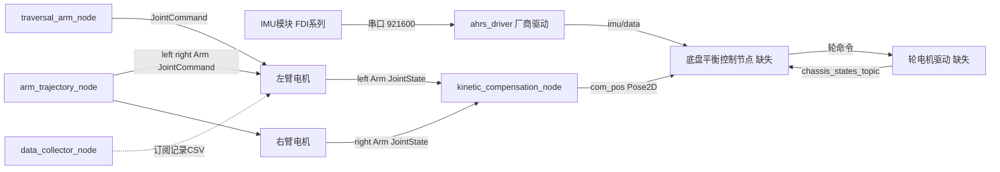
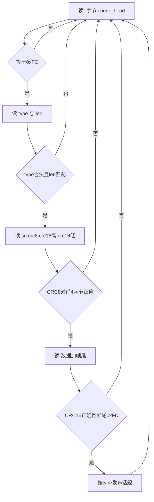

# 10 源码导读

> **一句话定位**：逐文件、逐函数读懂 P1 仓库里**真实存在**的两个 ROS 包：`fdilink_ahrs`（IMU 串口驱动，C++）和 `arm_controller`（臂轨迹、质心估计、数据采集，Python）。读完你应该能指着代码说清：数据从哪来、在哪被校验、在哪被变换、发布到哪个话题；以及哪些是读码发现的隐患（不是你的贡献）。底盘控制器与底盘驱动的源码目录为空，那一部分按 CV 与学习笔记讲，放在本章 §6。

**本章学完你能：**

- 画出 P1 的 ROS 计算图，指出哪些节点在仓库里、哪些缺失；
- 逐段解释 `ahrs_driver.cpp` 的 `processLoop`：帧头、类型、长度、CRC8、CRC16、帧尾、序号、发布，以及 `device_type=1` 的坐标变换；
- 逐函数解释 `kinetic_compensation_node.py`：参数、关节索引、回调、`pin.centerOfMass`、发布；
- 说清 `arm_trajectory_node.py`、`traversal_arm_node.py`、`data_collector_node.py` 的作用、安全写法和隐患；
- 区分"我写的""我读到的""我注意到的隐患"，不夸大贡献；
- 用英文回答 8 个基于这些代码的追问。

**前置：** [03 IMU 与姿态](./03_IMU_AHRS与姿态估计.md)、[07 质心前馈](./07_质心前馈补偿.md)、[08 安全闭环](./08_ROS_CAN安全执行闭环.md)。可复现的解析逻辑见 [11 教学仿真实验手册](./11_教学仿真实验手册.md) 的 S8 节。

**目录**

1. 阅读前须知
2. 全局：ROS 计算图与话题表
3. `fdilink_ahrs` 逐文件
4. `arm_controller` 逐文件
5. 配置、launch 与其余文件
6. 缺失部分：底盘控制器按快照结构理解
7. 读码发现汇总（不是你的贡献）
8. 与 CV 对应、与你的项目的差异
9. 面试问答（8 题）
10. 要点速记 / 自测题 / 链接

---

## 1. 阅读前须知

**源码在哪：** `项目源码/AIRS/Robot/`，其中 `fdilink_ahrs`、`arm_controller` 有完整文件；`arm_hand_ros` 只有启动脚本、录包脚本和若干 `.bag`；`chassis_controller`、`chassis_driver` 为空。引用行号以当前快照为准。

**三种标签，面试时的措辞不同：**

| 标签 | 含义 | 面试措辞 |
|---|---|---|
| 【你的工作】 | CV 与推荐信明确写到、且源码或笔记有依据 | "I built…" |
| 【读到的】 | 仓库里存在，团队/厂商写的，你读懂并使用 | "I used… / I read…" |
| 【读码发现】 | 读代码时发现的隐患，不是你修的 | "I noticed… / I would harden…" |

> **注意**：`fdilink_ahrs` 是厂商（WHEELTEC / FDI 系列）提供的驱动，README 里标注版本 `Deta-10-ros-v0.0.1`，不是你写的。你的工作是**用它**、读懂它、围绕它做数据有效性检查与坐标/符号核对（CV 的 "ROS state processing"）。说"I wrote the IMU driver"会被一问就穿。

---

## 2. 全局：ROS 计算图与话题表



| 话题 | 类型 | 发布者 | 订阅者 | 备注 |
|---|---|---|---|---|
| `imu/data`（launch 里；README 默认 `/imu`） | `sensor_msgs/Imu` | `ahrs_driver` | 底盘控制器 | 姿态来自 AHRS 包，角速度来自 IMU 包 |
| `/euler_angles`、`/magnetic`、`/mag_pose_2d` | `Vector3` / `Pose2D` | `ahrs_driver` | 调试 | 模块内部欧拉角与磁力计 |
| `/left/Arm/JointState`、`/right/Arm/JointState` | `JointState` | 臂电机驱动（`taihu_motor`，不在本仓库源码内） | 质心节点、采集节点 | 位置、速度 |
| `/left/Arm/JointCommand`、`/right/Arm/JointCommand` | `JointState` | 轨迹节点、遍历节点 | 臂电机驱动 | 只用 `position` |
| `/cb_left_hand_control_cmd`、`/cb_right_hand_control_cmd` | `JointState` | 轨迹节点 | 灵巧手驱动 | 6 维 |
| `/com_pos`、`/com_vel` | `Pose2D` | 质心节点 | 底盘控制器（订阅 `/com_pos`；`/com_vel` 订阅被注释） | 无时间戳 |
| `/controller_pos` | `Pose2D` | 底盘控制器 | 采集节点 | 底盘位置 |
| `/chassis_states_topic` | `JointState` | 底盘驱动 | 控制器 | 轮状态（见 `arm_controller/README.md`） |
| `/Arm/Action` | 服务 `pcl_msgs/UpdateFilename` | 轨迹节点 | 操作员 | 填文件名，返回 `success` |

---

## 3. `fdilink_ahrs` 逐文件【读到的】

目录：`include/{fdilink_data_struct.h, ahrs_driver.h, crc_table.h}`，`src/{ahrs_driver.cpp, crc_table.cpp, imu_tf.cpp}`，`launch/{ahrs_data.launch, tf.launch}`，`wheeltec_udev.sh`，`README.md`，`data/gps_data.bag`。

### 3.1 `include/fdilink_data_struct.h`：帧与数据包的内存布局

**作用：** 定义串口帧头、四种数据包以及"帧 = 头 + 数据 + 帧尾"的联合体，使驱动可以把读到的字节直接按结构访问。

```text
 文件:行      内容
 7-16         struct fdilink_header: header_start, data_type, data_size, serial_num,
              header_crc8, header_crc16_h, header_crc16_l   (7 字节, #pragma pack(1))
 20-35        IMUData_Packet_t: gyroscope xyz(rad/s), accelerometer xyz(m/s^2),
              magnetometer xyz(mG), imu_temperature, Pressure, pressure_temperature (12 个 float) + int64 Timestamp(us)  = 56 字节
 38-51        AHRSData_Packet_t: RollSpeed, PitchSpeed, HeadingSpeed, Roll, Pitch, Heading,
              Qw, Qx, Qy, Qz (10 个 float) + int64 Timestamp  = 48 字节
 53-72        INSGPSData_Packet_t (80 字节帧), 76-83 Geodetic_Position_Packet_t (32 字节数据)
 88-108       read_imu_struct / read_imu_tmp / union imu_frame_read: 头7B + 数据56B + 帧尾1B
```

关键点：

1. 一个 IMU 帧总长 $7+56+1=64$ 字节，AHRS 帧 $7+48+1=56$ 字节。第 11 章 S8 用 `struct.pack('<12fq')` / `'<10fq'` 构造了同样长度的数据，验证了 56/48 字节与 64/56 字节整帧长。
2. 联合体 `imu_frame_read` 同时提供三种视图：结构化的 `frame`、按字节的 `read_buf`（头 7 + `read_msg[57]`）和 64 字节的 `read_tmp`。驱动先单独读头 7 个字节填 `frame.header`，再一次性读 `IMU_LEN+1`（数据 + 帧尾）填 `read_buf.read_msg`，这样 `frame.data` 与 `frame.frame_end` 同时被填好。
3. 【读码发现】`AHRSData_Packet_t`（38–51 行）**没有** `#pragma pack(1)`，而它的邻居都有；碰巧 10 个 4 字节 `float` 加 8 字节对齐的 `int64` 是 48 字节且无填充，所以没出问题，但这依赖编译器对齐规则。`Geodetic_Position_Packet_t` 的注释写 40 字节，实际 $8\times3+4\times2=32$ 字节，`GEODETIC_POS_LEN` 为 `0x20`（32），注释是错的。

### 3.2 `include/ahrs_driver.h`：常量与类

**作用：** 声明帧常量、类型常量、长度常量和 `ahrsBringup` 类。

```c
#define FRAME_HEAD 0xfc        // ahrs_driver.h:26
#define FRAME_END 0xfd         // :27
#define TYPE_IMU 0x40          // :28   IMU 包
#define TYPE_AHRS 0x41         // :29   AHRS 包
#define TYPE_INSGPS 0x42       // :30
#define TYPE_GEODETIC_POS 0x5c // :31
#define TYPE_GROUND 0xf0       // :32
#define IMU_LEN  0x38          // :34   56
#define AHRS_LEN 0x30          // :35   48
```

类 `ahrsBringup` 的成员：公开 `processLoop()`、`checkSN(int)`、`magCalculateYaw(...)`；私有的 `sn_lost_`（丢包累计）、`crc_error_`（**声明了但从未递增**）、`read_sn_`、`frist_sn_`、`device_type_`（默认 1）、串口对象 `serial_`、四种帧缓冲、话题名字符串与 7 个发布者。注意 `checkCS8`、`checkCS16` 声明了但没有定义，也没有调用。

### 3.3 `src/ahrs_driver.cpp`：构造函数 `ahrsBringup()`（5–62 行）

**输入：** ROS 私有参数。**输出：** 7 个发布者、已打开的串口。

```cpp
ahrsBringup::ahrsBringup() :frist_sn_(false), serial_timeout_(20)       // :5
  pravite_nh.param("device_type", device_type_, 1);                     // :11 default: single imu
  pravite_nh.param("imu_topic", imu_topic_, std::string("/imu"));        // :12
  pravite_nh.param("port", serial_port_, std::string("/dev/ttyTHS1"));   // :22
  pravite_nh.param("baud", serial_baud_, 115200);                        // :23
  imu_pub_ = nh_.advertise<sensor_msgs::Imu>(imu_topic_.c_str(), 10);    // :26
  ...
  serial_.setTimeout(serial::Timeout::simpleTimeout(serial_timeout_));   // :43-44
  serial_.open();                                                        // :45
  catch (serial::IOException &e) { ROS_ERROR_STREAM("Unable to open port "); exit(0); }  // :47-51
  ...
  processLoop();                                                         // :61
```

逐行含义：

- 第 5 行：初始化列表设 `serial_timeout_=20`，即读串口的超时 20 ms；
- 第 9–23 行：从私有参数服务器取配置，`imu_topic` 默认 `/imu`、`port` 默认 `/dev/ttyTHS1`（Jetson 的 UART）、`baud` 默认 115200；launch 覆盖为 `imu/data`、`/dev/wheeltec_FDI_IMU_GNSS`（udev 别名）、`921600`；
- 第 26–32 行：每个发布者队列深度 10；
- 第 35–51 行：设置 8N1 无流控，超时 20 ms，`open()`；失败则 `exit(0)`；
- 第 61 行：**在构造函数里直接调用 `processLoop()`**，所以 `main` 里 `FDILink::ahrsBringup bp;` 一直不返回，直到 `ros::ok()` 为假。

【读码发现】① `exit(0)` 返回码 0 会让上层（roslaunch、systemd）把"打不开串口"当成正常退出；应返回非零。② 在构造函数里跑无限循环是不好的结构（对象永远"构造中"），但对一个纯发布节点能工作。③ 这是"启动失败要明显"的朴素实现：打不开就退出，不带病运行（第 08 章同一思想）。

### 3.4 `processLoop()`：核心解析循环（70–525 行）



分段解读（行号指 `ahrs_driver.cpp`）：

**① 找帧头（80–93）：**

```cpp
uint8_t check_head[1] = {0xff};
size_t head_s = serial_.read(check_head, 1);      // :81  超时20ms则保持0xff
if (check_head[0] != FRAME_HEAD) { continue; }    // :90-93
```

读 1 个字节；超时则缓冲区仍是预设的 `0xff`，不等于 `0xfc`，`continue`。这就是"逐字节重新同步"：一旦错位，循环会一个字节一个字节地丢，直到再遇到 `0xFC`。返回值 `head_s` 只在 debug 模式用来打印，**读超时不视为错误**。

**② 类型检查（94–104）：** 接受 `0x40/0x41/0x42/0x5C/0x50/TYPE_GROUND(0xF0)/0xFF` 这几种，其余打印 `head_type error` 后丢弃。注意 `0xFF` 也放行，是对读超时的容忍，但后面没有对应分支，会空转一圈。

**③ 长度检查（105–127）：** `IMU_LEN`、`AHRS_LEN`、`INSGPS_LEN`、`GEODETIC_POS_LEN` 必须等于第三个字节，不等则 `head_len error (imu)` 之类并 `continue`。

**④ 未知类型的跳过（128–156）：** 类型 `0xF0` 或 `0x50`（"未知数据，防止记录失败"）读序号、算丢包，再用 `serial_.read(ground_ignore, check_len+4)` 整帧吞掉，避免它们的字节污染找帧头。

**⑤ 读头剩余字段（157–167）：** 依次读 `sn`、`crc8`、`crc16_H`、`crc16_L`。

**⑥ 头 CRC8（176–265）：** 对每种类型，先把 7 个头字段写入 `*_frame_.frame.header`，然后：

```cpp
uint8_t CRC8 = CRC8_Table(imu_frame_.read_buf.frame_header, 4);   // :187
if (CRC8 != imu_frame_.frame.header.header_crc8) { ROS_WARN("header_crc8 error"); continue; }
if(!frist_sn_){ read_sn_ = imu_frame_.frame.header.serial_num - 1; frist_sn_ = true; }
ahrsBringup::checkSN(TYPE_IMU);                                   // :198
```

CRC8 只算头的前 4 个字节（`0xFC`、类型、长度、序号）。第一次成功后用当前序号减 1 初始化 `read_sn_`，再调用 `checkSN` 统计丢包。

**⑦ 数据 CRC16 与帧尾（266–404）：**

```cpp
uint16_t head_crc16 = head_crc16_l + (head_crc16_h << 8);          // :271
size_t data_s = serial_.read(imu_frame_.read_buf.read_msg, (IMU_LEN + 1)); // :272 48+1(注释有误: 实为56+1)
uint16_t CRC16 = CRC16_Table(imu_frame_.frame.data.data_buff, IMU_LEN);    // :280
if (head_crc16 != CRC16) { ROS_WARN("check crc16 faild(imu)."); continue; } // :291-295
else if(imu_frame_.frame.frame_end != FRAME_END) { ROS_WARN("check frame end."); continue; } // :296-300
```

CRC16 是 CCITT 多项式 0x1021 的表驱动实现，作用在数据区；头里先读到的字节是高字节（big-endian）。随后检查帧尾 `0xFD`。三道校验（CRC8 头、CRC16 数据、帧尾）全部通过才算一帧有效。

**⑧ IMU 包发布（406–457）：**

```cpp
sensor_msgs::Imu imu_data;
imu_data.header.stamp = ros::Time::now();                    // :410  接收时刻，不是采样时刻
imu_data.header.frame_id = imu_frame_id_.c_str();
Eigen::Quaterniond q_ahrs(ahrs_frame_.frame.data.data_pack.Qw, ...Qx, ...Qy, ...Qz);   // :412-415  最近一次AHRS包
...
if (device_type_ == 0) { /* 原始数据直接赋值 */ }            // :428-440
else if (device_type_ == 1) {                                // :441
    Eigen::Quaterniond q_out = q_r * q_ahrs * q_rr;          // :444
    ... angular_velocity  =  ( x, -y, -z );                  // :449-451
    ... linear_acceleration = ( x, -y, -z );                 // :452-454
}
imu_pub_.publish(imu_data);                                  // :456
```

三个要点：

1. **姿态与角速度来自不同的包**：四元数取自 `ahrs_frame_`（最近一个 AHRS 包），陀螺和加速度取自当前 `imu_frame_`。最坏相差一个 AHRS 包周期（100 Hz 下 10 ms）；
2. **时间戳是 `ros::Time::now()`**，设备自带的 µs 时间戳（`Timestamp` 字段）没被使用；
3. `device_type=1` 的变换：$q_r=R_z(\pi)R_y(\pi)=R_x(\pi)$、$q_{rr}=R_x(\pi)$，作用是 FRD→FLU、NED→"北西上"，并把 $y,z$ 轴的角速度与加速度取反。第 11 章 S2 用旋转矩阵验证：FRD 下绕右轴抬头 $+10^\circ$ 的姿态，经此变换变成 FLU 下的 $R_y(-10^\circ)$，数值上与 $R_y(-10^\circ)$ 一致。

【读码发现】① `ahrs_frame_` 是栈上对象的成员，没有显式初始化，**在第一个 AHRS 包到达前四元数内容不确定**（常表现为全零，也可能是垃圾值）。下游必须做四元数模长检查（第 08 章）。② 代码里定义了 `q_xiao_rr`（用于 `device_type=2`，README 提到"Xiao"）但没有对应分支，`device_type=2` 实际无效。

**⑨ AHRS 包发布（459–476）：** 发布 `Pose2D`（只填 `theta`＝航向 Heading）、`/euler_angles`（Roll、Pitch、Heading）、`/magnetic`（来自最近的 IMU 包的磁力计）。注意这里的欧拉角是模块输出的，未经 `device_type` 变换。

**⑩ GPS、INS 包（478–523）：** 发布 `NavSatFix`、里程计和机体系速度；P1 平衡不需要。

### 3.5 `checkSN(int type)`（539–630 行）

对四种类型各写了一遍几乎相同的代码：期望序号 `++read_sn_` 与实际 `serial_num` 比较；实际 < 期望说明回绕，丢失数 $=256-(read\_sn\_-sn)$，否则丢失数 $=sn-read\_sn\_$，累加到 `sn_lost_`，并 `read_sn_ = serial_num`。**用途：** 统计丢包，只在 debug 打印"detected sn lost."。第 11 章 S8 复现了这一逻辑：序号 0,1,2,5,6 的流统计出 2 个丢失，与手算一致。

【读码发现】`sn_lost_` 与 `crc_error_` 都没有对外发布；排查通信问题只能靠开 `debug` 或看 `ROS_WARN`。如果你想让"丢包率"成为健康指标，需要自己把它发布出来。

### 3.6 `magCalculateYaw(...)`（527–537）与 `main`（634–640）

`magCalculateYaw` 是倾斜补偿磁航向：先用 roll、pitch 把磁力计读数转到水平面，再 `atan2(-temp1, temp2)`，负值加 $2\pi$。**定义了，但 `processLoop` 里没有调用。** `main`：`ros::init`，构造 `bp`（阻塞），返回 0。没有 `ros::spin()`，因为没有订阅回调。

### 3.7 `src/crc_table.cpp` 与 `crc_table.h`

三个函数：`CRC8_Table(uint8_t* p, uint8_t counter)`、`CRC16_Table`、`CRC32_Table`。

- **CRC8**：256 项查表，首项 `0, 94, 188, 226, …`。第 11 章 S8 用脚本验证它是 CRC-8/MAXIM（反射算法、多项式 $0x31$ 的反射形式 $0x8C$、初值 0），**逐项与源码表一致**；
- **CRC16**：表首项 `0x0000, 0x1021, 0x2042, …`，XMODEM（CCITT，初值 0）。脚本验证标准校验串 `"123456789"` 的 CRC16 是 `0x31c3`，且整张表与源码一致；
- 【读码发现】**`CRC32_Table` 实际用 `uint16_t` 累加器和 CRC16 表**，名不副实，也没有被调用。

### 3.8 `src/imu_tf.cpp`（53 行）：把 IMU 姿态广播成 TF

订阅 `imu_topic`（默认 `/imu`），回调里把四元数写入 `tf::Transform`，以 `world → imu` 广播。

```cpp
tf::Quaternion q;  q.setX(...); q.setY(...); q.setZ(...); q.setW(...);   // :22-26
q.normalized();                                                          // :27  返回值被丢弃
transform.setRotation(q);
br.sendTransform(tf::StampedTransform(transform, ros::Time::now(), world_frame_id, imu_frame_id));   // :31
```

【读码发现】① `q.normalized()` 返回新对象而不修改 `q`，所以这行没有效果；② `position_x/y/z` 声明成 `int`，`node.param` 会截断小数；③ 默认订阅 `/imu`，而 `ahrs_data.launch` 发布的是 `imu/data`，同时用时要改话题名。这个节点是**可视化/调试**用，不进控制。

### 3.9 `launch/ahrs_data.launch` 与 `wheeltec_udev.sh`

launch 关键参数：`port=/dev/wheeltec_FDI_IMU_GNSS`、`baud=921600`、`imu_topic=imu/data`、`imu_frame=gyro_link`、`device_type=1`，另外为 `/mag_pose_2d`、`/euler_angles`、`/magnetic`、`/gps/fix`、`/system_speed`、`/NED_odometry` 设话题名。`wheeltec_udev.sh` 为 CP2102（`10c4:ea60`）、CH9102（`1a86:55d4`，分系统装了驱动与没装驱动两种情形各一条）、CH340（`1a86:7523`）三种 USB 转串口芯片共写四条 udev 规则，统一别名 `wheeltec_FDI_IMU_GNSS`，`MODE:="0777"`，然后 `service udev reload/restart`。**价值：** 设备号不再乱跳（案例 9 的防复发措施之一）。**风险：** `0777` 权限偏宽，对实验室机器人可接受，量产不应如此。

**串口带宽估算（脚本 S2）：** 一个 IMU 帧 64 字节 + 一个 AHRS 帧 56 字节，各 100 Hz，每字节 10 位（8N1），$120\times100\times10=120{,}000$ bit/s，占 921600 的 13.0%；200 Hz 时 26%，400 Hz 时 52%。所以 921600 baud 在 100～200 Hz 下余量充足。

---

## 4. `arm_controller` 逐文件

### 4.1 `scripts/kinetic_compensation_node.py`（128 行）：质心估计【你的工作】

**作用：** 订阅左右臂关节状态，用 Pinocchio 和 URDF 算整机质心，发布 `/com_pos`、`/com_vel`。对应 CV：*Estimated CoM offset from arm joint states with URDF/Pinocchio*。

**输入：** `/left/Arm/JointState`、`/right/Arm/JointState`。**输出：** `/com_pos`（`Pose2D`，x、y 为质心水平坐标）、`/com_vel`。

**逐函数：**

`__init__`（13–54 行）

```python
self.model_path = rospy.get_param('~model_path', '../mujoco_rl_env/ballbotgym/assets/uni.urdf')   # :18
self.freq = float(rospy.get_param('~freq', 100)); self.rate = rospy.Rate(self.freq)              # :21-22
self.joint_num = rospy.get_param('~arm_joint_num', 4)                                            # :25
self.has_velocity = rospy.get_param('~has_velocity', True)                                       # :28
...
self.pin_model = pin.buildModelFromUrdf(self.model_path)                                         # :43
self.pin_data = self.pin_model.createData()
self.pin_q = np.zeros(self.pin_model.nq); self.pin_dq = np.zeros(self.pin_model.nv)              # :45-46
left_arm_joint_names = [f"left_arm_joint_{i+1}" for i in range(self.joint_num)]                  # :48
self.left_arm_pin_indices = self.get_joint_indices_from_names(left_arm_joint_names)              # :51
```

先读参数，建 Pinocchio 模型，把位置、速度数组全部置零（所以手、颈、浮动基等没被写入的关节保持 0）。关节名按约定拼成 `left_arm_joint_1…4`、`right_arm_joint_1…4`，通过 `get_joint_indices_from_names` 找到它们在 `q` 里的索引。launch 中模型路径是 `$(find mujoco_rl_env)/ballbotgym/assets/uni.urdf`——同一份 URDF 也用于 MuJoCo 仿真环境（README 自查表第 21 行）。

`get_joint_indices_from_names`（57–65 行）

```python
for name in joint_names:
    if name in self.pin_model.names:                          # :60
        joint_id = self.pin_model.getJointId(name)
        idx_q = self.pin_model.joints[joint_id].idx_q         # :63
        indices.append(idx_q)
return indices
```

【读码发现】**名字不在模型里时被静默跳过**，不报错；返回的列表会比 4 短。后面把 4 个位置写进短索引时，NumPy 会因形状不匹配抛 `ValueError`，节点崩溃，而不是悄悄产生错数。但如果 JointState 恰好只有那么多个元素，就会悄悄用错映射。启动时应断言 `len(indices)==joint_num`（第 07 章 §9）。

`_left_joint_callback / _right_joint_callback`（67–85 行）：只缓存最新消息。`has_velocity=False` 分支（69–73）：

```python
dt = msg.header.stamp.to_sec() - self.left_joint_state.header.stamp.to_sec()    # :71
for pos, last_pos in zip(msg.position, self.left_joint_state.position):
    msg.velocity = (pos - last_pos) / dt                                        # :73
```

【读码发现】首帧时 `self.left_joint_state` 是 `None`，访问 `.header` 会抛 `AttributeError`；循环里把**标量**反复赋给 `velocity`（一个列表字段），最终值只是最后一个关节的差分，类型也不对。launch 里 `has_velocity=true`，所以这个分支没被走到，但它是未经测试的代码。

`run`（87–113 行）

```python
if self.left_joint_state is not None and self.right_joint_state is not None:     # :91
    self.pin_q[self.left_arm_pin_indices]  = self.left_joint_state.position       # :93
    self.pin_q[self.right_arm_pin_indices] = self.right_joint_state.position      # :94
    self.pin_dq[self.left_arm_pin_indices] = self.left_joint_state.velocity       # :95  用了位置索引
    self.pin_dq[self.right_arm_pin_indices] = self.right_joint_state.velocity     # :96
    pin.centerOfMass(self.pin_model, self.pin_data, self.pin_q, self.pin_dq)      # :99
    com_pos_msg.x = self.pin_data.com[0][0]; com_pos_msg.y = self.pin_data.com[0][1]    # :102-104
    com_vel_msg.x = self.pin_data.vcom[0][0]; com_vel_msg.y = self.pin_data.vcom[0][1]  # :108-110
self.rate.sleep()                                                                  # :113
```

数据流：两臂各自缓存 → 100 Hz 定时循环取"各自最新" → 写入 `pin_q/pin_dq` → `centerOfMass`（按 URDF 质量与局部质心、当前关节角做正运动学，再质量加权，第 07 章 §3） → 发布水平分量。要点：

1. 需要**两侧都收到过**才开始发布；一侧断流后，另一侧的旧值会被一直使用，节点**不检查消息年龄**；
2. 速度索引复用了位置索引（95–96 行），只对"单自由度转动关节、没有浮动基"的模型成立，应当用 `idx_v`；
3. `Pose2D` 没有 header，下游无法判断是否过期；
4. 只写臂的 8 个关节，手的 6 DOF 保持 0，所以手部姿态变化的质心影响被忽略；
5. `/com_vel` 在底盘侧订阅被注释，速度没被消费。

**与你的项目的差异：** 你在 CV 里写的是用它估质心并前馈到 roll/pitch；这个节点本身不做前馈，前馈在（缺失的）底盘控制器里。

### 4.2 `scripts/filters.py`（237 行）：一阶低通滤波库【读到的】

四个类，核心是 `LowPassFilter`（6–31 行）：

```python
dt = 1.0 / sampling_freq
tau = 1.0 / (2 * math.pi * cutoff_freq)
self.alpha = dt / (dt + tau)                       # :15-17
self.y = 0.0                                       # :18  初值 0
def update(self, x): self.y = self.alpha * x + (1.0 - self.alpha) * self.y   # :26
```

这就是第 03 章 §8 的 $\alpha=\Delta t/(\Delta t+\tau)$。包装类：`JointStateFilter`（按关节分别滤波位置/速度/力矩）、`Pose2DFilter`（x、y 与 theta）、`TwistFilter`（线、角速度各 3 轴）。

两点读码发现：

1. 【读码发现】`Pose2DFilter.filter_pose2d` 中 `self.x_filters.update(raw_msg.x[i])`（151 行）：`i` 未定义，`raw_msg.x` 是浮点数不能下标，**一旦配置了 `pos_cutoff` 就会报错**；
2. 【读码发现】`LowPassFilter` 的初值是 0。第一次输出是 $\alpha x$，需要多个周期才爬到 $x$：0.8 Hz 截止时 $\alpha=0.048$，达到 63% 需要 21 个采样（0.21 s，脚本 S2），2 Hz 截止（质心量）约 8 个采样。如果不在使能时用当前测量值 `reset(value)` 播种，滤波后的质心前馈在使能后前几十毫秒是一个"从 0 爬升"的假信号——第 08 章初始化第 4 步要求"清滤波"，更严格的做法是**用首帧测量值播种**而不是清零。

当前仓库里 **没有任何文件 import `filters.py`**；它预期的使用者是缺失的底盘控制器（笔记所记快照里 0.8 Hz 低通的写法与此一致）。所以对它只能说"the project has a first-order low-pass library"，不要说"我在 arm_controller 里滤了 X"。

### 4.3 `scripts/arm_trajectory_node.py`（299 行）：预设动作播放【读到的】

**作用：** 提供服务 `/Arm/Action`（类型 `pcl_msgs/UpdateFilename`），读 `config/episodes/<name>.yaml`，三次样条插值后以固定频率发布两臂（以及灵巧手）命令。验证前馈时用它重复固定轨迹。

**类 `ArmTrajectoryPlayer`：**

`__init__`（12–39 行）：参数 `file_dir`、`arm_joint_num=4`、`hand_joint_num=6`、`freq`（代码默认 100，launch 设为 50）；4 个发布者（左右臂 `JointCommand`、左右手 `cb_*_hand_control_cmd`）；注册服务；`is_playing=False`。

`handle_play_trajectory(req)`（41–292 行）分为七段：

1. **并发保护**（42–45）：`if self.is_playing: return success=False`；
2. **读文件与格式校验**（47–65）：文件存在、YAML 可解析、必须是非空列表；
3. **首尾点检查**（67–89）：首点和末点必须至少含 `left_arm / right_arm / left_hand / right_hand` 之一；
4. **逐点解析**（91–166）：每个点必须有 `timestamp`；每组长度必须等于 `arm_joint_num`（4）或 `hand_joint_num`（6）；缺失的中间点用 "last valid" 填充；一直没出现过的组用全 0；
5. **时间单调化**（175–191）：若时间戳不严格递增，则稳定排序，再用 `np.unique(..., return_index=True)` 去重——这个调用保留的是每个值**第一次**出现的行，与注释"保留最后一次"不符【读码发现】；
6. **样条构建**（198–225）：`CubicSpline(timestamps, positions, bc_type='clamped')`，两端速度为 0；但只有 **`np.any(positions)` 为真的组才建样条**——一整条全零的臂轨迹会被当作"不控制这条臂"【读码发现】；
7. **播放循环**（227–292）：以 `rospy.Time` 计时，`current_t = t_start + (now - start_real)`，每个周期求样条值并发布，到 `t_end` 退出；`rate.sleep()` 保持频率。

**数据流：** YAML → 样条 → 50 Hz 的 `JointCommand`。**安全写法（对应第 08 章臂侧旁证）：** 拒绝并发、校验输入、首尾点强制存在、clamped 边界速度为零。

【读码发现】服务调用是**阻塞的**：回调线程里跑完整个播放循环才返回；播放期间再次调用会返回 `success=False`，但不会取消当前播放，也没有"紧急停止"接口。播放结束不会回到零位。

### 4.4 `scripts/arm_trajectory_node_bk.py`（201 行）：旧版本【读到的】

与新版同结构，区别：键为 `left` / `right`、单一参数 `joint_num`、首尾点**必须同时**含左右臂；没有手。`config/episodes/front_raise1～6.yaml` 使用的正是这种旧格式，所以与新节点不匹配（第 09 章案例 14）。

### 4.5 `scripts/traversal_arm_node.py`（272 行）：臂空间遍历【读到的】

**作用：** 在关节限位内用 Halton 序列生成遍历点，贪心排序，逐点移动、停留 2 s，用来"遍历臂工作空间并采集数据"（用于质心/静态补偿标定与仿真，README 口径备忘第 9 条）。

`__init__`（17–75）：必须有 `config_path`；读 `traversal.joint_limits`（一维数组 `[j1_min, j1_max, j2_min, …]`，6 个关节×2 = 12 个数）；`traversal_arm_joint_num=3`，`arm_joint_num=4`；`max_speed` 代码默认 0.3，launch 设 0.2 rad/s；`num_samples` 默认 200，组合 launch 设 50；`control_freq=100`。校验 `len(raw_limits) == traversal_joint_num*4` 与 `min < max`，失败则 `sys.exit(1)`。

`halton_sequence(n, dim)`（77–95）：对第 $d$ 维用第 $d$ 个素数做基的 van der Corput 序列，再随机循环移位。低差异序列比均匀随机更均匀地铺满高维空间。

`generate_halton_path_with_start_end`（97–139）：把序列映射到限位，随机选第一个点，之后反复选**离当前最近**的点（贪心 TSP 近似），最后回到零位。

`move_to_position(target)`（141–201）：

```python
delta = target - self.current_position;  max_delta = np.max(np.abs(delta))
duration = max_delta / self.max_speed if max_delta > 1e-5 else 0.01           # :146-150
interp_func = CubicSpline(np.array([0, duration]), np.array([cur, target]))   # :153-157
waytimes = np.linspace(0, duration, max(2, int(duration * self.control_freq)))  # :160
...  pos[i] = max(min_val, min(max_val, pos[i]))                                # :170-173 限位钳制
...  left_pos = np.pad(left_pos, (0, delta_joint_num), constant_values=0.0)      # :179-182 3 关节补 0 到 4
```

要点：时长由**最大关节位移 / 最大速度**决定，保证最快的关节不超速；每个周期钳位到限位。【读码发现】只有**两个**节点的 `CubicSpline` 在默认边界条件下按 SciPy 的处理会退化成直线（本机 SciPy 导入失败，未能复核），所以每段是**匀速**运动，段与段之间速度在路径点处突变（0.2 rad/s 与停 2 s 之间是阶跃），这对采集静态数据没问题，但不是平滑轨迹。

`run`（203–242）：先移到 `path[0]`，然后遍历：移动 → `time.sleep(2.0)` → 打印进度和估计剩余时间。`finally` 里调用 `cleanup()`。

`cleanup`（244–260）：

```python
stop_msg.position = [0.0] * (self.joint_num * 2)      # :253  长度 8
for _ in range(5):                                    # :255  确保命令送达
    self.left_pub.publish(stop_msg); self.right_pub.publish(stop_msg); rospy.sleep(0.1)
```

退出时**连发 5 次零位命令**。【读码发现】`stop_msg.position` 长度是 `joint_num*2=8`，而每条臂只有 4 个关节；且发的是"回零位"而不是"停在原地"；`cleanup` 同时被 `rospy.on_shutdown` 和 `finally` 调用两次。还用 `signal.signal(SIGINT, ...)` 覆盖了 rospy 自己的信号处理。

### 4.6 `scripts/data_collector_node.py`（182 行）：数据采集【读到的】

**作用：** 订阅两臂状态与 `/controller_pos`（底盘位置），以 100 Hz 写 CSV：时间戳、左右臂各 `num_joints` 个位置+速度、底盘 x、y。

`__init__`（12–61）：参数 `csv_directory`、`duration_threshold=10 s`、`joint_zero_threshold`（代码默认 0.01，launch 设 0.05 rad）、`rate=100`、`collect_arm_joint_num=4`；`stopped_recently = deque(maxlen=100)`（"100 次×0.01 s = 1 s"）；打开 `robot_data_<unix秒>.csv` 并写表头。

回调（63–81）：缓存最新消息；`check_all_data_received` 在三个来源都至少收到一次后置位，才开始记录。

`check_stop_condition`（91–123）：

```python
if time.time() - self.start_time < self.duration_threshold: return False       # :97
all_close_to_zero = all(abs(pos) <= thr for pos in left + right)               # :101-116 (展开写法)
self.stopped_recently.append(all_close_to_zero)                                 # :119
return all(self.stopped_recently)                                               # :123
```

【读码发现】停止判据是"超过 10 s 且**队列里所有**记录都是接近零位"。队列最长 100，但**不满 100 个时 `all` 也会返回真**：如果 10 s 时关节恰好在零位，第一次检查就会停止；只有队列里混有 False（运动期间）时，才需要 100 个连续真值把它们挤出去。这和"持续 1 s 才停"的注释不完全一致，也是第 09 章案例 15 的补充事实。

`run`（125–179）：循环写 CSV，数据不足时填空；最后关闭文件。【读码发现】时间戳用 `time.time()`（写入时刻）而不是消息时间戳；`collect_data.launch` 的参数名 `num_joints` 与节点读取的 `collect_arm_joint_num` 不一致，该参数被忽略。

---

## 5. 配置、launch 与其余文件

| 文件 | 内容与要点 |
|---|---|
| `config/dual_arm_params.yaml`（3 行） | `traversal.joint_limits`：当前启用的是"双下垂"组 `[-0.5,0.5,-0.1,0.2,-0.3,0.3]` 重复两次；另有"全空间"和"双前平举"两组注释 |
| `config/episodes/front_raise1～6.yaml` | 旧格式（`left` / `right`）；每条三个点：0 s 零位、中点到幅度、末点回零。1：8 s/0.78 rad，2：4 s/0.78，3：8 s/1.57（第二关节 0.1），4：4 s/1.57（第二关节 0.1），5：8 s/1.0，6：4 s/1.0（时间为半周期）。第 07 章动态项估算用的就是这些 |
| `greet / shake / hug / dish_up / dish_down / architect_forum_talkshow.yaml` | 新格式（`left_arm` / `right_arm` / `left_hand` / `right_hand`），6 维手的取值 0～255 |
| `launch/arm_trajectory.launch` | 新轨迹节点，`arm_joint_num=4`、`hand_joint_num=6`、`freq=50` |
| `launch/kinetic_compensation.launch` | `model_path=$(find mujoco_rl_env)/ballbotgym/assets/uni.urdf`、`freq=100`、`arm_joint_num=4`、`has_velocity=true` |
| `launch/traversal_arm.launch`、`traversal_arm_and_collect_data.launch` | `max_speed=0.2`、`num_samples=200 / 50`、`traversal_arm_joint_num=3`；后者同时起采集节点（参数名正确） |
| `launch/collect_data.launch` | 参数名 `num_joints`（节点读 `collect_arm_joint_num`）【读码发现】 |
| `README.md` | 启动 CAN（`sudo ip link set can0 up type can bitrate 1000000`）、臂电机 `roslaunch taihu_motor dual_forearm.launch`、灵巧手 `linker_hand_double.launch`、仿真 `roslaunch mujoco_rl_env robot.launch`；检查话题 `/chassis_states_topic`、`/imu/data`；调用动作 `rosservice call /Arm/Action "filename: 'front_raise4'"`；蓝牙配对笔记 |
| `requirements.txt` | `rospkg`、`csv`、`pinocchio`。`csv` 是 Python 标准库模块，不应出现在依赖里；Pinocchio 的 pip 包名需核对（未核对） |
| `scripts/__pycache__/{model,train_arm}.cpython-39.pyc` | 遗留缓存，说明曾存在学习型补偿的 `model.py`、`train_arm.py`，但源文件不在仓库里。若被问到，只说"用于数据采集和仿真验证"（README 口径备忘第 9 条） |
| `arm_hand_ros/{start_service.sh, stop_service.sh, record.bash}` | `can0 down/up`（1 Mbit/s）、启动臂/手驱动；`rosnode kill /taihu_motor` 并强杀手驱动进程；用 `rosbag record` 录命令话题 |

---

## 6. 缺失部分：底盘控制器按快照结构理解

> **诚实边界。** `chassis_controller`、`chassis_driver` 的源码目录为空。下面是根据学习笔记所记的快照结构整理的**理解**，不是逐行源码。面试以你亲手所写为准，凡细节拿不准就说 "that's the design as I remember it"。

```text
回调缓存:  /imu/data, /chassis_states_topic, /cmd_vel, /com_pos
定时器(100 Hz):
   周期开头: 跌倒阈值检查(快照中跌倒分支: 复位状态并返回)
   -> 姿态/速度估计(轮速里程, 0.8 Hz 低通)
   -> 外环 XLoop / YLoop (限幅 θmax)
   -> 内环 Roll / Pitch / Yaw PID (陀螺做D项)
   -> 加质心前馈(/com_pos 位置级)
   -> 运动学 ik (J)
   -> 整体 L2 限幅 -> 低通
   -> 发布轮命令(速度字段)
```

与第 06～08 章的关系：外环/内环/前馈见 06、07；限幅、使能状态机、跌倒检测在 08 中按"设计取值"写成更严格的版本，快照里有两处较弱（跌倒分支只复位；使能超时仍使能），README 口径备忘第 2 条记录。

---

## 7. 读码发现汇总（不是你的贡献）

| # | 位置 | 发现 | 影响 | 建议 |
|---|---|---|---|---|
| 1 | `ahrs_driver.cpp:50,59` | 打不开串口 `exit(0)` | 上层看不到失败 | 返回非零 |
| 2 | `:61` | 构造函数里跑主循环 | 结构不佳 | 拆到 `run()` |
| 3 | `:410`，`:444` | `header.stamp=now()`；姿态与角速度来自不同包 | 时间戳不是采样时刻；姿态最多旧一个 AHRS 周期 | 使用设备时间戳；同包取姿态 |
| 4 | `ahrs_frame_` 未初始化 | 首个 AHRS 包前四元数不确定 | 启动瞬间姿态无效 | 下游检查模长 |
| 5 | `crc_error_`、`sn_lost_` | 不发布，`crc_error_` 不递增 | 难以监控通信质量 | 发布诊断 |
| 6 | `device_type=2` | 有 `q_xiao_rr` 无分支 | 参数无效 | 实现或删除 |
| 7 | `crc_table.cpp:CRC32_Table` | 用 `uint16_t` 与 CRC16 表 | 名不副实，未调用 | 删除或修正 |
| 8 | `imu_tf.cpp:27` | `q.normalized()` 无效果；位置参数为 `int` | TF 四元数可能未归一化 | 使用返回值 |
| 9 | `kinetic_compensation_node.py:57-65` | 关节名缺失被静默跳过 | 映射错或崩溃 | 启动断言 |
| 10 | `kinetic_compensation_node.py:95-96` | 速度用位置索引 | 只对简单模型正确 | 用 `idx_v` |
| 11 | `kinetic_compensation_node.py:69-73` | `has_velocity=False` 分支首帧崩溃且赋值类型错 | 未测试分支 | 修正或删除 |
| 12 | `kinetic_compensation_node.py`（`run`） | 不检查消息年龄；`Pose2D` 无时间戳 | 臂断流后仍发布旧质心 | 年龄检查、`PointStamped` |
| 13 | `filters.py:151` | `raw_msg.x[i]` 未定义 `i` | 启用位置滤波即报错 | 修正 |
| 14 | `filters.py:18` | 初值 0 | 启动有爬升瞬态 | 首帧播种 |
| 15 | `arm_trajectory_node.py:186` | `np.unique` 保留第一次而非最后一次 | 与注释不符 | 修正 |
| 16 | `arm_trajectory_node.py:201-209` | 全零轨迹被当作不控制 | 回零轨迹可能不发 | 用显式标志 |
| 17 | `traversal_arm_node.py:253` | 零位消息长度 8（应为 4）；回零而非保持；`cleanup` 调用两次 | 驱动可能忽略或误解 | 与驱动约定一致 |
| 18 | `data_collector_node.py:123` | 队列未满即可停止 | 采集可能提前结束 | 要求队列满 |
| 19 | `collect_data.launch` | 参数名 `num_joints` 与节点不一致 | 被静默忽略 | 统一参数名 |
| 20 | `front_raise*.yaml` | 旧格式与新节点不匹配 | 服务返回失败 | 统一格式 |

> **面试要点**：读码发现的价值在于"我知道这条链的薄弱环节在哪"。用 "I noticed X and would harden it with Y" 的句式；**不要**说成你修复了它们。

---

## 8. 与 CV 对应、与你的项目的差异

| CV 的话 | 对应代码 | 状态 |
|---|---|---|
| *used IMU and wheel-speed feedback* | `fdilink_ahrs` → `imu/data`；`/chassis_states_topic`（底盘驱动缺失） | 驱动是厂商写的，你用它并做有效性检查 |
| *estimated CoM offset from arm joint states with URDF/Pinocchio* | `kinetic_compensation_node.py` | 这是你的工作，源码在仓库 |
| *fed roll/pitch gravity feedforward* | 底盘控制器（缺失） | 按快照结构理解 |
| *verified by toggling compensation under fixed arm trajectories* | `arm_trajectory_node.py` + `front_raise*.yaml` + `rosservice call /Arm/Action` | 工具在仓库；开/关与统计在你的实验里 |
| *integrated ROS state processing with CAN motor execution* | `ahrs_driver`、`start_service.sh`、`ip link set can0 …` | 底盘驱动缺失，臂链有旁证 |
| *state initialisation, output limiting, fall-recovery* | 底盘控制器（缺失）；臂侧 `cleanup`、限位钳制、`is_playing` | 设计取值见第 08 章 |

**与"你的项目"的三处差异（不要混淆）：** ① IMU 驱动是厂商的；② 臂的电机驱动（`taihu_motor`、灵巧手 SDK）是别人的；③ 学习型补偿的残留（`train_arm`、`model`）与本项目 CV 声称的 URDF/Pinocchio 前馈是两回事，不主动展开。

---

## 9. 面试问答

**Q1. Walk me through how the IMU data gets into your controller.**

> The IMU module streams binary frames over a serial port at 921600 baud. The vendor driver looks for a 0xFC head byte, checks the type and length, verifies an 8-bit CRC on the header and a 16-bit CRC plus an end byte on the data, and only then publishes. Frames that fail are dropped and the parser resynchronises on the next head byte. The orientation comes from the module's own AHRS packet and the gyro from the IMU packet, merged into one `sensor_msgs/Imu` message. I use the driver; my work is on checking the data before using it.

中文：IMU 通过 921600 串口发二进制帧；驱动找 0xFC、检查类型与长度、头 CRC8、数据 CRC16 和帧尾，通过才发布，失败丢帧并重新同步；姿态取自 AHRS 包、陀螺取自 IMU 包合并成一条 Imu 消息；我用驱动，做数据检查。

- L2：*What can still go wrong?* — "The stamp is the receive time, not the sample time, and the orientation can be one packet older than the gyro. So I check data age and the quaternion norm."
- L3：*Did you write the driver?* — "No, it is the vendor's package; I read it, used it, and noticed a few weak points."

**Q2. How does the driver recover from a corrupted byte stream?**

> It reads one byte at a time until it sees the head byte, then validates the header with a CRC. If anything fails, it discards and goes back to looking for the next head byte, so a single corrupted or missing byte costs at most one frame. I reproduced that logic in a short script: flipping one bit loses one frame, deleting ten bytes loses one frame, and the stream recovers.

中文：逐字节找帧头，头 CRC、数据 CRC、帧尾任一失败就丢弃回到找头；一个坏字节最多损失一帧；我用脚本复现：翻转一位损失一帧，删 10 个字节损失一帧，随后恢复。

- L2：*What about false positives?* — "Three independent checks, two CRCs and the end byte, make a corrupted frame accepted by chance very unlikely."
- L3：*What would you add?* — "Publish the CRC-error and lost-sequence counters as diagnostics."

**Q3. What does your centre-of-mass node do, step by step?**

> It subscribes to the left and right arm joint states and caches the latest. A 100 hertz loop copies both into the Pinocchio position vector using indices found by joint name, calls the centre-of-mass function on the URDF model, and publishes the horizontal x and y. The model's root frame is at the ball centre, so the offset is relative to the support.

中文：订阅两臂关节状态并缓存；100 Hz 循环按关节名索引写入 Pinocchio 位置向量，调用质心函数，发布水平 x、y；模型根在球心。

- L2：*What are its limits?* — "The message has no timestamp, the two arms are not synchronised, velocity uses the position indices, and a missing joint name is skipped silently. I would assert the mapping at startup."
- L3：*How do you know the output is right?* — "I compared it with hand calculations for static poses, for example a forward raise moves the centre of mass about 3 to 4 centimetres."

**Q4. How do you play a fixed arm trajectory repeatably?**

> A ROS service takes a file name, loads a YAML list of timestamped joint targets, validates the first and last points and the joint counts, builds a clamped cubic spline so the start and end velocities are zero, and publishes at 50 hertz with a clock-based time so the playback duration doesn't depend on loop jitter. It rejects a second request while one is playing.

中文：服务接收文件名，读 YAML，校验首末点与关节数，建 clamped 三次样条（首末速度为零），以时钟计时按 50 Hz 发布；播放期间拒绝新请求。

- L2：*Why a clock-based time?* — "If the loop runs late, the sample still corresponds to the right moment of the trajectory instead of drifting."
- L3：*What did you notice in it?* — "An all-zero arm trajectory is treated as 'not controlled', and the old trajectory files use a key format the new node rejects."

**Q5. What happens when your script is killed?**

> The arm traversal node publishes five zero-position commands, 100 milliseconds apart, so the command actually arrives, and clamps every point to the joint limits. That is the pattern I borrowed for the base safety design: limit, validate, send zero on exit. I noticed the stop message there has the wrong length, so I would harden it.

中文：臂遍历节点退出时连发 5 次零位命令（间隔 100 ms）以确保送达，并把每个点钳位到关节限位；这是底盘安全设计借用的模式；我注意到停止消息长度不对，需要加固。

- L2：*Why five times?* — "Because a single message can be dropped; resending is cheap."
- L3：*Is that enough for the base?* — "No, for the base I want a driver-side watchdog as well, since the controller itself might be the thing that died."

**Q6. Why is the quaternion transformed in the driver?**

> The module reports in the aerospace convention, forward-right-down body and north-east-down world. ROS wants forward-left-up. The driver rotates by 180 degrees about the x axis on both sides of the quaternion and flips the y and z components of the gyro and accelerometer. I checked it with rotation matrices: a nose-up pitch in the module becomes a negative pitch in the ROS frame, consistent with positive pitch meaning nose-down.

中文：模块输出航空坐标（前右下/北东下），ROS 用前左上；驱动在四元数两侧各绕 x 转 180°，陀螺和加速度的 y、z 取反；我用旋转矩阵验证，抬头在 ROS 系是负 pitch。

- L2：*What is the world frame afterwards?* — "North-west-up, so yaw zero points to magnetic north rather than east; the balance loop only uses roll, pitch and relative yaw."
- L3：*Why does the sign matter to the controller?* — "A wrong sign anywhere makes every gain destabilising in my model."

**Q7. How big is the serial load, and does it matter?**

> An IMU frame is 64 bytes and an AHRS frame 56 bytes. At 100 hertz each, with 10 bits per byte, that's 120 thousand bits per second, about 13 percent of 921600 baud. It matters little at 100 hertz, but it would start to matter above 400 hertz.

中文：IMU 帧 64 字节、AHRS 帧 56 字节，各 100 Hz、每字节 10 位，共 12 万 bit/s，约占 921600 的 13%；100 Hz 下无所谓，超过 400 Hz 才要注意。

- L2：*What else shares the bus?* — "Nothing; the module has its own USB serial link, and the CAN buses for wheels and arms are separate."
- L3：*What if the loop jitters?* — "Serial bytes buffer in the kernel, so occasional delays only add latency; sustained overload would show as dropped frames."

**Q8. If you could change one thing in this code base, what would it be?**

> I'd make the data self-describing: put real timestamps and a validity flag in the centre-of-mass message, use the sensor's own timestamp in the IMU message, and publish the driver's CRC-error and lost-sequence counters. All the problems I debugged were stale or inconsistent data that the controller couldn't tell was stale.

中文：让数据自描述——质心消息加时间戳与有效位，IMU 消息用设备时间戳，发布驱动的 CRC 错误与丢序计数；我调过的问题都是控制器无法分辨的陈旧/不一致数据。

- L2：*Which is the most urgent?* — "The timestamp on the centre-of-mass message, because it feeds the feedforward and has no age information at all."
- L3：*Cost?* — "Small: a message type change and a staleness check; it removes a whole class of silent failures."

---

## 本章要点速记

1. `fdilink_ahrs` 是厂商驱动；你用它、读懂它，并围绕它做有效性检查。
2. 帧格式：`0xFC | type | len | sn | crc8 | crc16(高,低) | 数据 | 0xFD`；IMU 包 56 字节、AHRS 包 48 字节，整帧 64/56 字节。
3. 三道校验：头 CRC8（前 4 字节，MAXIM 反射算法）、数据 CRC16（CCITT 0x1021）、帧尾；任一失败丢一帧并重新找帧头。
4. IMU 消息：姿态取自最近的 AHRS 包，角速度取自 IMU 包，时间戳是接收时刻；`device_type=1` 做 FRD/NED → FLU/北西上。
5. 质心节点：关节名 → 索引 → `pin_q` → `centerOfMass` → `/com_pos`；无时间戳、两臂异步、速度复用位置索引。
6. 轨迹节点：服务 + YAML + clamped 样条 + 拒绝并发；遍历节点：Halton + 贪心 + 钳位 + 退出连发零位。
7. 读码发现的隐患（20 项）要说成"我注意到"，不是"我修了"。
8. 底盘控制器源码缺失，按快照结构讲，不逐行声称。

## 自测题

1. 一个 IMU 帧总共多少字节？由哪几部分组成？（64：头 7 + 数据 56 + 帧尾 1。）
2. 为什么帧头被破坏不会让驱动永远错位？（逐字节找 `0xFC` 重新同步，失败只丢一帧。）
3. `device_type=1` 里 `q_out = q_r*q_ahrs*q_rr` 想做什么？（FRD/NED → FLU/北西上，配合 y、z 取反。）
4. 为什么 `/com_pos` 的新鲜度只能间接判断？（`Pose2D` 没有 header。）
5. 遍历节点退出时为什么连发 5 次零位？（单条消息可能丢失；确保送达。）
6. 100 Hz 下两个包各一帧占用 921600 baud 的多少？（约 13%。）

## 相关链接

上一章 [09 调试案例](./09_调试案例与故障排查.md)　下一章 [11 教学仿真实验手册](./11_教学仿真实验手册.md)　[03 IMU](./03_IMU_AHRS与姿态估计.md)　[07 质心前馈](./07_质心前馈补偿.md)　[08 安全闭环](./08_ROS_CAN安全执行闭环.md)　[README](./README.md)
