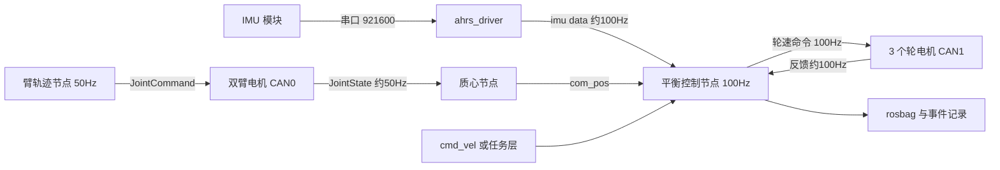

# P1 工程化实践：频率、周期与问题解决

> **一句话定位**：前面章节讲"算法是什么、为什么对"，本章讲"怎样把一台带双臂的 ballbot 做成、跑稳、改好"：需求怎么落成指标和方案，各层用多少赫兹、为什么，延迟与抖动怎么算，线程怎么排，五轮优化怎么做，仿真怎么搬到实机，遇到的十几个工程问题怎么解决，以及怎样和导师、队友协作。面试官问"你具体怎么做的、遇到什么坑"时，这一章就是素材库。
>
> **口径说明**：CV 只给出了平台（三全向轮 ballbot + 双臂、ROS + CAN、IMU 与轮速反馈）、方法（级联 PID、四状态倒立摆 + LQR 分析、URDF/Pinocchio 质心前馈）和安全措施（初始化、限幅、跌倒恢复）。本章里的频率、阈值、时间线、"前后对比"数字，是**与 README「实机细节自查表」一致的本项目设计取值**，用于把过程讲具体、讲得前后自洽；它们不是实测数据，面试时请用 "about / roughly / in our setup" 这类措辞，不要说成"测得"。凡"教学示例"均非项目数据。

**本章学完你能：**

1. 用一张表说清各层频率（100 Hz 控制主循环、约 100 Hz 的 IMU 与轮反馈、约 50 Hz 的臂与质心、20 Hz 量级的电机速度环）以及每个数字背后的取舍理由，并能回答"为什么不是 200 Hz";
2. 手算一条"IMU 采样 → 解析缓存 → 控制计算 → CAN 发送 → 电机速度环"链上的延迟预算，并换算成相位滞后，判断它对平衡带宽的影响；
3. 说清线程/进程优先级、绑核、周期触发方式、抖动怎么度量和压低；
4. 复述五轮优化（周期抖动、速度估计、命令斜坡、质心通道、回归脚本化）的"现象→度量→瓶颈→改动→前后对比→回归"；
5. 讲清仿真到实机的三层验证（教学仿真、MuJoCo 环境、实机）和实机保护清单；
6. 针对至少 10 个工程问题，按"现象→度量→原因→处理→回归"回答，并用 12 道英文问答表达。

**前置知识：** [06 级联 PID](./06_级联PID控制.md)、[08 安全闭环](./08_ROS_CAN安全执行闭环.md)、[09 调试案例](./09_调试案例与故障排查.md)、[10 源码导读](./10_源码导读.md)、[11 仿真手册](./11_教学仿真实验手册.md)；基础：[数字控制与实时性](../../02_基础知识/05_控制理论/08_数字控制与实时性.md)、[CAN / FDCAN 与电机通信](../../02_基础知识/11_嵌入式与通信/03_CAN_FDCAN与电机通信.md)、[ROS2 Humble 核心概念与 ROS1 对比](../../02_基础知识/12_机器人软件/04_ROS2_Humble核心概念与ROS1对比.md)。

**目录：** 1 从需求到上线 · 2 各层频率与周期设计 · 3 延迟预算与抖动 · 4 CAN 负载、线程优先级与调度 · 5 调参流程与实机安全 · 6 五轮优化过程 · 7 从仿真到实机 · 8 十四个工程问题 · 9 版本、参数与日志管理 · 10 团队协作与冲突解决 · 11 经验教训 · 12 面试问答（12 题）· 13 速记与自测

---

## 1. 从需求到上线：一条完整的工程线

### 1.1 需求怎么变成指标

课题的原始任务是一句话：让三全向轮 ballbot 在双臂沿固定轨迹运动时保持动态平衡（CV 的结果句）。工程上要把它拆成可检验的指标，否则"调好了"没有标准。我们的做法是拆成四层需求：

| 层次 | 需求 | 可检验指标（本项目取值） |
|---|---|---|
| 功能 | 原地平衡；按速度指令平移；双臂按固定轨迹运动时不倒 | 静止 60 s 位置漂移约 5 cm 以内；0.6 m/s 以内的速度指令可稳定跟踪；`front_raise` 一类轨迹（0→0.78 rad→0，16 s）全程不倒 |
| 性能 | 受推扰动后恢复；臂动期间倾角波动小 | 手推 20～30 N 后恢复，倾角峰值约 0.15 rad；臂动期间倾角峰值约 0.03 rad 以内（前馈开） |
| 安全 | 任何异常不伤人、不伤机 | 倾角超 0.5 rad 连续 5 周期、数据过期、NaN、反馈缺失都进入零输出锁定；重新使能一律走初始化 |
| 工程 | 可复现、可回溯 | 每次实验能说出代码提交、参数 yaml 版本、rosbag 文件名 |

注意"安全"和"工程"两层不是锦上添花：ballbot 是本质不稳定的系统（倾角每 0.17～0.27 s 翻倍，第 01、05 章），失败的代价是 32 kg 的整机压向地面，所以它们要排在性能前面。

### 1.2 方案选型：为什么是"级联 PID + 模型分析 + 前馈"

选型不是拍脑袋，我们按"能在实机快速整定、可解释、能加限幅与保护"三条比较过几个候选：

| 方案 | 优点 | 缺点 | 取舍 |
|---|---|---|---|
| 单环 PID（只用倾角） | 最简单 | 位置会漂；外环缺失时无法跟速度；倾角与位置耦合 | 不选 |
| 级联 PID（位置外环 → 有界倾角参考 → 姿态内环） | 物理链条清楚（倾角即加速度请求）；实机整定直观；易加限幅、抗饱和、前馈、开关 | 需要拆环、整定带宽比；与全状态最优相比有结构限制 | **部署** |
| LQR 全状态反馈 | 多状态统一处理，有最优性与稳定性解释 | 依赖模型精度；输入是力矩而接口是轮命令；限幅/积分/开关处理麻烦 | **只作分析参照**，不上机 |
| MPC | 能显式处理约束 | 建模与算力成本高；与既有 ROS 架构一致性差；面试里也更难解释"为什么稳" | 不选，列为后续方向 |

再看三条子选型：

- **IMU：板载 AHRS vs 自写融合。** 选板载（FDI 系列 AHRS，姿态由模块内部融合）。理由：团队已有可用的厂商驱动；自己写滤波要同时处理零偏、磁干扰、安装标定，收益小；我把精力放在**有效性检查**（数据年龄、四元数模长）和**偏置初始化**上；
- **电机命令：速度模式 vs 力矩模式。** 选速度模式：驱动器内部已有电流环（约 1 kHz）和速度环（约 500 Hz，带宽约 20 Hz），上位机只下发轮速目标；好处是对上位机抖动不敏感、保护更简单。代价是控制量名为 `tau` 却是速度量纲，要明确它是整定量；
- **前馈：质心前馈 vs 积分项吸收。** 选前馈：积分慢、会引入滞后；臂动是可预测扰动，用 URDF/Pinocchio 提前给平衡点平移更快，也能验证（开/关对比）。

### 1.3 架构

分层原则：**算法与系统分开**。算法层（估计、外环、内环、前馈、运动学分配 `ik`）写成纯函数式的计算，输入是缓存好的状态结构，输出是命令；系统层（订阅回调、定时器、使能状态机、有效性检查、限幅、看门狗）负责调用它们。好处是同一份算法既能在第 11 章的教学仿真里验证符号和量级，也能在实机运行；坏处是需要在两层之间传递"数据是否有效"这类元信息。

### 1.4 里程碑与迭代

按 CV 的 2025 年 9 月至 2026 年 3 月分六段（周数为复盘叙述，不是工时记录）：

| 阶段 | 时间 | 做什么 | 退出条件 |
|---|---|---|---|
| M0 熟悉平台 | 2025 年 9 月 | 读机械与电气文档、驱动代码与 launch；确认球/轮尺寸、电机协议、坐标符号；搭 ROS 环境，udev 固定串口 | 能在 `rostopic echo` 看到 IMU、轮反馈；手算一次 $J$ 并与单轴测试对上 |
| M1 悬空自检 | 2025 年 10 月 | 球离地，单轴自检（第 02 章 §10），IMU 轴/符号检查，限幅与看门狗雏形 | 符号与轮序检查表全部通过 |
| M2 龙门架平衡 | 2025 年 11 月 | 内环 → 外环 → 参考上限逐步放开；发现零偏爬行（案例 1）、IMU 丢帧（案例 9） | 静止 60 s 漂移约 5 cm；推扰可恢复 |
| M3 安全闭环与模型 | 2025 年 12 月 | 使能状态机与五步初始化（案例 7）；推导模型、做 LQR 分析、解决 1.5 Hz 振荡（案例 3） | 重新使能 10 次倾角峰值 <0.02 rad |
| M4 臂运动与前馈 | 2026 年 1 月 | 质心节点、前馈接入、符号错误排查（案例 5）、开/关对比；饱和排查（案例 6） | 同轨迹开/关各 5 次，指标达标 |
| M5 加固与交接 | 2026 年 2～3 月 | 驱动看门狗（案例 12）、回归脚本化、参数固化、文档与交接 | 回归清单全过；参数 yaml 与代码同次提交 |

每个阶段结束都做一次**回归**：把前面阶段验证过的项重跑一遍（见第 9 节），防止后面的改动悄悄破坏前面的功能。

---

## 2. 各层频率与周期设计

### 2.1 总表

| 层 | 频率/周期 | 触发方式 | 为什么是这个数 |
|---|---|---|---|
| 平衡控制主循环（外环、内环、前馈、`ik`、限幅） | 100 Hz，10 ms | `rospy.Timer`/`Rate` 定时器 | 内环带宽约 1 Hz，采样为带宽的约 100 倍；离散化与连续设计差约 5%（第 05 章）；IMU 与轮反馈都是 100 Hz，更快没有新数据 |
| IMU（FDI 系列，板载 AHRS） | 约 100 Hz | 串口流式输出，921600 baud | 与控制同频，每个控制周期取最新帧；串口占用约 13%，余量充足 |
| 轮电机反馈 | 约 100 Hz | CAN，驱动节点转 `JointState` | 与控制同频；缺失 50 ms（5 帧）判掉线 |
| 轮速度命令 | 100 Hz | 控制节点每周期发布一次 | 命令与控制同频，不插值；驱动侧看门狗 100 ms |
| 臂关节状态 | 约 50 Hz | 臂驱动发布 | 臂是慢变量；质心节点输入 |
| 质心节点（`/com_pos`） | 单独调试 100 Hz，整机 launch 50 Hz | 节点内 `Rate` | 质心只平移平衡点，不进内环；50 Hz 足够，加约 2 Hz 低通 |
| 臂轨迹节点 | 50 Hz（launch） | 节点内 `Rate`，时钟计时 | 轨迹光滑，50 Hz 足够；时长由时钟决定而非循环次数 |
| 电机驱动器内部电流环/速度环 | 约 1 kHz / 约 500 Hz | 驱动器固件 | 带宽约 20 Hz，是整个链路里最快的闭环 |
| 日志（rosbag） | 与话题同频；事件触发另存最后 1 s | `rosbag record` | 见 2.5 |

### 2.2 控制周期怎么选：三条判据

**判据一：相对带宽。** 数字控制的经验法则是采样频率不低于闭环带宽的 10～30 倍（第 06 章）。本项目内环带宽约 1 Hz，100 Hz 是它的 100 倍；离散化带来的增益偏差在第 11 章 S3 的离散 LQR 表里是 100 Hz 约 5%，结论不变。

**判据二：延迟占比。** 采样保持本身引入平均 $T_s/2$ 的延迟。100 Hz 为 5 ms，占 25 ms 最坏预算的 20%；若改成 200 Hz，只能省 2.5 ms（占预算 10%）。收益有限，因为瓶颈在 IMU 采样/传输（5～10 ms）和电机速度环（5～6 ms），不在控制周期。

**判据三：数据可用性与计算时间。** IMU 与轮反馈都是 100 Hz，把控制提到 200 Hz 只是在重复使用同一帧数据（等于零阶保持），并不会获得更新的信息。此外控制节点是 Python/ROS 进程，单周期要做回调缓存读取、外环/内环/前馈、`ik`、限幅、低通、发布，实机上周期约 1 ms 的计算（预算表），200 Hz 下占用翻倍，抖动余量变小。

**为什么不选 50 Hz？** 50 Hz 的 $T_s/2$ 是 10 ms，且离散化与连续设计的偏差增大（第 05 章离散 LQR 表：50 ms 周期偏差约 20%，20 ms 约 8%）；对一个倍增时间 0.17～0.27 s 的对象，20 ms 周期已经占了倍增时间的约 10%，余量太小。

所以 100 Hz 是"带宽、数据可用性、抖动余量"三者的折中。

### 2.3 IMU 与串口

IMU 模块通过 921600 baud 串口发两种包：IMU 包（64 B 整帧）和 AHRS 包（56 B 整帧）。各 100 Hz 时每秒 12000 字节，每字节 10 位（8N1），占线 120 kbit/s，约 13%（第 11 章 S2）。控制节点每 10 ms 取"当时缓存里的最新值"，**不是对每个样本逐个处理**，所以被取走的样本年龄最大约 10 ms（IMU 与控制相位随机时平均 5 ms）。这个年龄已经计入延迟预算的第一项（5/10 ms）。

另一个事实：驱动里姿态与角速度来自不同的包，姿态最多比角速度旧一个 AHRS 包周期（10 ms）。在预算里算作该项最坏值的一部分。

### 2.4 速度指令与斜坡

`cmd_vel` 经平滑得到目标速度，再积分成目标位置（第 06 章 §4）。**指令是阶跃时危险**：速度阶跃要求外环瞬间给出大倾角参考，贴到 0.10 rad 界后饱和。所以本项目取值：速度上限 0.6 m/s，加速度上限约 0.5 m/s²（0.6 m/s 的阶跃要 1.2 s 完成）；这个界与倾角参考上限 0.10 rad 对应的 $a_{\max}=\theta_{\max}g/(1+R/l)\approx0.78$ m/s² 相比留有余量。

### 2.5 日志与带宽

估算一次常规 rosbag（记录 `imu/data`、`chassis_states_topic`、轮命令、`com_pos`、两臂状态、`controller_pos`）：`Imu` 消息含三个 9 元协方差，约 320 B，100 Hz 约 32 kB/s；轮 `JointState`（3 关节）约 160 B × 100 Hz = 16 kB/s；轮命令约 80 B × 100 Hz = 8 kB/s；两臂 `JointState` 各约 150 B × 50 Hz = 15 kB/s；`com_pos` 与位置合计约 5 kB/s。总计约 80 kB/s，即 **0.1 MB/s 量级，一小时约 300 MB**（估算）。数据量并不大，问题不在带宽而在**磁盘写入与同机 CPU 竞争对控制周期抖动的影响**（见优化一）。

---

## 3. 延迟预算与抖动

### 3.1 为什么要算

闭环里的每一段延迟等价于纯滞后 $e^{-s\tau}$，在频率 $f$ 处造成的相位滞后为

$$\Delta\varphi=360^\circ\cdot f\cdot\tau .$$

ballbot 的特殊性是对象本身有不稳定极点：延迟吃掉相位裕度，并且（第 05 章）总延迟应远小于 $1/\lambda$。

### 3.2 一个周期的延迟预算（本项目取值）

| 环节 | 典型 | 最坏 | 说明 |
|---|---|---|---|
| IMU 采样与串口传输 | 5 ms | 10 ms | 半个采样周期 + 串口/USB 传输 |
| 驱动解析、缓存、控制节点相位 | 3 ms | 5 ms | 三级校验后发布；控制定时器取最新缓存 |
| 控制计算 | 1 ms | 2 ms | 外环、内环、前馈、`ik`、限幅 |
| CAN 发送 | 1 ms | 2 ms | 打包与总线（130 µs/帧量级） |
| 电机速度环响应 | 5 ms | 6 ms | 20 Hz 带宽的一阶近似时间常数约 8 ms 的前几毫秒 |
| **合计** | **15 ms** | **25 ms** | |

### 3.3 手算：延迟换算成相位滞后

- 在内环带宽 1 Hz：$\Delta\varphi=360\times1\times0.025=9^\circ$（最坏），典型 $5.4^\circ$；
- 在位置模态 0.15 Hz：$360\times0.15\times0.025=1.35^\circ$，可忽略；
- 对比慢路径滤波：0.8 Hz 低通（$\tau=0.199$ s）在 0.15 Hz 处的相位滞后为 $\arctan(f/f_c)=\arctan(0.15/0.8)=10.6^\circ$，在 1 Hz 处为 $51^\circ$——所以这条滤波**只能放在外环速度估计这条慢路径上**，放在内环路径会直接吃掉大半相位裕度；
- 与 $1/\lambda$ 对比：$\lambda\approx4$ s⁻¹ 时 $1/\lambda=250$ ms，最坏延迟 25 ms 占 10%，$\lambda T_d=0.1$，教学模型的失稳边界约 0.3（第 11 章实验 4），所以余量约 3 倍（README 量级）到 5 倍（教学模型）。

### 3.4 抖动（jitter）

**定义：** 实际周期与标称周期之差。控制周期 10 ms，目标抖动 ±1 ms，偶发 2 ms。抖动的影响比平均延迟更隐蔽：它把"采样时刻不定"带进环里，而控制器里的离散化（比如 $K_i T_s$ 的积分）假设周期固定。

**度量方法：** 在定时器回调第一行记录单调时钟，离线算相邻回调的差分，画直方图并算 99 分位和最大值；同时用 `pidstat -t`/`top -H` 看每个线程占用，用 `rostopic hz`/`rostopic delay` 看话题端的节奏。**判据：** 99 分位抖动 ≤1 ms、最大值 ≤2 ms、1 小时内无超过 5 ms 的事件。**压低方法：** 见 4.3 和优化一。

---

## 4. CAN 负载、线程优先级与调度

### 4.1 CAN 负载手算（经典 CAN，8 字节，1 Mbit/s）

标准帧约 111 bit（不含位填充），最坏位填充按 130 bit 估计，每帧 111～130 µs。

| 通道 | 帧数/秒 | 负载 |
|---|---|---|
| 轮（`can1`）：3 条命令 + 3 条反馈，100 Hz | 600 | 600 × 130 / 10⁶ = 7.8% |
| 臂（`can0`）：8 关节命令 + 反馈，50 Hz | 800 | 800 × 130 / 10⁶ = 10.4% |
| 若合并在同一总线 | 1400 | 约 18.2% |

本项目取值：臂与轮分在两条通道（均 1 Mbit/s，起链用 `ip link set canX up type can bitrate 1000000`），各自负载 10% 以内，远低于常见的 30%～50% 上限。**结论：** 总线带宽不是瓶颈；真正要管的是**抖动、数据新鲜度、故障处理**。

### 4.2 进程与线程

ROS1 的每个节点是一个进程，内部有主线程、spinner 线程、定时器线程。本项目取值：

| 进程 | 语言 | 作用 | 调度 | 优先级 | 绑核 |
|---|---|---|---|---|---|
| `ahrs_driver` | C++ | 阻塞读串口、解析、发布 | `SCHED_FIFO` | 40 | 核 2 |
| 平衡控制节点 | Python（rospy） | 100 Hz 定时器；回调只缓存 | `SCHED_FIFO` | 50 | 核 3 |
| 底盘驱动节点 | — | 命令转 CAN、反馈转话题、看门狗 | `SCHED_FIFO` | 45 | 核 2 |
| 质心节点、臂轨迹节点 | Python | 50～100 Hz，慢变量 | 默认（CFS） | nice 0 | 核 0～1 |
| `data_collector`、`rosbag record` | Python / C++ | 写盘，非关键 | 默认 | nice 10 | 核 0～1 |

设计理由：

1. **控制与驱动用实时调度类、较高优先级，绑到专用核**，避免与写盘、日志、视觉等非关键进程争用；
2. **优先级顺序** 控制 50 > 驱动 45 > IMU 驱动 40 > 其它。IMU 驱动大部分时间阻塞在串口读上，占用很低，不会饿死别人；控制节点要在每个 10 ms 内完成，优先级最高；
3. **防止实时进程霸占 CPU**：不让实时线程出现无限循环；保留内核的实时节流（默认约 95%）作为保险；
4. **避免优先级反转**：回调与定时器之间共享的缓存用最小临界区（Python 里对象赋值是原子的，缓存只存"最新消息引用"，不在回调里做重计算）；
5. Python 的限制：GIL 使同一进程内线程不能并行，所以把重活（写盘、日志格式化）放到别的进程；控制节点里**不在周期内打印日志**。

### 4.3 触发方式

控制节点用 `rospy.Timer` 以 10 ms 触发，回调里取各缓存最新值。不使用"收到 IMU 消息就计算"的事件触发，因为那样周期会随 IMU 抖动，且多源数据（IMU、轮、臂）无法对齐；定时器取最新缓存是把抖动限制在"单一时钟"上的做法，代价是必须做**数据年龄检查**（第 08 章）。

---

## 5. 调参流程与实机安全

### 5.1 总原则

1. **先安全、后性能**：先保证出错时无害，再追求好看；
2. **一次只改一个量**；改完立即跑同一套回归；
3. **先怀疑符号、单位、时序，再怀疑增益**（案例 8、9）；
4. **参数与代码同次提交**，并附基线 rosbag；
5. **用模型预言"应该看到什么"**，对不上就回头查。

### 5.2 整定流程（九步，细节见第 06 章 §10）

| 步 | 做什么 | 通过条件 |
|---|---|---|
| 1 | 单轴自检、IMU 符号检查（悬空） | 三轮模式与手算一致 |
| 2 | 内环 P：从小往大加，直到轻微振荡后退到约一半 | 推一把能回正 |
| 3 | 加内环 D（陀螺）：抑制振荡 | 静止命令抖动在可接受范围 |
| 4 | 检查饱和：轻推下命令是否贴限幅 | 饱和占比 <5% |
| 5 | 开外环：先速度项后位置项，参考上限从 0.03 rad 起 | 无慢速摆动 |
| 6 | 放宽参考上限到 0.10 rad，设速度/加速度上限 | 反向位移与饱和可接受 |
| 7 | 接质心前馈：先静态单臂，再动态轨迹 | 开/关对比达标 |
| 8 | 臂运动 + 推扰 | 不倒、恢复时间达标 |
| 9 | 用 LQR 参照做一致性检查 | 比例关系合理 |

### 5.3 实机保护清单

- **三阶段测试**：悬空单轴自检 → 龙门架（吊带松弛作保险）低增益 → 落地；
- **急停**：无线遥控急停 + 电源接触器，测试时始终有人手持；
- **软保护**：使能状态机、三层限幅、跌倒判据（0.5 rad / 5 周期）、数据年龄、看门狗（100 ms）；
- **测试区**：清场，旁人不入内；电池、线缆整理固定；
- **先小后大**：参考上限、臂轨迹幅度、速度上限都从小值起步；
- **记录**：每次实验保存 rosbag 与参数 yaml，写明条件。

---

## 6. 五轮优化过程

每一轮都写成：**现象 → 度量方法 → 瓶颈 → 改动 → 前后对比 → 回归验证**。数字是本项目设计取值。

### 6.1 优化一：控制周期抖动

- **现象：** 整机 launch 起来后，控制周期偶发 5～8 ms 的超时，约每分钟 3 次；这些时刻轮命令偶有小跳变，推一把时恢复略慢。
- **度量：** 定时器回调首行记录单调时钟，离线算差分直方图；`pidstat -t` 看线程占用；对比"只开控制节点"与"整机全开"两种情形。
- **瓶颈：** 三个：① 周期内的 `rospy.loginfo` 写 stdout 与 `/rosout`，I/O 不确定；② `rosbag record` 与 CSV 采集写盘占用同一核；③ 周期内反复创建临时列表/数组引起内存分配与 GC。
- **改动：** 周期内去掉所有打印，状态改为低频（1 Hz）汇总；`rosbag`、采集进程设 `nice 10` 并绑核 0～1；控制节点设 `SCHED_FIFO` 50 并绑核 3；预先分配 NumPy 数组，复用对象。
- **前后：** 周期 99 分位抖动 3.5 ms → 1.0 ms，最大值 8 ms → 2 ms；1 小时内超过 5 ms 的事件从约 180 次降到 0。
- **回归：** 整机全开跑 1 小时，统计直方图；推扰测试恢复时间回到基线；静止命令 RMS 不增大。

### 6.2 优化二：速度估计的滞后与噪声

- **现象：** 轮速里程得到的速度估计在静止时有毛刺，外环速度项把毛刺放大成倾角参考的抖动，轮命令里出现约 0.5 Hz 的小幅摆动。
- **度量：** 静止 60 s 记录速度估计，算 RMS 与功率谱；对比有无滤波时外环参考的 RMS。
- **瓶颈：** 轮速分辨率与里程差分带来的噪声；而整条外环路径对延迟不敏感（带宽约 0.15 Hz）。
- **改动：** 在**外环速度估计这条慢路径**上加一阶低通，截止 0.8 Hz（100 Hz 采样，$\alpha=0.048$，延迟约 0.2 s），约为外环带宽的 5 倍；陀螺只做约 25 Hz 轻度低通，倾角不再滤。
- **前后：** 静止速度估计 RMS 约 0.020 → 0.004 m/s；外环参考 RMS 约 0.004 → 0.001 rad；推一把后的恢复时间不变（说明延迟没进内环）。
- **回归：** 起步—停车反向位移与过冲不变；第 11 章实验 4 的结论（陀螺不能滤 0.8 Hz）在设计检查表里保留。

### 6.3 优化三：使能斜坡与命令斜率限制

- **现象：** 使能瞬间和故障恢复后，轮命令出现阶跃，电机啸叫并伴随电流尖峰；重新使能时机器人猛冲（案例 7）。
- **度量：** 记录使能前后 1 s 的轮命令与倾角；`candump` 看 CAN 命令的最大步变化。
- **瓶颈：** 命令从 0 直接跳到控制器输出，没有过渡；使能边沿没有清理状态。
- **改动：** 使能后 0.3 s 线性斜坡（30 个周期，每周期 +1/30）；每周期命令斜率限制 0.5（0→3 需要 6 周期，即 60 ms，与电机速度环匹配）；初始化五步（第 08 章）。
- **前后：** 使能瞬间命令最大步变化约 3 → 0.5；重新使能倾角峰值 0.12 → <0.02 rad。
- **回归：** 连续 10 次"跌倒—扶正—重新使能"；起步响应的反向位移不变（斜率限制不应改变正常动态）。

### 6.4 优化四：质心通道的平滑与有效性

- **现象：** 臂动期间质心消息偶有台阶，前馈随之出现倾角小跳；`Pose2D` 无时间戳，臂驱动断流时仍使用旧质心。
- **度量：** 回放 `/com_pos` 与两臂时间戳差；统计前馈项逐周期变化的最大值；故意拔掉一路臂反馈，看控制器行为。
- **瓶颈：** 质心 50 Hz 而控制 100 Hz，每两个周期才有一个新值（零阶保持成台阶）；两臂异步；无新鲜度判断。
- **改动：** 质心量加约 2 Hz 低通（延迟约 80 ms，质心是慢变量）；两臂时间差大于 20 ms 或质心超过 200 ms 无更新视为无效，**关前馈而不是用旧值**；使能前断言 8 个关节名都找到（案例 11）。
- **前后：** 臂动期间倾角 RMS 约 0.013 → 0.010 rad；前馈项逐周期最大台阶约降到原来的 1/8。
- **回归：** 同轨迹开/关各 5 次，指标达标；拔臂反馈时前馈自动关闭、不倒。

### 6.5 优化五：回归脚本化

- **现象：** 每次改参数后手工看曲线，一条回归要约 15 分钟，指标凭眼睛，不同人的结论不同。
- **度量：** 计时；对同一份 rosbag 让两个人分别读数，比较差异。
- **瓶颈：** 指标计算与绘图是手工的，没有固定输出格式。
- **改动：** 写脚本读取 rosbag，自动输出：静止 60 s 漂移、倾角峰值/RMS、30 s 位置漂移、饱和占比、重新使能峰值、周期抖动分位数，并生成一页对比图；参数 yaml 的哈希写进结果。
- **前后：** 每条回归从约 15 分钟降到约 1 分钟；两人读数差异从约 20% 降到 0（同一份脚本）。
- **回归：** 脚本对 3 份已知 rosbag 的输出与手算结果一致（用第 11 章的手算方法交叉验证）。

---

## 7. 从仿真到实机

### 7.1 三层验证

| 层 | 工具 | 验证什么 | 不验证什么 |
|---|---|---|---|
| ① 教学仿真 | 第 11 章 NumPy 脚本 | 符号、量级、趋势（LQR 极点、偏置漂移、延迟边界、前馈）；手算复核 | 摩擦、打滑、电机动态、噪声、臂多体动力学 |
| ② MuJoCo 环境 `ballbotgym` | URDF（`uni.urdf`）、`mujoco_rl_env` | URDF 关节轴方向、质心方向、臂轨迹合理性、`/com_pos` 与手算对照 | 增益整定（不把仿真增益直接上机）|
| ③ 实机 | 悬空 → 龙门架 → 落地 | 真实动态、延迟、饱和、数据质量、安全 | — |

### 7.2 仿真与实机的常见差异及处理

| 差异 | 现象 | 处理 |
|---|---|---|
| URDF 质量/质心不准 | 前馈偏小或偏大 | 称重核对到约 5%；静态姿态回归标定 $K_{tff}$ |
| 关节轴符号与实机不同 | 前馈方向反 | 单臂静态实验（案例 5）；关节名映射断言 |
| 延迟 | 仿真 0 延迟、实机 15～25 ms | 按预算表在仿真里加延迟，看余量 |
| 轮打滑与摩擦 | 里程漂移、起步迟滞 | 外环不依赖绝对位置；限制加速度 |
| 电池电压压降 | 满载时命令跟不上 | 监控电压；饱和排查先看电压 |
| 传感器噪声与丢帧 | 偶发跳变 | 数据年龄检查、四元数模长检查、线缆固定 |

### 7.3 一个原则

**仿真给"预言"，实机给"裁决"。** 仿真里看到的现象用来知道该看什么，不用来声称实机的结论；增益在实机上整定，不直接搬仿真的数。

---

## 8. 十四个工程问题

每条按"现象→度量→原因→处理→回归"；括号里是对应章节。

**问题 1（联调：轮序/符号）。** 现象：第一次落地使能，机器人朝非预期方向加速。度量：悬空单轴自检，三轮模式与手算不一致。原因：轮序与方位错、轮正转方向符号反。处理：以实机单轴测试为准修正矩阵，启动时打印 $J$。回归：单轴自检脚本化，每次改矩阵或换电机都跑（案例 8，第 02 章）。

**问题 2（联调：坐标系与单位）。** 现象：roll 通道的修正方向一直反；偶发把度当弧度。度量：手动倾斜机体，对照 pitch/roll 符号与轮响应；打印单位。原因：IMU 驱动 `device_type=1` 做了 FRD→FLU 变换，但 roll/pitch 的符号约定（正 roll 质心偏向 −y）没有同步到外环。处理：把符号约定写成表格，roll 通道外环取负，单位统一弧度。回归：符号检查表（第 03 章 §2.2）。

**问题 3（联调：时间戳与新鲜度）。** 现象：臂断流后机器人仍按旧质心补偿；IMU 丢帧后姿态"冻结"。度量：回放时间戳；`rostopic hz`。原因：`header.stamp` 是接收时刻；`Pose2D` 无时间戳；定时器取缓存不检查年龄。处理：IMU/轮 50 ms、臂/质心 200 ms 年龄阈值；超时回失能（第 08 章）。回归：拔线实验在 50 ms 内进入 FAULT。

**问题 4（联调：USB 串口设备号乱跳）。** 现象：重启后 IMU 节点打不开串口。度量：`ls /dev/ttyUSB*` 号码变化。原因：设备枚举顺序不固定。处理：用 udev 规则把 CP2102/CH9102/CH340 固定成别名 `wheeltec_FDI_IMU_GNSS`（`wheeltec_udev.sh`）。回归：重启 10 次均能打开。

**问题 5（联调：CAN 起链与总线错误）。** 现象：重启后电机无反馈。度量：`ip -details link show can0`、`candump`。原因：接口停留在旧状态或波特率不对。处理：先 `down` 再 `up type can bitrate 1000000`，写进 `start_service.sh`；驱动对 bus-off 做恢复。回归：脚本化启动，10 次均成功。

**问题 6（版本管理：参数与代码不同步）。** 现象：同一份代码在不同日子表现不同，因为 yaml 被手改过。度量：对比实验当天 yaml 与仓库。原因：参数改了没提交。处理：**参数 yaml 与代码同次提交**；启动日志打印生效参数及哈希；实验记录里写提交号。回归：任一历史 rosbag 能复现当时的参数。

**问题 7（参数管理：launch 参数名与节点不一致）。** 现象：采集的 CSV 列数与预期不符。度量：`rosparam get` 与表头。原因：launch 传 `num_joints`，节点读 `collect_arm_joint_num`，被静默忽略（案例 15，读码发现）。处理：参数名放常量表，节点启动时打印所有生效参数，对未知参数告警。回归：启动检查清单。

**问题 8（仿真到实机：URDF 质量/根坐标）。** 现象：臂前举时前馈偏小，稳态残差随姿态变化。度量：静态姿态下手算质心与 `/com_pos` 对比；称重。原因：URDF 质量与实机有差；根坐标原点与支撑点的偏移。处理：称重核对到约 5%；根取球心；静态回归标定 $K_{tff}\approx1.0$。回归：5 个静态姿态残差在阈值内。

**问题 9（安全与保护：重新使能猛冲）。** 现象：见案例 7。度量：使能边沿前后的目标/积分/偏置。原因：带记忆的量没清。处理：使能状态机 + 五步初始化 + 0.3 s 斜坡。回归：连续 10 次重新使能倾角峰值 <0.02 rad。

**问题 10（安全与保护：控制节点死亡后轮子继续转）。** 现象：见案例 12。度量：`candump`。原因：驱动无看门狗。处理：100 ms 看门狗；退出连发零命令；电机反馈缺失 50 ms 判掉线。回归：杀控制节点，轮子约 0.1 s 内停。

**问题 11（日志与复现：随机性不可复现）。** 现象：臂空间遍历（Halton 序列 + 随机循环移位 + 随机首点）每次路径不同，采集的数据无法复现。度量：对比两次路径的前 10 个点。原因：`np.random` 未设种子（读码发现）。处理：采集时把随机种子与路径写入元数据；需要复现时固定种子。回归：同种子同路径。

**问题 12（日志与复现：故障无上下文）。** 现象：保护触发后只看到"倒了"，不知道前一秒发生了什么。度量：回放缺失。原因：只记录了触发时刻。处理：环形缓冲保留最近 1 s 的倾角、陀螺、命令、数据年龄，触发时转储，附原因码。回归：模拟触发，转储文件完整。

**问题 13（测试方法：前馈开/关的混杂变量）。** 现象：连续做开—关，后者"更差"，其实是电池掉电和电机变热。度量：记录电压与时间顺序。原因：顺序效应。处理：ON/OFF **交错**执行；每次重新初始化；记录电压；每个条件 5 次。回归：交错顺序下 ON 优势稳定。

**问题 14（线缆与机械：IMU 偶发丢帧）。** 现象：见案例 9。度量：驱动日志 CRC 错误、话题间隔。原因：串口线在关节处被拉扯。处理：重新走线并固定；udev；数据年龄检查。回归：悬空与落地测试无无解释的抖动。

---

## 9. 版本、参数与日志管理

### 9.1 版本管理

- **Git 分支**：`main` 稳定；`feature/*` 开发；`exp/*` 实验分支；每次实机实验前打 tag；
- **提交规则**：一次提交一件事；**代码与参数 yaml 同次提交**；提交信息写"改了什么、为什么、怎么验证"；
- **不提交**：大 rosbag（放共享盘并在提交信息里写文件名）、`__pycache__`；
- **审阅**：改安全相关代码（限幅、跌倒判据、使能状态机）需要导师过目。

### 9.2 参数管理

- 参数集中在 yaml（增益、限幅、阈值、滤波截止），launch 只负责加载；
- 每个参数有注释：含义、单位、取值范围、改动日期；
- 启动日志打印全部生效参数与哈希；
- 变更流程：本地改 → 悬空/龙门架验证 → 回归 → 提交 → 才在落地测试使用。

### 9.3 日志与复现

| 数据 | 方式 | 说明 |
|---|---|---|
| 常规记录 | `rosbag record` 选定话题 | 约 0.1 MB/s，一小时约 300 MB（估算） |
| 事件记录 | 环形缓冲 1 s，触发转储 | 带原因码 |
| 元数据 | 提交号、参数 yaml 哈希、电压、操作者、条件 | 写在 bag 同名的文本里 |
| 结果 | 回归脚本输出一页 | 与基线对比 |

### 9.4 回归清单

1. 静止 60 s：漂移约 5 cm、饱和占比；
2. 重新使能 10 次：倾角峰值 <0.02 rad；
3. 手推 20～30 N：倾角峰值约 0.15 rad、饱和占比 <5%、恢复时间；
4. 起步—停车：反向位移、过冲；
5. 臂轨迹（前馈开/关）：峰值、RMS、漂移；
6. 杀控制节点：停轮时间；
7. 拔 IMU 串口线：50 ms 内 FAULT；
8. 周期抖动 99 分位 ≤1 ms。

---

## 10. 团队协作与冲突解决

### 10.1 角色与分工

| 角色 | 负责 | 接口 |
|---|---|---|
| 我 | 平衡控制开发与实机整定、质心节点、安全闭环 | 订阅 IMU/轮/臂状态，发布轮命令与 `/com_pos` |
| 直接指导的导师（AIRS 机器人开发工程师） | 目标设定、评审、安全把关 | 每周评审，关键改动过目 |
| 臂与灵巧手同事 | 臂电机、手驱动、臂轨迹与动作 | `JointState`/`JointCommand`、`/Arm/Action` 服务 |
| 机械同事 | 球、轮、机体结构 | 尺寸、质量、安装面 |

### 10.2 与导师沟通

- **目标先对齐**：导师给的目标是"双臂按固定轨迹运动时底盘保持平衡"，我据此定指标；
- **汇报方式**：每周带图的简短更新（做了什么、结论、下一步、需要的资源）；
- **提问方式**：先自己查并做单变量实验，再带着"我观察到 X，排除了 Y，怀疑 Z"去问；
- **关键决策**：回到模型分析（STAR 1）、落地测试激进程度，都先讨论后执行。

### 10.3 与队友协作

- **接口先行**：和臂同事先约定话题名、消息类型、频率、单位和零位；
- **测试资源共享**：龙门架和机器人用预约表，每次测试前通报；
- **变更通知**：臂动作文件、质心节点、轮命令话题的改动提前告知。

### 10.4 冲突与解决（典型情形）

| 冲突 | 原因 | 解决 |
|---|---|---|
| 臂动作速度 vs 底盘平衡 | 臂同事想要更快更大的动作，底盘余量有限 | 用第 07 章的动态项估算与饱和指标说话：慢速轨迹动态项约 3.6%，快动作需要加速度前馈；约定先用慢速，快动作后续再评估 |
| 消息类型之争：`Pose2D` vs 带时间戳消息 | 改接口需要多方改动 | 先保留 `Pose2D` 并在控制侧用超时判新鲜；把"换成 `PointStamped`"列入后续改进 |
| 龙门架占用 | 多人测试 | 预约；每次限时；优先安全相关测试 |
| 测试激进程度 | 进度压力 vs 风险 | 三阶段流程写成规则：悬空 → 龙门架 → 落地，不跳步 |

**原则：** 用数据和流程化解分歧，而不是比谁资历深；安全相关的事"一票否决"，没有商量余地。

---

## 11. 经验教训

1. **先把"状态进出"做对**：使能、失能、故障、恢复这些边沿，比增益更容易出 bug，也更危险；
2. **符号、单位、时序先于增益**；
3. **每个数字都要有出处**：参数、阈值、延迟都在文档里留痕，能解释为什么这个值；
4. **模型是预言，不是证明**：用模型知道该看什么；结论以实机数据为准；
5. **数据要自描述**：时间戳、有效位、坐标系声明，缺了这些，控制器无法分辨陈旧数据；
6. **看门狗放在下游**：死掉的可能是控制器本身；
7. **回归自动化**：手工回归一定会被跳过；
8. **读码发现的隐患如实说**：说"我注意到"，不说"我修了"；
9. **安全是设计项**：从第一天写进架构，而不是事后加；
10. **写下来**：推荐信里提到的 "documented clearly"，意味着流程要能被别人复现。

---

## 12. 面试问答（12 题，含 L2 追问）

**Q1. Walk me through how you went from the requirement to a working system.**

> The requirement was to keep the ballbot balanced while both arms move on fixed trajectories. I turned it into four layers of checks: function, performance, safety and reproducibility. For the controller I compared a single-loop PID, a cascade, full-state LQR and MPC, and chose a cascade for deployment because it is quick to tune on hardware and easy to add limits and feedforward to. I used LQR only as an analysis reference. Then I worked in stages: lifted single-axis tests, gantry with low gains, ground tests, then the arm feedforward and the safety hardening.

中文：需求是双臂按固定轨迹运动时保持平衡；拆成功能、性能、安全、可复现四层检查；比较单环 PID、级联、LQR、MPC，选级联部署（实机易整定、易加限幅与前馈），LQR 只作分析；分阶段推进：悬空单轴 → 龙门架低增益 → 落地 → 臂前馈与安全加固。

- **L2** *Why not deploy LQR?* — "The model is planar and ignores the three-wheel geometry, slip and actuator limits; the interface takes wheel commands, and adding limits and anti-windup was easier in the PID structure."
  中文：模型是平面的、忽略三轮几何/打滑/执行器限制；接口是轮命令，在 PID 结构里加限幅与抗饱和更容易。

**Q2. Why is the control loop at 100 hertz and not 200?**

> Four reasons. The inner loop bandwidth is about 1 hertz, so 100 hertz is already a hundred times higher. The IMU and wheel feedback arrive at 100 hertz, so running faster would only reuse the same data. The sample-and-hold delay is half a period: 5 milliseconds at 100 hertz, and going to 200 would save only 2.5 milliseconds out of a 25 millisecond budget. And a Python node has limited jitter margin, so doubling the rate would shrink it.

中文：①内环带宽约 1 Hz，100 Hz 已是 100 倍；②IMU 与轮反馈都是 100 Hz，更快只是重复用同一数据；③采样保持延迟是半个周期，200 Hz 只省 2.5 ms（预算 25 ms）；④Python 节点抖动余量有限。

- **L2** *What would change your mind?* — "A faster IMU and a faster motor loop; then the delay budget would justify it."
  中文：IMU 与电机环更快，延迟预算才值得。

**Q3. How did you budget the latency, and how does it relate to stability?**

> I split it into IMU sampling and serial, parsing and caching, computation, CAN, and the motor's speed loop: about 5, 3, 1, 1 and 5 milliseconds typical, 15 in total; worst case about 25. The plant has an unstable pole of a few radians per second, so a 250 millisecond time scale; 25 milliseconds is about a tenth of it. At the 1 hertz inner bandwidth it costs about 9 degrees of phase in the worst case. It is also why I only filter the slow velocity path.

中文：拆成 IMU+串口、解析缓存、计算、CAN、电机速度环：典型约 5/3/1/1/5 共 15 ms，最坏 25 ms；对象不稳定时间尺度约 250 ms，25 ms 约十分之一；1 Hz 内环带宽处最坏约 9° 相位；所以只在慢速度路径上滤波。

- **L2** *How did you verify the numbers?* — "Timestamps along the chain, a bag at the controller, and CAN dump timestamps for the last hop."
  中文：沿链路的时间戳、控制器处录包、最后一跳用 CAN dump。

**Q4. How did you reduce the control period jitter?**

> I measured the callback intervals and found a few 5 to 8 millisecond outliers per minute. The causes were logging inside the loop, disk writes from rosbag on the same core, and allocations in the cycle. I removed the prints from the loop, pinned the control node to its own core with a real-time priority and moved the recorder to the other cores with a nice value, and preallocated the arrays. The 99th percentile jitter went from about 3.5 to 1 millisecond and the maximum from 8 to 2.

中文：测回调间隔，每分钟有几次 5～8 ms 的超时；原因是周期内日志、同核 rosbag 写盘、周期内分配；去掉打印、控制节点绑独立核并设实时优先级、录包放别的核并降优先级、预分配数组；99 分位抖动 3.5→1 ms，最大 8→2 ms。

- **L2** *Why not move the controller to C++?* — "It would help the worst case, but with the isolation above the margin was already enough; I kept the code simple and testable."
  中文：C++ 能改善最坏情形，但上述隔离后余量已足；保持代码简单可测。

**Q5. How do you schedule the processes, and what could go wrong with real-time priorities?**

> The control node and the base driver run with real-time FIFO priorities, 50 and 45, pinned to dedicated cores, and the IMU driver at 40; the IMU driver mostly blocks on the serial port so it cannot starve the others. Non-critical nodes stay on the normal scheduler. The risks are priority inversion and a runaway real-time loop, so shared caches use tiny critical sections, there are no unbounded loops in the real-time nodes, and the kernel's real-time throttling stays on as a safety net.

中文：控制节点与底盘驱动用实时 FIFO 优先级（50/45）并绑专用核，IMU 驱动 40（大部分时间阻塞在串口）；非关键节点走普通调度；风险是优先级反转和实时死循环：共享缓存临界区极小、实时节点无无界循环、保留内核实时节流作保险。

- **L2** *Python and the GIL?* — "Heavy work like logging goes in other processes; the control process only caches and computes."
  中文：重活（日志）放别的进程；控制进程只缓存和计算。

**Q6. What's the CAN load and does it limit you?**

> An eight-byte classic CAN frame takes about 111 to 130 microseconds at one megabit. The wheels need six frames per cycle at 100 hertz, which is about 8 percent; the arms, with eight joints at 50 hertz, about 10 percent. They are on separate channels, so neither is near any limit. The real risks are jitter, stale data and fault handling, not bandwidth.

中文：8 字节经典 CAN 帧在 1 Mbit/s 下约 111～130 µs；轮每周期 6 帧、100 Hz 约 8%；臂 8 关节、50 Hz 约 10%；分在两个通道，都远离上限；真正风险是抖动、陈旧数据和故障处理。

- **L2** *What if you merged them?* — "About 18 percent, still fine, but I'd keep the safety-critical wheel channel separate."
  中文：约 18%，仍可以，但我会把安全关键的轮通道单独保留。

**Q7. Tell me about an optimisation you made and how you validated it.**

> The wheel-speed estimate used by the outer loop was noisy at rest and the outer loop turned that into jitter in the tilt reference. I added a 0.8 hertz first-order low-pass on that slow path only, about five times above the outer loop's 0.15 hertz bandwidth, at the cost of about 0.2 seconds of delay. The velocity estimate's RMS at rest fell from about 0.02 to 0.004 metres per second and the reference jitter by a factor of four, while the recovery time after a push did not change, which showed the delay hadn't entered the inner loop. I then re-ran the regression.

中文：外环用的轮速估计静止时噪声大，被外环放大成倾角参考抖动；只在慢路径加 0.8 Hz 一阶低通（约为外环带宽 5 倍，延迟约 0.2 s）；静止速度估计 RMS 0.02→0.004 m/s，参考抖动降为约 1/4，推后恢复时间不变，说明延迟没进内环；然后重跑回归。

- **L2** *Why not filter the gyro the same way?* — "A 0.2 second lag in the inner loop would destabilise it; in my teaching model the loop fails around 0.12 seconds."
  中文：内环加 0.2 s 滞后会失稳；教学模型约 0.12 s 就失稳。

**Q8. How do you keep experiments reproducible?**

> Parameters live in yaml and are committed together with the code; the launch prints the effective parameters with a hash; every experiment has a bag, the commit id, battery voltage and conditions in a text file. Randomised scripts, like the arm workspace traversal that shuffles its start and path, store their seed. A regression script computes the same metrics each time.

中文：参数在 yaml 且与代码同次提交；launch 打印生效参数与哈希；每次实验有 bag、提交号、电压与条件文本；随机化脚本（如臂空间遍历）记录种子；回归脚本每次算同样的指标。

- **L2** *Example of reproducibility failing?* — "A launch file passed a parameter name the node didn't read, so the column count was wrong until I printed the effective parameters."
  中文：launch 传的参数名节点不读，列数不对，直到我打印生效参数才发现。

**Q9. How do you go from simulation to the real robot?**

> Three layers. A normalised NumPy model for signs, magnitudes and trends, for example that one degree of tilt offset moves the robot about 0.2 metres. A MuJoCo environment with the same URDF to check joint axes, centre-of-mass direction and arm trajectories. Then the real robot: lifted single-axis tests, a gantry with low gains, and finally the ground. I don't copy simulated gains to the robot; they only tell me what to look for.

中文：三层：归一化 NumPy 模型（符号、量级、趋势，如 1° 偏置推约 0.2 m）；同一 URDF 的 MuJoCo 环境（关节轴、质心方向、臂轨迹）；实机：悬空单轴 → 龙门架低增益 → 落地；不把仿真增益拷到实机，只当提示。

- **L2** *What differs most?* — "Delay, slip and electrical effects such as the battery sag."
  中文：延迟、打滑和电池压降等电气效应。

**Q10. Describe a conflict or disagreement in the team and how it was resolved.**

> The arm side wanted faster, larger motions, but the base had limited margin. Rather than argue, I used my estimate that for the slow trajectories the dynamic part is only about 3.6 percent of the static moment, but that fast motions would need an acceleration feedforward, and I showed the saturation fraction on the plots. We agreed to use the slow trajectories first and revisit fast ones after I added the acceleration term. Safety rules, like the three-stage test procedure, were not negotiable.

中文：臂侧想要更快更大的动作，底盘余量有限；我用估算（慢轨迹动态项仅约静态的 3.6%，快动作需加速度前馈）和饱和占比图说话；约定先用慢轨迹，加速度项做好后再评估快动作；安全规则（三阶段测试）不容商量。

- **L2** *What did you learn?* — "Put numbers on the table, agree on interfaces first, and keep safety rules outside the negotiation."
  中文：用数据说话、先约接口、安全规则不参与谈判。

**Q11. Which engineering problem taught you the most?**

> The re-enable lurch. It looked like a gain problem, but it was three stale things stacked: the target, the integrator and an offset captured while I was steadying the robot. It taught me that state transitions are where bugs live. I wrote the enable as a state machine with a five-step initialisation and put 'ten fall-and-re-enable cycles' into the regression. After that the peak tilt at re-enable stayed under 0.02 radians.

中文：重新使能猛冲；看似增益问题，实则三个陈旧量叠加（目标、积分、晃动中采的偏置）；教训是状态边沿最容易出 bug；写成状态机+五步初始化，并把"10 次跌倒-重新使能"放进回归；之后倾角峰值<0.02 rad。

- **L2** *How do you find stacked causes?* — "Restore them one at a time and watch each contribution."
  中文：逐个恢复，看各自贡献。

**Q12. What would you improve in the engineering process?**

> Make the data self-describing: timestamps and validity in the centre-of-mass message, the sensor's own timestamp in the IMU message, and published error counters from the driver. Add a hardware emergency stop independent of software, an acceleration feedforward for fast arm moves, and automatic regression on every commit. And keep a short written safety procedure, because reproducibility is part of safety.

中文：让数据自描述（质心消息加时间戳与有效位、IMU 用设备时间戳、发布驱动错误计数）；加独立于软件的硬件急停；为快速臂动加加速度前馈；每次提交自动回归；写一份简短的安全流程文档，因为可复现也是安全的一部分。

- **L2** *Which first?* — "Diagnostics and the hardware stop; they make every other test safer."
  中文：诊断和硬件急停，它们让其他测试更安全。

---

## 13. 本章要点速记与自测

**要点速记**

1. 需求拆成功能/性能/安全/工程四层，安全与可复现排在性能前面。
2. 部署级联 PID，LQR 只作分析；IMU 用板载 AHRS，速度模式下发轮速。
3. 频率：控制 100 Hz、IMU 与轮反馈约 100 Hz、臂约 50 Hz、质心 50～100 Hz、电机速度环约 20 Hz 带宽。
4. 延迟预算典型 15 ms、最坏 25 ms；相位在 1 Hz 约 9°；$\lambda T_d\approx0.1$。
5. CAN 负载：轮约 8%、臂约 10%，分通道；瓶颈是抖动与新鲜度。
6. 调度：控制与驱动用实时优先级并绑核，非关键进程降级；周期内不打印。
7. 五轮优化：周期抖动、速度估计、命令斜坡、质心通道、回归脚本化。
8. 三层验证：教学仿真 → MuJoCo → 实机三阶段；仿真给预言，实机给裁决。
9. 14 个工程问题：联调（符号、单位、时间戳、串口、CAN）、版本与参数、仿真到实机、安全、日志、测试方法。
10. 协作靠接口先行与数据说话；安全规则不谈判。

**自测题**

1. 为什么控制不选 200 Hz？（IMU 与轮反馈都是 100 Hz；只省 2.5 ms 采样保持延迟；Python 节点抖动余量；瓶颈在传感器与电机环。）
2. 25 ms 延迟在 1 Hz 处造成多少相位滞后？（$360\times1\times0.025=9^\circ$。）
3. 0.8 Hz 低通在 0.15 Hz 与 1 Hz 处的相位滞后？（$\arctan(0.15/0.8)=10.6^\circ$；$\arctan(1/0.8)=51^\circ$。）
4. 轮通道的 CAN 负载怎么算？（6 帧 × 100 Hz × 130 bit / 1 Mbit/s = 7.8%。）
5. 为什么控制节点周期内不打印日志？（I/O 不确定性造成周期抖动。）
6. 为什么前馈开/关要交错执行？（消除电量、温度等随时间的趋势。）

**相关链接**

[README](./README.md)　[06 级联 PID](./06_级联PID控制.md)　[07 质心前馈](./07_质心前馈补偿.md)　[08 安全闭环](./08_ROS_CAN安全执行闭环.md)　[09 调试案例](./09_调试案例与故障排查.md)　[10 源码导读](./10_源码导读.md)　[11 仿真手册](./11_教学仿真实验手册.md)　[99 英文口述](./99_英文面试口述与深挖问答.md)
