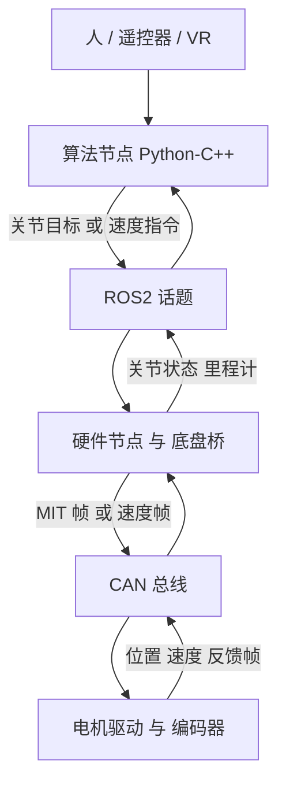

# 01 项目背景与系统总览

> **一句话定位**：P2 是你在深圳未来动力（Shenzhen Future Power）机器人软件实习（2026.03–2026.05）里做的三件事——VR 双臂遥操作、主从示教、差速底盘轮速控制——它们共用同一条"ROS 2 → CAN → 电机"的执行链，并且都在真机上验证过。这一章先把全貌讲清楚：三条线各是什么、数据怎么流、软硬件怎么分层，后面每一章再把一条线拆到公式和代码。

**本章学完你能：**

- 用 30 秒讲清 P2 的三条线分别解决什么问题、输入是什么、输出是什么；
- 画出"软件层 → ROS 2 → CAN → 电机 → 编码器反馈"的分层图，并指出每一层的责任；
- 解释为什么 VR 线用"位置/速度级"的逆运动学，主从线用"力矩级"的重力补偿，底盘线用"速度级"闭环——三者控制层级不同；
- 说出每条箭头上应该能回答的五件事：消息名、数组形状、单位、坐标系、时间；
- 知道本项目文档里哪些是 CV 的事实、哪些是教学示例数值、哪些是本项目的统一设计取值（见 README 自查表）。

**前置知识（不会也能读，但建议先扫一眼）：**

- ROS 2 的话题（topic）、节点（node）、发布/订阅：[../../02_基础知识/12_机器人软件/04_ROS2_Humble核心概念与ROS1对比.md](../../02_基础知识/12_机器人软件/04_ROS2_Humble核心概念与ROS1对比.md)
- CAN 总线与电机通信：[../../02_基础知识/11_嵌入式与通信/03_CAN_FDCAN与电机通信.md](../../02_基础知识/11_嵌入式与通信/03_CAN_FDCAN与电机通信.md)
- 坐标系与齐次变换：[../../02_基础知识/03_运动学与坐标变换/01_坐标系_旋转矩阵_齐次变换.md](../../02_基础知识/03_运动学与坐标变换/01_坐标系_旋转矩阵_齐次变换.md)

## 目录

1. CV 上这一段到底写了什么
2. 三条线一张表
3. 为什么是三条"不同层级"的控制
4. 数据流图：三条线各走一遍
5. 软硬件分层与 ROS 2–CAN 执行链
6. "五要素"读图法：每条箭头问五个问题
7. 几个周期别混：VR 频率、IK 步长、总线频率、电机内环
8. 三条线共用的知识地图
9. 本项目文档的约定：事实、示例、本项目取值
10. 面试怎么问、怎么答
11. 本章要点速记 / 自测题 / 相关链接

---

## 1. CV 上这一段到底写了什么

CV 里 P2 的原文（面试时英文就按这个说，不要加戏）：

> **Robotics Software Intern — Shenzhen Future Power Co., Ltd. — Mar 2026 – May 2026**
> Dual-arm and chassis control, covering VR teleoperation, leader–follower teaching and base motion control, all validated on real hardware through the ROS2-CAN execution chain.
>
> - **VR dual-arm teleoperation:** mapped VR controller motion to end-effector targets and solved constrained inverse kinematics with MuJoCo/Mink, achieving end-effector tracking while suppressing velocity amplification near singularities.
> - **Leader–follower teaching:** built dual-arm dynamics from URDF/KDL, designed leader-arm gravity compensation and follower position–velocity tracking, enabling low-resistance hand-guided teaching with synchronous follower motion.
> - **Wheel-speed control:** mapped body velocity commands to wheel targets via differential-drive kinematics, closed the PID loop using encoder feedback and integrated wheel motion into odometry for teleoperated and autonomous modes.

中文逐句拆开：

| CV 原句关键词 | 中文含义 | 对应章节 |
|---|---|---|
| mapped VR controller motion to end-effector targets | 把 VR 手柄的运动（不是绝对位置）映射成机械臂末端目标 | [02](./02_VR遥操作的相对位姿映射.md) |
| constrained inverse kinematics with MuJoCo/Mink | 用 MuJoCo 模型 + Mink 求解"带约束的"逆运动学（QP） | [03](./03_MuJoCo与Mink入门.md)、[04](./04_逆运动学_雅可比_奇异性与阻尼最小二乘.md)、[05](./05_约束与限位.md) |
| suppressing velocity amplification near singularities | 抑制接近奇异位形时的"关节速度放大" | [04](./04_逆运动学_雅可比_奇异性与阻尼最小二乘.md) |
| dual-arm dynamics from URDF/KDL | 用 URDF 描述 + KDL 库建立双臂动力学模型 | [06](./06_URDF_KDL动力学与重力补偿.md) |
| leader-arm gravity compensation | 主臂重力补偿 | [06](./06_URDF_KDL动力学与重力补偿.md) |
| follower position–velocity tracking | 从臂位置–速度跟踪（MIT 电机接口） | [07](./07_主从跟踪与MIT电机接口.md) |
| low-resistance hand-guided teaching | 人手拖动主臂时阻力很小 | [06](./06_URDF_KDL动力学与重力补偿.md) |
| differential-drive kinematics | 差速运动学：线/角速度 → 左右轮目标 | [08](./08_差速底盘运动学_轮速PID与里程计.md) |
| closed the PID loop using encoder feedback | 用编码器反馈闭合轮速 PID | [08](./08_差速底盘运动学_轮速PID与里程计.md)、[09](./09_STM32H7_FDCAN底盘固件解读.md) |
| integrated wheel motion into odometry | 把轮子运动积分成里程计 | [08](./08_差速底盘运动学_轮速PID与里程计.md) |
| teleoperated and autonomous modes | 遥控 / 自动两种模式 | [09](./09_STM32H7_FDCAN底盘固件解读.md) |
| ROS2-CAN execution chain | ROS 2 到 CAN 的执行链 | [10](./10_ROS2_CAN执行链.md) |

> **面试要点**：这段 CV 有两个"硬点"——"constrained IK / suppress velocity amplification"和"all validated on real hardware"。前者你要能推导（雅可比、阻尼最小二乘、QP），后者你要能说出"在真机上验证时看了什么、遇到过什么故障"（见 [11 调试与故障案例](./11_调试与故障案例.md)）。

---

## 2. 三条线一张表

| | **A. VR 双臂遥操作** | **B. 主从示教** | **C. 差速底盘** |
|---|---|---|---|
| 人做什么 | 手持 VR 控制器，空中挥动 | 用手直接拖动主臂（Leader） | 摇杆遥控，或上位机发速度指令 |
| 要解决的问题 | 人手的 6D 运动 → 机械臂末端跟着走，且不能在伸直附近暴冲 | 主臂要"轻"，从臂要"跟" | 想要车体前进/转弯的速度 → 两个轮子各转多快；并知道车走了多远 |
| 核心算法 | 相对位姿映射 → 约束逆运动学（FrameTask + PostureTask + QP + 积分） | URDF/KDL 重力补偿；MIT 位置–速度跟踪 | 差速运动学；轮速 PID；里程计积分 |
| 控制层级 | 位置/速度（运动学）层 | 力矩层（主）+ 位置速度层（从） | 速度层（含闭环） |
| 输出给执行器的量 | 关节目标（位置，必要时带速度） | 主：前馈力矩；从：位置、速度、kp、kd | 左右轮目标转速 |
| 执行接口 | ROS 2 话题 → 硬件节点 → CAN → 电机（MIT 帧） | 同上 | ROS 2/上位机 → CAN → 底盘板（STM32H7）→ CAN → 轮毂/驱动器 |
| 反馈 | 电机编码器位置/速度 | 电机编码器位置/速度 | 编码器轮速 |
| 数学基础 | 旋转矩阵/四元数、雅可比、SVD、QP | 拉格朗日动力学、重力力矩 | 刚体平面运动、离散 PID、积分 |
| 验证 | 真机 | 真机 | 真机 |

三条线"各自独立也能运行"，但它们共享同一套软件分层思想：**上层算"想要什么"，下层把"想要什么"变成电机能执行的帧，反馈再回到上层。**

> **注意（口径）**：面试时可以说"同一条 ROS2–CAN 执行链支撑了三个功能"，但不要说成"VR 手柄直接遥控了带底盘的双臂整机"之类 CV 没写的说法。三条线的入口、坐标系、执行器各不相同，要分开讲。

---

## 3. 为什么是三条"不同层级"的控制

这是理解 P2 的第一个关键点。同样是"让机器人动起来"，可以在三个层级上发命令：

```text
层级 1  任务/运动学层   "手要到空间里的这一点"     → 需要逆运动学才能变成关节命令
层级 2  关节位置/速度层 "第 3 关节转到 0.8 rad"    → 电机内部有位置环去追
层级 3  关节力矩层      "第 3 关节输出 2.1 N·m"    → 最底层、最"柔"、最"裸"
```

三条线分别落在：

- **VR 线**：从层级 1 出发，经逆运动学落到层级 2。因为人给的是"手的位置和朝向"，不是关节角，所以必须先做逆运动学。
- **主臂**：层级 3。主臂的目标不是"去哪"，而是"让人拖动时尽量不费力"——所以电机只出"抵消重力的力矩"，kp = kd = 0，不去追任何位置。
- **从臂**：层级 2。从臂的目标是"精确复现主臂的关节"，用 MIT 帧里的位置+速度+kp+kd 让电机内环去追。
- **底盘**：速度层的闭环。目标是轮速，用编码器反馈做 PID；上面再套一层差速运动学把"车体速度"拆成"轮速"。

> **提示**：MIT 电机接口之所以重要，是因为它**一条帧同时覆盖层级 2 和层级 3**：
> $\tau_{cmd}=k_p(q^*-q)+k_d(\dot q^*-\dot q)+\tau_{ff}$。
> 令 $k_p=k_d=0$ 就是纯力矩模式（主臂用），令 $\tau_{ff}$ 为零并给足 $k_p,k_d$ 就是位置–速度模式（从臂用）。详见 [07 主从跟踪与 MIT 电机接口](./07_主从跟踪与MIT电机接口.md)。

---

## 4. 数据流图：三条线各走一遍

### 4.1 线 A：VR 遥操作

```text
VR 控制器 (位置3 + 四元数4 + 触发键)
   │  XR 软件栈，约几十~百 Hz（具体见自查表）
   ▼
[坐标对齐 R_a]  VR 世界系 ──► 机器人基座系
   │  低通滤波 / 归一化
   ▼
[相对位姿]  触发键 > 0.9 时记下手柄起点 T_v0 与末端起点 T_r0
   │  Δp = p_v − p_v0 ，ΔR = R_v R_v0ᵀ
   ▼
[目标合成]  p_d = p_r0 + s·R_a·Δp ，R_d = (R_a ΔR R_aᵀ)·R_r0     ← 02 章
   │  左右手各一个 SE(3) 目标 T_d
   ▼
[Mink]  FrameTask(左) + FrameTask(右) + PostureTask → QP(OSQP)        ← 03/04/05 章
   │  输出关节速度 q̇ ，积分 q ← q + q̇·dt
   ▼
[ROS 2 话题]  关节目标数组（双臂 2×7）                                  ← 10 章
   ▼
[硬件节点]  关节 → 电机映射(偏置/方向/减速) → MIT 帧(pos, vel, kp, kd, τ)
   ▼
[SocketCAN]  can0 / can1 ──► 电机驱动 ──► 关节
   ▲                                          │
   └──────── 编码器位置/速度反馈 ◄────────────┘
```

MuJoCo 在这条链里的位置：提供**机械臂模型**（连杆、关节、末端 frame），让 Mink 算正运动学和雅可比；也可以显示/推进虚拟机械臂用于离线调试。它**不是**电机命令的生成者。

### 4.2 线 B：主从示教

```text
                ┌────────── 主臂 (Leader) ──────────┐
人手拖动 ─────► │ 电机编码器: q_L, q̇_L               │
                │   │                               │
                │   ▼                               │
                │ KDL/URDF 重力项 g(q_L)             │
                │   × gravity_comp_ratio            │
                │   ▼                               │
                │ MIT 帧: kp=0 kd=0 τ=ratio·g(q_L)  │──► 电机出托举力矩
                └───────────────────────────────────┘
                         │ q_L, q̇_L
                         ▼
                 [关节映射 f]  偏置 / 方向 / 比例
                         │ q*_F, q̇*_F
                         ▼
                ┌────────── 从臂 (Follower) ─────────┐
                │ MIT 帧: pos=q*_F vel=q̇*_F kp kd τ  │──► 电机追踪
                └───────────────────────────────────┘
                         ▲ 编码器反馈 q_F, q̇_F
```

注意主臂的**反馈**（当前真实 $q$）进了重力计算，主臂的**位置/速度**还被拿去做从臂的**指令**——同一个量在两个地方身份不同：一个是"算重力用的状态"，一个是"给从臂的参考"。这是学习笔记里反复被追问的点（"指令 vs 反馈"），详见 [06](./06_URDF_KDL动力学与重力补偿.md) 和 [07](./07_主从跟踪与MIT电机接口.md)。

### 4.3 线 C：差速底盘

```text
遥控模式:  遥控器摇杆(SBUS) ──► (前进量, 转向量)
自动模式:  上位机 ROS 2 节点 ──CAN 0x050──► (vx, vy, vw, 附加位)
                         │
                         ▼
       [差速运动学]  车体速度 (v, ω) ──► 左右轮目标 v_l, v_r
                         │
                         ▼
       [轮速闭环]  e = 目标 − 编码器反馈 ；PID ；限幅          ← 08/09 章
                         │
                         ▼
       [CAN 帧]  轮驱动器 (节点 ID 1 和 3)
                         │
                         ▼
          电机/轮子 ──► 编码器 ──► 轮速反馈 ──┐
                                             ▼
                              [里程计]  Δs, Δψ → x, y, ψ
                                             │
                    CAN 0x051 (x,y,ψ ×1000) ─┘──► 上位机 ROS 2 (odom)
```

上图的帧 ID、字段来自仓库里 STM32H7 底盘工程的源码（详见 [09](./09_STM32H7_FDCAN底盘固件解读.md)）。

---

## 5. 软硬件分层与 ROS 2–CAN 执行链

把整个 P2 系统按"谁负责什么"切成六层：

```text
┌─────────────────────────────────────────────────────────────────┐
│ L6 人机交互层   VR 控制器 / 摇杆遥控器 / 手拖主臂                │
├─────────────────────────────────────────────────────────────────┤
│ L5 任务/算法层  相对位姿映射 · Mink 逆运动学 · KDL 重力补偿      │
│                 差速运动学 · 里程计 (Python / C++)               │
├─────────────────────────────────────────────────────────────────┤
│ L4 ROS 2 通信层 话题、节点、定时器、QoS (rclpy / rclcpp)         │
├─────────────────────────────────────────────────────────────────┤
│ L3 设备驱动层   硬件节点：关节↔电机映射、MIT 打包、SocketCAN 收发 │
│                 底盘桥：Twist ↔ CAN 0x050/0x051                  │
├─────────────────────────────────────────────────────────────────┤
│ L2 总线与固件层 CAN / CAN-FD 总线；STM32H7 底盘板固件            │
├─────────────────────────────────────────────────────────────────┤
│ L1 机电层       关节电机 (MIT 接口) / 轮电机 / 编码器            │
└─────────────────────────────────────────────────────────────────┘
```

用 mermaid 表示"命令向下、反馈向上"：



每一层的"责任边界"要说清楚，否则故障时不知道往哪一层查：

| 层 | 负责 | 不负责 | 典型故障落点 |
|---|---|---|---|
| 算法层 | 目标的几何/动力学正确 | 帧格式、总线 | 抖动、方向反、跳变 |
| ROS 2 层 | 消息传递、时序、丢包策略 | 物理量是否合理 | 目标过时、延迟、话题名对不上 |
| 驱动层 | 单位换算、映射、打包、限幅 | 控制律设计 | 关节错位、符号反、单位错 |
| 总线/固件层 | 帧收发、过滤、调度 | 算法 | 丢帧、超时、总线错误 |
| 机电层 | 力矩/速度实际输出 | 软件逻辑 | 发热、饱和、间隙、摩擦 |

> **提示**：把故障"定位到层"是面试官最喜欢的回答方式之一。例如"关节动作反了"——先看是算法层（目标就反）还是驱动层（映射符号反）：看 ROS 话题上的目标数组是否正确，再看 CAN 帧里的 pos 字段。

---

## 6. "五要素"读图法：每条箭头问五个问题

学习笔记里总结得很好的一条方法：读任何一条数据流，每个箭头都要能回答——

1. **名字**：消息 / 函数 / 帧 ID 叫什么？
2. **形状**：几个数？（7 个关节？2×7？3 个速度？）
3. **单位**：m、rad、rad/s、m/s、N·m、rpm、计数？
4. **坐标系**：VR 世界系、机器人基座系、关节空间、车体系、里程计世界系？
5. **时间**：谁在什么周期、带不带时间戳、数据多旧？

举三个例子（✓ 表示本项目资料能确证，△ 表示教学示例/按本项目取值）：

| 箭头 | 名字 | 形状 | 单位 | 坐标系 | 时间 |
|---|---|---|---|---|---|
| 手柄 → 目标 | 手柄位姿 → 末端 SE(3) 目标 | 位置 3 + 四元数 4 → 4×4 | m, 无单位 | VR 世界 → 机器人基座 | 按触发键起算 △ |
| 目标 → 关节 | Mink 求解输出 | 每臂 7 个速度 → 7 个角度 | rad/s → rad | 关节空间 | dt = 1/200 s ✓（学习笔记记录的求解器配置） |
| 底盘 → 上位机 | CAN 0x051 | 3 个 int16（x,y,ψ ×1000） | mm, mrad | 里程计世界系 | 板端 5 ms 采样 ✓（源码） |

---

## 7. 几个周期别混：VR 频率、IK 步长、总线频率、电机内环

新手最容易把"频率"混成一个数。P2 里至少有五种不同的"周期"：

| 周期 | 谁的 | 作用 | 本项目依据 |
|---|---|---|---|
| VR 数据周期 | XR 运行时给出控制器位姿的间隔 | 目标更新的上限频率 | 本项目取值：Meta Quest 3 手柄位姿约 90 Hz（头显刷新率）；一般 XR 设备在 60–120 Hz 量级 |
| IK 步长 dt | Mink 积分用的"小时间步" | $q\leftarrow q+\dot q\,dt$ | 学习笔记中核对到 dt = 1/200 s = 5 ms ✓；这是**配置值**，不是实测频率 |
| ROS 2 发布周期 | 硬件节点订阅/定时器 | 目标送到驱动层的速率 | 本项目取值：目标发布 100 Hz（IK 实测循环约 120 Hz，取其下整）|
| CAN 往返周期 | 一次"发 7 帧 + 收 7 帧" | 反馈刷新率 | 受波特率与帧数限制，见 [10 章](./10_ROS2_CAN执行链.md) 的估算 |
| 电机内环周期 | 电机驱动器内部位置/电流环 | 真正的力矩闭环 | 典型 kHz 量级（电机厂商固件，非项目可控）|

> **注意**：dt = 5 ms 是"求解器每步让关节走多久"，不是"程序真的以 200 Hz 运行"。若实际循环只有 100 Hz 而积分仍用 5 ms，关节每步的位移相当于被少算了一半，跟随会变慢；反之亦然。真机上务必记录**实际循环周期**（见 [11 章](./11_调试与故障案例.md) 的"如何测"）。

---

## 8. 三条线共用的知识地图

| 知识点 | 用在哪条线 | 基础文档 |
|---|---|---|
| 旋转矩阵、四元数、齐次变换 SE(3) | A（目标合成）、B（URDF 关节坐标）| [02_基础知识/03.../01](../../02_基础知识/03_运动学与坐标变换/01_坐标系_旋转矩阵_齐次变换.md)、[02](../../02_基础知识/03_运动学与坐标变换/02_欧拉角_四元数_姿态表示.md) |
| 正逆运动学、雅可比 | A | [03](../../02_基础知识/03_运动学与坐标变换/03_正逆运动学与雅可比.md) |
| 奇异性、阻尼最小二乘、零空间 | A | [04](../../02_基础知识/03_运动学与坐标变换/04_奇异性_阻尼最小二乘_零空间.md) |
| 二次规划 QP | A | [01_数学基础/04_最优化与二次规划](../../02_基础知识/01_数学基础/04_最优化与二次规划.md) |
| 拉格朗日动力学、重力补偿、URDF/KDL | B | [02_力学与动力学建模/02](../../02_基础知识/02_力学与动力学建模/02_拉格朗日方程与机器人动力学.md)、[03/06](../../02_基础知识/03_运动学与坐标变换/06_机械臂动力学_重力补偿_URDF_KDL.md) |
| 差速运动学 | C | [02_力学与动力学建模/04](../../02_基础知识/02_力学与动力学建模/04_差速_麦克纳姆_全向轮与车辆运动学.md) |
| PID、限幅与抗积分饱和 | C（也用于 B 的从臂 PD） | [05_控制理论/02](../../02_基础知识/05_控制理论/02_PID控制全解.md)、[07](../../02_基础知识/05_控制理论/07_前馈_增益调度_限幅与饱和.md) |
| 编码器、里程计 | C | [06_状态估计/01](../../02_基础知识/06_状态估计/01_传感器_IMU_编码器_激光雷达.md)、[04](../../02_基础知识/06_状态估计/04_里程计与传感器融合.md) |
| CAN/FDCAN、MIT 电机协议 | A B C | [11_嵌入式与通信/03](../../02_基础知识/11_嵌入式与通信/03_CAN_FDCAN与电机通信.md)、[05](../../02_基础知识/11_嵌入式与通信/05_电机_编码器_驱动与力矩控制.md) |
| ROS 2、URDF、TF | A B C | [12_机器人软件/04](../../02_基础知识/12_机器人软件/04_ROS2_Humble核心概念与ROS1对比.md)、[07](../../02_基础知识/12_机器人软件/07_URDF_TF_坐标系实践.md) |
| MuJoCo / KDL / Pinocchio 工具链 | A B | [12_机器人软件/06](../../02_基础知识/12_机器人软件/06_MuJoCo_Pinocchio_KDL_工具链.md) |

与其他项目的联系（面试时可以"一条主线讲"）：

- **P1**（AIRS 球形机器人）里你用 URDF/Pinocchio 估计双臂的质心偏移并做重力前馈；P2 里你用 URDF/KDL 算单臂的关节重力矩——同一类"从 URDF 算重力项"的思路，只是一个用在质心前馈、一个用在关节力矩。见 [P1 README](../P1_AIRS球形机器人平衡控制/README.md)。
- **P3 / P7** 里你积累了 STM32 + CAN/FDCAN + 电机的经验；P2 的底盘固件和 MIT 帧是同一类技术。见 [P3 README](../P3_RoboMaster英雄机器人嵌入式控制/README.md)、[P7 README](../P7_可变腿长轮腿机器人/README.md)。
- **P5** 里有完整的里程计/EKF 链；P2 的里程计是其中"轮式里程计"那一块。见 [P5 README](../P5_车式移动机器人自主导航/README.md)。
- **P6** 里"设备抽象 + ROS/ROS 2 命令映射到底层驱动"与 P2 的硬件节点是同一类工作。见 [P6 README](../P6_深开鸿M-Robots平台软件/README.md)。

---

## 9. 本项目文档的约定：事实、示例、本项目取值

为了让你面试时不被"挖穿"，本套文档把内容分成四类，写法上做了区分：

| 类别 | 标记 | 例子 |
|---|---|---|
| **CV 事实** | 直接陈述 | "用 Mink 求解约束 IK""主臂重力补偿""里程计""ROS2-CAN 真机验证" |
| **源码事实** | 标注文件/函数 | 仓库里 XArmcontroller 的 MIT 打包、STM32 底盘的 `chassis_odom_calc` 等 |
| **教学示例数值** | 写"示例（非项目实测）" | 二连杆算例、PID 阶跃、阻尼表格 |
| **本项目取值（实机细节）** | 写"本项目取值约…" | 控制频率、增益量级、轮径轮距、编码器线数、电机型号、限幅；汇总于 [README](./README.md) 自查表 |

> **注意**：VR 目录在你的资料里是空的，所以线 A 的具体代码细节（参数名、函数名）来自学习笔记中你们逐段核对过的描述，加上 CV；凡是笔记没有确证的，本文档按"典型做法"写，并在文中说明。线 B 的重力补偿原理有仓库里 `gravity_comp.py` 作为可引用的真实代码证据；线 C 有完整的 STM32 工程源码。

---

## 10. 面试怎么问、怎么答

**Q1. Can you give me a quick overview of your internship at Future Power?**

> I worked on dual-arm and chassis control for about three months. There were three pieces. First, VR teleoperation: I mapped the VR controller's relative motion to end-effector targets and solved constrained inverse kinematics with MuJoCo and Mink. Second, leader–follower teaching: I built the arm dynamics from URDF and KDL, did gravity compensation on the leader so it is easy to drag by hand, and made the follower track the leader's position and velocity. Third, a differential-drive base: I mapped velocity commands to wheel targets, closed a PID loop on encoder feedback, and integrated odometry. All of it ran on real hardware through a ROS 2 to CAN chain.

中文要点：三条线各一句；强调"真机、ROS2–CAN"。

**追问方向**：哪一条是你最自己的工作？→ 见 README 自查表，按你真实分工回答。

**Q2. Why are the three parts controlled at different levels?**

> Because each task asks for something different. VR gives a hand pose, so I need inverse kinematics to turn it into joint targets. The leader arm should be easy to push, so I only command gravity-compensation torque and no position target. The follower must reproduce the leader, so I use position and velocity with gains. The base needs a speed loop, so encoder feedback closes a PID on wheel speed.

中文要点：任务决定层级——位姿→IK；轻→纯力矩；复现→位置速度；车→速度环。

**Q3. What does "validated on real hardware" mean in your case?**

> It means the algorithms ran through the actual execution chain, not only in simulation: commands went through ROS 2 and CAN to the motors, and I looked at encoder feedback to check tracking, direction and limits. If asked for numbers: the follower tracked the leader with an RMS joint error of about 0.01 radians, the end-effector steady error was under 5 millimetres, no joint touched its limit, and the base drove a 2-metre line with under 5 centimetres of sideways drift.

中文要点：真机=命令真的走 ROS2→CAN→电机；看编码器反馈。具体指标以 README 自查表的统一取值为准，不要现场另编数字。

**Q4. Where does MuJoCo fit — do you need it on the real robot?**

> MuJoCo gives me the robot model: kinematics and Jacobians for Mink, and a visualisation for offline debugging. The real robot does not need MuJoCo to move; it needs joint commands. MuJoCo and Mink compute those joint commands, and the motors execute them through ROS 2 and CAN.

中文要点：MuJoCo=模型/算雅可比/可视化；真机执行靠关节命令+电机。

---

## 本章要点速记

1. P2 = 三条线：VR 双臂遥操作、主从示教、差速底盘；共用 ROS2→CAN→电机执行链，**真机验证**。
2. 控制层级不同：VR 是"运动学→关节位置"，主臂是"纯力矩"，从臂是"位置+速度"，底盘是"速度闭环"。
3. MIT 电机接口一条帧同时支持力矩模式和位置–速度模式：$\tau=k_p(q^*-q)+k_d(\dot q^*-\dot q)+\tau_{ff}$。
4. 分层：算法 → ROS 2 → 驱动 → 总线/固件 → 电机；故障要定位到层。
5. 读图五要素：名字、形状、单位、坐标系、时间。
6. 周期要分清：VR 数据、IK 步长 dt、ROS 发布、CAN 往返、电机内环；dt=5 ms 是配置不是实测。
7. MuJoCo/Mink 只算关节命令，不直接控制硬件。
8. 面试只说 CV 有的；细节没有就按 README 自查表的统一取值回答，不要现场另编数字。

## 自测题

1. 为什么主臂重力补偿时 $k_p=k_d=0$，而从臂必须给非零的 $k_p,k_d$？（要点：目标不同；主臂要被人推动，从臂要追位置。）
2. VR 线里，"目标"和"反馈"分别是什么？它们在哪一步被比较？（要点：目标=末端 SE(3) 目标，由 Mink 内部与当前 FK 比较；关节层面的反馈=编码器。）
3. 一个 dt=5 ms 的 IK，关节速度 0.4 rad/s，一步走多少？（0.4×0.005=0.002 rad。）
4. 画出底盘线从"摇杆"到"里程计上报"的数据流，并标出哪里用到了编码器。
5. "关节动作反了"应该先查哪两层？怎么区分？（算法层 vs 驱动层；看话题上目标数组与 CAN 帧 pos 字段。）

## 相关链接

- 下一章：[02 VR 遥操作的相对位姿映射](./02_VR遥操作的相对位姿映射.md)
- 工程过程与频率周期：[20 工程化实践](./20_工程化实践_频率周期与问题解决.md)
- 返回：[P2 README](./README.md)
- 英文口述：[99 英文面试口述与深挖问答](./99_英文面试口述与深挖问答.md)
- 学习笔记（原始疑惑）：[../../05_学习笔记归档/P2/P2_本对话问答逐字稿.md](../../05_学习笔记归档/P2/P2_本对话问答逐字稿.md)
