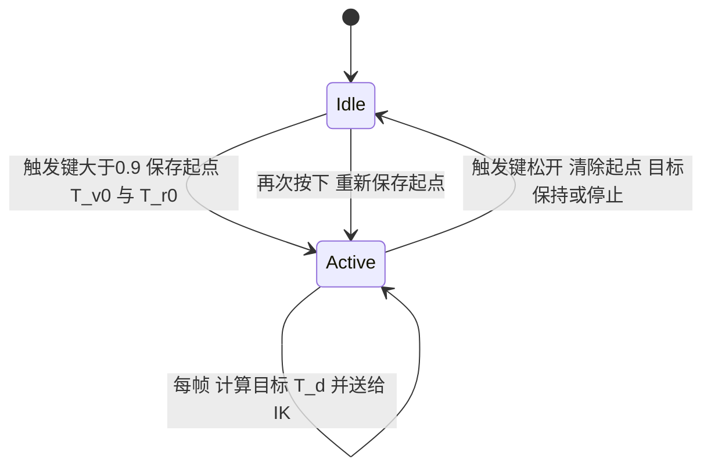

# 02 VR 遥操作的相对位姿映射

> **一句话定位**：VR 手柄给出的是"手在 VR 房间里的位置和朝向"，机械臂需要的是"末端在机器人基座系里的目标位姿"。两者的原点、坐标轴、尺度都不同，所以不能直接照搬。解决办法是**相对位姿映射（relative pose mapping）**：按下触发键时同时记住手柄起点和末端起点，之后只让末端跟着"手柄相对起点的位移和转动"走。这一章把这个映射的每一步——起点保存、坐标对齐 $R_a$、缩放 $s$、四元数、乘法顺序——从零推导并手算一遍。

**本章学完你能：**

- 解释为什么不能把手柄绝对位置当目标，并讲清"激活时保存起点"的作用；
- 写出并推导位置目标 $p_d=p_{r0}+s\,R_a(p_v-p_{v0})$ 和旋转目标 $R_d=(R_a\,\Delta R\,R_a^{\mathsf T})\,R_{r0}$；
- 解释为什么旋转要"夹着 $R_a$ 做共轭（相似变换）"，以及乘法顺序错了会发生什么；
- 说明为什么**只缩放平移、不缩放旋转**；
- 用四元数完成同一件事，并识别 $q$ 与 $-q$ 的陷阱；
- 手算一个带数字的完整例子，并写出最终的 4×4 目标矩阵；
- 列出这条映射上最常见的 8 种错误和对应现象。

**前置知识：**

- 旋转矩阵、齐次变换：[01_坐标系_旋转矩阵_齐次变换](../../02_基础知识/03_运动学与坐标变换/01_坐标系_旋转矩阵_齐次变换.md)
- 四元数与姿态表示：[02_欧拉角_四元数_姿态表示](../../02_基础知识/03_运动学与坐标变换/02_欧拉角_四元数_姿态表示.md)
- 上一章：[01 项目背景与系统总览](./01_项目背景与系统总览.md)

## 目录

1. 要解决的问题：为什么不能用绝对位置
2. 符号、坐标系与单位
3. 相对控制的流程：离合器（clutch）逻辑
4. 位置映射的推导与手算
5. 坐标对齐矩阵 $R_a$：怎么来、怎么验
6. 旋转映射的推导：相对旋转、共轭、乘法顺序
7. 为什么只缩放平移，不缩放旋转
8. 四元数版本与 $q/-q$ 陷阱
9. 滤波、限幅与失联处理（工程细节）
10. 手柄点与腕部 TCP 的固定偏移
11. 合成目标 SE(3)：完整数字例子
12. 常见错误与现象
13. 面试怎么问、怎么答
14. 本章要点速记 / 自测题 / 相关链接

---

## 1. 要解决的问题：为什么不能用绝对位置

设想最朴素的做法：每一帧读到手柄位置 $p_v$，直接把它当机械臂末端目标。会发生三件坏事：

1. **启动跳变**：手柄在 VR 房间里可能在 $(1.0,\,2.0,\,1.2)$ m，机械臂工作空间在基座前方 $(0.3,\,0,\,0.4)$ m。一启动，目标瞬间跳到房间坐标，机械臂想"冲过去"。
2. **够不到**：VR 房间的坐标范围和机械臂的可达范围根本不重叠。
3. **没有"暂停/重新定位"的手段**：人手一旦走到房间边上，机械臂无法"重新找舒服位置"。

所以采用**相对控制**：

> 按下触发键的瞬间，把"手柄当时的位姿"和"末端当时的位姿"配成一对起点。以后目标 = 末端起点 + 缩放后的（手柄现在 − 手柄起点）。

这样不需要手柄和末端在启动时重合，也不要求它们的绝对位置有任何关系；手柄不动，目标就不动。

学习笔记里你问过一个很关键的问题：**"手的位置和机械臂的位置是不同步的是吗？"**——对。绝对位置不同步，**变化量**同步。你还问过"初始化手臂后，手在与手臂差不多的位置按下开始，是不是就能大致同步？"——可以让手感更直观，但**不是必须**，因为配对的是起点，不要求起点重合；真正影响手感的是**坐标轴方向是否对齐、缩放比例**。

---

## 2. 符号、坐标系与单位

先固定记号（本章和后面章节一致）：

| 符号 | 含义 | 单位 |
|---|---|---|
| $W$ | VR 世界坐标系（XR 运行时给出的 tracking space） | — |
| $B$ | 机器人基座坐标系（base frame） | — |
| $p_v,\ R_v$ | 手柄当前位置、朝向（在 $W$ 中表示） | m，旋转矩阵 |
| $p_{v0},\ R_{v0}$ | 触发时刻保存的手柄起点位姿 | m，旋转矩阵 |
| $p_{r0},\ R_{r0}$ | 触发时刻保存的末端（TCP）起点位姿（在 $B$ 中表示） | m，旋转矩阵 |
| $\Delta p=p_v-p_{v0}$ | 手柄相对位移（在 $W$ 中） | m |
| $\Delta R=R_vR_{v0}^{\mathsf T}$ | 手柄相对旋转（在 $W$ 中的增量） | 旋转矩阵 |
| $R_a$ | 坐标对齐旋转：把 $W$ 中的向量换成 $B$ 中的向量 | 旋转矩阵 |
| $s$ | 位置缩放系数 | 无量纲 |
| $p_d,\ R_d$ | 末端目标位置、朝向（在 $B$ 中） | m，旋转矩阵 |

常用的两个"读法"（读错一个，方向就全错）：

- $R_a\,u^{W}=u^{B}$：$R_a$ 左乘一个 VR 系里的向量，得到同一个向量在机器人系里的坐标。
- 旋转矩阵 ${}^{B}R_E$ 的**列**是手腕坐标轴在基座系里的方向。第 3 列就是手腕 $z$ 轴指向哪里（见 [01 坐标系](../../02_基础知识/03_运动学与坐标变换/01_坐标系_旋转矩阵_齐次变换.md)）。

> **提示**：本章为了简洁，不再给 $R_{v}$ 等写左上标，但**每个量表达在哪个系里**始终按上表理解：手柄量在 $W$，末端/目标量在 $B$。学习笔记里你在这里卡住过一次（"参考坐标系是什么"），记住"量在哪个系里"比记公式更重要。

---

## 3. 相对控制的流程：离合器（clutch）逻辑

相对控制的核心是一个"离合器"：按下才连接，松开就断开。



三个动作：

1. **按下（触发键 > 阈值，学习笔记记录的是 0.9）**：读取当前手柄位姿，存为 $T_{v0}$；读取当前末端位姿（来自关节角的正运动学），存为 $T_{r0}$。这一步保证目标从"当前末端位姿"开始，**连续、不跳**。
2. **按住期间**：每一帧用 $T_v$ 与 $T_{v0}$ 算相对量，合成 $T_d$，交给 IK。
3. **松开**：清除起点参考。再次按下时**重新**保存起点——这样人可以先把手收回到舒服位置，松开，再按下，继续"棘轮式"地推进，机械臂不会回跳。

> **注意**：松开以后目标怎么处理（保持最后一个目标 / 停止更新 / 回到安全姿态）是工程策略，不同实现不同。学习笔记提醒过：IK 异常时代码"返回当前关节"只是"这一步不前进"，**不等于安全停机**——如果下游位置环仍使能，电机还在出力保持。具体的失联策略放在 [10 章](./10_ROS2_CAN执行链.md) 讲。

两种常见的末端控制模式（学习笔记里出现过）：

- **position 模式**：只用位置映射，朝向保持在起点 $R_{r0}$ 不变；
- **pose 模式**：位置和旋转增量一起应用。

---

## 4. 位置映射的推导与手算

### 4.1 推导

目标：末端位置的**变化量**应该与手柄位置的变化量成比例、方向对应。

1. 手柄在 $W$ 系里的位移：$\Delta p=p_v-p_{v0}$。
2. 把它换到机器人系：$R_a\,\Delta p$。
3. 乘缩放：$s\,R_a\,\Delta p$。
4. 加到末端起点：

$$
p_d=p_{r0}+s\,R_a\,(p_v-p_{v0}).
$$

注意：**位移是向量**，只需要旋转，不需要平移（位移是两点之差，起点的平移被减掉了）。这也是为什么这里只用 $R_a$，而不用完整的 4×4 变换。

### 4.2 一维手算（先建立直觉，学习笔记的第一个例子）

- 按下时手柄 $x=1.00$ m，末端 $x=0.30$ m；
- 后来手柄到 $x=1.10$ m，位移 $+0.10$ m；
- $s=0.5$，$R_a=I$：末端目标 $=0.30+0.5\times0.10=0.35$ m。

手柄动 10 cm，末端目标动 5 cm；绝对位置 $1.10$ m 从未进入公式。

### 4.3 三维手算（示例数值，非项目实测）

取 OpenXR 常见的 VR 轴约定：$+x$ 右、$+y$ 上、$-z$ 前（人面朝的方向）。机器人基座系约定：$+x$ 前、$+y$ 左、$+z$ 上。则对齐矩阵（5.1 节推导）为

$$
R_a=\begin{bmatrix}0&0&-1\\-1&0&0\\0&1&0\end{bmatrix}.
$$

给定：

- $p_{r0}=(0.30,\ 0,\ 0.40)^{\mathsf T}$ m，$s=0.5$；
- 手柄位移 $\Delta p=(0.10,\ 0.05,\ -0.20)^{\mathsf T}$ m——意思是向右 10 cm、向上 5 cm、向前 20 cm（因为 $-z$ 是前）。

逐步：

$$
R_a\Delta p=
\begin{bmatrix}0&0&-1\\-1&0&0\\0&1&0\end{bmatrix}
\begin{bmatrix}0.10\\0.05\\-0.20\end{bmatrix}
=\begin{bmatrix}0\cdot0.10+0\cdot0.05+(-1)(-0.20)\\(-1)(0.10)+0+0\\0+1\cdot0.05+0\end{bmatrix}
=\begin{bmatrix}0.20\\-0.10\\0.05\end{bmatrix}.
$$

读结果：机器人系里"前 20 cm、右 10 cm（$y=-0.10$ 是向右）、上 5 cm"，与人手的动作方向一致，这就是对齐正确。再乘 $s$：

$$
sR_a\Delta p=(0.10,\ -0.05,\ 0.025)^{\mathsf T},\qquad
p_d=(0.30,0,0.40)+(0.10,-0.05,0.025)=(0.40,\ -0.05,\ 0.425)^{\mathsf T}\ \text{m}.
$$

> **检查习惯**：每次推导完先做方向核对——"人手向右，目标向右了吗？向前呢？"这能在写代码前抓住 90% 的轴错误。

---

## 5. 坐标对齐矩阵 $R_a$：怎么来、怎么验

### 5.1 怎么构造

$R_a$ 的**第 $i$ 行**回答"机器人第 $i$ 个轴的分量，等于 VR 向量的哪个分量（带符号）"。对上面的约定：

| 机器人轴 | 等于 VR 的 | 所以这一行是 |
|---|---|---|
| $x$（前） | $-z_W$ | $(0,\ 0,\ -1)$ |
| $y$（左） | $-x_W$ | $(-1,\ 0,\ 0)$ |
| $z$（上） | $+y_W$ | $(0,\ 1,\ 0)$ |

也可以反过来想：**$R_a$ 的第 $j$ 列是"VR 的第 $j$ 个轴在机器人系里的方向"**。VR 的 $x_W$（右）在机器人系里是 $(0,-1,0)$（$-y$），对应第 1 列 $(0,-1,0)^{\mathsf T}$ ✓；VR 的 $y_W$（上）是 $(0,0,1)$，第 2 列 ✓；VR 的 $z_W$（后）是机器人 $(-1,0,0)$，第 3 列 ✓。

### 5.2 必须检查的两个性质

$R_a$ 必须是**真旋转（proper rotation）**：

$$
R_aR_a^{\mathsf T}=I,\qquad \det R_a=+1.
$$

- 若 $\det R_a=-1$，说明你不小心做了**镜像**（比如只把 $x$ 和 $y$ 对调而没有加负号）。现象：左右手动作反了，或绕某轴转动方向反了，而位移看起来"差不多对"。
- 若不正交（比如手滑写成了 0.7），就混入了缩放/剪切。

教学检查代码（示例，非项目源码）：

```python
import numpy as np
Ra = np.array([[0, 0, -1],
               [-1, 0, 0],
               [0, 1, 0]], dtype=float)
assert np.allclose(Ra @ Ra.T, np.eye(3))      # 正交
assert np.isclose(np.linalg.det(Ra), 1.0)     # 行列式 +1（不是镜像）
```

对上面的 $R_a$ 手算行列式：按第一行展开，$\det=0\cdot(\cdots)-0\cdot(\cdots)+(-1)\cdot\big((-1)(1)-0\cdot0\big)=(-1)(-1)=+1$ ✓。

### 5.3 项目里的情形

按学习笔记，VR 路径里有一个固定的"XR → 世界"轴变换（代码中叫 `R_headset_world` 一类的名字），位置被它左乘，四元数用 $q_a\,q\,q_a^{*}$ 改轴。这个固定变换只负责把 XR 运行时的原始轴约定换成统一约定；**从统一约定到机械臂基座系**还可能需要一个由安装方向决定的对齐。两步合起来，就是本章的 $R_a$。

> **本项目取值：** VR 设备为 Meta Quest 3 手柄，软件栈走 OpenXR，位姿经局域网 WebSocket 送到 PC 上的遥操作进程，约 90 Hz。XR 原始轴约定是右手系：$x$ 右、$y$ 上、$-z$ 前。机械臂基座按人面向前方安装（基座 $x$ 朝前、$y$ 朝左、$z$ 朝上），所以最终 $R_a=\begin{bmatrix}0&0&-1\\-1&0&0\\0&1&0\end{bmatrix}$（即 5.2 节的检查代码，$\det=+1$）。

---

## 6. 旋转映射的推导：相对旋转、共轭、乘法顺序

这是学习笔记里被追问最多的地方（你先后问了"为什么要有 $C$""为什么乘法顺序重要""$\Delta R=R_{H0}^{\mathsf T}R_H$ 是什么"）。本节分三步把它讲透。

### 6.1 第一步：手柄"相对起点转了多少"

我们要一个量，只描述"从起点到现在又转了什么"。有两种自然的写法：

- **世界系增量**：$\Delta R_W=R_vR_{v0}^{\mathsf T}$。含义：$R_v=\Delta R_W\,R_{v0}$，即"先到起点姿态，再绕**世界轴**转 $\Delta R_W$"。
- **本体系增量**：$\Delta R_L=R_{v0}^{\mathsf T}R_v$。含义：$R_v=R_{v0}\,\Delta R_L$，即"先到起点姿态，再绕**手柄自己的轴**转 $\Delta R_L$"。

两者关系：$\Delta R_W=R_{v0}\,\Delta R_L\,R_{v0}^{\mathsf T}$（同一个转动，换了参考系表达）。

学习笔记里项目用的是 $\Delta R=R_vR_{v0}^{\mathsf T}$（四元数里对应 `quat_diff`），也就是**世界系增量**。含义最直观："我在 VR 房间里把手柄绕竖直轴向左转了 30°"，增量就是"绕世界竖直轴转 30°"，与手柄起点怎么拿无关。

### 6.2 第二步：换到机器人系——相似变换（共轭）

$\Delta R$ 是"在 VR 世界系里表示"的转动。我们想要同一个转动在机器人基座系里怎么写。

设 $u$ 是 VR 系里的向量，它被转动后变成 $\Delta R\,u$。把两边都换到机器人系：

- 转动前：$u^{B}=R_a\,u$；
- 转动后：$(\Delta R\,u)^{B}=R_a\,\Delta R\,u$。

我们要找一个矩阵 $\Delta R^{B}$，使 $\Delta R^{B}\,u^{B}=(\Delta R\,u)^{B}$，即 $\Delta R^{B}R_a\,u=R_a\Delta R\,u$ 对所有 $u$ 成立。所以

$$
\boxed{\ \Delta R^{B}=R_a\,\Delta R\,R_a^{\mathsf T}\ }
$$

这就是"夹着 $R_a$ 的共轭"（similarity transform，相似变换）。它回答了笔记里那个问题"$C\Delta R_HC^{\mathsf T}$ 为什么要这样写"——**$C$ 就是这里的 $R_a$**，它负责改变参考系，前乘一次、后乘它的转置一次，是因为矩阵既作用在输入向量上，也作用在输出向量上，两头都要换系。

一个几何直觉：转动轴 $n$ 在新系里变成 $R_a n$，转动角度不变。也就是说共轭**不改变转了多少度，只改变绕哪个（新系里的）轴**。

### 6.3 第三步：作用到末端起点——为什么是左乘

机器人系里的增量 $\Delta R^{B}$ 是"绕**基座系**的轴"的转动。要把它加到末端起点朝向 $R_{r0}$（也表示在基座系里）上，就是：

$$
\boxed{\ R_d=\big(R_a\,\Delta R\,R_a^{\mathsf T}\big)\,R_{r0}\ }
$$

**左乘**表示"先有 $R_{r0}$，再绕基座系的轴转"。若改成右乘 $R_{r0}\,\Delta R^{B}$，含义就变成"绕**末端自己的轴**转"，转动方向会随当前末端姿态变化——这通常不是人想要的（人把手柄绕竖直轴向左转，希望末端也绕竖直轴向左转，而不是绕夹爪自己的某个轴）。

### 6.4 数字例子：左乘与右乘差在哪

示例数值（非项目实测）：手柄起点 $R_{v0}=I$，现在绕 VR 的 $y$ 轴（竖直向上）转 $30^\circ$：

$$
\Delta R=R_y(30^\circ)=\begin{bmatrix}0.866&0&0.5\\0&1&0\\-0.5&0&0.866\end{bmatrix}.
$$

共轭：转动轴 $(0,1,0)_W$ 经 $R_a$ 变为 $R_a(0,1,0)^{\mathsf T}=(0,0,1)^{\mathsf T}$，即机器人的竖直轴 $z$。所以

$$
R_a\Delta R R_a^{\mathsf T}=R_z(30^\circ)=\begin{bmatrix}0.866&-0.5&0\\0.5&0.866&0\\0&0&1\end{bmatrix}.
$$

（可以直接代入 $R_a$ 做矩阵乘法验证；这个结果的物理意义是："人把手柄绕竖直轴向左转 30°" ⇒ "机器人系里绕竖直轴向左转 30°"。）

设末端起点朝向：夹爪 $z$ 轴指向前方（$+x_B$），夹爪 $x$ 轴指向下方：

$$
R_{r0}=\begin{bmatrix}0&0&1\\0&1&0\\-1&0&0\end{bmatrix}
\quad(\text{列}=\text{夹爪 }x,y,z\text{ 轴在基座系里的方向}).
$$

**左乘（正确）：**

$$
R_d=R_z(30^\circ)R_{r0}
=\begin{bmatrix}0&-0.5&0.866\\0&0.866&0.5\\-1&0&0\end{bmatrix}.
$$

第 3 列（夹爪 $z$ 轴）变成 $(0.866,\ 0.5,\ 0)$：夹爪从"正前方"偏向"前左 30°"——和人手向左转一致 ✓。

**右乘（错误）：**

$$
R_{r0}R_z(30^\circ)=\begin{bmatrix}0&0&1\\0.5&0.866&0\\-0.866&0.5&0\end{bmatrix}.
$$

第 3 列仍是 $(1,0,0)$：夹爪指向没变，而是**绕自己的指向轴滚转（roll）**了 30°。操作者会感到"我明明向左转，夹爪却在原地拧螺丝"。

> **面试要点**：能说出"左乘 = 绕固定的基座轴，右乘 = 绕运动的本体轴"，并给出这个 30° 的例子，说明你真的理解而不是背公式。

---

## 7. 为什么只缩放平移，不缩放旋转

位置缩放很自然：$p_d=p_{r0}+s\cdots$。但**旋转不能把矩阵乘以 $s$**：

- 若 $\Delta R\to s\,\Delta R$，则 $(s\Delta R)(s\Delta R)^{\mathsf T}=s^2I\ne I$，不再是旋转矩阵，混入了均匀缩放；
- 即使想"把 90° 转动缩成 45°"，正确做法也不是乘标量，而是对**轴角**缩放：$\Delta R^{k}=\exp(k\,\log\Delta R)$（先取对数得到轴角向量 $\theta n$，缩放为 $k\theta\,n$，再取指数回到旋转矩阵）。

在 P2 的实现里（按学习笔记）：位置乘缩放系数，旋转**不缩放**，保持一对一（手柄转 90°，末端转 90°）。理由是：操作者对"手腕朝向"需要 1:1 的直觉；而平移缩放能让小范围手动作覆盖机械臂的工作空间或实现更精细的操作。

> 如果面试官问"那你想缩放旋转怎么办"，答案是上面的轴角缩放，或者用 SLERP 对单位四元数做插值：$\text{slerp}(I,q_\Delta,k)$。

---

## 8. 四元数版本与 $q/-q$ 陷阱

### 8.1 四元数怎么做同一件事

单位四元数 $q=(w,\ x,\ y,\ z)$（本文用 wxyz 顺序）表示绕单位轴 $n$ 转角 $\theta$：$q=(\cos\frac\theta2,\ n\sin\frac\theta2)$。

- 相对旋转：$q_\Delta=q_v\otimes q_{v0}^{-1}$（$q^{-1}=q^{*}=(w,-x,-y,-z)$，对单位四元数）。对应 $\Delta R=R_vR_{v0}^{\mathsf T}$。
- 换系（共轭）：$q'_\Delta=q_a\otimes q_\Delta\otimes q_a^{*}$，其中 $q_a$ 是 $R_a$ 对应的四元数。**共轭的效果：标量部分 $w$ 不变，向量部分被 $R_a$ 旋转**，即 $q'_\Delta=(w,\ R_a\,\vec v)$。
- 合成目标：$q_d=q'_\Delta\otimes q_{r0}$（与矩阵左乘对应）。

用上一节的数字：$30^\circ$ 绕 $y_W$：

$$
q_\Delta=(\cos15^\circ,\ 0,\ \sin15^\circ,\ 0)=(0.9659,\ 0,\ 0.2588,\ 0).
$$

$R_a$ 对应的四元数：迹 $=0$，所以 $w=\tfrac12\sqrt{1+0}=0.5$；$x=\dfrac{R_{32}-R_{23}}{4w}=\dfrac{1-0}{2}=0.5$；$y=\dfrac{R_{13}-R_{31}}{4w}=\dfrac{-1-0}{2}=-0.5$；$z=\dfrac{R_{21}-R_{12}}{4w}=\dfrac{-1-0}{2}=-0.5$。即 $q_a=(0.5,\ 0.5,\ -0.5,\ -0.5)$。向量部分 $(0,0.2588,0)$ 被 $R_a$ 旋转成 $(0,0,0.2588)$，所以

$$
q'_\Delta=(0.9659,\ 0,\ 0,\ 0.2588)=\text{绕 }z_B\text{ 转 }30^\circ,
$$

与矩阵结果一致 ✓。

### 8.2 两个很容易踩的坑

**坑 1：分量顺序。** SciPy 的 `Rotation.from_quat` 用 $(x,y,z,w)$；MuJoCo、Mink 的 `SO3` 用 $(w,x,y,z)$。把 xyzw 当 wxyz 用不会报错，但旋转是乱的。学习笔记里的源码在入口处显式做了 `xyzw → wxyz`。

**坑 2：$q$ 与 $-q$ 表示同一个旋转。** 若对两个四元数做**线性加权平均再归一化**（常见于滤波），当它们符号相反时会相消。数字例子：

- 旋转 $-10^\circ$（绕 $z$）：$q_1=(\cos5^\circ,\ 0,\ 0,\ -\sin5^\circ)=(0.9962,\ 0,\ 0,\ -0.0872)$；
- 同一个旋转的另一种表示（等价于转 $350^\circ$）：$q_2=-q_1=(-0.9962,\ 0,\ 0,\ 0.0872)$。

平均：$0.5q_1+0.5q_2=(0,0,0,0)$，归一化时除以零。

学习笔记明确指出：项目源码对四元数是"线性融合后归一化"（等价于 nlerp 式处理），**没有**显式处理相邻两帧的 $q/-q$ 半球。所以：

- 你**可以**说"线性融合后归一化，在小角度、相邻帧接近时效果等价于 SLERP 的近似"；
- 你**不应**说"我们用了 SLERP"；
- 你**可以**主动说"改进方式是：融合前若 $q_{prev}\cdot q_{new}<0$ 则把 $q_{new}$ 取反（统一半球），或用 SLERP"。

SLERP 公式（供追问）：

$$
\text{slerp}(q_0,q_1,t)=\frac{\sin((1-t)\Omega)}{\sin\Omega}q_0+\frac{\sin(t\Omega)}{\sin\Omega}q_1,\quad \cos\Omega=q_0\cdot q_1,
$$

并先保证 $q_0\cdot q_1\ge0$。

---

## 9. 滤波、限幅与失联处理（工程细节）

手柄数据有抖动（手抖、传感器噪声），直接送入 IK 会让末端抖。常见做法：

### 9.1 一阶低通（指数滑动平均）

$$
y_k=y_{k-1}+\alpha\,(x_k-y_{k-1}),\qquad 0<\alpha\le1.
$$

近似时间常数（采样周期 $T$）：$\tau\approx T\,\dfrac{1-\alpha}{\alpha}$。示例：$T=1/90$ s，$\alpha=0.2$：$\tau\approx0.0111\times4=0.044$ s。

代价：**引入延迟**。$\alpha$ 越小越平滑、越滞后。手感上，几十毫秒的延迟通常可以接受，但超过 100 ms 会明显"粘"。学习笔记里特别强调："VR 数据频率、低通延迟、机器人控制频率不是同一个量"——别把它们混为一谈。

对四元数的滤波见 8.2 节：先统一半球，融合后归一化。

### 9.2 典型的保护层（典型做法，不代表项目全部实现）

| 保护 | 作用 | 备注 |
|---|---|---|
| 目标位移限幅（workspace clamp） | 目标不超出机械臂合理可达盒 | 防止走到够不到的地方 |
| 目标速度限幅（rate limit） | 单帧目标变化量上限 | 防止手柄瞬间跳变 → 机械臂暴冲 |
| 数据新鲜度检查 | 数据时间戳过旧则不更新 | 防止"失联后旧目标持续" |
| 触发键滞回 | 按下阈值 0.9，松开阈值更低 | 防止键值抖动导致反复启停 |

> **本项目取值：** 四层保护都用上了。工作空间盒约 $\pm0.4$ m（相对起点）；速度限幅：末端线速度 0.5 m/s（100 Hz 下单步 5 mm）、角速度 1.5 rad/s；数据新鲜度：VR 数据超过 200 ms 无更新，目标冻结在当前位姿；触发键滞回：按下阈值 0.9、松开阈值 0.7。

---

## 10. 手柄点与腕部 TCP 的固定偏移

手柄的追踪点（grip pose）通常在手掌握住的位置，而机械臂的"末端"是 TCP（Tool Center Point，工具中心点，如夹爪中心）。两者之间有一个**固定**偏移 $T_{off}$（手握姿态到 TCP 的变换）。若要让"人手的姿态"直观对应"夹爪的姿态"，需要在映射里加入这个偏移：

$$
T_d^{TCP}=T_d\cdot T_{off}.
$$

其中 $T_d$ 是上文合成出的"抓握点目标"。如果不加，现象通常是：人把手柄绕自己手心转，夹爪不是绕自己的中心转，而是绕腕部转，目标位置会有一个随姿态变化的错位（大小等于偏移长度）。

> 这是学习笔记里提到的"TCP 偏移"问题。本项目取值：手柄握持点到夹爪 TCP 沿手柄 $-z$ 方向约 8 cm（固定偏移 $T_{off}$，纯平移、无旋转），由夹爪安装和手柄握持方式决定；标定方法是让人握住手柄只转姿态，调 $T_{off}$ 直到夹爪中心几乎不动。

---

## 11. 合成目标 SE(3)：完整数字例子

SE(3) 是 4×4 齐次变换：

$$
T=\begin{bmatrix}R&p\\0&1\end{bmatrix}.
$$

最后一行 $[0\ 0\ 0\ 1]$ 的作用（你在学习笔记里问过"为什么要有最后一行"）：

1. 让点写成 $(x,y,z,1)^{\mathsf T}$ 后，$T\tilde p=(Rp+t,\ 1)^{\mathsf T}$——**第四个数保持为 1**，点才仍然是点；
2. 使 4×4 矩阵可以直接相乘：$T_2T_1=\begin{bmatrix}R_2R_1&R_2p_1+p_2\\0&1\end{bmatrix}$，仍是刚体变换（封闭性）；
3. 求逆有简洁形式：$T^{-1}=\begin{bmatrix}R^{\mathsf T}&-R^{\mathsf T}p\\0&1\end{bmatrix}$；
4. 区分点（第四个数为 1）和方向向量（第四个数为 0，不受平移影响）；
5. 保证它是刚体变换，不混入缩放、剪切、透视。

把 4.3 节和 6.4 节的结果合成：

$$
T_d=\begin{bmatrix}0&-0.5&0.866&0.40\\0&0.866&0.5&-0.05\\-1&0&0&0.425\\0&0&0&1\end{bmatrix}.
$$

前三列是目标朝向，第 4 列前三个数是目标位置。这就是交给 Mink 的 `FrameTask` 的目标（下一章）。

### 完整流水（一个周期）

```text
1. 读手柄: p_v, q_v (xyzw) -> 转 wxyz -> 轴变换 -> 低通/归一化
2. 触发 >0.9 且没有起点 -> 保存 T_v0 与 T_r0 (T_r0 来自当前关节角的正运动学)
3. Δp = p_v - p_v0 ;  ΔR = R_v R_v0^T
4. p_d = p_r0 + s * R_a Δp ;  R_d = (R_a ΔR R_a^T) R_r0
5. (可选) 目标限幅/速度限幅/加 TCP 偏移
6. 拼 T_d, 送 IK
7. 触发松开 -> 清除起点
```

---

## 12. 常见错误与现象

| # | 错误 | 现象 | 怎么定位 |
|---|---|---|---|
| 1 | 把绝对位置混入目标（忘了减 $p_{v0}$） | 按键瞬间机械臂跳向很远的地方 | 在按下那一帧打印 $p_d$ 与 $p_{r0}$，应相等 |
| 2 | $R_a$ 行列式为 −1（镜像） | 左右动作反，或某轴转动反向，位移"看起来"差不多 | 做 5.2 的两个断言；逐轴单独动手柄验证 |
| 3 | 轴映射顺序错（行列写反，即用了 $R_a^{\mathsf T}$） | 前后动手柄，末端却左右动 | 单轴测试：只向前移 10 cm，看末端动哪里 |
| 4 | 旋转右乘 | 手柄转动，夹爪绕自身轴"滚" | 绕竖直轴转手柄 30°，看夹爪指向变不变 |
| 5 | 缩放了旋转矩阵 | 目标姿态奇怪、不正交，IK 误差大 | 检查 $R_dR_d^{\mathsf T}\approx I$ |
| 6 | 四元数分量顺序错（xyzw/wxyz） | 旋转乱跳、不可预测 | 单位四元数 $(1,0,0,0)$ 测试：应表示无旋转 |
| 7 | $q/-q$ 相消 | 偶发地目标姿态突变或 NaN | 融合前检查点积符号；打印范数 |
| 8 | 单位混用（m 与 mm） | 动 1 cm 末端动 1 m（或相反） | 打印位移量级；检查接口单位 |
| 9 | 失联后旧目标持续 | 手柄断连，机械臂仍在追旧目标 | 检查数据时间戳与超时策略 |
| 10 | 忘了 TCP 偏移 | 绕手心转的动作变成绕腕转 | 对比姿态变化时位置是否错位 |

---

## 13. 面试怎么问、怎么答

**Q1. Why don't you map the VR controller's absolute position directly to the arm?**

> Because the VR tracking space and the robot base frame have different origins, axes and ranges. If I used the absolute position, the arm would jump to the controller's room coordinates when I start, and it might be out of reach. So I use relative motion: when the clutch is pressed I store the controller pose and the end-effector pose as two reference points, and afterwards the target is the end-effector start plus the scaled controller displacement. Releasing the clutch clears the reference, so I can reposition my hand and continue without any jump.

中文要点：坐标系/范围不同 → 绝对映射会跳变/够不到；相对映射 + 离合器，松开可重新定位。

*追问*：Is the reference stored once or every time? → 每次按下都重新存，保证连续。

**Q2. Write the target pose formulas and explain each term.**

> Position: $p_d = p_{r0} + s\,R_a\,(p_v - p_{v0})$. I take the controller displacement, rotate it into the robot base frame with $R_a$, scale it by $s$, and add it to the end-effector start. Rotation: $R_d = (R_a\,\Delta R\,R_a^T)\,R_{r0}$ where $\Delta R = R_v R_{v0}^T$. The conjugation by $R_a$ changes the frame of the incremental rotation, and left multiplication applies it about the fixed base axes. I scale only the translation; the rotation is kept one-to-one.

中文要点：位置=起点+缩放后的对齐位移；旋转=共轭换系+左乘；只缩平移。

**Q3. Why left multiplication, not right?**

> Left multiplication means the rotation happens about the base axes, which matches what the operator expects: if I turn my hand left about the vertical axis, the gripper should yaw left about the vertical axis. Right multiplication would rotate about the gripper's own axes, so the same hand motion would roll the gripper around its pointing direction. I checked this with a simple 30-degree example.

中文要点：左乘=绕固定基座轴；右乘=绕自身轴；用 30° 例子验证。

*追问*：Can you scale the rotation? → 轴角缩放 $\exp(k\log R)$ 或 SLERP，不能直接乘矩阵。

**Q4. What goes wrong with quaternions?**

> Two things. First, the component order: SciPy uses xyzw while MuJoCo and Mink use wxyz, so I convert explicitly. Second, q and minus q are the same rotation, so naive averaging of two quaternions with opposite signs can cancel out. I would flip the sign when the dot product is negative, or use SLERP. In our code the filter was a linear blend with normalisation, so I treat that as a known limitation rather than claiming SLERP.

中文要点：顺序坑 + 半球坑；诚实说明项目是线性融合+归一化。

**Q5. How do you check that the axis mapping is right on the real robot?**

> I test one axis at a time: move the controller 10 cm forward and see if the end-effector moves forward, then left, then up, then rotate about each axis. I also assert the alignment matrix is orthonormal with determinant plus one to rule out a mirror. Doing it with small amplitudes first keeps it safe.

中文要点：单轴小幅度测试 + 矩阵断言。

---

## 本章要点速记

1. 绝对位置映射会启动跳变、够不到；用**相对位姿 + 离合器**：按下存起点，松开清除。
2. 位置：$p_d=p_{r0}+s\,R_a(p_v-p_{v0})$——位移是向量，只需旋转。
3. 旋转：$\Delta R=R_vR_{v0}^{\mathsf T}$；换系用共轭 $R_a\Delta R R_a^{\mathsf T}$；作用到起点用**左乘**。
4. 共轭的意义：转动角不变，转动轴换到机器人系；左乘=绕基座轴，右乘=绕自身轴。
5. 只缩放平移；旋转缩放要用轴角（对数/指数）或 SLERP，不能乘矩阵。
6. $R_a$ 必须正交且 $\det=+1$；$\det=-1$ 是镜像。
7. 四元数：注意 xyzw/wxyz；$q$ 与 $-q$ 同一旋转，融合前统一半球。
8. SE(3) 最后一行 $[0\,0\,0\,1]$ 保证点仍是点、可相乘、可求逆、保持刚体。
9. 低通滤波有延迟：$\tau\approx T(1-\alpha)/\alpha$；TCP 偏移别忘。

## 自测题

1. 手柄起点 $(1,2,3)$，末端起点 $(0.3,0,0.4)$，手柄移动 $(0.1,0,0)$，$s=0.5$，$R_a=I$，目标是？（$(0.35,0,0.4)$。）
2. 若 $R_a$ 的行列式为 −1，会出现什么现象？（镜像：左右或某轴转向反。）
3. 手柄绕 VR 竖直轴转 30°，用本章的 $R_a$，目标旋转是绕机器人哪个轴？（$z_B$，竖直轴。）
4. 为什么 $R_{r0}\,\Delta R^{B}$ 是错的？（绕末端自身轴，而非基座轴。）
5. $q_1=(0.9962,0,0,-0.0872)$ 与 $q_2=-q_1$ 平均后会怎样？怎么避免？（得零向量，无法归一化；点积为负时取反。）
6. 为什么 SE(3) 要有最后一行 $[0,0,0,1]$？（点/向量区分、可相乘、可求逆、刚体封闭。）

## 相关链接

- 上一章：[01 项目背景与系统总览](./01_项目背景与系统总览.md)
- 下一章：[03 MuJoCo 与 Mink 入门](./03_MuJoCo与Mink入门.md)（把这里得到的 $T_d$ 变成关节动作）
- 基础：[坐标系_旋转矩阵_齐次变换](../../02_基础知识/03_运动学与坐标变换/01_坐标系_旋转矩阵_齐次变换.md)、[欧拉角_四元数_姿态表示](../../02_基础知识/03_运动学与坐标变换/02_欧拉角_四元数_姿态表示.md)
- 八股：[运动学动力学八股](../../03_八股知识/03_机器人学/01_运动学动力学八股.md)
- 学习笔记（原始疑惑）：[P2 逐字稿第 8–17 组](../../05_学习笔记归档/P2/P2_本对话问答逐字稿.md)
