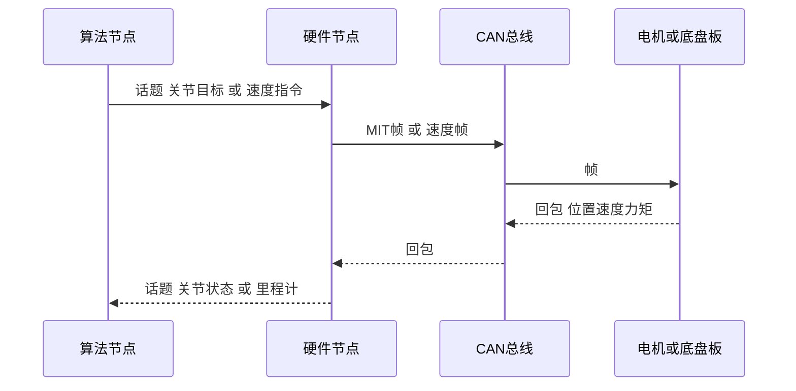

# 10 ROS2-CAN 执行链

> **一句话定位**：把三条线的"想要什么"送到电机的那条链：ROS 2 节点与话题 → 驱动节点 → SocketCAN/FDCAN → 电机/底盘板 → 反馈回来。本章讲每一层的接口、帧、使能、限幅、超时与失联策略。仓库源码提供 CAN 一侧的真实证据；ROS 2 话题名等未在你的资料里确证的内容按"典型做法"写，并标注。

**学完你能：** 画出执行链时序；说明话题/消息/QoS 选择；估算 CAN 总线负载；描述使能、限幅、超时、失联的分层策略。

**前置：** [ROS 2 核心概念](../../02_基础知识/09_机器人软件/04_ROS1_ROS2核心概念.md)；[CAN/FDCAN](../../02_基础知识/08_嵌入式与通信/03_CAN_FDCAN与电机通信.md)；[07](./07_主从跟踪与MIT电机接口.md)、[09](./09_STM32H7_FDCAN底盘固件解读.md)。

## 目录
1. 总览与时序　2. ROS 2 层　3. 驱动节点　4. SocketCAN　5. 帧汇总　6. 总线负载估算　7. 使能与收尾　8. 限幅分层　9. 超时与失联　10. 时间与坐标一致性　11. 问答　12. 速记/自测/链接

## 1. 总览与时序

学习笔记记录：VR 路径把关节配置发布到 `/dual_xarm/joints`，硬件节点把其中数值当作 MIT 位置目标下发。其余话题名【待你补全】。

## 2. ROS 2 层
- 典型消息（典型做法，非项目确证）：关节目标 `sensor_msgs/JointState` 或 `std_msgs/Float64MultiArray`（双臂 2×7=14 个数，**单位 rad，顺序必须约定**）；底盘速度 `geometry_msgs/Twist`（`linear.x` 前进、`angular.z` 转向）；里程计 `nav_msgs/Odometry`（`odom→base_link`）。
- QoS：控制指令常用 *keep last, depth 1*，可靠或 best-effort 均可；关键是**只取最新**，旧指令无价值。
- 定时器 vs 回调：硬件节点最好用固定周期定时器读取"最新缓存目标"并下发，而非在每个回调里直接发 CAN，以得到稳定的 CAN 周期。
- 时间戳：目标带 `header.stamp`，驱动节点据此判断"目标年龄"。

## 3. 驱动节点（硬件节点）职责
关节↔电机映射（偏置/方向/减速）→ 钳位 → MIT 打包 → 发送 → 收回包 → 发布 `joint_states`。仓库 `XArmController` 是这一层的 Python 实现范例：每条 CAN 总线一个 `_SingleBus`，双臂用 `can0`/`can1`（脚本里右臂常量也写过 `can2`，需按实机核对）；`recv_all` 等 7 个主机 ID 回包（超时 10 ms）。

## 4. SocketCAN
```bash
sudo ip link set can0 type can bitrate 1000000 dbitrate 5000000 fd on   # 示例；dbitrate 以硬件为准
sudo ip link set up can0
candump can0          # 监听
cansend can0 001#FFFFFFFFFFFFFFFC   # 示例：给 ID 1 发使能
```
python-can：`can.Bus(channel="can0", interface="socketcan", fd=True)`。【待你补全：实机波特率、是否 CAN-FD、终端电阻】。底盘板侧标称 1 Mbit/s（见 09）。

## 5. 帧汇总
| 帧 | ID | 数据 | 方向 | 来源 |
|---|---|---|---|---|
| 关节使能/失能/置零 | 0x01–0x08 | 7×0xFF + FC/FD/FE | 主机→电机 | XArmcontroller |
| MIT 指令 | 同上 | pos16 vel12 kp12 kd12 tau12 | 主机→电机 | 同上 |
| 电机回包 | 0x11–0x18 | pos16 vel12 tau12… | 电机→主机 | 同上 |
| 轮速命令 | 0x600+节点 | 0x2B + 对象索引 + int16 | 板→驱动 | chassis 固件 |
| 轮速反馈 | 0x581 / 0x583 | d4–5 int16 | 驱动→板 | 同上 |
| 速度指令 | 0x050 | vx vy vw int16 小端 + 附加位 | 上位机→板 | 同上 |
| 里程计 | 0x051 | x y yaw ×1000 int16 大端 | 板→上位机 | 同上 |

## 6. 总线负载估算（教学推算）
经典 8 字节标准帧约 111 位（无填充位），1 Mbit/s 下约 0.11 ms，最坏含填充约 0.135 ms。单臂 7 电机每周期 7 发 + 7 收 = 14 帧 ≈ 1.55 ms → 单总线上限约 640 Hz（含夹爪 16 帧 ≈ 560 Hz）。因此双臂应放在**两条总线**（`can0`/`can1`），也解释了循环频率常受 CAN 往返限制。CAN-FD 数据段提速可提高上限。实测频率【待你补全】。

## 7. 使能与收尾
使能序列：发 FC（重复 3 次，间隔 2 ms）→ 等 0.2 s → 先用位置模式移动到已知姿态 → 再切入目标模式。收尾：力矩渐降（每步×0.85，约 60 步）→ FD 失能 → 关闭总线。异常退出用 `finally`。

## 8. 限幅分层
| 层 | 限什么 |
|---|---|
| 目标端 | 工作空间盒、目标速率 |
| IK/QP | 关节位置/速度/碰撞 |
| 驱动节点 | 机械限位检查、MIT 范围钳位、力矩速率与幅值 |
| 底盘板 | 速度通道 ±800 钳位（命令），死区 |
| 电机/驱动器 | 电流、力矩、速度上限 |
越靠近硬件越"硬"、越简单。

## 9. 超时与失联
多层看门狗，各自独立：
1. 驱动节点：目标年龄 > 阈值 → 保持/降增益/回安全位/失能；
2. VR 层：触发键松开或数据停更 → 清参考；
3. 底盘板：上位机心跳丢失 → 零速（固件里该逻辑有缺陷，见 09）；遥控丢失 → 保护模式；
4. 电机：部分驱动器自带通信超时，失联自动失能。
原则：**失联时默认动作要写成显式代码，而不是沿用旧值**；"IK 异常返回当前 q"不是停机。阈值【待你补全】。

## 10. 时间与坐标一致性
每个箭头问五要素（见 [01](./01_项目背景与系统总览.md)）。TF 唯一发布者；单位 m/mm、rad/deg；关节顺序；时间戳来源。基础：[时间同步与一致性](../../02_基础知识/05_状态估计/06_时间同步_坐标系一致性与数据有效性.md)。

## 11. 问答
**Q. Describe your ROS 2 to CAN chain.** 
> Algorithm nodes publish joint targets or velocity commands. A hardware node subscribes, maps joints to motors, clamps, packs MIT or speed frames and sends them over SocketCAN. Replies come back, are decoded and published as joint states or odometry.

**Q. What happens if a node dies?** 
> There are layered timeouts: the driver checks target age, the base board has a heartbeat and remote-loss protection, and the motors can disable on bus silence. I make the default action explicit instead of reusing stale commands. 【补全实际阈值。】

**Q. Why two CAN buses?** 
> One bus carries about 14 frames per cycle per arm, which limits rate to a few hundred hertz; two arms on separate buses double the capacity and isolate faults.

## 速记
话题→驱动→CAN→电机；只取最新；钳位在驱动层；失联显式处理；负载≈14 帧/周期·臂。
## 自测
1. 单总线 7 电机最大周期频率约多少？（≈640 Hz）2. 为什么用固定周期定时器？ 3. 使能为何重复发？ 4. 列出三层限幅。 5. 失联默认动作为何要显式？
## 链接
[09](./09_STM32H7_FDCAN底盘固件解读.md) · [11](./11_调试与故障案例.md) · [P6 ROS/ROS2 到底层驱动](../P6_深开鸿M-Robots平台软件/README.md)
