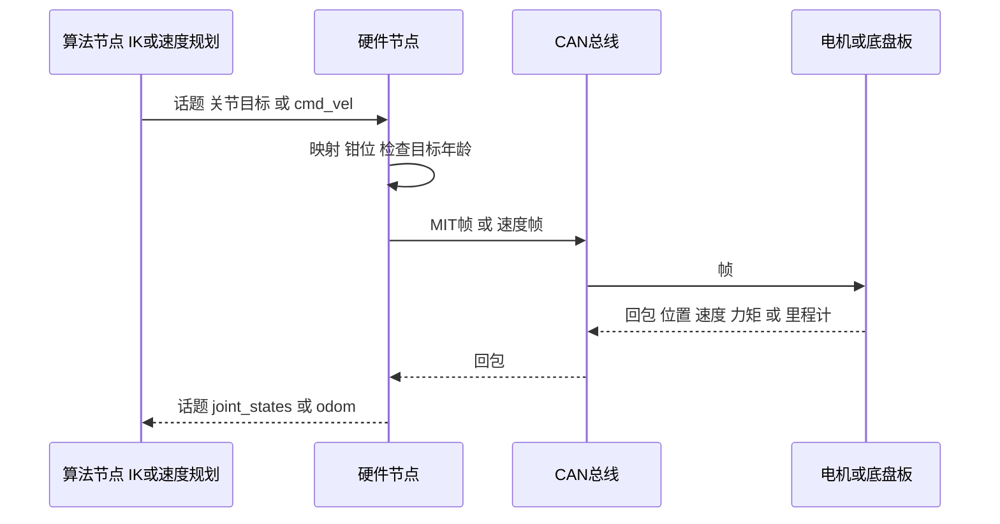
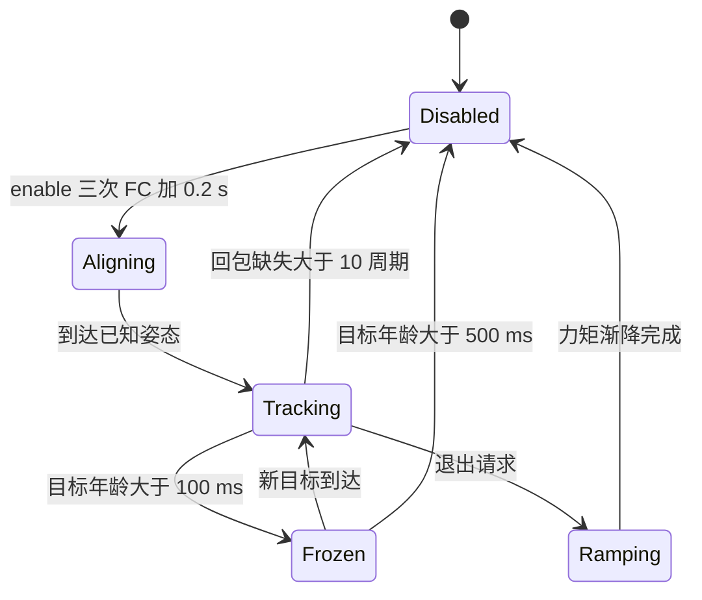

# 10 ROS2-CAN 执行链

> **一句话定位**：把 VR、主从、底盘三条线“想要什么”送到电机、再把“实际怎么样”送回来的那条链：算法节点 → ROS 2 话题 → 硬件（驱动）节点 → SocketCAN / FDCAN → 电机或底盘板 → 反馈回来。CV 里 *validated on real hardware through the ROS2-CAN execution chain* 说的就是它。本章讲每一层的接口、帧格式、周期、使能与收尾、分层限幅、超时与失联策略，并给出可手算的帧编码与单位换算。电机一侧的 CAN 细节有仓库源码作证据（`XArmcontroller.py`）；ROS 2 话题、节点等未在源码里的部分，按“本项目取值”写成具体设计，并与 [README 自查表](./README.md) 保持一致。

**本章学完你能：**

- 画出执行链的时序图，并说出每一层该检查什么；
- 手工把一组 MIT 控制量编码成 8 字节 CAN 帧，再解码回来；
- 估算两条 CAN 总线的负载与最高循环频率；
- 写出使能、收尾、限幅、超时四套“默认动作”，并解释为什么失联时的行为必须显式；
- 完成“`/cmd_vel` → 板子 0x050 → 轮速 → 0x051 → `/odom`”的单位与坐标换算，并指出里程计角度的符号约定。

**前置：** [ROS 2 核心概念](../../02_基础知识/12_机器人软件/04_ROS2_Humble核心概念与ROS1对比.md)；[CAN/FDCAN 与电机通信](../../02_基础知识/11_嵌入式与通信/03_CAN_FDCAN与电机通信.md)；[07 主从跟踪与 MIT 接口](./07_主从跟踪与MIT电机接口.md)；[09 底盘固件解读](./09_STM32H7_FDCAN底盘固件解读.md)。

## 目录

1. 总览与时序
2. 节点、话题与消息
3. 硬件节点的内部结构
4. MIT 帧：编码与手算
5. SocketCAN 配置与调试命令
6. 帧汇总
7. 周期、负载与时间预算
8. 使能与收尾
9. 限幅分层
10. 超时与失联：一张状态表
11. 底盘支路：`/cmd_vel` 到 `/odom`
12. 时间、单位与坐标一致性
13. 面试问答
14. 速记 / 自测 / 链接

---

## 1. 总览与时序

### 1.1 它要解决什么问题

算法层（IK、重力补偿、速度规划）输出的是“关节角”“力矩”“车体速度”这类物理量，电机和底盘板能听懂的是 CAN 帧。中间需要一层**翻译 + 保护**：把物理量按约定映射到电机、做范围检查、编码成帧、定时发出，并把回包解成物理量发布回来。把这层单独做成“硬件节点”，算法节点就不必关心总线细节，换电机或换总线时只改这一层，这是 [P6 里统一运动接口](../P6_深开鸿M-Robots平台软件/README.md) 想做的事的小规模版本。

### 1.2 时序图



本项目的话题与消息（统一取值，与 README 自查表 #16 一致）：

| 话题 | 类型 | 方向 | 内容 | 频率 |
|---|---|---|---|---|
| `/dual_xarm/joints` | `std_msgs/Float64MultiArray` | 算法 → 硬件 | 双臂 14 个关节目标，单位 rad，顺序：左臂 J1–J7，右臂 J1–J7 | 100 Hz |
| `/dual_xarm/joint_states` | `sensor_msgs/JointState` | 硬件 → 算法 | 位置 / 速度 / 力矩回读 | 100 Hz |
| `/cmd_vel` | `geometry_msgs/Twist` | 算法或遥控 → 硬件 | `linear.x` 前进 m/s，`angular.z` 转向 rad/s | 20–50 Hz |
| `/odom` | `nav_msgs/Odometry` | 硬件 → 算法 | 底盘里程计 | 板端 200 Hz 积分，发布降到 50 Hz |

---

## 2. 节点、话题与消息

### 2.1 为什么用数组而不用 `JointState`

关节目标用 `Float64MultiArray` 是为了简洁：目标只有“位置”一个维度，14 个数；`JointState` 的位置 / 速度 / 力矩三个数组和名字数组对于“单向下发目标”显得冗余。代价是**顺序和单位只靠约定**：消息里没有关节名，一旦两端对顺序的理解不同（比如右臂在前），就是“两条臂对调”。所以顺序要写进文档，并在硬件节点启动时检查数组长度是否为 14。回读用 `JointState` 是因为有 `name` 字段，便于其他工具（RViz、rosbag 回放）直接使用。

### 2.2 QoS：只取最新

控制目标的特点是“旧数据没价值”。所以订阅端用 *KEEP_LAST, depth=1*，可靠性用 *RELIABLE* 或 *BEST_EFFORT* 均可：本项目取值 **BEST_EFFORT + depth 1**，同一台机器内的链路丢包极少，宁可丢一帧也不要排队产生延迟。回读话题用默认 *RELIABLE + depth 10*，因为日志和回放不希望丢。

### 2.3 定时器 vs 回调

硬件节点最好用**固定周期定时器**读取“最新缓存目标”并下发，而不是在订阅回调里直接发 CAN。理由：

1. 订阅频率是上游决定的，上游抖动会直接变成 CAN 抖动；定时器下发把抖动隔离在节点外。
2. 目标缺失（上游挂了）时，回调不会被触发，**没人去执行保护逻辑**；定时器仍在，可以检查“目标年龄”并冻结或失能。
3. 总线周期稳定，电机侧的 PD 控制才稳定。

本项目取值：硬件节点定时器 100 Hz（10 ms），回调只更新缓存与时间戳。

### 2.4 时间戳与目标年龄

算法节点发布时带 `header.stamp`（`Float64MultiArray` 没有 header，实际做法是同时发布一个 `std_msgs/Header` 风格的辅助时间戳，或改用带 header 的自定义消息；本项目取值是硬件节点以**收到时刻**打戳，目标年龄 = 当前时刻 − 收到时刻）。这个定义忽略了网络传输延迟，但同一台机器内差别在毫秒量级，对“100 ms / 500 ms”量级的保护阈值没有影响。VR 位姿到达 IK 机器时则用接收时刻（见 README 自查表 #1）。

---

## 3. 硬件节点的内部结构

下面是**教学示例**（Python / rclpy 风格，非项目源码），把一个硬件节点最核心的五步写出来：

```python
class HardwareNode(Node):
    def __init__(self):
        self.target = None            # 最新 14 维目标 (rad)
        self.target_rx_time = None    # 收到时刻 (s)
        self.create_subscription(Float64MultiArray, '/dual_xarm/joints',
                                 self.on_target, qos_best_effort_depth1)
        self.create_timer(0.01, self.on_timer)        # 100 Hz

    def on_target(self, msg):
        if len(msg.data) != 14:                       # 长度检查
            return
        self.target = np.array(msg.data)
        self.target_rx_time = self.get_clock().now()

    def on_timer(self):
        age = (now - self.target_rx_time).seconds if self.target_rx_time else 1e9
        if age > 0.5:   self.disable_all_arms();  return   # 失能
        if age > 0.1:   q_cmd = self.last_cmd              # 冻结在当前位置
        else:           q_cmd = self.safe_clamp(self.target)  # 钳位后使用
        self.send_mit(q_cmd)           # 打包并发 CAN
        self.recv_feedback()           # 收 14 个回包
        self.publish_joint_states()
```

要点：**每一步都是一道独立的保护**。长度检查防止对不上的数组；目标年龄分两档（冻结 / 失能）；`safe_clamp` 做位置、速度限幅；发送后立刻收回包，回包超时视为故障（见 10 节）。

仓库里的 `XArmController`（`XArmcontroller.py` 与 `_v2.py`）是 CAN 一侧的真实范例：每条 CAN 总线对应一个 `_SingleBus`，里面是 `can.Bus(channel, interface="socketcan", fd=True)`；双臂用 `can0`、`can1` 两个通道；`recv_all` 等待 7 个主机 ID 的回包，最多 10 ms。读法见 [12 源码导读](./12_源码导读.md)。

---

## 4. MIT 帧：编码与手算

### 4.1 问题与格式

达妙（DM）电机的 MIT 模式把五个量压进 8 个字节：期望位置 $q_d$（16 位）、期望速度 $\dot q_d$（12 位）、$K_p$（12 位）、$K_d$（12 位）、前馈力矩 $\tau_{ff}$（12 位）。每个量都映射到一个固定量程，量程由电机型号决定（`XArmcontroller.py` 第 43–50 行）：

| 型号 | 位置 ±(rad) | 速度 ±(rad/s) | 力矩 ±(N·m) |
|---|---|---|---|
| DM4310 | 12.5 | 30 | 10 |
| DM4340 | 12.5 | 8 | 28 |
| DM8009 | 12.5 | 45 | 54 |

$K_p\in[0,500]$，$K_d\in[0,5]$（所有型号相同）。电机内部执行：

$$\tau = K_p(q_d-q)+K_d(\dot q_d-\dot q)+\tau_{ff}$$

### 4.2 线性量化

浮点 $x$ 在 $[x_{min},x_{max}]$ 内量化为 $b$ 位无符号整数（源码 `_f2u`）：

$$u=\left\lfloor\frac{x-x_{min}}{x_{max}-x_{min}}\,(2^b-1)\right\rfloor$$

字节排布（`_pack_mit`）：`d0=q_hi, d1=q_lo, d2=dq[11:4], d3=dq[3:0]<<4 | kp[11:8], d4=kp[7:0], d5=kd[11:4], d6=kd[3:0]<<4 | tau[11:8], d7=tau[7:0]`。

### 4.3 完整手算（DM4310，教学示例）

取 $q_d=0.5$ rad，$\dot q_d=0.2$ rad/s，$K_p=50$，$K_d=1.2$，$\tau_{ff}=0.3$ N·m。

1. $u_q=\lfloor(0.5+12.5)/25\times65535\rfloor=\lfloor34078.2\rfloor=34078=\texttt{0x851E}$；
2. $u_{\dot q}=\lfloor(0.2+30)/60\times4095\rfloor=\lfloor2061.15\rfloor=2061=\texttt{0x80D}$；
3. $u_{kp}=\lfloor50/500\times4095\rfloor=\lfloor409.5\rfloor=409=\texttt{0x199}$；
4. $u_{kd}=\lfloor1.2/5\times4095\rfloor=\lfloor982.8\rfloor=982=\texttt{0x3D6}$；
5. $u_\tau=\lfloor(0.3+10)/20\times4095\rfloor=\lfloor2108.9\rfloor=2108=\texttt{0x83C}$。

字节：`d0=0x85, d1=0x1E, d2=0x80, d3=(0xD<<4)|0x1=0xD1, d4=0x99, d5=0x3D, d6=(0x6<<4)|0x8=0x68, d7=0x3C`，帧为

```text
ID = 0x05（关节 5）   DATA = 85 1E 80 D1 99 3D 68 3C
```

（Python 复算 `85 1E 80 D1 99 3D 68 3C` ✓）。

解码回包：反馈帧 `d[1..2]` 是位置（16 位）、`d[3]<<4 | d[4]>>4` 是速度（12 位）、`(d[4]&0xF)<<8 | d[5]` 是力矩（12 位），用 `_u2f` 反量化。注意 **回包 `d[0]` 里是电机 ID 和状态**，位置从 `d[1]` 开始，这是解码时最容易错位的地方。

**量化误差**：位置 16 位，分辨率 $25/65535=3.8\times10^{-4}$ rad $\approx0.022^\circ$；力矩 12 位，DM4310 分辨率 $20/4095=4.9\times10^{-3}$ N·m。后者决定了重力补偿的最小力矩台阶，也是低速时“力矩抖动”的一个来源（见 [06 章](./06_URDF_KDL动力学与重力补偿.md)）。

### 4.4 钳位：v1 与 v2 的差别

v1 的 `_pack_mit` **不钳位**：若 $\tau_{ff}$ 超过量程，$u_\tau$ 会超过 4095，高位被 `& 0xF` 与 `& 0xFF` 截掉，等于对 4096 取模，力矩**符号翻转**。例：DM4310 上指令 $+11$ N·m，$u=\lfloor21/20\times4095\rfloor=4299$，$4299-4096=203$，解码回 $203/4095\times20-10=-9.0$ N·m。v2 的 `_pack` 先把各量钳位到量程再量化，从根上解决（`XArmcontroller_v2.py` 第 159–181 行）。教训：**“打包前钳位”是任何定点编码的第一条规则**。

---

## 5. SocketCAN 配置与调试命令

```bash
sudo ip link set can0 down
sudo ip link set can0 type can bitrate 1000000          # 本项目取值：1 Mbit/s，数据段不提速
sudo ip link set can0 up
ip -details -statistics link show can0                   # 看错误计数、重启次数
candump can0                                             # 抓包
cansend can0 005#FFFFFFFFFFFFFFFC                        # 给 5 号电机发使能（示例）
```

关于 FD：仓库示例命令里写了 `fd on dbitrate 5000000`，Python 里也是 `can.Bus(..., fd=True)` 并以 `is_fd=True` 发帧。本项目取值是：**总线 1 Mbit/s，不使用数据段提速**（BRS 关闭），帧有效载荷仍是 8 字节，线上负载与经典帧相当；总线两端各一个 120 Ω 终端电阻，空载时在 CAN_H 与 CAN_L 间量约 60 Ω（并联结果）。如果某端终端电阻缺失或多装，会出现错误帧增多、偶发丢包。

---

## 6. 帧汇总

| 帧 | ID | 数据 | 方向 | 来源 |
|---|---|---|---|---|
| 使能 / 失能 / 置零 | 0x01–0x08 | `FF×7` + `FC` / `FD` / `FE` | 主机 → 电机 | XArmcontroller |
| MIT 指令 | 同上 | pos16 vel12 kp12 kd12 tau12 | 主机 → 电机 | 同上 |
| 电机回包 | 0x11–0x18（从机 ID + 0x10） | id/状态 + pos16 vel12 tau12 | 电机 → 主机 | 同上 |
| 轮速命令 | 0x600 + 节点 | `2B` + 对象索引 + int16 | 板 → 驱动器 | 底盘固件 |
| 轮速反馈 | 0x581 / 0x583 | d4–d5 int16 | 驱动器 → 板 | 同上 |
| 底盘速度指令 | 0x050 | vx vy vw int16 **小端** + updown | 上位机 → 板 | 同上 |
| 里程计 | 0x051 | x y yaw ×1000 int16 **大端** | 板 → 上位机 | 同上 |

---

## 7. 周期、负载与时间预算

### 7.1 机械臂总线负载

每条臂 7 个本体电机 + 1 个夹爪 = 8 个电机。每个周期：8 帧 MIT 指令 + 8 帧回包 = 16 帧。每帧 111 位（经典 8 字节标准帧，无填充位），最坏含填充位约 135 位：

$$t_{frame}=111\ \mu s,\quad t_{16}=16\times111=1.78\ \text{ms}\ \Rightarrow\ f_{max}\approx560\ \text{Hz}$$

只控制本体 7 个电机：14 帧 $=1.55$ ms，$f_{max}\approx640$ Hz。含最坏填充位，上限约 $1/(14\times135\ \mu s)=530$ Hz。两条臂放两条总线（`can0`/`can1`）互不占用，上限不降低，且一条臂的总线故障不会影响另一条。

本项目取值的实际循环：主臂重力补偿约 200 Hz（实测 190~200 Hz，README 自查表 #8）。远低于总线上限（负载 $200\times1.78=36\%$），瓶颈在 Python 循环 + Pinocchio / KDL 的动力学计算 + `recv_all` 的等待（单臂最多 10 ms，超时就是丢包）。经验：总线负载应保持在 50% 以内，这里留有余量。

### 7.2 底盘总线负载

见 [09 章 9.5](./09_STM32H7_FDCAN底盘固件解读.md)：设计 5 ms 周期下 FDCAN1 约 9%，FDCAN2 约 3%。

### 7.3 端到端时间预算（从 VR 手柄动到手臂动）

| 环节 | 时间 | 说明 |
|---|---|---|
| VR 位姿采样（头显刷新 90 Hz） | 0–11 ms | 平均半个周期 5.5 ms |
| 局域网 WebSocket 传输 | 约 3–5 ms | 同一路由器内 |
| IK 求解循环（实测约 120 Hz） | 约 8 ms | 含 QP 求解 |
| ROS 2 发布与硬件节点接收 | 约 5 ms | 定时器 100 Hz 带来最多 10 ms 的等待，平均 5 ms |
| CAN 往返 | 约 2 ms | 一个周期内 16 帧 1.78 ms |
| 电机内环响应 | 约 15–20 ms | 取决于 $K_p,K_d$ 与负载 |
| **合计** | **约 45–55 ms** | 这是教学推算的预算，不是实测 |

（主从示教那条线不经过 VR 与 IK，端到端约 30 ms，见 07 章。）

---

## 8. 使能与收尾

### 8.1 使能序列

电机上电后默认不输出。使能要点（`XArmcontroller.py` 第 235–241 行、第 214–220 行）：

1. 给每个电机发 `FF FF FF FF FF FF FF FC`（使能），**重复 3 次、间隔 2 ms**——因为总线上第一个帧可能丢（电机刚醒）；
2. 全部发完后 `sleep(0.2)` 让电机准备好；
3. **先用位置模式把手臂移到已知姿态**（`move_to_initial_position`，220 步 × 10 ms，线性插值）；
4. 再切入目标模式（重力补偿 / 跟踪）。

为什么不直接进入目标模式？因为使能的一刻电机会把当前编码器位置当作起点，如果马上给一个很远的目标就会“猛弹”。先移动到已知姿态，再让上层从已知状态起步。

### 8.2 收尾序列

`nullspace_control.py` 的收尾是“力矩渐降”：`_tau_prev *= 0.85` 重复 60 次（每次 10 ms），$0.85^{60}\approx5.8\times10^{-5}$，从满力矩降到几乎为零用时 0.6 s，然后再发失能 `FD`、关总线。而 `gravity_comp.py` 与 `imdepence_control.py` 在 `finally` 里**直接失能**，没有渐降——手臂会因重力瞬间下坠，所以“结束后电机会自动掉电，注意安全”是它们自己打印的提醒。教训：**退出路径要像进入路径一样被设计**，异常退出（Ctrl+C、异常）都要走 `finally`。

---

## 9. 限幅分层

| 层 | 限什么 | 本项目取值 |
|---|---|---|
| 目标端（VR / 规划） | 工作空间盒、目标速率 | 盒 ±0.4 m；线速度 ≤0.5 m/s，角速度 ≤1.5 rad/s |
| IK / QP | 关节位置、速度、碰撞 | 关节速度：J1–4 取 2.5 rad/s，J5–7 取 4 rad/s |
| 硬件节点 | 位置限位（URDF 限位内缩 0.05 rad）、MIT 量程钳位、力矩速率与幅值 | 力矩速率与幅值见 nullspace：8 N·m/步、25 N·m |
| 底盘板 | 速度通道 ±800 钳位、死区 | 源码 |
| 电机 / 驱动器 | 电流、力矩、速度 | 厂家固件 |

越靠近硬件，规则越简单、越“硬”（只有上下限，不含意图）。靠近算法的层可以复杂（QP 约束），但可能因为求解失败而失效；最靠近硬件的层不依赖任何上层是否正常。

---

## 10. 超时与失联：一张状态表

### 10.1 原则

失联时的默认动作必须是**显式代码**，而不是“沿用上一个值”。“IK 异常返回当前 q”不是停机：当前 q 会被当作新目标继续下发，手臂看起来没动，但如果上游已经死了，它会永远“保持”，一旦上游恢复又可能带着旧状态冲出去。

### 10.2 本项目的分层看门狗（取值与 README 自查表 #17 一致）

| 层 | 检测 | 阈值 | 动作 |
|---|---|---|---|
| VR 采集 → IK | 位姿无更新 | >200 ms | 目标冻结在当前位姿；触发键滞回 0.9 / 0.7（按下 / 松开） |
| 硬件节点（臂） | 目标年龄 | >100 ms | 冻结在当前位置（不沿用旧目标，持续发送当前位置） |
| | | >500 ms | 失能（`FD`） |
| 硬件节点（回包） | 单个电机连续回包缺失 | >3 个周期 | 记录告警；>10 个周期 → 失能整条臂 |
| 底盘（上位机侧） | `/cmd_vel` 无更新 | >300 ms | 轮速归零（发 0x050 全零） |
| 底盘板 | 上位机心跳 | 设计 500 ms | **读码发现该逻辑永不触发**（09 章隐患 1），所以真正兜底的是上一行 |
| 电机 | 总线静默 | 约 1 s | 电机自动失能（厂家固件自带） |

### 10.3 状态机（臂）



### 10.4 为什么冻结而不是直接失能

7 自由度机械臂失能后会在重力下坠落，可能砸到操作者或自身。目标丢失 100 ms 往往只是网络抖动，冻结等待恢复比立即失能安全；若 500 ms 仍无目标，说明上游真的挂了，这时再失能，并配合电机本身的力矩上限限制下坠的冲击。主臂（leader）的重力补偿模式在 `finally` 里直接失能，是一个**与“冻结”相反的取舍**——主臂由人托着，下坠风险小于从臂。

---

## 11. 底盘支路：`/cmd_vel` 到 `/odom`

### 11.1 链路

```text
/cmd_vel (Twist) ──► 底盘桥接节点（上位机）──► CAN 0x050（vx, vy, vw, updown，小端 int16）
                                                    │
                          ┌─────────────────────────┘
                          ▼
                 底盘板（STM32H7）：速度分配 → SDO 速度命令 → 轮驱动器
                          │  200 Hz 积分
                          ▼
                 CAN 0x051（x, y, yaw 各 ×1000，大端 int16）──► 桥接节点 ──► /odom (Odometry) + TF
```

### 11.2 `Twist` 到 0x050 的换算

由 09 章：每个计数对应 $k=8.17\times10^{-4}$ m/s 的**轮缘速度**。直行时车速 $v=k\cdot v_y$；转向时两轮差速 $v_L-v_R=2k\,v_w$，所以 $\omega=2k\,v_w/b$（$b=0.75$ m）。反解：

$$v_y=\frac{v}{k},\qquad v_w=\mp\frac{\omega\,b}{2k}$$

取 $v=0.3$ m/s、$\omega=0.5$ rad/s（逆时针为正，ROS 约定）：

- $v_y=0.3/8.17\times10^{-4}=367$；
- 固件里 $v_w>0$ 是**顺时针**（09 章 12.2 节：`z` 增大 = 右转），而 ROS 的 $\omega_z>0$ 是逆时针，所以 $v_w=-\omega\times0.75/(2k)=-0.5\times459.1=-230$。

帧：$v_y=367=\texttt{0x016F}$ → d2=`6F`, d3=`01`；$v_w=-230=\texttt{0xFF1A}$ → d4=`1A`, d5=`FF`。数据 `00 00 6F 01 1A FF 00 00`，ID `0x050`。

### 11.3 `0x051` 到 `/odom` 的换算

板子的约定：坐标 $(x_b,y_b)$ 以起点为原点，**初始前进方向是 $+y_b$**，航向 $z$ 从 $+y_b$ **顺时针**量起，单位 mm / mrad。ROS 的约定是 $x$ 前、$y$ 左、yaw 逆时针从 $x$ 量起。换算：

$$x_r=y_b,\qquad y_r=-x_b,\qquad \text{yaw}_r=-z$$

验证：车头沿 $+y_b$ 时 $z=0$，换算得 yaw $=0$、前进沿 $+x_r$ ✓；车右转（$z>0$、$x_b$ 增大）→ $y_r$ 减小（车向右）、yaw 为负 ✓（ROS 里右转是顺时针 = 负 yaw）。

手算：收到 `x = 0x00C8 (200 mm), y = 0x03E8 (1000 mm), yaw = 0x012C (300 mrad)`（大端）：板子 $(x_b,y_b,z)=(0.2,1.0,0.3)$ → ROS $(x_r,y_r,\text{yaw})=(1.0,-0.2,-0.3)$。

四元数：$q=(0,0,\sin(\text{yaw}/2),\cos(\text{yaw}/2))=(0,0,-0.149,0.989)$。协方差按教学取值：位置 $\sigma=0.02\ \text{m}$ 起步随距离线性增长，yaw $\sigma=0.05$ rad 起步随转角增长（轮式里程计误差累积的粗略模型）。

### 11.4 TF 与唯一发布者

`odom → base_link` 的 TF 只由**桥接节点**发布，别的节点（比如 EKF）若也发布同一条 TF，会得到“TF 跳变”。如果之后接 EKF 或 AMCL（见 [P5](../P5_车式移动机器人自主导航/README.md)），就把桥接节点的 TF 发布关闭、改为由融合节点发布，同时桥接节点只发 `/odom` 话题。

---

## 12. 时间、单位与坐标一致性

每个箭头问“五要素”（见 [01 章](./01_项目背景与系统总览.md)）：量、单位、坐标系、时间戳、有效性。执行链里最容易出错的八个点：

1. 关节顺序（左 / 右臂谁在前）；
2. 单位（rad vs deg；m vs mm；rpm vs rad/s）；
3. 符号（电机正方向与 URDF 正方向，镜像轮）；
4. 零位偏置（上电后需把两臂摆到同一标定姿态来测，量级小于 0.03 rad）；
5. 字节序（0x050 小端 vs 0x051 大端）；
6. 量程（电机型号错了，量化范围就错）；
7. 时间戳来源（发布时刻 / 接收时刻 / 采样时刻）；
8. 坐标约定（板子 yaw 顺时针 vs ROS 逆时针）。

基础：[时间同步与一致性](../../02_基础知识/06_状态估计/06_时间同步_坐标系一致性与数据有效性.md)。

调试工具表：

| 现象 | 先用什么看 | 命令示例 |
|---|---|---|
| 话题没数据 | 频率与是否发布 | `ros2 topic hz /dual_xarm/joints`、`ros2 topic echo --once` |
| 目标对不对 | 数组长度、数值范围 | `ros2 topic echo /dual_xarm/joints` |
| 帧发没发出 | 总线侧 | `candump can0 -td`（带时间差） |
| 总线健康 | 错误计数 | `ip -details -statistics link show can0` |
| 回放复现 | 录包 | `ros2 bag record /dual_xarm/joints /dual_xarm/joint_states` |

---

## 13. 面试问答

**Q1. Describe your ROS 2 to CAN chain.**

> Algorithm nodes publish joint targets or velocity commands. A hardware node subscribes, keeps the latest target, and on a fixed 100 hertz timer maps joints to motors, clamps, packs MIT or speed frames and sends them over SocketCAN. Replies come back, are decoded and published as joint states or odometry.

中文：算法节点发布目标；硬件节点缓存最新目标，用固定 100 Hz 定时器完成映射、钳位、打包并经 SocketCAN 发送；回包解码后发布为关节状态或里程计。

- *L2：Why a timer instead of sending in the callback?* The timer keeps the CAN period stable and still runs when the upstream dies, so the node can check the target age and protect the arm. *（定时器让 CAN 周期稳定，并且上游挂掉时仍会运行，节点能检查目标年龄并保护手臂。）*
- *L3：What QoS did you use and why?* Best effort with depth one for commands, because an old command is worse than a missing one; reliable with a deeper queue for state topics that I record. *（命令用 best effort、深度 1，旧命令比缺失更糟；记录的状态话题用 reliable 和较深队列。）*

**Q2. What happens if a node dies?**

> There are layered timeouts. The hardware node freezes the arm at its current position after 100 milliseconds without a new target and disables it after 500. The base zeroes its wheels after 300 milliseconds without a velocity command. The motors disable themselves after about a second of bus silence. I make the default action explicit instead of reusing stale commands.

中文：分层超时：100 ms 冻结，500 ms 失能；底盘 300 ms 无速度命令归零；电机总线静默约 1 s 自动失能；默认动作写成显式代码。

- *L2：Why freeze first instead of disabling at once?* A seven-degree-of-freedom arm falls under gravity when disabled; a 100 millisecond gap is usually jitter, so freezing is safer. *（失能会下坠；100 ms 缺失多是抖动，冻结更安全。）*
- *L3：Is "freeze" itself safe if the hardware node dies too?* No, so the motors have their own bus-silence timeout as the last layer. *（硬件节点本身也挂了就不安全，所以最后一层是电机自带的总线静默失能。）*

**Q3. Why two CAN buses?**

> One arm needs about sixteen frames per cycle, roughly 1.8 milliseconds, which limits a single bus to a few hundred hertz. Two arms on separate buses double the capacity and isolate faults.

中文：每臂每周期约 16 帧（约 1.8 ms），单总线上限几百 Hz；两臂分总线容量加倍并隔离故障。

**Q4. How do you encode an MIT frame, and what is the main pitfall?**

> Each value is mapped linearly to an unsigned integer of 16 or 12 bits over the motor's range, then packed into eight bytes. The pitfall is not clamping first: an out-of-range torque wraps around and can flip sign, for example plus 11 newton metres on a 10 newton metre motor decoded as about minus 9.

中文：每个量在电机量程内线性量化成 16/12 位整数并打包；陷阱是未先钳位，超量程力矩会回绕并符号翻转（+11 N·m 变约 −9 N·m）。

**Q5. How do you convert the base odometry to ROS?**

> The board reports millimetres and milliradians as big-endian 16-bit integers, with forward along its own y axis and heading clockwise. I map x to y, y to minus x and yaw to minus yaw, build the quaternion, and publish odom and the TF from one node only.

中文：板子上报 mm / mrad，大端 int16，前进沿自身 y，航向顺时针；换算 $x_r=y_b$、$y_r=-x_b$、yaw 取负，建四元数，仅由一个节点发布 odom 与 TF。

**Q6. What did you validate on the real hardware chain?**

> Joint direction against encoder feedback, follower tracking error of about 0.01 radian RMS, end-effector steady-state error under five millimetres, no joint touching its limit, and for the base a two-metre straight run with under five centimetres of sideways drift.

中文：关节方向与编码器一致、从臂 RMS 跟踪误差约 0.01 rad、末端稳态误差 <5 mm、无关节触限位、底盘 2 m 直线横向偏移 <5 cm。

---

## 14. 速记 / 自测 / 链接

### 要点速记

1. 链路：算法节点 → 话题 → 硬件节点 → SocketCAN → 电机 / 底盘板 → 回包 → 话题。
2. 命令用 best-effort + depth 1（只取最新）；硬件节点用固定周期定时器下发。
3. MIT 帧：16+12+12+12+12 位，线性量化；先钳位后量化，否则回绕翻符号。
4. 单臂 8 电机每周期 16 帧 ≈ 1.78 ms，单总线上限约 560 Hz；双臂分两条总线。
5. 使能三次重复 + 0.2 s 等待 + 先对齐已知姿态；退出走 `finally` 并渐降力矩。
6. 限幅分层：目标端、IK、硬件节点、底盘板、电机；越靠近硬件越简单越硬。
7. 失联：100 ms 冻结，500 ms 失能；`/cmd_vel` 300 ms 归零；电机 1 s 静默失能；默认动作显式。
8. 底盘：0x050 小端 int16 输入，0x051 大端 int16 输出；板子 yaw 顺时针、起始前进沿 y，转 ROS 要换轴并取负。

### 自测题

1. 单总线 7 个电机每周期 14 帧，上限频率多少？（≈640 Hz；含夹爪 16 帧 ≈560 Hz）
2. 为什么硬件节点不在订阅回调里发 CAN？（周期稳定；上游挂了回调不触发，没人执行保护）
3. 用 DM4310 手算 $q_d=0$ 的 16 位值。（$12.5/25\times65535=32767$，`0x7FFF`）
4. 目标年龄 300 ms 时硬件节点做什么？（冻结在当前位置；>500 ms 才失能）
5. 板子上报 $(x_b,y_b,z)=(0.5,2.0,-0.2)$，换算到 ROS？（$(2.0,-0.5,+0.2)$）
6. 为什么 `finally` 里直接失能会有风险，而渐降更好？（失能后重力下坠；渐降让力矩平滑退出）
7. 终端电阻缺一端会怎样？（错误帧增多、偶发丢包、两端量测电阻约 120 Ω 而不是 60 Ω）

### 相关链接

[09 底盘固件解读](./09_STM32H7_FDCAN底盘固件解读.md) · [11 调试与故障案例](./11_调试与故障案例.md) · [12 源码导读](./12_源码导读.md) · [20 工程化实践](./20_工程化实践_频率周期与问题解决.md) · [P6 ROS/ROS2 到底层驱动](../P6_深开鸿M-Robots平台软件/README.md)
