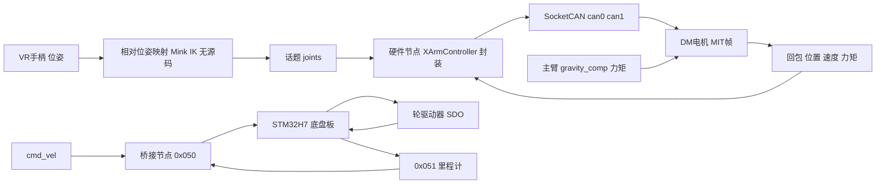

# 12 源码导读

> **一句话定位**：逐文件、逐函数地读 `项目源码/VLAI/` 下 P2 相关的两部分真实代码——机械臂电机控制库与上层脚本（`arm/XArmcontroller-master`，Python），以及差速底盘固件（`two_wheel_chassis/mini_car_self`，C / STM32H7）。每个文件按“作用 → 输入输出 → 关键函数 → 数据流 → 对应 CV 哪一句 → 与你的项目的差异”讲，贴关键代码并逐行解释，标出读码发现的隐患（**这些是读码发现，不是我的贡献，也不是我修复的**），最后给 8 个“面试官可能基于这段代码问的问题”。路径均相对 `项目源码/VLAI/`。

**本章学完你能：**

- 说出每个源码文件在整条链路里的位置，以及它能给 CV 的哪一句话做证据；
- 对着 `_pack_mit`、`arm_control`、`compute`、`chassis_odom_calc` 等关键函数讲清楚每一行；
- 分清“仓库里存在的函数”和“真正被调用的活动路径”；
- 诚实地区分“我实现的”“我整定的”“团队已有、我读懂并用于验证的”。

**前置：** 01–11 章，尤其 [06 重力补偿](./06_URDF_KDL动力学与重力补偿.md)、[07 主从跟踪与 MIT 接口](./07_主从跟踪与MIT电机接口.md)、[09 底盘固件](./09_STM32H7_FDCAN底盘固件解读.md)、[10 ROS2-CAN](./10_ROS2_CAN执行链.md)。

## 目录

0. 文件地图与证据等级
1. `XArmcontroller.py`（v1：MIT 编码与总线）
2. `XArmcontroller_v2.py`（v2：钳位、插值、双臂线程）
3. `gravity_comp.py`（重力 + 科氏 + 摩擦补偿）
4. `nullspace_control.py`（任务空间 + 零空间力矩控制）
5. `imdepence_control.py`（笛卡尔阻抗）
6. `xarm_bimanual.urdf`、`example_XArmcontroller.py`、`README.md`
7. 底盘固件：文件与函数清单
8. 整体数据流与对应 CV
9. 读码发现汇总
10. 面试官可能基于这段代码问的 8 个问题
11. 速记 / 自测 / 链接

---

## 0. 文件地图与证据等级

| 路径 | 内容 | 对应 CV | 证据等级 |
|---|---|---|---|
| `arm/XArmcontroller-master/XArmcontroller.py` | v1：MIT 打包 / 解码、使能、SocketCAN、默认 $K_p/K_d$ | ROS2-CAN、MIT 接口 | 代码确证 |
| `.../XArmcontroller_v2.py` | v2：钳位、机械限位、minimum-jerk、双臂线程 | 限幅、同步 | 代码确证 |
| `.../gravity_comp.py` | Pinocchio 重力 + 科氏 + 摩擦补偿循环 | 主臂重力补偿 | 代码确证 |
| `.../nullspace_control.py` | SVD、$\sigma_{min}$ 增益调度、DLS 伪逆、力矩限幅 | 奇异处理（同类思路） | 代码确证 |
| `.../imdepence_control.py` | 笛卡尔阻抗 + 重力 | 动力学的另一种应用 | 代码确证 |
| `.../xarm_bimanual.urdf` | 双臂 URDF（质量、质心、限位） | URDF | 代码确证 |
| `arm/VR/`、`arm/x_air…` | **空目录** | VR 线 | 无源码，按 CV 与学习笔记 |
| `two_wheel_chassis/mini_car_self/User/app/` | `chassis_task.c`、`controler_task.c` | 差速、模式 | 代码确证 |
| `.../User/drv/drv_8030.c` | 轮驱动 SDO | 执行链 | 代码确证 |
| `.../User/bsp_fdcan.c`、`uart_bsp.c` | 过滤、收发、上位机帧、SBUS | CAN | 代码确证 |
| `.../User/math/pid.c` | PID（含改进） | PID | 代码确证（调用被旁路） |
| `.../Core/Src/main.c`、`.ioc` | 启动、时钟、1 Mbit/s | FDCAN | 代码确证 |

> **读码前的三条规矩**：①**函数存在 ≠ 被调用**：科氏 / 摩擦补偿、`pid_calc`、SVD 零空间路径都要核对活动分支；②**参考实现（Python / Pinocchio）≠ 项目实现（CV 写的 C++ / KDL）**，数学等价；③VR / Mink / `ROLE_LEADER/FOLLOWER` / 话题名 `/dual_xarm/joints` 在仓库里没有源码，只能依赖 CV 与学习笔记。

---

## 1. `XArmcontroller.py`（v1，586 行）

### 1.1 作用与输入输出

达妙（DM）电机的 MIT 协议封装 + SocketCAN 总线管理。输入：每个电机的 `MITParam`（$K_p,K_d,q,\dot q,\tau$）；输出：CAN 帧；反向：回包解码成 `MotorState`（位置、速度、力矩）。它是整条执行链**最靠近硬件的 Python 层**，也是团队已有代码。

### 1.2 常量与数据结构（第 43–101 行）

- `LIMIT_DM4310=[12.5,30,10]` 等：`[p_max, v_max, t_max]`，编码时作为量化量程；填错型号会导致力矩编码错（文件头第 9 行就写了警告）。
- `ARM_7DOF_LIMITS`：关节 1–2 DM8009，3–4 DM4340，5–7 DM4310，与 README 自查表 #6 一致。
- `ARM_SLAVE_IDS=[1..7]`，`ARM_MASTER_IDS = slave + 0x10`：主机 ID（回包 ID）= 从机 ID + 0x10。
- `MotorState`：含 `default_kp=52, default_kd=1.2` 等默认值与 `last_update`（`time.monotonic()`，可用来做回包新鲜度检查，但库内没人使用）。

### 1.3 `_SingleBus`（第 103–330 行）

**构造**（第 105–139 行）：`default_params` 字典按 CAN ID 给默认 $K_p/K_d$（前 2 个 300/2.5，3–4 个 150/2.5，5–6 个 40/0.8，7 号 30/0.8，夹爪 10/0.9）；`can.Bus(channel, interface="socketcan", fd=True)` 打开总线。

**编码**（第 143–167 行），逐行：

```python
def _f2u(x, xmin, xmax, bits):                       # 143-145
    return int((x - xmin) / (xmax - xmin) * ((1 << bits) - 1))
def _pack_mit(self, m, p):                           # 151-167
    p_max, v_max, t_max = m.limit
    q_u   = self._f2u(p.q,   -p_max, p_max, 16)      # 位置 16 位
    dq_u  = self._f2u(p.dq,  -v_max, v_max, 12)      # 速度 12 位
    kp_u  = self._f2u(p.kp,  0, 500, 12)             # Kp 量程 0–500
    kd_u  = self._f2u(p.kd,  0, 5,   12)             # Kd 量程 0–5
    tau_u = self._f2u(p.tau, -t_max, t_max, 12)      # 力矩 12 位
    d[0] = (q_u >> 8) & 0xFF;  d[1] = q_u & 0xFF
    d[2] = dq_u >> 4;  d[3] = ((dq_u & 0xF) << 4) | ((kp_u >> 8) & 0xF)
    d[4] = kp_u & 0xFF;  d[5] = kd_u >> 4
    d[6] = ((kd_u & 0xF) << 4) | ((tau_u >> 8) & 0xF);  d[7] = tau_u & 0xFF
```

`_f2u` 是线性量化，`int()` 向零截断；**没有钳位**——这是 v1 的缺陷（见 [10 章 4.4](./10_ROS2_CAN执行链.md)、[11 案例 10](./11_调试与故障案例.md)）。手算见 10 章 4.3：$(0.5,0.2,50,1.2,0.3)\to$ `85 1E 80 D1 99 3D 68 3C`。

**解码**（`_parse_frame`，第 169–183 行）：`q_u=(d[1]<<8)|d[2]`，`dq_u=(d[3]<<4)|(d[4]>>4)`，`tau_u=((d[4]&0xF)<<8)|d[5]`，用 `_u2f` 反量化，同时更新 `last_update`。`d[0]` 是电机 ID / 状态，所以位置从 `d[1]` 开始。

**收发**：`_send` 用 `is_fd=True, is_extended_id=False` 发帧；`_send_cmd` 发 `FF×7 + cmd`（`0xFC` 使能，`0xFD` 失能，`0xFE` 置零）。`recv_all(timeout=0.01)`（第 197–210 行）：循环 `bus.recv(timeout=remaining)`，只接受 `master_ids` 内的帧，收齐 7 个或超时即退出——**阻塞式**，这是单臂循环频率的上限来源之一。

**控制接口**：`enable_all`（每个电机重复 3 次、间隔 2 ms，再 `sleep(0.2)`）、`mit_control_one/all`、`torque_control_one/all`（$K_p=0$，仅 $K_d$ 与 $\tau$）、`position_control_one/all`。

### 1.4 `XArmController`（第 336–560 行）

多总线管理器：`bus_configs = {"can0": ARM_7DOF_LIMITS, "can1": ...}`，每个通道一个 `_SingleBus`。常用方法：`enable_all/disable_all`、`recv_all`（顺序阻塞每条总线）、`mit_control_all(channel, params)`、`torque_control_all`、`get_positions/velocities/torques_measured`、夹爪（索引 7，CAN ID 0x08，位置 0 = 夹紧、−1 = 张开）。

### 1.5 与 CV 对应、与我的项目的差异

对应 CV：*mapped ... through the ROS2-CAN execution chain*。差异：①本库是 Python，直接调用；项目里硬件节点是 ROS 2 节点，在此之上加了话题、定时器、目标年龄、分层限幅（10 章）；②本库没有超时 / 失联逻辑；③ID、量程、$K_p/K_d$ 默认值是团队的，我整定的是从臂跟踪增益与重力补偿参数。

### 1.6 读码发现

- `position_control_all`（外层 `XArmController`，第 481 行）把标量 `kp` 直接传给 `_SingleBus.position_control_all`，而后者按列表 `zip(kps, ...)` 遍历；README 的示例传 `kp=10.0`，会抛 `TypeError`（推断）。
- `XArmController.__init__` 接收 `motor_params` 但没有传给 `_SingleBus`。
- `_pack_mit` 不钳位（见上）。
- `last_update` 无人使用，库层没有“回包新鲜度”判断。

---

## 2. `XArmcontroller_v2.py`（809 行）

### 2.1 作用

v1 的升级：单类管理双臂（`side="left"/"right"/None`）、每臂 8 电机（7 + 夹爪）、**钳位**、**机械限位检查**、**minimum-jerk 插值**、**线程并行**。

### 2.2 关键常量（第 33–88 行）

- `MECH_LIM`：关节机械限位（弧度）。J1 −80°..200°，J2 ±100°，J3 ±90°，J4 0..140°，J5 ±90°，J6 ±45°，J7 ±90°，夹爪 −60°..0。
- `ARM_KP_DEFAULT=[280,280,240,240,35,35,35]`，`ARM_KD_DEFAULT=[5,5,5,5,1.2,1.2,1.2]`；注释说明原始 20 / 10 超出 $K_d$ 量程 5，已钳到 5。
- `_min_jerk(t)=10t³−15t⁴+6t⁵`：五次多项式，起止速度、加速度皆为零。手算：$s(0.25)=0.1035$，$s(0.5)=0.5$，$s(0.75)=0.8965$——两端平缓、中间最快。

### 2.3 `_pack`（第 159–181 行）

与 v1 的区别只有一处：先把五个量钳位到量程（`q = max(-pm, min(pm, p.q))` 等）再量化。这就是 [案例 10](./11_调试与故障案例.md) 的修复。

### 2.4 `_recv` 与 `refresh_arm`（第 209–266 行）

`_recv(target_ids, timeout)`：收到的**每一帧都解析**（注释“关键修复”：避免旧帧在缓冲区累积），只有目标 ID 才算“收齐”。`refresh_arm(active=True)`：发保持当前位置的 MIT 帧（带默认 $K_p,K_d$）来触发回包，**不会掉臂**；`active=False` 发零力矩，只适合使能后、控制前。

### 2.5 `arm_control`（第 304–381 行）

四个阶段，按顺序：

1. 用缓存位置 `m.position` 发一帧“顶住臂”（带增益），并 `recv_arm(0.05)` 刷新真实起点；
2. 稳定阶段 `settle_n = 0.025*hz` 帧（200 Hz 时 5 帧 ≈ 25 ms）：以起点为目标、全量增益发帧；
3. 插值：`for step in range(steps+1)`，目标 `sp + s(step/steps)*(tp - sp)`，每步 `recv_arm(dt*0.5)`，再 `sleep` 到下一个绝对时刻 `t0 + (step+1)*dt`（**按绝对时刻睡眠，不累积抖动**，是这段代码里最值得学的一处）；
4. 结束后保持目标位置并 `recv_arm(0.05)`。

### 2.6 `XArmController`（第 441–735 行）

`_targets(side)` 选总线；`_run_parallel(fn_args)`：多条总线时每条一个 `threading.Thread(daemon=True)` 并 `join`。双臂运动因此是**两线程并行**，Python GIL 在 I/O 等待（`bus.recv`）时释放，所以两路总线可以交错执行，但 CPU 密集部分并不真并行。

### 2.7 读码发现

- `XArmController.arm_hold` 调用 `bus.arm_hold(...)`，但 `_ArmBus` 里**没有定义** `arm_hold`（全文只出现一次定义在外层），调用会 `AttributeError`（推断）。
- `_check_joint_limits` 越限时 `sys.exit(1)`，在插值中途退出，**不会失能电机**；
- README 示例写 `XArmController(right_can=..., left_can=...)`，实际参数名是 `right_channel/left_channel`；
- `MECH_LIM` 与 URDF 限位并不一致（如 J2：机械 ±100°，右臂 URDF −0.17..3.32 rad），两套限位以哪个为准要在使用前核对。

### 2.8 对应与差异

对应 CV 的“限幅”“同步”。项目里的位置限位取 URDF 限位内缩 0.05 rad，速度限幅 J1–4 取 2.5 rad/s、J5–7 取 4 rad/s（README 自查表 #7），在目标端与驱动节点施加，而不是靠 `MECH_LIM`。

---

## 3. `gravity_comp.py`（280 行）

### 3.1 作用与关键参数

用 **Pinocchio** 从 URDF 计算每个关节的重力矩（加可调增益的科氏力、摩擦补偿），以纯力矩 MIT 帧（$K_p=0$）发给电机，让手臂可被手轻松拖动——即 CV 的 *leader-arm gravity compensation*。注意：CV 写 KDL，这里用 Pinocchio，数学等价。

关键参数（第 45–97 行）：`GRAVITY_SCALE=1.0`、`FRICTION_GAIN=0.3`、`CORIOLIS_GAIN=0.1`；`INIT_POS=[-0.049,0.53,-0.3313,1.272,0.521,0.05855,0.605]`；摩擦参数 `_Fc,_k,_Fv,_Fo`；`RIGHT_KD=[0.5,0.5,0.1,0.1,0.1,0.2,0.2]`（右臂各关节的 $K_d$，左臂为 0）。

### 3.2 `ArmDynamics`（第 59–88 行）

```python
full_model = pin.buildModelFromUrdf(urdf_path)
arm_joint_names = {f"{arm_prefix}joint{i}" for i in range(1, 8)}
joints_to_lock = [jid for jid in range(1, full_model.njoints)
                  if full_model.names[jid] not in arm_joint_names]   # 锁掉另一条臂和夹爪
result = pin.buildReducedModel(full_model, joints_to_lock, pin.neutral(full_model))
if self.model.nv != 7: raise RuntimeError(...)                       # 自检：必须 7 个自由度
```

整机 URDF 包含左右两臂和手指，这里把“不属于本臂的关节”锁死，得到只剩 7 个自由度的简化模型。`get_gravity` 调 `pin.computeGeneralizedGravity`；`get_coriolis` 返回 $C(q,\dot q)\dot q$。

### 3.3 摩擦模型与总力矩

$$f(\dot q)=F_c\tanh(0.1\,k\,\dot q)+F_v\dot q+F_o,\qquad \tau_i=g_i\cdot s_g+c_i\cdot0.1+f_i\cdot0.3$$

手算（关节 1，$F_c=0.5$，$k=10$，$F_v=0.1$，$\dot q=0.5$ rad/s）：$f=0.5\tanh(0.5)+0.1\times0.5=0.5\times0.4621+0.05=0.281$ N·m，乘 `FRICTION_GAIN` 0.3 得 0.084 N·m——相对重力矩（几个 N·m）很小，所以摩擦补偿只负责消除“粘手感”，不能代替重力项。`tanh` 用来平滑库仑摩擦的符号函数，避免 $\dot q\approx0$ 附近抖动。

### 3.4 主循环（第 211–249 行）

```python
q = np.array(ctrl.get_positions(LEFT_CAN)); dq = np.array(ctrl.get_velocities(LEFT_CAN))
g_tau = left_dyn.get_gravity(q); cor_tau = left_dyn.get_coriolis(q, dq)
for i in range(7):
    fric  = compute_friction(dq[i], _Fc[i], _k[i], _Fv[i], _Fo[i])
    total = g_tau[i]*GRAVITY_SCALE + cor_tau[i]*CORIOLIS_GAIN + fric*FRICTION_GAIN
    params.append(MITParam(kp=0.0, kd=0.0, q=0.0, dq=0.0, tau=total))
ctrl.mit_control_all(LEFT_CAN, params); ctrl.recv_all(channel=LEFT_CAN)   # 最多等 10 ms
```

数据流：上一周期回包里的 $q,\dot q$ → 动力学 → 力矩 → MIT 帧 → 等回包。周期 = 动力学计算 + 发送 + `recv_all` 等待，没有定时器，所以周期由“回包多快到齐”决定（实测 190~200 Hz，README 自查表 #8）。`finally` 里 `disable_all`——**直接失能，没有渐降**。

### 3.5 与项目的差异与读码发现

- 项目里主臂的 `gravity_comp_ratio=[1,1,1,1,1,1,0.8]` 来自学习笔记 / 项目配置，本文件只有标量 `GRAVITY_SCALE`；
- `RIGHT_CAN="can2"` 与旁边打印的 “(can0)” 不一致，实机用哪个以接线为准；
- 初次进入循环时，`get_positions` 返回的可能是 0（尚未收到回包）——靠 `move_to_initial_position` 里先 `recv_all` 缓解；
- INIT_POS 下的重力矩（右臂 J1–J7 约 3.37、2.57、1.92、3.36、0.013、0.004、0.80 N·m）是我离线用 URDF 推算的，不是实测（见 [06 章](./06_URDF_KDL动力学与重力补偿.md)）。

---

## 4. `nullspace_control.py`（302 行）

### 4.1 作用

在**力矩模式**下实现“末端位姿保持不动、关节可被推动”的零空间行为，并按 $\sigma_{min}$ 自适应降低刚度。它是奇异性处理的**同类思路**（不是 Mink QP），可作为解释 DLS 与奇异增益调度的真实代码例子。

### 4.2 `Config`（第 25–56 行）

末端刚度 `ee_kp_pos=450`（N/m）、`ee_kp_ori=40`（N·m/rad）；奇异值增益调度 `sigma_high=0.12`、`sigma_low=0.03`、`gain_min_ratio=0.35`；DLS 阻尼 `lambda_pinv=0.03`、零空间阻尼 `lambda_null_base=0.015` 且夹在 `[0.10,0.60]`；力矩限幅 `tau_rate_limit=8`（每步 N·m）、`tau_max=25`；速度滤波 `dq_alpha=0.15`。

### 4.3 `compute`（第 94–143 行）

```python
dq   = self._filter_dq(dq_raw)                        # 一阶低通，alpha=0.15
tau_ff = self._feedforward(q, dq)                     # 重力 + 0.1·科氏 + 0.3·摩擦
J = self._jacobian(q); U, s, Vt = np.linalg.svd(J, full_matrices=False)
sigma_min = s[-1]
lambda_null = np.clip(0.015 / max(sigma_min, 1e-4), 0.10, 0.60)   # 越近奇异阻尼越大
gain_scale  = self._sigma_gain(sigma_min)                          # 0.35..1.0
J_null = self._dls_pinv(U, s, Vt, lambda_null)        # Vt.T @ diag(s/(s²+λ²)) @ U.T
N      = np.eye(7) - J_null @ J                        # 零空间投影
e_pos  = self.x0 - x_cur;  e_ori = pin.log3(self.R0 @ R_cur.T)
tau_main = J.T @ concat(kp_pos*gain_scale*e_pos, kp_ori*gain_scale*e_ori)
tau_des  = tau_ff + tau_main - kd_joint*dq + N @ (-null_kd*dq)
return self._safe_limit(tau_des)
```

读法：①$\tau_{main}=J^\top F$ 把末端“弹簧力”映射到关节，这是**雅可比转置**控制；②零空间项 $N(-k\dot q)$ 只在不影响末端的方向上加阻尼，防冗余关节漂移；③限幅分两步：先限制相邻两步差（斜率限制），再限幅值。

手算（$\sigma_{min}=0.075$）：`gain_scale` $=0.35+0.65\times\frac{0.075-0.03}{0.12-0.03}=0.35+0.65\times0.5=0.675$；`lambda_null` $=0.015/0.075=0.2$（在 [0.10, 0.60] 内）；DLS 增益 $\frac{s}{s^2+\lambda^2}=\frac{0.075}{0.005625+0.04}=1.64$，对比未加阻尼的 $1/s=13.3$——放大被压到约 1/8。

### 4.4 收尾与读码发现

`run()` 的 `finally` 做“力矩渐降 60 步（每步×0.85）→ 失能 → 关总线”（约 0.6 s），是三个脚本里**收尾最完整**的。读码发现：①`urdf_path` 写死 `/home/lft-vlai2/damiao_python/...` 绝对路径；②本文件自己的 `RIGHT_KD=[0.5,0.5,0.1,0.1,0.1,0.2,4.2]` 最后一项 4.2，与 `gravity_comp.py` 的 0.2 不一致（可能是笔误，也可能是特意加的阻尼，需要核对）；③`target_dt=0.002` 只是配置，实际由 `recv_all` 决定；④README 把它描述为“双臂同时控制”，代码实际一次只控一条臂。

---

## 5. `imdepence_control.py`（251 行）

### 5.1 作用与参数

笛卡尔空间**阻抗控制**：末端位置和姿态受“弹簧—阻尼”约束，外加重力补偿。参数：

$$K=\text{diag}(200,200,200,4,4,4),\quad B=\text{diag}(2,2,2,0.05,0.05,0.05),\quad \tau_{lim}=[54,54,28,28,10,10,10]$$

控制律：

$$F=K\,(x_d-x)-B\,\dot x,\qquad \tau=J^\top F+g(q)$$

### 5.2 逐段

- `RobotHardware`：封装 `XArmController`，`_KD=[0.5,3.0,0.1,0.1,0.1,0.2,0.2]`（关节 2 的 3.0 是为了稳定性）；
- `compute_gravity_compensation`：`pin.rnea(model, data, q, 0, 0)`——用逆动力学在速度、加速度为零时得到重力项，与 `computeGeneralizedGravity` 等价；
- `compute_orientation_error`：$R_{err}=R_{cur}^\top R_{des}$，转成旋转向量再用 $R_{cur}$ 转回世界系；姿态误差范数限幅 0.5 rad；
- 主循环 `dt=0.005`：读状态 → 速度低通（`dq_alpha=0.05`）→ 正运动学 → 雅可比 → $F$ → $J^\top F$ → 加 $g(q)$ → **幅值限幅 + 斜率限幅（5 N·m/步）**→ 发送。

手算：末端被推开 1 cm，弹簧力 $200\times0.01=2$ N；若此时雅可比第一列在某关节的杠杆臂是 0.4 m，那个关节承受约 $0.4\times2=0.8$ N·m 的恢复力矩。

### 5.3 与项目的关系

阻抗控制**不是 CV 里的内容**（CV 是主臂重力补偿 + 从臂位置–速度跟踪），这里只是同一套电机接口的另一种应用，可用来回答“如果要做柔顺接触你会怎么做”。读码发现：`tau_limit` 硬编码；`finally` 里直接 `disable`（提示“结束后电机会自动掉电，注意安全”）；URDF 路径写死。

---

## 6. `xarm_bimanual.urdf`、示例与 README

### 6.1 URDF 结构

由 xacro 自动生成（头注释）。`world → xarm_body_link0`（躯干，质量 3.36 kg）→ 左 / 右 `link0`（固定，位姿 `xyz=(0.03, ±0.0308, 0.697)`，绕 x 转 ∓90°）→ `joint1..joint7`（revolute）→ 手（`hand_joint` 固定）→ `finger_joint1/2`（prismatic，0–0.044 m）。两臂**各自独立 7 自由度**，没有共享腰关节（README 自查表 #6）。

右臂各连杆质量（kg）：link1 1.0148、link2 0.2498、link3 0.9819、link4 0.4839、link5 0.4819、link6 0.3917、link7 0.4300，合计约 4.03 kg；手 0.35 kg。限位：`effort` 15.7 / 15.7 / 6.8 / 6.8 / 20.9 / 20.9 / 20.9 N·m，`velocity` 36 / 36 / 14 / 14 / 7 / 7 / 7 rad/s。这些 URDF 数值是**描述文件里的额定值**，与电机型号的 $t_{max}$（54 / 28 / 10 N·m）和遥操作中实际使用的速度限制（J1–4 取 2.5 rad/s，J5–7 取 4 rad/s）都不同，三者含义不同：URDF 的 `effort/velocity` 来自模型，电机量程来自 MIT 协议，遥操作限制是安全取值。

### 6.2 `example_XArmcontroller.py`

十个示例函数（读状态、单电机力矩、全体力矩、位置回零、带前馈的位置控制、重力补偿、双臂、夹爪、单电机使能 / 置零）。读码发现：`from xarm_controller.XArmcontroller import ...` 的包路径与当前目录结构（脚本与模块同目录）不一致，原样运行会 `ModuleNotFoundError`；示例中 `ip link set can0 up type can bitrate 1000000 dbitrate 5000000 fd on` 表示可以工作在 CAN FD 数据段提速，而本项目取值是 1 Mbit/s 不提速（见 [10 章 5 节](./10_ROS2_CAN执行链.md)）。

### 6.3 `README.md`

库的使用说明。读码发现两处与代码不符：v2 示例的构造参数名、`nullspace_control.py` 对“双臂同时控制”的描述（见上）。

---

## 7. 底盘固件：文件与函数清单

详细讲解见 [09 章](./09_STM32H7_FDCAN底盘固件解读.md)，这里只给“读哪个文件的哪个函数”的索引（行号对应当前快照）。

| 文件 | 关键函数（行号） | 作用 |
|---|---|---|
| `Core/Src/main.c` | `main`（77–144）、`SystemClock_Config`（150–202） | 缓存、外设初始化、过滤器、任务注册、电机使能、主循环 |
| `User/rtos/EZ_RTOS.c` | `rtos_add_task`（31）、`rtos_tick`（42）、`task_delay`（62）、`rtos_start`（76） | 协作式轮询调度 |
| `User/app/controler_task.c` | `controler_task`（21）、`remoteHandler`（31–76） | 模式选择、摇杆死区与缩放、AUTO 取上位机值 |
| `User/app/chassis_task.c` | `chassis_task`（32）、`Chassis_mode_switch`（63）、三个模式回调（100–158）、`chassis_spd_distribution`（160）、`chassis_pid_calcu`（169）、`Chassis_ctrl`（181）、`mini_car_calc`（205）、`chassis_odom_calc`（233）、`odom_update`（299） | 底盘核心 |
| `User/uart_bsp.c` | `sbus_frame_parse`（10）、`HAL_UARTEx_RxEventCallback`（32）、`HAL_UART_ErrorCallback`（51） | SBUS 接收 |
| `User/bsp_fdcan.c` | `can_filter_init`（16）、`fdcanx_send_data`（71）、两个 FIFO 回调（99 / 125）、`msg_to_Host`（165）、`chassis_automode_msg_handle`（183）、`spd0_get/spd1_get`（208 / 216） | CAN 收发与帧解码 |
| `User/drv/drv_8030.c` | `MotoEnable`（431）、`MotoSetSpeed`（452）、`MotoSendSyncFrame`（375）、配置示例 `MotoSpeedConfigExample`（397，未调用） | 轮驱动器命令 |
| `User/math/pid.c` | `PID_struct_init`、`pid_calc`（调用被注释） | DJI 风格 PID |
| 未调用的库 | `motion.c`、`Robstride01.c`、`drv_dmmotor.c`、`bmi088.c`、`KalmanFilter.c`、`DataScope_DP.C` | 控制板通用库，本底盘链路不用 |

---

## 8. 整体数据流与对应 CV



| CV 原句（节选） | 代码证据 | 备注 |
|---|---|---|
| mapped VR controller motion to end-effector targets; constrained IK with MuJoCo/Mink | 无源码（`arm/VR` 为空） | 依 CV 与学习笔记 |
| dual-arm dynamics from URDF/KDL | `xarm_bimanual.urdf` + `gravity_comp.py`（Pinocchio） | 数学等价 |
| leader-arm gravity compensation | `gravity_comp.py` 主循环 | 纯力矩 $K_p=0$ |
| follower position–velocity tracking | `XArmcontroller*.py` 的 MIT 五字段 | 速度前馈由上层节点提供 |
| differential-drive kinematics, PID loop with encoder feedback, odometry | `chassis_task.c`（PID 在快照里被旁路） | 口径见 README 备忘 |
| ROS2-CAN execution chain, real hardware | `XArmcontroller*.py` + `bsp_fdcan.c` | ROS 2 节点本身不在仓库 |

---

## 9. 读码发现汇总（不是我的贡献，也不是我修复的）

**机械臂 Python 侧**：v1 不钳位；`position_control_all` 标量 `kp` 报错；`motor_params` 未传递；v2 的 `arm_hold` 找不到实现；越限 `sys.exit` 不失能；`gravity_comp.py` 与 `imdepence_control.py` 退出直接失能；`nullspace_control.py` 的 `RIGHT_KD` 末项 4.2 与 `gravity_comp.py` 的 0.2 不一致；URDF 路径写死；示例包路径不一致；README 参数名不符。

**底盘 C 侧**：心跳标志永不更新；AUTO 分支发送未初始化帧；`task_delay` 失效（推断）；里程计 int16 毫米溢出；遥控失联仅检 `ch[7]==0`；速度限幅注释；`rx_buff` 越界风险；`online` 无超时；`FilterID2` 未初始化；右轮符号链若启用 PID 会正反馈（推断）；`theta_mid` 公式偏差（推断）。完整表见 [09 章 13 节](./09_STM32H7_FDCAN底盘固件解读.md)。

> **说法**：我读代码时把这些记成风险清单，对团队的框架没有直接修改；与我职责相关的兜底（上位机 `/cmd_vel` 300 ms 超时、目标年龄 100 / 500 ms、位置与速度限幅）做在我负责的节点里。

---

## 10. 面试官可能基于这段代码问的 8 个问题

**Q1. In your MIT packing function, why can the torque flip sign, and how do you prevent it?**

> The packer maps each value linearly to a 12-bit integer. If the value is outside the motor range, the integer exceeds 4095 and the high bits are cut off when it is split into bytes, so it wraps around. For example plus 11 newton metres on a 10 newton metre motor decodes as about minus 9. The newer version clamps every field to its range before quantising.

中文：线性量化成 12 位，超量程时整数超过 4095，拆字节时高位被截断而回绕（+11 N·m 解码约 −9）；新版本先钳位再量化。

- *L2：Is clamping enough?* No, it only prevents wrap-around; the upper layers still need torque limits and rate limits because a saturated command can still be unsafe. *（钳位只防回绕；上层仍需力矩幅值与斜率限制。）*
- *L3：What would you unit-test?* Boundary values, just outside the range, sign symmetry and round-trip error below one quantisation step. *（边界值、略超量程、符号对称、往返误差小于一个量化步长。）*

**Q2. Walk me through the gravity-compensation loop.**

> Each cycle I read joint positions and velocities from the last reply, compute the generalised gravity torque from the URDF model, add a small scaled Coriolis term and a smooth friction term, and send it as a pure torque command with zero stiffness. Then I wait for all seven replies. The period is set by how quickly the replies arrive, which gave about 200 hertz.

中文：读上次回包的 q、dq，由 URDF 模型算重力矩，加小比例科氏项与平滑摩擦项，以零刚度纯力矩下发，再等 7 个回包；周期由回包速度决定，约 200 Hz。

- *L2：Why is friction smoothed with tanh?* A sign function chatters around zero velocity; tanh gives a smooth transition. *（符号函数在零速附近抖动；tanh 平滑过渡。）*
- *L3：What happens if the model mass is wrong?* The arm slowly drifts up or down; that is why the last joint, whose payload is most uncertain, uses a ratio of 0.8. *（质量不准手臂会缓慢上漂或下沉；最后关节载荷最不确定，所以比例取 0.8。）*

**Q3. Explain the sigma-based gain scheduling in the null-space script.**

> It takes the smallest singular value of the Jacobian. Above 0.12 the stiffness is full; below 0.03 it is 35 percent; in between it interpolates linearly. At the same time the damping of the pseudo-inverse grows as the singular value falls. At a singular value of 0.075 the gain is 0.675 and the damped inverse gain is about 1.6 instead of 13.

中文：取雅可比最小奇异值；>0.12 刚度全开，<0.03 取 35%，之间线性插值；同时伪逆阻尼随奇异值下降而增大；0.075 时增益 0.675，阻尼逆增益约 1.6 而非 13。

**Q4. Why does the minimum-jerk profile help?**

> It is a fifth-order polynomial with zero velocity and acceleration at both ends, so the arm starts and stops smoothly and the position controller is not asked for a step. At the halfway point it is at exactly half the distance.

中文：五次多项式，两端速度与加速度为零，起停平滑，位置控制器不会遇到阶跃；中点恰为一半距离。

**Q5. How does the chassis firmware decide between remote and autonomous mode?**

> A three-position switch channel from the SBUS receiver. Below 972 is protect mode, above 1012 is auto, and in between is remote. If no valid frame has ever arrived the channel is zero and the firmware forces protect mode.

中文：SBUS 三段开关通道：<972 保护、>1012 自动、之间遥控；从未收到有效帧时通道为 0，强制保护模式。

**Q6. What is wrong with the host-timeout logic in the firmware?**

> The counter that should reset on each host message compares a flag that nothing ever writes, so the counter saturates at 5000 and the condition "greater than 5000" is never true. I found it by reading and covered it on the ROS side with a 300 millisecond timeout; I did not modify the firmware.

中文：本该在每条上位机消息时清零的计数器比较的是一个从未被写入的标志，于是卡在 5000，“>5000”永不成立；读码发现，我在 ROS 侧用 300 ms 超时覆盖，没有改固件。

**Q7. How is the odometry constant derived?**

> Speed feedback is in rpm and the sample time is five milliseconds, so each sample moves a wheel by two pi over sixty times the wheel radius times 0.005 metres per rpm. With a radius of 0.13 that is 6.8 times ten to the minus five, matching the constant in the code.

中文：反馈 rpm、采样 5 ms，每次采样每 rpm 的位移 = 2π/60 · r · 0.005；r=0.13 时为 6.8e-5，与代码常量一致。

**Q8. Which parts of this code are yours?**

> The reference code in this repository is mostly the team's: the motor driver wrapper, the chassis CAN framework and the VR capture side. My part was the relative pose mapping and the constrained IK configuration and tuning, the gravity-compensation parameters and follower gains, and the differential-drive kinematics, wheel-speed loop, odometry and ROS 2 integration. I read the rest closely and used it for validation.

中文：仓库里大部分是团队代码（电机驱动封装、底盘 CAN 框架、VR 采集端）；我的部分是相对位姿映射与约束 IK 的配置整定、重力补偿参数与从臂增益、差速运动学 / 轮速环 / 里程计与 ROS 2 集成；其余我读懂并用于验证。

---

## 11. 速记 / 自测 / 链接

### 要点速记

1. 读码顺序：接口 → 编码 → 控制循环 → 参数 → 边界；先找活动路径再下结论。
2. v1 `_pack_mit` 不钳位，v2 `_pack` 先钳位再量化；解码从 `d[1]` 开始。
3. `arm_control`：顶住 → 稳定 25 ms → minimum-jerk 插值（按绝对时刻睡眠）→ 保持。
4. `gravity_comp.py`：重力 + 0.1·科氏 + 0.3·摩擦，$K_p=0$；周期由 `recv_all` 决定。
5. `nullspace_control.py`：SVD → $\sigma_{min}$ → 增益调度 + DLS 阻尼 + 零空间投影 + 双重限幅。
6. 阻抗控制：$\tau=J^\top[K(x_d-x)-B\dot x]+g(q)$，不是 CV 内容。
7. 底盘：`main → controler_task → chassis_task → bsp_fdcan → drv_8030`。
8. 读码发现 ≠ 我的贡献；参考实现 ≠ 项目实现。

### 自测题

1. `_pack_mit` 里哪个量用 16 位？哪几个用 12 位？（位置 16；速度、$K_p$、$K_d$、力矩各 12）
2. `arm_control` 的稳定阶段做什么？（以起点为目标、全量增益发约 25 ms，防止进入插值时突变）
3. $\sigma_{min}=0.075$ 时 `gain_scale` 是多少？（0.675）
4. `gravity_comp.py` 的周期由什么决定？（动力学计算 + `recv_all` 等回包）
5. `rnea` 在 $\dot q=\ddot q=0$ 时得到什么？（重力矩）
6. 为什么说 `task_delay` 很可能无效？（返回地址 ≠ 入口地址；`rtos_tick` 未被调用）
7. 哪些文件是团队代码，哪些是你的？（见第 10 节 Q8 与 README 自查表 #18）

### 相关链接

[06 重力补偿](./06_URDF_KDL动力学与重力补偿.md) · [07 主从跟踪与 MIT 接口](./07_主从跟踪与MIT电机接口.md) · [09 底盘固件](./09_STM32H7_FDCAN底盘固件解读.md) · [10 ROS2-CAN](./10_ROS2_CAN执行链.md) · [11 调试与故障案例](./11_调试与故障案例.md) · [20 工程化实践](./20_工程化实践_频率周期与问题解决.md) · [99 英文面试口述](./99_英文面试口述与深挖问答.md)
