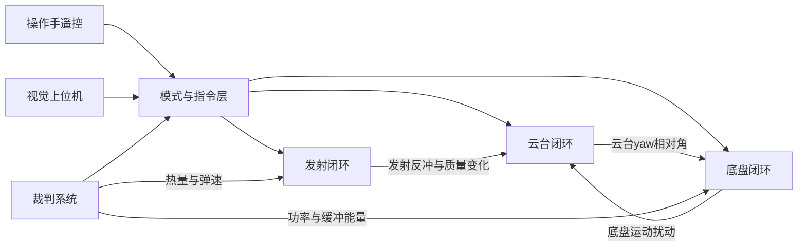

# 01 RoboMaster 比赛背景与英雄机器人任务

> **一句话定位**：先弄清"这台机器人在比赛里要完成什么、规则怎样限制它"，后面所有的云台、发射、底盘控制设计才有"为什么这样做"的依据。本章只写公开的、通用的比赛背景，凡是具体数值一律用"典型"措辞，并且以当赛季规则手册为准。

## 本章学完你能……

- 用英文 60 秒讲清 RoboMaster 是什么比赛、英雄机器人在其中承担什么任务；
- 说出英雄机器人的三大机构（云台、发射机构、底盘）各自的控制目标，并解释为什么它们是三个相互耦合的闭环；
- 解释"裁判系统、热量限制、底盘功率限制、缓冲能量、弹速上限"如何把"能做什么"约束成"必须怎么控制"；
- 把 CV 里 P3 的三条 bullet 一一对应到比赛需求上，知道每条控制设计背后的需求来源；
- 区分"通用比赛背景（可以放心讲）"和"本项目的实机细节（取值见自查表，与实机记忆不同时以实机为准）"。

## 前置知识

- 不需要任何控制理论基础，只需要对"闭环反馈"有直觉：[反馈控制与系统响应基础](../../02_基础知识/04_控制理论/01_反馈控制与系统响应基础.md)。
- 想先看整个项目的全貌，请回到 [README](./README.md)。

## 目录

1. RoboMaster 是什么
2. 比赛形式与你的获奖
3. 英雄机器人是什么
4. 英雄机器人的任务分解
5. 三大机构与三类闭环
6. 裁判系统：规则怎样变成数据
7. 三类限制：热量、功率、弹速
8. 需求如何推导出控制设计（需求 → 设计对照表）
9. 一场比赛里的典型操作剖面
10. 面试怎么讲这一章
11. 本章要点速记、自测题

---

## 1. RoboMaster 是什么

RoboMaster 是由大疆（DJI）发起并长期举办的机器人竞技赛事。高校战队自己设计、制造、编程机器人，在一块标准场地上进行对抗。它的特点是：

- **机器人是完整的工程系统**：机械结构、电气、嵌入式电控、视觉算法、上位机通信、操作手策略都要自己做；
- **有一套统一的"裁判系统"**：由主办方提供的硬件（装甲板、枪口测速模块、电源管理模块、主控模块等）和协议，负责判定命中、扣血、限热、限功率，并把比赛状态通过串口发回给机器人；
- **机器人之间用"发射弹丸"对抗**：不同兵种发射不同口径的弹丸（典型为 17 mm 小弹丸和 42 mm 大弹丸），命中对方机器人身上的装甲板才会扣血。

> **注意**：本文档只写公开通用的比赛背景。比赛规则每个赛季都会修订（弹丸数量、热量上限、功率上限、等级系统、场地机制等），所以下面所有具体数字都带有"典型"字样，并以**当赛季规则手册与裁判系统串口协议附录**为准。你在面试里被问到具体数值时，应当说"in the season I competed, the rule was ..."，而且只说你确实记得的部分；不确定的以 [README 自查表](./README.md#实机细节自查表)第 33 项为准：本项目取值为 2025 赛季英雄 42 mm 大弹丸、弹速上限 16 m/s，热量与功率上限以当赛季规则手册和裁判上报为准，不写具体版本号。

### 1.1 为什么嵌入式控制在这个比赛里很重要

机器人自动瞄准（视觉）、自动导航、策略都建立在一个前提上：**底层的电控必须稳定、快速、可预测**。视觉算法只是告诉云台"目标在哪里"，真正把枪口稳稳地对上去、把弹丸以稳定的速度打出去、在功率限制下灵活移动的，是电控里的闭环控制。可以把它想成：

```text
视觉 / 操作手        = 大脑（决定"去哪里、打哪里"）
嵌入式闭环控制        = 小脑和脊髓（把意图变成稳定、精确、受约束的动作）
电机 + 机械结构       = 肌肉和骨骼
裁判系统              = 规则与记分员（告诉你哪些动作是不允许的）
```

这就是 CV 里 P3 的定位：**Embedded closed-loop control**（嵌入式闭环控制）。

## 2. 比赛形式与你的获奖

CV 中与 P3 相关的获奖（直接引用 CV，不增不减）：

| 赛事 | 成绩 |
|---|---|
| RoboMaster 2025 University Championship（即机甲大师超级对抗赛体系），National Final | Third Prize（国赛三等奖） |
| RoboMaster 2025 University Championship, South Division | Second Prize（南部赛区二等奖） |
| RoboMaster 2025 University League, 3V3 Match | Second Prize（高校联盟赛 3V3 二等奖） |

> **面试要点**：英文里最稳妥的说法是照 CV 念："Our team's hero robot competed in the 2025 national final and won third prize; we also won second prize in the South Division and in the 3V3 match of the University League." 这是**团队**成绩，你的个人贡献是 CV 写明的"gimbal, launcher and chassis control loops"（云台、发射、底盘三类控制回路）。不要说成"我一个人拿了三等奖"。

> **注意**：CV 的获奖是团队荣誉。University League 的 3V3 项目通常以规模更小、更强调单车对抗的形式进行，该项目中具体出场的是哪几台机器人、是否包含英雄机器人，本项目的口径是：3V3 为团队成绩，不归于英雄车；我的贡献是把同一套云台、发射、底盘控制代码与调参流程移植到 3V3 参赛车，并在赛前调参（见自查表第 32 项）。面试中不要把 3V3 的成绩直接说成"英雄机器人拿的"。

### 2.1 赛事体系（通用理解，措辞保守）

高校赛季的典型赛程是：先参加分区赛（如南部赛区），分区赛成绩决定是否进入全国赛；全国赛里再分组淘汰、决出名次。除了主赛事（多兵种团队对抗），还有规模更小的对抗形式（如 3V3，参赛机器人数量更少、更强调单车对抗与自动化）。**各年各赛区的具体赛制细节**（几对几、场地大小、胜负判定）在不同年份不同，面试时只讲你亲身参加的部分，其余用"typically"带过。

## 3. 英雄机器人是什么

在 RoboMaster 的多兵种设计里，**英雄机器人（Hero）**是典型的"重火力、高伤害"兵种：

| 维度 | 英雄机器人的典型特点 |
|---|---|
| 武器 | 发射 **42 mm 大弹丸**（相比步兵的 17 mm 小弹丸，质量大得多，单发伤害高） |
| 射速 | 典型射频低（每秒不到几发），所以**每一发都很重要**，对命中率要求高 |
| 弹速 | 受规则限制，42 mm 弹丸弹速有上限（典型量级十几米每秒，以当赛季规则为准） |
| 底盘 | 体积和质量较大，通常是**麦克纳姆轮（Mecanum）**底盘，能平移和旋转 |
| 云台 | 俯仰（pitch）+ 偏航（yaw）两自由度，承载沉重的发射机构，惯量大 |
| 定位 | 在对抗中用于打击高价值目标（典型如对方基地、前哨站等建筑和高血量目标），常用于"远距离精确打击" |

### 3.1 大弹丸带来的控制难点

大弹丸不是"步兵的放大版"，它改变了几个控制量级：

1. **弹丸质量大 → 发射时从摩擦轮带走的能量大 → 摩擦轮在弹丸通过的瞬间掉速更明显**；这是后面"PID → 变增益 PID → 滑模"迭代的物理根源，详见 [08 从 PID 到变增益 PID 再到滑模控制](./08_从PID到变增益PID再到滑模控制.md)。
2. **弹丸大 → 供弹路径更容易卡弹**；拨盘要能判断堵转并自救，详见 [07 发射机构](./07_发射机构_摩擦轮与拨盘.md)。
3. **整机重 → 底盘惯量大、电机电流大 → 容易触发功率限制**；详见 [10 底盘功率控制](./10_底盘功率控制.md)。
4. **发射机构挂在云台上 → 云台转动惯量大，重心偏，发射反冲也更大**；详见 [06 云台串级 PID](./06_云台串级PID与视觉跟踪.md)。

## 4. 英雄机器人的任务分解

从控制工程师的角度，把"英雄机器人完成一次精确打击"拆成一条任务链：

```text
1. 感知目标      视觉相机 + 上位机识别装甲板，给出目标方位（yaw/pitch 偏差）
2. 瞄准          云台转到目标方向并稳住（云台闭环）
3. 建立弹速      摩擦轮加速到目标转速，使出膛弹速在规则允许的稳定窗口内（发射闭环）
4. 供弹          拨盘把一颗弹丸送入摩擦轮之间（拨盘位置-速度闭环）
5. 出膛          弹丸被摩擦轮加速射出，摩擦轮瞬时掉速后需快速恢复
6. 机动          底盘在整个过程中移动/旋转，既要躲避又不能超功率（底盘闭环 + 功率控制）
7. 约束监控      热量、功率、血量、电源状态由裁判系统实时给出，控制代码据此限制动作
```

注意这条链上**每一步都依赖前一步的稳定输出**：云台抖动会让视觉目标丢失；弹速不稳会让弹道落点散布；底盘功率超限会被裁判系统降级甚至断电，导致整机失去机动。因此 P3 的三条 CV bullet 不是三件孤立的事，而是同一个"稳定连续输出"目标的三个子问题。

## 5. 三大机构与三类闭环

### 5.1 云台（Gimbal）

- **任务**：让枪口指向"期望方向"，并在底盘运动、发射反冲、外部扰动下**保持指向稳定**。
- **执行器**：两个电机分别驱动 yaw（水平转动）和 pitch（俯仰）。
- **传感器**：电机编码器（相对角度）+ 云台上的 IMU（惯性测量单元，提供绝对姿态与角速度）。
- **指令来源**：操作手遥控（连续的摇杆/鼠标增量）或视觉系统（目标偏差/目标角度）。
- **CV 对应**：*Gimbal cascaded PID: built pitch/yaw angle–rate cascaded PID using IMU/AHRS and motor feedback, converting remote-control and vision targets into continuous attitude commands for stable aiming and tracking.*
- **本项目文档**：[05 IMU/AHRS](./05_IMU_AHRS与云台姿态.md)、[06 云台串级 PID](./06_云台串级PID与视觉跟踪.md)。

### 5.2 发射机构（Launcher）

- **任务**：把弹丸以**稳定的出膛速度**打出去，并且**连续发射不卡、不超热量、不超弹速**。
- **执行器**：摩擦轮电机（高速旋转，通过摩擦加速弹丸）+ 拨盘电机（把弹丸一发一发送到发射位置）。
- **传感器**：电机反馈的转速/编码器；弹速来自裁判系统（枪口测速模块的发射数据）。
- **CV 对应**：*Launcher control loops: built friction-wheel speed loops and a feeder position–velocity dual loop, iterating from PID through variable-gain PID to sliding-mode control with muzzle-velocity feedback for stable continuous firing.*
- **本项目文档**：[07 发射机构](./07_发射机构_摩擦轮与拨盘.md)、[08 迭代动机与滑模理论](./08_从PID到变增益PID再到滑模控制.md)。

### 5.3 底盘（Chassis）

- **任务**：根据操作手/上层指令，让车体按期望的平移速度和旋转速度运动；在整车功率受限时保持"可操作"。
- **执行器**：四个驱动电机，带动四个麦克纳姆轮。
- **传感器**：电机反馈（转速）、裁判系统给出的实时功率与缓冲能量、云台 yaw 相对角（用于"底盘跟随云台"）。
- **CV 对应**：*Chassis power control: allocated body velocity to four Mecanum wheels, estimated power demand from real-time power and buffer-energy feedback and scaled wheel speeds, keeping the chassis manoeuvrable under power limits.*
- **本项目文档**：[09 麦克纳姆轮运动学与底盘跟随](./09_麦克纳姆轮运动学与底盘跟随.md)、[10 底盘功率控制](./10_底盘功率控制.md)。

### 5.4 三者的耦合关系



三条关键耦合：

1. **底盘 ↔ 云台**：底盘转动会通过机械结构扰动云台；同时"底盘跟随云台"需要云台 yaw 相对角作为底盘旋转的控制输入。
2. **发射 → 云台**：每发射一发都有后坐冲量，且弹仓弹丸数量变化也在缓慢改变云台质量分布。
3. **裁判系统 → 发射、底盘**：热量决定"能不能发"，功率与缓冲能量决定"底盘能出多大力"。

## 6. 裁判系统：规则怎样变成数据

裁判系统是**规则的数字化执行者**。典型的组成与数据（具体型号、协议版本以当赛季资料为准）：

| 组成/数据 | 作用 | 对控制代码的意义 |
|---|---|---|
| 主控模块 | 汇总机器人状态，通过串口把数据发给机器人电控 | 电控从这里解析数据 |
| 电源管理模块 | 底盘、云台、发射机构的供电被它管理（典型三路输出），可被裁判系统远程断电 | 违规时会被"断电"；底盘功率超限直接影响供电 |
| 装甲板 | 受击检测，扣血 | 与电控无直接关系，但"被打"信息会回传 |
| 枪口测速模块 | 测量每发弹丸的出膛速度 | **弹速反馈的来源**（见 07 章"弹速反馈闭环"） |
| 状态数据 | 机器人 ID/等级、血量、底盘功率上限、枪口热量上限与冷却速率等 | 控制代码据此设定限制 |
| 功率/热量数据 | 底盘电压电流功率、缓冲能量、枪口当前热量 | 底盘功率控制与发射限热的直接输入 |
| 发射数据 | 每发弹丸的弹速等 | 弹速闭环的事件输入 |

### 6.1 串口协议的典型结构

裁判系统与机器人之间走**串口（UART）**，典型帧结构是（具体字段以官方协议附录为准）：

```text
| SOF 0xA5 | data_length(2B) | seq(1B) | CRC8(1B) | cmd_id(2B) | data(n B) | CRC16(2B) |
|<------------ frame_header (5B) ------------->|
```

- **SOF**：帧起始字节；
- **data_length**：data 段长度；
- **seq**：包序号；
- **CRC8**：只校验帧头；
- **cmd_id**：命令字，标识这帧是"比赛状态""机器人状态""功率热量""发射数据"等；
- **CRC16**：校验整帧。

控制代码要做的事：**在串口接收中断/DMA 空闲中断里收字节 → 找帧头 → 校验 CRC → 按 cmd_id 解包到结构体**。这个过程在 [02 整机电控架构](./02_整机电控架构与数据流.md) 和 [03 FreeRTOS](./03_FreeRTOS任务设计与时序.md) 中展开。

> **面试要点**：如果被问 "How does your robot get the power limit and heat?"，答案是："From the referee system over a UART link. The referee sends framed packets with a header, CRC8, a command ID, the payload and a CRC16; we parse them into a struct and use the chassis power limit, buffer energy, shooter heat and bullet speed in the control loops."

### 6.2 数据的"新鲜度"问题

裁判数据不是每个控制周期都更新：典型地，功率热量类数据以几十赫兹更新，而控制环可能是几百赫兹到一千赫兹。所以：

- 控制环里读到的是"最近一次收到的值"，可能已经过时几十毫秒；
- 如果串口断了，结构体里还保留着旧值，必须有**离线检测**（超过某个时间没更新就判离线并采取保守动作）。

这个"新鲜度"思想会反复出现：电机反馈、IMU、视觉、遥控、裁判，每一路输入都有自己的更新节奏和失效模式。

## 7. 三类限制：热量、功率、弹速

规则把"可以做什么"变成了三类硬约束。每一类约束都对应一类控制设计问题：

### 7.1 枪口热量限制（Heat limit）

- **规则机制（典型）**：每发射一发弹丸，枪口热量增加一个固定值（42 mm 弹丸每发的增量典型为 100，以当赛季规则为准）；热量以一定速率冷却；热量超过上限，机器人会被扣血甚至被限制发射。
- **控制含义**：发射前要**预判**——"发了这一发，热量会不会超限？"如果会，拨盘就不应该送弹。
- **教学示例（非项目数值）**：热量上限 200，当前热量 120，每发 +100：120+100=220>200，所以不允许发射；冷却速率 40/s 时，需等 (220−200)/40=0.5 s 才能发下一发。

### 7.2 底盘功率限制与缓冲能量（Power limit and buffer energy）

- **规则机制（典型）**：底盘有一个功率上限（随机器人等级/模式变化）；超出功率时，消耗的是一个"缓冲能量"池（典型初值为几十焦耳）；缓冲能量耗尽还继续超功率，则会被裁判系统惩罚（扣血、降功率或断电）。
- **控制含义**：底盘控制器必须在"想要的速度"和"能给的功率"之间折中，**主动限制轮速指令**。
- **教学示例（非项目数值）**：功率上限 100 W，实际消耗 150 W，缓冲能量 60 J：缓冲净消耗速率 50 W，可持续 60/50=1.2 s。

### 7.3 弹速限制（Muzzle velocity limit）

- **规则机制（典型）**：弹丸出膛速度有上限，超过上限会被判违规（扣血等）；同时弹速太低则弹道下坠大、命中率下降。
- **控制含义**：摩擦轮的目标转速要被**设计在上限以下的稳定窗口内**，而且每一发的弹速要一致（离散度小）。弹速不仅取决于轮速，还取决于弹丸与轮面的打滑、弹丸状态、摩擦轮磨损、电池电压等，所以需要**弹速反馈**去修正轮速目标。
- 这是 CV 里 "with muzzle-velocity feedback for stable continuous firing" 的需求来源。

## 8. 需求如何推导出控制设计（需求 → 设计对照表）

这张表是本章最重要的收获：**每一个控制设计都能追溯到一个比赛需求**。面试官问"Why did you design it this way?"时，答案就是这张表。

| 比赛需求 | 物理原因 | 控制设计 | 详见 |
|---|---|---|---|
| 枪口要稳稳指向目标 | 云台是惯量大的二阶系统，有摩擦、重力矩、外部扰动 | 角度环（外）+ 角速度环（内）串级 PID；用 IMU 角速度做内环反馈 | 06 |
| 底盘转动时枪口不能跟着晃 | 底盘扰动通过结构传递；编码器角度是相对角 | 用 IMU 的绝对姿态做云台反馈，而不是只用电机相对角 | 05、06 |
| 视觉目标和遥控要平顺切换 | 视觉目标有延迟、有跳变；遥控是连续增量 | 目标滤波、限速、模式仲裁、无扰切换 | 06 |
| 每发弹速要一致 | 弹丸通过摩擦轮时带走能量，轮速掉下去 | 摩擦轮速度闭环，从 PID 迭代到变增益、滑模，加弹速反馈修正目标 | 07、08 |
| 连续发射不能卡弹 | 大弹丸供弹路径易卡；拨盘有堵转风险 | 拨盘位置-速度双环 + 基于"目标未达+超时"的堵转判断 + 反转自救 | 07 |
| 不能超热量 | 规则按发数累加热量 | 发射前热量预判与限制 | 07 |
| 底盘能平移也能旋转 | 麦克纳姆轮结构 | 麦轮运动学分配四轮速度 | [09](./09_麦克纳姆轮运动学与底盘跟随.md) |
| 操作时"前进"要相对云台朝向 | 操作手看的是枪口方向 | 把云台系下的速度指令旋转到底盘系，底盘跟随云台 yaw | [09](./09_麦克纳姆轮运动学与底盘跟随.md) |
| 不能超功率被罚 | 缓冲能量有限 | 估计功率需求，按比例统一缩放四轮目标 | 10 |
| 通信不能乱、各环不能互相拖慢 | 多路异步输入、单核 MCU | FreeRTOS 任务划分、中断到任务的数据传递 | 02、03 |
| 电机数据要可靠且及时 | CAN 总线共享、帧丢失、掉线 | CAN 反馈解码、多圈处理、离线检测 | 04 |

## 9. 一场比赛里的典型操作剖面

理解"控制器在什么工况下被使用"对调参和故障分析很重要。下面是一个**典型**的英雄机器人操作剖面（不是你的具体战术，只用来理解工况）：

| 阶段 | 云台 | 发射 | 底盘 |
|---|---|---|---|
| 起步/占点 | 手动，慢速摇杆 | 摩擦轮关闭或待机 | 平移为主，功率较低 |
| 远距离打击 | 视觉辅助瞄准（自动模式）或手动精调；云台需极稳 | 摩擦轮常开，单发，间隔长 | 站定或小幅移动，底盘功率低 |
| 近距离对抗/规避 | 手动 + 大角度快速转动 | 视情况连发 | 高速平移 + 旋转（含"小陀螺"类持续旋转），功率需求最大 |
| 被打/血量低 | 同上 | 受热量限制 | 可能被降功率 |
| 通信异常（遥控断连、视觉断联） | 退化到安全模式（放松或保持） | 停止供弹 | 停车 |

由此可见：
- **云台**的工况范围最广：从静止精瞄到高速跟踪；
- **发射**是"间歇的强冲击负载"：大部分时间空转，弹丸通过的那一瞬间负载剧变；
- **底盘**是"功率瓶颈"：近距离机动时功率需求最大，最容易触发限制；
- **异常处理**是第一类需求：不是"锦上添花"，而是比赛能否安全进行的前提。

## 10. 面试怎么讲这一章

### 10.1 英文 60 秒背景介绍（可直接说）

> "RoboMaster is a robotics competition where university teams build robots that fight each other with projectiles. Our hero robot fires 42-millimetre projectiles, so it is a heavy-fire, high-precision unit. I was responsible for the embedded closed-loop control on an STM32F407 with FreeRTOS and CAN, covering three subsystems: the gimbal for aiming, the launcher for firing, and the chassis for movement under power limits. The robot competed in the 2025 national final and won third prize."
>
> 译：RoboMaster 是高校战队造机器人互射弹丸的比赛。我们的英雄机器人发射 42 mm 弹丸，属于重火力、高精度兵种。我负责 STM32F407 + FreeRTOS + CAN 上的嵌入式闭环控制，覆盖云台瞄准、发射机构、受功率限制的底盘三个子系统。机器人进入 2025 全国赛并获三等奖。

### 10.2 常见问题与回答

**Q1. What does a hero robot do in the match?**
- 回答要点：重火力单位，42 mm 大弹丸，单发伤害高、射频低，所以对命中和弹速一致性要求高；主要用于打击高价值目标。
- 英文：*"The hero is the heavy-fire unit. It shoots large 42-millimetre projectiles at a low rate, so each shot matters. That puts a lot of weight on stable aiming and consistent muzzle velocity."*
- 追问 1：*Why does a low fire rate make accuracy more important?* → 发数少，浪费一发就是浪费很大比例的输出；弹速离散直接转为落点离散。
- 追问 2：*What changed in your control design because of the large projectile?* → 弹丸质量大，摩擦轮掉速明显，所以需要更好的速度环；供弹易卡，所以需要堵转检测。（注意：这是设计动机的解释；具体现象是连发时弹丸擦过使摩擦轮转速跌落约 600–900 rpm、恢复约 120 ms、弹速离散约 ±1 m/s，见自查表第 17 项与 [11 调试与实战故障案例](./11_调试与实战故障案例.md)。）

**Q2. How do the rules affect your controller?**
- 回答要点：热量限制 → 发射前限制；功率限制/缓冲能量 → 底盘按比例缩放；弹速上限 → 弹速反馈修正轮速目标。
- 英文：*"The rules turn into constraints in the controller: heat limits stop the feeder, the chassis power limit and buffer energy force me to scale wheel speeds, and the muzzle velocity cap is why I use velocity feedback to correct the friction wheel target."*

**Q3. Why three separate subsystems instead of one controller?**
- 回答要点：三者的动力学、带宽、传感器、故障模式不同；但耦合需要接口（云台 yaw 相对角给底盘跟随，发射反冲扰动云台）。
- 英文：*"They have different dynamics and sensors, so each gets its own loops. But they are coupled: the chassis motion disturbs the gimbal and the gimbal angle drives chassis following. So the interfaces between them matter as much as each loop."*

**Q4. What is the referee system?** 见 6 节英文答案。

**Q5. How did your team's result break down?**
- 英文：*"Third prize at the national final, second prize in the South Division, and second prize in the 3V3 match of the University League. These are team results; my part was the gimbal, launcher and chassis control loops."*

## 本章要点速记

1. RoboMaster 是高校机器人对抗赛，机器人是完整工程系统，裁判系统负责规则判定并回传数据。
2. 英雄机器人发射 42 mm 大弹丸，重火力、低射频，每一发都重要。
3. 电控分三大机构：云台（瞄准）、发射机构（弹速与供弹）、底盘（机动与功率）。
4. 三大机构相互耦合：底盘扰动云台、发射反冲扰动云台、云台 yaw 相对角驱动底盘跟随。
5. 规则变成三类硬约束：热量、功率/缓冲能量、弹速上限。
6. 裁判数据通过串口帧协议到达，更新频率低于控制环，必须有离线检测。
7. 每个控制设计都能追溯到一个比赛需求（见第 8 节对照表）。
8. 大弹丸使"摩擦轮掉速""供弹卡弹""功率超限""云台惯量大"成为重点问题。
9. CV 的三条 P3 bullet 分别对应云台、发射、底盘；获奖是团队成绩，你的贡献是三类控制回路。
10. 具体规则数值一律以当赛季手册为准，不确定就说不确定。

## 自测题

1. 英雄机器人和步兵机器人在发射机构上的主要差异是什么？这些差异怎样影响控制设计？
   *要点：弹丸口径/质量不同；大弹丸带走能量多、掉速明显、易卡弹；射频低要求每发一致。*
2. 为什么说云台、发射、底盘"是三个耦合的闭环"而不是三个独立系统？举两个耦合路径。
   *要点：底盘转动扰动云台；云台 yaw 相对角给底盘跟随；发射反冲扰动云台。*
3. 裁判系统串口帧里为什么有 CRC8 和 CRC16 两个校验？
   *要点：CRC8 先校验帧头以快速确认帧边界和长度字段可信，CRC16 校验整帧数据完整性。*
4. 如果裁判系统数据中断了（串口线松了），控制代码应该怎么办？为什么？
   *要点：离线检测（超时判定），采取保守策略——限制发射、降底盘功率；否则会用过期的功率/热量值导致违规。*
5. 教学计算：热量上限 250，当前热量 180，每发 +100，冷却 50/s，最早多久能发下一发？
   *答：180+100=280>250；需冷却到 ≤150，即降 30，用时 30/50=0.6 s。*
6. 把 CV 里 launcher 那条 bullet 中的三个关键词（friction-wheel speed loops / feeder position–velocity dual loop / muzzle-velocity feedback）分别对应到一个比赛需求。
   *要点：弹速一致 / 连续供弹与卡弹处理 / 弹速上限与稳定出膛速度。*

## 相关链接

- 下一章：[02 整机电控架构与数据流](./02_整机电控架构与数据流.md)
- 返回：[P3 README](./README.md)
- 基础：[反馈控制与系统响应基础](../../02_基础知识/04_控制理论/01_反馈控制与系统响应基础.md)
- 面试口述总览：[七个项目 30 秒/90 秒/3 分钟口述](../../04_面试准备/03_项目口述总览/01_七个项目30秒_90秒_3分钟口述.md)
