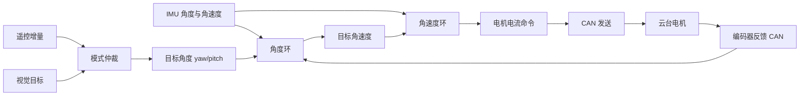
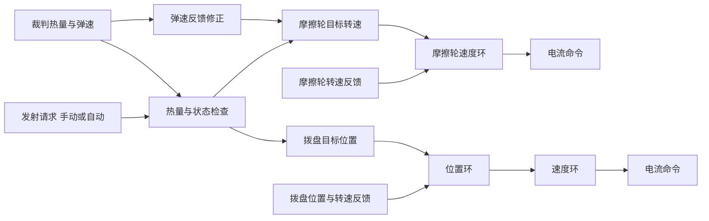
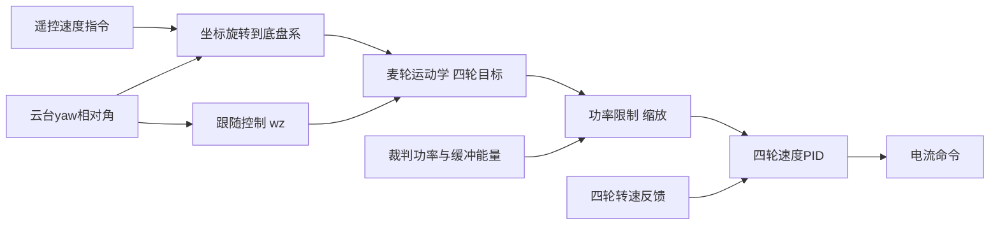
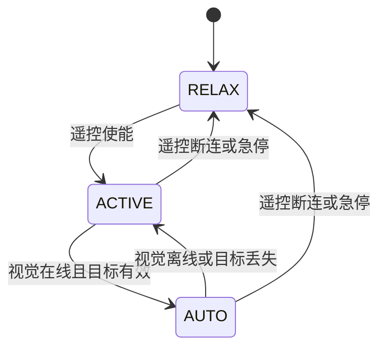

# 02 整机电控架构与数据流

> **一句话定位**：把英雄机器人的电控系统画成一张"谁给谁发什么数据、多快、怎么失效"的地图。这张地图是你在面试里回答任何"系统怎么搭的"问题的骨架，也是后面 FreeRTOS、CAN、IMU、控制回路各章的总纲。

## 本章学完你能……

- 画出英雄机器人电控的整机框图，并说出每条数据通路的方向、协议、典型频率；
- 解释为什么选 STM32F407 + FreeRTOS + CAN 这个组合，它的资源（主频、FPU、CAN 控制器数量、DMA）怎样支撑多回路控制；
- 说清遥控器（DBUS 类）、视觉通信、裁判系统串口、IMU、电机 CAN 五类输入各自的特点；
- 画出云台、发射、底盘三条"反馈 → 控制 → 命令"的数据流，并指出其中的时间对齐与失效点；
- 区分 CV 事实、学习笔记中读到的实现线索、通用典型做法，诚实回答"具体型号/周期"类追问。

## 前置知识

- [STM32 时钟、GPIO、中断、DMA](../../02_基础知识/08_嵌入式与通信/01_STM32_时钟_GPIO_中断_DMA.md)
- [CAN / FDCAN 与电机通信](../../02_基础知识/08_嵌入式与通信/03_CAN_FDCAN与电机通信.md)
- [UART、SPI、I2C、以太网、TCP](../../02_基础知识/08_嵌入式与通信/04_UART_SPI_I2C_以太网_TCP.md)
- 上一章：[01 比赛背景与英雄机器人任务](./01_RoboMaster比赛背景与英雄机器人任务.md)

## 目录

1. 先区分四种信息来源
2. 为什么是 STM32F407 + FreeRTOS + CAN
3. 整机硬件框图
4. 五类输入：特点与失效模式
5. 三条核心数据流
6. 多板架构（典型的"云台板 + 底盘板"）
7. 控制链分层：模式层、规划层、控制层、驱动层
8. 时间与频率的整体视图
9. 软件分层与代码组织（典型）
10. 安全与失效处理总览
11. 面试怎么问、怎么答
12. 要点速记、自测题

---

## 1. 先区分四种信息来源

本项目文档里的每个技术陈述，都属于下面四类之一。**这一点对面试诚信至关重要**，请把它当成阅读规则：

| 标记 | 含义 | 面试中怎么用 |
|---|---|---|
| **【CV】** | CV 明确写出的事实 | 可以作为"I did..."直接陈述 |
| **【笔记线索】** | 你的学习笔记里，对队伍源码快照的阅读结果。源码本身不在本仓库，**未经实机核对** | 可作为"在我们的实现里……"的候选，但要先自己对照代码/记忆核对，核对不了就改成"典型做法" |
| **【典型】** | RoboMaster 电控或通用嵌入式工程里常见的做法 | 用"typically / a common design is"来讲，不说成"我做了" |
| **【教学示例】** | 为了手算而取的干净数字 | 只用于讲原理，绝不当作实机数据 |

另外，所有你必须自己补充的具体项都写成 `【待你补全：…】`，并汇总在 [README 的实机细节自查表](./README.md#实机细节自查表)。

## 2. 为什么是 STM32F407 + FreeRTOS + CAN

**【CV】**: *embedded control ... on STM32F407/FreeRTOS and CAN*。

### 2.1 STM32F407 的资源（公开数据手册层面的通用事实）

| 资源 | 典型规格 | 对本项目的意义 |
|---|---|---|
| 内核 | ARM Cortex-M4F，带单精度浮点单元（FPU） | 姿态四元数、PID、滑模、功率二次式求解等浮点运算可以直接在 MCU 上做，不必定点化 |
| 主频 | 最高 168 MHz | 一个控制周期（毫秒级）内能容纳 IMU 解算 + 多个 PID + 通信解析 |
| 内存 | 192 KB SRAM（含 64 KB CCM）量级，Flash 1 MB 量级 | 足够放 FreeRTOS、多个任务栈、协议缓冲区 |
| CAN | 2 个 bxCAN 控制器（CAN1、CAN2） | 一路接电机，一路接板间通信或另一组电机，分担总线负载 |
| UART | 多路 USART | 遥控（DBUS 类，反相串口）、裁判系统、调试 |
| SPI | 多路 SPI | 读 IMU（如 BMI088 一类） |
| DMA | 多路 DMA 控制器 | 串口收发、SPI 读 IMU 都用 DMA，释放 CPU |
| USB | USB OTG FS | 与视觉上位机通信（典型用虚拟串口 CDC） |
| 定时器 | 多个通用/高级定时器 | PWM（蜂鸣器/LED/IMU 恒温加热）、时间戳 |

> **【笔记线索】**：你的笔记里提到 IMU 为 BMI088（通过 SPI + DMA 读取）并提到过 IST8310（磁力计，但在快照里未启用）。这套 IMU 组合是 RoboMaster 开发板上很常见的配置，与 STM32F407 开发板的搭配也很典型。具体是否是"C 型开发板"【待你补全：主控板型号】。

### 2.2 为什么需要 RTOS

没有 RTOS 的"前后台"程序（主循环 + 中断）也能做控制，但本系统有这些特征，让 RTOS 更合适：

1. **多个周期不同的活动并存**：IMU 解算（高频、由数据到来触发）、云台控制、底盘控制、通信解析、UI/LED、离线检测；
2. **某些活动是事件触发，另一些是周期触发**；
3. **需要优先级**：IMU 与云台控制环不应被 LED 刷新或日志打印拖慢；
4. **需要同步/通信原语**：队列、信号量、任务通知，在"中断收到数据 → 任务处理数据"之间安全传递。

详见 [03 FreeRTOS 任务设计与时序](./03_FreeRTOS任务设计与时序.md)。

### 2.3 为什么电机用 CAN

电机和主控之间需要：多节点（4 个底盘电机 + 云台 + 发射 + ...）、实时（毫秒级）、抗干扰（机器人里有大电流电机）。CAN 总线天然支持多节点广播、差分抗干扰、硬件仲裁和错误检测，所以是机器人里电机通信的标准选择。详见 [04 CAN 总线与电机反馈](./04_CAN总线与电机反馈.md)。

## 3. 整机硬件框图

下面是**典型**的英雄机器人电控框图（实际接线以你的机器人为准，细节处写【待你补全】）：

```text
                    ┌────────────────────────────────────────────┐
                    │               裁判系统                      │
                    │ 主控模块  电源管理模块  测速模块  装甲板      │
                    └───────┬───────────────┬────────────────────┘
          UART(串口帧协议)  │               │ 供电(底盘/云台/发射)
                            ▼               ▼
 ┌──────────┐ DBUS(UART) ┌────────────────────────────────────────┐
 │ 遥控接收机 │──────────▶│              STM32F407 主控            │
 └──────────┘            │   FreeRTOS: INS / 云台 / 发射 / 底盘 /   │
                         │             通信 / 检测 / UI ...        │
 ┌──────────┐ SPI+DMA    │                                        │
 │  IMU      │──────────▶│                                        │
 │ (BMI088类)│            │                                        │
 └──────────┘            │                                        │
                         │   CAN1 ◀───────▶ 云台电机 / 发射电机    │
 ┌──────────┐ USB(CDC)   │   CAN2 ◀───────▶ 底盘电机 / 板间通信     │
 │ 视觉上位机 │◀─────────▶│                                        │
 │ (小电脑)  │            └────────────────────────────────────────┘
 └──────────┘
```

> **提示**：把"哪个电机挂在哪条 CAN 上"作为自查项：【待你补全：CAN1/CAN2 各挂哪些电机与节点】。面试官很爱问"总线负载怎么分配"，第 04 章会给出算法。

### 3.1 执行器清单（典型 + 笔记线索）

| 机构 | 执行器 | 备注 |
|---|---|---|
| 云台 yaw / pitch | RoboMaster 系列电机（典型为 GM6020 或 M3508/M2006 加减速结构） | 【待你补全：yaw/pitch 电机型号与减速比】 |
| 摩擦轮 | 高速电机（笔记中的源码快照有三个摩擦轮变量 `fire_l`、`fire_r` 与第三个） | 【待你补全：摩擦轮数量与电机型号】 |
| 拨盘 | M3508 或 M2006 加减速（笔记中 60° 对应 26225 个编码计数，与 M3508 的约 19.2:1 减速比吻合，见 04 章推算） | 【待你补全：拨盘电机型号、每格角度】 |
| 底盘 | 4 × M3508 驱动 4 个麦克纳姆轮（笔记中 `M3508_DECELE_RATIO = 1/19`，限速 8000 RPM） | 【待你补全：底盘电机型号与实际限速】 |

> 注意：上面"M3508 + 19 : 1"是**笔记线索 + 公开规格**，不是 CV。面试时若说，请加 "if I remember correctly"，并优先自己核对一次实物铭牌/代码。

### 3.2 传感器清单

| 传感器 | 提供 | 接口 | 备注 |
|---|---|---|---|
| IMU（陀螺仪 + 加速度计） | 三轴角速度、三轴比力 | SPI + DMA | 云台姿态与角速度的主要来源 |
| 磁力计（可选） | 航向参考 | I2C | 笔记显示快照中未启用，yaw 无绝对参考 |
| 电机编码器 | 转子位置（单圈）、转速、转矩电流、温度 | CAN 反馈帧 | 电机内部提供，通过 CAN 回传 |
| 摄像头（视觉） | 目标图像 | 在上位机上 | 间接通过 USB 提供目标方位 |
| 裁判系统传感 | 功率、热量、弹速、状态 | UART | 官方硬件提供 |

## 4. 五类输入：特点与失效模式

### 4.1 遥控器（DBUS 类）

- **物理层/协议（典型，DJI DR16 类接收机）**：反相串口，波特率 100000，8 位数据，偶校验（8E1），一帧 18 字节，约每 14 ms 一帧（约 71 Hz）。
- **帧内容**：4 路摇杆通道（各 11 位）、2 个三档拨杆、鼠标 x/y/z 速度与左右键、键盘按键位图、一个拨轮。
- **通道数值**：典型范围 364～1684，中位 1024，故归一化为 $(\text{ch}-1024)/660$。
- **手算（教学示例）**：通道值 1500 → $(1500-1024)/660 = 0.7212$，即推到约 72% 行程。
- **失效模式**：遥控断连时，接收机停止发送或发送全零/保持帧。必须用"超时未收到有效帧"判定离线，并进入安全模式（云台放松、发射关闭、底盘停车）。
- **处理方式（典型）**：UART 空闲中断 + DMA 接收固定长度帧，在中断里或任务里解码，并校验长度。

### 4.2 视觉上位机

- **链路（典型）**：USB 虚拟串口（CDC）或 UART 连接到车上的小电脑。【笔记线索：快照中有 USB 通信任务和一个解码任务 `Decode_task` 处理 USB 协议】。
- **MCU → 上位机**：当前姿态（四元数或欧拉角）、弹速、机器人状态（颜色、模式等）。上位机需要它们来做弹道补偿和坐标变换。
- **上位机 → MCU**：目标 yaw/pitch（绝对角或偏差）、是否发射的命令、目标有效标志。
- **特点**：更新频率远低于控制环（典型几十到两百赫兹），带有显著延迟（相机曝光 + 传输 + 识别 + 解算，典型几十毫秒），数据偶发丢帧或跳变。
- **失效模式**：断联、帧错、目标丢失、数值跳变。必须有**离线检测、目标有效标志、模式回退**（自动 → 手动）。
- 详见 [06 云台串级 PID 与视觉跟踪](./06_云台串级PID与视觉跟踪.md)。

### 4.3 裁判系统串口

见上一章第 6 节。关键点：串口帧、CRC、cmd_id 分发、更新频率低、有离线风险。

### 4.4 IMU

- **链路**：SPI + DMA。传感器有数据就绪信号（DRDY 类中断引脚）或定时读取；DMA 搬运完成后触发任务处理。
- **输出**：陀螺仪 + 加速度计原始值，经量程换算为 rad/s 和 m/s²。
- **特点**：采样率高（典型数百赫兹到上千赫兹）；有零偏；有温漂（所以不少开发板给 IMU 加恒温控制）。
- 详见 [05 IMU/AHRS 与云台姿态](./05_IMU_AHRS与云台姿态.md)。

### 4.5 电机 CAN 反馈

- **链路**：CAN 总线，每个电机以固定频率（典型 1 kHz 量级）发回反馈帧。
- **内容**：单圈编码器位置、转速、转矩电流、温度。
- **中断收→缓存**：CAN 接收中断里按 ID 把数据解码到各电机结构体。**【笔记线索】**：你的笔记强调快照中电机 CAN 反馈在**接收中断里直接分发解码**，而不是交给某个任务（`Decode_task` 处理的是 USB 协议）。
- **失效**：电机掉线（线松、供电掉）、总线错误、ID 冲突。用时间戳判定离线。
- 详见 [04 CAN 总线与电机反馈](./04_CAN总线与电机反馈.md)。

### 4.6 输入汇总表

| 输入 | 典型更新节奏 | 延迟特点 | 主要失效模式 | 离线判定方式（典型） |
|---|---|---|---|---|
| DBUS 遥控 | ~71 Hz（每 14 ms） | 低 | 断连、全零 | 超时（如 100 ms 未收到合法帧） |
| 视觉 | 几十～两百 Hz | 高（几十毫秒级） | 断联、丢目标、跳变 | 超时 + 有效标志 |
| 裁判 | 几十 Hz（因 cmd_id 而异） | 中 | 断线、CRC 错 | 超时 |
| IMU | 数百～上千 Hz | 很低 | 零偏、温漂、通信错误 | 数据就绪超时 |
| 电机反馈 | ~1 kHz | 很低 | 掉线、ID 冲突 | 时间戳超时 |

> **教学示例（非项目数值）**：超时阈值建议取"正常周期的数倍"，例如 DBUS 正常周期 14 ms，阈值取 100 ms 约为 7 倍，可以容忍偶发丢帧又不至于失控太久。具体值【待你补全：你的离线判定阈值】。

## 5. 三条核心数据流

### 5.1 云台数据流



要点：外环（角度）输出的是**目标角速度**，内环（角速度）输出的是**电机电流命令**；反馈取自 IMU（绝对姿态与角速度）和电机编码器（相对角）。详见 06 章。

### 5.2 发射数据流



要点：摩擦轮管"转多快"，拨盘管"送到哪里"；两者由一个发射状态机协调；弹速反馈去修正摩擦轮目标。详见 07、08 章。

### 5.3 底盘数据流



要点：底盘有两层——**运动学分配**（体速度 → 四轮目标）与**轮速闭环**（四轮 PID），功率限制插在两者之间，缩放的是轮速**目标**。详见 09、10 章。

## 6. 多板架构（典型的"云台板 + 底盘板"）

很多 RoboMaster 机器人（尤其是云台与底盘可相对旋转、中间用滑环/线束连接的）会用**两块主控板**：

- **云台板**：IMU 在云台上；运行云台、发射、视觉通信、遥控接收等；
- **底盘板**：运行底盘轮速控制、裁判系统通信（裁判主控模块通常靠近底盘）、超级电容等；
- **板间通信**：典型用 CAN（板间帧 ID 自定义），传遥控数据、云台 yaw 相对角、裁判数据、底盘状态。

**【笔记线索】**：你的笔记显示快照中存在"底盘板通过板间 CAN 发送 pitch 数据"，以及云台控制里把"本板 IMU 的 pitch + 底盘板发来的 pitch"相加作为 pitch 反馈（并强调这是代码组合量，符号约定需要核对）；还有"板间帧 ID 0x113"和"下板 5 度门槛"之类的细节。这些提示：**你的机器人可能是双板结构**。

> 但这并不在 CV 里，你应当自己核对：【待你补全：是否双板？每块板负责什么？板间 CAN 传哪些量，多快？】

### 6.1 双板结构带来的面试追问

- **数据同步**：板间数据有延迟，云台板用的是"几毫秒前的底盘数据"，如何保证一致？
- **谁拥有哪个状态**：云台 yaw 相对角由谁采、谁用？
- **板间失联**：一块板掉线，另一块怎么办？（应有超时与安全动作。）

## 7. 控制链分层：模式层、规划层、控制层、驱动层

把"从操作手意图到电机电流"分成四层，可以让你在白板上清楚地讲系统：

| 层 | 职责 | 典型内容 | 周期特点 |
|---|---|---|---|
| 模式层（Mode） | 决定当前机器人处于什么模式：放松、手动、自动、故障 | 遥控拨杆映射模式；离线、故障触发回退 | 事件驱动 + 周期检查 |
| 指令层（Command） | 把遥控/视觉输入变成连续的目标 | 遥控增量积分成目标角；视觉目标滤波；速度指令限幅 | 与控制环同周期 |
| 控制层（Control） | 闭环计算 | 角度环、角速度环、轮速 PID、摩擦轮速度控制、拨盘位置-速度环、功率缩放 | 控制周期 |
| 驱动层（Driver） | 把控制量变成电机能理解的命令 | 电流限幅、协议打包、CAN 发送；反馈解码 | 与 CAN 节奏同步 |

> **面试要点**：当被问 "Walk me through the control architecture" 时，按这四层讲：mode → command shaping → closed loops → drivers。再说"safety is cross-cutting: every layer can force a safe state."

### 7.1 模式状态机（典型）



**【笔记线索】**：笔记中提到云台模式有 `GIMBAL_RELAX / GIMBAL_ACTIVE / GIMBAL_AUTO`，自动模式要求视觉在线且状态满足条件，否则回退到 ACTIVE。这与上图一致。

## 8. 时间与频率的整体视图

"控制频率"是面试高频雷区。先建立整体视图（全部为**典型/推算**，你的实机值要自己补）：

| 活动 | 驱动方式 | 典型频率量级 | 本项目的值 |
|---|---|---|---|
| IMU 数据就绪 | 传感器内部时钟 / DRDY | 数百 Hz～1 kHz 量级 | 【待你补全】 |
| IMU 解算任务 | 任务通知（事件触发） | 同 IMU 数据率 | 【待你补全】 |
| 电机反馈到达 | 电机内部固定 | ~1 kHz | 约 1 kHz（电机规格，非你的测量） |
| 云台控制任务 | 周期延时 | 数百 Hz～1 kHz | 【笔记线索：循环内有三处 1 tick 延时，结构估算约 3 ms，需实测】【待你补全：实测周期】 |
| 底盘控制任务 | 周期延时 | 数百 Hz～1 kHz | 同上 |
| 视觉消息 | 上位机发送 | 几十～两百 Hz | 【待你补全】 |
| 裁判消息 | 裁判发送 | 几十 Hz | 【待你补全】 |
| 遥控帧 | 接收机发送 | ~71 Hz | 约 71 Hz（协议规格） |
| CAN 命令发送 | 控制任务内 | 与控制任务同频 | 【待你补全】 |

> **注意（诚实性）**：不要在面试里说 "my control loop ran at 1 kHz" 除非你确实测过。更稳妥的说法：*"The nominal tick was 1 ms, but I would say the effective loop period was a few milliseconds because of the delays in the loop; I'd measure it with timestamps or a GPIO toggle."* 详见 [03 FreeRTOS 任务设计与时序](./03_FreeRTOS任务设计与时序.md) 的"周期不等于延时参数"一节。

## 9. 软件分层与代码组织（典型）

RoboMaster 电控常见的工程组织（你的工程可能略有不同）：

```text
Core/            CubeMX 生成：时钟、GPIO、外设初始化、FreeRTOS 任务创建
application/     应用层：Gimbal / Chassis / Launcher / Communication(CAN, USB, 裁判) / INS
component/       组件层：算法 (PID, SMC, AHRS, 滤波)，设备驱动 (电机, IMU, 遥控)
Middlewares/     FreeRTOS、HAL 库、USB 库
```

**【笔记线索】**：你的笔记里出现的路径显示出这类分层：`application/Gimbal`、`application/Chassis`、`application/Communication`、`component/algorithm`（AHRS）、`component/controller`（PID、SMC、变增益 PID）、`component/Motor`（电机驱动）、`component/devices`（BMI088 驱动）。

### 9.1 分层的好处

- 控制算法（PID/SMC）与硬件无关，便于单独测试；
- 方向修正（符号）放在调用处而不是算法内部，使算法通用（见 08 章"外部负号"）；
- 驱动层统一封装 CAN 打包，应用层只关心"给每个电机一个电流值"。

## 10. 安全与失效处理总览

比赛机器人上，**失控比"不够好"危险得多**（会撞人、损坏机构、被罚下）。典型的安全机制按层次列出：

| 层面 | 机制 | 目的 |
|---|---|---|
| 输入 | 离线检测（遥控/视觉/裁判/电机/IMU） | 不用过期数据做控制 |
| 模式 | 断连 → RELAX；视觉丢失 → 回退手动 | 失去输入就失去权限 |
| 输出 | 电流限幅、轮速限幅、斜坡 | 防止异常命令损坏机构 |
| 执行器 | 温度/电流监控 | 防止堵转烧电机（见 07 章） |
| 发射 | 热量预判、弹速上限 | 满足规则，避免被罚 |
| 底盘 | 功率缩放 | 避免被断电 |
| 软件 | 看门狗、栈溢出检测 | 防止死机 |
| 初始化 | 先标定（IMU 零偏、云台零位）后使能 | 避免启动瞬间飞车 |

> **【待你补全：你的项目里实际实现了哪些安全机制？】**（如离线检测的具体写法、RELAX 时是否发零电流、是否用了独立看门狗）

## 11. 面试怎么问、怎么答

**Q1. Can you describe the overall architecture of your hero robot's control system?**
- 回答骨架：*一块（或两块）STM32F407 板；FreeRTOS 多任务；CAN 连电机；SPI 读 IMU；UART 连遥控与裁判系统；USB 连视觉上位机；云台、发射、底盘三个控制任务加一个 IMU 解算任务和若干通信/检测任务。*
- 英文：*"The core is an STM32F407 running FreeRTOS. Motors sit on CAN, the IMU is read over SPI with DMA, the remote and the referee system come in over UART, and the vision computer talks to us over USB. We have separate tasks for the IMU, the gimbal, the launcher and the chassis, plus communication and monitoring tasks."*
- 追问 1：*Which parts ran in interrupts and which in tasks?* → 通信接收和 DMA 完成走中断，只做最少的事（取数据、置标志/通知）；控制计算放任务。
- 追问 2：*How did you make sure stale data was not used?* → 每一路输入有时间戳或计数，超时判离线；离线触发安全模式。
- 追问 3：*What would happen if the CAN bus went down?* → 反馈停止更新，电机离线检测触发，控制器停止发送新命令/发零电流，模式回到 RELAX。

**Q2. Why FreeRTOS rather than a bare-metal loop?**
- 要点：多速率、事件驱动与周期混合、优先级隔离、同步原语。
- 英文：*"We had several activities at different rates, some event-driven like the IMU and some periodic like the control loops. An RTOS gives priorities and clean synchronization, so a slow task like UI cannot delay the gimbal loop."*
- 追问：*What is the downside?* → 抖动、栈内存开销、调度开销、需要注意共享数据与优先级反转。

**Q3. How do the remote and the vision target coexist?**
- 要点：模式仲裁（同一时刻只有一个来源决定目标），视觉有效才切自动，离线回退。
- 英文：*"A mode decides which source owns the target. In auto mode the vision target feeds the same angle loop; if vision goes offline or loses the target, we fall back to manual and avoid a jump by re-initialising the target to the current attitude."*

**Q4. What is on CAN1 and what is on CAN2?**
- 诚实回答：*"I don't remember the exact split in front of me, but the idea was to separate the chassis motors from the gimbal and launcher motors to keep the bus load and latency manageable."*（仅在你确实记不清时使用，并去补全。）

**Q5. How did the gimbal board and the chassis board exchange data?**（仅当你的机器人是双板时）
- 英文：*"Over a dedicated CAN link, with a few custom frames carrying commands and the gimbal yaw relative angle in one direction, and referee and chassis state in the other. Each side has a timeout to detect link loss."* 先核对你是否真是这样：【待你补全】。

## 本章要点速记

1. 本文档对每个陈述标注来源：CV / 笔记线索 / 典型 / 教学示例；具体项用【待你补全】。
2. STM32F407 = Cortex-M4F + FPU + 168 MHz + 双 CAN + DMA，足以在 MCU 上做全部浮点控制。
3. FreeRTOS 解决多速率、事件+周期混合、优先级隔离、同步通信。
4. 五类输入：遥控（~71 Hz）、视觉（高延迟）、裁判（低频）、IMU（高频）、电机反馈（~1 kHz），各有失效模式，都需要离线检测。
5. 云台链：目标 → 角度环 → 角速度环 → 电流；发射链：状态机 + 摩擦轮速度环 + 拨盘位置速度环；底盘链：运动学分配 → 功率缩放 → 轮速 PID。
6. 底盘功率缩放作用在轮速目标上，处于运动学与轮速 PID 之间。
7. 典型双板结构需要回答板间同步与失联问题；你是否双板需自查。
8. 控制层之上有模式层与指令层，控制层之下有驱动层；安全贯穿各层。
9. 不要未经测量就说"1 kHz 控制环"；区分 tick、延时参数、实际周期。
10. 方向修正放在调用处使算法与硬件解耦。

## 自测题

1. 列出五类输入及各自典型的更新节奏，并为每类写一个失效模式。
   *见 4.6 表。*
2. 为什么云台板上的 IMU 比电机编码器更适合做云台的稳定反馈？
   *要点：IMU 测绝对姿态/角速度，不受底盘转动影响；编码器只给相对角。*
3. 计算：遥控通道值 700，归一化值是多少？
   *答：(700−1024)/660 = −0.4909。*
4. 一条 CAN 总线 1 Mbps，标准帧 8 字节数据约 111 bit（不含填充位），一帧需要多少时间？
   *答：111 µs。*
5. 说出把系统分成模式层、指令层、控制层、驱动层的好处。
   *要点：职责清晰；安全回退集中在模式层；算法与硬件解耦；便于测试与调试。*
6. 视觉上位机比控制环慢很多且有延迟，控制环里怎样避免"阶梯状"的目标输入造成抖动？
   *要点：目标滤波/限速/插值；详见 06 章。*

## 相关链接

- 上一章：[01 比赛背景与英雄机器人任务](./01_RoboMaster比赛背景与英雄机器人任务.md)
- 下一章：[03 FreeRTOS 任务设计与时序](./03_FreeRTOS任务设计与时序.md)
- 基础：[FreeRTOS 实时系统](../../02_基础知识/08_嵌入式与通信/02_FreeRTOS实时系统.md)、[CAN / FDCAN 与电机通信](../../02_基础知识/08_嵌入式与通信/03_CAN_FDCAN与电机通信.md)
- 八股：[嵌入式与机电八股](../../03_八股知识/03_机器人学/06_嵌入式与机电八股.md)
- 学习笔记：[P3 本对话问答逐字稿](../../05_学习笔记归档/P3/P3_本对话问答逐字稿.md)
