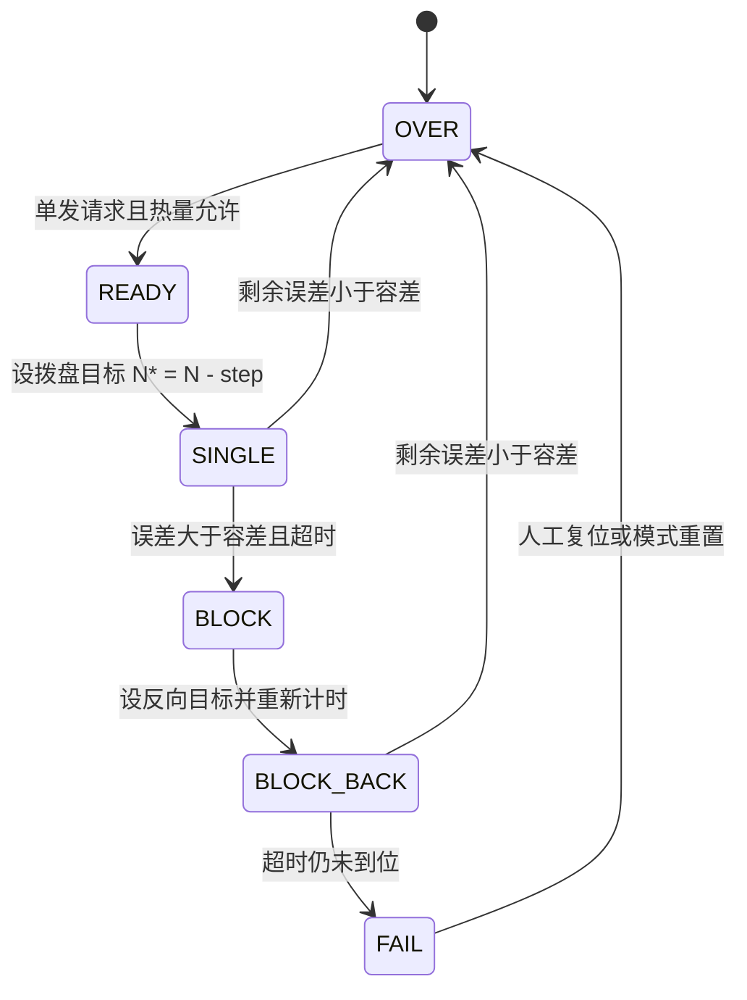

# 07 发射机构：摩擦轮、拨盘、状态机、堵转与热量

> **一句话定位**：CV 第二条 bullet 的工程全貌——*friction-wheel speed loops and a feeder position–velocity dual loop ... with muzzle-velocity feedback for stable continuous firing*。本章讲清发射机构的物理原理、摩擦轮速度环、弹速反馈、拨盘位置-速度双环、发射状态机、堵转判断与恢复、热量限制，全部给手算。控制算法迭代（PID → 变增益 PID → 滑模）的理论放在下一章 [08](./08_从PID到变增益PID再到滑模控制.md)。

## 本章学完你能……

- 解释摩擦轮发射的物理原理：轮面线速度、打滑、弹丸获得的动能、轮子掉速的来源，并手算；
- 区分"轮速稳定"和"弹速稳定"，说明为什么需要弹速反馈，并设计一个收敛的弹速闭环（含稳定性条件与手算）；
- 设计拨盘位置-速度双环：计数—角度换算、位置环限速、速度环；
- 画出并解释发射状态机，区分 Fire_ON / Fire_OFF / RELAX；
- 比较三种堵转检测方案（电流/速度/位置进度），解释"目标未达 + 超时"方案的细节与边界；
- 设计热量预判与限制，解决裁判数据滞后问题；
- 说出发射过程的常见故障与定位方法；
- 回答"为什么拨盘要双环""怎么判断卡弹""怎么保证弹速一致"等面试追问。

## 前置知识

- [PID 控制全解](../../02_基础知识/04_控制理论/02_PID控制全解.md)
- [电机、编码器、驱动与力矩控制](../../02_基础知识/08_嵌入式与通信/05_电机_编码器_驱动与力矩控制.md)
- 上两章：[04 CAN 与电机反馈](./04_CAN总线与电机反馈.md)、[06 云台串级 PID](./06_云台串级PID与视觉跟踪.md)；背景：[01 比赛背景](./01_RoboMaster比赛背景与英雄机器人任务.md)

## 目录

1. 发射机构的物理原理
2. 摩擦轮：对象模型与速度环
3. 弹丸通过时的掉速（手算）
4. 轮速 ≠ 弹速：弹速反馈闭环
5. 拨盘：位置-速度双环
6. 发射状态机
7. 触发：手动与自动
8. 热量限制
9. 堵转：检测与恢复
10. 与云台、底盘的耦合
11. 在本项目里怎么用
12. 常见故障
13. 面试怎么问、怎么答
14. 要点速记、自测题

---

## 1. 发射机构的物理原理

```text
        供弹路径                         摩擦轮对
   ┌──────────────┐                  ┌──────────┐
   │  ○ ○ ○ ○ ○   │   拨盘转动一格     │  ◯   ◯   │ ← 两个或三个摩擦轮高速反向/相向旋转
   │  弹仓+拨盘    │ ───────────────▶ │   ●      │ ← 弹丸被夹在轮间，靠摩擦加速到出膛速度
   └──────────────┘                  └──────────┘
```

两个独立的执行器、两种完全不同的控制问题：

| 部件 | 控制目标 | 被控量 | 工况特点 |
|---|---|---|---|
| 摩擦轮 | 保持目标转速；弹丸通过后快速恢复 | 转速（rad/s 或 rpm） | 长时间空转，弹丸通过的瞬间有强冲击负载 |
| 拨盘 | 每次精确送一发；卡弹时自救 | 累计位置 + 转速 | 间歇运动，可能堵转 |

> **【笔记线索】**：你的笔记里，发射机构有三个摩擦轮变量（左、右和第三个），拨盘变量叫 `trigger`，其中的摩擦轮目标速度正负不同表示转向不同（负数不是"慢"）。**摩擦轮的数量和布局**：本项目取值为 2 个 M3508 直驱摩擦轮（左 0x201、右 0x202，轮径约 60 mm），第三个变量是左右共用的目标速度 fire_speed（42 mm 发射机构不同队伍布局不同）。

## 2. 摩擦轮：对象模型与速度环

### 2.1 对象模型

一个摩擦轮（含电机转子）的旋转动力学：

$$
J_w\dot\omega=K_t\,i-b_w\,\omega-\tau_L(t)
$$

- $J_w$：轮+转子惯量（kg·m²）；
- $\tau_L$：弹丸通过时的**冲击负载**（正值表示阻碍旋转）；
- $b_w$：摩擦与风阻。

特点：

1. 目标转速高（几千 rpm），**惯量不大**，所以电机能在数毫秒到数十毫秒内改变转速；
2. 负载脉冲持续时间很短（弹丸通过接触区，毫秒量级）；
3. 电流受限：$|i|\le i_{\max}$，所以恢复速度有上限，$\dot\omega_{\max}=K_ti_{\max}/J_w$。

### 2.2 速度环

CAN 反馈转速 $\omega$（从 rpm 换算），误差 $e=\omega^*-\omega$，控制器输出电流指令，电调内部电流环执行。基本控制器是 PI（见 06 章内环推导），带宽 $\omega_v=K_tK_p/J_w$。

**手算（教学示例）**：$J_w=4\times10^{-4}$ kg·m²，$K_t=0.3$ N·m/A，要求 $\omega_v=100$ rad/s：$K_p=\omega_vJ_w/K_t=100\times4\times10^{-4}/0.3=0.133$ A/(rad/s)。最大角加速度（电流限幅 10 A）：$K_ti_{\max}/J_w=0.3\times10/4\times10^{-4}=7500\ \text{rad/s}^2$，从 0 加速到 500 rad/s 至少 $500/7500=67$ ms。

### 2.3 起转（spin-up）

从 0 加速到目标转速时，误差很大、电流饱和，**积分项会累积（积分饱和）**，导致到达目标后过冲（overshoot）。对策：条件积分/积分分离（大误差时关闭积分）、变增益、斜坡给定。过冲会让**第一发弹速偏高**，甚至越过弹速上限。这是后面迭代控制算法的一个重要动机（第 08 章）。

### 2.4 使能与停机

- **Fire_OFF（关摩擦轮）**：目标转速设为 0，控制器仍在运行，可能输出制动电流；
- **RELAX（放松）**：明确把电流置零，电机自由滑行。

二者的区别是安全问题：Fire_OFF 之后"目标为 0 不等于电流为 0"。

## 3. 弹丸通过时的掉速（手算）

### 3.1 能量账

弹丸出膛速度 $v_b$、质量 $m$，动能 $E_k=\tfrac12 mv_b^2$。这份能量来自摩擦轮的转动动能。若有 $N_w$ 个轮子平分（理想假设）：

$$
\tfrac12J_w(\omega_0^2-\omega_1^2)=\frac{E_k}{N_w}\ \Rightarrow\ \omega_1=\sqrt{\omega_0^2-\frac{2E_k}{N_wJ_w}}
$$

**手算（教学示例；弹丸质量约 45 g 量级，轮半径 3 cm，打滑系数 0.8）**：

- 出膛速度 $v_b=16$ m/s：$E_k=\tfrac12\times0.045\times16^2=5.76$ J；
- 轮面线速度 $v_s=v_b/\eta=16/0.8=20$ m/s；$\omega_0=v_s/r=20/0.03=666.7$ rad/s = 6366 rpm；
- 两个轮平分：$E_k/N_w=2.88$ J；
- 若 $J_w=4\times10^{-4}$：$\omega_1=\sqrt{666.7^2-2\times2.88/(4\times10^{-4})}=\sqrt{444444-14400}=655.8$ rad/s，**掉速 10.9 rad/s（1.6%）**，对应若不恢复，下一发弹速降低约 $16\times1.6\%=0.26$ m/s；
- 若惯量较大 $J_w=1.5\times10^{-3}$：掉速 2.9 rad/s（0.43%），下一发弹速降低约 0.07 m/s。

**结论**：
1. 惯量越小，掉速越明显；
2. 掉速是**能量守恒的必然结果**，控制器无法避免第一时间的掉速，只能决定**多快恢复**以及**恢复时是否过冲**；
3. 恢复所需时间下限：$t_{\min}=J_w\Delta\omega/\tau_{\max}$。设最大可用力矩 $\tau_{\max}=0.5$ N·m：$4\times10^{-4}\times10.9/0.5=8.7$ ms。

### 3.2 对英雄机器人意味着什么

英雄射频低（两发之间通常是数百毫秒或更久），所以**只要控制器正常，下一发之前轮速已经恢复**。真正造成弹速离散的，往往是：

1. **起转过冲/欠冲**（第一发弹速不准）；
2. **电池电压跌落**使电机能力下降，恢复变慢；
3. **弹丸与轮面接触状态**（打滑系数 $\eta$ 变化、弹丸尺寸/硬度离散、轮面磨损）造成同样轮速下弹速不同；
4. **控制器噪声/抖振**使轮速围绕目标波动；
5. **连发时**（短时间内多发）掉速累积。

因此"弹速一致"既要有**好的速度环**，也要有**对打滑变化不敏感的目标修正（弹速反馈）**。

> 本项目的主要问题是连发时弹丸擦过使摩擦轮转速跌落约 600–900 rpm、恢复约 120 ms，导致弹速离散约 ±1 m/s（PID 阶段）；这决定了"为什么迭代到变增益、滑模"的故事，见 [08 章](./08_从PID到变增益PID再到滑模控制.md)与 [99 章](./99_英文面试口述与深挖问答.md)。

## 4. 轮速 ≠ 弹速：弹速反馈闭环

### 4.1 为什么需要

$v_b=\eta\,r\,\omega$，$\eta$ 不是常数：弹丸磨损、轮面磨损、温度、电池电压（间接）、供弹顺序都会改变。开环的"轮速 → 弹速"映射会逐渐漂移。需要**直接测量弹速**，据此修正轮速目标。

### 4.2 弹速信息从哪里来

裁判系统枪口测速模块会在每发弹丸发射后上报该发的弹速（事件型数据，通常在发射后几十毫秒内到达）。**【CV】**: *with muzzle-velocity feedback*。弹速反馈是**事件触发、有延迟、有噪声的慢速反馈**，所以它适合作为**外层慢环**，修正内层摩擦轮速度环的**目标**，而不是直接参与转速闭环。

```text
        弹速目标 v_ref
            │ (+)
            ▼
   ┌─── 弹速外环（每发更新一次） ───┐
   │  ω_set ← ω_set + K_v (v_ref − v_b) │
   └──────────────┬─────────────────┘
                  ▼
        摩擦轮速度环（高速，毫秒级）
                  ▼
             摩擦轮 → 弹丸 → 测速模块 → v_b
```

### 4.3 推导：外环为什么收敛

设 $v_b=\kappa\,\omega$（$\kappa=\eta r$，局部线性）。更新律：

$$
\omega_{n+1}=\omega_n+K_v\,(v_{ref}-\kappa\omega_n)
$$

误差 $e_n=v_{ref}-\kappa\omega_n$ 满足 $e_{n+1}=(1-K_v\kappa)\,e_n$。收敛条件：

$$
|1-K_v\kappa|<1\ \Longleftrightarrow\ 0<K_v<\frac2\kappa
$$

$K_v=1/\kappa$ 是"一步到位"（deadbeat），但对每发弹速的随机离散最敏感（直接把噪声搬到轮速上）；取 $K_v=0.3/\kappa\sim0.5/\kappa$ 是兼顾收敛与滤噪的折中。

**手算**（继续用 $\kappa=0.8\times0.03=0.024$ m/s per rad/s）：$K_v=0.5/\kappa=20.8$ (rad/s)/(m/s)，目标 $v_{ref}=15.5$ m/s（在 16 m/s 上限下留余量），当前弹速 14.9 m/s（$\omega=620.8$）：

| 发数 | 轮速 $\omega$ (rad/s) | 弹速 (m/s) | 误差 (m/s) |
|---|---|---|---|
| 0 | 620.8 | 14.90 | 0.60 |
| 1 | 633.3 | 15.20 | 0.30 |
| 2 | 639.6 | 15.35 | 0.15 |
| 3 | 642.7 | 15.43 | 0.075 |
| 4 | 644.3 | 15.46 | 0.037 |

每发误差减半。

### 4.4 工程细节

| 问题 | 做法 |
|---|---|
| 单发弹速噪声 | 增益取小、死区（如 ±0.2 m/s 内不调）、对最近几发滑动平均 |
| 弹速超上限 | 不等外环：超限立即下调目标（单边快速下调，上调慢），并留裕量 |
| 步长限制 | 每次修正量限幅（如 ±30 rad/s），防止异常读数（如 0 或 100）造成大动作 |
| 异常读数 | 不在合理范围（如 <5 或 >30 m/s）的忽略 |
| 初始值 | 以标定过的轮速目标起步，反馈只做微调 |
| 数据延迟 | 修正在"下一发"生效；连发时当前发已无法修正 |

> **【笔记线索】**：你的笔记里读到快照的做法是：用裁判上报的 `bullet_speed` 分档调整 `fire_speed`，步长为 50（rpm 量级）；阈值包括 15.7 和 16；并且指出两个阈值判断写成**两个独立 `if`**（而不是 `else if`），在某些情况下可能一次加两个步长。这是典型的"阶梯式（bang-bang with step）"弹速修正，实现简单。你可以主动说它的优缺点：简单、鲁棒；步长是离散的，可能出现极限环（来回调节）。本项目取值：高于 16.0 m/s 则 fire_speed 绝对值减 50 rpm，低于 15.7 m/s 则加 50 rpm，软限幅 7000 rpm；满电时曾 2 次测到 16.2 m/s 超限，这是引入下调逻辑的原因；15.7–16.0 m/s 之间是死区，没有出现持续的来回调节。

### 4.5 手算：阶梯式修正的极限环风险

假设步长 50 rpm 对应弹速变化 $\Delta v=\kappa\times50\times2\pi/60=0.024\times5.236=0.126$ m/s。若死区宽度（上下阈值之差）小于 $\Delta v$，就可能在两个阈值间来回跳。设计原则：**死区宽度 ≥ 一个步长引起的弹速变化 + 弹速随机离散的数倍**。

## 5. 拨盘：位置-速度双环

### 5.1 为什么要双环

拨盘每次送一格（例如 60°），然后停住等下一发。需要**位置精确**（到位而不过冲）+ **运动平稳**（速度受限，避免弹丸被甩或撞击）+ **力矩足够**（克服弹丸堆积摩擦）。位置环提供精确到位，速度环提供平稳和力矩。与云台串级同理（见 06 章），只是外环是位置（编码器累计计数）。

### 5.2 计数与角度的换算（手算）

拨盘电机经减速比 $i_g$ 驱动拨盘；编码器测量转子（单圈 8192 计数）。拨盘转 $\Delta\theta_{out}$ 时，转子累计计数：

$$
N=\frac{8192\cdot i_g\cdot\Delta\theta_{out}}{360^\circ}
$$

**手算（推算）**：$i_g=3591/187=19.2032$，一格 $60^\circ$：$N=8192\times19.2032/6=26219$ 计数；整圈 $157{,}313$ 计数。

> **【笔记线索】**：你的笔记里一格增量为 26225、堵转反转 52450（正好 2 倍）。推算值 26219 与 26225 只差 6 个计数（0.02%），**强烈提示拨盘是约 19.2:1 减速的 M3508、一圈 6 格（60°）**。这是用于自我核对的"推算"。本项目取值：M3508（19.2:1）、一圈 6 格，目标按多圈累计编码计算，每发后取整到最近一格。

### 5.3 控制结构

```text
目标累计计数 N*  ──(+)──▶ 位置环 P ──▶ 目标转速 ω* (限幅) ──(+)──▶ 速度环 PI ──▶ 电流指令
                    ▲ −                                     ▲ −
         实际累计计数 N                               实际转速 ω（电机反馈 rpm）
```

位置环 $\omega^*=\mathrm{clip}(K_N(N^*-N),\pm\omega_{\max})$。

**手算（教学示例）**：$K_N=0.02$ rpm/计数，限速 $\pm400$ rpm（转子侧）。一格 26219 计数：$K_N\times26219=524$ rpm，超限 → 限速 400 rpm。以 400 rpm 匀速需转 $26219/8192=3.2$ 圈 = $3.2/(400/60)=0.48$ s，加上加减速，单发约 0.5～0.6 s。**限速决定了最大射频**：1/0.55≈1.8 发/s（受热量限制通常更低）。

- 误差降到 $400/0.02=20000$ 计数以下进入线性区；
- 在目标附近，$e=1000$ 计数 → $\omega^*=20$ rpm，速度环平稳到位。

### 5.4 为什么限速

1. 速度太快：弹丸被甩出或在通道里撞击卡弹；
2. 电流峰值大：拉低电池电压，影响全车；
3. 过冲：位置环增益过大时到位冲过头。

### 5.5 目标更新方式

单发：$N^*\leftarrow N_{\text{ref}}\pm\Delta N$（相对增量）。关键设计选择：增量基于**"上次目标"**还是**"当前位置"**？

| 做法 | 优点 | 缺点 |
|---|---|---|
| 基于当前位置 | 简单；误差不累积到下一发 | 上一发没完全到位的误差会被"吃掉"，长期累积漂移（偏离格线） |
| 基于上次目标 | 位置不累积漂移（始终对齐格线） | 如果上一发没到位（卡弹），目标会累积变大，需要卡弹复位 |

这是个有深度的追问点。【笔记线索】你的笔记里是"目标 = 当前累计编码 − 26225"（基于当前位置）。本项目的做法是基于当前位置：用多圈累计编码防止回绕，每发之后把目标取整到最近一格，误差不会随发数累积漂移；缺点是卡弹时目标会跟着当前位置走，所以需要堵转判据兜底。

## 6. 发射状态机

### 6.1 两个正交的状态量

| 状态量 | 含义 |
|---|---|
| `fire_mode`（摩擦轮开关） | Fire_ON：摩擦轮目标转速非零；Fire_OFF：目标为 0 |
| `shoot_cmd`（单发进度） | 当前这一发进行到哪一步 |

**打开摩擦轮 ≠ 每个周期都拨弹。**

### 6.2 单发状态（对应笔记中的状态名，原拼写保留）

| 状态 | 含义 |
|---|---|
| `SHOOT_CLOSE` | 单发流程关闭 |
| `SHOOT_READLY`（ready） | 收到单发请求，准备执行 |
| `SHOOT_SINGLE` | 正在执行这一发（拨盘在转） |
| `SHOOT_OVER` | 这一发完成，可以接受下一个请求 |
| `SHOOT_BLOCK` | 判为堵转 |
| `SHOOT_BLOCK_BACK` | 正在反向退弹 |
| `SHOOT_FAIL` | 反向后仍未到位 |



### 6.3 三种"停"的区别（重点）

| 动作 | 摩擦轮 | 拨盘 | 说明 |
|---|---|---|---|
| Fire_OFF | 目标=0，**控制器仍可能输出制动电流** | 电流置零 | 目标为零 ≠ 电流为零 |
| RELAX | 电流置零 | 电流置零，**拨盘目标参考重置** | 明确的安全动作 |
| FAIL | 未必改变 | **状态标记**，不必然切断电流 | 需要上层处理 |

> **【笔记线索】**：你的笔记反复强调：Fire_OFF 与 RELAX 不同；SHOOT_FAIL 状态本身不等于电流为零。面试里可以主动说："I distinguish between commanding zero speed and removing the drive: only the relax path guarantees zero current."

### 6.4 改进建议（可写进"what would you improve"）

1. FAIL 时**锁存**：拨盘电流置零 + 告警 + 禁止后续单发请求，直到操作手重新使能；
2. 限制重试次数（例如反转 1～2 次）；
3. 送弹前**摩擦轮达速门限**：$|\omega-\omega^*|<\epsilon$ 且持续一定时间才允许拨弹，避免"轮还没转到位就送弹"。本项目的快照中没有明确的达速门限（笔记所述），靠连发间隔不小于 400 ms 与热量门限制节奏；达速门限是改进项。

## 7. 触发：手动与自动

### 7.1 手动

- 来源：遥控拨杆边沿、鼠标左键按下沿；
- **用边沿而不是电平**：一次拨动只触发一发；电平触发会连发；
- 前提：状态为 OVER、摩擦轮已开、热量允许。

边沿检测：

```c
bool rising = (now && !last);   /* last 保存上次状态 */
```

### 7.2 自动

条件（典型）：

1. 视觉给出发射建议（`fire_command`）；
2. 云台处于 AUTO；
3. 热量允许；
4. 距上次发射超过最小间隔；
5. （建议）云台偏差足够小——**只有瞄准稳定才发射**：$|e_{\text{yaw}}|<\epsilon$ 且持续一段时间。

**【笔记线索】**：你的笔记里自动路径的条件包括 `fire_command==1`、云台 AUTO、42 mm 枪口热量小于阈值（笔记中为 100）、距上次自动发射超过 500 ms。这些是该快照的具体条件，不是规则。

## 8. 热量限制

### 8.1 模型

- 每发加热：$\Delta H=H_{shot}$（42 mm 典型为 100，以规则为准）；
- 冷却：以速率 $c$（单位/秒）线性下降；
- 超限：热量超过上限 $H_{\max}$ 会被惩罚。

允许发射的条件：

$$
H_{\text{now}}+H_{shot}\le H_{\max}-H_{\text{margin}}
$$

### 8.2 手算

**教学示例**：$H_{\max}=200$，$H_{shot}=100$，冷却 $c=40$/s，余量 $H_{margin}=10$。

- 当前 $H=60$：$60+100=160\le190$ → 允许；
- 当前 $H=120$：$220>190$ → 不允许；需等待 $(220-190)/40=0.75$ s；
- 连续发射稳态射频上限：每秒冷却 40，每发 100 → 持续射频 $\le0.4$ 发/s，即每 2.5 s 一发；爆发时可先用满热量空间（空间 190/100 约 1 发再 1 发……）。

### 8.3 裁判热量数据的滞后

裁判上报热量有延迟（几十毫秒），拨盘送弹和实际出膛也有延迟。如果只看裁判热量，可能在热量尚未更新时连续发两发而超限。对策：

```text
H_est = max( H_referee, H_local )
H_local：本地累计——每次判定发射成功（拨盘到位 / 测速事件）加 H_shot，按冷却速率衰减
```

**手算**：t=0 发射（本地 H_local=100）；裁判在 t=60 ms 才报告 H=100；t=30 ms 时若操作手又点一发，只看裁判热量会判 H=0 → 允许，实际会超；使用 H_est 则 100+100=200>190 → 拒绝。

### 8.4 热量与拨盘的关系

热量限制的是**发射数**，不是摩擦轮转速；热量满时应停止拨盘，摩擦轮可保持开启。

## 9. 堵转：检测与恢复

### 9.1 现象与危害

大弹丸供弹通道里可能卡弹；拨盘电机继续出力但不转，电流大、发热；久了烧电机、损坏机构。

### 9.2 三种检测方案比较

| 方案 | 判据 | 优点 | 缺点 |
|---|---|---|---|
| 电流阈值 | 反馈电流 > 阈值 | 简单，反应快 | 启动、加速、正常送弹也会大电流 → 误判；弹丸摩擦大时 → 漏判 |
| 速度阈值 | 指令大但速度≈0 | 比较直接 | 启动瞬间速度本来就是 0，需要延时去抖 |
| **位置进度 + 超时** | 目标未达且超过时间 | 抓住"该到没到"的本质，不依赖电流标定 | 需要合理的时间与容差；卡在目标附近时不触发 |
| 组合 | 电流高 **且** 速度低 **持续** T | 最稳健 | 需要多个阈值调参 |

**【笔记线索】**：你的笔记确认快照用的是第三种：`Trigger_Finish_Judge` 比较剩余编码误差与时间，**不是**"电流大就是堵转"。阈值：剩余误差 5000 计数（`TRI_MINECD`），时间 1000 ms（`TRI_MAXTIME`）。

### 9.3 判断逻辑（含边界）

```text
err = | N* − N |
if state == SINGLE or BLOCK_BACK:
    if err < TOL:                    # 严格小于：到位
        state = OVER
    elif err > TOL and (now − t0) > T_MAX:  # 严格大于：超时未到位
        if state == SINGLE:   state = BLOCK   → 设反向目标、重置 t0、进入 BLOCK_BACK
        else:                 state = FAIL
    # err == TOL 或 (now − t0) == T_MAX：本周期不命中任何分支（边界情形，下个周期再判）
```

### 9.4 手算：参数含义

- 容差 5000 计数 → 拨盘角度 $5000/26219\times60^\circ=11.4^\circ$（拨盘侧）。等价于"离目标不到 11.4° 就算到位"；
- 超时 1000 ms：正常单发 ≈ 0.5 s（第 5 节）→ 超时是正常用时的 2 倍，余量足但不太长；
- 笔记示例：当前累计 100000，单发目标 73775。若当前到 78000：误差 4225 < 5000 → OVER；若 500 ms 时在 85000：误差 11225 > 5000 但 500 ms < 1000 ms → 继续等；若 1000 ms 后在 95000：误差 21225 > 5000 → BLOCK。

### 9.5 恢复策略

**反向退弹**：判堵后设反向目标。**【笔记线索】**：笔记中是 `N* += 52450`（两格增量）。以笔记示例：起点 100000，原目标 73775，堵在 95000，反向目标 $73775+52450=126225$，从堵点 95000 到新目标的位移 $+31225$ 计数（约 71° 拨盘角度）。反向后再判：误差 <5000 → OVER；超时仍大 → FAIL。

> 方向由编码器计数正方向和安装共同决定；"加"是否真的是物理反向需要实物验证。

**可能的改进**：

1. 重试次数可配置（最多 N 次）；
2. 反向时限制电流（防止把弹丸压坏）；
3. 反向到位后短暂停顿再正向重试；
4. FAIL 后锁存并告警（OLED/LED/蜂鸣器/UI 提示操作手）；
5. 电流 + 位置组合判据，减少误判，并作为过流保护。

### 9.6 误判与漏判的边界

| 情形 | 后果 | 对策 |
|---|---|---|
| 超时太短 | 正常慢速送弹被判堵转 → 无谓反转 | 超时 ≥ 2 倍正常用时 |
| 超时太长 | 堵转持续时间长，电机过热 | 增加电流/温度保护 |
| 容差太小 | 稳态误差/抖动使永远"到不了位" → 误判堵转 | 容差大于稳态抖动 |
| 容差太大 | 其实没到位也算到位 → 格线漂移 | 配合目标基于上次目标的做法 |
| 起步抖动 | 启动阶段 | 单发开始重新计时 |
| tick 时间单位 | `HAL_GetTick()` 是 ms | 统一单位，防止把 tick 与 ms 混用 |

## 10. 与云台、底盘的耦合

1. **后坐力**：发射反冲扰动云台（06 章 10.5）；
2. **弹仓质量变化**：随着弹丸减少，云台 pitch 的重力矩缓慢变化；
3. **电源**：摩擦轮和拨盘电流脉冲拉低电压，影响底盘和其他电机；
4. **总线**：发射电机反馈占 CAN 带宽，需纳入负载计算（04 章第 6 节）；
5. **CPU**：在笔记快照里发射控制由云台任务调用（不是独立任务），所以云台任务周期会受发射控制和 CAN 发送的影响。

## 11. 在本项目里怎么用

- **【CV】**：*friction-wheel speed loops and a feeder position–velocity dual loop, iterating from PID through variable-gain PID to sliding-mode control with muzzle-velocity feedback for stable continuous firing.*
- **【笔记线索】**（需核对）：
  - 摩擦轮：当前活动路径是滑模控制，变增益 PID 已初始化但调用被注释；
  - 拨盘：角度 PID（输出 `trigger.speed`）+ 速度 PID（输出 `give_current`）；
  - 弹速：裁判 `bullet_speed` 分档调整 `fire_speed`（步长 50）；
  - 状态机：`READLY → SINGLE → OVER/BLOCK → BLOCK_BACK → OVER/FAIL`，Fire_OFF 与 RELAX 区别；
  - 堵转：误差 5000 计数 + 1000 ms；反转 52450 计数；
  - 自动发射条件：视觉发射命令 + AUTO + 热量 < 100 + 间隔 > 500 ms。
- **本项目取值**：2 个 M3508 摩擦轮，基础目标约 6000 rpm；弹速目标 15.7–16.0 m/s，实测离散约 ±0.3 m/s；拨盘每格 60°、增量 26225 计数；拨盘位置环 Kp=0.1、速度环 Kp=8/Ki=0.3；遇到的主要问题是连发掉速与大弹丸堵转，见 [11 调试与实战故障案例](./11_调试与实战故障案例.md)。

## 12. 常见故障

| # | 现象 | 可能原因 | 定位 | 处理 |
|---|---|---|---|---|
| 1 | 第一发弹速偏高/偏低 | 起转过冲/欠冲；未达速就送弹 | 记录起转曲线与第一发弹速 | 抗饱和/变增益/达速门限 |
| 2 | 连发弹速逐发下降 | 掉速累积；电池跌落 | 记录每发前轮速与弹速 | 提高恢复能力；限制射频；检查电池 |
| 3 | 弹速超规则上限 | 轮速目标过高；打滑系数变化 | 查弹速分布上尾 | 下调目标；弹速反馈单边快降 |
| 4 | 弹速来回波动 | 弹速反馈步长/死区不当（极限环） | 记录 ω_set 随发数变化 | 增大死区、减小增益、滤波 |
| 5 | 摩擦轮高频啸叫 | 差分噪声（滑模/微分）、延迟 | 看电流指令频谱 | 滤波、加大边界层、降增益 |
| 6 | 拨盘一格走不到位 | 位置环/速度环弱、摩擦大 | 对比目标与位置曲线 | 调增益、限幅、检查机械 |
| 7 | 误判堵转 | 超时太短或容差太小 | 记录误差—时间曲线 | 调阈值 |
| 8 | 真卡弹但没判出 | 电流判据缺失；容差过大 | 回放误差 | 组合判据 |
| 9 | 反转后仍卡，电机发热 | 无重试上限、无过流保护 | 温度曲线 | 限次数、限电流、FAIL 锁存 |
| 10 | 点一次发多发 | 电平触发而非边沿触发 | 看触发信号 | 边沿检测 |
| 11 | 热量超限被罚 | 只看裁判热量，数据滞后 | 对齐时间线 | 本地热量估计 |
| 12 | 格线漂移（拨盘越转越偏） | 目标基于当前位置，容差吃掉误差 | 记录每发后残余误差 | 改基于上次目标 + 周期性对齐 |
| 13 | 关了摩擦轮仍有嗡嗡声 | Fire_OFF 目标为 0 但仍在制动 | 看电流 | 区分 RELAX |
| 14 | 方向装反，一使能就发散 | 符号约定 | 点动 | 调用处统一反号 |

## 13. 面试怎么问、怎么答

**Q1. How does your launcher work and what loops did you build?**
- 英文：*"There are two sub-systems. The friction wheels run a speed loop to hold the target speed, and the feeder runs a position loop on top of a velocity loop, so each shot is a fixed increment of the encoder count. A small state machine coordinates them, checks heat, and handles jams. I iterated the friction-wheel controller from PID to variable-gain PID to sliding-mode control, and added muzzle-velocity feedback to keep the shot speed consistent."*
- 追问 1：*Why does the muzzle velocity vary even with a constant wheel speed?* → 打滑系数、弹丸离散、电池电压、磨损；轮速只是间接变量。
- 追问 2：*How does your velocity feedback work?* → 事件触发、每发更新一次、修正轮速目标；步长/增益限制、死区、上限保护；收敛条件 $0<K_v\kappa<2$。
- 追问 3：*What about the first shot after spin-up?* → 起转过冲，用抗饱和、变增益或斜坡，并要求达速后再送弹。

**Q2. Why a position–velocity dual loop for the feeder?**
- 英文：*"The outer position loop makes each step land exactly on a slot; the inner velocity loop gives smooth motion and enough torque against friction, and the position loop's output clamp limits the feed speed so projectiles aren't thrown or jammed."*
- 追问：*How do you convert a 60° step into counts?* → $8192\times\text{gear ratio}\times60/360$，给出你的数字（推算 ≈26,200）。

**Q3. How do you detect a jam?**
- 英文：*"I don't rely on current alone, because current is high during normal starts. Instead I check whether the feeder reached its target position within a time window. If the remaining error is still above a tolerance after the timeout, I declare a jam, reverse the target to back out the projectile, and check again. If that fails, I flag a fault."*
- 追问 1：*What are the failure modes of that approach?* → 超时/容差选取、卡在目标附近、不利用电流信息。
- 追问 2：*What happens in the fail state?* → 如实说；理想应锁存并切断电流（第 6.4 节）。
- 追问 3：*How would you improve it?* → 电流+速度+位置组合判据、重试次数、温度保护、FAIL 锁存。

**Q4. How do you avoid exceeding the heat limit?**
- 英文：*"The referee reports heat with a delay, so I keep a local estimate that adds the per-shot heat immediately and decays at the cooling rate, and I use the larger of the two. The feeder only advances if the next shot fits below the limit minus a margin."*

**Q5. What's the difference between Fire_OFF and RELAX?**
- 英文：*"Fire_OFF sets the friction wheel target to zero, but the controller may still apply braking current. Relax explicitly zeros all currents. I treat relax as the safety state."*

**Q6. How do you make the shot-to-shot muzzle velocity consistent?**
- 英文：*"Three layers: a fast, well-damped wheel speed loop with anti-windup so the wheel recovers quickly and doesn't overshoot after a shot or spin-up; gating the feeder until the wheels are at speed; and a slow outer loop that corrects the wheel speed target using the measured muzzle velocity."*
- 若被问数字：*"I don't have the exact spread in front of me, but ..."*（只有记不清时用；本项目的离散度约 ±0.3 m/s，见自查表第 22 项）。

**Q7. What does a shot do to the wheel speed, quantitatively?**
- 英文：*"By energy balance, the projectile kinetic energy comes from the wheels' rotational energy. For a 45-gram projectile at 16 m/s that is about 5.8 joules, so with two wheels of small inertia the speed dips by roughly one to two percent, and the controller determines how fast it recovers."*（数字来自本章教学示例，说成 "for example".）

## 本章要点速记

1. 发射机构 = 摩擦轮（速度环）+ 拨盘（位置-速度双环）+ 状态机 + 热量/堵转保护。
2. 弹丸动能来自轮的转动动能；掉速 $\omega_1=\sqrt{\omega_0^2-2E_k/(N_wJ_w)}$。
3. 惯量越小掉速越明显；控制器决定恢复速度与是否过冲。
4. 英雄射频低，弹速离散更多来自起转过冲、打滑变化、电池电压、轮面/弹丸状态。
5. 弹速反馈是事件触发的慢外环，修正轮速目标；收敛条件 $0<K_v\kappa<2$。
6. 拨盘一格计数 $=8192\times i_g\times\Delta\theta/360$；推算 26219≈笔记 26225。
7. 位置环限速决定最大射频与送弹平稳性。
8. 三种"停"：Fire_OFF（目标 0）、RELAX（电流 0）、FAIL（只是状态）。
9. 堵转判据：位置进度 + 超时，优于只看电流；注意容差、超时、严格不等号、单位。
10. 热量：本地估计 + 裁判值取大，发射前预判。
11. 手动触发用边沿；自动触发要加"瞄准稳定"条件；送弹前建议加摩擦轮达速门限。
12. 改进点：FAIL 锁存、重试次数、组合判据、基于上次目标防漂移。

## 自测题

1. 弹丸 45 g，出膛 15 m/s，三个轮平分，$J_w=6\times10^{-4}$，$\omega_0=600$ rad/s，求掉速。
   *答：$E_k=0.5\times0.045\times225=5.0625$ J；每轮 1.6875 J；$\omega_1=\sqrt{360000-2\times1.6875/6\times10^{-4}}=\sqrt{360000-5625}=595.3$；掉 4.7 rad/s。*
2. $\kappa=0.025$，要在 3 发内把弹速误差降到初值的 1/8，$K_v$ 取多少（等比收敛）？
   *答：每发因子 $1/2$ → $1-K_v\kappa=0.5$ → $K_v=20$。*
3. 拨盘减速比 19.2，8 格，一格多少计数？
   *答：$8192\times19.2/8=19660.8$。*
4. 热量上限 300，每发 100，冷却 60/s，余量 20，当前 190：何时可发下一发？
   *答：需 $\le180$ → 降 10 → 10/60=0.167 s。*
5. 堵转判据容差 4000 计数，一格 26219 计数，容差对应多少度？
   *答：4000/26219×60≈9.2°。*
6. 为什么手动发射用边沿触发？
   *要点：电平会在按住期间连续触发；边沿一次动作一发。*
7. Fire_OFF 后电机仍有电流的原因？
   *要点：目标为 0，但轮仍在转，控制器输出制动电流。*
8. 弹速外环增益取 $K_v=2.5/\kappa$ 会怎样？
   *答：$|1-2.5|=1.5>1$，发散（越调越偏）。*

## 相关链接

- 上一章：[06 云台串级 PID 与视觉跟踪](./06_云台串级PID与视觉跟踪.md)
- 下一章：[08 从 PID 到变增益 PID 再到滑模控制](./08_从PID到变增益PID再到滑模控制.md)
- 基础：[PID 控制全解](../../02_基础知识/04_控制理论/02_PID控制全解.md)、[滑模控制](../../02_基础知识/04_控制理论/06_滑模控制.md)、[电机、编码器、驱动与力矩控制](../../02_基础知识/08_嵌入式与通信/05_电机_编码器_驱动与力矩控制.md)
- 八股：[控制八股](../../03_八股知识/03_机器人学/02_控制八股.md)
- 学习笔记：[P3 本对话问答逐字稿](../../05_学习笔记归档/P3/P3_本对话问答逐字稿.md)（第 12、13、16 组）
- 工程化：[20 工程化实践：频率周期与问题解决](./20_工程化实践_频率周期与问题解决.md)（发射回路周期与回归测试）
