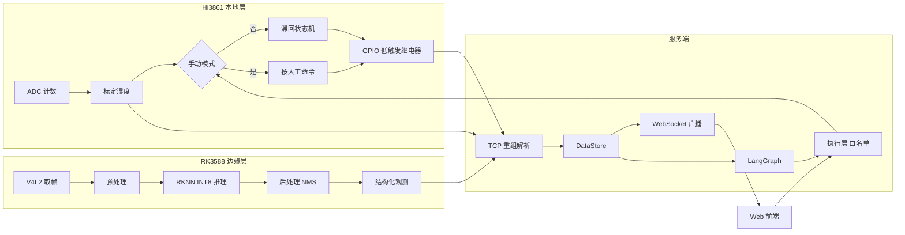

# 01 系统总览与三层架构

> **一句话定位**：P4 不是"AI 看一眼就去浇水"，而是三台设备、五类信息、四级权威组成的一条可追踪的闭环——Hi3861 守住本地灌溉闭环，RK3588 把图像变成结构化观测，服务端用规则加 LangGraph 把观测变成建议或受约束的请求。

## 本章学完你能……

- 用 60 秒讲清 P4 的三层架构，并说出每一层**为什么放在这台设备上**。
- 区分**五类信息**（传感读数、模型观测、建议、命令请求、设备反馈），并举出每一类"不能被谁替代"。
- 画出完整数据链图，指出每个箭头上传的是什么、延迟量级是多少。
- 解释"本地闭环 + 上层监督"的分层思想，以及为什么 LLM 不进入控制内环。
- 把 CV 的四条 bullet 逐条对应到后续章节，知道面试官问到哪里该翻哪一章。

## 前置知识

- 反馈控制的基本概念：[反馈控制与系统响应基础](../../02_基础知识/04_控制理论/01_反馈控制与系统响应基础.md)
- 嵌入式与通信基础：[UART、SPI、I2C、以太网与 TCP](../../02_基础知识/08_嵌入式与通信/04_UART_SPI_I2C_以太网_TCP.md)
- 平台背景：[本项目平台基础：OpenHarmony、Hi3861、RK3588](./02_平台基础_OpenHarmony_Hi3861_RK3588.md)（建议紧接着读）

## 目录

1. P4 在 CV 里怎么写，每个词意味着什么
2. 三层架构：谁在哪里做什么
3. 五类信息：本项目最重要的一张表
4. 完整数据链
5. 四级权威：谁说了算
6. 时间尺度：毫秒、百毫秒、秒
7. 设计原则（可直接当面试答案）
8. CV 四条 bullet 与章节对照
9. 手算练习：一次"土壤干 + 发现病斑"的全链路
10. 常见误解

---

## 1. P4 在 CV 里怎么写，每个词意味着什么

CV 原文（以英文 CV 为准）：

> **OpenHarmony Smart Gardening System** — Personal project · Edge vision and autonomous control — May 2024 – Aug 2024
> Edge-vision perception, agent decision-making and autonomous irrigation on OpenHarmony and RK3588; independently built the full loop from visual observation and decision to device-side execution.

逐词拆解：

| CV 用词 | 含义 | 面试官会追问什么 |
|---|---|---|
| Personal project | 个人项目，没有团队分工；"independently built" 指整条闭环都是你搭的 | 哪些是你写的，哪些是用了现成的库/SDK？ |
| Edge vision | 视觉推理在**设备端**（RK3588）完成，而不是把视频流传到云端 | 为什么放边缘？带宽、延迟、隐私、断网可用 |
| Agent decision-making | 服务端的 LangGraph 决策链，不是强化学习 agent | LLM 用在哪？出错怎么办？ |
| Autonomous irrigation | 灌溉在 Hi3861 上**自主**完成，土壤湿度驱动 | 断网时还能灌吗？ |
| full loop | 视觉观测 → 决策 → 设备端执行 → 反馈 | 闭环里"反馈"是什么？ |

> **面试要点**：CV 里 "autonomous" 的准确含义是**本地自主闭环**（断网仍可按阈值灌溉），不是"LLM 全自动"。回答时先讲本地闭环，再讲上层智能，听起来更工程化也更安全。

---

## 2. 三层架构：谁在哪里做什么

```text
┌──────────────────────────────────────────────────────────────────────────┐
│ 服务端（Python）  ── 汇聚、解释、编排、交互                                │
│   DataStore 快照 · 规则 fast path · LangGraph 决策链 · WebSocket · Web 前端│
│   延迟量级：百毫秒～秒（LLM 节点更慢）                                     │
└───────────────▲───────────────────────────────▲──────────────────────────┘
                │ 传感 JSON、泵状态反馈          │ 视觉事件 JSON + JPEG
                │ （同时下发命令请求）            │
┌───────────────┴──────────────┐   ┌─────────────┴────────────────────────┐
│ Hi3861（本地控制层）          │   │ RK3588（边缘视觉层）                  │
│ ADC 读土壤湿度 → 标定         │   │ V4L2 取帧 → 预处理 → RKNN INT8 推理   │
│ 滞回状态机 → GPIO 低触发继电器│   │ → 后处理（阈值 + NMS）→ 坐标还原      │
│ 手动优先、语音触发            │   │ → 结构化观测（类别/置信度/框/时间戳） │
│ 延迟量级：毫秒～百毫秒        │   │ 延迟量级：几十～几百毫秒              │
└───────────────┬──────────────┘   └──────────────────────────────────────┘
                │ GPIO
            继电器 → 水泵 → 土壤 → 土壤湿度探头 ──┐
                ▲                                  │ （物理闭环：水改变土壤，
                └──────────────────────────────────┘   土壤改变读数）
```

### 2.1 第一层：Hi3861 本地灌溉控制

- **是什么**：一颗带 Wi-Fi 的低成本 MCU（公开资料：32 位 RISC-V、约 160 MHz、几百 KB SRAM，运行 OpenHarmony 轻量系统，细节见[平台基础](./02_平台基础_OpenHarmony_Hi3861_RK3588.md)）。
- **做什么**：读土壤湿度 ADC → 线性标定成"湿度百分比" → 滞回状态机决定泵开/关 → 通过 GPIO 驱动低触发继电器；同时处理手动命令与语音触发；周期性把读数与泵状态上报服务端。
- **为什么放这里**：这是**物理闭环的内环**——传感器、泵、土壤都在身边；内环必须在网络断开、服务端宕机、LLM 超时时依然工作。把最基本的"土干了就浇、湿够了就停"放在最靠近执行器的地方，是所有嵌入式控制的通用做法。
- **详细展开**：[03 ADC 采集与标定](./03_Hi3861本地灌溉_ADC标定与传感策略.md)、[04 滞回状态机与手动优先](./04_Hi3861滞回状态机_继电器与手动优先.md)。

### 2.2 第二层：RK3588 边缘视觉

- **是什么**：Rockchip 的 8 核 SoC，带 NPU（公开规格约 6 TOPS INT8），能跑 Linux 用户态程序、调用 RKNN 运行库。
- **做什么**：摄像头帧（V4L2）→ 颜色转换/缩放/letterbox/归一化 → YOLOv5（INT8，RKNN 格式）推理 → 置信度过滤 + NMS → 坐标还原到原图 → 打包成**带置信度与时间戳的结构化观测**，通过 TCP 发给服务端（JSON + JPEG 分段）。
- **为什么放这里**：视频流是带宽大户（见第 02 章的算例），实时推理需要 NPU；在板端把图像压缩成"几百字节的观测"，才适合在 Wi-Fi 上传输，也让服务端决策不依赖图像解码。
- **详细展开**：[05 取帧与预处理](./05_RK3588边缘视觉_V4L2取帧与预处理.md)、[06 输出解码与结构化事件](./06_YOLOv5输出解码_NMS与结构化事件.md)、[07 INT8 量化与 RKNN 转换](./07_INT8量化与RKNN转换.md)。

### 2.3 第三层：服务端（Python）

- **是什么**：一个 Python 服务进程：TCP 接收线程 + asyncio 事件循环（WebSocket/Web）+ 决策链（LangGraph）。
- **做什么**：
  1. 解析两路设备数据（字节流重组，见 [08 TCP](./08_TCP通信与协议设计.md)）；
  2. 写入 **DataStore**（带来源与时间的快照）；
  3. 通过 WebSocket 广播给网页；
  4. 把事件送入 **LangGraph 决策链**——规则 fast path 处理极端状态，其他走 supervisor → care/alert/skip；
  5. 输出**结构化建议**或**受约束的命令请求**给执行层；
  6. 执行层做白名单与策略检查，再把请求下发设备，并记录设备反馈。
- **为什么放这里**：需要汇聚多路信息、有算力跑 LLM、要提供 Web 交互；这些都不是 MCU 的强项，且**允许慢、允许偶尔不可用**。
- **详细展开**：[09 服务端](./09_服务端_DataStore_WebSocket_asyncio.md)、[10 LangGraph 决策链](./10_LangGraph决策链.md)、[11 执行边界](./11_执行边界_白名单_幂等与设备反馈.md)。

### 2.4 为什么不是"全放服务端"或"全放 Hi3861"？

| 方案 | 问题 |
|---|---|
| 全放服务端（设备只当传感器/继电器） | 断网即瘫痪；每次动作都等网络往返和 LLM；泵控制的时延和可用性依赖最不可靠的环节 |
| 全放 Hi3861 | MCU 算力/内存跑不了 YOLO（第 02 章算例：单帧约需数十秒量级的上界估算）；也无法做语义级建议 |
| 全放 RK3588 | RK3588 可以做更多，但它不是为"接 ADC 与继电器的低功耗常开节点"设计的；而且视觉与灌溉故障应当互相隔离 |
| **三层分工（P4）** | 每层只做自己擅长的，故障被限制在层内；上层失效，下层仍保持安全的基本功能 |

---

## 3. 五类信息：本项目最重要的一张表

P4 里流动的信息必须分成五类，**任何一类都不能冒充另一类**。这是本项目最核心的"工程判断"，面试里反复出现。

| 序号 | 类别 | 谁产生 | 例子（教学示例） | 不能被什么替代 |
|---|---|---|---|---|
| ① | 传感读数（sensor reading） | Hi3861 | `moisture=55`（ADC 标定后） | 不能被"建议"或"模型观测"替代：病叶图像不等于土壤缺水 |
| ② | 模型观测（model observation） | RK3588 | `class=lesion, score=0.90, bbox=[...]` | 不是"事实"：置信度≠准确率；空检测≠健康 |
| ③ | 建议（recommendation） | 服务端规则/LLM | `action=start, reason=土壤过干` | 不等于已执行：它只是一个文本/结构化提案 |
| ④ | 命令请求（command request） | 服务端执行层 | `water_on, action_id=…` | 不等于设备收到，更不等于水已流出 |
| ⑤ | 设备反馈（device feedback） | Hi3861 | `pump_state=on`（GPIO 实际状态上报） | 仍不等于"水流到根部"（没有流量计时） |

### 3.1 三个"不等于"链条

```text
建议  ≠  命令请求  ≠  设备收到  ≠  设备已动作  ≠  水已浇到
 ③        ④           ④→⑤的ACK       ⑤                   （需要流量/湿度变化佐证）
```

后面每一章都会回到这条链：
- 第 04 章：**设备已动作**由 GPIO 低触发 + 状态机保证；
- 第 10 章：**建议**由 LangGraph 产出；
- 第 11 章：**命令请求**要过白名单、新鲜度、模式；**设备反馈**要带 `action_id` 关联。

### 3.2 每类信息的元数据（"可追踪"的关键）

CV 里 "traceable system state" 靠的是每条信息都带上 4 个元数据：

| 元数据 | 作用 | 例子 |
|---|---|---|
| 来源（source） | 谁说的 | `hi3861-node1`、`rk3588-cam0`、`agent-rule`、`user-web` |
| 时间（time） | 什么时候；采样时间 vs 接收时间要分开 | `captured_at`, `received_at` |
| 序号/ID（seq/id） | 去重、关联、排序 | `event_id`, `action_id`, `seq` |
| 有效性（validity/age） | 还能不能用 | `age_ms`, `valid=true` |

> **注意**：具体字段名与格式是**实机细节**，见 README 的「实机细节自查表」。本教材中的 JSON 均为**教学示例**，用来讲清楚结构，不代表你的系统字段原样如此。

### 3.3 示例：五类信息各一条（教学示例 JSON）

```json
// ① 传感读数（Hi3861 → 服务端）
{"type":"sensor","node":"pot1","moisture":55,"pump":"on","mode":"auto","seq":1042}

// ② 模型观测（RK3588 → 服务端），bbox 已还原到原图像素
{"type":"vision","event_id":"cam0-000873","location_id":"plant_1",
 "captured_at_ms":1718000123456,"image_size":[1280,720],
 "detections":[{"class":"lesion","score":0.90,"bbox":[200,120,600,520]}]}

// ③ 建议（服务端内部）
{"kind":"recommendation","action":"start","reason":"moisture_below_critical",
 "source":"rule_fast_path","inputs":{"moisture":18,"age_ms":800}}

// ④ 命令请求（服务端 → Hi3861）
{"type":"command","action_id":"a-20240601-0007","cmd":"pump_on","max_s":60}

// ⑤ 设备反馈（Hi3861 → 服务端）
{"type":"feedback","action_id":"a-20240601-0007","pump":"on","gpio_level":0,"seq":1043}
```

---

## 4. 完整数据链

### 4.1 ASCII 总图

```text
Hi3861:
  探头 → ADC 计数 → 线性标定 → 湿度%(0–100) → [manual?] → 滞回状态机 → GPIO(低触发) → 泵
                                   │                                  │
                                   └────────→ sensor JSON ←───────────┘(泵状态)
                                                  │ TCP/Wi-Fi
RK3588:                                           ▼
  摄像头 → V4L2 缓冲队列 → 颜色转换/letterbox/归一化 → RKNN(INT8) → 后处理 → 结构化观测
                                                                       │ TCP: JSON + JPEG(分段，带长度)
                                                                       ▼
服务端:                                                    ┌──── 字节流重组/解析 ────┐
                                                           ▼                         ▼
                                                      DataStore 快照 ──→ WebSocket 广播 → 网页
                                                           │
                                                           ▼
                                      LangGraph: sensing ─┬─ fast path ─→ execution(白名单/模式/新鲜度) → 命令请求 → Hi3861
                                                          └─ supervisor ─┬─ care  → 建议文本/结构化建议
                                                                         ├─ alert → 告警
                                                                         └─ skip  → 什么都不做
                                                                  设备反馈 ←──────────────────────────────┘
```

### 4.2 Mermaid 版本



### 4.3 每个箭头上传什么

| 箭头 | 内容 | 传输 | 频率量级 | 丢了怎么办 |
|---|---|---|---|---|
| 探头 → ADC | 模拟电压 | 模拟/ADC | 周期采样（周期【待你补全】） | 读不到就按传感失效策略（第 03 章） |
| Hi3861 → 服务端 | 传感 JSON、泵状态 | TCP over Wi-Fi | 周期上报（周期【待你补全】） | 服务端把读数标记为"过期"，不据此做危险决定 |
| RK3588 → 服务端 | 观测 JSON + JPEG | TCP | 每有观测即发（节流策略【待你补全】） | 观测丢失不影响本地灌溉 |
| 服务端 → 网页 | 状态广播 | WebSocket | 事件驱动 | 网页重连后拉一次全量快照 |
| 服务端 → Hi3861 | 命令请求 | TCP | 稀疏、事件驱动 | 带 `action_id`，重发要幂等 |
| Hi3861 → 服务端 | 设备反馈 | TCP | 周期 + 状态变化 | 服务端据此更新"设备已动作"层级 |

---

## 5. 四级权威：谁说了算

当不同来源的"想法"冲突时，必须有明确的优先级。P4 的原则（设计意图，对应 CV 的 "manual-priority override" 与 "constrained requests"）：

```text
级别 1（最高）：物理/人工安全  ── 用户手动 off、传感失效强制关、最长运行时间等
级别 2：        本地闭环      ── Hi3861 的滞回状态机（断网也有效）
级别 3：        服务端规则    ── fast path 等确定性规则，经执行层校验后才成为命令请求
级别 4（最低）：LLM 建议      ── 只产生建议，不直接成为命令
```

**冲突案例**：

| 场景 | 谁赢 | 为什么 |
|---|---|---|
| 土壤很干（规则建议开泵），用户在网页按了"手动关" | 用户 | 级别 1 > 级别 3；执行层必须尊重人工 off |
| LLM 说"现在浇水"，但本地滞回认为湿度在带内且泵已开 | 本地 | LLM 建议不进入内环；本地状态机是设备安全的最后防线 |
| 服务端宕机 | 本地 | 内环不依赖服务端 |
| 视觉发现病斑，建议喷药，但系统没有喷药执行器 | 无命令 | 白名单里没有这个动作，只能给用户"提醒" |

> **面试要点**：回答"AI 决策如何变成物理动作"（正是 PS 的主线，P6 也是同一思想）：**AI 的输出永远是提案，经过策略检查、模式检查、新鲜度检查、白名单后才成为命令；设备端还有自己的安全层**。这个模式与 [P6 的 action-proposal → policy-check → execution → state-feedback 链](../P6_深开鸿M-Robots平台软件/README.md) 同构。

---

## 6. 时间尺度：毫秒、百毫秒、秒

不同层的"节拍"不同，这决定了谁适合放在内环：

| 过程 | 典型量级 | 说明 |
|---|---|---|
| GPIO 切换继电器 | 微秒（电平）+ 毫秒级（继电器机械吸合） | 机械动作约 10 ms 量级（典型） |
| 土壤湿度对灌溉的响应 | 秒～分钟 | 水渗透到探头需要时间，是慢过程 |
| Hi3861 采样周期 | 秒级（具体值【待你补全】） | 土壤变化慢，没必要快采样 |
| 摄像头一帧 | 33 ms（30 fps 时） | 采集节拍 |
| YOLO 单帧推理（NPU） | 几毫秒～几十毫秒量级 | 具体【待你补全】，不要编数字 |
| Wi-Fi + TCP 一次往返 | 几毫秒～几十毫秒（局域网典型），偶有尖峰 | 受干扰影响 |
| LLM 一次调用 | 约 1～数十秒 | 远慢于所有控制过程 |

**推论**：土壤湿度是慢过程（秒～分钟），所以泵的闭环不需要 LLM 的响应速度，也**不能容忍** LLM 的不确定性；而病害识别属于"观测→建议"的慢通路，可以交给服务端慢慢分析。

---

## 7. 设计原则（可直接当面试答案）

1. **本地自主**：基本的灌溉闭环在设备端，网络/服务/LLM 失效时仍可按阈值工作，且有明确的失败策略。
2. **AI 不进内环**：LLM 只产生建议，规则 fast path 处理明确的极端状态；任何命令都要过校验。
3. **五类信息分开**：传感、观测、建议、命令、反馈各有各的语义与置信级别，界面和日志也要分开显示。
4. **人工优先**：手动 off/模式切换在每一层都高于自动逻辑。
5. **可追踪**：每条信息带来源、时间、ID、有效性；决策带 trace，能回答"为什么开了泵"。
6. **幂等与去重**：网络重传、事件重复、服务重启，都不能让泵"多浇一次"。
7. **诚实的验证级别**：区分"代码写了/测试通过/实机跑过/长期稳定"，不把仿真或静态检查说成实测。

对应的英文一句话：

> "The local controller owns the irrigation loop. Vision produces observations, not truths. The agent produces recommendations, not actions. Only a validated command request reaches the device, and only the device's own feedback tells us the pump actually ran."
> （本地控制器掌握灌溉闭环；视觉产出观测而非真相；智能体产出建议而非动作；只有通过校验的命令请求才到达设备，只有设备自己的反馈才能说明泵确实运行了。）

---

## 8. CV 四条 bullet 与章节对照

| CV bullet | 关键词 | 主要章节 |
|---|---|---|
| **Edge vision inference**：YOLOv5/RKNN INT8 inference chain on RK3588, converting camera frames into structured observations with confidence and timestamps | V4L2、预处理、YOLOv5 输出、NMS、INT8、RKNN、时间戳 | [05](./05_RK3588边缘视觉_V4L2取帧与预处理.md)、[06](./06_YOLOv5输出解码_NMS与结构化事件.md)、[07](./07_INT8量化与RKNN转换.md) |
| **Agent decision chain**：LangGraph decision chain with environment and vision events, rule-based fast path for extreme states, structured recommendations or constrained requests | state、节点、条件边、fast path、LLM 校验、白名单 | [09](./09_服务端_DataStore_WebSocket_asyncio.md)、[10](./10_LangGraph决策链.md)、[11](./11_执行边界_白名单_幂等与设备反馈.md) |
| **Local irrigation control**：soil-moisture-driven pump state machine on Hi3861 with independent start/stop thresholds and manual-priority override | ADC、滞回、GPIO、手动优先 | [03](./03_Hi3861本地灌溉_ADC标定与传感策略.md)、[04](./04_Hi3861滞回状态机_继电器与手动优先.md) |
| **System integration**：unified visual observations, environment state and user commands into a traceable system state; server-side agent orchestration; web interaction and device-side irrigation | 统一状态、TCP、WebSocket、前端、闭环 | [08](./08_TCP通信与协议设计.md)、[09](./09_服务端_DataStore_WebSocket_asyncio.md)、[12](./12_系统集成与可追踪系统状态.md) |
| （隐含）可靠性与验证 | 故障模式、测试 | [13](./13_故障与测试.md) |

---

## 9. 手算练习：一次"土壤干 + 发现病斑"的全链路

**场景（教学示例，非实测）**：自动模式；泵当前关；紧急阈值（fast path）教学取 20；本地启动阈值 56、停止阈值 65（来自此前对源码的阅读线索，实际值以你的系统为准）。

| 时刻 | 事件 | 各层发生了什么 |
|---|---|---|
| t = 0 s | Hi3861 读 ADC = 2700 | 湿度 = 2700×(−0.05)+147.52 = 12.52 → 取整 12；12 < 56 → **本地立即开泵**（GPIO 拉低）；上报 `moisture=12, pump=on` |
| t = 0.3 s | 服务端收到传感 JSON | DataStore 写入快照（`received_at`）；WebSocket 广播；LangGraph 的 sensing 节点：12 < 20（极端干），命中 **fast path** |
| t = 0.35 s | execution 节点 | 白名单：`pump_on` 允许；模式 auto 允许；数据年龄 0.3 s ≤ 上限（教学取 5 s）允许；但**设备已经是 on**，所以命令是"幂等的重复"→ 可以只记录不重发 |
| t = 2 s | RK3588 观测：`lesion, score=0.90` | 服务端 sensing：湿度非极端（此时仍低，但 fast path 已处理）；supervisor 看到视觉事件 → care 节点（LLM）产出建议"检查叶片、保持浇水"；**不产生泵命令** |
| t = 40 s | 湿度升到 60 | 本地：在 56–65 带内，**保持 on**（不因 60 就关） |
| t = 55 s | 湿度升到 66 | 本地：66 > 65 → 关泵；上报 `pump=off` |

可以看到：**泵的开关全程由本地状态机完成**，服务端的 fast path 只是"确认并记录"，视觉病斑触发的是建议而不是泵动作。这正是五类信息分开的价值。

---

## 10. 常见误解

| 误解 | 纠正 |
|---|---|
| "检测到病斑就浇水" | 病斑≠缺水；视觉观测不直接驱动泵 |
| "LLM 决定泵开关" | 泵由本地滞回 + 人工优先决定；LLM 只给建议 |
| "网页显示'已浇水'就是水浇了" | 要区分请求已发、设备已确认、GPIO 已动作、水已流出 |
| "RK3588 做了训练" | 板端做**推理**；ONNX→RKNN 是转换，不是训练（第 07 章） |
| "置信度 0.9 就是 90% 准确" | 不是，置信度是单次检测分数（第 06 章） |
| "TCP 一次 recv 就是一条消息" | TCP 是字节流（第 08 章） |
| "用了 LangGraph 就是自主智能体" | 它只是显式的状态机/流程图，安全来自校验和边界（第 10 章） |

---

## 本章要点速记

1. 三层：Hi3861 本地灌溉闭环、RK3588 边缘视觉、服务端汇聚与决策。
2. 五类信息：传感读数、模型观测、建议、命令请求、设备反馈——互不替代。
3. "建议 ≠ 命令请求 ≠ 设备收到 ≠ 设备已动作 ≠ 水已浇到"。
4. 四级权威：人工/安全 > 本地闭环 > 服务端规则 > LLM 建议。
5. 土壤湿度是慢过程；LLM 慢且不确定，所以不进内环。
6. 每条信息带来源、时间、ID、有效性，系统状态才可追踪。
7. 断网时本地闭环继续；服务端只在"能用时"增值。
8. 具体字段、周期、阈值属于实机细节，见 README 自查表。

## 自测题

1. 说出五类信息，并各举一个"不能被谁替代"的例子。
2. 为什么 LLM 不放进泵的控制内环？给出至少三个理由。
3. 用户手动关泵，但土壤很干且 fast path 建议开泵，最终结果是什么？为什么？
4. RK3588 为什么要在板端输出"结构化观测"而不是直接把视频传给服务端？
5. 画出"传感读数 → 决策 → 设备反馈"的数据链，并标出每个箭头的传输方式。

**参考要点**：
1. 见第 3 节表格。
2. 延迟与不确定性、网络与服务可用性、输出不可预测需校验（还可答：成本、可审计性）。
3. 泵保持关；人工 off 优先于规则建议；执行层拒绝该命令并记录原因。
4. 带宽、延迟、断网可用、隐私、服务端解耦于图像解码。
5. 见第 4 节图。

## 相关链接

- 下一章：[02 平台基础：OpenHarmony、Hi3861、RK3588](./02_平台基础_OpenHarmony_Hi3861_RK3588.md)
- 返回：[P4 README](./README.md)
- 同构思想：[P6 安全执行链](../P6_深开鸿M-Robots平台软件/README.md)
- 基础：[平台基础（通用）](../../02_基础知识/08_嵌入式与通信/06_OpenHarmony_Hi3861_RK3588平台基础.md)
