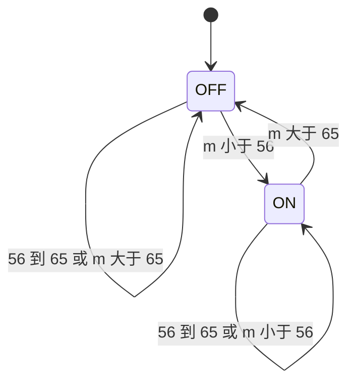
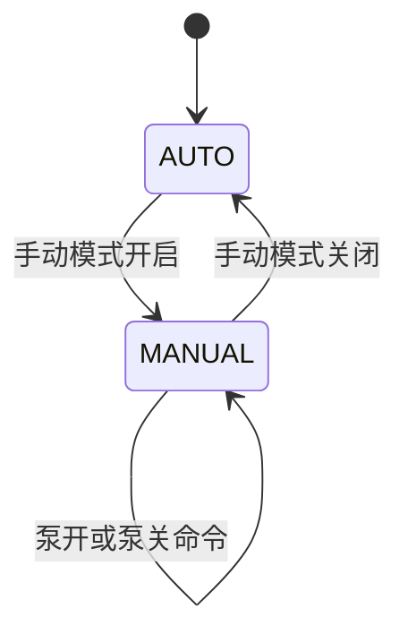

# 04 Hi3861 滞回状态机、低触发继电器与手动优先

> **一句话定位**：这是 CV 里 "soil-moisture-driven pump state machine with independent start/stop thresholds and manual-priority override" 的完整展开——用**两个独立阈值加记忆**防抖，用**低电平触发的 GPIO 语义**驱动继电器，用**模式优先级**保证人永远说了算。

## 本章学完你能……

- 解释**滞回（hysteresis）**与单阈值、与滤波的区别，写出状态转移函数，并**手算**任意读数序列的泵状态。
- 说明**严格不等号**在边界（56、65）上的行为，以及整数截断造成的切换点偏移。
- 区分**逻辑状态**（pump_on）与**物理电平**（GPIO），理解低触发继电器与"上电默认安全"。
- 画出 AUTO / MANUAL 的模式状态机，说明**手动优先**的含义、"手动 off 不等于永久 off"的陷阱，以及语音触发的行为与改进。
- 估算继电器切换次数与寿命，说明为什么需要最短保持时间与最长运行时间。
- 英文回答 "Why two thresholds?" 与 "What happens if the user turns the pump off?"

## 前置知识

- 上一章：[03 ADC 采集、标定与传感失效策略](./03_Hi3861本地灌溉_ADC标定与传感策略.md)
- 反馈与开关控制：[反馈控制与系统响应基础](../../02_基础知识/04_控制理论/01_反馈控制与系统响应基础.md)
- 限幅与饱和思想：[前馈、增益调度、限幅与饱和](../../02_基础知识/04_控制理论/07_前馈_增益调度_限幅与饱和.md)
- GPIO 基础：[STM32 时钟、GPIO、中断、DMA](../../02_基础知识/08_嵌入式与通信/01_STM32_时钟_GPIO_中断_DMA.md)

## 目录

1. 问题：为什么不能"低于 60 开、高于 60 关"
2. 滞回的定义与状态转移函数
3. 手算：四组读数序列
4. 参数设计：带宽、噪声、响应
5. 继电器切换次数与寿命估算
6. GPIO 低触发：逻辑状态与物理电平
7. 手动优先：模式状态机
8. 语音触发
9. 在本项目里怎么用 / 实现线索
10. 教学示例代码
11. 常见错误与故障现象
12. 面试怎么问、怎么答
13. 要点速记与自测

---

## 1. 问题：为什么不能"低于 60 开、高于 60 关"

**单阈值**控制器：

$$u_k=\begin{cases}1 \text{（开）} & m_k<60\\ 0 \text{（关）} & m_k\ge 60\end{cases}$$

当真实湿度正好在 60 附近，读数里有 ±1 的噪声（教学示例）：

| k | 1 | 2 | 3 | 4 | 5 | 6 |
|---|---|---|---|---|---|---|
| $m_k$ | 59 | 61 | 59 | 61 | 60 | 59 |
| 单阈值输出 $u_k$ | 开 | 关 | 开 | 关 | 关 | 开 |
| 切换次数（累计） | 0 | 1 | 2 | 3 | 3 | 4 |

6 个样本切 4 次。这叫**抖振（chattering）**：继电器反复吸合/释放，造成触点磨损、电源浪涌、水流忽断忽续、日志噪声。

**滞回**的想法：**开和关用不同的门槛**，中间留一条"死区"，在死区内**保持上一次的决定**。

---

## 2. 滞回的定义与状态转移函数

### 2.1 符号

| 符号 | 含义 | P4 的线索值 |
|---|---|---|
| $m$ | 标定后的湿度指数（0–100） | — |
| $T_{\text{on}}$ | 启动阈值（低于它才开） | 56（线索，实际值【待你补全】） |
| $T_{\text{off}}$ | 停止阈值（高于它才关） | 65（线索，实际值【待你补全】） |
| $s_k\in\{0,1\}$ | 第 $k$ 个周期泵的逻辑状态（1=开） | — |

要求 $T_{\text{on}}<T_{\text{off}}$。两者之间叫**滞回带**（死区），宽度 $\Delta = T_{\text{off}}-T_{\text{on}}=9$。

### 2.2 转移函数

$$s_{k}=\begin{cases}1 & m_k< T_{\text{on}}\\[2pt] 0 & m_k> T_{\text{off}}\\[2pt] s_{k-1} & T_{\text{on}}\le m_k\le T_{\text{off}}\end{cases}$$

**关键点**：
1. 前两种情况与历史无关；第三种（带内）**取决于上一状态**——所以滞回需要"记忆"（一个状态变量），它不是纯函数 $m\mapsto s$。
2. 用的是**严格不等号**：$m=56$ 与 $m=65$ 都落在带内，**保持**原状态。
3. 这是一个两状态的有限状态机（FSM）：



```text
            m < 56
   ┌──────────────────────┐
   │                      ▼
 [OFF] ◀──────────────── [ON]
            m > 65
  (带内 56≤m≤65：保持当前状态，不转移)
```

### 2.3 滞回 ≠ 滤波

| | 滤波 | 滞回 |
|---|---|---|
| 作用对象 | 输入信号（平滑读数） | 输出决策（开关） |
| 机制 | 平均/中位数/低通 | 两阈值 + 记忆 |
| 解决的问题 | 尖峰、随机噪声 | 阈值附近的反复穿越 |
| 代价 | 滞后 | 带内的"不响应"（有意设计） |

两者**互补**：滤波先把读数变干净，滞回再保证输出不抖。

### 2.4 类比：施密特触发器

模拟电路里的施密特触发器（Schmitt trigger）有"上翻转电压"和"下翻转电压"，同样的思想：输入从低到高过 $V_+$ 才翻转，从高到低过 $V_-$ 才翻回。空调恒温器也是同理（制冷在 26℃开、24℃关）。

---

## 3. 手算：四组读数序列

### 3.1 序列 A（笔记中的例子）

初始 OFF，$T_{\text{on}}=56$，$T_{\text{off}}=65$。

| k | $m_k$ | 判定 | $s_k$ |
|---|---|---|---|
| 0 | — | 初始 | OFF |
| 1 | 55 | 55<56 → 开 | **ON** |
| 2 | 60 | 带内，保持 | ON |
| 3 | 64 | 带内，保持 | ON |
| 4 | 66 | 66>65 → 关 | **OFF** |
| 5 | 60 | 带内，保持 | OFF |

注意 $k=2$ 与 $k=5$ 的 $m$ 都是 60，输出却相反——**同一输入，不同历史，不同输出**，这就是滞回。

### 3.2 序列 B：边界值

初始 OFF：

| k | $m_k$ | 判定 | $s_k$ |
|---|---|---|---|
| 1 | 56 | 56<56? 否；56>65? 否 → 带内，保持 | OFF |
| 2 | 55 | 开 | ON |
| 3 | 65 | 65>65? 否 → 带内 | ON |
| 4 | 66 | 关 | OFF |
| 5 | 56 | 带内 | OFF |

如果误写成 `<=` 与 `>=`，k=1 会开泵、k=3 会关泵——所以边界行为是**实现细节**，要与代码一致。

### 3.3 序列 C：从 ADC 计数出发（含整数截断）

用第 03 章的整数映射 $m=\lfloor(14752-5x)/100\rfloor$，初始 OFF：

| k | ADC $x$ | 浮点 $m$ | 整数 $m$ | 判定 | $s_k$ |
|---|---|---|---|---|---|
| 1 | 1900 | 52.52 | 52 | <56 → 开 | ON |
| 2 | 1850 | 55.02 | 55 | <56 → 开（已开） | ON |
| 3 | 1800 | 57.52 | 57 | 带内 | ON |
| 4 | 1700 | 62.52 | 62 | 带内 | ON |
| 5 | 1650 | 65.02 | 65 | 65>65? 否 → 带内 | ON |
| 6 | 1620 | 66.52 | 66 | >65 → 关 | OFF |
| 7 | 1700 | 62.52 | 62 | 带内 | OFF |
| 8 | 1850 | 55.02 | 55 | <56 → 开 | ON |

注意 k=5：浮点 65.02>65，但整数截断为 65，不满足 >65，所以**不关**。这就是第 03 章说的"取整位置会让切换点漂移约 20 个 ADC 计数"。

### 3.4 序列 D：噪声下，单阈值 vs 滞回

湿度真值缓慢从 58 降到 52，读数含 ±1 噪声（教学示例）。单阈值取 56（<56 开，≥56 关），滞回取 56/65，初始 OFF：

| k | $m_k$ | 单阈值 $u_k$ | 滞回 $s_k$ |
|---|---|---|---|
| 1 | 58 | 关 | 关 |
| 2 | 57 | 关 | 关 |
| 3 | 56 | 关 | 关 |
| 4 | 57 | 关 | 关 |
| 5 | 55 | **开** | **开** |
| 6 | 56 | **关** | 开（带内保持） |
| 7 | 54 | **开** | 开 |
| 8 | 55 | 开 | 开 |
| 9 | 56 | **关** | 开 |
| 10 | 54 | **开** | 开 |

单阈值在 k=5..10 间共切换 5 次（关→开→关→开→关→开，含第一次开泵）；滞回只切换 1 次（k=5 开泵）。

---

## 4. 参数设计：带宽、噪声、响应

### 4.1 设计准则

1. **带宽大于噪声峰峰值**：$\Delta \gg$ 噪声峰峰值。本项目带宽 9 个百分点，探头+ADC 噪声若是 ±1 个百分点级，裕量足够。噪声大要么加滤波，要么加宽带。
2. **带宽不能大到失去控制意义**：$T_{\text{on}}$ 太低会让植物经常处于偏干；$T_{\text{off}}$ 太高会过湿。
3. **考虑土壤响应滞后**：水渗到探头需要时间。泵开了，读数几十秒后才升；若采样周期长或不限时，就会过冲（读数已经很湿，泵还开着）。解决：最长连续开泵时间、间歇式浇水（开 N 秒、停 M 秒、再测）。
4. **阈值是配置，不是常数**：不同植物、盆、探头需要不同值。56/65 是此前阅读源码时记录的配置，**不是通用土壤阈值**。

### 4.2 手算：一个周期有多长（教学示例）

假设泵开时湿度以 +0.3 %/s 上升，泵关时以 −0.05 %/s 蒸腾下降（教学数值，非实测）：

- 开泵段：从 55（刚触发）升到 66（触发关闭）共 11 个百分点：$11/0.3 = 36.7$ s；
- 关泵段：从 66 降到 55：$11/0.05 = 220$ s；
- 周期 $\approx 256.7$ s，每周期 2 次切换。

**每小时切换次数**：$3600/256.7\times 2 = 28.0$ 次。

---

## 5. 继电器切换次数与寿命估算

机械继电器的电气寿命常见在 $10^5$ 次量级（教学数值，以所选继电器手册为准）。

- 单阈值抖振最坏情况（采样周期 1 s，每周期都翻转）：每小时 3600 次 → $10^5/3600 \approx 27.8$ 小时就到寿命；
- 滞回：28 次/小时 → $10^5/28 = 3571$ 小时 ≈ 148.8 天连续运行。

这个算例的重点不是数字本身，而是**数量级差异（约 130 倍）**。说明"滞回不是花哨，是保护硬件"。

**进一步保护**（典型做法，非你已实现的事实）：

| 保护 | 含义 | 作用 |
|---|---|---|
| 最短保持时间（min dwell） | 切换后至少保持 $T_{\min}$ 才允许再切换 | 防止任何原因的快速翻转 |
| 最长连续开泵时间 | 开泵超过 $T_{\max}$ 强制关 | 防止传感失效、水箱空、爆管造成无限浇水 |
| 最短停泵间隔 | 关泵后至少等 $T_{\text{cool}}$ | 让水渗透、让泵冷却 |
| 每日总水量上限 | 累计开泵时间限额 | 总体兜底 |

---

## 6. GPIO 低触发：逻辑状态与物理电平

### 6.1 什么是"低触发（active-low）"

很多继电器模块的输入 IN 脚在**低电平时触发吸合**，高电平释放。于是：

| 逻辑状态 pump_on | 物理电平（GPIO 输出） | 继电器 | 泵 |
|---|---|---|---|
| 1（开） | **LOW（0）** | 吸合 | 转 |
| 0（关） | **HIGH（1）** | 释放 | 停 |

**容易犯的错**：把"1 = 开"直接写到 GPIO，结果泵反向。正确做法是把逻辑状态与电平**分开**，只在一个函数里做翻译：

```c
/* 教学示例，非项目源码 */
static bool g_pump_on = false;                 /* 逻辑状态 */

static void pump_apply(bool on)
{
    g_pump_on = on;
    /* 低触发：开 = 拉低，关 = 拉高 */
    gpio_write(PUMP_PIN, on ? GPIO_LOW : GPIO_HIGH);
}
```

### 6.2 为什么模块常做成低触发

- 光耦/三极管驱动电路里，IN 拉低使光耦 LED 导通更方便；
- 模块 IN 脚常带上拉：MCU 复位/悬空时电平为高 → 继电器**默认释放（关）**，上电瞬间不会误开泵。

> 这与"失效安全（fail-safe）"一致：**默认状态 = 关**。初始化时应先把 GPIO 设成输出并写 HIGH，再进入主循环。此前对源码的阅读线索：初始化为 GPIO_HIGH（关），开泵设 GPIO_LOW（开）。

### 6.3 其他硬件注意点（面试加分，点到为止）

- **感性负载**：泵电机是感性负载，断开瞬间有反电动势尖峰；继电器触点/电机应有续流二极管或 RC 吸收（模块通常已有线圈续流，电机侧视情况）。
- **电源隔离**：泵的大电流电源与 MCU 电源分开，共地处理要谨慎，避免泵启动时拉低 MCU 电源导致复位。
- **电平兼容**：部分继电器模块需要 5 V 逻辑或更大驱动电流，3.3 V 的 GPIO 能否直接驱动要看模块（光耦输入）规格。
- **【待你补全：你用的继电器模块型号、泵的电压与功率、是否有续流/隔离】**

---

## 7. 手动优先：模式状态机

### 7.1 要解决的问题

自动逻辑按阈值开关，但人需要有**最高权**：想关就关、想浇就浇（例如检修、换水、给植物特殊浇水）。如果自动逻辑每个周期都重新判断，会和人的操作"打架"。所以要有**显式的模式**与**优先级**。

### 7.2 模式与优先级

```text
优先级： 手动命令  >  自动滞回
```

| 模式 | 谁决定泵 | 滞回状态机 |
|---|---|---|
| AUTO | 滞回状态机按 $m$ 决定 | 运行 |
| MANUAL | 人的命令（on/off）决定 | **暂停**，不改变泵状态 |

此前对源码的阅读线索：存在全局手动标志（g_manual_control）；**手动模式下，控制函数在函数开头直接 return，不执行自动逻辑**；命令字符串控制模式切换与开关。



### 7.3 "手动关"与"自动重启"的陷阱

线索中还有一点值得讲清：**语音关闭这类动作可能把系统切回自动**，这样一来如果此时湿度仍低于启动阈值，**下一个周期自动逻辑会重新开泵**。

用一个事件序列说明（教学示例，湿度保持 40 不变）：

| 事件 | 模式 | 泵 | 说明 |
|---|---|---|---|
| 初始 | AUTO | ON | 40<56 → 自动开 |
| 用户"手动模式 + 关泵" | MANUAL | OFF | 自动逻辑暂停，泵被人关掉 |
| 若干周期 | MANUAL | OFF | 湿度 40，自动逻辑不运行，泵保持关 ✓ |
| 用户"退出手动模式" | AUTO | OFF→? | 下个周期：40<56 → **自动重新开泵** |

结论：**"手动 off"只在 MANUAL 模式内有效；回到 AUTO 后，自动逻辑重新接管**。要把这件事讲清楚，别说"off 就永久 off"。

### 7.4 更稳妥的语义（改进建议）

如果希望"人说关就关到我说开为止"，可以引入更细的状态：

| 状态 | 含义 |
|---|---|
| AUTO | 自动 |
| MANUAL_ON | 人强制开（建议带超时） |
| MANUAL_OFF | 人强制关（直到用户取消，或超时恢复自动） |

并规定：任何手动状态都**可被更高优先级的安全逻辑覆盖**（如最长开泵时间、传感失效强制关），因为"人说开"也不应让泵无限运行。这体现 CV 里 "manual-priority override" 与安全兜底的组合：**人 > 自动，但安全 > 人**（对物理危险而言）。

### 7.5 远程命令怎么进入这个状态机

服务端发来的"命令请求"（见第 11 章）在设备端的合理处理：

1. 在 AUTO 模式下收到"开泵"请求：设备端要么**忽略并回执拒绝**，要么**进入带超时的 MANUAL_ON**。线索显示远程开关命令只在手动模式下被接受（自动模式下忽略），因此服务端若想开泵，需要正确的模式切换与恢复策略。**【待你补全：你的服务端命令是怎样映射到设备端模式切换的】**
2. 无论哪种，设备要**回报实际执行结果**（设备反馈），不是只回"收到"。

---

## 8. 语音触发

**线索**（此前对源码的阅读，以实机为准）：存在语音触发检测函数：触发有效时 **开泵并进入手动模式**；**等待触发信号消失**后关泵并**恢复自动模式**。

时间线（教学示例）：

```text
t0   语音模块输出有效电平      → 开泵，MANUAL
t0..t1 说话/信号持续            → 泵一直开（等待循环）
t1   信号消失                  → 关泵，回到 AUTO
```

**需要注意的问题**：
1. **阻塞等待**：如果"等待信号消失"是忙等待/阻塞循环，会阻塞所在任务的其它工作（例如采样、上报、看门狗喂狗）。典型改进：用状态变量 + 周期轮询（非阻塞），并设最长时间。
2. **信号一直有效**：语音模块故障导致信号常高 → 泵一直开。需要超时。
3. **与自动逻辑的交接**：恢复 AUTO 后，湿度若低于启动阈值会立即再开（见 7.3）。

**面试说法**：

> "Voice triggering is a manual override: it starts the pump and puts the controller in manual mode, then restores automatic mode when the trigger ends. In a refined version I would make the wait non-blocking and add a timeout so a stuck signal can't keep the pump on."

---

## 9. 在本项目里怎么用 / 实现线索

| 项 | 线索（以实机为准） | 状态 |
|---|---|---|
| 阈值 | 启动 56（严格 <），停止 65（严格 >） | 线索，**【待你补全：核对阈值与比较符】** |
| 带内行为 | 保持上一次泵状态 | 线索 |
| GPIO | 初始化 HIGH（关）；开泵 LOW | 线索；与 CV 的 state machine 一致 |
| 手动 | 全局手动标志；手动时自动逻辑直接返回 | 线索 |
| 语音 | 触发→开泵+手动；信号消失→关泵+自动 | 线索，【待你补全：语音模块与实际触发逻辑】 |
| 上报 | 泵状态 `watering` 之类字段随传感 JSON 上报 | 线索（字段名【待你补全】） |

> 关于 CV 的措辞 "**independent** start/stop thresholds"：独立 = 开和关是两个不同的参数，各自可配置，且 $T_{\text{on}}<T_{\text{off}}$。回答时直接用这个词："the start and stop thresholds are separate parameters".

---

## 10. 教学示例代码

下面的函数是纯逻辑（便于单元测试），**教学示例，非项目源码**：

```c
typedef enum { MODE_AUTO = 0, MODE_MANUAL = 1 } Mode;

typedef struct {
    Mode mode;
    bool pump_on;       /* 逻辑状态 */
    int  t_on;          /* 启动阈值 */
    int  t_off;         /* 停止阈值 */
} Ctrl;

/* 每个采样周期调用一次。valid=false 表示传感无效。 */
static void control_step(Ctrl *c, int moisture, bool valid)
{
    if (c->mode == MODE_MANUAL) {
        return;                          /* 手动：自动逻辑暂停 */
    }
    if (!valid) {                        /* 传感失效：失效安全 = 关 */
        c->pump_on = false;
        return;
    }
    if (moisture < c->t_on)       c->pump_on = true;
    else if (moisture > c->t_off) c->pump_on = false;
    /* 否则保持：带内不改变 */
}
```

**表驱动测试**（Python 版，思路同上）：

```python
def step(state, m, t_on=56, t_off=65):
    if m < t_on:
        return True
    if m > t_off:
        return False
    return state

def run(seq, init=False):
    s, out = init, []
    for m in seq:
        s = step(s, m)
        out.append(s)
    return out

assert run([55, 60, 64, 66, 60]) == [True, True, True, False, False]
assert run([56, 55, 65, 66, 56]) == [False, True, True, False, False]
```

---

## 11. 常见错误与故障现象

| 现象 | 可能原因 | 排查 |
|---|---|---|
| 泵一直开 | 探头断线读成极干；$T_{\text{on}}\ge T_{\text{off}}$；极性写反 | 打印 ADC/$m$/状态/GPIO 电平 |
| 泵一直关 | 极性写反；手动标志卡在 MANUAL；探头读成极湿 | 看模式变量与 GPIO |
| 泵反向动作 | 把逻辑 1 直接写成 HIGH（低触发理解反） | 用万用表量 IN 脚电平 |
| 继电器"咔哒"频繁 | 抖振：无滞回/带太窄/噪声大 | 记录切换次数；加滤波/加宽带 |
| 手动关了又自己开 | 回到 AUTO 且湿度低于启动阈值 | 看模式转换日志 |
| 上电瞬间泵动一下 | GPIO 初始化顺序错，复位时电平不确定 | 先写 HIGH 再设输出；模块上拉 |
| 语音触发后系统卡住 | 阻塞等待、信号常高 | 非阻塞+超时 |

---

## 12. 面试怎么问、怎么答

**Q1. Why do you use two thresholds instead of one?**

> "With a single threshold, noise around the threshold makes the pump toggle repeatedly. I use separate start and stop thresholds and keep the previous state in between. For example, it starts below 56 and stops above 65, so a reading of 60 can mean either on or off, depending on history. That cuts relay switching a lot and protects the hardware."

（译：单阈值下噪声会让泵反复翻转。我用独立的启动/停止阈值，带内保持上一状态；例如低于 56 启动、高于 65 停止，所以读数 60 可能是开也可能是关，取决于历史。这大大减少继电器切换并保护硬件。）

追问 1：**Is that the same as filtering?**
> "No. Filtering smooths the input; hysteresis makes the decision depend on history. I use both: a median filter against spikes, hysteresis against slow crossings."

追问 2：**How did you choose 56 and 65?**
> "They're configuration values for my setup, not universal soil thresholds. 【补全：你选取它们的依据，如植物需求、探头标定、试运行观察】. The band must be wider than the noise, and the stop threshold shouldn't let the soil get waterlogged."

**Q2. What does manual priority mean in your system?**

> "A manual command always beats the automatic logic. In manual mode the hysteresis state machine is paused and the pump follows the human command. One subtlety is that leaving manual mode returns control to automatic logic, so if the soil is still dry the pump may start again. I'm explicit about that rather than claiming manual off is permanent."

追问：**What if the user says 'on' and the sensor says the soil is soaked?**
> "A human override should still be bounded by a safety layer, like a maximum run time. Human priority over automation doesn't mean no limits at all."

**Q3. The relay is active-low. What does that change?**

> "The logical state and the pin level are inverted: turning the pump on means driving the pin low. I keep a logical state variable and translate it in one function. It also gives a safe default, since a pulled-up input keeps the relay released at power-up."

**Q4. What happens if the network is down?**

> "The irrigation loop still works, because the hysteresis and manual logic run on the Hi3861. The server's recommendations and the web interface are unavailable, but the pump keeps following the local rule."

**Q5. How would you test this state machine without hardware?**

> "It's a pure function of the previous state, the new reading and the mode. I'd write table-driven tests covering the thresholds, the boundary values 56 and 65, and mode changes, and also a replay test of recorded readings to count relay switches."

---

## 本章要点速记

1. 滞回：$m<T_{\text{on}}$ 开，$m>T_{\text{off}}$ 关，带内保持——需要记忆。
2. 线索值 56/65，严格不等号；$m=56$ 或 65 保持。
3. 同一读数（如 60）可对应 ON 或 OFF，取决于历史。
4. 滞回≠滤波：前者作用于决策，后者作用于输入；两者互补。
5. 切换次数估算：滞回约 28 次/小时 vs 抖振最坏 3600 次/小时。
6. 低触发：逻辑 on ↔ GPIO LOW；逻辑与电平分开，上电默认 HIGH=关。
7. 手动优先：手动模式下自动逻辑暂停；回到自动后若仍干会重启——别说"永久 off"。
8. 语音触发=开泵+手动，信号消失→关泵+自动；阻塞等待要改非阻塞+超时。
9. 人 > 自动，但安全（最长开泵时间等）> 人。

## 自测题

1. 初始 OFF，读数 [57, 56, 55, 60, 65, 66, 60, 56, 55]，写出每步泵状态。
2. 为什么 $T_{\text{on}}\ge T_{\text{off}}$ 是配置错误？会出现什么现象？
3. 逻辑状态 pump_on=1 时，低触发继电器的 GPIO 是什么电平？上电默认应是什么？
4. 手动关泵后回到自动模式，湿度仍为 40，会发生什么？如何在设计上避免误解？
5. 用你的话解释"为什么需要最长连续开泵时间"。

**参考答案**：
1. 57 带内保持 OFF；56 带内 OFF；55 开 ON；60 保持 ON；65 保持 ON；66 关 OFF；60 保持 OFF；56 保持 OFF；55 开 ON。
2. 带宽为负/零，既满足"开"又满足"关"，或在单一点上抖振；泵会反复切换或行为不确定。
3. LOW；上电默认 HIGH（关）。
4. 自动逻辑重新接管，40<56 → 重新开泵；明确文档/界面提示，或使用带超时的 MANUAL_OFF 状态。
5. 作为独立于传感器的硬件级兜底，防止传感失效、水箱空、泵卡等导致无限运行。

## 相关链接

- 上一章：[03 ADC 采集与标定](./03_Hi3861本地灌溉_ADC标定与传感策略.md)
- 下一章：[05 RK3588 边缘视觉：V4L2 取帧与预处理](./05_RK3588边缘视觉_V4L2取帧与预处理.md)
- 服务端如何尊重人工 off：[11 执行边界](./11_执行边界_白名单_幂等与设备反馈.md)
- 返回：[P4 README](./README.md)
