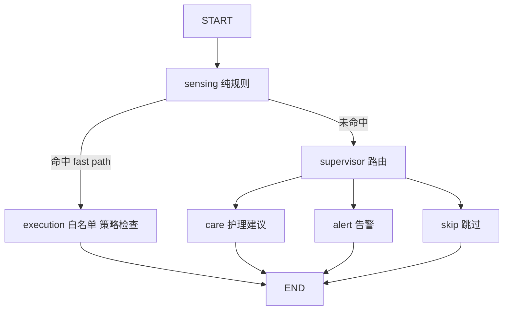

# 10 LangGraph 决策链

> **一句话定位**：LangGraph 在 P4 里是一张**人工设计的、带共享状态的流程图**——规则节点处理明确的极端情况，LLM 节点处理需要综合语义的情况，最终只输出**结构化建议**或**受约束的命令请求**，而不是直接操作泵。

## 本章学完你能……

- 解释 LangGraph 的 **state、node、edge、conditional edge、compile/invoke**，并说明它**不是**神经网络、**也不等于**自治智能体。
- 画出六节点图（sensing、supervisor、care、alert、execution、skip）并说出每个节点的输入、输出、是否调用 LLM。
- 区分 **fast path** 与 **skip**，解释 fast path 为什么处理"极端状态"、`fallback_rule` 的作用。
- 写出路由函数，并对 6 个场景**手工走一遍图**。
- 说明 LLM 节点的输入输出、**结构化输出与校验**、失败处理，以及 LLM 输出为什么不能直接执行。
- 解释 working / short-term / long-term 记忆与 RAG，并区分"字段存在""实现了""运行过"。
- 回答 AI 方向面试官最爱问的 **Agent 可靠性**问题。

## 前置知识

- 基础篇：[Transformer、LLM 与 Agent、LangGraph](../../02_基础知识/07_感知与机器学习/05_Transformer_LLM与Agent_LangGraph.md)
- 八股：[Agent 与 RAG 八股](../../03_八股知识/02_人工智能/07_Agent与RAG八股.md)、[Transformer 与大模型八股](../../03_八股知识/02_人工智能/04_Transformer与大模型八股.md)
- 上一章：[09 服务端](./09_服务端_DataStore_WebSocket_asyncio.md)

## 目录

1. P4 里的"Agent"指什么
2. LangGraph 的概念
3. 六节点图
4. 状态（state）
5. 规则层：fast path、skip、fallback
6. 路由函数与手工走图
7. LLM 节点
8. 记忆、历史与 RAG
9. 与执行层的接口
10. 测试与评估
11. LLM Agent 的可靠性（面试高频）
12. 在本项目里怎么用 / 实现线索
13. 教学示例代码
14. 常见错误与故障现象
15. 面试怎么问、怎么答
16. 要点速记与自测

---

## 1. P4 里的"Agent"指什么

"Agent"在不同语境含义不同：

| 含义 | 例子 | P4 是不是 |
|---|---|---|
| 通用智能体 | 能感知并行动的实体 | 否（过于宽泛） |
| 强化学习 agent | 通过奖励学习策略 | **不是** |
| LLM agent | LLM 自主决定调用工具、多步推理 | 部分接近 |
| **工作流 agent** | 按预设流程图执行步骤，某些步骤调用 LLM | **是** |

> **P4 的 Agent** = 一组按 LangGraph 流程图执行的节点；有的节点是确定性规则，有的节点调用 LLM。**LLM 不决定控制流的全部，也不直接驱动执行器。**

这与 CV 的措辞一致："built an environment and vision-event decision chain with LangGraph, with a rule-based fast path for extreme states, issuing structured recommendations or constrained requests to the execution layer."

---

## 2. LangGraph 的概念

### 2.1 定义

LangGraph 是一个用来把**带状态的多步流程**表示成图并执行的库：
- **State（状态）**：一个共享的数据结构（字典/TypedDict），所有节点读写；
- **Node（节点）**：一个函数，读取当前 state，返回对 state 的**部分更新**；
- **Edge（边）**：固定的"下一步去哪个节点"；
- **Conditional edge（条件边）**：由一个**路由函数**根据 state 决定下一个节点；
- **START / END**：入口与出口；
- **compile → invoke**：编译成可运行对象，传入初始 state 运行到 END，得到最终 state。

### 2.2 与神经网络、普通流程图的区别

| | 神经网络 | LangGraph |
|---|---|---|
| 参数 | 权重 | **无权重** |
| 学习 | 训练得到 | **不训练**，人工设计 |
| 节点 | 层（张量运算） | 函数（任意 Python，可调 LLM） |
| 边 | 数据连接 | 控制流（可条件跳转） |
| 输出 | 张量 | state 更新 |

> **关键认知**：LangGraph 本身不聪明、不自治，也不自带安全性。它让流程**显式**（可读、可测、可追踪）；正确性和安全性来自你写的节点、校验和边界。"用了 LangGraph"不等于"有自主决策能力"。

### 2.3 状态合并

节点返回的字典会**合并**进 state。默认是**覆盖**同名键；如果希望追加（如日志），可为该字段声明 reducer（如 `Annotated[list, operator.add]`）。

---

## 3. 六节点图

### 3.1 拓扑

```text
START
  │
  ▼
┌──────────┐   命中 fast path         ┌───────────┐
│ sensing  │ ───────────────────────▶ │ execution │ ──▶ END
│ (纯规则) │                           └───────────┘
└────┬─────┘
     │ 未命中
     ▼
┌────────────┐   ┌───────┐
│ supervisor │──▶│ care  │──▶ END      （建议文本/结构化建议）
│ (路由)     │   └───────┘
│            │   ┌───────┐
│            │──▶│ alert │──▶ END      （告警）
│            │   └───────┘
│            │   ┌───────┐
│            │──▶│ skip  │──▶ END      （什么都不做）
└────────────┘   └───────┘
```



### 3.2 各节点职责

| 节点 | 职责 | 调用 LLM？ | 输出 |
|---|---|---|---|
| sensing | 读传感快照与视觉事件；做 `check_fast_path`（纯规则） | 否 | `fast_path`、`action` |
| supervisor | 未命中 fast path 时，决定走 care / alert / skip | 可能（也可纯规则） | `route` |
| care | 生成护理建议（浇水、观察、通风等） | 可能 | `advice` |
| alert | 生成告警（病害、传感异常等） | 可能 | `alert` |
| execution | 对待执行的 commands 做白名单、策略检查，构造硬件命令请求，Web 广播 | **否** | `commands`、`rejected` |
| skip | 无需处理时结束 | 否 | — |

> 笔记原话：**不是所有节点都调用 LLM**；`sensing` 和 `skip` 是纯规则，`execution` 也不调用 LLM。

---

## 4. 状态（state）

线索中 state 含这些字段（实际字段名【待你补全】）：

```python
class PlantState(TypedDict, total=False):
    # 输入
    event_id: str
    scope: str                    # "sensor" | "detect" | ... 事件作用域
    sensor_snapshot: dict         # 传感快照（带 age）
    detections: list              # 视觉观测列表（带 captured_at、score）
    mode: str                     # "auto" | "manual"
    manual_request: Optional[str] # 用户的显式请求，如 "off"
    soft_thresholds: dict         # 规则阈值（可配置）
    history: list                 # 近期历史（短期记忆）
    rag_context: str              # 检索到的参考资料
    # 中间
    fast_path: bool
    action: Optional[str]         # "start" | "stop" | None
    route: str                    # "care" | "alert" | "skip"
    # 输出
    advice: Optional[dict]
    commands: list                # 待执行的命令请求
    rejected: list                # 被拒绝的命令及原因
    trace: list                   # 决策轨迹（节点名、依据）
```

**设计要点**：
1. state 里的传感/视觉数据**必须带年龄**，否则节点无法判断新鲜度；
2. `trace` 记录每一步依据，保证"为什么开了泵"可回溯（CV 的 traceable）；
3. state 是**一次决策的工作单**，不是长期存储——长期存储在 DataStore/数据库。

---

## 5. 规则层：fast path、skip、fallback

### 5.1 fast path 是什么

**定义**：条件**简单且明确**时，不经过 LLM，直接走短路径到执行层。

CV 的措辞："a rule-based fast path for **extreme states**"。为什么是"极端状态"：

- 本地 Hi3861 已经用 56/65 的滞回处理"一般偏干/偏湿"；服务端 fast path 处理的是**需要立刻有结论、立刻有记录、立刻通知**的极端情形；
- 极端情形的判断很简单（阈值），不需要语义分析，用 LLM 只会增加延迟和不确定性；
- 规则**低延迟（微秒～毫秒）、可预测、可测试**。

**教学示例阈值（非项目实测）**：

| 极端状态 | 条件 | fast path 动作 |
|---|---|---|
| 极干 | `moisture < 20` 且新鲜且 auto | 请求 `pump_on`（带最长时长上限） |
| 过湿 | `moisture > 90` | 请求 `pump_off`（确保关）并告警 |
| 传感失效 | 传感器无效/过期 | 请求 `pump_off` 并告警 |
| 温度极端 | 例如 `temperature > 40`（若有传感） | 告警（不动泵） |

**【待你补全：你系统的 fast path 实际条件与阈值（线索里的示例用到了 56 这个本地启动阈值，与 CV 的 "extreme states" 的关系需要你核对）】**

### 5.2 fast path vs skip

| | fast path | skip |
|---|---|---|
| 触发节点 | sensing | supervisor |
| 触发条件 | 简单明确的**需要动作**的条件满足 | **没有**需要处理的情况 |
| 去向 | execution | skip → END |
| 结果 | 生成命令请求（经校验） | **什么都不做，也不生成建议** |
| 目的 | 快速响应 | 避免无意义的处理（省 LLM 调用） |
| 例子 | 极干 → 请求开泵 | 湿度正常、无检测 → 不管 |

一句话：**fast path 是"赶紧去做"，skip 是"没事不用管"。**

### 5.3 fallback_rule

线索：LangGraph 库缺失或运行异常时有 `fallback_rule`——一段**不依赖图**的简化规则，保证最基本的行为。例如：

```python
def fallback_rule(state):
    m = state["sensor_snapshot"].get("moisture")
    if m is None or state["sensor_snapshot"]["age_s"] > 5:
        return {"action": None, "reason": "no_fresh_sensor"}
    if state["mode"] == "auto" and m < 20:
        return {"action": "start", "reason": "critical_dry"}
    return {"action": None, "reason": "no_rule_hit"}
```

**设计意图**：决策框架出问题时系统仍有**可预测的最小行为**（并且绝不比"什么都不做"更危险）。

---

## 6. 路由函数与手工走图

### 6.1 路由函数（教学示例）

```python
def route_after_sensing(state) -> str:
    return "execution" if state.get("fast_path") else "supervisor"

def route_after_supervisor(state) -> str:
    return state["route"]          # "care" | "alert" | "skip"
```

supervisor 的路由逻辑可以先走规则：
- 传感无效/过期 → alert；
- 有高置信度视觉事件且已确认（k-of-n）→ care；
- 病害类别在"高风险"集合 → alert；
- 否则 → skip。
若规则无法判断再让 LLM 辅助分类。

### 6.2 六个场景（教学示例：极干阈值 20，新鲜度上限 5 s）

| 场景 | 输入 | 路径 | 输出 |
|---|---|---|---|
| ① 极干，auto，新鲜 | moisture=12，age=1 s，mode=auto | sensing 命中 fast path → execution：白名单 ✓、模式 ✓、新鲜度 ✓ | `pump_on` 请求（带最长时长）；若设备上报已开则判定为重复，仅记录 |
| ② 湿度正常 + 检出病斑 | moisture=70，lesion 0.9（已确认） | sensing 未命中 → supervisor → care（LLM） | `advice`：检查叶片…；**无命令** |
| ③ 极干但用户手动关 | moisture=12，mode=manual，manual_request=off | sensing 命中 → execution：模式检查失败 | `commands=[]`，`rejected=[pump_on: manual_off_priority]` |
| ④ 正常、无检测 | moisture=70，无检测 | sensing 未命中 → supervisor → skip | 无输出 |
| ⑤ 传感过期 | moisture=12，但 age=30 s | sensing：传感无效，**不触发 fast path**（不据旧值开泵）→ supervisor → alert | 告警"传感器数据过期"；请求 `pump_off`（失效安全，若策略如此） |
| ⑥ 极干且同时检出病斑 | moisture=12 与 lesion 同时 | 两个事件**各自**处理：`scope=sensor` 事件走 fast path；`scope=detect` 事件走 supervisor → care | 避免同一事件被两条路径重复处理 |

场景 ⑤ 体现原则：**旧数据不能驱动动作**；场景 ③ 体现：**规则建议不能越过人工 off**；场景 ⑥ 体现：事件**作用域（scope）**用于去重和避免重复输出。

---

## 7. LLM 节点

### 7.1 LLM 节点做什么

输入：state 的**一部分**（传感摘要、检测摘要、历史摘要、检索资料）。输出：**建议文本**或**结构化动作提案**。

### 7.2 提示词与上下文组装

```python
def build_prompt(state) -> str:
    s = state["sensor_snapshot"]
    dets = [{"class": d["class"], "score": round(d["score"], 2)} for d in state["detections"]]
    return f"""你是园艺助手。只根据下列数据给出建议。
传感器（{s['age_s']:.0f}秒前）：湿度={s['moisture']}，泵={s['pump']}，模式={state['mode']}
视觉观测：{dets}
参考资料：{state.get('rag_context','（无）')}
只输出 JSON：{{"advice": "<不超过80字>", "severity": "info|warn|critical",
"proposed_action": "none|pump_on|pump_off", "reason": "<依据>"}}"""
```

**上下文工程要点**：
- 只放**必要的、已清洗的**字段（不要把原始 JSON 全塞进去）；
- 带上**数据年龄**，让模型知道数据新旧；
- 明确输出格式（JSON schema），限制长度；
- 温度设低（减少随机性）。

### 7.3 输出校验：LLM 输出不可信

LLM 的输出可能：格式不对、字段缺失、内容错误、与规则冲突、编造不存在的动作。所以**解析 + 校验**是必需步骤：

```python
from pydantic import BaseModel, ValidationError
from typing import Literal

class Advice(BaseModel):
    advice: str
    severity: Literal["info", "warn", "critical"]
    proposed_action: Literal["none", "pump_on", "pump_off"]
    reason: str

def parse_advice(text: str):
    try:
        a = Advice.model_validate_json(text)
    except ValidationError:
        return None                       # 失败：重试一次或降级
    if len(a.advice) > 200:
        return None
    return a
```

**手算：校验把关**。

| LLM 返回 | 校验结果 |
|---|---|
| `{"advice":"建议检查叶片","severity":"warn","proposed_action":"none","reason":"lesion 0.9"}` | 通过 |
| `{"advice":"立即浇水","severity":"urgent",...}` | `severity` 不在枚举 → **失败** |
| `{"advice":"开阀","proposed_action":"open_valve",...}` | `proposed_action` 不在枚举 → **失败**（也不在白名单） |
| 非 JSON 文本 | 解析失败 |
| `proposed_action="pump_on"` 但 mode=manual 且 manual_off | 校验通过，但**执行层**会拒绝 |

### 7.4 失败处理（降级链）

```text
LLM 调用 → 超时/异常/非法输出
   → 重试一次（可选）
   → 降级为规则生成的模板建议（例如 "检测到 lesion，请检查叶片"）
   → 仍记录失败计数与原因
```

关键：**LLM 失败不应影响 fast path 与本地灌溉**。

### 7.5 LLM 建议如何变成命令

LLM 返回的 `proposed_action` 只是**提案**。如果允许其进入执行，必须：
1. 转成与规则同样的**命令请求结构**；
2. 走与 fast path **同一个** `execution` 校验（白名单、模式、新鲜度、范围）；
3. 不允许 LLM 直接构造硬件命令字符串。

更保守的做法（CV 的 "recommendations or constrained requests"）：LLM 节点**只产生建议**，需要人确认后才生成命令；由规则 fast path 处理自动动作。**【待你补全：你的 LLM 节点是否可以产生命令请求；LLM 型号与调用方式】**

---

## 8. 记忆、历史与 RAG

### 8.1 为什么需要"记忆"

假设每 10 秒一次决策，没有记忆的系统只看当前值：t=0 湿度 55 开泵；t=10 湿度 60——在 56–65 的带内——它不知道刚才已经开过泵，可能重复开或错误关。有记忆就能说"刚开过、保持"。

### 8.2 三种记忆

| 类型 | 内容 | 存放 | 类比 |
|---|---|---|---|
| 工作记忆 | 本次决策需要的信息 | `state` 字典 | 你手里正拿着的东西 |
| 短期记忆 | 最近一段时间的事件/动作 | `state["history"]`，近 N 条 | 你今天做了什么 |
| 长期记忆 | 跨天跨周的偏好、植物档案、历史事件 | 数据库/文件 | 病历 |

**用途**：避免重复（5 分钟内不重复浇）、判断趋势（连续 5 次下降）、提供上下文（上次施肥时间）。

> 线索：长期记忆**是否持久化、存哪里**文档里没有明确说明。**不要声称已实现长期记忆**，除非你确认（笔记里列为"不能确认"）。**【待你补全：你的系统到底有什么记忆（短期 history？数据库？）】**

### 8.3 谁决定存什么

| | 程序员规则 | LLM 判断 |
|---|---|---|
| 可预测性 | 高 | 低 |
| 灵活性 | 低 | 高 |
| 风险 | 漏存 | 误存/漏存/存太多/检索不到 |

折中：**程序员定义类别，LLM 在类别内提取内容**；执行相关的记忆（动作日志）一律由程序写，不由 LLM 决定。

### 8.4 RAG（检索增强生成）

**问题**：LLM 的知识来自训练数据，可能过时、缺专业知识、会编造。
**做法**：生成前先从外部知识库检索相关片段，拼进提示词。

```text
事件（如检出 lesion）→ 构造检索 query → 知识库检索 top-k → 片段+事件拼成 prompt → LLM 生成 → 校验
```

检索方式：关键词（简单、不懂语义）、向量检索（嵌入后用余弦相似度，理解语义，需要嵌入模型和向量库）、混合。

**余弦相似度手算**：$\cos(\mathbf a,\mathbf b)=\dfrac{\mathbf a\cdot\mathbf b}{\|\mathbf a\|\|\mathbf b\|}$。查询向量 $a=(1,2)$，文档 $b_1=(2,4)$，$b_2=(3,-1)$：
- $\cos(a,b_1)=\dfrac{2+8}{\sqrt5\sqrt{20}}=\dfrac{10}{10}=1$（方向相同）；
- $\cos(a,b_2)=\dfrac{3-2}{\sqrt5\sqrt{10}}=\dfrac{1}{7.07}=0.141$。
应取 $b_1$。

**RAG 的边界**：
- 检索质量决定回答质量；检索错了模型会"有依据地说错"；
- 模型可能忽略检索资料；
- 需要维护知识库；
- **检索结果不是传感数据，不是命令，也不能绕过执行层**。

### 8.5 "字段存在 ≠ 实现 ≠ 运行"

| 级别 | 含义 | 证据 |
|---|---|---|
| 字段存在 | state 里有 `history/rag_context` | 读代码 |
| 已实现 | 有函数会写入/读取，且被调用 | 读调用路径 |
| 运行过 | 在真实运行中产生过日志/输出 | 运行记录 |
| 有效 | 对决策质量有可测量的提升 | 评估 |

面试时只报告你**有证据的那一级**。向量库型号、历史保留时间、top-k、知识库内容、是否真被调用：**【待你补全】**。

---

## 9. 与执行层的接口

决策链的输出只有两类：

1. **建议**（advice/alert）：文本或结构化，展示给用户；
2. **命令请求**（commands）：必须经过 `execution` 节点的**白名单、模式、权限、范围、新鲜度**检查。

详细规则、幂等、去重和反馈见 [11 执行边界](./11_执行边界_白名单_幂等与设备反馈.md)。

---

## 10. 测试与评估

| 层 | 测什么 | 怎么测 |
|---|---|---|
| 规则 | fast path 条件、边界 | 表驱动单元测试（含 19.9/20.0/20.1 边界） |
| 路由 | 每个 (state → 路径) | 构造 state，断言走到哪个节点 |
| 校验 | LLM 输出各类非法情形 | 喂固定的坏字符串，断言被拒 |
| 执行 | 白名单/模式/新鲜度 | 构造命令与 state，断言通过/拒绝及原因 |
| LLM 节点 | 提示词与输出质量 | 用**固定的 LLM 替身（mock）**测流程；真模型用小型评测集+人工评分 |
| 集成 | 事件→命令→设备反馈 | 回放录制的事件流 |
| 不变量 | "人工 off 时永不产生 pump_on" | 属性测试：随机 state 生成，断言不变量 |

**原则**：流程的正确性用确定性测试保证；LLM 的"好坏"是概率性的，用评测集衡量；**安全不变量不依赖 LLM 的好坏**。

---

## 11. LLM Agent 的可靠性（面试高频）

| 风险 | 表现 | P4 的对策（设计层面） |
|---|---|---|
| 幻觉 | 编造不存在的动作/事实 | 输出枚举校验；动作白名单；建议里引用输入字段 |
| 不确定性 | 同一输入不同输出 | 低温度；关键路径用规则；对 LLM 输出做重试与校验 |
| 延迟高 | 秒级 | 规则 fast path 不等 LLM；异步调用；队列与限速 |
| 格式错误 | JSON 坏 | schema 校验+降级 |
| 提示注入 | 用户输入/检索文本里夹带指令 | LLM 输出只是提案，无直接执行权；用户输入当数据；不让模型决定权限 |
| 成本/可用性 | API 限流或宕机 | 降级为规则模板；本地闭环不受影响 |
| 难评估 | 没有单一对错 | 评测集+指标+人工抽检；记录线上拒绝率 |
| 越权 | 想绕过人工 off | 执行层不信任 LLM；模式/权限由程序判定 |

**核心一句话**：*Reliability comes from the system around the model — validation, whitelists, fallbacks and ownership of authority — not from trusting the model.*（可靠性来自模型之外的系统设计：校验、白名单、降级和权限归属，而不是信任模型。）

> 诚实边界：这些是**设计与对策**。你实际做了哪些、有没有量化评估（拒绝率、误报率等）**【待你补全】**；没有做的就说"I would add ..."。

---

## 12. 在本项目里怎么用 / 实现线索

| 项 | 线索（以实机为准） |
|---|---|
| CV 对应 | Agent decision chain：LangGraph + rule-based fast path + structured recommendations/constrained requests |
| 图 | `_build_graph` 建六个节点；sensing 调 `check_fast_path`；命中→execution，否则 supervisor→care/alert/skip |
| fallback | LangGraph 缺失/异常有 `fallback_rule` |
| 执行 | `execution` 对 commands 做白名单验证、构造硬件命令、Web 广播 |
| 去重 | key=`event_id:scope`，约 60 秒窗口；在执行分析前标记 |
| 作用域 | `detect` 作用域不复用 sensor 的快速规则，避免同一事件重复输出 |
| 记忆/RAG | state 有 history/RAG 字段；有数据库/向量检索与降级路径的代码，是否启用不确定 |
| LLM 型号 | **【待你补全】** |

---

## 13. 教学示例代码

```python
# 教学示例：LangGraph 六节点图骨架，非项目源码
from typing import TypedDict, Optional
from langgraph.graph import StateGraph, START, END

class S(TypedDict, total=False):
    sensor: dict
    detections: list
    mode: str
    manual_request: Optional[str]
    fast_path: bool
    action: Optional[str]
    route: str
    advice: Optional[dict]
    commands: list
    rejected: list

CRIT_DRY, MAX_AGE = 20, 5.0

def sensing(s: S) -> dict:
    snap = s.get("sensor") or {}
    fresh = snap.get("age_s", 1e9) <= MAX_AGE and snap.get("valid", False)
    if fresh and s.get("mode") == "auto" and snap["moisture"] < CRIT_DRY:
        return {"fast_path": True, "action": "start"}
    return {"fast_path": False}

def supervisor(s: S) -> dict:
    snap = s.get("sensor") or {}
    if not snap.get("valid", False) or snap.get("age_s", 1e9) > MAX_AGE:
        return {"route": "alert"}
    if s.get("detections"):
        return {"route": "care"}
    return {"route": "skip"}

def care(s: S) -> dict:
    return {"advice": {"text": "检测到异常，请检查叶片", "severity": "warn"}}  # 真实实现调用 LLM

def alert(s: S) -> dict:
    return {"advice": {"text": "传感器数据过期或无效", "severity": "critical"}}

def skip(s: S) -> dict:
    return {}

def execution(s: S) -> dict:
    cmds, rej = [], []
    if s.get("action") == "start":
        if s.get("mode") == "manual" and s.get("manual_request") == "off":
            rej.append({"cmd": "pump_on", "why": "manual_off_priority"})
        else:
            cmds.append({"cmd": "pump_on", "max_s": 60})
    return {"commands": cmds, "rejected": rej}

b = StateGraph(S)
for name, fn in [("sensing", sensing), ("supervisor", supervisor), ("care", care),
                 ("alert", alert), ("skip", skip), ("execution", execution)]:
    b.add_node(name, fn)
b.add_edge(START, "sensing")
b.add_conditional_edges("sensing",
    lambda s: "execution" if s.get("fast_path") else "supervisor",
    {"execution": "execution", "supervisor": "supervisor"})
b.add_conditional_edges("supervisor", lambda s: s["route"],
    {"care": "care", "alert": "alert", "skip": "skip"})
for n in ("care", "alert", "skip", "execution"):
    b.add_edge(n, END)
graph = b.compile()

# 场景 ①：极干，auto，新鲜
print(graph.invoke({"sensor": {"moisture": 12, "age_s": 1, "valid": True},
                    "mode": "auto", "detections": []})["commands"])
# [{'cmd': 'pump_on', 'max_s': 60}]
# 场景 ③：极干但人工关
print(graph.invoke({"sensor": {"moisture": 12, "age_s": 1, "valid": True},
                    "mode": "manual", "manual_request": "off"})["commands"])
# []
```

> 注意：此例里场景 ③ 的 `fast_path` 条件要求 `mode=="auto"`，所以不会进入 execution，`commands` 为空。这与第 6 节表中"命中后在 execution 被拒绝"是**两种等价的防线设计**：既可以在 sensing 里就不触发，也可以在 execution 里拒绝并记录原因。**推荐两处都检查**（纵深防御），因为日志里 `rejected` 的理由对排查更有价值。

---

## 14. 常见错误与故障现象

| 现象 | 可能原因 | 排查 |
|---|---|---|
| LLM 输出非法结构 | 无 schema 约束/无校验 | 加校验+重试+降级 |
| 快慢路径相互覆盖 | 优先级未定义（同一事件两条路径都产出命令） | 作用域区分；fast path 优先 |
| 旧传感+新检测拼出错误结论 | 没有按年龄过滤 | state 带 age，节点先判新鲜度 |
| 重复事件重复开泵 | 去重缺失或窗口太短 | 见第 11 章 |
| 把广播摘要当硬件回执 | 语义混淆 | 区分建议/请求/反馈 |
| 图运行异常整条链挂掉 | 无 fallback | 加 `fallback_rule` + 异常捕获 |
| LLM 慢导致事件堆积 | 同步调用/无限速 | 异步/限速/合并 |
| "多 Agent 自动决策"说不清 | 没梳理哪些节点真调用 LLM | 画图标注，每个节点写输入输出 |

---

## 15. 面试怎么问、怎么答

**Q1. What is LangGraph, and how did you use it?**

> "LangGraph lets you express a multi-step workflow as a graph over a shared state. Nodes are functions that read the state and return updates, and conditional edges choose the next node. In my project the graph has six nodes: a rule-based sensing node that can take a fast path, a supervisor that routes, care and alert nodes that may call an LLM, an execution node that validates commands, and a skip node. It's a hand-designed workflow — not a trained model."

追问 1：**What is the fast path for?**
> "For extreme, unambiguous states like very dry soil or a sensor failure, where waiting for an LLM would add latency and unpredictability. The rule is deterministic, testable, and answers in milliseconds. The LLM path is for situations that need interpretation, such as combining a visual finding with the environment."

追问 2：**What's the difference between the fast path and skip?**
> "Fast path means a clear condition is met, so go straight to execution checks. Skip means nothing needs doing, so do nothing and generate no advice. One is 'act now', the other is 'no action needed'."

追问 3：**Why not let the LLM decide when to water?**
> "Irrigation timing is a simple, safety-relevant decision that the local controller already handles with thresholds. The LLM adds latency and variability without adding much. I use it where language and context help: explaining findings, suggesting care actions. And whatever it proposes goes through the same validation as any other request."

**Q2. How do you make an LLM-based component reliable?**

> "I treat the model as an untrusted proposal generator. Its output must parse into a fixed schema with enumerated actions; anything else is rejected and falls back to a rule-based template. Commands go through a whitelist and mode, freshness and range checks. Manual override always wins. The deterministic parts are covered by unit tests, and the LLM part by an evaluation set with a mocked model for flow tests."

**Q3. What happens if the LLM is down?**
> "Nothing critical. The local irrigation loop doesn't depend on it, and the fast path doesn't call it. Care and alert nodes degrade to template advice, and the failure is counted and shown."

**Q4. How would you defend against prompt injection?**
> "The model has no authority. Its output is a proposal that gets schema-checked and policy-checked, so injected text can at worst change advice wording. I also keep untrusted text — user chat input, retrieved documents — in a clearly separated data section of the prompt, and don't let the model choose permissions or command names."

**Q5. Did you implement memory or RAG?**
> 【按真实情况回答。】 "The state has fields for recent history and retrieved context. 【补全：实际实现了什么，是否启用，用什么检索】. I'm careful to say what is implemented versus what is a design option."

**Q6. How did you evaluate the agent?**
> "I tested the deterministic parts with table-driven and property-based tests, like 'with manual off, no pump-on command is ever produced'. For the LLM text, I'd use a small labelled set and human review. 【补全：你实际做了什么评估；如果没有，就说计划如何做】"

---

## 本章要点速记

1. P4 的 Agent = 工作流 agent：LangGraph 流程图，部分节点调用 LLM；不是 RL、不是自治。
2. LangGraph：state + node + edge + conditional edge；无权重、不训练。
3. 六节点：sensing（规则）、supervisor（路由）、care、alert、execution（校验，无 LLM）、skip。
4. fast path = 极端/明确条件 → execution（赶紧做）；skip = 没事不管。
5. fallback_rule：图失效时的最小可预测行为。
6. LLM 输出必须 schema 校验；失败降级为模板；LLM 建议经同一 execution 校验。
7. 旧传感数据不能触发 fast path；人工 off 不能被建议覆盖；事件按 scope 分开处理。
8. 记忆三层：工作/短期/长期；RAG=检索后生成；字段存在≠实现≠运行≠有效。
9. 可靠性来自模型之外：校验、白名单、降级、权限归属、测试。

## 自测题

1. 画出六节点图，标出哪些节点可能调用 LLM。
2. fast path 与 skip 的区别？各举一个例子。
3. LLM 返回 `{"proposed_action": "open_valve"}`，系统如何处理？
4. 场景：moisture=12，但数据已 30 s 前，会发生什么？为什么？
5. 解释"字段存在、已实现、运行过、有效"四个级别，并举 RAG 的例子。

**参考答案**：
1. 见第 3 节；care、alert（supervisor 可选）。
2. fast path：极干→请求开泵；skip：湿度正常且无检测→什么都不做。
3. schema 枚举校验失败→丢弃，降级为模板建议；记录失败；绝不执行。
4. 传感过期→不触发 fast path，进入 supervisor→alert（或失效安全关泵）；旧数据不能驱动动作。
5. 字段存在=state 里有 `rag_context`；已实现=有代码写入并被调用；运行过=有真实运行日志；有效=可测量提升了建议质量。

## 相关链接

- 上一章：[09 服务端：DataStore、WebSocket 与 asyncio](./09_服务端_DataStore_WebSocket_asyncio.md)
- 下一章：[11 执行边界：白名单、幂等与设备反馈](./11_执行边界_白名单_幂等与设备反馈.md)
- 基础：[Transformer、LLM 与 Agent、LangGraph](../../02_基础知识/07_感知与机器学习/05_Transformer_LLM与Agent_LangGraph.md)
- 同构思想：[P6 安全执行链](../P6_深开鸿M-Robots平台软件/README.md)
- 返回：[P4 README](./README.md)
