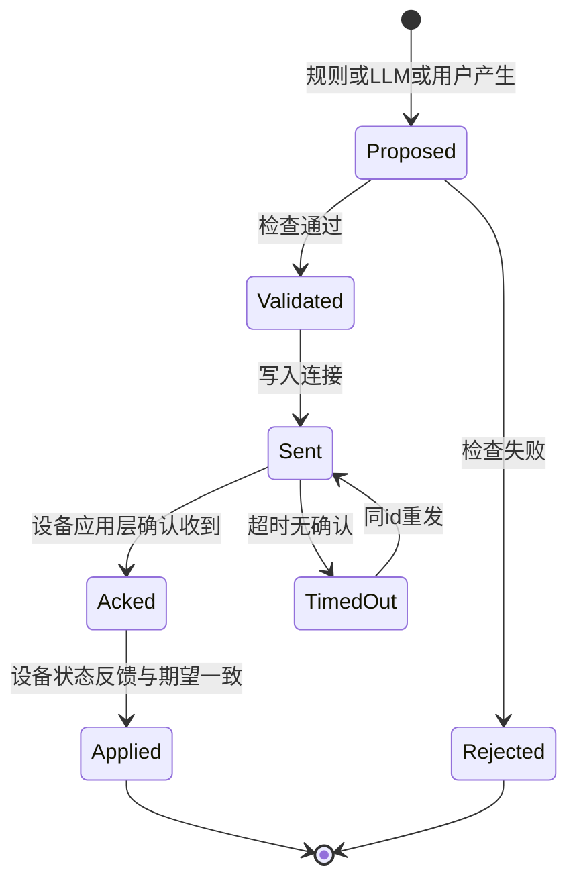

# 11 执行边界：白名单、人工优先、幂等与设备反馈

> **一句话定位**：这是 P4 最核心的安全设计章——**"建议 ≠ 命令请求 ≠ 设备收到 ≠ 设备已动作"**。决策链产出的任何东西，都必须穿过一道**执行层**：白名单、模式、新鲜度、范围、人工优先；之后用 `action_id` 保证重发幂等，用设备自己的反馈来确认状态。

## 本章学完你能……

- 画出命令的**生命周期状态机**，说出每个阶段**能证明什么、不能证明什么**。
- 列出执行层的**检查清单**与顺序，手工判断一批命令请求的通过/拒绝及原因。
- 解释**人工 off 优先**如何贯穿 UI → 服务端 → 设备，以及竞态时如何裁决。
- 区分**事件去重**与**命令幂等**，说清 `event_id:scope` 60 秒窗口"防重复分析，但不等于 exactly-once 执行"。
- 手算**非幂等命令重发**的后果（20 s 变 40 s），并给出绝对语义的修正。
- 设计 ACK/反馈/超时/重试流程，以及接口契约测试。
- 英文讲清 "How does an AI decision become a physical action safely?"（这正是 PS 主线问题）

## 前置知识

- 上一章：[10 LangGraph 决策链](./10_LangGraph决策链.md)
- 设备端：[04 滞回状态机与手动优先](./04_Hi3861滞回状态机_继电器与手动优先.md)
- 通信：[08 TCP 通信与协议设计](./08_TCP通信与协议设计.md)
- 相同思想的另一个项目：[P6 README（action-proposal → policy-check → execution → state-feedback）](../P6_深开鸿M-Robots平台软件/README.md)

## 目录

1. 为什么需要"执行边界"
2. 命令生命周期与证据级别
3. 执行层的检查清单
4. 手算：一批命令的判决
5. 人工优先贯穿三层
6. 事件去重（event_id:scope）
7. 命令幂等
8. ACK、反馈、超时与重试
9. 接口契约：命名与映射
10. 设备端的最后防线
11. 在本项目里怎么用 / 实现线索
12. 教学示例代码
13. 常见错误与故障现象
14. 面试怎么问、怎么答
15. 要点速记与自测

---

## 1. 为什么需要"执行边界"

决策链（规则 + LLM）产出的是**意图**；泵是**物理世界的后果**。两者之间如果没有一道强制的、确定性的检查，就会发生：

- LLM 幻觉出一个不存在的"开阀"命令；
- 规则基于 30 秒前的旧读数开泵；
- 用户刚点了"关"，自动建议又把泵打开；
- 网络重发让"浇 20 秒"变成两次；
- 页面显示"已浇水"，实际命令没送到。

执行边界的原则：**所有想动设备的东西——规则、LLM、用户——都用同一种命令请求格式，穿过同一条检查流水线**；设备端再有自己的底线。

---

## 2. 命令生命周期与证据级别

### 2.1 状态机



### 2.2 证据级别（"我能说到哪一步"）

| 级别 | 状态 | 能证明 | 不能证明 |
|---|---|---|---|
| L0 | Proposed（建议） | 某个模块认为应该这么做 | 任何事 |
| L1 | Validated（通过校验） | 它符合白名单、模式、新鲜度、范围 | 已经发出 |
| L2 | Sent（已发送） | 数据写入了服务端的发送通道 | 设备收到 |
| L3 | Acked（设备已确认） | 设备应用层解析了该命令 | 泵已动作 |
| L4 | Applied（设备报告状态一致） | 设备自己的状态变量/GPIO 与期望一致 | 水真的流了 |
| L5 | 物理佐证 | 土壤湿度随之上升（或流量计读数） | —— |

**对应关系**：笔记中"网页出现'请求已发送'不等于设备收到，更不等于水已经流出来"；"服务器选择或广播命令不证明 GPIO/泵动作"；"`execution_summary` 文本不自动是设备实测回执"。

> **面试规则**：每次说"executed"，立刻想"是 L 几？"。服务端日志里的 `executed` 很可能只是 L2。**【待你补全：你的系统确认到哪一级；有没有 L3/L4 的回执】**

---

## 3. 执行层的检查清单

### 3.1 检查项

| 序 | 检查 | 含义 | 失败后 |
|---|---|---|---|
| 1 | **结构有效** | 命令是已知结构，字段齐全且类型正确 | 拒绝 |
| 2 | **白名单** | 命令名在允许集合内（如 `pump_on`, `pump_off`, `set_duration`） | 拒绝 |
| 3 | **能力** | 目标设备支持该命令（如这个节点有泵） | 拒绝 |
| 4 | **权限/来源** | 该来源是否可发该命令（用户可手动；LLM 只能建议） | 拒绝 |
| 5 | **范围** | 参数在允许范围内（如 `max_s ≤ 120`） | 拒绝或钳位并标记 |
| 6 | **新鲜度** | 决策依据的数据足够新（age ≤ 阈值） | 拒绝 |
| 7 | **模式/人工优先** | 当前模式允许；不违背用户的手动 off | 拒绝 |
| 8 | **状态冗余** | 设备已处于目标状态（再开已经开着的泵） | 不重发，记录 |
| 9 | **冷却/限额** | 最短停泵间隔、每日总时长 | 拒绝 |
| 10 | **幂等/去重** | 同 `action_id` 已处理过 | 返回上次结果 |

### 3.2 不对称原则：安全方向放宽，危险方向收紧

- `pump_off`（走向安全状态）：几乎任何来源、任何模式都允许，也不要求数据新鲜（"不确定时就关"）；
- `pump_on`（走向有后果的状态）：必须全部检查通过。

这是一个通用的安全设计原则：**让"变安全"的路最短，让"变危险"的路最严。**

### 3.3 白名单只是其中一项

笔记要点：**白名单只是其中一项，不能跳过本地状态。** 一条命令名在白名单里，不代表此刻可以执行（模式、新鲜度、冷却、人工 off 都可能否决）。解析 JSON 成功只代表语法合法，不代表语义安全。

---

## 4. 手算：一批命令的判决

**设定（教学示例）**：当前 `mode=auto`，传感 `moisture=12`，数据年龄 1 s；泵 `reported=off`；白名单 = {`pump_on`,`pump_off`,`set_duration`}；范围 `max_s ≤ 120`；新鲜度上限 5 s；冷却：关泵后至少 30 s 才能再开，上次关泵在 100 s 前；用户当前**没有**手动关闭请求。

| # | 命令 | 来源 | 检查结果 |
|---|---|---|---|
| 1 | `pump_on, max_s=60, id=a1` | rule_fast_path | 全部通过 → **接受**（L1） |
| 2 | `pump_on, max_s=600, id=a2` | rule | 范围失败（600>120）→ **拒绝**（或钳位到 120 并标记 `modified`；选择由策略定，需记录） |
| 3 | `open_valve, id=a3` | llm | 白名单失败 → **拒绝** |
| 4 | `pump_on, id=a4`，但 mode=manual 且 manual_request=off | rule | 模式/人工优先失败 → **拒绝**，理由 `manual_off_priority` |
| 5 | `pump_on, id=a5`，传感 age=30 s | rule | 新鲜度失败 → **拒绝**，理由 `stale_input` |
| 6 | `pump_on, id=a1`（重复到达） | rule | 幂等：已处理 → **返回 a1 的当前状态**，不重复发 |
| 7 | `pump_on, id=a7`，但设备 reported=on | rule | 状态冗余 → **不重发**，记录 `already_on` |
| 8 | `pump_on, id=a8`，上次关泵在 10 s 前 | rule | 冷却失败（10<30）→ **拒绝** |
| 9 | `pump_off, id=a9` | user | 安全方向 → **接受**（任何模式，免新鲜度） |
| 10 | `pump_on, id=a10` | llm（直接提交） | 来源权限失败（LLM 只能建议）→ **拒绝**；若要采纳，转为"建议"让用户确认或由规则转换 |

每次拒绝都要**写入 `rejected` 列表并带理由**，这是"traceable"的一部分，对排查（"为什么没浇水？"）极其重要。

---

## 5. 人工优先贯穿三层

```text
┌──────────────┐  用户点"手动关"   ┌──────────────┐  命令 pump_off(user)  ┌──────────────┐
│ 网页 (UI)    │ ───────────────▶ │ 服务端执行层  │ ─────────────────────▶ │ Hi3861       │
│ 显示 pending │                  │ 记录 manual   │                        │ 进入 MANUAL  │
└──────────────┘                  │ _off 标志     │                        │ 暂停滞回     │
                                  │ 否决后续自动  │                        └──────────────┘
                                  │ pump_on 请求  │
                                  └──────────────┘
```

- **UI**：显示用户的意图与确认级别；
- **服务端**：把"用户要求关"记为一个**有优先级的状态**，之后所有自动 `pump_on` 请求在检查 7 被否决；
- **设备**：手动模式下暂停自动逻辑（[第 04 章](./04_Hi3861滞回状态机_继电器与手动优先.md)）。

### 5.1 竞态：用户 off 与自动 on 同时在途

时间线（教学示例）：

| 时刻 | 事件 |
|---|---|
| t=0.00 | 服务端 fast path 校验通过，`pump_on(a1)` 发出（L2） |
| t=0.05 | 用户点击"手动关"，服务端生成 `pump_off(a2, user)` 发出 |
| t=0.10 | 设备先收到 a1 → 开泵 |
| t=0.12 | 设备收到 a2 → 关泵 |
| 结果 | 泵最终关 ✓（顺序正确） |

如果网络**乱序**，设备先收到 a2 再收到 a1：泵最终**开** ✗——用户的 off 被覆盖。防护：
1. 命令带**单调序号**（或时间戳）与来源优先级；设备（或服务端）按序号处理，**旧序号的命令被丢弃**；
2. TCP 单连接上本来保序，乱序主要由"多连接/重连/重发"引起，所以重发要用**相同 id**；
3. 用户 off 设为**粘性状态**：在 `manual_off` 生效期间，设备拒绝来自自动来源的 `pump_on`（设备端检查"来源/模式"）。

### 5.2 手动 off 的有效期

笔记提醒：不要说"所有 off 都永久保持"。要明确：
- **MANUAL_OFF 持续到用户取消，或超时恢复自动**（需要写进协议和 UI 文案）；
- 回到自动后，若土壤仍干，本地滞回会重新开泵（见第 04 章 7.3）。

---

## 6. 事件去重（event_id:scope）

### 6.1 问题

事件可能被**重复送达**：设备重发、重连后重放、两处订阅都触发。重复处理会重复调用 LLM、重复产生命令、重复告警。

### 6.2 线索：源码的做法

- key = `event_id:scope`（scope 例如 `sensor` / `detect`，同一个事件在不同分析作用域各算一次）；
- 窗口约 **60 秒**（窗口内同 key 视为已处理）；
- 在**执行分析之前**就标记为已处理。

```python
processed = {}                       # key -> 时间

def seen(event_id, scope, now, window=60):
    key = f"{event_id}:{scope}"
    t = processed.get(key)
    if t is not None and now - t < window:
        return True
    processed[key] = now
    return False
```

### 6.3 手算：窗口行为

| 时刻 (s) | 事件 | 结果 |
|---|---|---|
| 0 | (e1, sensor) | 未见过 → 标记，**处理** |
| 30 | (e1, sensor) 重复 | 30<60 → **跳过** |
| 30 | (e1, detect) | key 不同（scope 不同）→ **处理** |
| 61 | (e1, sensor) 再次 | 61≥60 → 窗口过期 → **重新处理** |

### 6.4 "防重复分析" ≠ "exactly-once 执行"

笔记要点："**这主要防重复分析，不能自动称端到端 exactly-once 执行。**"原因（逐一手算验证）：

| 情形 | 发生什么 |
|---|---|
| ① 先标记后执行，**执行失败** | 标记仍在 → 窗口内重试会被当作重复跳过 → **丢处理**（at-most-once） |
| ② 内存字典，**进程重启** | 标记消失 → 重放事件被再次处理 → **可能重复** |
| ③ **窗口过期**后的重发 | 再次处理（t=61 例） |
| ④ 去重只管**服务端分析**，不管**设备端**是否重复执行 | 设备重复执行取决于命令幂等 |

**投递语义对照**：

| 语义 | 含义 | 实现难度 |
|---|---|---|
| at-most-once | 最多一次，可能丢 | 低（先标记后做） |
| at-least-once | 至少一次，可能重 | 中（先做后标记+重试） |
| exactly-once | 恰好一次 | 高（需要持久化去重+幂等的组合；端到端通常靠**幂等**近似） |

**工程上的务实路线**：*at-least-once 投递 + 幂等处理*，等效地达到"效果上恰好一次"。这就是下一节。

---

## 7. 命令幂等

### 7.1 定义

幂等（idempotent）：同一操作执行一次和执行多次，**最终效果相同**。

### 7.2 反例手算：非幂等的"浇 20 秒"

命令 `water(duration=20)`，语义是"再浇 20 秒"（增量语义）。因为超时重发，设备收到两次：

$$\text{总浇水时间}=20+20=40\ \text{s}\neq 20\ \text{s}$$

### 7.3 修正：状态语义 + 命令 id + 绝对期限

1. **状态语义**：命令表达**目标状态**而不是增量动作：`set pump=on until T_end`，重复到达仍然是"开到 $T_{\text{end}}$"；
2. **绝对期限**：用设备本地的 `now + 20 s` 计算后，重复命令不延长（`T_end = max(T_end, ...)` 或"已在运行则忽略"）；
3. **命令 id**：设备记住最近 $K$ 个 `action_id`；重复到达返回**上次结果**，不重复执行。

```c
/* 教学示例：设备端幂等处理，非项目源码 */
#define RECENT 8
static uint32_t recent_ids[RECENT]; static int rp = 0;

bool seen_id(uint32_t id) {
    for (int i = 0; i < RECENT; i++) if (recent_ids[i] == id) return true;
    recent_ids[rp] = id; rp = (rp + 1) % RECENT;
    return false;
}
```

### 7.4 desired vs reported

- `desired_state`：服务端想要的状态（`pump=on`，带 `action_id`）；
- `reported_state`：设备**自己报告**的实际状态（`pump=on`，带最后处理的 `action_id`）。

**对账（reconcile）**：服务端周期性比较两者；`desired != reported` 超过超时 → 告警/重发（同 id）。"服务重启后"不要假设泵状态，先**读取** `reported`。

---

## 8. ACK、反馈、超时与重试

### 8.1 流程

```text
服务端                                   设备
  │── cmd(id=7, pump_on, max_s=60) ─────▶│
  │                                      │ 解析、校验(模式/范围)、应用
  │◀── ack(id=7, accepted) ──────────────│  ← L3
  │◀── state(pump=on, last_id=7) ────────│  ← L4（来自 GPIO/状态变量）
  │ (超时未收 ack/state) → 重发 id=7      │
```

### 8.2 超时与重试

教学参数：ACK 超时 2 s，最多重试 3 次，指数退避（2 s、4 s、8 s）。

**手算：丢包情形**：
- t=0：发送 id=7；
- t=2：无 ack → 重发 id=7（第 1 次重试）；
- 实际上设备在 t=0.1 就收到并执行了，但它的 ack 丢了。t=2 的重发到达，设备 `seen_id(7)=true` → 不重复执行，回复**上次的 ack 与当前状态**；
- t=2.1：服务端收到 ack → 进入 Acked；
- 若 3 次重试仍无反应 → 状态置 `TimedOut`，告警，UI 显示"未确认"。

**幂等 + 重试** = 可靠。

### 8.3 拒绝也要回报

设备拒绝命令（如 AUTO 模式不接受远程 on）必须回 `ack(id, rejected, reason)`，而不是沉默——否则服务端会一直重发，UI 一直显示 pending。

---

## 9. 接口契约：命名与映射

服务端和设备是**两套代码**，各自有一套命令名称与取值范围。任何一处不一致，都会让"校验通过的命令"在设备端被忽略——且很难发现，因为两边各自看起来都正常。

| 风险 | 例子（泛化） |
|---|---|
| 命令名不一致 | 服务端 `start/stop`，设备解析 `water_on/water_off` |
| 模式前置条件 | 设备只在 MANUAL 模式接受远程开关 |
| 单位/范围 | 秒 vs 毫秒；0–100 vs 0–1 |
| 字段缺失默认值 | 缺 `max_s` 时设备默认无限运行 |

**对策**：
1. 在协议文档里写**单一事实来源**（枚举表、字段、单位、前置条件、错误码）；
2. 加**映射层**，集中做名称翻译，并为它写测试；
3. **契约测试**：服务端发出所有白名单命令，对着设备模拟器断言每一条都得到预期 ack 与状态变化；
4. 协议带版本号；
5. 端到端联调时，**逐级验证 L1→L5**，而不是只看服务端日志。

> 具体到你的系统：在此前对源码的静态对照中，注意过"服务端动作枚举与设备端命令字符串之间是否有适配"以及"设备远程开关是否要求手动模式"。这是**待核对的接口风险，不是已证实的故障**，放在 README 的口径备忘中，面试按 CV 讲；若被问到端到端闭环，诚实说明你验证到了哪一级。

---

## 10. 设备端的最后防线

不管上层怎么说，设备端自己要有**不依赖上层**的保护（[第 03/04 章](./04_Hi3861滞回状态机_继电器与手动优先.md)）：

| 防线 | 作用 |
|---|---|
| 滞回 + 手动优先 | 本地闭环与人工权 |
| 最长连续开泵时间 | 不论谁让开，到点关 |
| 最短停泵间隔 / 每日限额 | 防止过度浇水与过热 |
| 传感失效 → 关泵 | 数据不可信不动作 |
| 命令参数钳位 | 超范围的值被设备端截断或拒绝 |
| 上电默认关 | GPIO 默认 HIGH（低触发继电器释放） |

**纵深防御**：服务端检查是第一道，设备端检查是最后一道；任何一道独立都能挡住大多数错误。

---

## 11. 在本项目里怎么用 / 实现线索

| 项 | 线索（以实机为准） |
|---|---|
| CV 对应 | "issuing structured recommendations or constrained requests to the execution layer"；"manual-priority override"；"traceable system state" |
| 执行节点 | 对 commands 做白名单验证、构造硬件命令、Web 广播；不调用 LLM |
| 白名单 | 教学取 `water_on/water_off/set_duration`（实际枚举【待你补全】） |
| 去重 | `event_id:scope`，约 60 秒窗口，分析前标记 |
| 反馈 | 设备上报泵状态字段；是否有按 `action_id` 的 ACK【待你补全】 |
| 证据级别 | 你的系统最高确认到 L? 【待你补全】 |

**面试时的标准措辞**：

> "In my system the server issues a constrained request, the device applies its own rules, and the pump state comes back in the device's report. I distinguish those levels in the UI and logs. What I can confirm end to end is 【补全】."

---

## 12. 教学示例代码

```python
# 教学示例：执行层校验流水线，非项目源码
from dataclasses import dataclass
from typing import Optional

ALLOWED = {"pump_on", "pump_off", "set_duration"}
MAX_S, MAX_AGE, COOLDOWN = 120, 5.0, 30.0

@dataclass
class Ctx:
    mode: str                  # "auto" | "manual"
    manual_request: Optional[str]
    sensor_age_s: float
    sensor_valid: bool
    pump_reported: str         # "on" | "off"
    since_last_off_s: float
    seen_ids: set

def check(cmd: dict, ctx: Ctx):
    """返回 (decision, reason)。decision: accept | reject | noop | replay"""
    if cmd.get("name") not in ALLOWED:
        return "reject", "not_whitelisted"
    if cmd["id"] in ctx.seen_ids:
        return "replay", "duplicate_action_id"
    if cmd["name"] == "pump_off":
        return "accept", "safe_direction"           # 安全方向放宽
    if cmd.get("source") == "llm":
        return "reject", "llm_has_no_authority"
    if cmd.get("max_s", 0) > MAX_S:
        return "reject", "out_of_range"
    if not ctx.sensor_valid or ctx.sensor_age_s > MAX_AGE:
        return "reject", "stale_input"
    if ctx.mode == "manual" and ctx.manual_request == "off":
        return "reject", "manual_off_priority"
    if ctx.pump_reported == "on":
        return "noop", "already_on"
    if ctx.since_last_off_s < COOLDOWN:
        return "reject", "cooldown"
    return "accept", "ok"

# 表驱动测试：第 4 节的 10 个命令
base = Ctx("auto", None, 1.0, True, "off", 100.0, set())
assert check({"name":"pump_on","id":"a1","source":"rule","max_s":60}, base) == ("accept","ok")
assert check({"name":"pump_on","id":"a2","source":"rule","max_s":600}, base)[1] == "out_of_range"
assert check({"name":"open_valve","id":"a3"}, base)[1] == "not_whitelisted"
```

---

## 13. 常见错误与故障现象

| 现象 | 可能原因 | 排查 |
|---|---|---|
| 页面"已执行"但泵没动 | 把 L2 当成 L4；命令名/模式不匹配被设备忽略 | 抓设备端串口日志，逐级核对 |
| 命令越过人工 off | 优先级错；只在 UI 层检查 | 在执行层与设备层都检查 |
| 重复浇水 | 重发无幂等；增量语义命令 | `action_id` + 状态语义 |
| 旧命令重播 | 无序号/期限；重连后重放 | 命令带 TTL 与单调序号 |
| 事件被漏处理 | 先标记后失败 | 区分"已接收"与"已处理完"，失败时撤销标记或重试 |
| 重启后重复动作 | 内存去重 | 持久化最近 id；对账 desired/reported |
| UI 一直 pending | 设备拒绝但不回报 | 拒绝也回 ack |
| LLM 说开，系统开了 | 允许 LLM 直通命令 | LLM 只产生建议；统一校验 |
| 日志里找不到为何没浇水 | 拒绝无理由记录 | `rejected` 带理由 |

---

## 14. 面试怎么问、怎么答

**Q1. How does an AI decision become a physical action safely in your project?**

> "It never goes straight from the model to the actuator. The decision chain produces a recommendation or a constrained request. Every request, whether it comes from a rule, the LLM or the user, goes through the same execution layer: a command whitelist, a mode check, a freshness check on the data it was based on, range limits, and manual-priority. Only then is it sent to the device, which applies its own rules and reports back its actual pump state. I treat a recommendation, a request, a device acknowledgement and a device-reported state as different things."

（译：决不从模型直通执行器。决策链产出建议或受约束请求；无论来自规则、LLM 还是用户，都经同一执行层：白名单、模式、依据数据新鲜度、范围、人工优先；之后设备再按自身规则执行并回报实际状态。四者是不同的东西。）

追问 1：**What if the user turns the pump off while the agent wants it on?**
> "The user wins. The execution layer records a manual-off state and rejects automatic pump-on requests while it's active, and the device pauses its automatic logic in manual mode. The asymmetry is intentional: moving toward off is always allowed, moving toward on has to pass every check."

追问 2：**How do you avoid watering twice if a command is resent?**
> "Commands carry an action id and express a target state with a bounded duration, not an increment. The device remembers recent ids, so a resend returns the previous result instead of running again. If it were 'water 20 more seconds', a retry would make it 40."

追问 3：**You said you dedupe events by event id and scope for 60 seconds. Is that exactly-once?**
> "No. It prevents re-analysing the same event within a window. It's in memory, so it's lost on restart; if it marks before execution and the execution fails, the retry is skipped; and it doesn't control what the device does. For end-to-end behaviour I rely on at-least-once delivery with idempotent commands."

**Q2. How do you know the pump actually ran?**
> "There are levels of evidence. The server sending a command only proves the request was issued. A device acknowledgement shows it parsed the command. The device-reported pump state shows its internal state and GPIO matched. And to confirm water actually flowed I'd need a flow sensor, or a rise in the soil moisture reading. In my system I can claim up to 【补全】."

**Q3. What's the risk of two codebases with their own command names?**
> "A request can pass validation on the server and still be silently ignored by the device. I'd keep a single protocol table, a mapping layer with tests, and contract tests that send every whitelisted command to a device simulator. And I verify end to end level by level."

---

## 本章要点速记

1. 命令生命周期：Proposed → Validated → Sent → Acked → Applied；证据级别 L0–L5。
2. "建议 ≠ 请求 ≠ 设备收到 ≠ 设备已动作 ≠ 水已浇到"。
3. 检查：结构、白名单、能力、权限、范围、新鲜度、模式/人工优先、状态冗余、冷却、幂等；白名单只是其中一项。
4. 不对称：`pump_off` 放宽，`pump_on` 收紧；LLM 无权直接下命令。
5. 人工 off 贯穿 UI/服务端/设备；MANUAL_OFF 的有效期要写明。
6. 事件去重 `event_id:scope`+60 s：防重复分析，不等于 exactly-once。
7. 先标记后执行→可能丢；内存→重启丢；窗口过期→重处理。
8. 幂等：`action_id` + 目标状态语义 + 绝对期限；"再浇 20 s"重发会变 40 s。
9. desired vs reported 对账；拒绝也要回报；超时重试用同 id。
10. 接口契约：单一事实来源、映射层、契约测试；设备端有独立最后防线。

## 自测题

1. 列出命令生命周期的 5 个阶段与各自能证明的事。
2. 10 个检查项里，哪些对 `pump_off` 可以放宽？为什么？
3. 去重窗口 60 s：事件在 t=0、t=45、t=70 到达，各自被处理还是跳过？
4. 为什么"先标记后执行"可能导致漏处理？给出一个修补思路。
5. 设计一个命令，使得重发不会延长浇水时间。

**参考答案**：
1. 见 2.2 表。
2. 新鲜度、冷却、LLM 权限等；因为"关"是安全方向，宁可多关。
3. t=0 处理；t=45 跳过；t=70 窗口已过期→重新处理。
4. 标记后执行失败，标记仍在，重试被跳过；修补：执行成功后再确认标记（失败时撤销）、或 at-least-once+幂等。
5. `{id, pump=on, until=T_end}`，设备按 id 去重，且绝对期限取 `max` 而非累加。

## 相关链接

- 上一章：[10 LangGraph 决策链](./10_LangGraph决策链.md)
- 下一章：[12 系统集成与可追踪系统状态](./12_系统集成与可追踪系统状态.md)
- 故障与测试：[13 故障与测试](./13_故障与测试.md)
- P6 同构：[P6 README](../P6_深开鸿M-Robots平台软件/README.md)
- 返回：[P4 README](./README.md)
