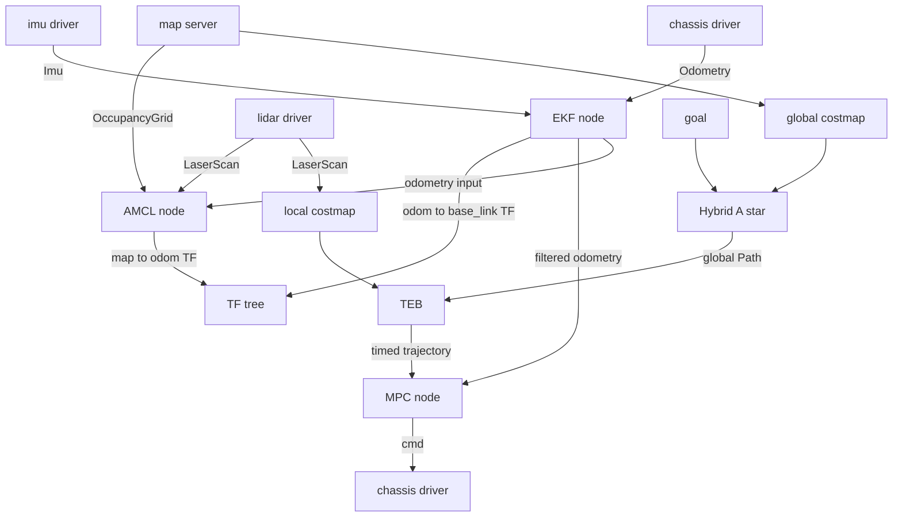

# 01 系统总览与导航栈分层

> **一句话定位**：P5 是一辆车式（Ackermann / car-like）移动机器人的"自己开到目标点"全链路——感知 → 定位 → 全局规划 → 局部规划 → 控制 → 执行。本章先把整座房子的结构图画出来：每一层输入什么、输出什么、用什么坐标系、跑多快，以及 CV 里的四条 bullet 分别落在哪一层。

**本章学完你能：**

- 画出 ROS 导航栈的六层结构，并在每一层说出"输入—输出—频率—坐标系"；
- 默写 `map → odom → base_link → sensor` 的 TF 树，并说清每一段由谁发布、为什么要拆成两段；
- 画出话题数据流图，指出哪条线上最容易出"时间/坐标/方向"不一致；
- 描述一台典型车式移动机器人的硬件组成（驱动、转向、编码器、IMU、2D 激光、上位机与下位机）；
- 把 CV 的四条 bullet（EKF/AMCL、Hybrid-A*、TEB、MPC）准确放进栈里，并解释"为什么全局、局部、控制要分三层，而不是一个算法解决"；
- 用 60 秒讲清"一趟导航是怎么走出来的"。

**前置知识：**

- 坐标系与齐次变换：[../../02_基础知识/03_坐标变换与运动学/01_坐标系_旋转矩阵_齐次变换.md](../../02_基础知识/03_坐标变换与运动学/01_坐标系_旋转矩阵_齐次变换.md)
- ROS 核心概念（节点/话题/服务）：[../../02_基础知识/09_机器人软件/04_ROS1_ROS2核心概念.md](../../02_基础知识/09_机器人软件/04_ROS1_ROS2核心概念.md)
- TF 与 URDF 实践：[../../02_基础知识/09_机器人软件/07_URDF_TF_坐标系实践.md](../../02_基础知识/09_机器人软件/07_URDF_TF_坐标系实践.md)
- 导航系统架构（move_base 与 Nav2）：[../../02_基础知识/06_规划与导航/05_导航系统架构_move_base与Nav2.md](../../02_基础知识/06_规划与导航/05_导航系统架构_move_base与Nav2.md)

**目录**

1. 先用一趟任务把全局走一遍
2. 六层导航栈：每层的输入、输出、频率
3. 坐标系与 TF 树
4. 话题数据流图
5. 典型车式移动机器人硬件
6. 为什么要分层：接口契约与职责边界
7. CV 四条 bullet 在栈中的位置
8. 延迟预算与频率设计（教学示例）
9. 两套中间件：ROS1 move_base 与 ROS2 Nav2 的对照
10. 常见错误与"一眼看出问题在哪一层"
11. 面试怎么问、怎么答
12. 本章要点速记 / 自测题 / 相关链接

---

## 1. 先用一趟任务把全局走一遍

想象小车停在房间入口，要开到桌子旁边，并且最后车头要朝着桌子。系统需要不断回答五个问题：

1. **我现在在哪里？车头朝哪？**（定位，Localization）
2. **目标在哪里？**（目标由人在地图上点击，或由上层任务给出）
3. **中间哪条路可以走？**（全局规划，Global Planning）
4. **眼前这 1–3 秒怎么走？**（局部规划，Local Planning）
5. **命令发出去后，车真的照做了吗？**（控制与执行，Control & Actuation）

数据循环可以这样记：


最后一个箭头回到传感器，是因为车一动，编码器、IMU、激光就产生新的数据——整个系统是**闭环**。闭环有两个后果，贯穿全书：

- **后果一：任何一层的小错误会被反馈放大或传播。** 比如定位位姿突然跳了 0.3 m，局部规划看到的障碍相对位置就变了，控制器看到的跟踪误差就突变，转向就会"抽一下"。这就是为什么 CV 里专门写了"handled drift and pose jumps from inconsistent timing, frames and motion direction"。
- **后果二：每一层的输出必须在下一层的"时间和坐标系"里有意义。** 同一个位姿，如果规划器认为它是 `map` 坐标系下 t 时刻的，控制器却把它当成 `odom` 坐标系下 t+0.1 s 的，就会出错。

---

## 2. 六层导航栈：每层的输入、输出、频率

下面这张表是本章的核心。**频率数值是"典型量级"，用于建立直觉，不是项目实测**；项目实测值请填入 README 的自查表。

| 层 | 输入 | 输出 | 典型频率（教学） | 主要坐标系 | 本项目对应 |
|---|---|---|---|---|---|
| 1 感知/传感器驱动 | 硬件信号 | `Imu`、`Odometry`（原始轮式里程）、`LaserScan` | IMU 100–400 Hz；编码器 20–100 Hz；激光 5–40 Hz | 各自传感器系 → `base_link` | 编码器、IMU、2D LiDAR |
| 2 定位/状态估计 | 传感器流 + 地图 | `odom→base_link`（连续）、`map→odom`（带修正） | EKF 30–50 Hz；AMCL 随激光 5–10 Hz | `odom`、`map` | EKF/AMCL |
| 3 全局规划 | 地图/全局代价地图 + 起点 + 目标位姿 | `nav_msgs/Path`（带航向的路径） | 事件触发（新目标/重规划，0.2–1 Hz） | `map` | Hybrid-A* |
| 4 局部规划 | 全局路径 + 局部代价地图 + 当前状态 | 时间参数化轨迹（位姿+速度+时间）或速度指令 | 10–20 Hz | `odom`（滚动窗口） | TEB |
| 5 控制/轨迹跟踪 | 局部轨迹 + 车辆状态 | 速度/加速度 + 前轮转角指令 | 20–50 Hz | `odom` / `base_link` | MPC |
| 6 执行/底层驱动 | 控制指令 | 电机电流/转速、舵机角度 | 100–1000 Hz（下位机） | — | 车载底层 |

### 2.1 感知层：只管"把传感器变成带时间戳、带坐标系的消息"

这一层不做"聪明"的事，只做三件事：**读数、打时间戳、标坐标系**。它的质量决定了后面所有层。典型检查项：

- 每条消息有没有 `header.stamp`（什么时候测的）和 `header.frame_id`（相对哪个坐标系）；
- 数值单位是否符合 ROS 约定（REP-103：长度 m，角度 rad，时间 s；坐标轴 x 前、y 左、z 上）；
- 噪声协方差有没有填（后面的 EKF 要靠它加权）。

详见 [03 传感器与数据质量](./03_传感器与数据质量_时间坐标与运动方向.md)。

### 2.2 定位层：回答"我在哪"，并且给出**两个**答案

这是整个栈里最容易被误解的一层。定位层同时给出两个互补的答案：

- **连续但会漂**：由编码器 + IMU 经 EKF 融合得到的 `odom → base_link`。它平滑、高频，短时间非常好用，但时间长了会累积误差（漂移）。
- **不漂但会跳**：由激光 + 地图经 AMCL 得到的 `map → base_link`（实际发布为 `map → odom`）。它对全局位置负责，不累积漂移，但每次修正会有"台阶"（位姿跳变）。

两者怎么组合、为什么这样分工，是 [06 EKF 与 AMCL 协同](./06_EKF与AMCL协同_TF分工与连续状态.md) 的主题。

### 2.3 全局规划层：在地图上画一条"能开"的大路线

输入是静态地图（加上全局代价地图里的膨胀）、起点（当前位姿）、终点（目标位姿含航向）。输出是一串带航向的路径点。对车式机器人来说，"能开"的含义远多于"没撞墙"：

- 路径上相邻点的航向变化要与曲率限制匹配（**最小转弯半径**）；
- 整个车体（矩形 footprint）而不是一个点都不能碰障碍；
- 倒车、换挡点（cusp）要被显式表示。

这就是 CV 里 Hybrid-A* 的任务，见 [08 Hybrid-A*](./08_HybridAStar全局规划.md)。

### 2.4 局部规划层：把"大路线"变成"带时间的小轨迹"

全局路径是几何曲线，没有"什么时候到哪"的信息，而且基于一张可能已经过时的地图。局部规划在车身周围的小窗口（几米）里：

- 用**实时的局部代价地图**避开新出现的障碍；
- 给轨迹加上**时间参数**（每一段花多少秒），从而得到速度、加速度；
- 在速度、加速度、转弯半径限制内，尽可能顺着全局路径、尽可能快。

输出的是**连续的位姿与曲率参考**——这正是 CV 里 TEB 的表述。见 [09 TEB](./09_TEB局部轨迹优化.md)。

### 2.5 控制层：把"想去哪"变成"现在打多少方向、给多少油"

局部轨迹是"理想的"，车是"现实的"：有延迟、有执行器限幅、有模型误差。控制器每个周期读取当前状态，计算让车贴着轨迹走的指令。MPC 的优势是**能把约束（位置、航向、速度、转角）直接写进优化问题**，并向前预测一段时间。见 [10 MPC](./10_MPC轨迹跟踪.md)。

### 2.6 执行层：协议、限幅、闭环

上位机算出的是物理量（m/s、rad 或 rad/s），下位机/驱动需要的是设备数值（电机转速、舵机脉宽、CAN 帧）。这一层通常做：单位换算、限幅、斜坡、心跳超时保护。**换算比例或符号一旦错，所有上层算法看起来都"不准"**，是联调中的头号嫌疑犯（见 [11 联调](./11_联调与故障案例.md)）。

---

## 3. 坐标系与 TF 树

### 3.1 四类坐标系，一个常用约定（REP-105）

ROS 社区约定（REP-105 / REP-103）：

| 坐标系 | 含义 | 特性 |
|---|---|---|
| `map` | 世界固定系，与地图对齐 | 长期不漂移，但位姿可能**不连续地跳** |
| `odom` | 里程系，由推算得到 | 短期**连续平滑**，长期漂移 |
| `base_link` | 固定在车体上，通常取后轴中心或车体几何中心 | 随车运动 |
| 传感器系，如 `laser_link`、`imu_link` | 固定在传感器上 | 相对 `base_link` 是**静态变换**（标定得到） |

> **注意**：`base_link` 取在哪里（后轴中心还是车体中心）是**必须全系统一致**的约定。后轴中心作为参考点时，自行车模型最简洁（见 [02 车辆运动学](./02_车辆运动学与里程计.md)）；若定位给的是车体中心而控制器假设后轴中心，就会出现与转弯半径同量级的横向偏差。

### 3.2 TF 树

```text
            map
             │   由 AMCL 发布（map→odom），可能不连续跳变
             ▼
            odom
             │   由 EKF（或里程计节点）发布，连续
             ▼
          base_link
        ┌────┼───────────┬───────────┐
        ▼    ▼           ▼           ▼
   laser_link  imu_link  (可选) base_footprint   wheel / steering 等
   （静态）    （静态）
```

要点（面试高频）：

1. **每个坐标系只能有一个父节点**，所以树里不会出现环；`map→odom→base_link` 是一条链。
2. **为什么不让 AMCL 直接发布 `map→base_link`？** 因为 `base_link` 的父已经是 `odom`（由连续的里程估计发布）。AMCL 的做法是计算
   $$T_{map\,odom}=T_{map\,base}\,\big(T_{odom\,base}\big)^{-1}$$
   然后发布 `map→odom`。这样 `map→base_link` 的查询结果等于 AMCL 的估计，同时 `odom→base_link` 依然平滑。（手算见 [06](./06_EKF与AMCL协同_TF分工与连续状态.md)）
3. **静态变换**（`base_link→laser_link`）由 URDF + `robot_state_publisher` 或 `static_transform_publisher` 发布，来自标定/测量，装反、装偏会直接带来系统性偏差。
4. **TF 带时间**：`lookupTransform(target, source, t)` 取的是 t 时刻的变换。传感器消息的时间戳与 TF 缓存对不上，就会出现 "extrapolation into the future/past" 错误或悄悄用错时刻——这是"时间不一致"的典型来源。

### 3.3 什么时候用哪个坐标系？

| 模块 | 推荐坐标系 | 理由 |
|---|---|---|
| 全局规划 | `map` | 地图本身在 `map` 下 |
| 局部代价地图（滚动窗口） | `odom` | 局部障碍不应被 `map→odom` 的跳变带着"瞬移" |
| 局部规划、控制 | `odom`（或在 `base_link` 里表达误差） | 要连续；跳变会直接变成控制突变 |
| 可视化、任务层 | `map` | 与人看的地图一致 |

这种分工是"**位姿跳变不至于传到控制层**"的第一道防线，第二道防线是对 `map→odom` 的修正做限速/门限（见 06）。

---

## 4. 话题数据流图

下面是一张典型的 ROS 话题数据流（话题名为常见命名，本项目实车的主要话题为 `/scan`、`/imu/data`、`/wheel/odom`、`/odometry/filtered`、`/amcl_pose`、`/plan`、`/teb/trajectory`、`/cmd_vel`，不使用命名空间，所有节点运行在根命名空间下）。

```text
┌────────────┐ /imu/data (Imu, 100–400Hz)  ┐
│    IMU     │────────────────────────────►│
└────────────┘                             │      ┌──────────────┐
┌────────────┐ /wheel_odom (Odometry,      │      │  EKF（融合） │ odom→base_link (TF)
│ 编码器/底盘 │──────────── 20–100Hz) ─────►├─────►│ robot_       │──► /odometry/filtered
└────────────┘                             │      │ localization │
                                           │      └──────────────┘
┌────────────┐ /scan (LaserScan, 5–40Hz)   │              │
│  2D LiDAR  │──────────────────────────┐  │              ▼
└────────────┘                          │  │      ┌──────────────┐
                                        └──┼─────►│    AMCL      │ map→odom (TF)
┌────────────┐ /map (OccupancyGrid)        │      │ (粒子滤波)   │──► /amcl_pose
│  map_server│────────────────────────────►│      └──────────────┘
└────────────┘                                            │
                                                          ▼
                       目标 /goal ─────────────►┌────────────────────┐
                                                │ 全局规划 Hybrid-A*  │──► /plan (Path, map)
                                                └────────────────────┘
                                                          │
 /scan ──► 局部代价地图(odom) ───────────────────────────┤
                                                          ▼
                                                ┌────────────────────┐
                                                │  局部规划 TEB       │──► 局部轨迹(位姿,速度,时间,曲率)
                                                └────────────────────┘
                                                          │
                                                          ▼
                                                ┌────────────────────┐
                                                │  MPC 轨迹跟踪       │──► 速度 / 转角指令
                                                └────────────────────┘
                                                          │
                                                          ▼
                                         底层驱动 → CAN/串口 → 电机 + 舵机
```

用 mermaid 画一个"节点—话题"版本（更接近 `rqt_graph` / `ros2 node info` 看到的节点图）：



**读图要点**

- 有**两条闭环**：快环（EKF，里程+IMU，几十 Hz）与慢环（AMCL，激光，几 Hz）。
- AMCL 的"里程输入"来自 TF（`odom→base_link`）而不是直接订阅，所以 EKF 的平滑程度直接决定了 AMCL 的运动模型质量。
- **MPC 同时依赖两个东西**：局部轨迹（TEB 输出）和状态（EKF/TF）。二者必须在**同一时间基准**下对齐，见 [10 MPC](./10_MPC轨迹跟踪.md) 的"参考轨迹时间对齐"。

---

## 5. 典型车式移动机器人硬件

> 以下为"典型车式平台"的通用描述，**不是**对项目实车的断言。本项目实车的具体取值（轴距 0.40 m、最大转角 30° 等）见 README 的实机细节自查表。

```text
            前 (x)
   ┌───────────────────────┐
   │  ◯ 前轮(转向)    ◯    │  ← 前轴：舵机/转向电机，Ackermann 连杆
   │         ┌───┐         │
   │         │上位│  LiDAR (车顶/车头, 2D)
   │         │机  │  IMU (靠近车体中心或后轴)
   │         └───┘         │
   │  ◯ 后轮(驱动)    ◯    │  ← 后轴：驱动电机 + 编码器（常见后驱）
   └───────────────────────┘
          轴距 L = 前后轴距离
```

| 子系统 | 典型实现 | 与算法的关系 |
|---|---|---|
| 驱动 | 直流有刷/无刷电机 + 减速箱，常见后轮驱动 | 提供纵向速度；速度环通常在下位机 |
| 转向 | 舵机（PWM）或转向电机 + Ackermann 梯形连杆 | 前轮转角 $\delta$；有最大转角、速率限制、回差 |
| 编码器 | 电机端或轮端 AB 相正交编码器；或单相霍尔 | 提供轮速/里程；是否带方向决定倒车是否正确 |
| IMU | 6 轴（陀螺+加计）或 9 轴 MEMS | 偏航角速度（z 轴陀螺）最关键 |
| 2D LiDAR | 旋转式单线激光，5–40 Hz，量程数米到数十米 | 定位（AMCL）与局部避障 |
| 上位机 | x86 / ARM 小电脑（跑 ROS） | 定位、规划、MPC |
| 下位机 | STM32 等 MCU | 速度环/转向环、编码器计数、通信看门狗 |
| 通信 | 串口 / CAN / USB | 带来延迟与丢包；协议里的数值缩放 |

**车式与差速的本质差异**（面试常问）：

- 差速底盘（如 P2 的差速底盘）可以**原地转向**，运动学是 $(v,\omega)$ 直接可控；
- 车式底盘有**最小转弯半径** $R_{min}=L/\tan\delta_{max}$，不能原地转，不能侧移，倒车时转向方向与航向变化关系取反；
- 因此车式的规划必须是"**非完整约束（nonholonomic）**"意义下的规划，这也是为什么不能用普通 A*+Pure Pursuit 草率了事，而要 Hybrid-A* 和曲率约束下的 TEB/MPC。

---

## 6. 为什么要分层：接口契约与职责边界

初学者常问：为什么不用一个"端到端"的算法，直接从地图+传感器输出方向盘角度？工程上分层的理由：

| 理由 | 说明 |
|---|---|
| **时间尺度不同** | 全局规划几百毫秒～秒，局部规划 50–100 ms，控制 20–50 ms，底层 1–10 ms。放一起，要么太慢要么太粗 |
| **信息范围不同** | 全局要整张地图；局部只要车周围几米；控制只要最近的几十个参考点。分层后每层的数据量可控 |
| **失败可隔离** | 全局规划失败（无路）不应让底层停转；局部规划失败可触发重规划/恢复行为；控制器出问题可降级为限速或停车 |
| **可替换** | 把 Hybrid-A* 换成别的全局规划器，只要仍输出 `Path`，下游不用改 |
| **可调试** | 每层有明确输入输出，可单独用 `ros2 bag` 录包回放（bag replay），二分定位问题 |

**接口契约**（每层的"承诺"）是联调的钥匙。一份清晰的契约例如：

```text
全局规划 → 局部规划 :  Path，frame=map，每点 (x,y,yaw)，相邻点间距 ≤ d，曲率 ≤ kappa_max，
                       含倒车段标记（cusp）
局部规划 → 控制    :  Trajectory，frame=odom，每点 (t,x,y,yaw,v,kappa)，t 单调递增，
                       t0 ≥ 当前时刻，yaw 已 unwrap
定位 → 其他        :  State，frame=odom/map，stamp，pose，twist，协方差，valid 标志
控制 → 执行        :  Cmd，单位 SI（m/s 或 m/s²，rad），含 stamp 以便下位机做超时保护
```

任何一条契约被悄悄破坏（例如把 yaw 归一化到 $[-\pi,\pi]$ 导致跨 $\pm\pi$ 时出现 $2\pi$ 跳变），都会在下游变成"莫名其妙的抖动"。

---

## 7. CV 四条 bullet 在栈中的位置

| CV 原文（P5） | 所在层 | 本项目文档 | 关键产出 |
|---|---|---|---|
| **EKF/AMCL localisation**: fused IMU, wheel encoders and 2D LiDAR for map-based localisation, handled drift and pose jumps from inconsistent timing, frames and motion direction, and output a continuous vehicle state | 定位层 | [03](./03_传感器与数据质量_时间坐标与运动方向.md) [04](./04_EKF融合定位.md) [05](./05_AMCL粒子滤波定位.md) [06](./06_EKF与AMCL协同_TF分工与连续状态.md) | 连续车辆状态 |
| **Hybrid-A\* global planning**: incorporated vehicle heading and kinematic constraints into the search; feasible global paths under footprint, minimum-turning-radius and obstacle-cost constraints | 全局规划层 | [07](./07_代价地图与车体外形.md) [08](./08_HybridAStar全局规划.md) | 可行全局路径 |
| **TEB local trajectory optimisation**: time-parameterised local trajectories under global-path and local-costmap constraints; continuous pose and curvature references to the controller | 局部规划层 | [09](./09_TEB局部轨迹优化.md) | 位姿+曲率参考 |
| **MPC trajectory tracking**: car-like kinematic model; receding horizon under position, heading, speed and steering constraints; closing the loop on the real vehicle | 控制层 | [10](./10_MPC轨迹跟踪.md) | 实车闭环 |

> **面试要点**：把四条串成一句话——"定位给出连续、可信的状态；Hybrid-A* 在车辆约束下给出可行大路线；TEB 把大路线在局部代价地图里优化成带时间的轨迹并输出位姿与曲率；MPC 在车式运动学模型和约束下滚动优化，把轨迹落到实车上。"

---

## 8. 延迟预算与频率设计（教学示例）

下面是一个**教学示例**（非项目实测），帮你建立"端到端延迟"的直觉。假设整条链路的各环节如下：

| 环节 | 延迟（示例） |
|---|---|
| 激光扫描周期 + 传输（10 Hz 激光） | 最大 100 ms + 20 ms |
| AMCL 处理 | 30 ms |
| EKF 周期（50 Hz） | ≤ 20 ms |
| TEB 周期（10 Hz） | ≤ 100 ms |
| MPC 求解（20 Hz） | 10–30 ms |
| 串口/CAN 传输 + 下位机周期 | 10–20 ms |
| 舵机响应（一阶惯性，时间常数示例 0.1 s） | 约 100–200 ms 才到位 |

把这些加起来，从"世界发生变化"到"车轮真正响应"，量级可以到 **0.2–0.4 s**。在 $v=1\ \mathrm{m/s}$ 时，0.3 s 意味着车已经多走了 0.3 m。所以：

- 控制器必须**知道**延迟并补偿（见 10 章"延迟补偿"），否则会振荡；
- 所有消息都必须带时间戳，用"**测量发生的时刻**"而不是"收到的时刻"；
- 提高频率不是越高越好：MPC 20 Hz 用在 EKF 50 Hz 的状态上是合理的；反过来，如果 TEB 只有 2 Hz（计算太重），控制器吃到的参考就会"阶梯式"更新，造成转向抖动。

**频率设计的两条经验规则**（典型做法）：

1. 下游频率 ≥ 上游频率：越靠近执行器越快；
2. 低频模块的输出要**能被高频模块插值/外推**（例如 TEB 的轨迹带时间，MPC 可以按当前时刻在轨迹上取点，而不是"取最新一个点"）。

---

## 9. 两套中间件：ROS1 move_base 与 ROS2 Nav2 的对照

本项目使用 ROS2 Humble（Ubuntu 22.04），导航部分对应 Nav2 体系。两套栈概念一一对应，面试时用"概念 + 两边的名字"回答最稳妥：

| 功能 | ROS1（move_base 体系） | ROS2（Nav2 体系） |
|---|---|---|
| 总调度 | `move_base`（状态机：规划 → 控制 → 恢复） | `bt_navigator`（行为树） |
| 全局规划插件 | `nav_core::BaseGlobalPlanner`（navfn、global_planner…） | `nav2_core::GlobalPlanner`（NavFn、Smac Planner，其中 Smac Hybrid-A* 就是 Hybrid-A* 的开源实现之一） |
| 局部规划/控制插件 | `nav_core::BaseLocalPlanner`（DWA、`teb_local_planner`） | `nav2_core::Controller`（DWB、MPPI、RPP、TEB 的移植等） |
| 代价地图 | `costmap_2d` | `nav2_costmap_2d` |
| 定位 | `amcl`、`robot_localization` | `nav2_amcl`、`robot_localization` |
| 地图 | `map_server` | `nav2_map_server` |
| 恢复行为 | `recovery_behaviors`（清图、原地旋转） | `behavior_server`（spin、backup、wait…） |
| TF | `tf` / `tf2` | `tf2` |

> **面试要点**：CV 写的是"算法链"，面试官更关心**你对每一块的原理和接口的理解**，而不是你用的是 ROS1 还是 ROS2。本项目实际使用的软件包为 `robot_localization`（EKF）、`nav2_amcl`、Nav2 Smac Hybrid-A*、`teb_local_planner`（ROS2 移植）以及自写的 MPC 节点，详见 README 自查表；本套文档讲的是这些公开软件包的**公认机制**。

另外，在 `move_base` 体系里，`teb_local_planner` 同时承担"局部规划 + 输出 cmd_vel"。CV 描述的是 TEB 输出"连续位姿与曲率参考给控制器"、再由 MPC 跟踪，所以本项目里 TEB 的角色更像"**局部轨迹生成器**"，MPC 才是"**最终指令生成器**"。`teb_local_planner` 公开提供轨迹反馈话题（带 `time_from_start` 的位姿与速度），这是常见的取轨迹方式之一；本项目的做法是：TEB 以 10 Hz 发布带 `time_from_start` 的轨迹消息，MPC 节点订阅最新一条，按自己的预测时刻重采样（详见 [09 章](./09_TEB局部轨迹优化.md) 与 [10 章](./10_MPC轨迹跟踪.md)）。

---

## 10. 常见错误与"一眼看出问题在哪一层"

| 现象 | 最可能的层 | 第一步检查 |
|---|---|---|
| RViz 里车模型在地图里"瞬移"一下 | 定位（AMCL 修正/重复 TF 发布者） | `ros2 run tf2_ros tf2_echo map odom` 看是否出现阶跃；`view_frames` 或 `rqt_tf_tree` 看父节点是否冲突 |
| 车沿直线开却慢慢拐弯 | 感知/里程计（轮径、转向零位、IMU 偏置） | 直线 5–10 m 实验：看 odom 的 y/yaw 漂移 |
| 倒车时位置往奇怪方向漂 | 感知/里程计（速度符号、转向符号） | 倒车直线实验，看 `twist.linear.x` 符号与实际 |
| 路径穿墙 | 全局代价地图/坐标系/分辨率 | 对比 `/map` 与 `global_costmap` 的 origin、resolution、frame |
| 局部轨迹左右摇摆 | 局部规划（同伦类切换、障碍噪声） | 看 TEB 可视化；放慢障碍更新或加滞回 |
| 车对着轨迹"画蛇" | 控制（权重、延迟、状态噪声） | 看状态是否抖；看 MPC 求解是否失败 |
| 所有层都"差一点" | 时间戳/静态变换 | 检查 `stamp` 来源；检查 `base_link→laser_link` |

**调试金句**："先看数据（频率、时间戳、坐标系、符号），再看算法。" 大多数联调故障不是算法错了，而是**接口两侧的约定不一致**。完整案例见 [11 联调与故障案例](./11_联调与故障案例.md)。

---

## 11. 面试怎么问、怎么答

**Q1. Walk me through your navigation stack.**

> I worked on a car-like robot. The stack has four main parts. First, localisation: I fused wheel encoders, an IMU and a 2D LiDAR with EKF and AMCL to get a continuous vehicle state. Second, global planning with Hybrid A-star, which respects heading, the footprint and the minimum turning radius. Third, TEB for local trajectory optimisation, which gives a time-parameterised trajectory with pose and curvature. Finally, an MPC controller that tracks that trajectory on the real vehicle.

（中文要点：定位 → 全局 Hybrid-A* → 局部 TEB → MPC 跟踪，按栈的顺序讲。）

*追问方向*：你在其中最主要负责哪一块？哪两层之间的接口最容易出问题？答案方向：接口最容易出问题的是定位与控制/规划之间的**时间与坐标系约定**。

**Q2. Why do you need both an odom frame and a map frame?**

> The odom frame is continuous but drifts; the map frame is globally consistent but can jump when the localiser corrects itself. The local planner and controller work in the odom frame so they see a smooth world, and the global planner works in the map frame. The transform between them absorbs the correction.

（中文要点：odom 连续会漂；map 不漂会跳；局部/控制用 odom，全局用 map，`map→odom` 吸收修正。）

*追问*：谁发布 `map→odom`？—— AMCL（或融合后的全局位姿节点）；`odom→base_link` 由 EKF 发布。

**Q3. Why is a car-like robot harder to plan for than a differential-drive robot?**

> A differential-drive robot can rotate in place, so heading is almost free. A car-like robot has a minimum turning radius and cannot move sideways, so the planner must search in position and heading together and respect curvature limits. That is why plain grid A-star is not enough and I used Hybrid A-star.

（中文要点：车式有最小转弯半径，不能原地转/侧移，必须在 $(x,y,\theta)$ 里搜索并满足曲率约束。）

---

## 12. 本章要点速记 / 自测题 / 相关链接

### 本章要点速记

1. 导航栈六层：感知 → 定位 → 全局规划 → 局部规划 → 控制 → 执行；越靠近执行器频率越高。
2. TF 链 `map→odom→base_link→sensor`：`odom→base_link` 连续会漂（EKF），`map→odom` 不漂会跳（AMCL）。
3. 局部规划、控制放在 `odom` 系，是把定位跳变挡在控制之外的第一道防线。
4. 每个坐标系只有一个父，AMCL 发布 `map→odom = T_map_base · T_odom_base⁻¹`。
5. 车式底盘有最小转弯半径 $R_{min}=L/\tan\delta_{max}$，不能原地转、不能侧移，决定了规划与控制的形式。
6. 联调故障大多是"接口两侧约定不一致"：时间戳、坐标系、符号（方向）、单位。
7. 全链路延迟量级可达 0.2–0.4 s，控制器必须对延迟有意识（补偿）。
8. CV 的四条 bullet 恰好是栈里的定位、全局、局部、控制四层。

### 自测题

1. 为什么 `map→base_link` 不直接由 AMCL 发布，而是 AMCL 发布 `map→odom`？（提示：每个坐标系只有一个父；要保持 `odom→base_link` 平滑。）
2. 局部代价地图为什么放在 `odom` 系的滚动窗口里，而不是 `map` 系？
3. 一个 TEB 以 2 Hz 更新、MPC 以 20 Hz 运行，可能出现什么问题？如何缓解？（提示：参考轨迹带时间，按当前时刻插值取点。）
4. 写出车式底盘与差速底盘在可控自由度上的差异，并说明对规划的影响。
5. 举出三种"接口两侧约定不一致"的例子，并说出各自在 RViz/日志里的症状。

**参考要点**：1）见 3.2；2）局部障碍不应随 `map→odom` 跳变而瞬移，且滚动窗口节省计算；3）参考阶梯式更新，转向抖动；缓解：按时间插值、热启动、降低计算量；4）车式有最小半径、非完整约束，须在 $(x,y,\theta)$ 空间搜索并限曲率；5）如时间戳取到达时刻（模糊/鬼影障碍）、`base_link` 取点不一致（弯道横向偏差）、倒车速度符号丢失（倒车漂移）。

### 相关链接

- 下一章：[02 车辆运动学与里程计](./02_车辆运动学与里程计.md)
- 总入口：[README](./README.md)
- 基础：[../../02_基础知识/06_规划与导航/05_导航系统架构_move_base与Nav2.md](../../02_基础知识/06_规划与导航/05_导航系统架构_move_base与Nav2.md)
- 相关项目（时间戳/坐标系/有效性检查的另一视角）：[../P6_深开鸿M-Robots平台软件/README.md](../P6_深开鸿M-Robots平台软件/README.md)
- 相关项目（差速底盘与里程计）：[../P2_未来动力双臂遥操作与差速底盘/README.md](../P2_未来动力双臂遥操作与差速底盘/README.md)
