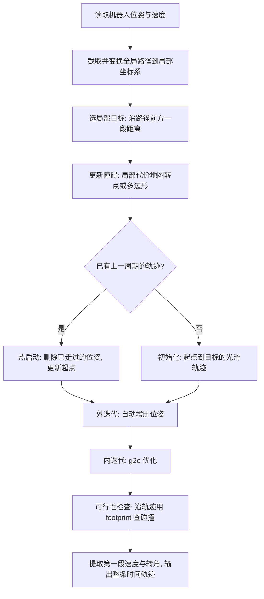

# 09 TEB 局部轨迹优化

> **一句话定位**：TEB（Timed Elastic Band，时间弹性带）把局部轨迹看成一串**带时间间隔的位姿**，像一根橡皮筋：起点和终点（目标）被固定住，障碍把它推开，全局路径把它拉回来，速度/加速度/运动学约束把它"捋顺"，时间项让它尽量快。优化完以后，每个位姿都带着时间、速度和曲率——这就是 CV 里 *continuous pose and curvature references to the controller*。

**本章学完你能：**

- 讲清 TEB 的整体流程：初始化 → 约束/目标 → 优化 → 可行性检查 → 输出 → 下一周期热启动；
- 写出 TEB 的变量（位姿 + 时间间隔）和各目标项：路径跟随、障碍、速度、加速度、运动学（非完整 + 最小转弯半径）、时间最优；
- 解释 g2o 超图优化：顶点、边、稀疏性、Levenberg-Marquardt；
- **手算**：一个变量的高斯—牛顿步（障碍项 vs 路径项的权重折中）、非完整约束残差、速度惩罚的平衡点、加速度、输出速度/曲率/转角；
- 回答笔记里的问题：绕开障碍的"点"怎么选、轨迹点的航向是谁定的、TEB 输出 P0…P4 要怎么理解；
- 解释同伦类（homotopy class）规划与局部极小；
- 对比 DWA，说出 TEB 与 MPC 的分工；
- 列出常见参数和失效模式（震荡、贴墙、不遵守转弯半径）。

**前置知识：**

- 代价地图与局部规划（基础）：[../../02_基础知识/08_规划与导航/03_代价地图_局部规划_TEB.md](../../02_基础知识/08_规划与导航/03_代价地图_局部规划_TEB.md)
- 最优化基础：[../../02_基础知识/01_数学基础/04_最优化与二次规划.md](../../02_基础知识/01_数学基础/04_最优化与二次规划.md)
- 本项目：[02 运动学](./02_车辆运动学与里程计.md)、[07 代价地图](./07_代价地图与车体外形.md)、[08 Hybrid-A*](./08_HybridAStar全局规划.md)

**目录**

1. 为什么需要局部规划
2. 从弹性带到时间弹性带
3. 变量与表示
4. 目标函数各项
5. 手算 1：障碍项与路径项的折中（高斯—牛顿一步）
6. 手算 2：非完整运动学残差
7. 手算 3：时间、速度、加速度
8. g2o 超图优化
9. 整体流程：一个控制周期里发生了什么
10. 完整例子：绕过一个障碍的 5 个位姿
11. 输出：速度、转角、曲率与给控制器的参考
12. 同伦类规划与震荡
13. 与 DWA 的对比；为什么 TEB 之后还要 MPC
14. 参数速查与调参
15. 失效模式与故障现象
16. 在 ROS2 里怎么跑 TEB：形态、话题与周期
17. 面试问答 / 要点速记 / 自测题 / 链接

---

## 1. 为什么需要局部规划

[08 章](./08_HybridAStar全局规划.md)的全局路径有三个局限：

1. **基于静态地图**：新出现的障碍（行人、箱子）它不知道；
2. **只有几何，没有时间**：没有"几秒到哪里""多快"的信息，没有加速度；
3. **更新慢**：全局规划计算量大，只能低频触发。

局部规划要在车周围几米的范围内、以 10–20 Hz 的频率，利用**实时局部代价地图**，把全局路径"改造"成一条：避开新障碍、满足速度/加速度/曲率限制、带时间的轨迹。

---

## 2. 从弹性带到时间弹性带

**弹性带（Elastic Band，Quinlan & Khatib，1993）**：路径是一串点，点之间有"内力"（让路径收缩变短），障碍给"外力"（把路径推开）。只有几何，没有时间，也不处理非完整约束。

**时间弹性带（Rösmann 等人，2012–2013 年的会议论文）**：在每两个相邻位姿之间加入**时间间隔** $\Delta T_i$，这样速度、加速度可以直接由位姿和时间差计算；并把运动学约束、速度/加速度限制、时间最优都写成目标函数中的项，用大规模稀疏非线性优化求解。（具体页码和细节未核对；面试可口头说 "Rösmann et al.'s TEB from TU Dortmund"。）

---

## 3. 变量与表示

一条 TEB 轨迹：
$$B=\{\mathbf s_0,\Delta T_0,\mathbf s_1,\Delta T_1,\ldots,\Delta T_{n-1},\mathbf s_n\},\qquad \mathbf s_i=(x_i,y_i,\beta_i).$$

| 符号 | 含义 | 单位 |
|---|---|---|
| $\mathbf s_i$ | 第 $i$ 个位姿（位置 + 航向 $\beta_i$） | m, m, rad |
| $\Delta T_i$ | 从 $\mathbf s_i$ 到 $\mathbf s_{i+1}$ 的时间间隔 | s |
| $n+1$ | 位姿数量（受 `min_samples`/`max_samples` 约束） | |

**起点 $\mathbf s_0$ 是当前机器人位姿，终点 $\mathbf s_n$ 是局部目标**（全局路径上前方一段距离处的点）。两者被作为"固定"（强约束的边）。**中间的位姿和所有时间间隔是优化变量。**

由变量推出的量：
$$\mathbf d_i=\begin{bmatrix}x_{i+1}-x_i\\y_{i+1}-y_i\end{bmatrix},\quad v_i\approx\frac{\|\mathbf d_i\|}{\Delta T_i},\quad \omega_i=\frac{\beta_{i+1}-\beta_i}{\Delta T_i},\quad a_i=\frac{2(v_{i+1}-v_i)}{\Delta T_i+\Delta T_{i+1}}.$$

速度符号：若 $\mathbf d_i$ 与航向 $\beta_i$ 的夹角超过 90°（点积为负），则该段是**倒车**，$v_i$ 取负。

---

## 4. 目标函数各项

优化问题：
$$B^*=\arg\min_B\ \sum_k\gamma_k\,f_k(B)^2\quad\text{（在 TEB 中，各项是带权重 }\gamma_k\text{ 的平方惩罚）}.$$

约束被写成**惩罚函数**（软约束）：对一个量 $x$ 与上界 $x_{max}$、安全裕度 $\varepsilon$：
$$f_{pen}(x)=\max\big(0,\ x-(x_{max}-\varepsilon)\big),$$
越过"上界减裕度"后开始产生惩罚，惩罚值平方进入目标。

| 项 | 含义 | 残差（示意） | 对应参数（`teb_local_planner`） |
|---|---|---|---|
| 终点/起点 | 起点 = 当前位姿，终点 = 局部目标 | $\mathbf s_0-\mathbf s_{start}$，$\mathbf s_n-\mathbf s_{goal}$ | 固定顶点 |
| **路径跟随 / via-point** | 轨迹靠近全局路径上的"途经点" | $\mathrm{dist}(\mathbf s_i,\mathbf v_j)$ | `global_plan_viapoint_sep`、`weight_viapoint` |
| **障碍** | 位姿到障碍的距离不小于 `min_obstacle_dist` | $f_{pen}$ 作用于 $-\mathrm{dist}$ | `min_obstacle_dist`、`inflation_dist`、`weight_obstacle`、`weight_inflation` |
| **速度限制** | $|v_i|\le v_{max}$，$|\omega_i|\le\omega_{max}$ | $f_{pen}(v_i)$ 等 | `max_vel_x`、`max_vel_x_backwards`、`max_vel_theta`、`weight_max_vel_x` |
| **加速度限制** | $|a_i|\le a_{max}$ | $f_{pen}(a_i)$ | `acc_lim_x`、`acc_lim_theta`、`weight_acc_lim_x` |
| **非完整运动学** | 相邻位姿在同一圆弧上（不能侧移） | 见第 6 节 | `weight_kinematics_nh` |
| **前向偏好** | 倾向前进 | | `weight_kinematics_forward_drive` |
| **最小转弯半径** | $|\kappa_i|\le1/R_{min}$ | $f_{pen}(|\Delta\beta_i|/\|\mathbf d_i\|)$ | `min_turning_radius`、`weight_kinematics_turning_radius` |
| **时间最优** | $\left(\sum\Delta T_i\right)^2$ 越小越好 | | `weight_optimaltime` |
| **最短路径**（可选） | $\sum\|\mathbf d_i\|$ | | `weight_shortest_path` |

对车式机器人，参数里还有 `wheelbase` 和 `cmd_angle_instead_rotvel`（把输出的角速度转换成前轮转角）。

**权重（$\gamma$）就是"各项谁更重要"**：障碍权重大 → 保守，容易绕大圈；时间权重大 → 激进，贴着速度上限；路径权重大 → 紧贴全局路径。调参的本质就是调这些权重的比例。

---

## 5. 手算 1：障碍项与路径项的折中（高斯—牛顿一步）

这个例子回答你笔记里的"**TEB 怎么选绕开障碍的点，有什么标准**"：标准不是一个"if 撞了就绕"的规则，而是**目标函数里障碍惩罚与其他项的权重平衡**，优化器沿"总代价下降最快"的方向移动位姿。

**设定（教学数值）**：起点 $(0,0)$、终点 $(6,0)$，只考虑中间位姿的横向偏移 $y$（$x=3$ 固定）。全局路径是 $y=0$ 直线。障碍在 $(3,\ 0.1)$ 附近，要求最小距离 $d_{min}=1.0$。

- 路径项（把位姿拉向全局路径）：$r_1=y$，权重 $w_1=1$；
- 障碍项：距离 $d=|y-0.1|$；当 $d<d_{min}$ 时 $r_2=d_{min}-d$，权重 $w_2=10$。
 因为初始 $y=0<0.1$，障碍在**左边**，$d=0.1-y$，所以 $r_2=1-(0.1-y)=0.9+y$。

总代价 $J(y)=w_1y^2+w_2(0.9+y)^2$。

**高斯—牛顿一步**：残差向量 $\mathbf r=[\sqrt{w_1}\,y;\ \sqrt{w_2}(0.9+y)]$，雅可比 $J=[\sqrt{w_1};\ \sqrt{w_2}]$ 与 $y$ 无关（残差对 $y$ 是线性的），所以一步就收敛：
$$\Delta y=-\frac{w_1y+w_2(0.9+y)}{w_1+w_2}\Big|_{y=0}=-\frac{10\times0.9}{11}=-0.818.$$

结果：$y^*=-0.818$（往右让开），此时到障碍的距离 $d=|-0.818-0.1|=0.918$，距离要求 1.0，**还差 0.082**。

**权重的影响**（同一问题，只改 $w_2$）：

| $w_2$ | $y^*=-0.9w_2/(1+w_2)$ | 实际距离 $d=0.1-y^*$ | 违反量 |
|---|---|---|---|
| 1 | −0.450 | 0.550 | 0.450 |
| 10 | −0.818 | 0.918 | 0.082 |
| 100 | −0.891 | 0.991 | 0.009 |

**结论**：

1. 位姿往哪边让由**当前它相对障碍的位置**决定（梯度方向 = 远离障碍的方向）：它初始就在障碍右边（$y<0.1$），所以向右；
2. 软约束总是有少量违反；权重越大违反越小，但同时对其他项（路径、时间）更不敏感，容易出现硬拉导致的数值震荡；
3. 因此**重要的安全距离要在配置里留余量**：`min_obstacle_dist` 设比真实需要大一点，避免"软约束被违反一点点"就擦碰。

---

## 6. 手算 2：非完整运动学残差

**问题**：怎么告诉优化器"车不能侧移，相邻两个位姿要能被一段圆弧连起来"？

**几何事实**：一段圆弧的两个端点，其切线方向与弦的夹角大小相等、方向对称。即弦方向是两端航向的平分线：
$$\varphi_i=\mathrm{atan2}(\Delta y,\Delta x)=\frac{\beta_i+\beta_{i+1}}{2}.$$

TEB 把它写成不含 $\arctan$ 的向量叉积形式（避免角度环绕问题）：
$$\begin{bmatrix}\cos\beta_i\\\sin\beta_i\\0\end{bmatrix}\times\mathbf d_{i,i+1}=\mathbf d_{i,i+1}\times\begin{bmatrix}\cos\beta_{i+1}\\\sin\beta_{i+1}\\0\end{bmatrix}.$$
平面内取 $z$ 分量：残差
$$e_{nh}=\underbrace{(\cos\beta_i\,\Delta y-\sin\beta_i\,\Delta x)}_{u_i\times d}-\underbrace{(\Delta x\sin\beta_{i+1}-\Delta y\cos\beta_{i+1})}_{d\times u_{i+1}}.$$

> **示例手算**：$\mathbf s_0=(0,0,0^\circ)$，$\mathbf s_1=(1.5,0.45,\beta_1)$，$\mathbf d=(1.5,0.45)$。
> - 弦方向 $\varphi=\arctan(0.45/1.5)=16.70^\circ$；理想圆弧要求 $\beta_1=2\varphi-\beta_0=33.4^\circ$。
> - 若 $\beta_1=33.4^\circ$：第一项 $=\cos0\times0.45-\sin0\times1.5=0.45$；第二项 $=1.5\sin33.4^\circ-0.45\cos33.4^\circ=1.5\times0.5505-0.45\times0.8348=0.8258-0.3757=0.4501$。残差 $=0.45-0.4501\approx0$ ✓。
> - 若 $\beta_1=25.3^\circ$：第二项 $=1.5\times0.4274-0.45\times0.9041=0.6411-0.4068=0.2343$，残差 $=0.45-0.2343=0.2157$——不为零，优化器会把 $\beta_1$ 往 33.4° 方向调。

**这回答了你笔记里的另一个问题——"局部路径的点的车头方向是 TEB 自己定的吗，依据是什么？"** 是的：每个位姿的航向 $\beta_i$ 也是优化变量。初始值通常取全局路径的切线方向；优化时由非完整约束把它和相邻位置绑在一起（航向必须和弦方向对称），再由终点航向约束、曲率限制共同决定。

**最小转弯半径**：弧的曲率 $\kappa_i=\dfrac{|\beta_{i+1}-\beta_i|}{\|\mathbf d_i\|}$ 近似为转角除以弦长。要求 $\kappa_i\le1/R_{min}$，越界就产生惩罚（`weight_kinematics_turning_radius`）。这是**软约束**：若权重不够大，可能被违反，造成"轨迹要求的转弯比车能做的更急"，控制器跟不上——这是实车上常见的问题。

---

## 7. 手算 3：时间、速度、加速度

### 7.1 速度惩罚与时间最优的平衡点

一段弦长 $d=1.5\ \mathrm m$，$v_{max}=1.0\ \mathrm{m/s}$。变量只有 $\Delta T$。时间项 $w_t\Delta T^2$（$w_t=1$），速度惩罚 $w_v\big(\max(0,d/\Delta T-v_{max})\big)^2$（$w_v=100$）。

- $\Delta T=1.5$：$v=1.0$，惩罚 0，时间项 2.25；
- $\Delta T=1.4$：$v=1.0714$，超出 0.0714，惩罚 $100\times0.0051=0.51$，时间项 1.96（节省 0.29 < 惩罚 0.51），更差；
- 令导数为 0：$2\Delta T-200\Big(\frac d{\Delta T}-v_{max}\Big)\frac d{\Delta T^2}=0$，数值解 $\Delta T\approx1.469$ s，对应 $v=1.021\ \mathrm{m/s}$，**超出上限约 2%**。

**结论**：时间最优项会把速度顶向上限，惩罚式的上限是"软"的，会略微越界；$w_v$ 越大越接近硬上限。**所以实车配置里 `max_vel_x` 要比硬件允许的最大速度留余量。**

### 7.2 加速度

三个位姿沿 $x$ 轴：$x=0,\ 0.25,\ 0.75$，$\Delta T=0.5,\ 0.5$。$v_0=0.25/0.5=0.5$，$v_1=0.5/0.5=1.0$，
$$a=\frac{2(v_1-v_0)}{\Delta T_0+\Delta T_1}=\frac{2\times0.5}{1.0}=1.0\ \mathrm{m/s^2}.$$
若 $a_{max}=0.5$，超出的部分会产生惩罚，优化器会拉大 $\Delta T$ 或调整位置，使速度变化更平缓。

---

## 8. g2o 超图优化

### 8.1 问题形式

TEB 的所有目标项，都可以写成 $\|\mathbf e_k(\mathbf x_{k})\|^2_{\Omega_k}$，其中 $\mathbf x_k$ 只涉及**少数几个变量**（例如障碍项只和一个位姿有关；速度项和两个相邻位姿 + 一个时间间隔有关；加速度项和三个相邻位姿 + 两个时间间隔有关）。整体：
$$\min_{\mathbf x}\ \sum_k\mathbf e_k^\top\Omega_k\mathbf e_k.$$

### 8.2 超图

g2o（General Graph Optimization）把问题画成图：

- **顶点（vertex）**：优化变量——位姿顶点（$x,y,\beta$）、时间间隔顶点（$\Delta T$）；
- **边（edge）**：一项残差，**可以连接多个顶点（超边）**——速度边、加速度边、运动学边、障碍边（连一个位姿 + 一个障碍）。

```text
  s0 ──ΔT0── s1 ──ΔT1── s2 ──ΔT2── s3 ...
  │ 位姿顶点 ○       时间顶点 □
  障碍边: ○─(障碍)        速度边: ○ □ ○        加速度边: ○ □ ○ □ ○
```

### 8.3 求解（高斯—牛顿 / Levenberg-Marquardt）

线性化残差 $\mathbf e(\mathbf x+\Delta\mathbf x)\approx\mathbf e+J\Delta\mathbf x$，得到正规方程
$$(J^\top\Omega J+\lambda I)\,\Delta\mathbf x=-J^\top\Omega\,\mathbf e,$$
$\lambda$ 是 LM 阻尼：$\lambda$ 大偏向梯度下降（稳），$\lambda$ 小偏向高斯—牛顿（快）。**$J^\top\Omega J$ 是稀疏的**（只有相邻变量之间有非零块，近似带状），所以可用稀疏 Cholesky（CSparse/CHOLMOD）高效求解，使一次迭代耗时与轨迹长度近似线性。这也是 TEB 能在 10–20 Hz 在线运行的原因。

### 8.4 内外迭代

- **外迭代**（`no_outer_iterations`）：每次外迭代开始前，**自动调整轨迹分辨率**——若某个 $\Delta T_i>\Delta T_{ref}+$ 滞回，则在中间插入新位姿；若 $<\Delta T_{ref}-$ 滞回，则删除一个位姿（`dt_ref`、`dt_hysteresis`），并更新障碍关联；
- **内迭代**（`no_inner_iterations`）：在固定的图结构上，做若干次高斯—牛顿/LM 迭代；
- 每个控制周期只做少量迭代（常见几次到十几次），靠"热启动"（继承上一周期结果）逐步收敛。

---

## 9. 整体流程：一个控制周期里发生了什么



要点：

1. **局部目标**：沿全局路径向前找一个点，距离受 `max_global_plan_lookahead_dist` 限制；
2. **全局路径的利用**：路径上每隔 `global_plan_viapoint_sep` 取一个途经点，作为路径跟随项的"磁铁"；`global_plan_overwrite_orientation` 控制是否用路径切线重写航向；
3. **障碍来源**：局部代价地图的占据格（可经 `costmap_converter` 转成点/线/多边形），加上动态障碍（带速度的）和自定义障碍；`obstacle_poses_affected` 控制每个障碍影响轨迹上多少个邻近位姿；
4. **初始化与重初始化**：目标变化超过 `force_reinit_new_goal_dist` 时，丢弃旧轨迹重新初始化；`allow_init_with_backwards_motion` 决定当目标在车后方时是否用倒车初始化；
5. **可行性检查**：`feasibility_check_no_poses` 个位姿上用 footprint 检查是否撞障碍；不可行 → 本周期失败，触发恢复行为或重新规划。

---

## 10. 完整例子：绕过一个障碍的 5 个位姿

回答你笔记里："如果输出点是 P0(0,0,0°) → P1(1.5,0.45,25.3°) → …，我是不是先把车头偏到 25.3° 再往 (1.5, 0.45) 走？"

**答案：不是"先转再走"。** 位姿的航向是**到达该位姿时车头应有的朝向**；车是沿着一段弧线从 P0 开到 P1，一边走一边转。

下面给一个运动学自洽的例子（教学数值）。**场景**：起点 $(0,0,0^\circ)$，目标 $(6,0,0^\circ)$，前方 $x=3$ 附近有障碍，TEB 把中间点向侧面推开。优化后的 5 个位姿（每段弦长 $\sqrt{1.5^2+0.45^2}=1.566$ m，$v\approx1.0$ m/s，$\Delta T\approx1.57$ s）：

| i | $x_i$ | $y_i$ | $\beta_i$ | 备注 |
|---|---|---|---|---|
| 0 | 0.0 | 0.00 | 0° | 当前位姿（固定） |
| 1 | 1.5 | 0.45 | 33.4° | |
| 2 | 3.0 | 0.90 | 0° | 侧向偏移最大处（绕过障碍） |
| 3 | 4.5 | 0.45 | −33.4° | |
| 4 | 6.0 | 0.00 | 0° | 目标（固定） |

**自洽性检验**（弦方向 = 两端航向平分线）：P0→P1 弦 $16.7^\circ=(0+33.4)/2$ ✓；P1→P2 弦 $16.7^\circ=(33.4+0)/2$ ✓；P2→P3 弦 $-16.7^\circ=(0-33.4)/2$ ✓；P3→P4 弦 $-16.7^\circ=(-33.4+0)/2$ ✓。每段都是一段圆弧，一个"S 形"。

**每段圆弧的半径**：转角 $\Delta\beta=33.4^\circ=0.583\ \mathrm{rad}$，弦长 1.566，$R=\dfrac{1.566}{2\sin(16.7^\circ)}=\dfrac{1.566}{2\times0.2874}=2.72$ m，曲率 $0.367\ \mathrm{m^{-1}}$，远小于示例 $\kappa_{max}=1.155$，可行。

**车实际怎么走**：从 P0 开始，前轮向左打一点，沿半径 2.72 m 的弧向左前方走 1.57 s，到达 P1 时车头已转到 33.4°；然后向右打，航向回到 0° 到达 P2（此时位置在最高点）；对称地回到 y=0 并摆正车头到达 P4。

**TEB 的输出是整条轨迹，但每个周期只执行第一小段**（或把整条轨迹交给 MPC）。下一周期，起点更新到车的新位置，障碍可能变化，轨迹重新优化——这就是"滚动"。

---

## 11. 输出：速度、转角、曲率与给控制器的参考

### 11.1 第一段的指令（TEB 自带输出）

取 P0→P1：
- 线速度 $v\approx\dfrac{\|\mathbf d_0\|}{\Delta T_0}=\dfrac{1.566}{1.57}=0.997\ \mathrm{m/s}$；
- 角速度 $\omega=\dfrac{\Delta\beta}{\Delta T_0}=\dfrac{0.583}{1.57}=0.371\ \mathrm{rad/s}$；
- 曲率 $\kappa=\omega/v=0.372\ \mathrm{m^{-1}}$（≈ $1/R=0.367$，差别来自弦长/弧长近似）；
- 车式转角：$\delta=\arctan(L\kappa)=\arctan(0.5\times0.372)=10.5^\circ$（`cmd_angle_instead_rotvel` 即做此转换；$L=0.5$ 为示例）。

### 11.2 给 MPC 的参考（CV 所述）

整条轨迹每个位姿 $i$ 对应：
$$\Big(t_i,\ x_i,\ y_i,\ \beta_i,\ v_i,\ \omega_i,\ \kappa_i\Big),\qquad t_i=\sum_{j<i}\Delta T_j.$$

`teb_local_planner` 提供了带 `time_from_start` 的轨迹反馈消息等取法，本项目中 MPC 节点订阅 TEB 的轨迹消息（约 10 Hz），取最新一条，用 `time_from_start` 对齐到自己的预测时刻。MPC 用这些点作为参考（见 [10 章](./10_MPC轨迹跟踪.md)），前馈使用 $\kappa_i$ 与 $v_i$。

### 11.3 接口契约（为避免联调坑）

- 坐标系：`odom`；时间：$t_i$ 单调递增，相对**生成这条轨迹的时刻**（需要换算成绝对时间戳）；
- 航向：已展开（unwrap），不出现 $\pm\pi$ 跳变；
- 倒车段：$v_i<0$，航向仍是车头方向；
- 有效性：轨迹生成时刻、可行标志、是否用了倒车初始化；
- 频率：若 TEB 周期 100 ms，MPC 周期 50 ms，则 MPC 的相邻两个周期可能看到同一条轨迹——要按时间戳插值，不要"取最新一个点"。

---

## 12. 同伦类规划与震荡

### 12.1 局部极小

TEB 是**局部**优化。障碍在路径正前方时，轨迹可以从左边绕，也可以从右边绕，这是两个不同的**同伦类**（homotopy class）：它们之间无法在不穿过障碍的情况下连续变形。优化器只能找到初始轨迹所在同伦类的局部最优。第 5 节的例子里，若障碍中心恰在路径上，左右对称，一次小扰动就决定往哪边走。

### 12.2 同伦类规划（HCP）

`enable_homotopy_class_planning`：

1. 在起终点之间采样一张图（`roadmap_graph_no_samples`），找出若干条拓扑不同的初始路径；
2. 用 **H-signature**（一个复数不变量）区分它们（`h_signature_prescaler`、`h_signature_threshold`）；
3. 为每条路径各优化一条 TEB（可多线程 `enable_multithreading`）；
4. 按总代价选最优（`max_number_classes` 限制数量）。

### 12.3 震荡的根源与处理

两个同伦类代价接近时，噪声使选择在左右之间来回切换，车就左右"画蛇"。缓解：

- `selection_cost_hysteresis`：新候选必须比当前轨迹好一定比例才切换；
- `selection_obst_cost_scale`、`selection_viapoint_cost_scale`：选择时的评分权重；
- `switching_blocking_period`：切换后一段时间内禁止再切；
- `oscillation_recovery`：检测到震荡后限制行为；
- 平滑障碍输入，避免障碍点跳动。

---

## 13. 与 DWA 的对比；为什么 TEB 之后还要 MPC

### 13.1 DWA（Dynamic Window Approach）简述

DWA 在速度空间 $(v,\omega)$ 采样：只考虑"在接下来一个控制周期内，加速度限制下可达到的速度窗口"。

> **示例**：当前 $v=0.5,\ \omega=0$；$a_{max}=0.5\ \mathrm{m/s^2}$，$\alpha_{max}=1.0\ \mathrm{rad/s^2}$，$\Delta t=0.2$ s。窗口 $v\in[0.4,0.6]$，$\omega\in[-0.2,0.2]$。在窗口里取网格（如 5×9 组），对每组 $(v,\omega)$ 用恒速前向仿真 1–2 s，得到弧线；评分函数通常 $=\alpha\cdot\text{朝向目标}+\beta\cdot\text{离障碍距离}+\gamma\cdot\text{速度}$；选最高分的一组。

### 13.2 对比

| 项 | DWA | TEB |
|---|---|---|
| 搜索空间 | 速度 $(v,\omega)$ 采样 | 位姿 + 时间间隔的连续优化 |
| 轨迹形态 | 每条候选是一段恒速弧 | 任意形状的时间参数化曲线 |
| 预测时域 | 短（1–2 s），固定速度 | 整条局部轨迹，速度随时间变化 |
| 运动学约束 | 采样时直接限制（差速友好） | 用惩罚项表达，可包含最小转弯半径、倒车 |
| 全局路径利用 | 评分项 | via-point 引力项 |
| 局部极小 | 易陷入 | HCP 可跳出 |
| 计算 | 轻 | 较重（稀疏优化） |
| 适合 | 差速、简单场景 | 车式（Ackermann）、狭窄、需要平滑轨迹 |

### 13.3 为什么 TEB 之后再接 MPC（典型理由；本项目的具体考虑如下）

- TEB 解决"**走哪条、什么时候到**"（带障碍的轨迹生成）；MPC 解决"**怎么把车开上去**"（考虑车辆模型、执行器限幅、延迟的闭环跟踪）；
- TEB 自带的输出（取第一段 $v,\omega$）是**开环式**的：没有对车辆响应和延迟的显式预测；
- MPC 可以把车辆的位置、航向、速度、转角约束**同时**放进一个滚动优化问题，并向前预测，使跟踪更平顺；
- 职责分离，便于单独调试：TEB 轨迹好不好看（RViz），MPC 跟得好不好（误差曲线）。

---

## 14. 参数速查与调参

以下为 ROS `teb_local_planner` 的参数名，本项目取值约：`min_obstacle_dist` 0.30 m、`inflation_dist` 0.50 m、`weight_obstacle` 50、`weight_kinematics_nh` 1000、`weight_kinematics_forward_drive` 1、`weight_optimaltime` 1、`min_turning_radius` 0.80 m（`cmd_angle_instead_rotvel: true`）、`max_vel_x` 1.0 m/s、`max_vel_x_backwards` 0.3 m/s、`acc_lim_x` 0.8 m/s²、`dt_ref` 0.30 s、`enable_homotopy_class_planning: true`（最多 4 个候选）、规划频率 10 Hz。

| 类别 | 参数 | 含义 | 调参提示 |
|---|---|---|---|
| 机器人 | `max_vel_x`, `max_vel_x_backwards`, `max_vel_theta`, `acc_lim_x`, `acc_lim_theta` | 速度/加速度上限 | 比硬件极限留余量 |
| 车式 | `min_turning_radius`, `wheelbase`, `cmd_angle_instead_rotvel` | 转弯半径与输出形式 | 与实车一致 |
| footprint | `footprint_model`（`point`/`circular`/`line`/`two_circles`/`polygon`） | 车形 | 车式用 `two_circles`/`polygon` |
| 目标 | `weight_optimaltime`, `weight_shortest_path`, `weight_viapoint`, `weight_obstacle`, `weight_inflation`, `weight_kinematics_nh`, `weight_kinematics_forward_drive`, `weight_kinematics_turning_radius`, `weight_max_vel_x`, `weight_acc_lim_x` | 各项权重 | 先保可行性（运动学/障碍），再调风格（时间/路径） |
| 轨迹 | `dt_ref`, `dt_hysteresis`, `min_samples`, `max_samples` | 时间分辨率与点数 | `dt_ref` 小→精但慢 |
| 全局路径 | `max_global_plan_lookahead_dist`, `global_plan_viapoint_sep`, `global_plan_overwrite_orientation` | 局部目标与途经点 | |
| 障碍 | `min_obstacle_dist`, `inflation_dist`, `include_costmap_obstacles`, `costmap_obstacles_behind_robot_dist`, `obstacle_poses_affected`, `dynamic_obstacle_inflation` | 安全距离与来源 | `min_obstacle_dist` 留余量 |
| 优化 | `no_inner_iterations`, `no_outer_iterations`, `penalty_epsilon` | 迭代次数与裕度 | |
| 检查 | `feasibility_check_no_poses` | 可行性检查位姿数 | |
| HCP | `enable_homotopy_class_planning`, `max_number_classes`, `selection_cost_hysteresis` 等 | 同伦类 | 见第 12 节 |

---

## 15. 失效模式与故障现象

| 现象 | 可能原因 | 判断/处理 |
|---|---|---|
| 左右来回绕障碍（震荡） | 两个同伦类代价接近；障碍抖动 | 增大 `selection_cost_hysteresis`、`switching_blocking_period`；滤波障碍 |
| 轨迹急转弯，车跟不上 | `min_turning_radius` 软约束被违反 | 提高 `weight_kinematics_turning_radius`；`min_turning_radius` 比实车更大 |
| 贴墙走 | `min_obstacle_dist` 小/`weight_obstacle` 小；footprint 小 | 增大安全距离与权重 |
| 窄口过不去 | 安全距离过大；膨胀代价 | 减小 `min_obstacle_dist`；检查窄口宽度与 footprint |
| 不肯倒车或倒车异常 | `max_vel_x_backwards`=0 或 `allow_init_with_backwards_motion` 关 | 按需开启 |
| 速度忽高忽低 | `dt_ref` 与频率不匹配；加速度权重小 | 调整 |
| 规划失败 | 可行性检查失败/局部目标在障碍里 | 查看局部代价地图和目标 |
| 计算超时 | 位姿过多、迭代过多、HCP 路径过多 | 减 `max_samples`、迭代数 |
| 轨迹在 cusp 处停住 | 换向处速度约束与加速度约束冲突 | 配合控制器的换向策略 |

---

## 16. 在 ROS2 里怎么跑 TEB：形态、话题与周期

CV 写的是"TEB 优化时间参数化的局部轨迹，输出连续位姿和曲率参考给控制器"。在 ROS2 Humble 上，`teb_local_planner` 没有随 Nav2 官方发行，需要用社区移植版本（ROS2 移植，具体版本与分支以所用仓库为准，属"未核对"）。它在 Nav2 里的标准形态是 `nav2_core::Controller` 插件，由 `controller_server` 以固定频率调用，并把结果直接变成 `cmd_vel`。本项目的用法与标准形态不同：把 TEB 当作**轨迹生成器**，只取它的轨迹，不取它的速度指令，最终指令由 MPC 给出。

### 16.1 两种集成形态对比

| 项目 | 标准形态（控制器插件） | 本项目形态（轨迹生成器） |
|---|---|---|
| 谁定时 | `controller_server`（`controller_frequency`） | TEB 所在节点自己的 10 Hz 定时器 |
| 输出 | `geometry_msgs/TwistStamped`（速度指令） | 带 `time_from_start` 的轨迹（位姿、速度、曲率） |
| 下游 | 底盘 | MPC 节点（20 Hz） |
| 优点 | 与 Nav2 行为树、目标检查器、进度检查器无缝配合 | 速度指令由 MPC 统一做约束与延迟补偿；便于单独回放轨迹 |
| 缺点 | TEB 的速度指令是对第一段轨迹的一阶差分，缺少延迟补偿 | 需要自己处理"目标到达""卡住"等行为树逻辑（本项目保留 Nav2 的目标检查器与进度检查器，用 TEB 的轨迹末点驱动） |

### 16.2 输入输出与频率

| 方向 | 话题 | 说明 |
|---|---|---|
| 订阅 | 全局路径（`nav_msgs/Path`） | 事件触发，≤ 1 Hz，来自 Hybrid-A* |
| 订阅 | 局部代价地图（`nav2_costmap_2d` 内部直接访问，非话题） | 10 Hz 更新，障碍转成点/线/多边形 |
| 订阅 | `/odometry/filtered` | 起点位姿与当前速度 |
| 发布 | `/teb/trajectory` | 10 Hz，带 `time_from_start` |
| 发布 | `/teb/candidates`（调试） | 各同伦类候选，用于 RViz 与切换统计 |

**10 Hz 怎么来的**：TEB 单次优化（几个同伦候选、几十个位姿、g2o 若干次迭代）在 x86 迷你主机上约 10–30 ms（量级估算），预留近 3 倍余量取 100 ms 周期；再快对 MPC 没有帮助（MPC 每个周期取最新一条并重采样），再慢则对新障碍的反应变迟（见 [07 章](./07_代价地图与车体外形.md) 第 12.3 节的延迟预算）。

### 16.3 参数文件示意（与自查表第 17 项一致）

```yaml
teb_planner:
  ros__parameters:
    teb_autosize: true
    dt_ref: 0.3
    dt_hysteresis: 0.1
    max_samples: 500
    global_plan_overwrite_orientation: true
    max_global_plan_lookahead_dist: 3.0
    feasibility_check_no_poses: 5
    max_vel_x: 1.0
    max_vel_x_backwards: 0.3
    max_vel_theta: 1.0
    acc_lim_x: 0.8
    min_turning_radius: 0.80
    wheelbase: 0.40
    cmd_angle_instead_rotvel: true
    footprint_model:
      type: "two_circles"
      radius: 0.242
      front_offset: 0.35
      rear_offset: -0.05
    min_obstacle_dist: 0.30
    inflation_dist: 0.50
    include_costmap_obstacles: true
    costmap_obstacles_behind_robot_dist: 1.0
    weight_optimaltime: 1.0
    weight_obstacle: 50.0
    weight_kinematics_nh: 1000.0
    enable_homotopy_class_planning: true
    max_number_classes: 4
    selection_cost_hysteresis: 0.8
```

（参数名取自公开版本的常见写法，ROS2 移植版的字段层级与命名可能与上不同，属"未核对"；数值是本项目的设计取值。）`selection_cost_hysteresis: 0.8` 的含义是：新候选的代价必须低于当前最优的 80%，也就是低 20% 以上才切换，对应第 12 节"选择滞回"。

### 16.4 轨迹消息的内容

每个轨迹点包含：位姿 $(x,y,\psi)$、线速度 $v$、角速度 $\omega$（或曲率 $\kappa=\omega/v$，低速时保护）、`time_from_start`。MPC 把它当作随时间变化的参考：以当前时刻为 0，在 $t_k=k\times0.1$ s 处取点（线性插值位置，航向用角度插值，点稀疏时用圆弧）。因此 TEB 的**时间参数化**是接口成立的前提：如果轨迹没有时间，MPC 只能"找最近点"，会引入第 9 节说的时间对齐误差。

### 16.5 频率不匹配时会发生什么

TEB 10 Hz、MPC 20 Hz：每两个 MPC 周期才会遇到一条新轨迹。新轨迹和上一条之间的差异（来自新障碍、新的定位修正、同伦类切换）会在新轨迹到达的那个周期突然出现在参考里。我们的缓解有三层：TEB 内部的选择滞回（让类别不乱跳）、MPC 的 $\Delta u$ 惩罚（输出不乱跳）、MPC 对参考做一个很短的过渡（新旧参考在 0.2 s 内线性混合）。如果去掉其中任何一层，在 [11 章](./11_联调与故障案例.md) 的案例 9 里都能看到相应的抖动。

---

## 17. 面试问答 / 要点速记 / 自测题 / 链接

### 面试问答

**Q1. Explain TEB in two minutes.**

> TEB represents a local trajectory as a sequence of poses with time intervals between them, like an elastic band. The first pose is the vehicle's current pose, the last is a goal taken from the global path. Then I solve a nonlinear least-squares problem where the cost terms are: stay close to the global path, keep a distance from obstacles in the local costmap, respect velocity and acceleration limits, obey a non-holonomic constraint and the minimum turning radius, and finish quickly. It is solved with g2o on a sparse hypergraph, warm-started from the previous cycle. The result is a time-parameterised trajectory, from which I read pose, speed and curvature for the controller.

*追问*：Why can it get stuck? —— 局部优化，同伦类；HCP。

**Q2. How does TEB make sure the trajectory is drivable by a car-like robot?**

> There are two terms. A non-holonomic term forces consecutive poses to lie on a circular arc, so the vehicle never moves sideways. A turning-radius term penalises curvature above the limit. They are soft constraints, so I also check the result, and I leave a margin on the minimum turning radius and keep the weight high.
> 本项目中 TEB 的转弯半径设为 0.80 m（实车极限约 0.69 m）。早期取 0.70 m 时，窄口处软约束被违反，轨迹局部曲率达到 1/0.55，实车跟不上而冲出；改为 0.80 m 并把 `weight_kinematics_nh` 提高后消失，MPC 层再对转角限幅。

**Q3. How did TEB's output connect with MPC in your system?**

> TEB gives a time-stamped trajectory with pose, speed and curvature. The MPC uses it as a reference: it re-samples the reference at its own prediction steps, aligned by time, and adds the curvature as feedforward. TEB decides where to go around obstacles; MPC takes care of the vehicle model, the limits and the delay.
> 本项目：TEB 以约 10 Hz 发布带时间的轨迹消息，MPC 节点以 20 Hz 运行，每个周期取最新一条轨迹，按预测步长重采样。

**Q4. What is the difference between TEB and DWA?**

> DWA samples velocity commands in a short dynamic window and scores each constant-velocity arc. TEB optimises the whole trajectory with time and vehicle constraints, so the speed profile and curvature are explicit, and it handles car-like constraints and reversing more naturally. DWA is lighter but easier to trap in local minima.

### 本章要点速记

1. TEB 变量：中间位姿 $(x,y,\beta)$ + 时间间隔 $\Delta T$；起点终点固定。
2. 目标项：via-point、障碍、速度、加速度、非完整、转弯半径、时间最优，全是带权重的软惩罚。
3. 绕障方向由梯度决定（远离障碍），不是 if-else；权重决定违反量。
4. 非完整约束 = 相邻位姿在同一圆弧上：弦方向是两端航向的平分线；航向也是优化变量。
5. 软约束会少量越界（速度示例超 2%），配置要留余量。
6. g2o：位姿/时间顶点，多顶点边，稀疏 $J^\top\Omega J$，LM 迭代，内外迭代，热启动。
7. 输出：$v=\|\mathbf d\|/\Delta T$，$\omega=\Delta\beta/\Delta T$，$\kappa=\omega/v$，$\delta=\arctan(L\kappa)$。
8. 局部极小 → 同伦类规划；震荡靠滞回和切换冷却。
9. TEB 生成带时间的轨迹；MPC 处理车辆模型、约束、延迟的闭环跟踪。

### 自测题

1. 在第 5 节中把 $w_2$ 改为 30，$y^*$ 与实际距离分别是多少？（答：$y^*=-0.9\times30/31=-0.871$；$d=0.971$。）
2. 三个位姿 $x=0,\ 0.5,\ 1.5$，$\Delta T=1,\ 1$，求 $v_0,v_1,a$。（答：$v_0=0.5$，$v_1=1.0$，$a=2(0.5)/2=0.5\ \mathrm{m/s^2}$。）
3. 为什么非完整约束用叉积形式而不是 $\arctan$？
4. $\mathbf s_0=(0,0,0)$，$\mathbf s_1=(1,0.2,\beta_1)$，求使残差为零的 $\beta_1$。（答：$2\arctan(0.2)=22.6^\circ$。）
5. TEB 的"外迭代"在做什么？

### 相关链接

- 上一章：[08 Hybrid-A* 全局规划](./08_HybridAStar全局规划.md)　下一章：[10 MPC 轨迹跟踪](./10_MPC轨迹跟踪.md)
- 工程化（频率、延迟、调参过程）：[20 工程化实践](./20_工程化实践_频率周期与问题解决.md)
- 返回：[README](./README.md)
- 学习笔记：[../../05_学习笔记归档/P5/P5_本对话问答逐字稿.md](../../05_学习笔记归档/P5/P5_本对话问答逐字稿.md)
