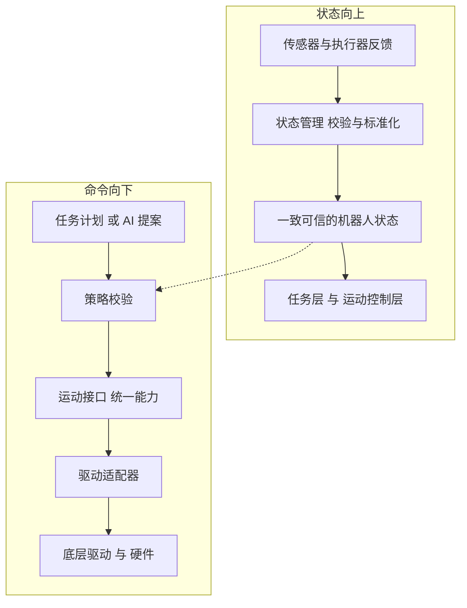
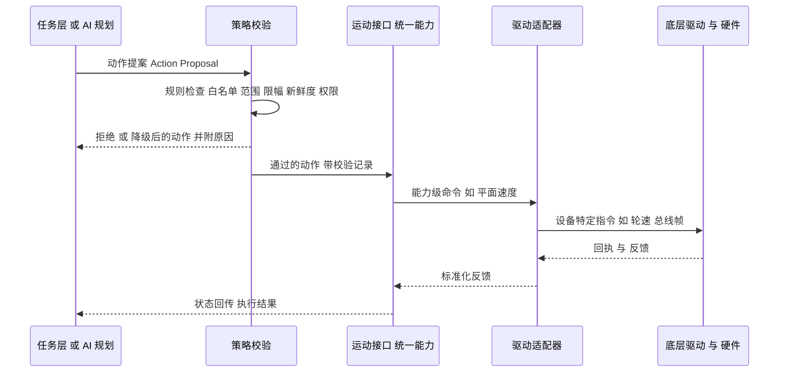

# 01 平台总览与分层架构：异构多机器人协同到底要解决什么

> 一句话定位：先把 P6 的"全景图"装进脑子——异构多机器人平台要解决哪些问题、典型怎么分层、和 ROS2 是什么关系、一条命令和一条状态在系统里怎么流动。后面 12 章都是把这张图的某一块放大。

**本章学完你能……**

- 用 1 分钟讲清"异构多机器人协同平台"要解决的五类问题（硬件异构、协议异构、时间与坐标异构、规模、安全）。
- 画出一张典型的五层架构图，并能指出 CV 里三条 bullet 各落在哪一层。
- 说清 M-Robots 与 ROS/ROS2 的关系：兼容与映射，而不是替代。
- 沿着"一条速度命令"和"一条状态反馈"各讲一遍数据流，说出每一跳的输入、输出、可能的失败。
- 诚实地区分"CV 上写的事实"和"典型架构的合理推断"，知道哪些细节必须自己补全。

**前置知识**

- [ROS1/ROS2 核心概念](../../02_基础知识/09_机器人软件/04_ROS1_ROS2核心概念.md)
- [DDS 与分布式通信](../../02_基础知识/09_机器人软件/05_DDS与分布式通信.md)
- [OpenHarmony / Hi3861 / RK3588 平台基础](../../02_基础知识/08_嵌入式与通信/06_OpenHarmony_Hi3861_RK3588平台基础.md)

**目录**

1. 先把边界划清：事实、推断、待补全
2. 异构多机器人协同要解决什么
3. CV 里 P6 的三条线
4. 典型分层架构（合理推断）
5. 与 ROS/ROS2 的关系
6. 数据流：命令向下、状态向上
7. 完整走读：一条"前进 0.3 m/s"
8. 你的职责边界
9. 常见误区
10. 面试怎么问、怎么答
11. 本章要点速记 / 自测题 / 相关链接

---

## 1. 先把边界划清：事实、推断、待补全

这套 P6 文档有一条硬规则：**事实只来自 CV 和个人陈述（PS）**。

CV 上关于 P6 的事实只有这些：

| 类别 | CV 原文要点 |
|---|---|
| 公司与岗位 | Shenzhen Kaihong Digital Industry Development Co., Ltd.，Robotics Platform Intern，2026 年 6 月至今（在职实习） |
| 平台 | M-Robots OpenHarmony 异构多机器人协同平台 |
| 总述 | device abstraction and motion coordination；independently developed and integrated device abstraction, state management, distributed coordination and the safe-execution chain |
| 统一运动接口 | 在 OpenHarmony 上用 C++ 为传感器、执行器、控制器建立统一能力模型；把 ROS/ROS2 运动指令映射到底层驱动；使运动控制代码能跨硬件复用 |
| 状态管理 | 对多源感知与执行器反馈的时间戳、坐标系、有效性检查做标准化，向运动控制层和任务层提供一致、可信的机器人状态 |
| 协同与安全执行 | 在 M-DDS 上实现设备发现、能力注册、状态同步、任务分发；任务计划经过 action-proposal → policy-check → execution → state-feedback 链 |

除此以外的一切——具体 API 名字、消息字段、QoS 配置、频率、策略规则——**文档里只能写"典型做法"**，凡面试官会追问的专有细节，一律留 `【待你补全：…】`，并汇总到 [README](./README.md) 的"实机细节自查表"。

> **注意**：讲"典型做法"时，面试里的措辞要自然切换：说 "In a typical design ..."、"The way I think about it is ..."，而不是把推断当成"我们的实现就是这样"。除非那一条你确实自己做过并能讲细节。

---

## 2. 异构多机器人协同要解决什么

### 2.1 它要解决的现实问题

想象一个仓库或实验场：有一台差速底盘小车、一台麦克纳姆轮平台、一台机械臂、几个独立的激光雷达和相机节点，可能还有一台四足。它们来自不同厂家，用不同的总线（CAN、RS-485、以太网、串口）、不同的控制接口（有的收 $v,\omega$，有的收每个轮子的转速，有的收关节力矩），不同的传感器时钟，不同的坐标约定。一个任务系统要让它们"协同"完成一件事，比如"小车把货送到 A 点，机械臂在 A 点取货"。

如果没有平台，每增加一种硬件，上层所有控制代码都要重写一遍；每增加一台机器人，通信、状态汇总、安全检查都要重新搭。平台要做的，就是**把"变化的部分"（硬件、协议、传输）关在下层，把"稳定的部分"（运动命令、状态、任务）以统一的接口暴露给上层**。

### 2.2 五类异构与对应的难点

| 异构维度 | 具体差异（典型） | 不处理会怎样 | 对应 P6 的哪条线 |
|---|---|---|---|
| 硬件 | 底盘构型（差速/麦轮/全向）、传感器种类、执行器接口（速度/位置/力矩） | 上层代码和硬件绑死，换硬件就重写 | 统一能力模型 + 驱动适配 |
| 协议与传输 | CAN/串口/以太网/共享内存；自定义二进制 vs 标准消息 | 每种设备一套通信代码 | 驱动适配器 + ROS/ROS2 映射 |
| 时间 | 各传感器时钟不同、有延迟、有抖动、可能乱序 | 融合和控制用错了"此刻"，抖动、震荡 | 状态管理：时间戳标准化 |
| 坐标与单位 | 左右手系、前向轴、角度弧度/度、速度单位、里程计起点 | 位姿对不上，控制方向错 | 状态管理：坐标系统一 |
| 规模与分布 | 设备上线下线、跨设备/跨机器人通信、网络丢包 | 手工配置地址，无法动态扩展 | M-DDS：发现、注册、同步、分发 |
| 安全 | 高层（含 AI）计划可能越界、过期、冲突 | 错误计划直接变成物理运动 | 安全执行链 |

> 这里有六行，其实是"五类异构 + 安全"。面试说 "heterogeneity" 时，讲硬件、协议、时间/坐标、分布四点，然后补一句 "and safety on top"，逻辑最顺。

### 2.3 "协同"不等于"同步控制"

多机器人"协同"（coordination）至少有三层含义：

1. **信息协同**：大家共享设备清单和状态（谁在线、能做什么、现在在哪）。
2. **任务协同**：任务被分解、分配给合适的机器人（task dispatch），并追踪执行结果。
3. **运动协同**：两台机器人需要在厘米/毫秒级协调（编队、协同搬运）。这一般要靠专门的控制和时间同步，不是通用平台的默认能力。

CV 里写的是前两层：device discovery、capability registration、state synchronisation、task dispatch。**不要在面试里把它吹成"多机编队控制"**；诚实的说法是 "the platform provides information and task coordination; tight motion-level coordination is handled by dedicated controllers"（平台提供信息和任务层面的协同，紧耦合的运动协调由专门控制器负责）。

---

## 3. CV 里 P6 的三条线

把 CV 的三条 bullet 和总述放在一张图里看：

```text
                      M-Robots (OpenHarmony 异构多机器人协同平台)
 ┌────────────────────────────────────────────────────────────────────────┐
 │  线 C  协同与安全执行  (M-DDS 之上)                                      │
 │   设备发现 · 能力注册 · 状态同步 · 任务分发                              │
 │   action-proposal → policy-check → execution → state-feedback          │
 ├────────────────────────────────────────────────────────────────────────┤
 │  线 B  机器人状态管理                                                    │
 │   时间戳 · 坐标系 · 有效性检查  → 一致、可信的状态                        │
 ├────────────────────────────────────────────────────────────────────────┤
 │  线 A  统一运动接口 (C++ on OpenHarmony)                                 │
 │   传感器/执行器/控制器统一能力模型 · ROS/ROS2 运动指令 → 底层驱动        │
 ├────────────────────────────────────────────────────────────────────────┤
 │  硬件：底盘 / 机械臂 / 传感器 ...                                        │
 └────────────────────────────────────────────────────────────────────────┘
```

三条线的依赖关系是：**A 提供"可以被统一调用的设备"；B 在 A 的基础上保证"读到的状态是可信的"；C 在 A、B 之上把设备和状态变成"可发现、可分发、可被安全门控的网络服务"**。这也是文档章节的编排逻辑：先 A（03、04 章），再 B（05 章），再 C（06、07、08 章）。

CV 的总述说 "independently developed and integrated device abstraction, state management, distributed coordination and the safe-execution chain"。意思是这四块是你**独立开发并集成**的，而不是你只写了其中一个小函数。这句话是面试官会追问"边界"的来源，所以第 8 节要专门准备。

---

## 4. 典型分层架构（合理推断）

> **说明**：以下是"这类平台通常怎么分层"的教学推断，用来给你一个思考框架，并非 M-Robots 的内部模块图。真实的模块名、进程划分请你自己补全：`【待你补全：M-Robots 实际的分层与模块名称（可公开讲的部分）】`。

### 4.1 五层模型

```text
┌───────────────────────────────────────────────────────────────┐
│ L5 应用与任务层   任务规划、调度、AI/LLM 规划、人机界面           │
│                   （时间尺度：秒～分钟，事件驱动）                │
├───────────────────────────────────────────────────────────────┤
│ L4 协同与安全层   设备发现、能力注册、状态同步、任务分发；         │
│                   提案→策略校验→执行→状态回传                    │
│                   （时间尺度：百毫秒～秒）                        │
├───────────────────────────────────────────────────────────────┤
│ L3 运动与状态层   运动控制接口、机器人状态管理（时间/坐标/有效性） │
│                   （时间尺度：毫秒～十毫秒，周期驱动）             │
├───────────────────────────────────────────────────────────────┤
│ L2 设备抽象层     统一能力模型；传感器/执行器/控制器抽象；         │
│                   驱动适配器；ROS/ROS2 命令映射                  │
│                   （时间尺度：毫秒）                              │
├───────────────────────────────────────────────────────────────┤
│ L1 系统与驱动层   OpenHarmony 内核、HDF 驱动、总线（CAN/串口等）  │
└───────────────────────────────────────────────────────────────┘
        横向：M-DDS（跨设备/跨进程通信总线）、时间服务、日志与审计
```

注意几点：

1. **越往下越实时、越确定；越往上越灵活、越不确定。**这是分层的第一原则，07 章会专门讲。
2. L3 与 L2 的边界是"能力接口"：上面只说"我要以 0.3 m/s 前进"，下面负责"这台底盘怎么把 0.3 m/s 变成轮速、总线帧"。
3. L4 的"安全层"不是装饰：它是 **所有高层决策进入物理执行的唯一入口**。如果平台上存在另一条绕过它的路径，整条链就失去意义（08 章会强调"唯一通道"原则）。
4. M-DDS 是横向的，它不属于某一层，而是 L4、L3 之间、跨设备之间的传输。

### 4.2 数据与控制的两个方向



右边那条虚线是关键：**策略校验需要读取"可信状态"来判断提案是否可执行**（例如当前是否急停、电量、位置是否在允许区域）。所以状态管理（线 B）既服务控制，也服务安全（线 C）。这是三条线互相咬合的地方，面试里很值得讲。

### 4.3 为什么要"能力模型"而不是"设备型号"

直觉：上层不应该问"你是不是型号 X 的底盘"，而应该问"你能不能接受平面速度命令，最大线速度多少，最大加速度多少"。后者就是**能力（capability）**。能力模型把"设备是什么"换成"设备能做什么、做到什么程度"，这才让同一份运动控制代码能跨硬件复用。03 章详述。

---

## 5. 与 ROS/ROS2 的关系

### 5.1 为什么不是"替代"

ROS/ROS2 已经有成熟的消息类型（如 `geometry_msgs/Twist`、`sensor_msgs/Imu`）、工具链（TF、rosbag）和大量算法包（导航、SLAM、MoveIt）。工业/科研生态里的运动指令和算法，大量以 ROS/ROS2 接口为"通用语言"。因此一个机器人平台最合理的姿态是：**对上兼容 ROS/ROS2 的接口，对下接入 OpenHarmony 上各种硬件驱动**。CV 的原话是 "mapped ROS/ROS2 motion commands to low-level drivers"，即命令映射（command mapping），而不是重造一个 ROS。

### 5.2 对照表

| 维度 | ROS2 | M-Robots（从 CV 与典型设计推断） |
|---|---|---|
| 运行环境 | 通常是 Linux（也支持其他系统） | OpenHarmony（CV 明确） |
| 通信中间件 | DDS（通过 RMW 抽象层选择具体实现） | M-DDS（CV 明确用 M-DDS 做发现、注册、同步、分发） |
| 运动命令表达 | Twist 等标准消息 | 兼容 ROS/ROS2 运动指令，映射到统一能力接口 |
| 设备抽象 | 由具体驱动包（ros2_control 等）各自实现 | 统一能力模型覆盖传感器/执行器/控制器 |
| 坐标系 | TF2 | 状态管理里统一坐标系 |
| 安全门控 | 无统一内置策略（需要自己加） | 动作提案→策略校验→执行→回传 |

> **面试要点**："I did not replace ROS2; I built a compatibility layer so that existing ROS/ROS2 motion commands can drive hardware through a unified capability interface on OpenHarmony."（我没有替代 ROS2，而是做了兼容层。）

`【待你补全：ROS/ROS2 侧具体是通过何种方式接入（桥接节点 / 原生客户端库 / 其他）——能公开讲的程度】`

### 5.3 M-DDS 与 ROS2 的 DDS 是什么关系

ROS2 本身就建立在 DDS 之上（DDS 是 OMG 的数据分发服务标准，ROS2 通过 RMW 层对接多种实现）。M-DDS 在 CV 中作为平台的分布式总线。典型的推断是：M-DDS 是 DDS 风格的数据分发中间件，提供 Topic、发布/订阅、QoS 等概念；但**它与某个具体 DDS 实现、是否符合 RTPS 线协议互通**，CV 没写。

`【待你补全：M-DDS 的来源与定位（自研/基于某 DDS 实现/厂商封装）、是否与 ROS2 的 RMW 对接，可公开讲的程度】`

---

## 6. 数据流：命令向下、状态向上

### 6.1 命令流（command path）



### 6.2 状态流（state path）

```text
编码器 / IMU / 雷达 / 电机驱动器      （各自的时钟、坐标、单位）
        │  原始数据 (raw)
        ▼
 驱动适配器：解码、单位换算、打时间戳
        │
        ▼
 状态管理：  ① 时间戳标准化（统一时间基准）
             ② 坐标系统一（统一到平台约定的 frame）
             ③ 有效性检查（范围、NaN、陈旧、突变）
        │  合格的 State（带 stamp、frame、validity）
        ▼
 ┌─────────────┬──────────────┬──────────────┐
 │ 运动控制层   │ 任务层        │ 策略校验      │
 │（闭环反馈）  │（进度判断）   │（新鲜度/模式）│
 └─────────────┴──────────────┴──────────────┘
        │
        ▼ 经 M-DDS 同步到其他设备 / 上层
```

**一致（consistent）与可信（trusted）**是 CV 里的两个关键词：

- 一致：同一份状态里的不同量，参考同一时间基准、同一坐标系、同一单位。
- 可信：每一个量都带"这个值还能用吗"的判断（有效、陈旧、来源、置信），使用者可以据此决定是继续用、降级还是停机。

---

## 7. 完整走读：一条"前进 0.3 m/s"

> **教学示例**：下面的数字是为讲解而设，不是项目实测。

场景：任务层（可能是人，也可能是 AI 规划）想让底盘 R1 以 0.3 m/s 前进 2 秒。

1. **提案**：任务层形成一个动作提案 `{robot: R1, action: move, vx: 0.3 m/s, duration: 2 s}`，附带自己的身份和请求时间。
2. **策略校验**：校验器检查——R1 是否在线且该动作在其能力清单内（能力注册信息）；$0.3$ 是否小于 R1 的最大线速度（假设 $0.5$ m/s，示例）；状态是否新鲜（最近一次底盘状态距今 $<200$ ms，示例阈值）；当前模式是否允许自动运动（非急停、非手动覆盖）；请求者是否有权限。全通过则放行；否则拒绝或降级（例如把速度钳到上限），并写审计记录。
3. **运动接口**：放行的动作被表示成统一的"平面速度命令"，交给 R1 对应的底盘适配器。
4. **驱动适配**：适配器知道 R1 是差速底盘，按运动学把 $(v=0.3,\omega=0)$ 换算为左右轮速，再按总线协议打包。若 R1 是麦轮底盘，同样的 $(v_x,v_y,\omega)$ 会换算成四个轮速——**上层代码一个字不用改**。
5. **执行**：驱动把帧发到总线；执行器开始运动。执行期间有看门狗（watchdog）：若一段时间内没有收到新的"续命"命令，适配器自动让底盘减速停车（典型安全设计）。
6. **状态回传**：编码器、里程计反馈经状态管理校验后，形成 R1 的当前状态，回传到任务层，任务层据此判断"是否到位 / 是否异常 / 是否需要重新提案"。

对应链条：**proposal → policy-check → execution → state-feedback**，缺一环都不完整。

---

## 8. 你的职责边界

CV：*independently developed and integrated device abstraction, state management, distributed coordination and the safe-execution chain.*

面试官几乎一定会问 "What exactly did you do versus the team?"。准备方式：

- 把这四块各自拆成**你能画出接口、讲出一个具体设计决定的最小单元**。
- 对于团队已有的部分（OpenHarmony 系统本身、HDF 驱动、M-DDS 中间件本体、具体硬件驱动），明确说"这些是平台/团队提供，我在其上构建"。
- 对于保密/在职边界：说 "this is an ongoing internship, so I can describe the design principles and my own modules, but not proprietary details."

`【待你补全：你独立完成的模块清单与边界；哪些是你写的，哪些是团队/平台已有的；可公开讲的粒度】`

---

## 9. 常见误区

| 误区 | 纠正 |
|---|---|
| "平台 = ROS2 换个壳" | 平台还包括设备抽象、状态治理、分布式协同、安全门控；ROS/ROS2 是兼容对象 |
| "统一接口就是写一个基类" | 基类只是形式；难点是能力描述、差异处理、状态一致、错误语义（03 章） |
| "安全就是限个速度" | 限速只是策略的一种；安全链包括身份、新鲜度、模式、审计、回执、看门狗（08 章） |
| "状态管理就是把数据存起来" | 核心是校验与标准化，让下游敢用（05 章） |
| "DDS 就是消息队列" | DDS 是以数据为中心的发布订阅，带 QoS 与自动发现（06 章） |
| "多机协同 = 多机编队" | CV 的协同是发现、注册、同步、分发 |

---

## 10. 面试怎么问、怎么答

**Q1. What problem does your platform solve?**

> The platform lets different robots — different chassis, sensors and actuators — be driven through one interface, and lets them work together over a distributed bus. Without it, every new piece of hardware means rewriting the motion code, and every new robot means rebuilding the communication and safety checks. I worked on the device abstraction, the robot state management, the distributed coordination and the safe-execution chain.

译：平台让不同底盘、传感器、执行器通过统一接口被驱动，并通过分布式总线协同。没有它，每加一种硬件就重写运动代码。我负责设备抽象、状态管理、分布式协同和安全执行链。

追问方向：为什么需要？→ 说"换硬件不用改上层代码"；你具体做了哪块？→ 回到第 8 节。

**Q2. How does your platform relate to ROS2?**

> It is compatible with ROS and ROS2 rather than a replacement. ROS2 motion commands are mapped onto the low-level drivers through the unified capability model, so existing ROS-style control code can run on hardware under OpenHarmony. [If asked about the bridge details:] That part I would prefer not to go into because the internship is ongoing.

译：兼容而不是替代；ROS2 运动命令通过统一能力模型映射到底层驱动。

**Q3. Draw the architecture.**

> At the bottom there is the OpenHarmony system and the drivers. Above that is the device abstraction layer with the capability model and driver adapters. Then the motion and state layer, where I standardise timestamps, frames and validity. Above that, the coordination and safety layer on M-DDS, and at the top the task layer. Commands go down through a policy check; state comes back up.

追问：哪层最难？→ 状态一致性和安全链，因为问题出在层与层之间的假设。

**Q4. Why is state management part of a motion platform?**

> Because a controller is only as good as the state it reads. If two sensors use different clocks or frames, or a value is stale, the control loop will react to something that is not true. So the platform first checks and standardises the state, and only then gives it to motion control and the task layer.

译：控制器只能和它读到的状态一样好；先校验标准化，再交给上层。

---

## 11. 本章要点速记

1. 平台的本质：把变化（硬件、协议）关在下层，把稳定（命令、状态、任务）以统一接口暴露给上层。
2. 五类异构：硬件、协议、时间/坐标、规模/分布，外加安全。
3. CV 三条线：A 统一运动接口，B 状态管理，C 协同与安全执行；依赖顺序 A→B→C。
4. 典型五层：系统驱动、设备抽象、运动与状态、协同与安全、任务应用；越往下越实时。
5. M-Robots 与 ROS/ROS2：兼容映射，不是替代。
6. 命令向下经策略校验；状态向上经状态管理；校验需要可信状态，所以两条线交汇。
7. 协同在 CV 里是信息与任务协同，不要说成编队控制。
8. 凡是专有细节，先说"典型设计"，不确定就标待补全。

## 自测题

1. 列出三种硬件异构并说明它们如何让"上层代码绑死硬件"。（要点：执行器接口速度/位置/力矩不同；底盘构型不同；总线协议不同。）
2. 为什么说策略校验需要状态管理？（要点：新鲜度、模式、位置、急停状态来自可信状态。）
3. 命令流与状态流各有哪几个环节？（要点：见 6.1、6.2。）
4. "协同"在你的项目里指什么、不指什么？（要点：发现/注册/同步/分发；不是编队。）
5. 用一句话回答"为什么不直接用 ROS2？"（要点：ROS2 是兼容对象；平台要在 OpenHarmony 上做设备抽象、状态治理、安全门控。）

## 相关链接

- 下一章：[02 OpenHarmony 基础](./02_OpenHarmony基础_架构_HDF_IPC_构建.md)
- 本项目入口：[README](./README.md)
- 英文口述：[99 英文面试口述与深挖问答](./99_英文面试口述与深挖问答.md)
- 相关项目：[P4 OpenHarmony 智能园艺系统](../P4_OpenHarmony智能园艺系统/README.md)
