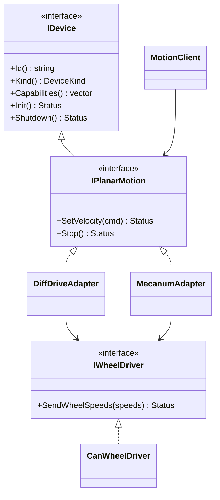
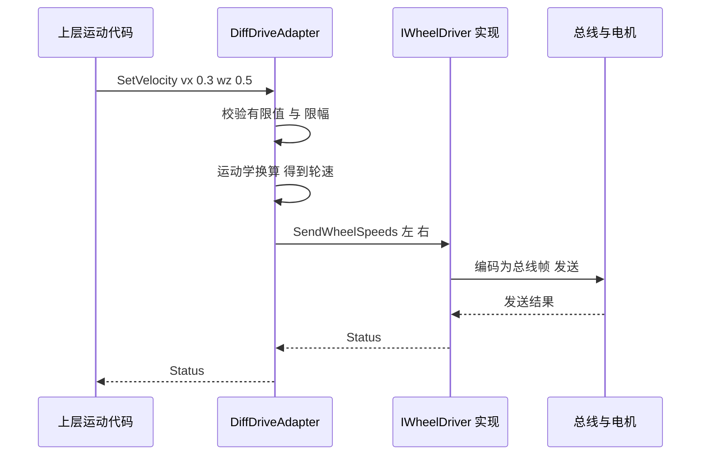

# 03 统一能力模型与设备抽象：让同一份运动代码跑在不同硬件上

> 一句话定位：这是 P6 第一条 CV bullet 的技术核心——"用 C++ 在 OpenHarmony 上为传感器、执行器、控制器建立统一能力模型"。本章教你从零设计这样一个模型：为什么要用"能力"而不是"型号"，接口怎么切，驱动适配器怎么写，错误和生命周期怎么定义，最后给出一个**可编译运行**的教学版 C++ 示例。

**本章学完你能……**

- 解释"能力（capability）"与"设备（device）"的区别，并说出能力描述里应包含哪些字段类型。
- 画出统一模型的类图和一次"设置速度"的时序图。
- 用适配器模式（Adapter）把差速底盘和麦克纳姆底盘封装成同一接口，并手算两种底盘的轮速。
- 说出接口设计里 7 条容易踩坑的原则（单位、坐标、错误语义、生命周期、线程模型、可观测性、版本演进）。
- 回答"你怎么做到运动控制代码跨硬件复用"：能讲机制，也知道哪些细节是设计级取值、要用 typically 措辞。

**前置知识**

- [C++ 现代特性与工程实践](../../02_基础知识/09_机器人软件/02_C++现代特性与工程实践.md)
- [差速、麦克纳姆、全向轮与车辆运动学](../../02_基础知识/02_力学与建模/04_差速_麦克纳姆_全向轮与车辆运动学.md)
- 上一章：[02 OpenHarmony 基础](./02_OpenHarmony基础_架构_HDF_IPC_构建.md)

**目录**

1. 要解决什么问题
2. 核心概念：设备、能力、适配器
3. 能力描述应包含什么
4. 三类设备：传感器、执行器、控制器
5. 接口设计七原则
6. 类图与时序图
7. 教学版 C++ 示例（可编译）
8. 手算：同一条命令在两种底盘上的轮速
9. 能力注册与协商
10. 如何做到"控制代码跨硬件复用"
11. 常见错误与故障现象
12. 面试问答
13. 要点速记 / 自测题 / 链接

> **诚实声明**：下面的接口、字段、类名是**典型设计**（本项目口述口径），不是 M-Robots 的真实 API 逐字转述。统一口径：能力分三大类——Sensor（imu、lidar2d、odometry）、Actuator（wheel_velocity、joint_position、joint_torque）、Controller（velocity_controller、trajectory_follower）；硬件种类为两类移动底盘（差速、阿克曼式）、一类多关节伺服臂，传感器为 2D 激光雷达、IMU、轮式编码器，底层总线为 CAN 与串口。

---

## 1. 要解决什么问题

先想一个反面例子。你有一份"沿直线前进 2 米"的控制代码，里面直接写：

```cpp
// 反面教材：控制代码与硬件绑死
can_send(0x201, left_speed);   // 左轮电机 ID 0x201
can_send(0x202, right_speed);  // 右轮电机 ID 0x202
```

换一台麦克纳姆底盘：电机变四个，ID 不同，协议不同，速度要按四个轮子分配。这段代码要重写。再换一台使用 EtherCAT 的底盘，再重写。**每多一种硬件，控制逻辑就被拷贝一份并改一遍**，Bug 也随之成倍。

目标：控制代码只表达"意图"（以 0.3 m/s 前进），"如何让这台具体的机器做到"交给下层。要做到这一点，需要三样东西：

1. 一套**统一的接口**（上层只依赖它）；
2. 一套**能力描述**（让上层知道这台设备能做什么、做到什么程度）；
3. 一组**适配器**（把统一接口翻译成具体硬件的操作）。

这三样合起来就是 CV 里说的 "unified capability model"。

---

## 2. 核心概念：设备、能力、适配器

| 概念 | 一句话 | 类比 |
|---|---|---|
| 设备（Device） | 一个有身份的硬件或软件实体，有生命周期（初始化/关闭） | 插座上的一个电器 |
| 能力（Capability） | 设备"能做的一件事"及其参数范围，如"平面速度控制，最大 0.5 m/s" | 电器的功能标签：220V、1000W |
| 适配器（Adapter） | 把统一接口转成具体硬件操作的翻译层 | 转换插头 |
| 注册表（Registry） | 记录有哪些设备、各有什么能力，供查询 | 通讯录 |
| 接口（Interface） | 上层依赖的抽象契约 | 插座标准 |

### 2.1 为什么是"能力"而不是"型号"

如果上层问"你是不是型号 X"，每出现新型号上层就要加一个 `if`。如果上层问"你有没有 `motion.planar_velocity` 能力、最大线速度是多少"，新型号只要声明同样的能力即可，上层代码不变。这是**面向契约编程**，是开闭原则（对扩展开放、对修改关闭）的直接应用。

### 2.2 能力是"接口 + 参数"的组合

同样是"平面速度"能力：

- 差速底盘：$v_x$ 和 $\omega_z$ 有效，$v_y$ 无效（非完整约束，non-holonomic）。
- 麦克纳姆/全向底盘：$v_x, v_y, \omega_z$ 都有效（完整约束，holonomic）。

接口相同，**能力参数（`holonomic`、最大速度）不同**。上层的规划/控制可以读取这些参数调整策略：不能横移就不要下发 $v_y$。

---

## 3. 能力描述应包含什么

典型的能力描述（教学设计）包含如下几类信息：

| 字段类别 | 例子 | 用途 |
|---|---|---|
| 标识 | `id`（如 `motion.planar_velocity`）、`version` | 查找、兼容性判断 |
| 类型/方向 | 命令型（能接收命令）、状态型（能产生数据）、事件型 | 区分执行器与传感器 |
| 数据类型 | 平面速度（vx, vy, wz）、IMU（加速度、角速度）、关节位置数组 | 编解码、校验 |
| 单位与坐标 | m/s、rad/s、body frame / base_link | 避免单位与坐标歧义 |
| 范围与限幅 | 最大线速度、最大角速度、最大加速度、最大 jerk | 策略校验、适配器限幅 |
| 时间特性 | 最大命令频率、典型延迟、命令超时（watchdog 超时） | 控制器设计、新鲜度判定 |
| 模式 | 支持的控制模式（速度/位置/力矩）、当前模式 | 策略校验"模式"检查 |
| 安全属性 | 是否具备硬件急停、是否需要使能、危险等级 | 安全链决定是否需要更严格校验 |
| 状态来源 | 状态更新频率、时间戳类型（硬件/软件）、坐标系 | 状态管理标准化（05 章） |

> **提示**：把"范围与限幅""超时""模式"写进能力描述，是为后面的安全执行链铺路——策略校验器**不用写死每台设备的上限，而是读能力描述**。这是模型"统一"的另一个价值：安全规则也能通用。

---

## 4. 三类设备：传感器、执行器、控制器

CV 说的是 "sensors, actuators and controllers"。可以这样理解（典型分类）：

| 类别 | 本质 | 主要方法 | 例子 |
|---|---|---|---|
| 传感器（Sensor） | 产生**带时间戳的数据流** | `Read()` / 订阅回调；`Capabilities()` 声明数据类型、频率、坐标系 | IMU、编码器、激光雷达、相机 |
| 执行器（Actuator） | 接收**命令**并产生物理动作 | `SetXxx(cmd)`、`Stop()`；声明命令范围、模式 | 底盘、关节电机、夹爪 |
| 控制器（Controller） | 消费状态、产生命令的**计算单元** | `Update(state, dt) -> cmd`；声明输入/输出端口类型 | PID 速度环、导航跟踪器、策略校验后的轨迹发生器 |

关键设计点：**控制器也被当成"设备"**，它同样有身份、能力描述（输入需要什么状态、输出什么命令、更新频率）、生命周期。这样控制器可以被注册、被发现、被替换，运动控制才能像拼积木一样组合：`传感器 → 控制器 → 执行器`。

```text
   Sensor (IMU/Encoder)          Controller (e.g. velocity PID)         Actuator (Chassis)
  ┌────────────────────┐        ┌──────────────────────────┐        ┌───────────────────┐
  │ capability:        │ state  │ capability:              │  cmd   │ capability:       │
  │  imu.sample 200Hz  │ ─────▶ │  in : state.velocity     │ ─────▶ │  motion.planar_   │
  │  frame: imu_link   │        │  out: motion.planar_vel  │        │  velocity         │
  └────────────────────┘        │  rate: 100Hz             │        └───────────────────┘
                                └──────────────────────────┘
```

（频率 200Hz、100Hz 是示意，非项目数据。）

---

## 5. 接口设计七原则

### 原则 1：单位与坐标写进类型/文档，不留给调用者猜

$v$ 的单位是 m/s 还是 mm/s？角速度是 rad/s 还是 deg/s？$\omega_z$ 逆时针为正吗？这些必须在接口里**唯一规定**（典型选择：SI 单位，右手系，$x$ 向前、$y$ 向左、$z$ 向上，与 ROS 的 REP-103 惯例一致）。适配器负责把统一约定转换为硬件私有约定。

### 原则 2：错误语义清晰（返回状态码，而不是静默失败）

函数应区分：参数非法（`InvalidArgument`）、不支持（`Unsupported`）、设备未就绪（`NotReady`）、硬件故障（`HardwareFault`）、超时。嵌入式环境常禁用异常，所以用**返回码或 Result 类型**。教学示例中用 `Status` 枚举。

### 原则 3：生命周期明确且对称

`Init()` / `Shutdown()` 成对；`Shutdown()` 里先 `Stop()` 再释放资源；析构函数是虚的（`virtual ~IDevice()`），否则通过基类指针删除会未定义行为。

### 原则 4：线程模型写明

接口是否线程安全？命令能否从多个线程同时下发？回调在哪个线程里执行？典型做法：命令入口加锁或进队列，由单一线程写硬件；回调只做轻量工作。

### 原则 5：命令必须有"超时"与"停止"语义

运动命令不是"发一次就永远有效"。典型设计是命令带有效期，超期未续则适配器自动停车（看门狗，watchdog）。`Stop()` 必须**幂等**（多次调用结果相同）且尽量不失败。

### 原则 6：可观测

每个设备应能报告自身状态（在线/故障/模式）、最近一次命令及结果、错误计数。没有可观测性，故障排查只能靠猜（11 章）。

### 原则 7：版本演进

能力 id 带版本；新增字段向后兼容；旧客户端遇到不认识的能力应忽略而非崩溃。

---

## 6. 类图与时序图

### 6.1 类图



读图要点：`MotionClient`（上层运动代码）只依赖 `IPlanarMotion`；适配器依赖更低一级的 `IWheelDriver`（驱动缝，driver seam）；`CanWheelDriver` 是总线实现。**换硬件 = 换右侧两个类，左侧不动。**

### 6.2 时序图：一次 SetVelocity



---

## 7. 教学版 C++ 示例（可编译）

> **教学示例，非项目源码。** 已用 `g++ -std=c++17` 编译运行验证。目的是演示接口形状、适配器和复用，不代表 M-Robots 的实际代码。

```cpp
#include <algorithm>
#include <cmath>
#include <cstdint>
#include <iostream>
#include <memory>
#include <string>
#include <vector>

enum class Status { Ok, InvalidArgument, Unsupported, NotReady, HardwareFault };
enum class DeviceKind { Sensor, Actuator, Controller };

struct PlanarVelocity {
  double vx = 0.0;  // m/s, forward (+x of body frame)
  double vy = 0.0;  // m/s, left (+y); ignored by non-holonomic bases
  double wz = 0.0;  // rad/s, counter-clockwise (+z)
};

struct CapabilityDescriptor {
  std::string id;            // e.g. "motion.planar_velocity"
  int version = 1;
  double max_linear = 0.0;   // m/s
  double max_angular = 0.0;  // rad/s
  bool holonomic = false;    // can it move sideways?
};

class IDevice {
 public:
  virtual ~IDevice() = default;
  virtual std::string Id() const = 0;
  virtual DeviceKind Kind() const = 0;
  virtual std::vector<CapabilityDescriptor> Capabilities() const = 0;
  virtual Status Init() = 0;
  virtual Status Shutdown() = 0;
};

class IPlanarMotion : public IDevice {
 public:
  virtual Status SetVelocity(const PlanarVelocity& cmd) = 0;
  virtual Status Stop() = 0;
};

// Low-level driver seam: what the adapter needs from the hardware side.
class IWheelDriver {
 public:
  virtual ~IWheelDriver() = default;
  virtual Status SendWheelSpeeds(const std::vector<double>& rad_per_s) = 0;
};

class DiffDriveAdapter : public IPlanarMotion {
 public:
  DiffDriveAdapter(std::string id, std::shared_ptr<IWheelDriver> drv,
                   double wheel_radius, double track_width)
      : id_(std::move(id)), drv_(std::move(drv)),
        r_(wheel_radius), track_(track_width) {}

  std::string Id() const override { return id_; }
  DeviceKind Kind() const override { return DeviceKind::Actuator; }
  std::vector<CapabilityDescriptor> Capabilities() const override {
    return {{"motion.planar_velocity", 1, 0.5, 1.5, false}};  // teaching limits
  }
  Status Init() override {
    ready_ = (drv_ != nullptr);
    return ready_ ? Status::Ok : Status::NotReady;
  }
  Status Shutdown() override { Stop(); ready_ = false; return Status::Ok; }

  Status SetVelocity(const PlanarVelocity& cmd) override {
    if (!ready_) return Status::NotReady;
    if (!std::isfinite(cmd.vx) || !std::isfinite(cmd.wz))
      return Status::InvalidArgument;
    // vy is ignored: a differential base cannot move sideways.
    const double v = std::clamp(cmd.vx, -0.5, 0.5);
    const double w = std::clamp(cmd.wz, -1.5, 1.5);
    const double wl = (v - w * track_ / 2.0) / r_;  // rad/s
    const double wr = (v + w * track_ / 2.0) / r_;
    return drv_->SendWheelSpeeds({wl, wr});
  }
  Status Stop() override {
    return ready_ ? drv_->SendWheelSpeeds({0.0, 0.0}) : Status::NotReady;
  }

 private:
  std::string id_;
  std::shared_ptr<IWheelDriver> drv_;
  double r_, track_;
  bool ready_ = false;
};

class MecanumAdapter : public IPlanarMotion {
 public:
  MecanumAdapter(std::string id, std::shared_ptr<IWheelDriver> drv,
                 double wheel_radius, double half_len, double half_wid)
      : id_(std::move(id)), drv_(std::move(drv)),
        r_(wheel_radius), k_(half_len + half_wid) {}

  std::string Id() const override { return id_; }
  DeviceKind Kind() const override { return DeviceKind::Actuator; }
  std::vector<CapabilityDescriptor> Capabilities() const override {
    return {{"motion.planar_velocity", 1, 0.8, 2.0, true}};   // teaching limits
  }
  Status Init() override {
    ready_ = (drv_ != nullptr);
    return ready_ ? Status::Ok : Status::NotReady;
  }
  Status Shutdown() override { Stop(); ready_ = false; return Status::Ok; }

  Status SetVelocity(const PlanarVelocity& cmd) override {
    if (!ready_) return Status::NotReady;
    if (!std::isfinite(cmd.vx) || !std::isfinite(cmd.vy) || !std::isfinite(cmd.wz))
      return Status::InvalidArgument;
    // Standard X-type mecanum layout; sign conventions vary by wheel mounting.
    const double fl = (cmd.vx - cmd.vy - k_ * cmd.wz) / r_;
    const double fr = (cmd.vx + cmd.vy + k_ * cmd.wz) / r_;
    const double rl = (cmd.vx + cmd.vy - k_ * cmd.wz) / r_;
    const double rr = (cmd.vx - cmd.vy + k_ * cmd.wz) / r_;
    return drv_->SendWheelSpeeds({fl, fr, rl, rr});
  }
  Status Stop() override {
    return ready_ ? drv_->SendWheelSpeeds({0, 0, 0, 0}) : Status::NotReady;
  }

 private:
  std::string id_;
  std::shared_ptr<IWheelDriver> drv_;
  double r_, k_;
  bool ready_ = false;
};

class PrintDriver : public IWheelDriver {   // stands in for a CAN driver
 public:
  Status SendWheelSpeeds(const std::vector<double>& w) override {
    for (double x : w) std::cout << x << " ";
    std::cout << "\n";
    return Status::Ok;
  }
};

// Hardware-agnostic motion code: it only sees IPlanarMotion.
Status DriveForward(IPlanarMotion& base, double speed) {
  PlanarVelocity cmd;
  cmd.vx = speed;
  return base.SetVelocity(cmd);
}

int main() {
  auto drv = std::make_shared<PrintDriver>();
  DiffDriveAdapter diff("base_diff", drv, 0.05, 0.4);
  MecanumAdapter mec("base_mec", drv, 0.05, 0.2, 0.15);
  diff.Init();
  mec.Init();
  PlanarVelocity c{0.3, 0.0, 0.5};
  diff.SetVelocity(c);        // prints: 4 8
  mec.SetVelocity(c);         // prints: 2.5 9.5 2.5 9.5
  DriveForward(diff, 0.3);    // prints: 6 6
  DriveForward(mec, 0.3);     // prints: 6 6 6 6
  diff.SetVelocity({9.0, 0, 0});  // clamped to 0.5 m/s -> 10 10
}
```

读这段代码时要抓住的**设计点**：

1. `DriveForward` 是"跨硬件复用的运动代码"，它只认 `IPlanarMotion`。
2. 差速适配器**忽略** `vy` 并在能力里声明 `holonomic=false`——这是一种"诚实的降级"，更好的做法是让上层读取能力后不下发 `vy`，或让适配器返回 `Unsupported` 以便被察觉（取决于契约，见 11 节）。
3. 限幅放在适配器里作为**最后一道防线**；策略校验在上游，适配器限幅在下游，两层互为冗余（08 章讲纵深防御）。
4. `IWheelDriver` 是"驱动缝"：真正的 CAN/串口细节在它的实现里，可以用假驱动做单元测试（10 章）。
5. `Shutdown()` 先 `Stop()`。

---

## 8. 手算：同一条命令在两种底盘上的轮速

**教学示例数值（非项目实测）**：轮半径 $r=0.05$ m，差速轮距 $L=0.4$ m；麦轮半长 $l_x=0.2$ m，半宽 $l_y=0.15$ m；命令 $v_x=0.3$ m/s，$v_y=0$，$\omega_z=0.5$ rad/s。

### 8.1 差速底盘

符号：$v_L,v_R$ 为左右轮线速度（m/s），$\omega_L,\omega_R$ 为轮角速度（rad/s）。

推导：车体中心线速度是左右轮线速度的平均，角速度是差除以轮距：
$$v=\frac{v_R+v_L}{2},\qquad \omega=\frac{v_R-v_L}{L}$$
解出：
$$v_L=v-\frac{\omega L}{2},\qquad v_R=v+\frac{\omega L}{2},\qquad \omega_{L,R}=\frac{v_{L,R}}{r}$$

代入：$v_L=0.3-0.5\times0.4/2=0.3-0.1=0.2$ m/s，$v_R=0.3+0.1=0.4$ m/s；
$\omega_L=0.2/0.05=4$ rad/s，$\omega_R=0.4/0.05=8$ rad/s。与程序输出 `4 8` 一致。

### 8.2 麦克纳姆底盘（X 型常见公式）

$$\omega_{fl}=\frac{v_x-v_y-(l_x+l_y)\omega_z}{r},\quad
\omega_{fr}=\frac{v_x+v_y+(l_x+l_y)\omega_z}{r}$$
$$\omega_{rl}=\frac{v_x+v_y-(l_x+l_y)\omega_z}{r},\quad
\omega_{rr}=\frac{v_x-v_y+(l_x+l_y)\omega_z}{r}$$

$l_x+l_y=0.35$，$(l_x+l_y)\omega_z=0.175$：
$\omega_{fl}=(0.3-0-0.175)/0.05=2.5$；$\omega_{fr}=(0.3+0+0.175)/0.05=9.5$；$\omega_{rl}=2.5$；$\omega_{rr}=9.5$。与输出 `2.5 9.5 2.5 9.5` 一致。

> **注意**：麦轮公式的正负号取决于轮子的安装方向和轮子正转定义。实际平台必须在适配器里按"每个轮子的符号表"配置，而不是假设公式通用——这是典型的"同一接口不同硬件"差异点。

### 8.3 两个观察

- 同一个 $(0.3,0,0.5)$ 命令得到完全不同的轮速向量（2 个轮 vs 4 个轮）——这就是适配器存在的价值。
- 纯前进 $(0.3,0,0)$：差速是 $6,6$，麦轮是 $6,6,6,6$，都是 $0.3/0.05=6$ rad/s，容易手验。

---

## 9. 能力注册与协商

适配器初始化成功后，通常要**注册**到本机的设备注册表，让别的模块发现它：

```text
适配器 Init()
   │  成功
   ▼
Registry.Register(device_id, kind, capabilities, health=OK)
   │
   ├─▶ 本机其他服务可查询：Find(capability="motion.planar_velocity")
   └─▶ 经 M-DDS 发布到网络，其他设备可发现（06 章）
```

**能力协商**（capability negotiation）的典型流程：

1. 上层需要"平面速度"能力，查询注册表得到候选设备列表；
2. 比较能力参数（`holonomic`、最大速度）选择合适设备，或在下发命令时按设备能力裁剪；
3. 如果设备能力版本不兼容，拒绝使用或降级。

设备**下线**时要注销（或标记不可用），并通知依赖者，避免上层继续向已断开的设备下发命令。

本项目口径：设备适配器启动并自检通过后，向能力注册表提交一条能力描述（id、version、type、unit、frame、limits、cmd_rate_hz、timeout_ms、modes、safety_level）；触发时机是适配器启动、设备重上线、配置变更三种。掉线感知靠公告租约（3 s 内无公告即判 OFFLINE，见 [06 章](./06_DDS与M-DDS分布式协同.md)），注册表把该设备的能力置为不可用，并通过状态通道通知上层任务层，使其不再向它派发命令。

---

## 10. 如何做到"控制代码跨硬件复用"

这是面试高频追问。答案分为**机制**和**条件**两层。

### 10.1 机制

1. **依赖倒置**：上层控制代码依赖抽象接口（`IPlanarMotion`），不依赖具体适配器。
2. **能力查询替代型号判断**：上层读 `Capabilities()` 并据此裁剪行为。
3. **适配器承担"硬件差异"**：运动学换算（差速/麦轮）、单位、符号、总线协议、限幅都在适配器内。
4. **统一的状态输出**：执行器反馈经 05 章的状态管理标准化后输出统一格式，控制器无需关心反馈来自哪种编码器。
5. **ROS/ROS2 命令映射在统一接口之上**（04 章）：`Twist` 先映射为 `PlanarVelocity`，再走适配器。

### 10.2 条件（诚实地讲局限）

复用不是无条件的。常见限制：

- 动力学差异：同样的速度命令，不同底盘的响应延迟、加速能力不同；高性能控制可能需要**按能力参数调参**。
- 能力集合不同：差速不能横移，上层的规划要读能力。
- 反馈质量不同：有的底盘只有开环速度，没有编码器，状态的可信度不同（05 章用"有效性与置信"表达）。
- 所以"复用"通常指**控制逻辑的结构和大部分代码复用，参数和少量能力相关分支保留**。

> **面试要点**："Reuse does not mean zero changes. It means the control logic depends on a capability contract, and hardware differences are pushed into adapters and parameters."

本项目口径：同一份速度控制代码在差速底盘与阿克曼式底盘两种适配器上都跑通过（契约测试 + 台架实机）。复用时**仍要改**的只有三类：设备描述 YAML（轴距/轮距/限幅）、适配器内的运动学映射、以及底层 CAN 帧的编解码；运动控制代码本身不改。

---

## 11. 常见错误与故障现象

| 错误 | 现象 | 修正 |
|---|---|---|
| 基类没有虚析构 | 通过基类指针删除时泄漏/崩溃 | `virtual ~IDevice() = default;` |
| 单位约定不一 | 机器人速度快 1000 倍或慢 1000 倍 | 接口固定 SI，适配器转换 |
| 适配器静默忽略不支持的分量 | 上层以为横移了，实际没动 | 能力声明 + 返回 `Unsupported` 或日志告警 |
| `Stop()` 在未初始化时崩溃 | 关闭流程异常 | `Stop()` 幂等、对未就绪状态安全 |
| 适配器里阻塞等待总线 | 控制线程抖动 | 总线 IO 放独立线程，命令入队 |
| 限幅只放在上层 | 绕过上层时硬件超限 | 适配器也限幅，纵深防御 |
| 麦轮符号错 | 横移变成旋转 | 轮子符号表配置化，逐轮标定验证 |
| 能力描述与实际不符 | 策略放行了设备做不到的命令 | 能力描述来自配置并有自检 |
| 回调中直接调用 `Shutdown()` | 死锁/悬空引用 | 回调只投递事件，由拥有者线程处理 |

---

## 12. 面试问答

**Q1. What is a unified capability model, and why did you build one?**

> A capability model describes what a device can do — for example planar velocity control with maximum speeds — instead of what model it is. I built one in C++ for sensors, actuators and controllers, so upper-layer motion code depends on the capability contract and each hardware difference lives in an adapter. That is what made the motion-control code reusable across hardware.

译：能力模型描述设备"能做什么"而不是"是什么型号"；运动代码依赖能力契约，硬件差异在适配器里。

追问：能力里有哪些字段？→ 标识/版本、数据类型、单位与坐标、范围与限幅、超时、模式（见第 3 节；实际字段按事实）。再追问：为什么把控制器也建模成设备？→ 可注册、可发现、可替换。

**Q2. How would you design the interface for a mobile base?**

> I would define a small interface — set velocity, stop, initialise, shut down — with SI units and a fixed frame convention. It returns status codes instead of throwing, because many embedded builds avoid exceptions. Stop must be idempotent, and commands carry a timeout so the adapter stops the base if the upper layer goes silent.

追问：如果底盘不能横移怎么办？→ 能力声明 holonomic=false；上层读取后不发 vy；适配器不静默吞掉，要么返回 Unsupported 要么记录告警。

**Q3. Walk me through mapping one command to two different bases.**

> Take 0.3 metres per second forward with 0.5 radians per second turning. For a differential base with a 0.4 metre track, the wheel speeds are 0.2 and 0.4 metres per second, so with a 5-centimetre wheel radius that is 4 and 8 radians per second. For a mecanum base the same command turns into four wheel speeds, depending on the half-length plus half-width. The caller is the same; only the adapter changes. (These are textbook numbers, not from my robot.)

**Q4. Where do you put speed limits: the policy layer, the interface or the adapter?**

> In more than one place, deliberately. The policy layer checks against the capability description and the current mode, the interface validates arguments, and the adapter clamps again as the last line of defence, because it knows the real hardware limits. If one layer is bypassed or has a bug, the next one still protects the robot.

**Q5. Does your abstraction cost real-time performance?**

> A virtual call is negligible compared to bus latency and control periods. The real costs are blocking calls and locks in the hot path, so I keep bus I/O off the control thread and keep the command path short. (In our design the command path has a budget of well under 100 ms from command to actuator; that is a design budget, not a measured figure.)

---

## 13. 本章要点速记

1. 用"能力"而不是"型号"描述设备：接口 + 参数范围。
2. 三类设备：传感器（数据流）、执行器（命令）、控制器（计算），控制器也可注册与发现。
3. 适配器模式把统一接口翻译为硬件操作；驱动缝便于测试。
4. 接口七原则：单位坐标、错误语义、对称生命周期、线程模型、命令超时与幂等 Stop、可观测、版本演进。
5. 差速：$v_{L,R}=v\mp\omega L/2$；麦轮：四个轮速由 $v_x,v_y,\omega_z$ 和 $(l_x+l_y)$ 决定，符号随安装而变。
6. 限幅分层：策略层、接口层、适配器层。
7. 复用 = 依赖契约 + 差异下沉 + 参数配置，不是零改动。
8. 所有具体字段、接口名都是典型设计取值，口述时用 typically / in our design。

## 自测题

1. 说出差速底盘和麦轮底盘的"平面速度"能力在 `holonomic` 上的差异，以及上层应如何响应。
2. 为什么基类析构函数必须是 virtual？
3. 手算：$r=0.1$，$L=0.5$，$v=0.4$，$\omega=-0.8$ 时差速的 $\omega_L,\omega_R$。（答：$v_L=0.4+0.2=0.6$，$v_R=0.4-0.2=0.2$；$\omega_L=6$，$\omega_R=2$ rad/s。）
4. 为什么 `Stop()` 要幂等？
5. 控制器作为"设备"建模有什么好处？

## 相关链接

- 上一章：[02 OpenHarmony 基础](./02_OpenHarmony基础_架构_HDF_IPC_构建.md)
- 下一章：[04 ROS/ROS2 命令映射与跨硬件复用](./04_ROS_ROS2命令映射与跨硬件复用.md)
- 状态一致性：[05 机器人状态管理](./05_机器人状态管理.md)
- 基础：[C++ 八股](../../03_八股知识/01_计算机基础/05_C++八股.md)
