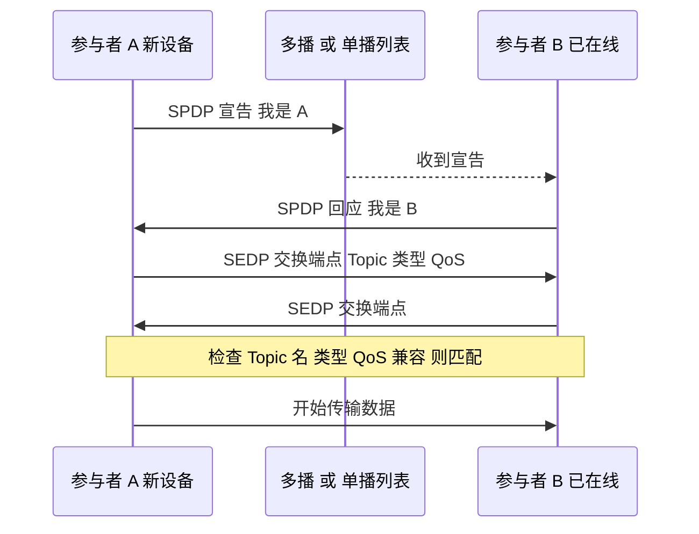
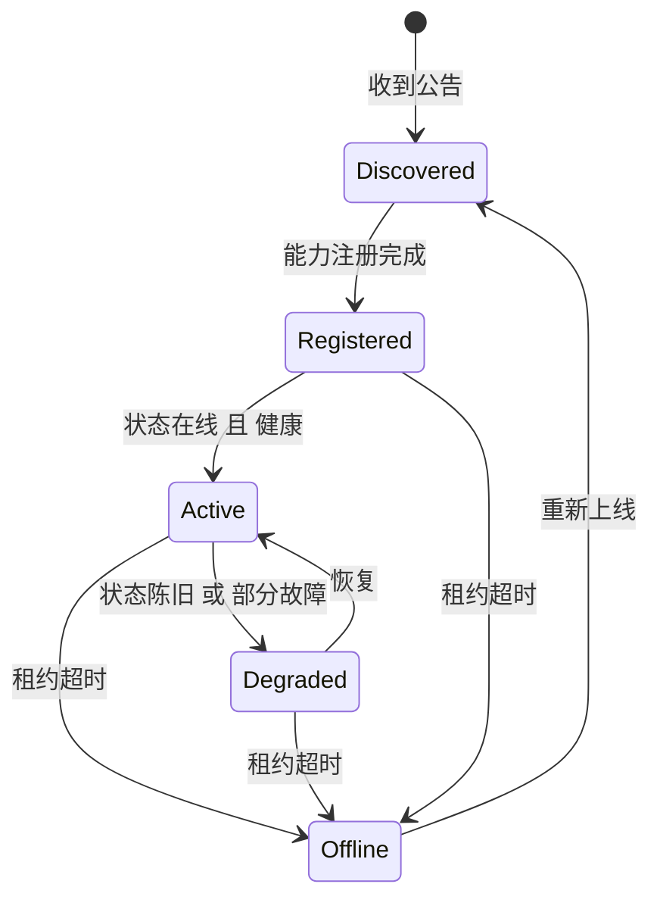
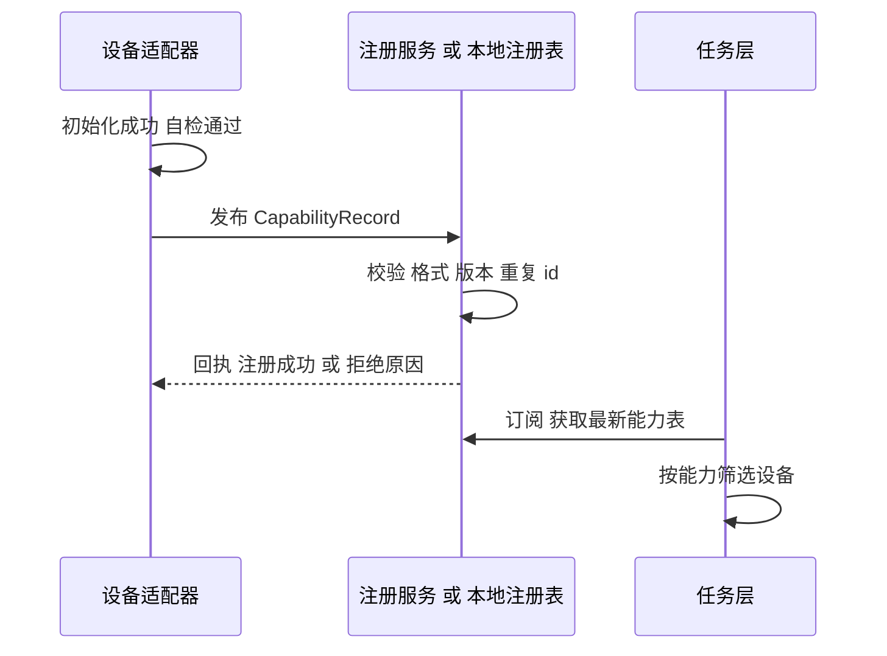

# 06 DDS 与 M-DDS：设备发现、能力注册、状态同步、任务分发

> 一句话定位：CV 第三条 bullet——"implemented device discovery, capability registration, state synchronisation and task dispatch over M-DDS"。本章先把 DDS 标准讲透（域、主题、发布订阅、QoS、发现、RTPS），再给出这四件事在 DDS 上**典型**的实现方式、QoS 选型理由和手算，最后给出本项目统一的 M-DDS 设计口径（第 12 节）。

**本章学完你能……**

- 讲清 DDS 与消息队列、TCP/HTTP、ROS2 的关系，以及"以数据为中心"是什么意思。
- 列出核心实体（Domain、DomainParticipant、Topic、Publisher/DataWriter、Subscriber/DataReader）和主要 QoS（Reliability、Durability、History、Deadline、Liveliness、Lifespan、Ownership、Partition）。
- 解释 QoS 的"请求—提供"兼容规则，并手算两端是否匹配。
- 为 **设备发现、能力注册、状态同步、任务分发** 四个功能各设计一套 Topic + QoS，并说出理由。
- 评估拓扑和带宽，识别发现风暴、大数据、丢包、时钟等风险。
- 面对 "M-DDS 是什么、和标准 DDS 有何区别" 时诚实且有条理地回答。

**前置知识**

- [DDS 与分布式通信](../../02_基础知识/09_机器人软件/05_DDS与分布式通信.md)
- [ROS1/ROS2 核心概念](../../02_基础知识/09_机器人软件/04_ROS1_ROS2核心概念.md)
- [计算机网络八股](../../03_八股知识/01_计算机基础/03_计算机网络.md)
- 上一章：[05 机器人状态管理](./05_机器人状态管理.md)

**目录**

1. 要解决什么问题
2. DDS 标准速览
3. QoS 详解与兼容规则
4. 发现机制
5. 设备发现的典型设计
6. 能力注册的典型设计
7. 状态同步的典型设计
8. 任务分发的典型设计
9. 拓扑、规模与带宽估算
10. 与 IPC、软总线、ROS2 的分工
11. 安全与可靠性风险
12. M-DDS 细节自查
13. 面试问答
14. 要点速记 / 自测题 / 链接

> **诚实声明**：M-DDS 的内部实现、API、是否遵循 RTPS 线协议互通，CV 都没有写。本章讲的是**标准 DDS 的通用机制**和"在 DDS 上做这四件事的典型设计"，其中"本项目取值"是设计级口径（与 README 自查表一致），不是 M-DDS 的专有细节转述。

---

## 1. 要解决什么问题

多机器人系统里，数据来源和使用者都在变：新机器人加入、旧机器人掉线、一个状态有多个订阅者、任务要送给特定设备。传统做法是点对点：写死 IP 和端口，每个连接自己管（TCP socket、HTTP 请求）。问题：

- 发布者必须知道所有订阅者（耦合）；
- 新设备加入要手工配置；
- 丢包、重传、缓存策略都要自己写；
- 不同数据（高频状态 vs 关键指令）需要不同的可靠性，一个通道难以同时满足。

DDS（Data Distribution Service，OMG 标准）的思路是 **以数据为中心的发布—订阅（data-centric publish-subscribe）**：

- 发布者只管往一个**主题（Topic）**写数据，订阅者只管订阅主题；
- 双方**自动发现**彼此，无需知道对方位置；
- 每个主题、每个读写端可配置**QoS（服务质量）**，把可靠性、历史、时效等策略声明出来，由中间件执行。

这与 ROS2 采用 DDS 做通信底座的理由一致。

---

## 2. DDS 标准速览

### 2.1 标准族

| 标准 | 作用 |
|---|---|
| DDS（DCPS） | 以数据为中心的发布订阅 API 与服务模型 |
| DDSI-RTPS | 线协议，规定不同厂商实现之间如何互通（基于 UDP，也可扩展） |
| DDS-XTypes | 类型系统与类型演进 |
| DDS-Security | 认证、访问控制、加密 |
| IDL | 接口定义语言，用来描述数据类型 |

### 2.2 核心实体

```text
Domain (域, 整数 id)  ── 逻辑隔离的"通信空间"；不同 domain 互相看不见
  └─ DomainParticipant   应用在某个 domain 中的入口（一个进程通常一个）
       ├─ Topic             名称 + 数据类型 (+ QoS)：通信的"频道"
       ├─ Publisher  ─ DataWriter<T>   写某个 Topic
       └─ Subscriber ─ DataReader<T>   读某个 Topic
```

| 概念 | 含义 |
|---|---|
| Domain | 以 domain id 区分的逻辑网络；同一 domain 内的参与者才会互相发现 |
| Topic | 命名的数据流，有类型；"名称+类型"一致才能匹配 |
| Key / Instance | 类型中可指定 key 字段；同一 Topic 下不同 key 值是不同"实例"（如不同设备 id 的状态）。QoS（如 History）按实例独立生效 |
| DataWriter / DataReader | 真正读写的端点；QoS 在此配置并参与匹配 |
| Listener / WaitSet | 回调或等待式取数据 |
| Content-filtered Topic | 在订阅端按内容过滤 |

**Key 的威力**（面试常问）：一个 `DeviceState` Topic，key 为 `device_id`。系统里有 30 台设备，只需要一个 Topic，却有 30 个实例；`KEEP_LAST 1` 意味着**每台设备**保留最新一条，而不是整个 Topic 只留 1 条。

### 2.3 RTPS 做什么

RTPS 规定了发现报文、数据报文、心跳（HEARTBEAT）、确认（ACKNACK）等格式。可靠传输靠"心跳 + ACKNACK + 重传"实现：写端周期性广播"我发到了序号 N"，读端回复"缺哪些"，写端补发。`BEST_EFFORT` 则不确认不重传。

---

## 3. QoS 详解与兼容规则

### 3.1 主要 QoS 策略

| 策略 | 取值 | 含义与典型用途 |
|---|---|---|
| Reliability | `BEST_EFFORT` / `RELIABLE` | 是否保证送达（重传）。高频状态用前者；命令、注册用后者 |
| Durability | `VOLATILE` / `TRANSIENT_LOCAL` / `TRANSIENT` / `PERSISTENT` | 对**晚加入**的订阅者是否补发历史。`TRANSIENT_LOCAL`：写端在运行期间保留，晚到者可拿到 |
| History | `KEEP_LAST(depth)` / `KEEP_ALL` | 本地保留多少样本（每实例） |
| Resource Limits | max_samples 等 | 防止内存无限增长 |
| Deadline | 周期 | 期望每个实例至少每隔多久更新一次；违反会产生通知 |
| Lifespan | 时长 | 样本的有效期，过期被丢弃（不会被迟到的订阅者收到） |
| Liveliness | `AUTOMATIC` / `MANUAL_BY_PARTICIPANT` / `MANUAL_BY_TOPIC` + lease_duration | 写端"还活着"的声明方式与租约；超期则认为写端失联 |
| Ownership | `SHARED` / `EXCLUSIVE` + strength | 多个写端写同一实例时，谁说了算；独占时强度最高者胜 |
| Destination Order | 按接收时间 / 按源时间戳 | 乱序到达时采用哪个顺序 |
| Time-based Filter | 最小间隔 | 订阅端降低数据频率 |
| Partition | 字符串集合 | 在 domain 内再做逻辑分区（如按机器人分组） |
| Latency Budget / Transport Priority | | 提示传输层优化延迟/优先级 |
| User Data / Topic Data | 字节串 | 附带的少量元数据 |

### 3.2 请求—提供（RxO）兼容规则

DDS 中部分 QoS 是"读端请求、写端提供"，匹配时**提供的必须不弱于请求的**：

| 策略 | 兼容条件 |
|---|---|
| Reliability | 写端 `RELIABLE` 可匹配读端 `RELIABLE` 或 `BEST_EFFORT`；写端 `BEST_EFFORT` **不能**匹配读端 `RELIABLE` |
| Durability | 写端等级 ≥ 读端等级（VOLATILE < TRANSIENT_LOCAL < TRANSIENT < PERSISTENT） |
| Deadline | 写端提供的周期 ≤ 读端请求的周期 |
| Liveliness | 写端的类型强度 ≥ 读端，且写端租约 ≤ 读端租约 |
| Ownership | 必须相同 |
| Destination Order | 写端提供 ≥ 读端请求 |

**手算（教学示例）**：

- 写端：`BEST_EFFORT, VOLATILE, deadline=100 ms`；读端：`RELIABLE, VOLATILE, deadline=200 ms`。
  Reliability：写端 BEST_EFFORT < 读端 RELIABLE → **不兼容**，不会匹配，且通常没有数据（排查时看到"incompatible QoS"事件）。
- 写端改为 `RELIABLE, TRANSIENT_LOCAL, deadline=100 ms`；读端 `RELIABLE, VOLATILE, deadline=200 ms`：
  Reliability 相同；Durability 写端 TRANSIENT_LOCAL ≥ 读端 VOLATILE；Deadline 100 ≤ 200 → **兼容**。

这是机器人系统里最常见的"为什么我收不到数据"的原因之一：状态话题写端用 `BEST_EFFORT`（传感器惯例），而读端默认 `RELIABLE`。

### 3.3 History 与 Reliability 的组合含义

- `RELIABLE + KEEP_LAST(1)`：保证"最新值"最终会送达，但如果读端处理慢，旧值会被覆盖。适合"状态"。
- `RELIABLE + KEEP_ALL`：保证每条都送达，写端缓冲可能增长，受 Resource Limits 限制。适合"事件/命令序列"。
- `BEST_EFFORT + KEEP_LAST(1)`：只关心最新，丢了就丢了。适合高频传感器流。

---

## 4. 发现机制

### 4.1 两层发现（标准 RTPS 做法）

1. **SPDP（Simple Participant Discovery Protocol）**：参与者周期性向约定的多播（或配置的单播列表）地址宣告自己（我是谁、我在哪、怎么联系我）。同一 domain 的其他参与者收到后互相认识。
2. **SEDP（Simple Endpoint Discovery Protocol）**：参与者互相认识后，交换各自的 **读写端点**信息（Topic 名、类型、QoS）。双方检查 Topic/类型/QoS 兼容，兼容则**匹配**，开始传数据。



### 4.2 发现的代价与变体

| 问题 | 说明 | 缓解 |
|---|---|---|
| 多播不可用 | 一些网络（无线、跨网段、云）禁用多播 | 配置静态对等列表（initial peers）或使用发现服务器（Discovery Server） |
| 发现流量随规模增长 | 全网状发现，每个参与者与所有其他参与者交换端点信息，复杂度约 $O(N^2)$ | 用 Domain/Partition 切分；发现服务器；限制每个进程的参与者数 |
| 重启后的"幽灵"实体 | 掉线后租约未到期，旧实体还被当作存活 | 调整租约时长；Liveliness |
| 发现慢 | 新设备要等周期性宣告 | 加快初始宣告速率 |

**手算（教学示例）**：$N$ 个参与者全网状发现，需要的两两发现关系数 $=N(N-1)/2$。$N=10$ 时 45 对；$N=50$ 时 1225 对。可见增长很快，这是规模扩大时需要关注发现开销的原因。

---

## 5. 设备发现的典型设计

要解决的问题：**机器人/设备上线、下线，其他节点要自动知道**。

### 5.1 两层含义

1. **网络层发现（DDS 内建）**：参与者互相发现。这只说明"有个进程在 domain 里"。
2. **应用层设备发现**：DDS 内建发现不知道"这是一台底盘还是一个雷达"。典型做法是加一层**设备公告（DeviceAnnouncement）**：每个设备/适配器向公告 Topic 发布自己的身份与状态。

### 5.2 典型的 Topic 设计（教学示例）

```text
Topic: device/announce
Type : DeviceAnnouncement { device_id (key), kind, robot_id, software_version, endpoint_info... }
QoS  : RELIABLE, TRANSIENT_LOCAL, KEEP_LAST(1), Liveliness=AUTOMATIC lease=3 s
```

- `KEY = device_id`：每台设备一个实例。
- `TRANSIENT_LOCAL + KEEP_LAST(1)`：晚加入的订阅者（例如刚启动的任务调度器）立即拿到所有设备的**最新公告**，而不用等下一次广播。
- `Liveliness lease = 3 s`（示例）：设备失联超过 3 s，订阅者收到"实例不再存活"通知 → 应用层把设备标为 `Offline`。
- 设备下线时主动 `dispose` 实例，实现**优雅下线**；崩溃则由 lease 超时检测。

> 对 "离线判断" 要小心：lease 过短会因网络抖动误判掉线；过长则故障发现慢。取值应结合心跳周期（至少 2–3 倍）和业务容忍度。数值 3 s 是示例。

### 5.3 设备生命周期状态机（典型）



"Discovered / Registered / Active" 要分开：**被发现（网络上有人）≠ 已注册能力（我知道它能做什么）≠ 可用（状态健康且新鲜）**。任务分发只能给 `Active` 的设备。

**本项目取值**：设备启动后每 1 s 在 `discovery/announce` 上发一次公告（device_id、robot_id、能力摘要哈希、软件版本、seq），公告 QoS 带 Liveliness 租约 3 s（3 个周期）；3 s 内收不到公告判为 OFFLINE，状态管理器置对应状态为 Stale 并通知任务层；重上线时设备重新提交能力、做一次完整状态同步，状态机回到 Discovered → Registered → Active。

---

## 6. 能力注册的典型设计

要解决的问题：设备被发现后，系统要知道"它能做什么、做到什么程度"（03 章的能力描述），并让任务层按能力选设备。

### 6.1 Topic 设计（教学示例）

```text
Topic: device/capabilities
Type : CapabilityRecord { device_id (key), capability_list[], schema_version, config_hash, stamp }
QoS  : RELIABLE, TRANSIENT_LOCAL, KEEP_LAST(1)
```

- 能力是**相对静态**的信息（设备不会频繁改变能做的事），适合"可靠 + 晚到者可补"。
- `config_hash`：能力或配置变化时哈希改变，订阅者据此知道要刷新缓存。
- `schema_version`：能力描述格式的版本，保证前后兼容。

### 6.2 注册流程



### 6.3 要点

1. **注册要经过校验**：重复 `device_id`（冲突）、能力格式错误、版本不兼容都要拒绝并返回原因；否则错误的能力描述会被策略校验"信任"，把危险命令放行。
2. **谁有权注册**：设备身份要有认证（DDS-Security 或应用层令牌），否则任何节点都能"冒充"一个设备并声明自己有任意能力。
3. **注销与更新**：设备下线时能力记录标为无效；能力变化时更新（不是新增一条）。
4. **注册内容与实际一致**：能力来自适配器自检/配置，不是硬编码的宣传。

**本项目取值**：注册内容即 03 章的能力描述（id、version、type、unit、frame、limits、cmd_rate_hz、timeout_ms、modes、safety_level）。校验规则：device_id 不得重复、字段齐全且单位合法、版本在兼容范围、limits 不得超过设备配置上限。注册管理由协同层的能力注册表负责（单点写、多点读，注册表内容缓存在每台机器人本地，注册服务短暂不可用不影响已注册设备）。认证：设备接入时用预置的设备密钥对注册请求做 HMAC 签名，未签名的注册被拒绝。

---

## 7. 状态同步的典型设计

要解决的问题：各设备的状态（05 章治理后的状态）要让任务层、策略校验、其他设备看到。

### 7.1 Topic 设计（教学示例）

```text
Topic: robot/state
Type : RobotStateMsg { robot_id (key), stamp, frame_id, fields[], overall_health, seq }
QoS  : BEST_EFFORT (或 RELIABLE), VOLATILE, KEEP_LAST(1),
       Deadline = 2 × 期望周期, Liveliness = AUTOMATIC lease = N × 周期
```

选型理由：

| QoS | 选择 | 理由 |
|---|---|---|
| Reliability | `BEST_EFFORT`（高频连续状态）；关键低频状态用 `RELIABLE` | 高频状态过时就没价值，重传反而造成延迟堆积与阻塞 |
| Durability | `VOLATILE`（连续状态）或 `TRANSIENT_LOCAL`（低频关键状态） | 连续流不需要补历史；晚加入者下个周期就会收到 |
| History | `KEEP_LAST(1)` | 只关心最新 |
| Deadline | 周期的 2 倍（示例） | 超过没更新 → 通知应用层，触发陈旧处理 |
| Liveliness | 租约 | 区分"没变化"和"发布者死了" |

### 7.2 状态同步的陷阱

1. **同步 ≠ 一致**：DDS 保证样本送达（取决于 QoS），不保证不同接收者**同一时刻**看到同一状态。需要一致性的使用者要用样本里的 `stamp`，而不是接收时间（05 章）。
2. **时间戳**：跨设备状态的 `stamp` 只有在时钟同步时才可比（见 05 章 3.3）。
3. **序号 `seq`**：用来检测丢包与乱序（`BEST_EFFORT` 下尤其需要）。
4. **大状态的分块**：一个巨大的状态消息会被 RTPS 分片，丢一个分片整条丢（BEST_EFFORT）。建议把高频小量（速度、位姿）与低频大量（地图、配置）分开成不同 Topic。
5. **频率控制**：订阅端可以用 Time-based Filter 降低频率，避免低速消费者被高频流淹没。
6. **状态是"事实"，命令是"意图"**：不要把命令混在状态 Topic 里。

### 7.3 同步方式：全量与增量

- **全量周期发布**：简单、自愈（丢了下一条补上）；适合小状态。
- **事件/增量发布**：省带宽；丢一条会导致不一致，需要定期全量校正。
典型组合：周期全量（低频）+ 变化事件（高频）。

**本项目取值**：分两个通道。**快通道** `state/{robot_id}/fast`：位姿/速度/关节摘要，20 Hz，BestEffort + Volatile + KeepLast(1)，Deadline 100 ms；**慢通道** `state/{robot_id}/health`：电量、温度、故障码、模式、设备在线表，1 Hz，Reliable + TransientLocal + KeepLast(1)，每 30 s 做一次全量校正。消息字段即 05 章的状态字段（stamp、frame_id、source_id、seq、value、age_ms、validity）。

---

## 8. 任务分发的典型设计

要解决的问题：把任务（含"动作提案"）可靠地送给指定设备，并获知执行情况；防止重复执行、过期执行、并发冲突。

### 8.1 命令/回执的两个 Topic（教学示例）

```text
Topic: task/command
Type : TaskCommand { task_id (key), target_device, action, params,
                     issued_at, valid_until, issuer, seq, idempotency_key }
QoS  : RELIABLE, TRANSIENT_LOCAL 或 VOLATILE (视场景), KEEP_ALL 或 KEEP_LAST(depth),
       Lifespan = 有效期

Topic: task/receipt
Type : TaskReceipt { task_id (key), device_id, stage, result, reason, stamp }
QoS  : RELIABLE, KEEP_LAST(depth)
```

### 8.2 设计要点

1. **可靠**：任务命令不可丢，用 `RELIABLE`。
2. **有效期（Lifespan / valid_until）**：任务过期后不应再被执行（例如设备离线 10 分钟后重连，不应执行 10 分钟前"前进"的命令）。DDS 的 `Lifespan` 让样本过期自动丢弃；应用层的 `valid_until` 字段在执行前再次检查，**两层保险**。
3. **定向分发**：用 `target_device` 字段 + 订阅端 content-filter，或每个设备独立 Topic / Partition，避免所有设备都收到所有任务。
4. **回执（receipt）**：设备按阶段回报：`Received → Accepted/Rejected → Started → Completed/Failed`。这对应第 08 章 "execution → state-feedback" 的语义。
5. **幂等**：同一个 `task_id`/`idempotency_key` 重复到达（网络重传、订阅者重启后 `TRANSIENT_LOCAL` 回放）只能执行一次。设备端记录已处理的 id。
6. **独占与冲突**：同一设备同一时间只应有一个"任务所有者"；可用 `Ownership=EXCLUSIVE` 或应用层租约/仲裁。
7. **顺序**：若任务序列有先后依赖，用序号 `seq` 并校验；乱序到达时按 `seq` 或拒绝。
8. **任务分发 ≠ 直接下发运动命令**：任务分发的内容是"高层任务/动作提案"，要进入 08 章的策略校验链，由设备侧或网关侧的校验服务把它变成受控的运动命令。

### 8.3 为什么 `TRANSIENT_LOCAL` 对任务命令是双刃剑

好处：设备晚启动能拿到尚未完成的任务。风险：设备重启后**重复执行**已执行过的任务，或执行已过期任务。所以必须配合幂等 id 与有效期。这是"设计 QoS 时同时考虑重放语义"的典型例子。

**本项目取值**：命令 Topic `task/{robot_id}/cmd` 携带 proposal_id、idem_key、action_type、params、frame、issued_at、valid_until、priority；回执 Topic `task/{robot_id}/ack` 依次回报 RECEIVED → ACCEPTED/REJECTED → EXECUTING → DONE/FAILED/ABORTED。幂等：按 idem_key 去重，去重表保留约为有效期的 2 倍（默认 60 s）。有效期：过期提案回 E_EXPIRED。顺序：同一 robot_id 内按 seq 递增，乱序到达的旧 seq 丢弃。冲突：每台机器人同一时刻只有一个任务所有者，高优先级可抢占，急停永远最高。

---

## 9. 拓扑、规模与带宽估算

### 9.1 拓扑分层（典型）

```text
Domain 0 ── 机器人 A 内部（设备级通信，同机/局域）
Domain 0 + Partition "fleet-1" ── 车队内共享的发现/状态/任务
           ├── Partition "robot-A"
           └── Partition "robot-B"
```

- 用 **Partition** 做机器人级分组；用 **Domain** 做大块隔离（例如实验环境 vs 生产）。
- 本机内部的高频控制数据不应上全网，只发布**降频后的摘要状态**到车队级 Topic。

### 9.2 带宽估算

**手算（教学示例）**：20 个设备，每台发布 50 Hz 状态，每条 200 字节（负载）。
负载带宽 $=20\times50\times200=200{,}000$ B/s $=200$ kB/s $\approx1.6$ Mbit/s。
RTPS 头与 UDP/IP 开销（每包约几十字节，设为 60 B）：$20\times50\times(200+60)=260$ kB/s $\approx2.1$ Mbit/s。
若把订阅端降到 10 Hz（Time-based filter，只影响接收端，写端仍按 50 Hz 发布；若用单播多订阅者则按订阅者数乘以流量），可见 **"谁订阅、订阅者有多少"** 对带宽影响很大。无线网络上，几十个高频订阅就会成为瓶颈。

### 9.3 常见规模问题

| 问题 | 现象 | 对策 |
|---|---|---|
| 发现风暴 | 大量设备同时上线，网络短时拥塞 | 随机退避、分区、发现服务器 |
| 多播泛滥 | Wi-Fi 下丢包 | 改单播/对等列表 |
| 高频大消息 | 分片丢失 | 降频、分 Topic、BEST_EFFORT |
| 订阅者过多 | 写端 CPU/带宽压力 | 汇聚网关、降频 |
| 时钟不同步 | 跨设备 stamp 不可比 | 时间同步机制（05 章） |

---

## 10. 与 IPC、软总线、ROS2 的分工

| 通信方式 | 范围 | 特点 | 典型用途（本平台推断） |
|---|---|---|---|
| IPC（02 章） | 同一设备不同进程 | 同步/异步调用，强类型接口，权限检查方便 | 服务调用、查询、控制接口 |
| M-DDS | 进程间与设备间 | 发布订阅 + QoS + 自动发现 | 发现、注册、状态同步、任务分发 |
| OH 分布式软总线 | 设备组网/连接 | 设备发现、认证、传输通道 | 设备互联底座（M-DDS 在其之上或并行，负责 Topic 级发布订阅，见 02 章） |
| ROS2 话题 | ROS2 节点间 | 基于 DDS 的 ROS 生态通信 | 与 ROS2 世界对接（04 章） |

**选择原则**：

- 需要**调用并得到结果**（请求/应答，带强约束）→ IPC / 服务调用；
- 需要**广播事实**（状态）或**松耦合订阅**（多个消费者）→ 发布订阅；
- 需要**可靠命令 + 回执** → 可靠 Topic 对（命令/回执）或服务调用，视是否需要异步和多订阅者而定。

---

## 11. 安全与可靠性风险

| 风险 | 说明 | 缓解 |
|---|---|---|
| 未认证节点加入 | 恶意或误配置的节点发布命令 | 认证与访问控制（DDS-Security 或应用层）；策略校验再检查 `issuer` 权限 |
| 欺骗设备身份 | 伪造 `device_id` 注册 | 注册需认证；device_id 与凭证绑定 |
| 重放 | 旧命令被重新送达 | `Lifespan`、`valid_until`、`seq`、幂等 id |
| 窃听 | 明文传输 | 加密（性能与密钥管理代价） |
| QoS 不兼容导致静默失败 | 订阅者收不到 | 启动期检查匹配状态并告警 |
| 拒绝服务 | 洪泛 | 速率限制、资源限制 |
| 单点故障 | 发现服务器/注册服务挂掉 | 冗余、本地缓存 |

DDS 本身只提供通信机制，**命令是否该执行，不是 DDS 的责任**。这就是为什么需要 08 章的安全执行链：即便命令经 DDS 可靠送达，也要在设备侧由策略校验把关。PS 里 "a fleet whose tasks are dispatched over a distributed bus needs a security model as well as a scheduler" 说的就是这一点。

---

## 12. M-DDS 细节自查

面试官很可能追问 "What is M-DDS? How is it different from standard DDS?" 本项目统一口径如下（设计级，口述时说 *in our design / roughly*）：

- **定位**：平台提供的 DDS 类中间件，按"DDS 标准概念的封装与裁剪版"来讲：保留 Domain、Topic、发布订阅、QoS、发现，裁掉与机器人场景无关的部分；我是使用者，在其上定义 Topic 与消息类型。
- **互通**：与 ROS2 通过桥接节点交换数据，而不是让 ROS2 直接换 RMW；线协议层面的互通程度属中间件内部，不展开。
- **QoS**：快状态 BestEffort + KeepLast(1) + Deadline；能力/健康 Reliable + TransientLocal；任务命令/回执 Reliable + Volatile + KeepLast(10)；公告带 3 s 租约。
- **发现**：同网段多播公告为主，多播被禁用时用静态对等列表兜底。
- **Topic 命名**：`discovery/announce`、`capability/{robot_id}`、`state/{robot_id}/fast|health`、`task/{robot_id}/cmd|ack`，按车队划分 Domain。
- **规模**：设计规模约 5–10 台机器人、每台 3–6 个设备，约 30–60 个端点；状态流合计约每台 20 Hz。

在不能或不愿透露时，诚实回答模板见 [99 文档](./99_英文面试口述与深挖问答.md) 的"边界回答"一节。

---

## 13. 面试问答

**Q1. Why DDS instead of plain TCP or an HTTP API?**

> Robots come and go, and many consumers need the same data. DDS is data-centric: a publisher writes to a topic, subscribers pick it up, discovery is automatic, and the quality of service — reliability, history, deadlines — is declared per topic. With TCP I would have to manage connections, addresses and retransmission myself.

追问：DDS 也有缺点吗？→ 配置复杂（QoS 不兼容静默失败）、发现流量随规模增长、不保证跨接收者同时一致、需要自己做安全模型。

**Q2. How did you use DDS for device discovery and capability registration?**

> In our design, discovery has two layers: the middleware discovers participants, and an application-level announcement says what the device is. Capability records are published reliably with transient-local durability, so a late-joining scheduler immediately gets the latest capability of each device, and a liveliness lease tells us when a device has gone.

**Q3. Which QoS would you choose for state and for task commands, and why?**

> For continuous state I would use best-effort, keep-last one, with a deadline: stale data is worthless, so retransmission would only add delay, and the deadline tells me when updates stop. For task commands I would use reliable delivery with a lifespan, plus task IDs for idempotency, because a lost command is bad, but a late or duplicated one can be worse.

追问：为什么不能全部 RELIABLE？→ 高频状态下重传造成队头阻塞和延迟堆积；慢订阅者会拖慢写端。

**Q4. Reader is reliable, writer is best-effort. What happens?**

> They do not match, because the offered reliability is weaker than requested. The reader gets no data, and typically you see an incompatible-QoS event. It's one of the first things I check when a topic is silent.

**Q5. Does DDS make the robot state consistent across devices?**

> No. It delivers samples according to the QoS, but different receivers see them at different times. Consistency comes from timestamps on a common time base and from validity checks on the receiving side.

**Q6. How do you stop a reconnecting device from re-running an old task?**

> A task ID for idempotency, a validity deadline checked before execution, and a lifespan on the sample so stale commands expire in the middleware as well.

---

## 14. 本章要点速记

1. DDS = 以数据为中心的发布订阅：Topic、DataWriter/Reader、自动发现、QoS。
2. Key 区分实例；`KEEP_LAST(1)` 按实例保留最新。
3. 核心 QoS：Reliability、Durability、History、Deadline、Lifespan、Liveliness、Ownership、Partition。
4. RxO 兼容：写端提供不弱于读端请求；BEST_EFFORT 写端不能匹配 RELIABLE 读端。
5. 发现分两层：SPDP（参与者）+ SEDP（端点）；全网状发现成本 $O(N^2)$。
6. 设备发现 = 网络层发现 + 应用层公告（lease 判离线）；发现 ≠ 注册 ≠ 可用。
7. 能力注册：可靠 + `TRANSIENT_LOCAL`，需校验与认证。
8. 状态同步：`BEST_EFFORT` + `KEEP_LAST(1)` + Deadline，用 `stamp` 保一致，高低频分通道。
9. 任务分发：`RELIABLE` + Lifespan + 回执 + 幂等 id + 所有权；`TRANSIENT_LOCAL` 要防重放。
10. DDS 只送数据，不判断该不该执行——需要安全执行链。

## 自测题

1. 写端 `RELIABLE, VOLATILE`，读端 `RELIABLE, TRANSIENT_LOCAL`，能否匹配？（答：不能，写端 Durability 低于读端请求。）
2. Key 在 `KEEP_LAST(1)` 下有什么作用？
3. 为什么设备"被发现"不等于"可接任务"？
4. 手算：15 台设备、每台 20 Hz、每条 300 B 负载，负载带宽是多少？（答：$15\times20\times300=90{,}000$ B/s $=90$ kB/s。）
5. 为什么任务命令需要 Lifespan 又需要应用层 `valid_until`？

## 相关链接

- 上一章：[05 机器人状态管理](./05_机器人状态管理.md)
- 下一章：[07 任务规划与实时控制的分层](./07_任务规划与实时控制的分层.md)
- 安全链：[08 安全执行链](./08_安全执行链.md)
- 基础：[DDS 与分布式通信](../../02_基础知识/09_机器人软件/05_DDS与分布式通信.md)
