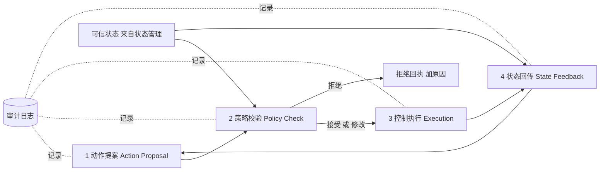
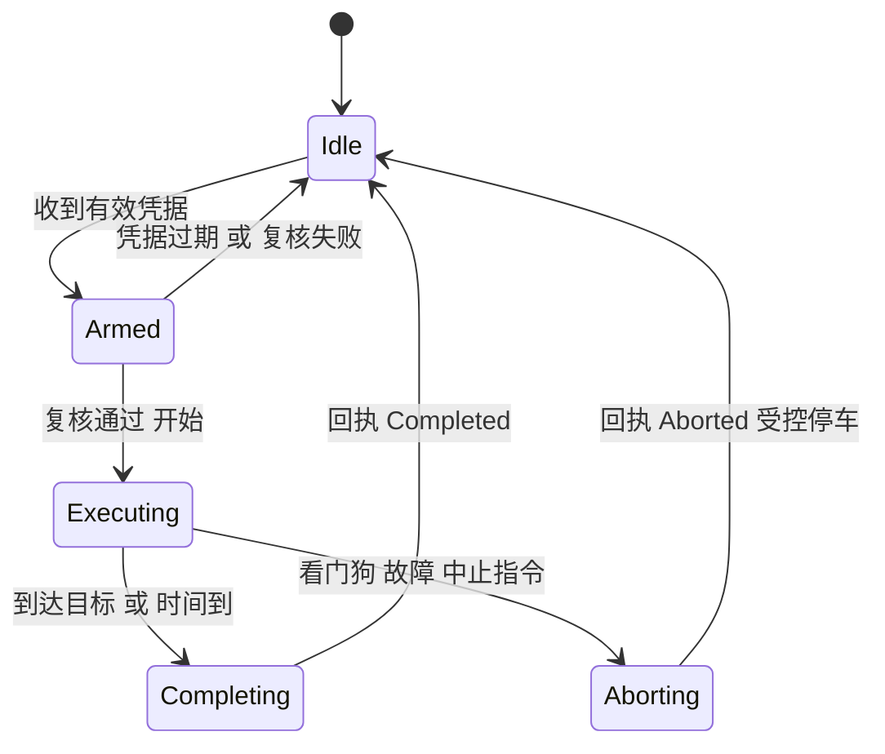
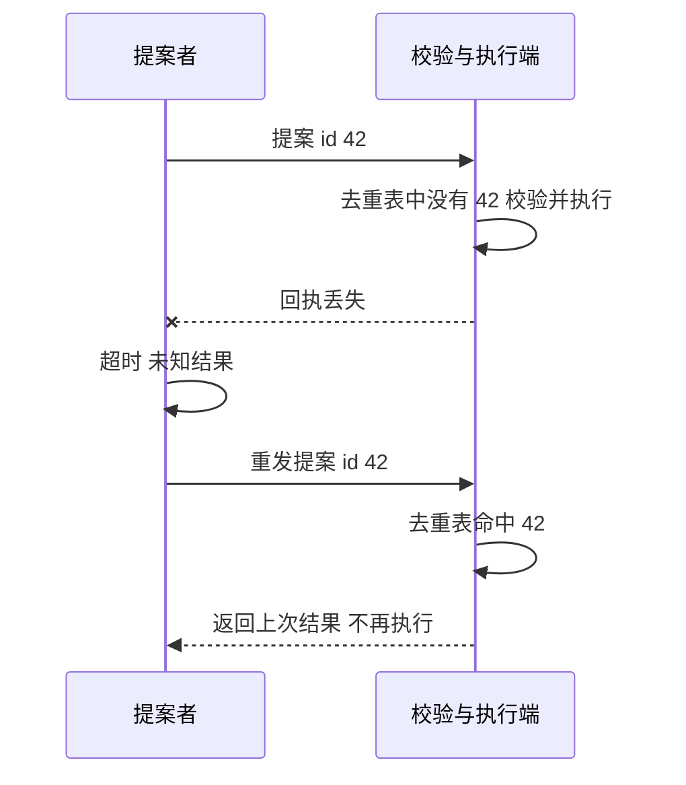

# 08 安全执行链：动作提案 → 策略校验 → 控制执行 → 状态回传

> 一句话定位：这是你 PS 的开篇钩子，也是面试官最可能反复深挖的一章。CV 原话："gated task plans through an action-proposal, policy-check, execution and state-feedback chain"；PS 原话："a high-level task plan cannot be sent directly to a robot. It must pass through an action-proposal, policy-check, execution and state-feedback chain before any actuator is allowed to move"。本章把这条链的每个阶段拆成：输入、输出、校验规则、拒绝与降级、审计、失败处理、幂等、看门狗，并给出可编译的教学版策略引擎。

**本章学完你能……**

- 用一句话和一张图讲清四个阶段各自负责什么、为什么缺一不可。
- 列出七类校验规则（白名单、范围、速度/加速度限幅、模式、新鲜度、权限、空间/地理围栏）及其数学形式，并说出"接受/修改/拒绝/需确认"四种裁决。
- 解释 TOCTOU（检查到使用之间的竞态）问题和"执行凭据"思路，说清"唯一通道"原则。
- 设计提案、决策、执行、回传四类记录的字段，使整条链可审计、可追溯。
- 讲清失败处理：超时、未知结果、重试、幂等、看门狗、故障安全、急停为什么不走这条链。
- 手算几个典型校验（限幅、围栏、新鲜度、停车距离）。

**前置知识**

- [03 统一能力模型](./03_统一能力模型与设备抽象.md)、[05 机器人状态管理](./05_机器人状态管理.md)、[06 DDS 与 M-DDS](./06_DDS与M-DDS分布式协同.md)、[07 任务规划与实时控制的分层](./07_任务规划与实时控制的分层.md)
- [前馈、增益调度、限幅与饱和](../../02_基础知识/04_控制理论/07_前馈_增益调度_限幅与饱和.md)

**目录**

1. 要解决什么问题
2. 总览：四个阶段与两个原则
3. 阶段一：动作提案
4. 阶段二：策略校验
5. 七类校验规则详解
6. 裁决：接受、修改、拒绝、需确认
7. TOCTOU 与执行凭据
8. 阶段三：控制执行
9. 阶段四：状态回传
10. 审计与可追溯
11. 失败处理、幂等与看门狗
12. 急停为什么不走这条链
13. 教学版策略引擎（可编译）
14. 设计取舍与常见错误
15. 面试问答（见 99 文档深挖）
16. 要点速记 / 自测题 / 链接

> **诚实声明**：以下规则类别、字段、流程都是"这类安全执行链的典型设计"，用于帮你建立框架并回答原理性问题。M-Robots 实际的策略规则清单、提案格式、凭据机制、审计内容，你需要自己补全：`【待你补全：策略规则清单（可公开的类别）】`、`【待你补全：提案与回执的字段】`、`【待你补全：策略校验部署位置与拒绝/降级的实际行为】`。在面试里，永远用 "In a typical design ..." 或 "The way I structured it ..."（后者只在确属你实现时用）。

---

## 1. 要解决什么问题

### 1.1 为什么高层计划不能直接发给机器人

高层计划的来源可能是：任务调度器、远程操作员、第三方应用，或者 **AI/LLM 规划器**。它们有共同特点：

1. **不了解物理实时状态**：规划时机器人状态可能已经变了。
2. **可能出错**：参数越界、单位错、目标点在禁区、与另一台机器人冲突。
3. **可能被攻击或误用**：伪造身份、重放旧命令。
4. **AI 生成内容可能不可预测**：LLM 输出看起来合理但违反物理或安全约束（"幻觉"）。

如果这些计划直接变成电机命令，任何一个错误都会直接变成物理伤害。**物理世界的错误无法回滚**——这是和纯软件系统的根本区别。

### 1.2 核心思想

> 在"决策"和"物理执行"之间放一道**独立的、可审计的、默认拒绝的门**。决策方只能"提议"（propose），门根据**当前可信状态**和**策略**裁决，门之后才有执行；执行结果必须回传，让决策方知道发生了什么。

这是一条经典的安全工程思想，类似：

- 工业控制里的**安全 PLC / 安全继电器**与普通控制器分离；
- 操作系统里**用户态请求 → 内核检查权限 → 执行**；
- 数据库的**事务校验**。

---

## 2. 总览：四个阶段与两个原则



| 阶段 | 做什么 | 输入 | 输出 | 谁负责（典型） |
|---|---|---|---|---|
| 1 提案 | 把意图表达为结构化、可校验的请求 | 任务计划 / AI 规划 / 操作员意图 | `Proposal`（带身份、有效期、参数） | 决策方（任务层、AI） |
| 2 校验 | 依据策略 + 当前状态裁决 | `Proposal`、可信状态、策略、能力描述 | `Decision`（接受/修改/拒绝/需确认 + 原因 + 凭据） | 策略校验器（安全层） |
| 3 执行 | 只执行已通过的、带凭据的命令 | 已通过的命令 | 受控的运动命令、执行回执 | 运动接口 + 适配器 |
| 4 回传 | 把执行阶段与结果、最新状态返回 | 执行事件、可信状态 | `Receipt`/`Feedback` | 状态管理 + 回执 |

**原则一：唯一通道（single path）**。所有会让执行器动的高层决策，**只能**经过这条链。如果存在任何一条旁路（调试接口、旧代码路径、另一个服务直连驱动），整条链的价值就被抵消。实现上靠进程/权限隔离：只有校验器签发的凭据，适配器才接受。

**原则二：默认拒绝（default deny）**。没有被明确允许的，就是不允许。白名单优于黑名单；规则缺失/异常/超时的处理结果都是拒绝或降级到更安全状态，而不是放行。

---

## 3. 阶段一：动作提案

### 3.1 为什么叫"提案"

用词体现语义：决策方**没有权力直接执行**，只是提出一个请求，等待裁决。这在代码里的体现是：决策方拿到的接口只能提交 `Proposal`，拿不到任何执行器句柄。

### 3.2 提案应包含什么（教学设计）

| 字段 | 含义 | 作用 |
|---|---|---|
| `proposal_id` | 全局唯一 id | 幂等、审计、回执关联 |
| `issuer` | 提出者身份（服务/用户/AI 规划器） | 权限校验、追责 |
| `target_device` | 目标设备 | 路由、能力查找 |
| `action` | 动作类型（来自白名单枚举） | 白名单校验 |
| `params` | 参数（带单位） | 范围/限幅校验 |
| `issued_at` / `valid_until` | 提出时间 / 失效时间 | 新鲜度、防重放 |
| `frame_id` | 参数所在坐标系 | 坐标一致 |
| `priority` | 优先级 | 冲突仲裁 |
| `rationale`（可选） | 提案理由/来源计划引用 | 审计、可解释性 |
| `preconditions`（可选） | 期望的前置状态 | 防止"过时的计划" |

### 3.3 结构化的重要性

提案**必须是结构化数据**（枚举 + 数值 + 单位），不是自由文本。尤其当提案来自 LLM：模型可以输出 JSON，但必须经过**模式（schema）校验**——字段缺失、类型错误、枚举值不在白名单，一律在最前面拒绝，**不尝试"猜测意图并修复"**。

---

## 4. 阶段二：策略校验

### 4.1 输入

1. **提案**。
2. **可信状态**（来自 05 章，包含各量的有效性和新鲜度）。
3. **能力描述**（来自 03 章：设备能做什么、上限是多少）。
4. **策略（policy）**：规则集合，版本化、可配置，通常**与代码分离**（数据驱动），便于审计和更新。
5. **上下文**：当前模式、其他任务占用情况、环境区域信息。

### 4.2 输出

`Decision` 包括：裁决（接受/修改/拒绝/需确认）、修改后的命令（若有）、触发的规则与原因列表、**策略版本号**、时间戳，以及（接受/修改时）**执行凭据**（见第 7 节）。

### 4.3 规则评估的结构

典型做法是**规则链（rule pipeline）**，按顺序评估，"先便宜后昂贵，先结构后语义"：

```text
1. 格式/模式校验      (schema, 类型, 有限值)
2. 身份与权限          (issuer 是谁, 能不能对该设备做该动作)
3. 白名单              (action 是否被允许)
4. 有效期              (valid_until, 防重放)
5. 状态依赖            (模式, 新鲜度, 健康, 前置条件)
6. 范围与限幅          (速度/加速度/力矩上限, 可能"修改")
7. 空间约束            (围栏, 禁区, 避让)
8. 资源与冲突          (设备是否被占用, 与其他任务冲突)
```

规则评估必须**确定且无副作用**（纯函数式）：同样的输入给出同样的输出，便于测试和重放审计。规则本身出现异常/超时 → 视为拒绝（默认拒绝）。

---

## 5. 七类校验规则详解

### 5.1 白名单（Whitelist）

只允许明确列出的 `(issuer, device, action)` 组合。

**例（教学示例）**：

| issuer | 允许的 action |
|---|---|
| task_planner | move_velocity, stop, go_to_pose |
| operator_ui | move_velocity, stop |
| ai_planner | go_to_pose（需要确认）, stop |

AI 规划器甚至不被允许直接 `move_velocity`（低层动作），只能提出高层目标，由下游转成受约束的轨迹。**权限随层级和风险递减。**

### 5.2 范围（Range）

参数落在物理/业务合理区间。

$$ v_{min}\le v_x\le v_{max},\quad |\omega_z|\le \omega_{max} $$

范围值来自**能力描述**，不是校验器里写死的常数（03 章）。同一规则对不同设备自动适配。

### 5.3 速度、加速度、跳变（Jerk）限幅

对一个速度提案，除了绝对上限，还有：

- 加速度：相邻命令的变化率 $|v_k-v_{k-1}|/\Delta t\le a_{max}$；
- 总持续时间：`duration` 不超过上限，避免"一次提案跑很久、中途无人监控"。

**手算（教学示例）**：当前速度 $0.1$ m/s，提案要求 $0.5$ m/s，要求 $0.2$ s 内完成，$a_{max}=1.0$ m/s$^2$：
需要的加速度 $=(0.5-0.1)/0.2=2.0$ m/s$^2>1.0$ → 超限。裁决选择：
(a) 拒绝；(b) 修改——延长爬升时间到 $0.4$ s，或把目标速度钳为 $0.1+1.0\times0.2=0.3$ m/s。
选择"修改"还是"拒绝"属于策略：对安全关键参数倾向拒绝，对"平滑性类"参数倾向修改并告知。

### 5.4 模式（Mode）

设备/系统处于哪种模式，决定哪些动作被允许：

| 模式 | 允许的提案 |
|---|---|
| EStop / Fault | 仅 `stop`、复位类 |
| Manual（遥控优先） | 拒绝自主运动提案 |
| Auto | 允许 |
| Maintenance | 仅限维护动作 |
| Degraded（降级） | 限速的 move，禁止高风险动作 |

`stop` 类动作**在任何模式下都应被接受**——"让机器人更安全"的请求永远不该被拒绝（但仍要验证来源，防止恶意中止）。

### 5.5 新鲜度（Freshness）

两个层面：

1. **提案新鲜度**：`now ≤ valid_until`；
2. **状态新鲜度**：做决定所依据的状态不能太旧。

**手算（教学示例）**：`now=1.000 s`，最新可信状态戳 $=0.500$ s，年龄 $500$ ms；规则要求状态年龄 $\le200$ ms → 拒绝，原因 "state too old"。依据 05 章：陈旧状态下无法判断"现在安全吗"。

### 5.6 权限（Permission）

基于身份的访问控制（RBAC/ABAC）：谁（`issuer`）、对什么（`device`/区域）、做什么（`action`）、在什么条件下。身份必须是**可验证的**（认证），否则 `issuer` 只是个字符串，任何人都能写。DDS 层的认证（DDS-Security）与应用层令牌是两种典型方法（06 章）。

### 5.7 空间约束（围栏/禁区/避让）

提案的目标位置、预测轨迹不得进入禁区，必须留在允许区域。

**手算（教学示例）**：允许区域 $[0,10]\times[0,10]$ m，机器人在 $(8,5)$，朝向 $0$，提案 $v_x=0.5$ m/s（已被限幅后），持续 $5$ s：直线预测终点 $=(8+0.5\times5,5)=(10.5,5)$，$x>10$ → 越界，拒绝（或修改为持续 $\le4$ s）。

注意：直线预测只是**粗检**。带转向的运动需要对预测轨迹逐点检查，并考虑机器人的占地尺寸（footprint）和减速距离；多机器人场景还需要避让/互斥（资源与冲突，第 5.8 节）。

### 5.8 其他常见规则

| 规则 | 内容 |
|---|---|
| 资源与冲突 | 同一设备同一时刻只允许一个"任务所有者"；与其他机器人的区域互斥 |
| 前置条件 | 提案声明的前置状态（如"机器人在 A 点"）与实际不符则拒绝（防止过时计划） |
| 速率限制 | 同一 issuer 单位时间内提案数量上限（防洪泛、防 AI 循环刷命令） |
| 能量/健康 | 电量过低、电机过热时拒绝高负载动作 |
| 一致性 | 提案 `frame_id` 与设备约定一致 |

---

## 6. 裁决：接受、修改、拒绝、需确认

| 裁决 | 含义 | 何时用 | 回传给提案者 |
|---|---|---|---|
| Accept | 原样放行 | 所有规则通过 | 通过 + 凭据 |
| Modify（降级） | 调整参数后放行 | 非安全关键参数超限，可钳位；或系统处于降级模式 | 通过 + 列出被修改项及原因 |
| Reject | 拒绝 | 越权、格式错、过期、状态陈旧、违反硬约束 | 拒绝 + 规则名 + 原因码 |
| Confirm（需确认） | 暂缓，等待人工或上级确认 | 高风险动作（如 AI 提出的新动作类型） | 待确认 + 超时 |

要点：

1. **修改必须透明**。提案者必须知道自己的请求被改了，否则会基于错误假设继续规划（例如以为已经到了 0.8 m/s 而实际只给了 0.5）。
2. **拒绝必须带结构化原因码**，不只是日志。上层（尤其是 AI 规划器）可据此重新规划，而不是盲目重试。
3. **降级 ≠ 放松**。降级是系统在不确定性增加时的保守行为（限速、缩小范围、要求确认），不是为了让提案"过关"而放宽阈值。
4. **多个规则触发多个修改时，顺序要确定**，并在审计里记录修改链。

---

## 7. TOCTOU 与执行凭据

### 7.1 TOCTOU（Time-Of-Check to Time-Of-Use）

校验是在时刻 $t_c$ 做的，执行在时刻 $t_u>t_c$。两者之间状态可能变化：

- 校验时是 Auto 模式，执行前被切到 Manual；
- 校验时区域无人，执行前有人进入；
- 校验通过的提案在队列里等了 10 秒才被执行。

对策（典型）：

1. **凭据短时效**：校验通过后签发一个很短有效期的 `ExecutionTicket`，过期就必须重新校验。
2. **执行端复核关键条件**：模式、急停状态、状态新鲜度这类**便宜且关键**的检查在执行端再做一遍（纵深防御）。
3. **命令持续时间短**：长动作拆成短段，每段续期（和 07 章"短视界"一致）。

**手算（教学示例）**：凭据有效期 $T_{ticket}=500$ ms；提案在队列里等 $700$ ms 才到执行端 → 凭据过期，执行端拒绝并要求重新提交。

### 7.2 执行凭据（Ticket）

校验器通过后签发凭据，内容绑定到被批准的**具体命令内容**（对修改后的最终参数取摘要）、设备、有效期、策略版本，并带签名（如 HMAC，密钥仅校验器与执行端持有）。执行端只接受带有效凭据且与命令摘要匹配的请求。这样即使别的服务拿到了运动接口的访问路径，没有凭据也动不了设备——这是"唯一通道"原则的一种实现方式。

```text
Ticket = { proposal_id, device, command_digest, valid_until, policy_version, sig }
sig    = HMAC(key, proposal_id || device || command_digest || valid_until || policy_version)
```

（教学设计。`【待你补全：平台是否有类似凭据机制、校验位置和绑定方式，可公开程度】`。）

---

## 8. 阶段三：控制执行

执行阶段的职责是"**忠实且受限地**把已批准的命令变成物理动作"。

### 8.1 输入输出

- 输入：带凭据的已批准命令。
- 输出：向适配器的受控命令（03、04 章），以及执行事件（开始、进行中、完成、失败、中止）。

### 8.2 执行端的纵深防御

即使上游已校验，执行端仍保留：

1. 凭据核验（签名、有效期、摘要匹配）；
2. 关键状态复核（急停、模式、新鲜度）；
3. 适配器限幅与限位（03 章最后一道防线）；
4. 命令超时/看门狗（07 章）；
5. 异常监控：电流过大、跟踪误差过大、编码器无反馈 → 自动中止并回传 `Failed` 事件。

### 8.3 执行器的生命周期



---

## 9. 阶段四：状态回传

### 9.1 为什么必须回传

1. 决策方需要知道**发生了什么**才能继续规划（开环决策不可靠）。
2. 校验器需要最新状态来裁决下一次提案。
3. 审计需要闭合的证据链。
4. 人类需要可见性。

### 9.2 回传内容

| 类别 | 内容 |
|---|---|
| 裁决回执 | 接受/修改/拒绝 + 原因码 + 策略版本 |
| 执行进度 | `Received → Started → Progress → Completed / Failed / Aborted` |
| 实际执行情况 | 实际执行的（可能被修改过的）命令、持续时间 |
| 状态快照 | 来自状态管理的最新可信状态（含有效性） |
| 偏差 | 预期与实际的差异（跟踪误差、饱和标志） |

### 9.3 回执语义：已提交 ≠ 已接收 ≠ 已执行 ≠ 已完成

| 阶段 | 意味着 | 不意味着 |
|---|---|---|
| Submitted | 提案者发出了 | 对方收到了 |
| Received | 校验器收到了 | 已被接受 |
| Accepted | 策略通过了 | 已开始动作 |
| Started | 执行器开始动 | 已达成目标 |
| Completed | 目标达成（有状态证据） | — |

"写成功"不等于"到位"：向总线发出成功，不代表机械装置已到位。**完成的判定必须基于状态反馈，而不是发送成功。**这也是闭环：状态回传把"物理世界实际发生了什么"带回给决策方。

---

## 10. 审计与可追溯

### 10.1 要记录什么

对每个提案，形成一条**可关联的记录链**：

```text
proposal_id ─▶ decision_id ─▶ ticket_id ─▶ execution_id ─▶ feedback_ids
```

| 记录 | 关键字段 |
|---|---|
| 提案 | `proposal_id`、`issuer`、时间、完整参数、来源计划引用 |
| 决策 | 裁决、触发的每条规则及结果、**输入状态摘要**（状态戳、模式）、策略版本、修改前后差异 |
| 凭据 | `ticket_id`、命令摘要、有效期 |
| 执行 | 开始/结束时间、实际命令、事件（异常、中止） |
| 回传 | 最终结果、实际偏差 |

### 10.2 设计要点

1. **可重放（replay）**：决策是确定性的，所以记录"输入"（提案 + 状态摘要 + 策略版本）即可事后重新计算决策，验证"当时为什么这样裁决"。
2. **不可篡改**：审计记录追加写；可选地用哈希链（每条记录含上一条的哈希）检测篡改。
3. **最小但够用**：高频状态不必全部入审计，保存决策依据的状态摘要和事件即可。
4. **隐私与保密**：审计内容可能含敏感数据，需访问控制。
5. **审计失败的处理**：如果审计写入不可用，高风险动作应拒绝（"无法记录即不执行"）；低风险按策略降级。

这对 AI/LLM 规划尤其重要：当出了问题，要能回答"是哪个计划、谁提的、为什么被放行"。

---

## 11. 失败处理、幂等与看门狗

### 11.1 失败类型与处理

| 失败 | 例子 | 处理 |
|---|---|---|
| 提案格式错误 | 缺字段、枚举越界 | 立即拒绝，返回错误码 |
| 校验器不可用 | 服务崩溃/超时 | **默认拒绝**；提案者重试；不要旁路 |
| 状态不可得 | 状态服务无数据 | 视为陈旧，拒绝依赖状态的动作；允许 `stop` |
| 凭据过期 | 排队太久 | 执行端拒绝，要求重提 |
| 适配器/总线失败 | CAN 发送失败 | 立即回传 `Failed`，进入安全状态 |
| 执行中异常 | 电流过大、跟踪误差大 | 中止 + 受控停车 + 回传 |
| 回执丢失 | 网络丢包 | 提案者收不到结果 → "未知结果"，见 11.2 |

### 11.2 未知结果与幂等

分布式系统里无法区分"命令没送到"和"命令执行了但回执丢了"。因此：

- 传输语义取 **至少一次（at-least-once）**：提案者超时后重发；
- 执行端靠**幂等**把"至少一次"变成"效果上恰好一次"：用 `proposal_id`/幂等键去重，已处理过的 id 直接返回之前的结果，不再执行。



幂等的几个细节：

1. 去重表要持久或至少覆盖重启窗口，否则重启后会重复执行；
2. 去重窗口要和提案有效期对应：超过 `valid_until` 的重发直接拒绝；
3. **相对动作**（"前进 0.3 m"）天然不幂等，重复执行会多走；**绝对目标**（"到达 A 点"）更适合幂等。设计动作类型时优先使用绝对目标或带版本号的目标；
4. 对"未知结果"的提案，提案者在重新规划前应先**读状态**确认，而不是盲目重发相对动作。

### 11.3 看门狗与故障安全

- **看门狗（watchdog）**：执行器要求周期性"续命"（新命令或心跳）；超时无续命 → 自动进入安全动作（受控减速到停，或保持刹车）。
- **故障安全（fail-safe）**：任何失效的默认状态都应是更安全的状态——断电则抱闸、通信丢失则停车、校验器失效则拒绝。
- **监控自身**：校验器、状态管理也要有心跳；它们死了，执行端应能察觉（例如凭据长期没有更新）并进入安全模式。

超时值如何确定见 04 章 7.2 与 07 章 7.3 的停车距离公式。

### 11.4 并发与顺序

- 同一设备的多个提案必须串行裁决（或明确定义并行语义），避免两个"各自合法"的提案合起来违反约束（例如各占一半的资源但总和超限）。
- 提案有 `seq`/优先级：新提案是否取消旧提案，需要策略定义（替换 vs 排队 vs 拒绝）。

---

## 12. 急停为什么不走这条链

**急停（Emergency Stop）必须独立于整条链**：

1. 链路本身可能故障（校验器卡住、网络断了），急停不能依赖它；
2. 急停的优先级高于一切，延迟必须最小且确定；
3. 急停的实现应尽量简单、接近硬件（硬件急停回路、驱动器使能线）；
4. 软件侧：一个独立高优先级通道，把设备置于安全状态，同时通知链路（进入 EStop 模式，之后只接受复位）。

链路的设计要和急停**配合**：EStop 模式下，校验器拒绝所有运动类提案；复位需要显式、授权的操作。

---

## 13. 教学版策略引擎（可编译）

> **教学示例，非项目源码。** 演示规则链、"接受/修改/拒绝"裁决、规则顺序影响、审计轨迹。已用 `g++ -std=c++17` 编译运行验证。

```cpp
#include <algorithm>
#include <cmath>
#include <cstdint>
#include <iostream>
#include <memory>
#include <set>
#include <string>
#include <vector>

enum class Mode { Manual, Auto, EStop };
enum class Verdict { Accept, Modify, Reject };

struct Proposal {
  std::string id, issuer, device, action;
  double vx = 0.0, wz = 0.0;     // m/s, rad/s
  double duration_s = 0.0;
  int64_t valid_until_ns = 0;
};

struct Context {
  int64_t now_ns = 0;
  int64_t state_stamp_ns = 0;     // timestamp of the latest trusted state
  Mode mode = Mode::Auto;
  double x = 0, y = 0, yaw = 0;   // current pose in map frame
  double max_v = 0.5, max_w = 1.5;                       // from the capability descriptor
  double area_xmin = 0, area_xmax = 10, area_ymin = 0, area_ymax = 10;
  std::set<std::string> issuers_allowed;
};

struct RuleResult { Verdict verdict; std::string note; };

class Rule {
 public:
  virtual ~Rule() = default;
  virtual std::string Name() const = 0;
  virtual RuleResult Apply(Proposal& p, const Context& c) const = 0;
};

class ActionWhitelist : public Rule {
 public:
  std::string Name() const override { return "action_whitelist"; }
  RuleResult Apply(Proposal& p, const Context&) const override {
    static const std::set<std::string> ok{"move_velocity", "stop"};
    return ok.count(p.action) ? RuleResult{Verdict::Accept, ""}
                              : RuleResult{Verdict::Reject, "action not in whitelist"};
  }
};

class IssuerPermission : public Rule {
 public:
  std::string Name() const override { return "issuer_permission"; }
  RuleResult Apply(Proposal& p, const Context& c) const override {
    return c.issuers_allowed.count(p.issuer)
               ? RuleResult{Verdict::Accept, ""}
               : RuleResult{Verdict::Reject, "issuer not authorised"};
  }
};

class ValidityWindow : public Rule {
 public:
  std::string Name() const override { return "validity_window"; }
  RuleResult Apply(Proposal& p, const Context& c) const override {
    return c.now_ns <= p.valid_until_ns ? RuleResult{Verdict::Accept, ""}
                                        : RuleResult{Verdict::Reject, "proposal expired"};
  }
};

class ModeCheck : public Rule {
 public:
  std::string Name() const override { return "mode_check"; }
  RuleResult Apply(Proposal& p, const Context& c) const override {
    if (p.action == "stop") return {Verdict::Accept, ""};   // stop is always allowed
    return c.mode == Mode::Auto
               ? RuleResult{Verdict::Accept, ""}
               : RuleResult{Verdict::Reject, "mode does not allow autonomous motion"};
  }
};

class Freshness : public Rule {
 public:
  explicit Freshness(int64_t max_age_ns) : max_age_(max_age_ns) {}
  std::string Name() const override { return "state_freshness"; }
  RuleResult Apply(Proposal& p, const Context& c) const override {
    if (p.action == "stop") return {Verdict::Accept, ""};
    return (c.now_ns - c.state_stamp_ns) <= max_age_
               ? RuleResult{Verdict::Accept, ""}
               : RuleResult{Verdict::Reject, "state too old"};
  }
 private:
  int64_t max_age_;
};

class SpeedLimit : public Rule {
 public:
  std::string Name() const override { return "speed_limit"; }
  RuleResult Apply(Proposal& p, const Context& c) const override {
    if (!std::isfinite(p.vx) || !std::isfinite(p.wz))
      return {Verdict::Reject, "non-finite command"};
    const double v = std::clamp(p.vx, -c.max_v, c.max_v);
    const double w = std::clamp(p.wz, -c.max_w, c.max_w);
    const bool changed = (v != p.vx) || (w != p.wz);
    p.vx = v; p.wz = w;
    return changed ? RuleResult{Verdict::Modify, "clamped to capability limits"}
                   : RuleResult{Verdict::Accept, ""};
  }
};

class Geofence : public Rule {
 public:
  std::string Name() const override { return "geofence"; }
  RuleResult Apply(Proposal& p, const Context& c) const override {
    // Straight-line endpoint prediction using the already clamped speed: a coarse check.
    const double d = p.vx * p.duration_s;
    const double ex = c.x + d * std::cos(c.yaw);
    const double ey = c.y + d * std::sin(c.yaw);
    const bool in = ex >= c.area_xmin && ex <= c.area_xmax &&
                    ey >= c.area_ymin && ey <= c.area_ymax;
    return in ? RuleResult{Verdict::Accept, ""}
              : RuleResult{Verdict::Reject, "predicted endpoint outside allowed area"};
  }
};

struct Decision {
  Verdict verdict = Verdict::Accept;
  Proposal approved;
  std::vector<std::string> trace;   // audit trail: one line per rule
};

class PolicyEngine {
 public:
  void Add(std::unique_ptr<Rule> r) { rules_.push_back(std::move(r)); }
  Decision Evaluate(const Proposal& in, const Context& c) const {
    Decision d;
    d.approved = in;                                   // work on a copy
    for (const auto& r : rules_) {
      RuleResult rr = r->Apply(d.approved, c);
      d.trace.push_back(r->Name() + ":" +
          (rr.verdict == Verdict::Accept ? "accept"
           : rr.verdict == Verdict::Modify ? "modify" : "reject") +
          (rr.note.empty() ? "" : " (" + rr.note + ")"));
      if (rr.verdict == Verdict::Reject) { d.verdict = Verdict::Reject; return d; }  // deny wins
      if (rr.verdict == Verdict::Modify) d.verdict = Verdict::Modify;
    }
    return d;
  }
 private:
  std::vector<std::unique_ptr<Rule>> rules_;
};

int main() {
  PolicyEngine eng;
  eng.Add(std::make_unique<ActionWhitelist>());
  eng.Add(std::make_unique<IssuerPermission>());
  eng.Add(std::make_unique<ValidityWindow>());
  eng.Add(std::make_unique<ModeCheck>());
  eng.Add(std::make_unique<Freshness>(200'000'000));   // 200 ms (teaching value)
  eng.Add(std::make_unique<SpeedLimit>());
  eng.Add(std::make_unique<Geofence>());

  Context c;
  c.now_ns = 1'000'000'000;
  c.state_stamp_ns = 950'000'000;                      // state is 50 ms old
  c.x = 8; c.y = 5; c.yaw = 0;
  c.issuers_allowed = {"task_planner"};

  Proposal p;
  p.id = "p-001"; p.issuer = "task_planner"; p.device = "R1";
  p.action = "move_velocity"; p.vx = 0.8; p.duration_s = 2.0;
  p.valid_until_ns = 1'500'000'000;

  auto show = [&](const char* title, const Proposal& pp, const Context& cc) {
    Decision d = eng.Evaluate(pp, cc);
    std::cout << title << " -> "
              << (d.verdict == Verdict::Accept ? "ACCEPT"
                  : d.verdict == Verdict::Modify ? "MODIFY" : "REJECT")
              << " vx=" << d.approved.vx << "\n";
    for (const auto& t : d.trace) std::cout << "   " << t << "\n";
  };
  show("A", p, c);                    // 0.8 clamped to 0.5; endpoint x = 8 + 0.5*2 = 9 -> inside
  p.duration_s = 5.0;                 // endpoint x = 8 + 0.5*5 = 10.5 -> outside
  show("B", p, c);
  c.state_stamp_ns = 500'000'000;     // state is now 500 ms old
  p.duration_s = 1.0;
  show("C", p, c);
}
```

**逐场景手验**：

- **A**：$0.8$ 被钳为 $0.5$（Modify），预测终点 $x=8+0.5\times2=9\in[0,10]$ → 整体裁决 `MODIFY`，`approved.vx=0.5`。
- **B**：钳位后 $0.5$，持续 $5$ s，终点 $x=10.5>10$ → `REJECT`（围栏）。
- **C**：状态年龄 $1.000-0.500=0.5$ s $>0.2$ s → 在新鲜度规则处 `REJECT`，后面的规则不再评估。

**这个示例体现的设计点**（面试可直接引用）：

1. 规则顺序：便宜的结构/权限检查在前；新鲜度在限幅之前；围栏使用**限幅之后**的速度，否则检查的是一个永远不会被执行的命令。
2. "拒绝胜出"（deny wins）：任何一条规则拒绝即终止。
3. 在**副本**上工作，保留原始提案以便审计对比。
4. 每条规则都留下 trace，既是调试工具，也是审计记录的来源。
5. 能力上限来自 `Context`（能力描述），不是硬编码在规则里。

局限（诚实地说）：没有凭据、没有幂等表、没有加速度/jerk 限幅、围栏只是直线粗检、没有持久化审计。这些在真实系统里都需要。

---

## 14. 设计取舍与常见错误

| 取舍 | 说明 |
|---|---|
| 校验器放哪里 | 独立服务（强隔离、难绕过，但多一跳延迟、成为依赖）vs 库（轻，但可绕过）。安全关键场景倾向独立进程 + 凭据 |
| 集中 vs 分布 | 集中校验便于全局约束（多机冲突），但是单点；设备侧校验延迟低、自治强。典型是"两层": 全局策略 + 设备侧本地复核 |
| 严格 vs 可用 | 太严 → 频繁拒绝，系统不可用；太松 → 失去保护。通过分级（Reject/Modify/Confirm）折中 |
| 策略更新 | 动态更新方便，但本身是攻击面/事故源：策略要版本化、签名、可回滚、先在影子模式（只记录不拦截）验证 |

| 常见错误 | 后果 |
|---|---|
| 存在旁路（调试接口、旧路径） | 链形同虚设 |
| 校验放在提案者进程里 | 提案者可以绕过 |
| 规则里硬编码上限 | 换设备要改代码；与能力描述不一致 |
| 只看提案不看状态 | 在陈旧或故障状态下放行 |
| 修改参数但不告知提案者 | 提案者基于错误假设继续规划 |
| 拒绝无原因码 | AI/上层无法有效重规划，只会盲目重试 |
| 回执当作"已完成" | 提早进入下一步 |
| 重试相对动作 | 重复执行、走过头 |
| 校验器异常时放行 | 违反默认拒绝 |
| 把急停放在链里 | 链故障时无法急停 |
| 审计只记结果不记输入 | 无法重放解释 |

---

## 15. 面试问答

这一章的系统化英文追问（多层追问、STAR、边界回答）全部写在 [99 英文面试口述与深挖问答](./99_英文面试口述与深挖问答.md) 的 "Tell me about the action-proposal / policy-check chain" 部分。这里只放最核心的两个：

**Q1. Explain the action-proposal, policy-check, execution, state-feedback chain.**

> A high-level plan is never sent to an actuator directly. First it is expressed as a structured action proposal with an identity, parameters and a validity time. Second, a policy check decides, from the proposal and the current trusted robot state, whether to accept it, modify it, or reject it with a reason. Third, only approved commands reach the execution layer, which still applies its own limits and watchdogs. Fourth, the execution result and robot state go back to the planner, so the decision loop is closed and every step is auditable.

译：计划不能直接发给执行器：先结构化提案；再由策略校验依据状态裁决；通过的命令才执行（执行层仍有自己的限幅和看门狗）；结果回传，闭环且可审计。

**Q2. What if the policy checker itself is wrong or down?**

> The default is deny. If the checker is down or times out, proposals are rejected rather than waved through, and only stop-type actions remain allowed. The execution layer has its own limits and a watchdog, so a bug in one layer does not become a physical hazard. And the emergency stop does not depend on this chain at all.

---

## 16. 本章要点速记

1. 链：提案 → 策略校验 → 执行 → 状态回传；门是独立的、默认拒绝的、可审计的。
2. 两个原则：唯一通道、默认拒绝。
3. 提案必须结构化，来源可认证，带有效期、幂等 id。
4. 七类规则：白名单、范围、速度/加速度限幅、模式、新鲜度、权限、空间围栏；另有冲突、前置条件、速率限制。
5. 四种裁决：接受、修改、拒绝、需确认；修改必须透明，拒绝带原因码。
6. TOCTOU：凭据短时效 + 执行端复核 + 命令短段。
7. 回执语义分层：提交 ≠ 接收 ≠ 接受 ≠ 开始 ≠ 完成；完成靠状态证据。
8. 审计链：proposal → decision → ticket → execution → feedback；记录输入以便重放。
9. 失败：默认拒绝；至少一次 + 幂等；看门狗 + 故障安全；未知结果先读状态。
10. 急停独立于该链；执行端保留自己的限幅（纵深防御）。

## 自测题

1. 为什么围栏检查必须使用限幅之后的速度？
2. 提案 `valid_until` 与凭据有效期有何区别？（要点：前者防提案本身过期/重放；后者防校验后到执行之间状态变化 TOCTOU。）
3. 手算：当前 $0.2$ m/s，提案 $0.6$ m/s 在 $0.25$ s 内，$a_{max}=1.0$。是否超限？修改后目标速度是多少？（答：需要 $1.6$ m/s$^2>1$；钳为 $0.2+0.25=0.45$ m/s。）
4. 为什么"相对动作"不适合重试？
5. 校验器宕机时系统应如何表现？
6. 为什么急停不放在链里？

## 相关链接

- 上一章：[07 任务规划与实时控制的分层](./07_任务规划与实时控制的分层.md)
- 下一章：[09 LLM/AI 规划进入物理执行的风险](./09_LLM_AI规划进入物理执行的风险.md)
- 故障案例：[11 故障案例库](./11_故障案例库.md)
- 相关项目：[P4 OpenHarmony 智能园艺系统（规则快速通道、受约束请求）](../P4_OpenHarmony智能园艺系统/README.md)
