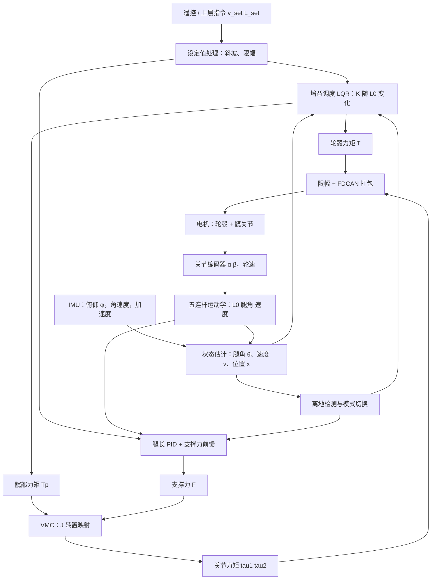

# P7 项目总览与控制架构：可变腿长轮腿机器人是什么、怎样站稳

> **一句话定位**：这一章把 P7 从头到尾讲一遍——机器人长什么样、为什么轮腿比纯轮或纯腿好、任务目标是什么、数据怎样流动、控制器怎样分层。后面 12 章都是把这一章的某个方框放大。

**本章学完你能：**

- 用一分钟向非专业的人解释"轮腿机器人是什么、难在哪里"；
- 画出整机结构图（机身、IMU、两条五连杆腿、两个轮毂电机、四个关节电机、控制板）；
- 画出控制架构总图，并说清每一层的输入、输出和频率关系；
- 说出你在 P7 中负责的三件事（增益调度 LQR、VMC 力矩控制、实车调试）与 CV 一一对应；
- 区分"课程仓库里能看到的"和"你自己的实机细节"，不把二者混为一谈。

**前置知识**：

- 经典控制与状态反馈的基本概念：[反馈控制与系统响应基础](../../02_基础知识/04_控制理论/01_反馈控制与系统响应基础.md)
- 倒立摆直觉：[倒立摆建模与线性化](../../02_基础知识/02_力学与建模/03_倒立摆建模与线性化.md)
- 坐标系与旋转：[坐标系、旋转矩阵、齐次变换](../../02_基础知识/03_坐标变换与运动学/01_坐标系_旋转矩阵_齐次变换.md)

**目录**

1. 轮腿机器人是什么
2. 为什么比纯轮式、纯腿式更合适
3. 整机结构与坐标约定（总览）
4. P7 的任务目标
5. 控制架构总图（分层）
6. 一个控制周期的数据流
7. 你的三项职责与 CV 的对应
8. 这套文档怎么读
9. 面试怎么问、怎么答
10. 本章要点速记、自测题、相关链接

---

## 1. 轮腿机器人是什么

### 1.1 一个生活比喻

想象你站在一块滑板上：

- 滑板轮子能滚，你就能前进、后退；
- 你的腿能弯曲、伸直，你就能降低重心、抬高身体，也能在颠簸路面上"吸收"起伏；
- 但滑板不会自己站稳——你必须不停调整身体，才不会向前或向后倒。

轮腿机器人（wheel-legged robot）就是把这个场景做成了机器：**每条腿的末端是一个能驱动的轮子，腿本身由电机驱动、可以伸缩和摆动，身体在上方**。它是一个**主动平衡**的系统：不控制就会倒。

### 1.2 P7 的整机构成

P7 是实验室的轮腿平台（可变腿长）。按 CV 的描述，你负责其中的平衡控制算法与实车调试。整机的组成可以画成下面的结构图：

```text
                       机身（body）
            ┌─────────────────────────────────┐
            │  控制板（STM32H7，FreeRTOS）      │
            │  IMU（机身俯仰、角速度、加速度）   │
            │  电池、驱动电路                    │
            └───┬───────────────────────┬─────┘
                │                       │
       两个髋关节电机（左腿）     两个髋关节电机（右腿）
          O ●────● D                O ●────● D        <- 机身下方的两个上关节
           \      /                  \      /
            ●    ●                    ●    ●          <- A、C：被电机驱动的杆端
             \  /                      \  /
              ● B                       ● B           <- 腿端 = 轮轴中心
             (○) 轮毂电机              (○) 轮毂电机
   ───────────────────────── 地面 ─────────────────────────
```

要点：

| 部件 | 数量 | 作用 | 通信/接口（典型） |
|---|---|---|---|
| 轮毂电机 | 2（左右各一） | 产生轮子的驱动力矩，让机器人前后移动、转向 | FDCAN 总线 |
| 髋关节电机 | 4（每条腿 2 个） | 驱动五连杆，改变腿长和腿角，输出支撑力 | FDCAN 总线 |
| IMU | 1 | 测机身俯仰/横滚/偏航及角速度、加速度 | SPI 或 I²C（典型） |
| 关节/轮编码器 | 内置在电机中 | 给出关节角、角速度、轮速 | 随电机状态帧回传 |
| 控制板 | 1 | 读传感器、算控制律、发电机命令 | STM32H7 + FreeRTOS |

> **提示**：电机型号、减速比、杆长、质量等数值，CV 和课程代码都没有给出你实机的真实值。本文档凡涉及实机数值，一律标 `【待你补全】`，教学数值一律标"示例（非项目实测）"。

### 1.3 两个"腿"的概念：五连杆实体腿与虚拟腿

这是 P7 最容易晕的地方，先在总览里立住：

- **实体腿**：由 5 根杆组成的闭链（五连杆，five-bar linkage）。两个电机转，杆件被迫协调运动，末端轮轴中心 B 的位置由两个电机角唯一确定（在选定解支的前提下）。
- **虚拟腿**：从两髋中点到轮轴中心 B 画一根想象的直线，它的长度叫**虚拟腿长 $L_0$**，它相对竖直方向的偏角叫**腿角 $\theta$**。控制器不想直接面对 5 根杆，它更愿意把腿当成"一根能伸缩、能摆动的杆"。

```text
实体腿（五连杆）                         虚拟腿（简化）

   O ●──●D                                   ● 髋中点 H
    \  /                                      │
     ●●   A、C                                │ L0（可变，可伸缩）
      \/                                      │ 偏角 θ
      ● B                                     ● 轮轴中心 B
      (○)                                    (○)
```

两种描述通过**运动学**（第 2、3 章）互相换算：电机角 $(\alpha,\beta)$ ↔ 轮轴位置 $(x,y)$ ↔ 虚拟腿 $(L_0,\theta)$。力和力矩则通过**雅可比转置**（第 6 章）互相换算：虚拟腿上的力 $F$ 和力矩 $T_p$ ↔ 两个关节力矩。

---

## 2. 为什么比纯轮式、纯腿式更合适

### 2.1 三种移动平台的对比

| 维度 | 纯轮式（如差速小车、两轮自平衡车） | 纯腿式（如四足、双足） | 轮腿式（P7） |
|---|---|---|---|
| 平地速度与效率 | 高、省能 | 低、耗能（需要不断抬腿落地） | 高（轮子滚动） |
| 越障与不平地形 | 差，受轮径限制 | 好（可迈腿） | 中到好（腿可伸缩、吸收起伏，可跨小障碍） |
| 机身高度/姿态可调 | 不可 | 可 | **可（改变腿长）** |
| 控制难度 | 低到中 | 高（接触序列、步态） | 中到高（欠驱动平衡 + 变几何） |
| 承载与稳定性来源 | 轮距支撑（四轮）或主动平衡（两轮） | 多点支撑 | 主动平衡（两点）+ 腿提供额外自由度 |
| 典型短板 | 地形适应性 | 速度、能耗 | 控制复杂：模型随腿长变化，接触切换复杂 |

一句话：**轮腿机器人想要"轮子的速度和效率 + 腿的地形适应与姿态可调"**。代价是你必须解决两个问题——（1）主动平衡（两个接触点，机身会倒），（2）腿长变化导致动力学变化（这正是"增益按腿长调度"的原因）。

### 2.2 为什么"可变腿长"让控制更难

两轮倒立摆的动力学参数里，**重心高度**直接决定倒下的快慢：重心越高，倒得越慢，但需要的控制动作行程更大；重心越低，倒得越快。腿长一变，重心高度、转动惯量、机身与轮轴的几何关系全部变化，**同一组反馈增益在不同腿长下效果不同**。这就引出：

- 固定增益只在某个腿长附近最优（甚至在腿长范围较大时失稳，第 5 章有数值演示）；
- 需要**增益调度（gain scheduling）**：离线为一系列腿长算出最优增益，运行时按当前腿长查表/插值/多项式计算。

这是 P7 CV 第一条（Gain-scheduled LQR）的核心动机。

---

## 3. 整机结构与坐标约定（总览）

### 3.1 侧视图中的几个点

下面采用课程仓库（第五到第十一课）的命名，因为你读源码时看到的就是这套名字：

```text
         x 向右 →
    O ●──────────────● D          O、D：机身上的两个髋关节转轴，OD = L5
    │\              /│           （后面讲坐标时 O 取原点）
    │ \ L1      L4 / │
    │ α\          /β │           α：杆 OA 的角（电机 1）
    ↓   ● A      ● C             β：杆 DC 的角（电机 2）
   y 向下  \    /
        L2  \  /  L3              A、C：杆端（被动杆与主动杆的铰点）
             \/
              ● B                 B：腿端 = 轮轴中心
             (○)                  轮子套在 B 上
```

- 杆长（课程代码，毫米）：$L_1=L_4=150$，$L_2=L_3=250$，$L_5=108$。
- **y 轴向下为正**：课程里的"腿高"就是 B 的纵坐标 $y_B$，值越大腿越长（见第 2 章）。
- 你自己的实机杆长【待你补全】。

### 3.2 三套"角"，别混

| 记号 | 名称 | 含义 | 在哪章 |
|---|---|---|---|
| $\alpha,\beta$ | 关节角 | 两个电机驱动的杆相对机身 x 轴的角 | 第 2 章 |
| $\theta_1,\theta_2$ | 连杆方向角 | 被动杆 AB、CB 的方向角，中间量 | 第 2 章 |
| $L_0,\phi_0$ | 虚拟腿长、腿几何角 | 髋中点到轮轴的距离与方向 | 第 3 章 |
| $\theta$ | 腿角（控制用） | 虚拟腿相对**竖直方向**的偏角（含机身姿态影响） | 第 3、4 章 |
| $\phi$ | 机身俯仰角 | IMU 给出 | 第 3、4 章 |

后面所有公式都会先写清楚"哪个角、从哪里量到哪里、正方向是什么"。

---

## 4. P7 的任务目标

按 CV：**机器人在腿长变化的同时保持机身平衡，并跟踪速度指令**（"the robot maintained body balance and tracked velocity commands while leg length changed"）。

拆开就是四个可检验的小目标：

1. **站稳**：机身俯仰角 $\phi$ 收敛到接近零（静止时不倒）；
2. **走得对**：速度估计 $\hat v$ 跟踪遥控/上层给出的速度指令 $v_{set}$，位置不无限漂移；
3. **腿能变**：腿长 $L_0$ 在设定范围内按指令伸缩，伸缩过程中机身仍然平衡；
4. **不乱**：在离地、打滑、电机限幅、数据不一致等异常下不失控、能恢复。

> **注意**：这里没有任何具体指标数字（比如"俯仰误差小于几度""速度跟踪误差多少"），因为 CV 没写，你也不应该在面试里编。面试官若追问指标，见 `99_英文面试口述与深挖问答.md` 的诚实回答模板，并把你的实测写进 README 的自查表。

---

## 5. 控制架构总图（分层）

### 5.1 总图



### 5.2 逐层解释

| 层 | 做什么 | 输入 | 输出 | 在哪章 |
|---|---|---|---|---|
| 传感与运动学 | 读 IMU、编码器；用五连杆几何算虚拟腿 $L_0,\theta$ 和速度 | $\alpha,\beta,\dot\alpha,\dot\beta$，IMU | $L_0,\dot L_0,\theta,\dot\theta$ | 2、3 |
| 状态估计 | 融合轮速、腿运动、IMU 加速度，估计车体速度和位置 | 轮速、腿几何、加速度 | $\hat v,\hat x$ | 8 |
| 平衡层：增益调度 LQR | 按 $L_0$ 取增益 $K(L_0)$，把六个状态误差变成两个输出 | 六状态 $\mathbf s$、$L_0$ | 轮毂力矩 $T$，髋部力矩 $T_p$ | 4、5 |
| 腿长层：PID + 前馈 | 控制腿长到目标值，输出沿腿方向的支撑力 | $L_{set}-L_0$，重力前馈 | 支撑力 $F$ | 7 |
| 力映射层：VMC | 把虚拟腿上的 $F,T_p$ 通过雅可比转置变成两个关节力矩 | $F,T_p$，$J(\alpha,\beta)$ | $\tau_1,\tau_2$ | 6 |
| 接触层 | 判断是否离地，切换控制模式 | 支撑力估计、加速度 | 模式标志 | 9 |
| 执行层 | 限幅、编码、通过 FDCAN 发给电机，接收反馈 | 力矩命令 | CAN 帧；电机状态 | 10 |

> **面试要点**：两个输出的分工要背熟——**LQR 输出两个量：轮毂力矩 $T$（让轮子滚动去"接住"身体）和髋部力矩 $T_p$（作用在腿与机身之间，调整机身与腿的相对姿态）；腿长 PID 输出沿腿的支撑力 $F$；VMC 把 $F$ 和 $T_p$ 一起变成两个髋关节电机的力矩。**

### 5.3 频率关系（典型）

典型的轮腿平衡控制是**内快外慢**：

- 电机内部电流环（驱动器内）：几十 kHz（电机侧，非你的代码）；
- 平衡控制循环（读状态 → LQR → VMC → 发命令）：典型几百 Hz 到 1 kHz；
- 状态估计：与控制循环同频；
- 遥控/上层指令：几十 Hz，经斜坡处理后喂给控制环。

你的实机控制周期 `【待你补全：控制频率、IMU 采样率、CAN 命令周期】`。

---

## 6. 一个控制周期的数据流

按时间顺序走一遍（"典型一帧"）：

```text
t0  读 IMU（SPI/DMA）             → φ, φ̇, 加速度
t1  取最新电机反馈（FDCAN 中断写入）→ α, β, α̇, β̇, 轮速
t2  运动学：α β → B(x,y) → L0, θ, L̇0, θ̇
t3  状态估计：v̂（轮速+腿运动+IMU加速度融合）, x̂ 积分
t4  离地检测：支撑力估计 → 模式（着地/腾空）
t5  组装六状态 s = [θ, θ̇, x−x_set, v−v_set, φ, φ̇]
t6  查增益 K(L0)，u = −K s → T, Tp
t7  腿长 PID：F = F_ff + PID(L_set − L0)
t8  VMC：[τ1 τ2]ᵀ = Jᵀ [F Tp]ᵀ（加横滚/防劈叉修正）
t9  限幅、编码、FDCAN 发送（轮 T，关节 τ1 τ2）
t10 电机执行，状态回传，进入下一周期
```

三个常见的"时间不一致"陷阱（也是第 11 章故障的来源）：

1. IMU 与关节反馈**不是同一时刻**采样；
2. 本周期算出的力矩往往**下一周期才被发出**（取决于调用顺序）；
3. 腿几何用的是上一周期的 CAN 反馈（数据年龄未知）。

课程仓库第十一课的主循环就存在"先发送、后计算 VMC"这样的顺序——这被你的学习笔记专门讨论过，见第 12 章源码导读。

---

## 7. 你的三项职责与 CV 的对应

CV 对 P7 的三条描述，与本文档章节的对应关系：

| CV 原句（英文） | 讲清楚了什么 | 对应章节 |
|---|---|---|
| **Gain-scheduled LQR**: built body-pitch and motion states from IMU, wheel-speed and joint feedback, scheduled LQR gains by leg length and converted balance and motion errors into wheel-hub and hip torques. | 状态怎么构造、LQR 怎么设计、增益怎么随腿长调度、两个输出是什么 | 3、4、5、8 |
| **VMC torque control**: computed virtual leg length and posture from closed-chain kinematics, mapped support force and pitch torque to joints via the Jacobian, and coordinated leg extension with leg-length PID and force feedforward. | 五连杆正逆解、虚拟腿、雅可比转置、腿长 PID、重力前馈 | 2、3、6、7 |
| **On-robot tuning**: integrated feedback and torque output on an STM32H7/FreeRTOS and FDCAN chain, traced balance anomalies to state inconsistency, torque limits and ground-contact transitions, and tuned parameters on the robot. | 嵌入式执行链；三类故障定位；参数整定 | 9、10、11 |

**你实际做了什么（只写 CV/推荐信有依据的）：**

- 你负责**平衡控制算法**和**实车调试**（CV Overview）；
- 你**构造**了机身俯仰与运动状态，**实现**了按腿长调度的 LQR，**实现**了 VMC 并配合腿长 PID 与力前馈；
- 你在 STM32H7/FreeRTOS/FDCAN 链上**集成**反馈与力矩输出，把平衡异常**追溯**到状态不一致、力矩限幅、离地切换三类原因，并在实车上**整定参数**（推荐信同样说明了这一点）。

**你没有被 CV 说明做过的（面试时不要主动声称）：** 五连杆机械设计本身、电机选型、电机固件、遥控协议、整机结构。若被问到，诚实说"这些由实验室平台提供，我负责控制算法与调试"，并把你实际接触到的部分补全到自查表。

---

## 8. 这套文档怎么读

建议顺序（每章都有"手算例子"，请动笔算一遍）：

1. 本章（总览）→ 第 2 章五连杆 → 第 3 章虚拟腿与符号 → 这三章是几何基础；
2. 第 4 章动力学建模 → 第 5 章 LQR → 平衡控制的核心；
3. 第 6 章 VMC → 第 7 章腿长 PID 与前馈 → 力的映射与腿长控制；
4. 第 8、9 章状态估计、接触切换 → 把系统做稳；
5. 第 10 章嵌入式执行链 → 第 11 章故障手册 → 第 12 章课程源码导读 → 第 13 章数值附录；
6. 最后读 `99_英文面试口述与深挖问答.md`，对着镜子说。

README 里有完整目录、依赖关系和"实机细节自查表"。

---

## 9. 面试怎么问、怎么答

**Q1. What is a wheel-legged robot, and why did your lab build one instead of a wheeled or a legged robot?**

> A wheel-legged robot is a balancing robot where each leg ends in a driven wheel. It combines the speed and efficiency of wheels with the adjustable body height and terrain adaptation of legs. The price is that it is an unstable system, so balance control is the core problem, and the dynamics change when the leg length changes. That is exactly what my project addressed.

（中文要点：轮腿 = 轮的速度效率 + 腿的高度可调与地形适应；代价是主动平衡与模型随腿长变化。）

追问方向：为什么不用纯轮？——高度不可调、越障差；为什么不用纯腿？——慢、耗能、步态复杂。

**Q2. Describe the control architecture of your robot in one minute.**

> It has three layers. First, a gain-scheduled LQR does the balance: it takes six states, the leg angle and its rate, position and velocity errors, and body pitch and its rate, and it outputs a wheel-hub torque and a hip torque. Second, a leg-length PID with gravity feedforward produces a support force along the virtual leg. Third, VMC, virtual model control, maps the support force and the hip torque to the two joint motors through the Jacobian transpose. Everything runs on an STM32H7 with FreeRTOS and sends torque commands over FDCAN.

（中文要点：LQR 平衡 → 腿长 PID+前馈 → VMC → FDCAN。注意"六状态"的具体定义以你实机为准。）

**Q3. What did you personally do in this project?**

> I was responsible for the balance control algorithm and the on-robot tuning. I built the body-pitch and motion states from IMU, wheel speed and joint feedback, scheduled LQR gains by leg length, implemented the virtual model controller on top of the closed-chain leg kinematics, and tuned everything on the real robot. When the robot lost balance, I traced the causes to state inconsistency, torque limits and ground-contact transitions.

（中文要点：只讲 CV 有依据的职责。）

---

## 10. 本章要点速记

1. 轮腿机器人 = 轮（速度、效率）+ 腿（高度可调、地形适应）；本质是**欠驱动的主动平衡系统**。
2. P7 每条腿是**五连杆闭链**，控制上把它抽象为**虚拟腿**（长度 $L_0$、偏角 $\theta$）。
3. 腿长变化 → 动力学变化 → 固定增益不够 → **增益按腿长调度**。
4. 控制分三层：**LQR（T、Tp）→ 腿长 PID+前馈（F）→ VMC（Jᵀ 映射到关节力矩）**。
5. 数据链：IMU + 关节编码器 + 轮速 → 运动学 → 状态估计 → 六状态 → 控制 → FDCAN。
6. 课程仓库（ESP32-S3、四状态 LQR）是同款参考，**你的项目以 CV 为准**（STM32H7/FreeRTOS/FDCAN）。
7. 三类故障：状态不一致、力矩限幅、离地切换（第 11 章）。
8. 所有实机数值（杆长、质量、增益、频率、限幅）一律不编，写进自查表。

## 自测题

1. 轮腿机器人相比纯轮式和纯腿式各有什么优势和代价？（要点：速度效率 vs 越障/高度可调；代价是控制复杂度。）
2. 为什么说它是"欠驱动"？（要点：自由度多于独立执行器；机身俯仰没有直接的执行器。）
3. 画出控制架构图，标出 LQR、腿长 PID、VMC 各自的输出。（答案见 5.1、5.2。）
4. 虚拟腿长和五连杆杆长有什么区别？（要点：杆长固定；虚拟腿长是髋中点到轮轴的距离，随关节运动变化。）
5. 为什么"本周期算的力矩下周期才发"会影响调试？（要点：引入一拍延迟，影响相位裕度；排查时间戳。）

## 相关链接

- 下一章：[02_五连杆闭链运动学.md](./02_五连杆闭链运动学.md)
- 本项目 README：[README.md](./README.md)
- 基础：[倒立摆建模与线性化](../../02_基础知识/02_力学与建模/03_倒立摆建模与线性化.md)、[状态空间、可控可观、稳定性](../../02_基础知识/04_控制理论/03_状态空间_可控可观_稳定性.md)
- 八股：[轮腿、球形机器人、机械臂专题八股](../../03_八股知识/03_机器人学/07_轮腿_球形机器人_机械臂专题八股.md)
- 相关项目：[P1 球形机器人平衡控制](../P1_AIRS球形机器人平衡控制/README.md)（同属"倒立摆 + LQR/PID"的主线）
