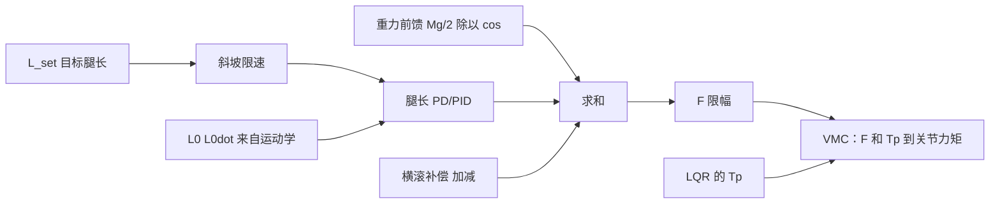

# 腿长 PID、支撑力前馈与姿态协调：横滚、左右腿、防劈叉

> **一句话定位**：LQR 管"站稳和跑"，腿长 PID 管"腿多长"。CV 写的是 "coordinated leg extension with leg-length PID and force feedforward"：**用腿长 PID 加重力前馈产生沿腿的支撑力 $F$，再配合横滚补偿、左右协调和防劈叉**，让机器人在腿长变化时机身仍保持平衡。这一章把这个"腿长层"完整讲清。

**本章学完你能：**

- 推出支撑力前馈 $F_{ff}=\dfrac{Mg/2}{\cos\theta}$ 的来源，并解释为什么必须有前馈；
- 写出腿长 PD/PID 的结构、限幅、抗积分饱和和腿长设定值的斜坡；
- 说明横滚（roll）补偿为什么是"一条腿加、一条腿减"，并从几何推出课程里的 $roll\_EH=\sin(\cdot)\cdot\tfrac{b}{2}$；
- 解释防劈叉（split prevention）和偏航（yaw）分配；
- 说清腿长环与 LQR 的耦合，以及为什么腿长要限速；
- 给出调参顺序与"吊起测试"的安全做法。

**前置知识**：

- PID 与抗积分饱和：[PID 控制全解](../../02_基础知识/04_控制理论/02_PID控制全解.md)、[前馈、增益调度、限幅与饱和](../../02_基础知识/04_控制理论/07_前馈_增益调度_限幅与饱和.md)
- [06_VMC原理与关节力矩映射.md](./06_VMC原理与关节力矩映射.md)（$F$ 如何变成关节力矩）
- [05_LQR原理与增益调度.md](./05_LQR原理与增益调度.md)

**目录**

1. 腿长环要解决什么问题
2. 结构总览：$F=F_{ff}+F_{pid}$
3. 重力前馈：为什么、怎么算
4. 腿长 PD/PID：参数含义、限幅、斜坡
5. 手算一个完整例子
6. 横滚补偿与左右腿协调
7. 防劈叉与偏航分配
8. 腿长环与 LQR 的耦合
9. 课程源码里的对应实现
10. 调参顺序与安全测试
11. 常见错误与故障现象
12. 面试怎么问、怎么答
13. 要点速记、自测题、相关链接

---

## 1. 腿长环要解决什么问题

LQR 的六个状态里**没有腿长**。LQR 假设腿长是"外部给定的参数"（用来选增益），它不负责把腿长控制到想要的值。腿长必须由另一个回路管：

1. **把腿长稳定到目标** $L_{set}$（遥控升降、地形自适应、起步姿态）；
2. **承重**：机身重量要由两条腿的支撑力共同撑住；
3. **不干扰平衡**：腿伸缩时不能把机身顶翻；
4. **左右一致**：两条腿不能一长一短（除非为了横滚补偿），不能劈叉。

---

## 2. 结构总览：$F=F_{ff}+F_{pid}$



$$
F=\underbrace{F_{ff}}_{\text{重力前馈}}+\underbrace{K_p(L_{set}-L_0)-K_d\dot L_0+K_i\!\!\int(L_{set}-L_0)}_{F_{pid}}\ \pm\ \underbrace{F_{roll}}_{\text{横滚（左右反号）}}
$$

符号：$F>0$ 表示腿**伸出**（见第 6 章）；$L_{set}>L_0$（腿比目标短）→ $F_{pid}>0$。

---

## 3. 重力前馈：为什么、怎么算

### 3.1 为什么需要前馈

静止站立时，每条腿必须持续提供大约一半体重的支撑力。如果没有前馈，这个力只能靠 PID 的比例项（需要持续的腿长误差）或积分项（需要时间累积）提供：

- 比例项：$K_p\,e=29.4\ \text{N}$，若 $K_p=500$ N/m，则需要 $e=5.9$ cm 的下沉——机器人会"坐"下去；
- 积分项：要积分到位需要时间，起立和变腿长时响应慢，还会引起积分饱和。

**前馈把"已知的、可预测的负载"直接加上**，PID 只管剩下的偏差。这是前馈的通用原则：**能算出来的先算出来**。

### 3.2 推导

设机身（含腿、轮以外的所有支撑重量）为 $M$，两腿对称，每条腿承担 $Mg/2$。腿相对竖直方向的偏角为 $\theta$，腿沿自身方向的支撑力为 $F$，则它的竖直分量必须等于所承担的重量：

$$
F\cos\theta=\frac{Mg}{2}\ \Longrightarrow\ \boxed{F_{ff}=\frac{Mg}{2\cos\theta}}
$$

直觉：腿越斜，同样的竖直承重需要沿腿更大的力。

**手算（教学数值）**：$M=6$ kg，$g=9.81$：$Mg/2=29.43$ N。$\theta=0^\circ$：$F_{ff}=29.43$ N；$\theta=10^\circ$：$29.43/0.9848=29.88$ N；$\theta=30^\circ$：$29.43/0.866=33.98$ N。

> **提示**：课程第九课的 `calVMC` 里有 `F = 48.755 / cos(thetaRight1) + yError`，结构与上式一致（常数除以一个 cos），只是 `thetaRight1` 是被动杆角、常数 48.755 的来源源码未注明；第十一课则用固定的 `fG = 25`。可见"重力前馈"在课程里的形式是常数或常数除以 cos，具体常数都是**实机标定**出来的，不是公式算出来的——你的项目里的前馈常数/形式【待你补全】。

### 3.3 前馈要不要含加速度项

更完整的前馈还包括惯性项（腿端加速度 × 等效质量），例如让腿长按轨迹快速变化时加 $m_{eq}\ddot L_{set}$。腿长变化慢时可以忽略。你实机是否用了惯性前馈【待你补全】。

---

## 4. 腿长 PD/PID：参数含义、限幅、斜坡

### 4.1 参数含义

- $K_p$（N/m）：虚拟弹簧**刚度**。大 → 腿硬，对高度偏差反应强；
- $K_d$（N·s/m）：虚拟**阻尼**。大 → 抑制腿长抖动，但放大速度噪声；
- $K_i$：消除静差（重力前馈标定不准时使用），应当很小并有限幅。

腿长速度 $\dot L_0$ **不要对 $L_0$ 数值微分**，用 $J_p\dot{\mathbf q}$ 的第一行直接算（第 3 章），噪声小得多。

### 4.2 四道保护

1. **设定值斜坡**：$L_{set}$ 按最大速度 $\dot L_{max}$ 逼近目标，避免阶跃引起力矩冲击；
2. **输出限幅**：$F\in[F_{min},F_{max}]$。$F_{min}\ge0$（腿只能推不能拉，且保持轮与地接触），$F_{max}$ 由关节力矩限幅决定：$F_{max}\approx\tau_{max}/|J_{p,11}|$；
3. **抗积分饱和**：输出被限幅时冻结积分（条件积分）；
4. **腿长范围限幅**：$L_{set}\in[L_{min},L_{max}]$，且与增益拟合区间对齐（第 5 章）。

### 4.3 教学示例代码（C，非项目源码）

```c
typedef struct { float kp, kd, ki, ff_mass_g, f_min, f_max, i_lim, i_term, dL_max, L_ref; } LegCtl;

float leg_force(LegCtl *c, float L_set, float L0, float L0dot, float theta, float dt) {
  /* 1) 设定值斜坡 */
  float dL = L_set - c->L_ref, step = c->dL_max * dt;
  c->L_ref += (dL > step) ? step : (dL < -step ? -step : dL);
  /* 2) PD + 条件积分 */
  float e = c->L_ref - L0;
  float f_pid = c->kp * e - c->kd * L0dot + c->i_term;
  /* 3) 重力前馈 Mg/(2 cos theta) */
  float f = f_pid + c->ff_mass_g / (2.0f * cosf(theta));
  /* 4) 限幅与抗饱和 */
  if (f > c->f_max)      f = c->f_max;
  else if (f < c->f_min) f = c->f_min;
  else {                              /* 未饱和才积分 */
    c->i_term += c->ki * e * dt;
    if (c->i_term >  c->i_lim) c->i_term =  c->i_lim;
    if (c->i_term < -c->i_lim) c->i_term = -c->i_lim;
  }
  return f;
}
```

---

## 5. 手算一个完整例子

**教学数值（非项目实测）**：$M=6$ kg，$K_p=500$ N/m，$K_d=30$ N·s/m，$\theta=0$，$\dot L_{max}=0.15$ m/s。腿长目标从 $0.22$ m 提到 $0.28$ m。

| 时刻 | $L_{ref}$（m） | 实际 $L_0$（m） | $\dot L_0$（m/s） | $F_{pid}$ | $F_{ff}$ | $F$ |
|---|---|---|---|---|---|---|
| 0 | 0.22 | 0.22 | 0 | 0 | 29.43 | 29.43 |
| 0.2 s | 0.25 | 0.235 | 0.10 | $500\times0.015-30\times0.10=4.5$ | 29.43 | 33.93 |
| 0.4 s | 0.28 | 0.270 | 0.08 | $500\times0.010-30\times0.08=2.6$ | 29.43 | 32.03 |
| 稳态 | 0.28 | 0.28 | 0 | 0 | 29.43 | 29.43 |

要点：

- 有前馈时，静态误差为 0，$F_{pid}$ 只在运动中出现，且数值小（几牛）；
- 斜坡把 0.06 m 的阶跃拉成 0.4 s 的平滑过程，避免 $F$ 突然冲到 $K_p\times0.06=30$ N 的额外力；
- 阻尼项在快到目标时 ($\dot L_0=0.08$) 减小了推力，防止冲过头。

---

## 6. 横滚补偿与左右腿协调

### 6.1 问题

机器人在不平路面或转弯时会横滚（roll）：左右轮高度不同或受到侧向扰动。我们希望机身保持水平。

### 6.2 几何：为什么是"一条腿加、一条腿减"

设左右轮距（track width）为 $b$，机身横滚角 $\varphi_r$，要想把机身调平，需要左右髋的高度差 $\Delta h=b\sin\varphi_r$。分摊到两条腿：一条腿伸长 $\Delta h/2$，另一条缩短 $\Delta h/2$：

$$
\Delta L=\frac{b}{2}\sin\varphi_r\quad\Rightarrow\quad L_{left}=L_{set}+\Delta L,\quad L_{right}=L_{set}-\Delta L
$$

（符号取决于左右和 roll 的正方向）。**一条腿的支撑力增加、另一条减少，总支撑力基本不变**，所以不会扰动垂直方向和 LQR 平衡——这就是"协调"的含义。

### 6.3 课程第十一课的实现（对照）

```text
rollbalance = gyroKp * ( rollKp * (target_roll − roll) − gyroX − 0.3 ) + center_offset
roll_EH     = sin(rollbalance * 3.14/180) * robotl / 2     // robotl = 312 mm，即 b/2·sinφ
roll_EH     = constrain(roll_EH, −80, 80);  lowPass(0.8)
右腿 Fy = fHeight + (+roll_EH) − kd·ẏ + fG
左腿 Fy = fHeight + (−roll_EH) − kd·ẏ + fG
```

- 外环：横滚角 P（`rollKp=1.5`）→ 期望角速度；内环：陀螺仪 $-\text{gyroX}$ 作阻尼（`gyroKp=0.13`）；
- `center_offset`：慢积分（步长 0.0005），误差小于 20°时累积，超过时衰减（×0.99），限幅 ±50——消除机械零偏；
- `roll_EH` 直接加到 $F_y$ 上，**一边加、一边减**，与上面的几何一致，只是用"力"而不是"腿长增量"作为输出（等效于增益 1 N/mm）。

你实机的横滚补偿形式（用腿长差还是用力差、增益是多少）【待你补全】。

---

## 7. 防劈叉与偏航分配

### 7.1 劈叉（split）

左右腿在不平地面或扰动下，一侧的腿角 $\theta_L$ 和另一侧 $\theta_R$ 可能逐渐分开，一条腿向前、一条向后——叫**劈叉**。LQR 只看左右腿合并后的平均量，**看不到差值**，所以差值是自由漂移的。解决：

$$
T_{p,L}\ \mathrel{-}=K_s(\theta_L-\theta_R)+K_{sd}(\dot\theta_L-\dot\theta_R),\qquad
T_{p,R}\ \mathrel{+}=K_s(\theta_L-\theta_R)+K_{sd}(\dot\theta_L-\dot\theta_R)
$$

即在两腿的 $T_p$ 上叠加一个**差模 PD**，把左右腿角拉回一致（符号取决于约定）。平均模态由 LQR 管，差模由 PD 管，互不干扰。

**教学数字**：$K_s=10$ N·m/rad，$\theta_L-\theta_R=0.05$ rad（约 2.9°）→ 差模力矩 0.5 N·m，各腿 $T_p$ 修正 ∓0.5 N·m。

### 7.2 偏航（yaw）与轮矩分配

LQR 输出的轮毂力矩 $T$ 是**左右合并**的。分配到左右轮：

$$
T_L=\frac T2-\Delta T,\qquad T_R=\frac T2+\Delta T,\qquad \Delta T=K_{yaw}(\omega_{set}-\omega_{gyro})
$$

课程里用 `steering` 做 ±0.3 的差动（`wheel_motor1 = … − 0.3*steering`，`wheel_motor2 = … + 0.3*steering`），`steering = −0.03·(−joystick − gyroZ)` 限幅 ±10：这是"偏航角速度的比例反馈"。

### 7.3 为什么要拆成"和"与"差"

左右对称的系统，把状态拆成**和模态**（前后平衡、速度）与**差模态**（偏航、横滚、劈叉）后，两个子系统近似解耦：和模态用 LQR，差模态用简单的 PD。这是轮腿机器人常用的"解耦"设计。

---

## 8. 腿长环与 LQR 的耦合

三条耦合路径，调试时要分清：

1. **腿长 → LQR 增益**：腿长变，$K(L_0)$ 变。$L_0$ 上的噪声直接变成增益噪声（第 5 章）。对策：$L_0$ 低通、限速；
2. **腿长变化 → 机身受力**：腿伸缩产生反作用力和惯性力，扰动机身俯仰。对策：限制 $\dot L_{set}$，加惯性前馈，必要时在伸缩过程中提高 $Q_\phi$；
3. **支撑力 $F$ 与髋力矩 $T_p$ 共享关节力矩预算**：两者合成后可能超过电机限幅（$\tau_\alpha,\tau_\beta$ 同时被 $F$ 的差模和 $T_p$ 的共模占用）。对策：优先保证 $T_p$（平衡），$F$ 让步（限幅时先削 $F$ 的 PID 部分）。

> **面试要点（"How do you coordinate leg extension with balance?"）**：把腿长当成缓变参数——设定值斜坡限速、增益按当前腿长调度、重力前馈保证静态承重、左右反向的力修正横滚而不改变总支撑、差模 PD 防劈叉；在关节力矩有限时优先保平衡力矩。

---

## 9. 课程源码里的对应实现

| 功能 | 课程位置 | 内容 |
|---|---|---|
| 高度弹簧 + 阻尼 + 前馈 | 第十一课 `robot.cpp: calRightVMC` | `fHeight=kpHeight*(targetHeight−y)`，`kdHeight=0.06`，`fG=25` |
| 目标高度 | 同上 | `targetHeight = startHeight(140) + remoteHeight(0–150) + jump_vlaue − Shake_shoulder_vakue` |
| 遥控高度平滑 | `mapPPMToRobotControl` | 增量式：`remoteHeight += (remoteHeight − last)*0.05`，限幅 0–150 |
| 横滚补偿 | 同上 | 第 6.3 节 |
| 起跳 | 第十一课 `ppm.cpp: remote_switch`；第九课 `robot.cpp: jump_control` | 十一课：遥控开关持续 500 ms 后，90 ms 内 `kpHeight` 从 0.4 提高到 1、目标高度加 150，之后恢复；九课：70 ms 内 `Am_kp` 与 `jump_vlaue=200`。（十一课 `robot.cpp` 里另有一个 `jump_control()`，值为 250，但主循环没有调用它。）这是"短时间提高刚度并抬高目标"的脉冲伸腿，本质是腿长环的一次大信号动作 |
| 偏航 | `wheel_control` | ±0.3·steering |
| PID 类 | 第六课 `Pid/pid.cpp` | Tustin 积分、`integral` 限幅为 `limit/3`、输出斜率限制 `output_ramp`；本身带抗积分饱和 |

> **注意**：第十一课没有"防劈叉"回路，也没有"离地检测"。这两项在你的 P7 里是否有，以及怎么做的，按你的实机为准【待你补全】；本文讲的是**典型做法**。

---

## 10. 调参顺序与安全测试

**吊起测试**（强烈推荐）：把机器人吊起使轮子离地，只开腿长环、关闭 LQR 和轮毂电机。这样腿长环的阶跃响应可以安全观察，不会因为失衡而撞坏机器。

推荐顺序：

| 步骤 | 做什么 | 判据 |
|---|---|---|
| 1 | 标定前馈：吊起时 $F=F_{ff}$，$K_p=K_d=0$，看腿是否基本静止 | 腿长缓慢漂移说明前馈接近真值 |
| 2 | 调 $K_d$：给 5 cm 阶跃，增大 $K_d$ 到振荡消失 | 无明显过冲 |
| 3 | 调 $K_p$：在不出现高频抖动的前提下尽量大 | 阶跃响应 0.3 s 左右到位（示例） |
| 4 | 加小 $K_i$（可选） | 静差消失、无积分饱和 |
| 5 | 落地：加 LQR，测腿长伸缩过程中的平衡 | 俯仰误差没有明显增大 |
| 6 | 加横滚/防劈叉 | 左右腿高差/劈叉量有界 |

---

## 11. 常见错误与故障现象

| 现象 | 原因 | 处理 |
|---|---|---|
| 腿长上下"弹跳"（pogo） | $K_p$ 大、$K_d$ 小，或延迟大 | 增大 $K_d$、降低 $K_p$、提高频率 |
| 站着慢慢"坐下" | 前馈偏小，积分太弱 | 重新标定前馈；检查质量参数 |
| 一条腿硬一条腿软 | 左右前馈/符号/零位不对称 | 左右分别测试；对比两腿 $F$ |
| 伸腿时机身往后倒 | 伸腿反作用力扰动俯仰；未限速 | 限 $\dot L_{set}$；加惯性前馈 |
| 腿长设定到极限时力矩尖峰 | 限幅未配合 FK 范围 | $L_{set}$ 限幅与拟合区间对齐 |
| 横滚补偿使机器人更倾斜 | 左右符号反 | 手动倾斜机身，看哪条腿应加力 |
| 积分饱和后"弹"一下 | 无条件积分 | 条件积分/钳位 |

---

## 12. 面试怎么问、怎么答

**Q1. Why do you need force feedforward in the leg-length controller?**

> Because the legs have to carry the weight of the body all the time, and that load is known. If I relied on the proportional or integral term to hold it, the leg would sag by a few centimeters, or the response would be slow and the integrator could wind up. With gravity feedforward, about half of the body weight divided by the cosine of the leg angle, the PD part only handles deviations from the target length.

**Q2. How do you keep the left and right legs consistent?**

> I split the problem into a common mode and a differential mode. The common mode is balance and speed, handled by the gain-scheduled LQR. The differential mode has three parts: a roll compensation that adds support force to one leg and removes it from the other, so the total support is unchanged, a differential PD on the hip torques that prevents a split between the leg angles, and a differential wheel torque for yaw.

**Q3. How does the leg-length loop interact with the LQR?**

> The LQR gains depend on the leg length, so the leg length measurement must be clean and slowly varying: I filter and rate-limit it. Also, extending the leg produces reaction forces that disturb the pitch, so I ramp the leg-length setpoint, and when the joint torque budget is limited I prioritize the balance torque and let the support force give way.

**Q4. How did you tune the leg-length loop safely?**

> I tested it with the robot lifted so the wheels were off the ground, with the balance controller and the wheel motors disabled. I set the feedforward first, then tuned the damping with small steps, then the stiffness, and only then enabled the balance controller on the ground.

（诚实提示：你实际是否用吊起测试，按你的经历说；若没做，可以说"在受保护的条件下"，别编。）

---

## 13. 本章要点速记

1. 腿长不在 LQR 状态里，需要单独的腿长环；输出沿腿的支撑力 $F$（$F>0$ 伸腿）。
2. $F=F_{ff}+F_{pid}\pm F_{roll}$；$F_{ff}=\dfrac{Mg}{2\cos\theta}$。
3. 前馈原则：可预测的负载先算出来加上；PID 只管偏差。
4. 腿长 PD/PID 四道保护：斜坡、$F$ 限幅、条件积分、腿长范围限幅。
5. 腿长速度用 $J_p\dot{\mathbf q}$，不要数值微分。
6. 横滚：一条腿加、一条腿减，$\Delta L=\frac b2\sin\varphi_r$，总支撑不变。
7. 防劈叉：两腿 $T_p$ 上叠加差模 PD；偏航：左右轮力矩差。
8. 和模态用 LQR，差模态用 PD。
9. 耦合：腿长→增益、腿长变化→机身受力、$F$ 与 $T_p$ 共享力矩预算。
10. 吊起测试是调腿长环最安全的方法。

## 自测题

1. 推导 $F_{ff}=Mg/(2\cos\theta)$。（答：竖直分量 $F\cos\theta=Mg/2$。）
2. 为什么限幅时要冻结积分？（答：避免积分饱和，退出限幅后大幅过冲。）
3. 横滚补偿为什么不改变总支撑力？（答：一边加、一边减，大小相等。）
4. 为什么 LQR 看不到劈叉？（答：它用左右合并的平均量，差模不在状态里。）
5. 腿长设定值为什么要斜坡？（答：阶跃会让 $K_p\Delta L$ 的力瞬间出现，冲击机身。）

## 相关链接

- 上一章：[06_VMC原理与关节力矩映射.md](./06_VMC原理与关节力矩映射.md)
- 下一章：[08_状态估计与速度_位置.md](./08_状态估计与速度_位置.md)
- 基础：[PID 控制全解](../../02_基础知识/04_控制理论/02_PID控制全解.md)、[前馈、增益调度、限幅与饱和](../../02_基础知识/04_控制理论/07_前馈_增益调度_限幅与饱和.md)
- 相关项目：[P3 RoboMaster 英雄机器人（PID 与限幅）](../P3_RoboMaster英雄机器人嵌入式控制/README.md)
