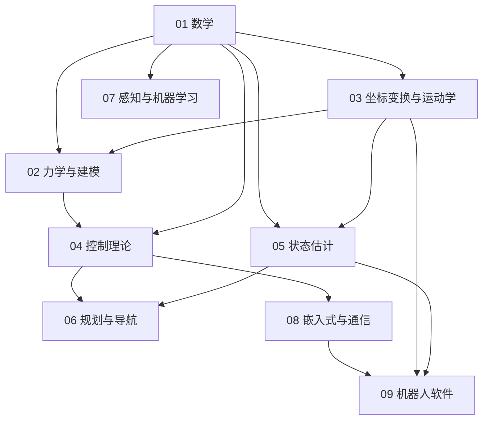

# 基础知识总览与学习路线：九个模块、依赖关系与 30 天节奏

> **一句话定位**：这是 `02_基础知识` 的地图。你的目标是面试时能用英文讲清七个项目背后的原理；这里告诉你先学什么、后学什么、每个项目要补哪几章，以及每章学到什么程度算"过关"。

**本章学完你能：**

- 说出九个模块各解决什么问题、彼此的依赖顺序；
- 对任一项目（P1–P7）列出必读的基础章节；
- 按 30 天节奏排学习计划；
- 用"三关验收"（会推导 / 会手算 / 会英文讲）自测每一章。

**前置知识**：无。你只会编程也能从第 1 章开始。

## 目录

1. 九个模块总览
2. 依赖关系图
3. 项目 × 基础章节依赖表
4. 学习顺序建议
5. 30 天学习节奏
6. 每章验收标准（三关）
7. 学习方法
8. 相关链接

---

## 1. 九个模块总览

| 模块 | 解决什么问题 | 章节 |
|---|---|---|
| 01 数学 | 所有公式的语言：矩阵、变化率、不确定性、最优选择、离散化 | [线性代数](./01_数学/01_线性代数.md)、[微积分与常微分方程](./01_数学/02_微积分与常微分方程.md)、[概率统计与高斯分布](./01_数学/03_概率统计与高斯分布.md)、[最优化与二次规划](./01_数学/04_最优化与二次规划.md)、[数值方法与离散化](./01_数学/05_数值方法与离散化.md) |
| 02 力学与建模 | 把机器人写成方程：力、力矩、动力学、倒立摆、底盘运动学 | [牛顿欧拉与刚体力学](./02_力学与建模/01_牛顿欧拉与刚体力学.md)、[拉格朗日方程与机器人动力学](./02_力学与建模/02_拉格朗日方程与机器人动力学.md)、[倒立摆建模与线性化](./02_力学与建模/03_倒立摆建模与线性化.md)、[差速、麦克纳姆、全向轮与车辆运动学](./02_力学与建模/04_差速_麦克纳姆_全向轮与车辆运动学.md) |
| 03 坐标变换与运动学 | 位置姿态怎么表示、关节到末端怎么算 | [坐标系、旋转矩阵、齐次变换](./03_坐标变换与运动学/01_坐标系_旋转矩阵_齐次变换.md)、[欧拉角、四元数、姿态表示](./03_坐标变换与运动学/02_欧拉角_四元数_姿态表示.md)、[正逆运动学与雅可比](./03_坐标变换与运动学/03_正逆运动学与雅可比.md)、[奇异性、阻尼最小二乘、零空间](./03_坐标变换与运动学/04_奇异性_阻尼最小二乘_零空间.md)、[闭链并联机构与五连杆运动学](./03_坐标变换与运动学/05_闭链并联机构与五连杆运动学.md)、[机械臂动力学、重力补偿、URDF、KDL](./03_坐标变换与运动学/06_机械臂动力学_重力补偿_URDF_KDL.md) |
| 04 控制理论 | 怎样让系统按要求动 | [反馈控制与系统响应基础](./04_控制理论/01_反馈控制与系统响应基础.md)、[PID 控制全解](./04_控制理论/02_PID控制全解.md)、[状态空间、可控可观、稳定性](./04_控制理论/03_状态空间_可控可观_稳定性.md)、[LQR 最优控制](./04_控制理论/04_LQR最优控制.md)、[MPC 模型预测控制](./04_控制理论/05_MPC模型预测控制.md)、[滑模控制](./04_控制理论/06_滑模控制.md)、[前馈、增益调度、限幅与饱和](./04_控制理论/07_前馈_增益调度_限幅与饱和.md)、[数字控制与实时性](./04_控制理论/08_数字控制与实时性.md) |
| 05 状态估计 | 带噪传感器怎样得到可信状态 | [传感器：IMU、编码器、激光雷达](./05_状态估计/01_传感器_IMU_编码器_激光雷达.md)、[互补滤波与 Mahony AHRS](./05_状态估计/02_互补滤波与Mahony_AHRS.md)、[卡尔曼滤波与 EKF](./05_状态估计/03_卡尔曼滤波与EKF.md)、[里程计与传感器融合](./05_状态估计/04_里程计与传感器融合.md)、[粒子滤波与 AMCL](./05_状态估计/05_粒子滤波与AMCL.md)、[时间同步、坐标系一致性与数据有效性](./05_状态估计/06_时间同步_坐标系一致性与数据有效性.md) |
| 06 规划与导航 | 从 A 到 B 怎么走 | [图搜索：Dijkstra、A*](./06_规划与导航/01_图搜索_Dijkstra_A星.md)、[Hybrid A* 与车辆运动学约束](./06_规划与导航/02_Hybrid_A星与车辆运动学约束.md)、[代价地图、局部规划、TEB](./06_规划与导航/03_代价地图_局部规划_TEB.md)、[轨迹跟踪：Pure Pursuit、Stanley、MPC](./06_规划与导航/04_轨迹跟踪_PurePursuit_Stanley_MPC.md)、[导航系统架构：move_base 与 Nav2](./06_规划与导航/05_导航系统架构_move_base与Nav2.md) |
| 07 感知与机器学习 | 视觉/学习模型与部署 | [机器学习基础](./07_感知与机器学习/01_机器学习基础.md)、[神经网络与反向传播](./07_感知与机器学习/02_神经网络与反向传播.md)、[卷积网络与目标检测：YOLO](./07_感知与机器学习/03_卷积网络与目标检测_YOLO.md)、[模型量化与边缘部署：RKNN](./07_感知与机器学习/04_模型量化与边缘部署_RKNN.md)、[Transformer、LLM 与 Agent：LangGraph](./07_感知与机器学习/05_Transformer_LLM与Agent_LangGraph.md)、[强化学习与具身智能入门](./07_感知与机器学习/06_强化学习与具身智能入门.md) |
| 08 嵌入式与通信 | 代码怎样在芯片上实时跑、怎样与电机通信 | [STM32：时钟、GPIO、中断、DMA](./08_嵌入式与通信/01_STM32_时钟_GPIO_中断_DMA.md)、[FreeRTOS 实时系统](./08_嵌入式与通信/02_FreeRTOS实时系统.md)、[CAN、FDCAN 与电机通信](./08_嵌入式与通信/03_CAN_FDCAN与电机通信.md)、[UART、SPI、I2C、以太网、TCP](./08_嵌入式与通信/04_UART_SPI_I2C_以太网_TCP.md)、[电机、编码器、驱动与力矩控制](./08_嵌入式与通信/05_电机_编码器_驱动与力矩控制.md)、[OpenHarmony、Hi3861、RK3588 平台基础](./08_嵌入式与通信/06_OpenHarmony_Hi3861_RK3588平台基础.md) |
| 09 机器人软件 | 软件工程与机器人中间件 | [Linux 与 Shell、Git](./09_机器人软件/01_Linux与Shell_Git.md)、[C++ 现代特性与工程实践](./09_机器人软件/02_C++现代特性与工程实践.md)、[Python 工程与科学计算](./09_机器人软件/03_Python工程与科学计算.md)、[ROS1、ROS2 核心概念](./09_机器人软件/04_ROS1_ROS2核心概念.md)、[DDS 与分布式通信](./09_机器人软件/05_DDS与分布式通信.md)、[MuJoCo、Pinocchio、KDL 工具链](./09_机器人软件/06_MuJoCo_Pinocchio_KDL_工具链.md)、[URDF、TF、坐标系实践](./09_机器人软件/07_URDF_TF_坐标系实践.md) |

---

## 2. 依赖关系图



```text
  数学 ──┬─> 力学与建模 ──┬─> 控制理论 ──┬─> 规划与导航
         │                │              │
         ├─> 坐标变换 ────┘              ├─> 嵌入式与通信 ─> 机器人软件
         │                               │
         ├─> 状态估计 ───────────────────┘
         └─> 感知与机器学习
```

章节内细线：线性代数 → 雅可比 → 奇异性/阻尼最小二乘 → 约束 IK(QP)；微积分(线性化) + 倒立摆建模 → 状态空间 → LQR → MPC；概率 → 卡尔曼 → EKF → 粒子滤波/AMCL。

---

## 3. 项目 × 基础章节依赖表

● 必读　○ 建议读

| 项目 | 必读章节 | 建议读 |
|---|---|---|
| [P1 AIRS 球形机器人平衡](../01_项目课程/P1_AIRS球形机器人平衡控制/README.md) | ● [线性代数](./01_数学/01_线性代数.md) ● [微积分与 ODE](./01_数学/02_微积分与常微分方程.md) ● [倒立摆建模](./02_力学与建模/03_倒立摆建模与线性化.md) ● [差速/全向轮运动学](./02_力学与建模/04_差速_麦克纳姆_全向轮与车辆运动学.md) ● [PID](./04_控制理论/02_PID控制全解.md) ● [状态空间](./04_控制理论/03_状态空间_可控可观_稳定性.md) ● [LQR](./04_控制理论/04_LQR最优控制.md) ● [前馈/饱和](./04_控制理论/07_前馈_增益调度_限幅与饱和.md) ● [机械臂动力学/URDF](./03_坐标变换与运动学/06_机械臂动力学_重力补偿_URDF_KDL.md) ● [互补滤波](./05_状态估计/02_互补滤波与Mahony_AHRS.md) | ○ [最优化](./01_数学/04_最优化与二次规划.md) ○ [牛顿欧拉](./02_力学与建模/01_牛顿欧拉与刚体力学.md) ○ [CAN](./08_嵌入式与通信/03_CAN_FDCAN与电机通信.md) ○ [ROS](./09_机器人软件/04_ROS1_ROS2核心概念.md) |
| [P2 未来动力双臂与差速底盘](../01_项目课程/P2_未来动力双臂遥操作与差速底盘/README.md) | ● [线性代数](./01_数学/01_线性代数.md) ● [最优化与 QP](./01_数学/04_最优化与二次规划.md) ● [坐标系/齐次变换](./03_坐标变换与运动学/01_坐标系_旋转矩阵_齐次变换.md) ● [四元数](./03_坐标变换与运动学/02_欧拉角_四元数_姿态表示.md) ● [正逆运动学/雅可比](./03_坐标变换与运动学/03_正逆运动学与雅可比.md) ● [奇异性/DLS](./03_坐标变换与运动学/04_奇异性_阻尼最小二乘_零空间.md) ● [重力补偿/URDF/KDL](./03_坐标变换与运动学/06_机械臂动力学_重力补偿_URDF_KDL.md) ● [拉格朗日](./02_力学与建模/02_拉格朗日方程与机器人动力学.md) ● [差速运动学](./02_力学与建模/04_差速_麦克纳姆_全向轮与车辆运动学.md) ● [PID](./04_控制理论/02_PID控制全解.md) ● [MuJoCo/Pinocchio/KDL](./09_机器人软件/06_MuJoCo_Pinocchio_KDL_工具链.md) | ○ [里程计](./05_状态估计/04_里程计与传感器融合.md) ○ [CAN](./08_嵌入式与通信/03_CAN_FDCAN与电机通信.md) ○ [ROS2](./09_机器人软件/04_ROS1_ROS2核心概念.md) |
| [P3 RoboMaster 英雄](../01_项目课程/P3_RoboMaster英雄机器人嵌入式控制/README.md) | ● [微积分与 ODE](./01_数学/02_微积分与常微分方程.md) ● [数值方法](./01_数学/05_数值方法与离散化.md) ● [麦克纳姆运动学](./02_力学与建模/04_差速_麦克纳姆_全向轮与车辆运动学.md) ● [反馈基础](./04_控制理论/01_反馈控制与系统响应基础.md) ● [PID](./04_控制理论/02_PID控制全解.md) ● [滑模](./04_控制理论/06_滑模控制.md) ● [前馈/饱和](./04_控制理论/07_前馈_增益调度_限幅与饱和.md) ● [数字控制](./04_控制理论/08_数字控制与实时性.md) ● [互补滤波/AHRS](./05_状态估计/02_互补滤波与Mahony_AHRS.md) ● [STM32](./08_嵌入式与通信/01_STM32_时钟_GPIO_中断_DMA.md) ● [FreeRTOS](./08_嵌入式与通信/02_FreeRTOS实时系统.md) ● [CAN](./08_嵌入式与通信/03_CAN_FDCAN与电机通信.md) ● [电机/编码器](./08_嵌入式与通信/05_电机_编码器_驱动与力矩控制.md) | ○ [牛顿欧拉](./02_力学与建模/01_牛顿欧拉与刚体力学.md) ○ [IMU](./05_状态估计/01_传感器_IMU_编码器_激光雷达.md) |
| [P4 OpenHarmony 智能园艺](../01_项目课程/P4_OpenHarmony智能园艺系统/README.md) | ● [机器学习基础](./07_感知与机器学习/01_机器学习基础.md) ● [卷积网络/YOLO](./07_感知与机器学习/03_卷积网络与目标检测_YOLO.md) ● [量化/RKNN](./07_感知与机器学习/04_模型量化与边缘部署_RKNN.md) ● [Transformer/LLM/Agent](./07_感知与机器学习/05_Transformer_LLM与Agent_LangGraph.md) ● [OpenHarmony/Hi3861/RK3588](./08_嵌入式与通信/06_OpenHarmony_Hi3861_RK3588平台基础.md) ● [UART/SPI/I2C/TCP](./08_嵌入式与通信/04_UART_SPI_I2C_以太网_TCP.md) ● [反馈基础](./04_控制理论/01_反馈控制与系统响应基础.md) | ○ [神经网络](./07_感知与机器学习/02_神经网络与反向传播.md) ○ [概率统计](./01_数学/03_概率统计与高斯分布.md) |
| [P5 车式移动机器人导航](../01_项目课程/P5_车式移动机器人自主导航/README.md) | ● [概率统计](./01_数学/03_概率统计与高斯分布.md) ● [最优化与 QP](./01_数学/04_最优化与二次规划.md) ● [车辆运动学](./02_力学与建模/04_差速_麦克纳姆_全向轮与车辆运动学.md) ● [传感器](./05_状态估计/01_传感器_IMU_编码器_激光雷达.md) ● [卡尔曼/EKF](./05_状态估计/03_卡尔曼滤波与EKF.md) ● [里程计融合](./05_状态估计/04_里程计与传感器融合.md) ● [粒子滤波/AMCL](./05_状态估计/05_粒子滤波与AMCL.md) ● [时间同步](./05_状态估计/06_时间同步_坐标系一致性与数据有效性.md) ● [图搜索](./06_规划与导航/01_图搜索_Dijkstra_A星.md) ● [Hybrid A*](./06_规划与导航/02_Hybrid_A星与车辆运动学约束.md) ● [代价地图/TEB](./06_规划与导航/03_代价地图_局部规划_TEB.md) ● [轨迹跟踪/MPC](./06_规划与导航/04_轨迹跟踪_PurePursuit_Stanley_MPC.md) ● [MPC](./04_控制理论/05_MPC模型预测控制.md) ● [导航架构](./06_规划与导航/05_导航系统架构_move_base与Nav2.md) | ○ [URDF/TF](./09_机器人软件/07_URDF_TF_坐标系实践.md) ○ [ROS](./09_机器人软件/04_ROS1_ROS2核心概念.md) |
| [P6 深开鸿 M-Robots](../01_项目课程/P6_深开鸿M-Robots平台软件/README.md) | ● [C++](./09_机器人软件/02_C++现代特性与工程实践.md) ● [ROS1/ROS2](./09_机器人软件/04_ROS1_ROS2核心概念.md) ● [DDS](./09_机器人软件/05_DDS与分布式通信.md) ● [URDF/TF](./09_机器人软件/07_URDF_TF_坐标系实践.md) ● [时间同步与数据有效性](./05_状态估计/06_时间同步_坐标系一致性与数据有效性.md) ● [OpenHarmony 平台](./08_嵌入式与通信/06_OpenHarmony_Hi3861_RK3588平台基础.md) ● [坐标系](./03_坐标变换与运动学/01_坐标系_旋转矩阵_齐次变换.md) | ○ [数值方法](./01_数学/05_数值方法与离散化.md) ○ [Transformer/Agent](./07_感知与机器学习/05_Transformer_LLM与Agent_LangGraph.md) ○ [Linux/Git](./09_机器人软件/01_Linux与Shell_Git.md) |
| [P7 可变腿长轮腿](../01_项目课程/P7_可变腿长轮腿机器人/README.md) | ● [线性代数](./01_数学/01_线性代数.md) ● [微积分与 ODE](./01_数学/02_微积分与常微分方程.md) ● [最优化(Riccati)](./01_数学/04_最优化与二次规划.md) ● [牛顿欧拉](./02_力学与建模/01_牛顿欧拉与刚体力学.md) ● [拉格朗日](./02_力学与建模/02_拉格朗日方程与机器人动力学.md) ● [倒立摆建模](./02_力学与建模/03_倒立摆建模与线性化.md) ● [雅可比](./03_坐标变换与运动学/03_正逆运动学与雅可比.md) ● [闭链五连杆](./03_坐标变换与运动学/05_闭链并联机构与五连杆运动学.md) ● [状态空间](./04_控制理论/03_状态空间_可控可观_稳定性.md) ● [LQR](./04_控制理论/04_LQR最优控制.md) ● [增益调度/饱和](./04_控制理论/07_前馈_增益调度_限幅与饱和.md) ● [数字控制](./04_控制理论/08_数字控制与实时性.md) ● [FreeRTOS](./08_嵌入式与通信/02_FreeRTOS实时系统.md) ● [FDCAN](./08_嵌入式与通信/03_CAN_FDCAN与电机通信.md) ● [电机力矩控制](./08_嵌入式与通信/05_电机_编码器_驱动与力矩控制.md) | ○ [互补滤波/AHRS](./05_状态估计/02_互补滤波与Mahony_AHRS.md) ○ [STM32](./08_嵌入式与通信/01_STM32_时钟_GPIO_中断_DMA.md) |

---

## 4. 学习顺序建议

1. **地基（必须先学）**：线性代数 → 微积分与 ODE → 牛顿欧拉 → 拉格朗日 → 倒立摆建模。
2. **控制主线**：反馈基础 → PID → 状态空间 → LQR → 前馈/饱和 → MPC → 滑模 → 数字控制。
3. **运动学主线**：坐标系 → 四元数 → 正逆运动学/雅可比 → 奇异性 → 闭链 → 机械臂动力学；车辆/全向轮运动学。
4. **估计与导航**：概率统计 → 传感器 → 互补滤波 → 卡尔曼/EKF → 里程计融合 → 粒子滤波 → 时间同步；图搜索 → Hybrid A* → TEB → 轨迹跟踪 → 导航架构。
5. **优化与数值**：最优化与 QP、数值方法穿插（学 LQR/MPC/IK 前读）。
6. **工程层**：嵌入式、通信、ROS、DDS、工具链；感知与 ML 按项目 P4 补。

---

## 5. 30 天学习节奏

| 天 | 内容 | 产出 |
|---|---|---|
| 1–3 | 线性代数、微积分与 ODE | 手算 SVD、DLS、线性化单摆 |
| 4–5 | 概率统计、数值方法 | 手算高斯融合、ZOH |
| 6 | 最优化与 QP | 手算 Riccati 标量、MPC 小 QP |
| 7–9 | 牛顿欧拉、拉格朗日、倒立摆建模 | 手推小车摆 $A,B$，二连杆 $M,g$ |
| 10 | 差速/麦克纳姆/全向轮运动学 | 手算轮速矩阵 |
| 11–13 | 坐标变换：旋转、四元数、雅可比、奇异性、闭链 | 二连杆 $J$，五连杆概念 |
| 14–17 | 控制理论：反馈、PID、状态空间、LQR、前馈/饱和、MPC、滑模、数字控制 | 能讲 P1/P3/P7 控制结构 |
| 18–21 | 状态估计：传感器、互补滤波、卡尔曼/EKF、里程计、AMCL、时间同步 | 手算一步卡尔曼 |
| 22–23 | 规划与导航 | 能讲 P5 全链路 |
| 24–25 | 嵌入式与通信 | 能讲 P3/P7 的 STM32 + CAN |
| 26–27 | ROS/DDS/工具链/URDF/TF | 能讲 P2/P6 |
| 28 | 感知与 ML（P4 相关） | 能讲 YOLO/RKNN/LangGraph |
| 29–30 | 回头自测，按项目英文复述 | 项目 99 号文件口述 |

时间紧时按第 3 节的项目依赖表，只学面试最先出场的项目所需的章节。

---

## 6. 每章验收标准（三关）

每章都过三关才算掌握：

1. **会推导**：不看资料，把核心公式从定义推出（如 DLS、Riccati、小车摆线性化、麦克纳姆 $H$）；
2. **会手算**：本章手算例子能独立复算，数字对上；
3. **会英文讲**：能用 60–90 秒英文讲清"它解决什么问题、公式、在我项目里怎么用"，并回答一个追问。

| 章节 | 推导 | 手算 | 英文讲 |
|---|---|---|---|
| 线性代数 | 伪逆、DLS | 2×2 特征值/逆/SVD | Jacobian pseudo-inverse and damping |
| 微积分与 ODE | 线性化、$e^{At}$ | 二阶超调/调节时间 | Why linearize |
| 概率统计 | 高斯融合、协方差传播 | 增益 $K$、马氏距离 | Kalman fusion |
| 最优化 | 正规方程、Riccati | KKT 小题、MPC 小 QP | Why MPC is a QP |
| 数值方法 | ZOH、Tustin | RK4 一步、混叠 | Discretization |
| 牛顿欧拉 | 小车摆、滚动等效质量 | 重力矩、惯量 | Derive pendulum |
| 拉格朗日 | 二连杆 $M$ | $g$、$\ddot q$ | Two-link dynamics |
| 倒立摆建模 | $A,B$ 全元素 | 极点、可控性 | Four-state model walkthrough |
| 车辆运动学 | 麦克纳姆 $H$、球—轮 $S$ | 轮速、转角 | Body velocity to wheel speeds |
| 其余模块 | 见各章末"自测题" | | 见各项目 99 号文件 |

---

## 7. 学习方法

1. 先读"它要解决什么问题"，再看推导，**合上书自己推一遍**；
2. 所有"示例"数值是教学用，不是项目实测；面试讲项目数据时只讲设计取值、典型范围与可追溯的现象，不把教学数值说成实测结果；
3. 每学完一章，立刻回到对应项目 README，找出该章在项目里出现的位置；
4. 每章末的英文问答，大声说出来，录音回听；
5. 文中凡标明“本项目通常取…”“我们的做法是…”的地方，都是面试官最可能追问的实现细节；其数值是设计取值或量级，调参时按实机微调，讲项目时以 CV 与项目课程文档为准。

## 8. 相关链接

- 上一级：[项目学习 README](../README.md)
- 第一章：[线性代数](./01_数学/01_线性代数.md)
- 项目入口：[P1](../01_项目课程/P1_AIRS球形机器人平衡控制/README.md)、[P2](../01_项目课程/P2_未来动力双臂遥操作与差速底盘/README.md)、[P3](../01_项目课程/P3_RoboMaster英雄机器人嵌入式控制/README.md)、[P4](../01_项目课程/P4_OpenHarmony智能园艺系统/README.md)、[P5](../01_项目课程/P5_车式移动机器人自主导航/README.md)、[P6](../01_项目课程/P6_深开鸿M-Robots平台软件/README.md)、[P7](../01_项目课程/P7_可变腿长轮腿机器人/README.md)
