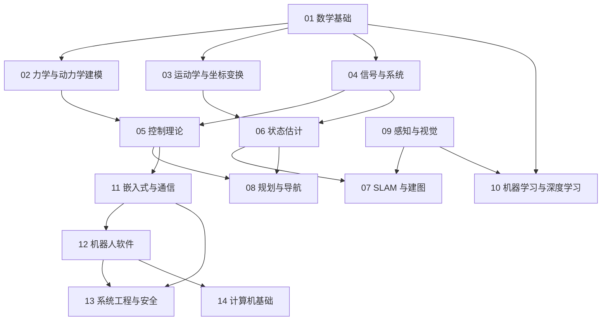

# 基础知识总览与学习路线：十四个知识模块、依赖关系与 30/60 天节奏

> **一句话定位**：这是 `02_基础知识` 的地图。目标是用中文讲解、英文术语，学会**机器人 / AI / CS 方向硕士面试可能涉及的全部基础知识**，既覆盖七个项目背后的原理，也覆盖不限于项目的通用知识。本页告诉你：知识分成哪十四个模块、先学什么后学什么、每个项目要补哪些章节、怎样按天数安排、怎样验收。

**本章学完你能：**

- 说出十四个模块各解决什么问题、彼此的依赖顺序；
- 对任一项目（P1–P7）列出必读与延伸的基础章节；
- 按你的目标方向（控制 / 估计与 SLAM / 感知与 AI / 系统与软件）选择路线；
- 按 30 天或 60 天节奏排学习计划；
- 用"三关验收"（会推导 / 会手算 / 会英文讲）自测每一章。

**前置知识**：无。你只会编程也能从第 1 个模块开始。

**相关文档**：[结构说明与扩展计划](./结构说明与扩展计划.md)（新旧对照与待写清单）。

## 目录

1. 十四个模块总览
2. 依赖关系图
3. 项目 × 基础章节依赖表
4. 按目标方向选路线
5. 学习顺序建议
6. 30 天与 60 天节奏
7. 每章验收标准（三关）
8. 学习方法
9. 现状说明：已完成与待补
10. 相关链接

---

## 1. 十四个模块总览

| 模块 | 解决什么问题 | 已完成章数 | 计划章数 |
|---|---|---|---|
| [01_数学基础](./01_数学基础/README.md) | 所有后续章节的公共语言：向量与矩阵、变化率与微分方程、不确定性、最优选择、离散化与数值计算。 | 5 | 3 |
| [02_力学与动力学建模](./02_力学与动力学建模/README.md) | 把机器人写成方程：刚体力学、拉格朗日动力学、倒立摆线性化、轮式底盘运动学，以及动力学算法、接触与阻抗。 | 5 | 2 |
| [03_运动学与坐标变换](./03_运动学与坐标变换/README.md) | 位置与姿态怎么表示、关节到末端怎么算、速度与力怎么传递，以及 URDF/KDL 动力学建模。 | 6 | 2 |
| [04_信号与系统](./04_信号与系统/README.md) | 传感器数据怎么看、滤波器怎么设计、控制器为什么稳定的共同语言：卷积、傅里叶、拉普拉斯、Z 变换、采样与滤波。 | 2 | 2 |
| [05_控制理论](./05_控制理论/README.md) | 让系统按要求运动：反馈、PID、状态空间、LQR、MPC、滑模、前馈与饱和、数字实现，以及非线性、鲁棒与自适应控制。 | 10 | 4 |
| [06_状态估计](./06_状态估计/README.md) | 带噪传感器怎样得到可信状态：传感器模型、互补滤波、卡尔曼与 EKF、里程计融合、粒子滤波与时间/坐标一致性。 | 6 | 4 |
| [07_SLAM与建图](./07_SLAM与建图/README.md) | 未知环境里一边建图一边定位：问题形式、前后端、位姿图优化、视觉里程计与（后续）激光/视惯融合。 | 2 | 5 |
| [08_规划与导航](./08_规划与导航/README.md) | 从 A 到 B 怎么走：图搜索、Hybrid A*、代价地图与局部规划、轨迹跟踪，以及 Nav2（ROS2 Humble）导航系统架构。 | 5 | 5 |
| [09_感知与视觉](./09_感知与视觉/README.md) | 机器人如何"看"：相机模型与标定、点云处理与配准，以及（后续）立体视觉、检测分割跟踪、3D 感知与传感器融合。 | 2 | 5 |
| [10_机器学习与深度学习](./10_机器学习与深度学习/README.md) | 从线性回归到大模型与具身智能：机器学习基础、神经网络、CNN/检测、量化部署、Transformer/LLM/Agent、强化学习、模仿学习与 VLA。 | 10 | 5 |
| [11_嵌入式与通信](./11_嵌入式与通信/README.md) | 代码怎样在芯片上实时跑、怎样与电机和上位机通信：STM32、FreeRTOS、CAN/FDCAN、串口/SPI/I2C/以太网、电机驱动与平台基础。 | 6 | 6 |
| [12_机器人软件](./12_机器人软件/README.md) | 软件工程与机器人中间件：Linux/Git、C++、Python、ROS2 Humble（ROS1 仅对比）、DDS、仿真与动力学工具链、URDF/TF。 | 7 | 7 |
| [13_系统工程与安全](./13_系统工程与安全/README.md) | 把算法变成可交付、可维护、安全的系统：架构、需求与接口、功能安全、可靠性、测试、可观测性。 | 0 | 7 |
| [14_计算机基础](./14_计算机基础/README.md) | CS 硕士面试的底座：算法与数据结构、操作系统、网络、体系结构、并发、编译链接、数据库与软件工程。本模块先给出概览与学习路径，现有的八股速查已覆盖基础问答。 | 0 | 8 |

每个模块的 README 列出了章节顺序、前置关系和与项目的联系；尚未写成的章节在 README 和 [结构说明与扩展计划](./结构说明与扩展计划.md) 里以文字列出，不放链接。

**本仓库对"面试知识版图"的覆盖逻辑**：

| 面试官可能问 | 对应模块 |
|---|---|
| 线性代数、概率、优化、数值方法 | 01 |
| 动力学建模、拉格朗日、倒立摆、轮式运动学 | 02 |
| 坐标变换、旋转表示、DH、雅可比、奇异性 | 03 |
| 信号与系统、傅里叶/拉氏、滤波器、采样 | 04 |
| PID、状态空间、LQR、MPC、非线性/鲁棒/自适应、数字控制 | 05 |
| 卡尔曼/EKF/粒子滤波、IMU、传感器融合 | 06 |
| SLAM、视觉里程计、回环、位姿图 | 07 |
| 路径规划、轨迹跟踪、导航系统 | 08 |
| 相机模型、标定、点云、检测 | 09 |
| 机器学习、深度学习、CNN/Transformer、强化学习、模仿学习、LLM/VLA | 10 |
| MCU、RTOS、CAN/总线、电机驱动 | 11 |
| ROS2、DDS、构建、仿真、C++/Python/Linux | 12 |
| 系统架构、功能安全、测试、可靠性 | 13 |
| 数据结构与算法、操作系统、网络、体系结构、并发 | 14（与 [八股知识](../03_八股知识/README.md) 配合） |

---

## 2. 依赖关系图



```text
  数学 ─┬─> 力学与建模 ─┬─> 控制 ──┬─> 规划与导航
        ├─> 运动学 ─────┤          │
        ├─> 信号与系统 ─┴─> 估计 ──┼─> SLAM <── 感知与视觉
        └─> 机器学习与深度学习 <───┘
  控制 ─> 嵌入式与通信 ─> 机器人软件 ─> 系统工程与安全 / 计算机基础
```

章节内的细线：线性代数 → 雅可比 → 奇异性 / 阻尼最小二乘 → 约束 IK(QP)；微积分（线性化）+ 倒立摆建模 → 状态空间 → LQR → MPC；概率 → 卡尔曼 → EKF → 粒子滤波 / AMCL → SLAM；信号与系统 → 滤波器 → 互补滤波 / 数字控制；神经网络 → CNN / Transformer → LLM / VLA；强化学习 → 策略梯度 → PPO / SAC；模仿学习 ← 扩散模型。

---

## 3. 项目 × 基础章节依赖表（● 必读　○ 建议读）

● 必读　○ 建议读

| 项目 | 必读章节 | 建议读 |
|---|---|---|
| [P1 AIRS 球形机器人平衡](../01_项目课程/P1_AIRS球形机器人平衡控制/README.md) | ● [线性代数](./01_数学基础/01_线性代数.md) ● [微积分与 ODE](./01_数学基础/02_微积分与常微分方程.md) ● [倒立摆建模](./02_力学与动力学建模/03_倒立摆建模与线性化.md) ● [差速/全向轮运动学](./02_力学与动力学建模/04_差速_麦克纳姆_全向轮与车辆运动学.md) ● [PID](./05_控制理论/02_PID控制全解.md) ● [状态空间](./05_控制理论/03_状态空间_可控可观_稳定性.md) ● [LQR](./05_控制理论/04_LQR最优控制.md) ● [前馈/饱和](./05_控制理论/07_前馈_增益调度_限幅与饱和.md) ● [机械臂动力学/URDF](./03_运动学与坐标变换/06_机械臂动力学_重力补偿_URDF_KDL.md) ● [互补滤波](./06_状态估计/02_互补滤波与Mahony_AHRS.md) | ○ [最优化](./01_数学基础/04_最优化与二次规划.md) ○ [牛顿欧拉](./02_力学与动力学建模/01_牛顿欧拉与刚体力学.md) ○ [CAN](./11_嵌入式与通信/03_CAN_FDCAN与电机通信.md) ○ [ROS](./12_机器人软件/04_ROS2_Humble核心概念与ROS1对比.md) |
| [P2 未来动力双臂与差速底盘](../01_项目课程/P2_未来动力双臂遥操作与差速底盘/README.md) | ● [线性代数](./01_数学基础/01_线性代数.md) ● [最优化与 QP](./01_数学基础/04_最优化与二次规划.md) ● [坐标系/齐次变换](./03_运动学与坐标变换/01_坐标系_旋转矩阵_齐次变换.md) ● [四元数](./03_运动学与坐标变换/02_欧拉角_四元数_姿态表示.md) ● [正逆运动学/雅可比](./03_运动学与坐标变换/03_正逆运动学与雅可比.md) ● [奇异性/DLS](./03_运动学与坐标变换/04_奇异性_阻尼最小二乘_零空间.md) ● [重力补偿/URDF/KDL](./03_运动学与坐标变换/06_机械臂动力学_重力补偿_URDF_KDL.md) ● [拉格朗日](./02_力学与动力学建模/02_拉格朗日方程与机器人动力学.md) ● [差速运动学](./02_力学与动力学建模/04_差速_麦克纳姆_全向轮与车辆运动学.md) ● [PID](./05_控制理论/02_PID控制全解.md) ● [MuJoCo/Pinocchio/KDL](./12_机器人软件/06_MuJoCo_Pinocchio_KDL_工具链.md) | ○ [里程计](./06_状态估计/04_里程计与传感器融合.md) ○ [CAN](./11_嵌入式与通信/03_CAN_FDCAN与电机通信.md) ○ [ROS2](./12_机器人软件/04_ROS2_Humble核心概念与ROS1对比.md) |
| [P3 RoboMaster 英雄](../01_项目课程/P3_RoboMaster英雄机器人嵌入式控制/README.md) | ● [微积分与 ODE](./01_数学基础/02_微积分与常微分方程.md) ● [数值方法](./01_数学基础/05_数值方法与离散化.md) ● [麦克纳姆运动学](./02_力学与动力学建模/04_差速_麦克纳姆_全向轮与车辆运动学.md) ● [反馈基础](./05_控制理论/01_反馈控制与系统响应基础.md) ● [PID](./05_控制理论/02_PID控制全解.md) ● [滑模](./05_控制理论/06_滑模控制.md) ● [前馈/饱和](./05_控制理论/07_前馈_增益调度_限幅与饱和.md) ● [数字控制](./05_控制理论/08_数字控制与实时性.md) ● [互补滤波/AHRS](./06_状态估计/02_互补滤波与Mahony_AHRS.md) ● [STM32](./11_嵌入式与通信/01_STM32_时钟_GPIO_中断_DMA.md) ● [FreeRTOS](./11_嵌入式与通信/02_FreeRTOS实时系统.md) ● [CAN](./11_嵌入式与通信/03_CAN_FDCAN与电机通信.md) ● [电机/编码器](./11_嵌入式与通信/05_电机_编码器_驱动与力矩控制.md) | ○ [牛顿欧拉](./02_力学与动力学建模/01_牛顿欧拉与刚体力学.md) ○ [IMU](./06_状态估计/01_传感器_IMU_编码器_激光雷达.md) |
| [P4 OpenHarmony 智能园艺](../01_项目课程/P4_OpenHarmony智能园艺系统/README.md) | ● [机器学习基础](./10_机器学习与深度学习/01_机器学习基础.md) ● [卷积网络/YOLO](./10_机器学习与深度学习/03_卷积网络与目标检测_YOLO.md) ● [量化/RKNN](./10_机器学习与深度学习/04_模型量化与边缘部署_RKNN.md) ● [Transformer/LLM/Agent](./10_机器学习与深度学习/05_Transformer_LLM与Agent_LangGraph.md) ● [OpenHarmony/Hi3861/RK3588](./11_嵌入式与通信/06_OpenHarmony_Hi3861_RK3588平台基础.md) ● [UART/SPI/I2C/TCP](./11_嵌入式与通信/04_UART_SPI_I2C_以太网_TCP.md) ● [反馈基础](./05_控制理论/01_反馈控制与系统响应基础.md) | ○ [神经网络](./10_机器学习与深度学习/02_神经网络与反向传播.md) ○ [概率统计](./01_数学基础/03_概率统计与高斯分布.md) |
| [P5 车式移动机器人导航](../01_项目课程/P5_车式移动机器人自主导航/README.md) | ● [概率统计](./01_数学基础/03_概率统计与高斯分布.md) ● [最优化与 QP](./01_数学基础/04_最优化与二次规划.md) ● [车辆运动学](./02_力学与动力学建模/04_差速_麦克纳姆_全向轮与车辆运动学.md) ● [传感器](./06_状态估计/01_传感器_IMU_编码器_激光雷达.md) ● [卡尔曼/EKF](./06_状态估计/03_卡尔曼滤波与EKF.md) ● [里程计融合](./06_状态估计/04_里程计与传感器融合.md) ● [粒子滤波/AMCL](./06_状态估计/05_粒子滤波与AMCL.md) ● [时间同步](./06_状态估计/06_时间同步_坐标系一致性与数据有效性.md) ● [图搜索](./08_规划与导航/01_图搜索_Dijkstra_A星.md) ● [Hybrid A*](./08_规划与导航/02_Hybrid_A星与车辆运动学约束.md) ● [代价地图/TEB](./08_规划与导航/03_代价地图_局部规划_TEB.md) ● [轨迹跟踪/MPC](./08_规划与导航/04_轨迹跟踪_PurePursuit_Stanley_MPC.md) ● [MPC](./05_控制理论/05_MPC模型预测控制.md) ● [导航架构](./08_规划与导航/05_导航系统架构_Nav2与move_base对比.md) | ○ [URDF/TF](./12_机器人软件/07_URDF_TF_坐标系实践.md) ○ [ROS](./12_机器人软件/04_ROS2_Humble核心概念与ROS1对比.md) |
| [P6 深开鸿 M-Robots](../01_项目课程/P6_深开鸿M-Robots平台软件/README.md) | ● [C++](./12_机器人软件/02_C++现代特性与工程实践.md) ● [ROS2 Humble（ROS1 对比）](./12_机器人软件/04_ROS2_Humble核心概念与ROS1对比.md) ● [DDS](./12_机器人软件/05_DDS与分布式通信.md) ● [URDF/TF](./12_机器人软件/07_URDF_TF_坐标系实践.md) ● [时间同步与数据有效性](./06_状态估计/06_时间同步_坐标系一致性与数据有效性.md) ● [OpenHarmony 平台](./11_嵌入式与通信/06_OpenHarmony_Hi3861_RK3588平台基础.md) ● [坐标系](./03_运动学与坐标变换/01_坐标系_旋转矩阵_齐次变换.md) | ○ [数值方法](./01_数学基础/05_数值方法与离散化.md) ○ [Transformer/Agent](./10_机器学习与深度学习/05_Transformer_LLM与Agent_LangGraph.md) ○ [Linux/Git](./12_机器人软件/01_Linux与Shell_Git.md) |
| [P7 可变腿长轮腿](../01_项目课程/P7_可变腿长轮腿机器人/README.md) | ● [线性代数](./01_数学基础/01_线性代数.md) ● [微积分与 ODE](./01_数学基础/02_微积分与常微分方程.md) ● [最优化(Riccati)](./01_数学基础/04_最优化与二次规划.md) ● [牛顿欧拉](./02_力学与动力学建模/01_牛顿欧拉与刚体力学.md) ● [拉格朗日](./02_力学与动力学建模/02_拉格朗日方程与机器人动力学.md) ● [倒立摆建模](./02_力学与动力学建模/03_倒立摆建模与线性化.md) ● [雅可比](./03_运动学与坐标变换/03_正逆运动学与雅可比.md) ● [闭链五连杆](./03_运动学与坐标变换/05_闭链并联机构与五连杆运动学.md) ● [状态空间](./05_控制理论/03_状态空间_可控可观_稳定性.md) ● [LQR](./05_控制理论/04_LQR最优控制.md) ● [增益调度/饱和](./05_控制理论/07_前馈_增益调度_限幅与饱和.md) ● [数字控制](./05_控制理论/08_数字控制与实时性.md) ● [FreeRTOS](./11_嵌入式与通信/02_FreeRTOS实时系统.md) ● [FDCAN](./11_嵌入式与通信/03_CAN_FDCAN与电机通信.md) ● [电机力矩控制](./11_嵌入式与通信/05_电机_编码器_驱动与力矩控制.md) | ○ [互补滤波/AHRS](./06_状态估计/02_互补滤波与Mahony_AHRS.md) ○ [STM32](./11_嵌入式与通信/01_STM32_时钟_GPIO_中断_DMA.md) |


**新增章节的延伸阅读（○）**：

| 项目 | 建议延伸 |
|---|---|
| P1 / P7 | ○ [信号与系统基础](./04_信号与系统/01_信号与系统基础_卷积_傅里叶_拉普拉斯_Z变换.md) ○ [数字滤波器](./04_信号与系统/02_数字滤波器_FIR_IIR_采样与混叠.md) ○ [李雅普诺夫稳定性与非线性控制](./05_控制理论/09_李雅普诺夫稳定性与非线性控制.md) ○ [鲁棒与自适应控制](./05_控制理论/10_鲁棒与自适应控制.md) ○ [机器人动力学进阶（LIPM/接触/ZMP）](./02_力学与动力学建模/05_机器人动力学进阶_操作空间_接触_阻抗.md) |
| P2 | ○ [机器人动力学进阶（操作空间/阻抗）](./02_力学与动力学建模/05_机器人动力学进阶_操作空间_接触_阻抗.md) ○ [模仿学习](./10_机器学习与深度学习/10_模仿学习_行为克隆_DAgger_扩散策略.md) ○ [李雅普诺夫稳定性（PD+重力补偿证明）](./05_控制理论/09_李雅普诺夫稳定性与非线性控制.md) |
| P3 | ○ [数字滤波器](./04_信号与系统/02_数字滤波器_FIR_IIR_采样与混叠.md) ○ [鲁棒与自适应控制（ESO/DOB 与滑模对比）](./05_控制理论/10_鲁棒与自适应控制.md) |
| P4 | ○ [序列模型、残差网络、ViT 与生成模型](./10_机器学习与深度学习/07_序列模型_残差网络_ViT与生成模型.md) ○ [大语言模型、RAG 与 VLA](./10_机器学习与深度学习/08_大语言模型预训练_微调_RAG与VLA.md) ○ [相机模型与标定](./09_感知与视觉/01_相机模型与标定.md) |
| P5 | ○ [SLAM 问题与位姿图优化](./07_SLAM与建图/01_SLAM问题_前端后端_位姿图优化.md) ○ [点云处理与 ICP](./09_感知与视觉/02_点云处理_滤波_配准_ICP.md) ○ [数字滤波器](./04_信号与系统/02_数字滤波器_FIR_IIR_采样与混叠.md) |
| P6 | ○ [大语言模型、RAG 与 VLA（第 13 节安全链）](./10_机器学习与深度学习/08_大语言模型预训练_微调_RAG与VLA.md) ○ [相机模型与标定（外参与时间偏移）](./09_感知与视觉/01_相机模型与标定.md) |

---

## 4. 按目标方向选路线

| 目标方向 | 优先阅读顺序（每个模块内按 README 顺序） | 重点英文表达 |
|---|---|---|
| 机器人控制 / 运动控制 | 01 → 02 → 04 → 05 → 11 → 03 → 06 | 稳定性、鲁棒性、PID/LQR/MPC 取舍 |
| 状态估计 / SLAM / 导航 | 01 → 03 → 04 → 06 → 07 → 08 → 09 | 滤波 vs 图优化、漂移与回环 |
| 感知 / 机器学习 / 具身智能 | 01 → 10（先 01→06 章再 07→10 章）→ 09 → 08 | LoRA、PPO、VLA 的局限与安全 |
| 机器人软件 / 系统 | 12 → 11 → 13 → 14 → 05 | 架构分层、延迟预算、测试与安全 |
| 计算机 / 通用 CS | 14 + [八股知识](../03_八股知识/README.md) → 12 → 10 | 数据结构、并发、系统设计 |

---

## 5. 学习顺序建议

1. **地基（必须先学）**：线性代数 → 微积分与 ODE → 牛顿欧拉 → 拉格朗日 → 倒立摆建模；
2. **信号与控制主线**：信号与系统基础 → 数字滤波器 → 反馈基础 → PID → 状态空间 → LQR → 前馈/饱和 → MPC → 滑模 → 数字控制 → Lyapunov → 鲁棒/自适应；
3. **运动学主线**：坐标系 → 四元数 → 正逆运动学/雅可比 → 奇异性 → 闭链 → 机械臂动力学 → 动力学进阶；车辆/全向轮运动学；
4. **估计、SLAM 与导航**：概率统计 → 传感器 → 互补滤波 → 卡尔曼/EKF → 里程计融合 → 粒子滤波 → 时间同步 → SLAM → 视觉里程计；图搜索 → Hybrid A* → TEB → 轨迹跟踪 → 导航架构；
5. **感知与学习**：相机模型 → 点云；机器学习 → 神经网络 → CNN → 序列/残差/ViT/生成 → Transformer/LLM → 强化学习 → 模仿学习/VLA；
6. **工程层**：嵌入式、通信、ROS2、DDS、工具链、系统工程与安全；
7. **优化与数值**：最优化与 QP、数值方法穿插（学 LQR/MPC/IK/SLAM 前读）。

---

## 6. 30 天与 60 天节奏

### 6.1 30 天（项目核心版，约覆盖已完成章节的核心部分）

| 天 | 内容 | 产出 |
|---|---|---|
| 1–3 | 线性代数、微积分与 ODE | 手算 SVD、DLS、线性化单摆 |
| 4 | 信号与系统基础、数字滤波器 | 手算卷积、4 点 DFT、EMA |
| 5 | 概率统计、数值方法 | 手算高斯融合、ZOH |
| 6 | 最优化与 QP | 手算 Riccati 标量、MPC 小 QP |
| 7–9 | 牛顿欧拉、拉格朗日、倒立摆建模 | 手推小车摆 A、B，二连杆 M、g |
| 10 | 差速/麦克纳姆/全向轮运动学 | 手算轮速矩阵 |
| 11–13 | 坐标变换：旋转、四元数、雅可比、奇异性、闭链 | 二连杆 J，五连杆概念 |
| 14–17 | 控制理论：反馈、PID、状态空间、LQR、前馈/饱和、MPC、滑模、数字控制 | 能讲 P1/P3/P7 控制结构 |
| 18–21 | 状态估计：传感器、互补滤波、卡尔曼/EKF、里程计、AMCL、时间同步 | 手算一步卡尔曼 |
| 22–23 | 规划与导航（Nav2 为主） | 能讲 P5 全链路 |
| 24–25 | 嵌入式与通信 | 能讲 P3/P7 的 STM32 + CAN |
| 26–27 | ROS2 / DDS / 工具链 / URDF / TF | 能讲 P2/P6 |
| 28 | 感知与 ML（P4 相关）：CNN、YOLO、量化、LLM/Agent | 能讲 YOLO/RKNN/LangGraph |
| 29–30 | 回头自测，按项目英文复述 | 项目 99 号文件口述 |

### 6.2 60 天（含新增通用知识）

在 30 天的基础上，增加通用知识章节，推荐的追加顺序：

| 阶段 | 内容 | 产出 |
|---|---|---|
| 第 31–34 天 | Lyapunov 与非线性控制、鲁棒与自适应控制、机器人动力学进阶 | 能论证 PD+重力补偿稳定性；会讲 DOB/ESO/MRAC |
| 第 35–38 天 | SLAM 问题与位姿图、视觉里程计 | 手算一维位姿图、对极约束；能讲视觉 SLAM 流程 |
| 第 39–41 天 | 相机模型与标定、点云与 ICP | 手算投影/反投影、Kabsch；能讲手眼标定 |
| 第 42–45 天 | 序列模型/残差/ViT/生成模型、LLM/RAG/VLA | 手算 LSTM、DDPM 一步、LoRA 参数量；能讲 VLA 局限 |
| 第 46–49 天 | 强化学习进阶、模仿学习 | 手算 GAE、PPO 裁剪；能讲 sim-to-real 与扩散策略 |
| 第 50–55 天 | 按"结构说明与扩展计划"中新写成的章节补读，并用八股知识巩固计算机基础 | 每天一个模块 30 分钟口述 |
| 第 56–60 天 | 全真英文模拟面试（见 [04_面试准备](../04_面试准备/README.md)） | 录音回听，改进表达 |

时间紧时按第 3 节的项目依赖表，只学面试最先出场的项目所需的章节。

---

## 7. 每章验收标准（三关）

每章都过三关才算掌握：

1. **会推导**：不看资料，把核心公式从定义推出（如 DLS、Riccati、小车摆线性化、麦克纳姆 $H$）；
2. **会手算**：本章手算例子能独立复算，数字对上；
3. **会英文讲**：能用 60–90 秒英文讲清"它解决什么问题、公式、在我项目里怎么用"，并回答一个追问。

| 章节 | 推导 | 手算 | 英文讲 |
|---|---|---|---|
| 线性代数 | 伪逆、DLS | 2×2 特征值/逆/SVD | Jacobian pseudo-inverse and damping |
| 微积分与 ODE | 线性化、$e^{At}$ | 二阶超调/调节时间 | Why linearize |
| 概率统计 | 高斯融合、协方差传播 | 增益 $K$、马氏距离 | Kalman fusion |
| 最优化 | 正规方程、Riccati | KKT 小题、MPC 小 QP | Why MPC is a QP |
| 数值方法 | ZOH、Tustin | RK4 一步、混叠 | Discretization |
| 牛顿欧拉 | 小车摆、滚动等效质量 | 重力矩、惯量 | Derive pendulum |
| 拉格朗日 | 二连杆 $M$ | $g$、$\ddot q$ | Two-link dynamics |
| 倒立摆建模 | $A,B$ 全元素 | 极点、可控性 | Four-state model walkthrough |
| 车辆运动学 | 麦克纳姆 $H$、球—轮 $S$ | 轮速、转角 | Body velocity to wheel speeds |
| 其余模块 | 见各章末"自测题" | | 见各项目 99 号文件 |


新增章节的验收：

| 章节 | 推导 | 手算 | 英文讲 |
|---|---|---|---|
| 信号与系统基础 | 卷积、频率响应 | 4 点 DFT、一阶低通 | Transfer function and aliasing |
| 数字滤波器 | EMA 的 α、双线性变换 | 7 点 FIR、Butterworth 系数 | Cost of filtering |
| Lyapunov 与非线性控制 | PD+重力补偿证明 | Lyapunov 方程 2×2 | Stability proof outline |
| 鲁棒与自适应 | MRAC 自适应律 | S/T 峰值与裕度 | Robust vs adaptive |
| 动力学进阶 | Λ 的推导、接触力 | 二连杆 Λ、接触力 | Operational space dynamics |
| SLAM 问题 | 位姿图法方程 | 一维位姿图 | Filter vs graph SLAM |
| 视觉里程计 | 对极约束 | 三角化、重投影误差 | Visual odometry pipeline |
| 相机模型与标定 | 针孔投影、张正友约束 | 投影/反投影/FOV | Intrinsics vs extrinsics |
| 点云处理 | Kabsch 闭式解 | 体素滤波、RANSAC 迭代数 | How ICP works |
| 序列/残差/ViT/生成 | 残差梯度、ELBO | LSTM 一步、DDPM 一步 | Why residuals help |
| LLM 与 VLA | LoRA、DPO | KV cache、BPE | LoRA and VLA limitations |
| 强化学习进阶 | 策略梯度定理 | GAE、PPO 裁剪 | Derive the policy gradient |
| 模仿学习 | 复合误差界 | 多模态 MSE | BC limits and diffusion policy |

---

## 8. 学习方法

1. 先读"它要解决什么问题"，再看推导，**合上书自己推一遍**；
2. 所有"示例"数值是教学用，不是项目实测；面试讲项目数据时只讲设计取值、典型范围与可追溯的现象，不把教学数值说成实测结果；
3. 每学完一章，立刻回到对应项目 README，找出该章在项目里出现的位置；
4. 每章末的英文问答，大声说出来，录音回听；
5. 文中凡标明“本项目通常取…”“我们的做法是…”的地方，都是面试官最可能追问的实现细节；其数值是设计取值或量级，调参时按实机微调，讲项目时以 CV 与项目课程文档为准。


---

## 9. 现状说明：已完成与待补

- **已完成**：原有 53 个章节（重组后全部保留）+ 本轮新增 13 个主题，共 66 个知识章节；每个模块都有 README。
- **待补**：13_系统工程与安全 与 14_计算机基础 目前只有 README 和计划；其余模块各有若干计划章节。完整清单、要点与篇幅见 [结构说明与扩展计划](./结构说明与扩展计划.md)。
- 计算机基础的问答速查已经在 [八股知识 / 计算机基础](../03_八股知识/01_计算机基础/01_数据结构与算法.md) 等文件中完成，可先使用。

## 10. 相关链接

- 上一级：[项目学习 README](../README.md)
- 结构与计划：[结构说明与扩展计划](./结构说明与扩展计划.md)
- 第一章：[线性代数](./01_数学基础/01_线性代数.md)
- 项目入口：[P1](../01_项目课程/P1_AIRS球形机器人平衡控制/README.md)、[P2](../01_项目课程/P2_未来动力双臂遥操作与差速底盘/README.md)、[P3](../01_项目课程/P3_RoboMaster英雄机器人嵌入式控制/README.md)、[P4](../01_项目课程/P4_OpenHarmony智能园艺系统/README.md)、[P5](../01_项目课程/P5_车式移动机器人自主导航/README.md)、[P6](../01_项目课程/P6_深开鸿M-Robots平台软件/README.md)、[P7](../01_项目课程/P7_可变腿长轮腿机器人/README.md)
