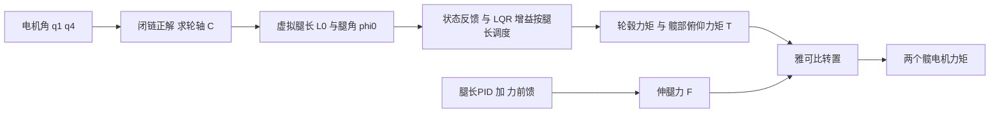

# 闭链并联机构与五连杆运动学

> **一句话定位**：轮腿机器人的"腿"通常是一个**平面五连杆**——两个电机装在机身上、一个轮子装在腿的下端，几根杆围成一个封闭的环。本章从零推导它的正解（两圆交点）、逆解、虚拟腿长 / 腿角、雅可比，以及虚功原理 $\tau=J^{\mathsf T}F$——这些就是 P7 里 VMC（虚拟模型控制）能把"支撑力"变成"电机力矩"的全部数学。

## 本章学完你能……

- 说清**开链**与**闭链**的区别，用自由度公式算出平面五连杆只有 2 个自由度。
- 自己推导"两圆交点"的正运动学公式，**手算**一个完整例子，并解释为什么有两个交点、怎么选。
- 判断什么时候**不可达**，以及程序里算出 NaN 时应该怀疑什么。
- 由轮轴位置反求两个电机角（逆解），并做往返验证。
- 定义虚拟腿长 $L_0$ 与腿角 $\varphi_0$，写出它们对电机角的雅可比。
- 用**长度约束求导**的方法推出速度映射，不死记公式。
- 用**虚功原理**推导 $\tau=J^{\mathsf T}F$，并手算一组支撑力 / 俯仰力矩对应的关节力矩。
- 讲清这些内容在 P7 的 VMC 里承担什么角色，并知道哪些参数要自己补全。

## 前置知识

- [坐标系、旋转矩阵与齐次变换](./01_坐标系_旋转矩阵_齐次变换.md)（向量、旋转、坐标约定）。
- [正逆运动学与雅可比](./03_正逆运动学与雅可比.md)（雅可比的含义、二连杆 IK 的余弦定理）。
- 勾股定理、余弦定理、`atan2`；偏导与链式法则。

## 目录

1. 要解决什么问题
2. 符号、坐标约定与示意图
3. 开链与闭链：自由度怎么数
4. 正运动学：两圆交点（含完整手算）
5. 解支选择与连续性
6. 不可达条件与数值保护
7. 逆运动学
8. 虚拟腿长与腿角
9. 雅可比与速度映射（长度约束求导）
10. 虚功原理：$\tau=J^{\mathsf T}F$
11. 手算：支撑力与俯仰力矩变成电机力矩
12. 奇异位形
13. 在本项目里怎么用（P7 VMC）
14. 常见错误与故障现象
15. 面试怎么问、怎么答
16. 本章要点速记、自测题、相关链接

---

## 1. 要解决什么问题

### 1.1 为什么腿是一个"环"

轮腿机器人（见 CV 的 P7）要在跳跃、缓冲、变腿长的同时保持平衡。腿如果做成"髋部一个电机 + 膝部一个电机"的串联二连杆，膝电机要跟着腿一起动，腿的转动惯量大、响应慢。五连杆的典型做法是：**把两个电机都固定在机身（髋）上**，通过几根杆把力和运动传到下端的轮子。腿更轻、响应更快，但代价是：几何变成**闭环**，不能用串联机械臂的公式。

### 1.2 控制器需要什么

平衡控制器（LQR）想的是"腿有多长、腿朝哪边倾斜、腿要撑多大的力"，而不是"两个电机各转多少度"。所以需要两个方向的翻译：

```text
电机角 q1, q4 ──正运动学──▶ 轮轴位置 C ──▶ 虚拟腿长 L0、腿角 φ0   （状态反馈要用）
支撑力 F、俯仰力矩 T ──雅可比转置──▶ 电机力矩 τ1, τ4              （执行器指令要用）
```

---

## 2. 符号、坐标约定与示意图

### 2.1 坐标约定（先定死，否则符号全乱）

本章采用"**两个关节在上、轮在下、竖直向下为正**"的腿部平面坐标：

- $x$ 向右为正；
- $y$ **向下为正**（腿向下伸，坐标是正数）；
- 一个方向角 $q$ 定义为：从 $+x$ 方向转向 $+y$ 方向的角度，方向向量为 $(\cos q,\ \sin q)$。所以 $q=0$ 指向右，**$q=90^\circ$ 指向正下方**，$q=180^\circ$ 指向左。

> **注意**：因为 $y$ 向下，"角度增大"在画面上是**顺时针**。这不是错，只是坐标系的手性（画面上看是左手系）。如果你的资料里 $y$ 向上，所有 $\sin$ 的符号要相应处理，以资料自己的定义为准。

### 2.2 点、杆与示意图

```text
   机身 (body)
   A ●──────── l5 ────────● E          ───▶ x
     \                    /            │
      \ l1            l4 /             ▼ y (向下为正)
       \                /
        ● B          D ●
         \            /
          \ l2    l3 /
           \        /
            \      /
             \    /
              ● C       ← 轮轴中心
             (( ))      ← 轮子 (不是五根杆之一)
   ─────────────────────── 地面
```

| 符号 | 含义 | 备注 |
|---|---|---|
| $A,\ E$ | 机身上的两个髋关节（电机轴） | 固定，$A=(0,0)$，$E=(l_5,0)$ |
| $B$ | 杆 $AB$ 的末端（"膝"） | 由电机 1 决定 |
| $D$ | 杆 $ED$ 的末端 | 由电机 4 决定 |
| $C$ | 杆 $BC$ 与 $DC$ 的汇合点 = 轮轴中心 | 要求的目标 |
| $l_1,\ l_4$ | 主动杆 $AB$、$ED$ 的长度 | m |
| $l_2,\ l_3$ | 从动杆 $BC$、$DC$ 的长度 | m |
| $l_5$ | 两个髋关节间距 $AE$ | m |
| $q_1,\ q_4$ | 电机角：杆 $AB$、$ED$ 的方向角（按 2.1 定义） | rad |
| $O$ | $A,E$ 的中点 | 虚拟腿的起点 |
| $L_0,\ \varphi_0$ | 虚拟腿长、腿角（$O\to C$） | m, rad |

**五根杆**：$AE$（机身，固定）、$AB$、$BC$、$CD$、$DE$，围成环 $A\to B\to C\to D\to E\to A$。

### 2.3 教学示例数值（非项目实测）

$$
l_1=l_4=0.10\ \mathrm m,\quad l_2=l_3=0.20\ \mathrm m,\quad l_5=0.12\ \mathrm m
$$

> 这是为了手算方便设定的数，**不是你的机器人的真实杆长**。真实杆长、零位、电机正方向：【待你补全：你的轮腿五连杆五个杆长、两个电机的零位与正方向、与本章 2.1 节坐标约定的对应关系】。

---

## 3. 开链与闭链：自由度怎么数

### 3.1 开链（串联）

像二连杆那样，从基座一路连到末端，没有回路。每个关节独立，$n$ 个关节就有 $n$ 个自由度，末端位姿由关节角**直接**连乘出来（上一章）。

### 3.2 闭链（并联 / 含回路）

五连杆从 $A$ 出发走 $A\to B\to C$，和从 $E$ 出发走 $E\to D\to C$，**必须到达同一个点 $C$**。这给了额外的约束条件。

**平面机构的自由度（Grübler 公式）**：

$$
\mathrm{DoF}=3(N-1)-2J_1
$$

$N$ 是构件数（包括机架），$J_1$ 是转动副数。五连杆：机架 $AE$、$AB$、$BC$、$CD$、$DE$，$N=5$；转动副 $A,B,C,D,E$，$J_1=5$：

$$
\mathrm{DoF}=3\times4-2\times5=2
$$

**2 个自由度 = 2 个电机**。电机角 $(q_1,q_4)$ 决定了整个腿的形状，轮轴 $C$ 的位置是它们的函数（有限个分支）。

### 3.3 工程含义

- 正运动学（电机角 $\to C$）：用**解析几何**（两圆交点）即可，不是矩阵连乘。
- URDF / TF 的树结构**不能直接表示闭环**；常用做法是在某个关节处"切断"成开链，再另外加约束，或者像本章这样直接用解析公式。
- 两个电机力矩不是独立产生 $C$ 的两个方向的力，而是通过几何耦合；需要雅可比（第 9–10 节）。

---

## 4. 正运动学：两圆交点（含完整手算）

### 4.1 第一步：求 $B$ 和 $D$

主动杆从髋关节出发，沿方向角走一个杆长：

$$
B=A+l_1\begin{bmatrix}\cos q_1\\\sin q_1\end{bmatrix},\qquad
D=E+l_4\begin{bmatrix}\cos q_4\\\sin q_4\end{bmatrix}
$$

### 4.2 第二步：$C$ 是两个圆的交点

从动杆长度固定，所以 $C$ 同时满足

$$
\lVert C-B\rVert=l_2,\qquad \lVert C-D\rVert=l_3
$$

"到 $B$ 的距离为 $l_2$"是以 $B$ 为圆心、$l_2$ 为半径的圆；"到 $D$ 的距离为 $l_3$"是以 $D$ 为圆心、$l_3$ 为半径的圆。$C$ 是这两个圆的交点。

### 4.3 推导交点公式

设 $\delta=D-B$，圆心距 $d=\lVert\delta\rVert$，沿圆心连线的单位向量 $e=\delta/d$，与它垂直的单位向量 $e_\perp=(-e_y,\ e_x)$。

设交点 $C$ 在 $B$ 出发沿 $e$ 走 $a$、再沿 $e_\perp$ 走 $h$ 的位置：$C=B+a\,e+h\,e_\perp$。

由两个圆的方程：
- 到 $B$：$a^2+h^2=l_2^2$；
- 到 $D$：$(d-a)^2+h^2=l_3^2$。

两式相减消去 $h^2$：$a^2-(d-a)^2=l_2^2-l_3^2\Rightarrow 2ad-d^2=l_2^2-l_3^2$，得

$$
\boxed{a=\frac{l_2^2-l_3^2+d^2}{2d},\qquad h=\pm\sqrt{l_2^2-a^2}}
$$

$$
\boxed{C=B+a\,e\pm h\,e_\perp}
$$

$\pm$ 对应两个交点（在连线 $BD$ 的两侧各一个）。

### 4.4 完整手算（教学示例数值）

电机角 $q_1=100^\circ,\ q_4=60^\circ$。

**(1) 求 $B$、$D$**

$B=\big(0.10\cos100^\circ,\ 0.10\sin100^\circ\big)=(-0.01736,\ 0.09848)$

$D=\big(0.12+0.10\cos60^\circ,\ 0.10\sin60^\circ\big)=(0.17000,\ 0.08660)$

（$q_1=100^\circ$ 略微偏向左，所以 $B$ 的 $x$ 为负。）

**(2) 圆心距与方向**

$\delta=D-B=(0.18736,\ -0.01188)$

$d=\sqrt{0.18736^2+0.01188^2}=\sqrt{0.035104+0.000141}=\sqrt{0.035245}=0.18774$

$e=\delta/d=(0.99800,\ -0.06327)$；$e_\perp=(-e_y,e_x)=(0.06327,\ 0.99800)$（**这个垂直方向在 $y$ 向下的坐标里指向下**）

**(3) $a$ 与 $h$**

因为 $l_2=l_3$：$a=\dfrac{0+d^2}{2d}=\dfrac d2=0.09387$

$h=\sqrt{l_2^2-a^2}=\sqrt{0.04-0.008812}=\sqrt{0.031188}=0.17660$

**(4) 取"下方"交点（$+h\,e_\perp$）**

$C=B+a\,e+h\,e_\perp$

$x$：$-0.01736+0.09387\times0.99800+0.17660\times0.06327=-0.01736+0.09368+0.01117=0.08749$

$y$：$0.09848+0.09387\times(-0.06327)+0.17660\times0.99800=0.09848-0.00594+0.17625=0.26879$

$$
C=(0.08749,\ 0.26879)\ \mathrm m
$$

**(5) 验算**：$\lVert C-B\rVert=\sqrt{0.10485^2+0.17031^2}=\sqrt{0.010994+0.029006}=0.2000$ ✔；$\lVert C-D\rVert=\sqrt{0.08251^2+0.18219^2}=\sqrt{0.006808+0.033192}=0.2000$ ✔。

**(6) 另一个交点**取 $-h\,e_\perp$：$C'=(-0.01736+0.09368-0.01117,\ 0.09848-0.00594-0.17625)=(0.06515,\ -0.08371)$，在 $B$、$D$ 的**上方**，$y<0$，比髋关节还高——也满足两个杆长，但对应"腿向上折过去"的另一种装配方式，**不是真实的轮腿装配**。

---

## 5. 解支选择与连续性

### 5.1 为什么有两个交点，选哪个

数学上两个圆通常交于两点；物理上两个点对应**两种装配方式**（assembly mode）：杆 $BC$、$DC$ 在连线 $BD$ 的下面还是上面。机器人出厂时已装配成其中一种，运行中**不会自己跳到另一种**（要跳过去，需要 $B,C,D$ 共线，那是奇异位形）。

本章的约定里轮子在下，所以始终取 $+h\,e_\perp$ 这一支（前提：$e$ 大致指向 $+x$，使 $e_\perp$ 指向 $+y$ 下方）。更稳妥的判据是**符号固定**：

$$
\operatorname{sign}\big((C-B)\times(D-B)\big)\ \text{在整个运动范围内保持不变}
$$

（二维叉积 $a\times b=a_xb_y-a_yb_x$。）

### 5.2 连续性检查

电机每个周期只转一点，$C$ 也只该移动一点。代码里加一个便宜的保护：

```python
# 教学示例，非项目源码
import numpy as np

def five_bar_fk(q1, q4, l1, l2, l3, l4, l5, branch=+1):
    A = np.array([0.0, 0.0]);  E = np.array([l5, 0.0])
    B = A + l1 * np.array([np.cos(q1), np.sin(q1)])
    D = E + l4 * np.array([np.cos(q4), np.sin(q4)])
    delta = D - B
    d = np.linalg.norm(delta)
    if d < 1e-9 or d > l2 + l3 or d < abs(l2 - l3):      # 不可达/退化
        return None
    e = delta / d
    e_perp = np.array([-e[1], e[0]])                      # y 向下坐标中指向下
    a = (l2**2 - l3**2 + d**2) / (2 * d)
    h2 = l2**2 - a**2
    if h2 < 0.0:                                          # 严格判据，见第 6 节
        return None
    C = B + a * e + branch * np.sqrt(h2) * e_perp
    return B, D, C

# 上层:  if C_prev is not None and np.linalg.norm(C - C_prev) > jump_limit: 判为解支跳变/数据异常
```

**如果下一周期突然改选了另一个交点**，程序会认为轮轴"瞬间从腿下方跳到腿上方"，这在物理上做不到，几乎一定是**选错解支**（或者输入角度有跳变）。

---

## 6. 不可达条件与数值保护

两圆有交点的充要条件：

$$
\boxed{\ |l_2-l_3|\ \le\ d\ \le\ l_2+l_3\ }
$$

- $d>l_2+l_3$：两圆分离，没有交点——$B$、$D$ 离得太远，杆 $BC$、$DC$ 够不到一起；
- $d<|l_2-l_3|$：一圆在另一圆内部，没有交点；
- $d=0$：$B$ 与 $D$ 重合，圆心重合，$e$ 无定义（**退化**）；
- $d=l_2+l_3$ 或 $|l_2-l_3|$：两圆相切，$h=0$，两个解合并（**奇异**）。

**数值陷阱**：$h^2=l_2^2-a^2$ 在相切附近可能因浮点误差成为 $-10^{-17}$ 量级的负数，`sqrt` 得到 NaN。处理原则：

- 微小负数（比如 $|h^2|<10^{-12}$）可以按 0 处理；
- 明显的负数要判为"不可达"，**不能一律夹到 0 后继续计算**——否则会把真实错误（零位错、杆长参数错、电机角单位错）掩盖成"看起来合理"的位置。

**手算例子（错误参数如何导致不可达）**：若误把 $l_2=l_3$ 写成 $0.15$ m（而真实是 $0.20$ m），在 $q_1=180^\circ,\ q_4=0^\circ$ 时 $B=(-0.10,0)$、$D=(0.22,0)$，$d=0.32>l_2+l_3=0.30$，$h^2=0.0225-0.0256<0$，算出 NaN。看到 NaN 不要先修数值，先核对杆长与零位。

---

## 7. 逆运动学

### 7.1 问题

已知希望的轮轴位置 $C$（由虚拟腿长和腿角给出，见下节），求两个电机角 $(q_1,q_4)$。

### 7.2 思路：两侧各是一个二连杆

从 $A$ 看：$A\to B\to C$ 就是一个二连杆（长度 $l_1,l_2$），目标点是 $C$。用上一章的余弦定理：

令 $d_A=\lVert C-A\rVert$，在三角形 $ABC$ 中，$B$ 处的两条边 $l_1$（$AB$）和 $d_A$（$AC$）的夹角 $\beta$（在 $A$ 点）满足

$$
\cos\beta=\frac{l_1^2+d_A^2-l_2^2}{2\,l_1\,d_A}
$$

$AB$ 的方向 $=$ $AC$ 的方向 $\pm\beta$：

$$
q_1=\operatorname{atan2}(C_y-A_y,\ C_x-A_x)\ +\ s_A\,\beta
$$

同样对 $E$ 侧：$d_E=\lVert C-E\rVert$，$\cos\gamma=\dfrac{l_4^2+d_E^2-l_3^2}{2\,l_4\,d_E}$，

$$
q_4=\operatorname{atan2}(C_y-E_y,\ C_x-E_x)\ +\ s_E\,\gamma
$$

$s_A,s_E=\pm1$ 是两侧的**膝向**选择（"膝盖朝外"还是"朝内"）；**必须与真实装配一致**。本章示例选"膝朝外"，即 $s_A=+1$、$s_E=-1$（在 $y$ 向下的坐标里，$+\beta$ 把 $AB$ 往 $-x$ 方向、即画面左侧偏；$-\gamma$ 把 $ED$ 往画面右侧偏）。

### 7.3 手算：往返验证

用 4.4 节得到的 $C=(0.08749,\ 0.26879)$。

**$A$ 侧**：$C-A=(0.08749,0.26879)$，$d_A=\sqrt{0.007655+0.072248}=0.28267$。

$\cos\beta=\dfrac{0.01+0.07990-0.04}{2\times0.10\times0.28267}=\dfrac{0.04990}{0.056534}=0.88270\Rightarrow\beta=28.03^\circ$。

$\operatorname{atan2}(0.26879,0.08749)=71.97^\circ$。

$q_1=71.97^\circ+28.03^\circ=100.00^\circ$ ✔（回到原来的电机角）。另一个膝向会给出 $71.97-28.03=43.94^\circ$。

**$E$ 侧**：$C-E=(-0.03251,\ 0.26879)$，$d_E=\sqrt{0.001057+0.072248}=0.27075$。

$\cos\gamma=\dfrac{0.01+0.07331-0.04}{2\times0.10\times0.27075}=\dfrac{0.04331}{0.05415}=0.79972\Rightarrow\gamma=36.90^\circ$。

$\operatorname{atan2}(0.26879,-0.03251)=96.90^\circ$。

$q_4=96.90^\circ-36.90^\circ=60.00^\circ$ ✔。

两侧各自的可达条件也要检查：$|\cos\beta|\le1$、$|\cos\gamma|\le1$，即 $|l_1-l_2|\le d_A\le l_1+l_2$（这里 $0.10\le d_A\le0.30$）。示例里 $d_A=0.2827$，已经接近伸直极限 $0.30$——腿的**最大伸展长度**由它限制。

---

## 8. 虚拟腿长与腿角

### 8.1 为什么要"虚拟腿"

五根杆、两个电机角，对平衡控制器来说太复杂。LQR 与重力补偿更关心**轮轴相对机身髋部的位置**：把它描述成一条从髋部中点 $O$ 指向轮轴 $C$ 的"虚拟直腿"，用长度和方向两个数表示。这根腿不是真实存在的杆，只是**坐标变换**。

### 8.2 定义

$O=\dfrac{A+E}{2}$，$r=C-O=(r_x,r_y)$：

$$
\boxed{L_0=\sqrt{r_x^2+r_y^2},\qquad \varphi_0=\operatorname{atan2}(r_y,\ r_x)}
$$

- $\varphi_0$：按 2.1 的约定，从 $+x$ 转向 $+y$ 的角度；腿正下方 $\varphi_0=90^\circ$。
- 逆关系：$C=O+L_0(\cos\varphi_0,\ \sin\varphi_0)$。
- 很多资料用"相对竖直向下"的腿角：$\alpha=\dfrac\pi2-\varphi_0$。腿竖直 $\alpha=0$，轮轴在髋部右侧时 $\alpha>0$。**读公式前先确认角度从哪里量起。**

### 8.3 手算

$O=(0.06,\ 0)$；$r=C-O=(0.02749,\ 0.26879)$。

$L_0=\sqrt{0.000756+0.072248}=\sqrt{0.073004}=0.27019\ \mathrm m$

$\varphi_0=\operatorname{atan2}(0.26879,0.02749)=84.16^\circ$；$\alpha=90^\circ-84.16^\circ=5.84^\circ$（轮轴略偏髋部中点右侧）。

### 8.4 腿角与机身俯仰合成

平衡控制要用的是"腿相对铅垂线的摆角"。机身俯仰（IMU 给出）为 $\theta_b$，腿相对机身的角为 $\alpha$，控制状态里的摆角 $\theta$ 通常是二者的组合（符号、零位由具体定义决定，典型形式如 $\theta=\alpha\pm\theta_b$ 的某种线性组合）。**两个角如果正方向不一致，这一项会符号错误**，闭环失稳。见 [欧拉角、四元数与姿态表示](./02_欧拉角_四元数_姿态表示.md) 第 11 节的符号讨论。

【待你补全：你的 LQR 状态向量里的摆角 $\theta$ 具体怎样由腿角与机身俯仰组合；左右腿镜像时符号怎样处理】

---

## 9. 雅可比与速度映射（长度约束求导）

### 9.1 思路：杆长不变

不要背公式，从"杆长恒定"推。$\lVert C-B\rVert^2=l_2^2$，两边对时间求导：

$$
(C-B)^{\mathsf T}(\dot C-\dot B)=0,\qquad
(C-D)^{\mathsf T}(\dot C-\dot D)=0
$$

意思是：杆 $BC$ 上两端点的**沿杆方向相对速度为 0**（杆不能被拉长或压短）。

主动杆端点的速度是转动的切线速度：

$$
\dot B=l_1\dot q_1\,t_B,\quad t_B=(-\sin q_1,\ \cos q_1);\qquad
\dot D=l_4\dot q_4\,t_D,\quad t_D=(-\sin q_4,\ \cos q_4)
$$

移项写成矩阵：

$$
\underbrace{\begin{bmatrix}(C-B)^{\mathsf T}\\(C-D)^{\mathsf T}\end{bmatrix}}_{M}\dot C=
\underbrace{\begin{bmatrix}l_1\,(C-B)\!\cdot\!t_B&0\\0&l_4\,(C-D)\!\cdot\!t_D\end{bmatrix}}_{N}
\begin{bmatrix}\dot q_1\\\dot q_4\end{bmatrix}
$$

$$
\boxed{\dot C=J_C\,\dot q,\qquad J_C=M^{-1}N}
$$

$J_C$ 是 $2\times2$ 的，单位 m/rad。

### 9.2 手算（接 4.4 节的位形）

- $C-B=(0.10485,\ 0.17031)$，$C-D=(-0.08251,\ 0.18219)$
- $t_B=(-\sin100^\circ,\ \cos100^\circ)=(-0.98481,\ -0.17365)$，$t_D=(-\sin60^\circ,\ \cos60^\circ)=(-0.86603,\ 0.5)$
- $N_{11}=0.10\times\big(0.10485\times(-0.98481)+0.17031\times(-0.17365)\big)=0.10\times(-0.10326-0.02957)=-0.013283$
- $N_{22}=0.10\times\big((-0.08251)(-0.86603)+0.18219\times0.5\big)=0.10\times(0.07146+0.09110)=0.016255$
- $M=\begin{bmatrix}0.10485&0.17031\\-0.08251&0.18219\end{bmatrix}$，$\det M=0.10485\times0.18219+0.17031\times0.08251=0.019102+0.014052=0.033154$
- $M^{-1}=\dfrac{1}{0.033154}\begin{bmatrix}0.18219&-0.17031\\0.08251&0.10485\end{bmatrix}$

$$
J_C=M^{-1}N=\frac{1}{0.033154}\begin{bmatrix}0.18219\times(-0.013283)&-0.17031\times0.016255\\0.08251\times(-0.013283)&0.10485\times0.016255\end{bmatrix}
=\begin{bmatrix}-0.07299&-0.08350\\-0.03306&0.05141\end{bmatrix}
$$

**用有限差分核对**：令 $q_1$ 增加 $10^{-7}$ rad，重新做 4.4 节的正解，$C$ 的变化除以步长得 $(-0.07299,\ -0.03306)$ ✔（有限差分的数值结果与解析结果在 4 位有效数字内一致）。

**一次速度映射**：$\dot q=(0.5,\ 0)$ rad/s（只有电机 1 转）：$\dot C=(-0.0365,\ -0.0165)$ m/s。

> 注意 $\dot C$ 的 $x$、$y$ 分量都不为 0：虽然只转了一个电机，轮轴**既向左又向上**移动——这就是**耦合**。若把某一个电机当成独立的串联关节，会得到完全错误的答案。

### 9.3 把雅可比转到虚拟腿坐标

$L_0=\lVert r\rVert$，$\varphi_0=\operatorname{atan2}(r_y,r_x)$，且 $\dot r=\dot C$（$O$ 固定在机身）。令 $\hat r=r/L_0$，$\hat t=(-\hat r_y,\ \hat r_x)$：

$$
\dot L_0=\hat r^{\mathsf T}\dot C,\qquad \dot\varphi_0=\frac{1}{L_0}\hat t^{\mathsf T}\dot C
$$

$$
\boxed{\begin{bmatrix}\dot L_0\\\dot\varphi_0\end{bmatrix}=J_v\dot q,\qquad J_v=\begin{bmatrix}\hat r^{\mathsf T}\\\tfrac{1}{L_0}\hat t^{\mathsf T}\end{bmatrix}J_C}
$$

**手算**：$\hat r=(0.02749,0.26879)/0.27019=(0.10174,\ 0.99481)$；$\hat t=(-0.99481,\ 0.10174)$。

- 第 1 行：$\hat r^{\mathsf T}J_C=(0.10174\times(-0.07299)+0.99481\times(-0.03306),\ 0.10174\times(-0.08350)+0.99481\times0.05141)=(-0.04031,\ 0.04265)$
- 第 2 行：$\hat t^{\mathsf T}J_C=(-0.99481\times(-0.07299)+0.10174\times(-0.03306),\ -0.99481\times(-0.08350)+0.10174\times0.05141)=(0.06925,\ 0.08830)$，再除以 $L_0=0.27019$，得 $(0.2563,\ 0.3268)$

$$
J_v=\begin{bmatrix}-0.04031&0.04265\\0.2563&0.3268\end{bmatrix}
\quad\begin{matrix}\text{第 1 行：m/rad}\\\text{第 2 行：rad/rad（无量纲）}\end{matrix}
$$

**解读**：

- 第 1 行 $(-0.040,\ +0.043)$：电机 1 增大（杆 $AB$ 顺时针转向左下，画面上）会使腿**变短**，电机 4 增大会使腿**变长**；两个电机同向等量转（$\dot q_1=\dot q_4$）时 $\dot L_0\approx0.0023\,\dot q$，几乎抵消（$-0.0403+0.0427=0.0023$）——两个电机"同向"主要改变腿角而不是腿长；
- 第 2 行 $(0.256,\ 0.327)$：两个电机同向转时腿角变化显著（$\dot\varphi_0\approx0.58\,\dot q$）；
- **腿长主要由两个电机的"差动"决定，腿角主要由"共模"决定**。这解释了为什么腿长 PID 和摆腿控制器可以相对独立地设计。

**速度例**：$\dot q=(0.5,0)$：$\dot L_0=-0.0202$ m/s，$\dot\varphi_0=0.128$ rad/s。

---

## 10. 虚功原理：$\tau=J^{\mathsf T}F$

### 10.1 要解决什么问题

VMC 的控制律在**虚拟腿坐标**里想象一个"虚拟弹簧阻尼器 + 力矩"：沿腿方向产生一个力 $F$，绕髋部产生一个力矩 $T$。需要知道两个电机各出多少力矩才能"等效地"产生这个 $F,T$。

### 10.2 推导（虚功 / 功率守恒）

在**无摩擦、准静态**的条件下，机构内部是理想约束（不耗能、不做功），所以：电机输入的功率 $=$ 虚拟腿上输出的功率。令小位移 $\delta q$ 对应虚拟位移 $\delta x_v=(\delta L_0,\delta\varphi_0)$，虚功相等：

$$
\tau_1\delta q_1+\tau_4\delta q_4=F\,\delta L_0+T\,\delta\varphi_0
$$

写成向量：$\tau^{\mathsf T}\delta q=f^{\mathsf T}\delta x_v$，其中 $f=(F,T)^{\mathsf T}$。再代入 $\delta x_v=J_v\,\delta q$：

$$
\tau^{\mathsf T}\delta q=f^{\mathsf T}J_v\,\delta q\quad\forall\,\delta q\ \Longrightarrow\ \tau^{\mathsf T}=f^{\mathsf T}J_v
$$

$$
\boxed{\tau=J_v^{\mathsf T}\,f}\ ,\qquad \tau=\begin{bmatrix}\tau_1\\\tau_4\end{bmatrix},\ f=\begin{bmatrix}F\\T\end{bmatrix}
$$

**关键点**：速度用 $J$，力用 $J^{\mathsf T}$；**不是**用 $J^{-1}$，也不是伪逆。

### 10.3 力的定义（符号很关键）

- $F$（N）：虚拟腿的**伸腿力**——腿沿 $\hat r$ 方向向外推轮轴所需的力的大小，$F>0$ 表示要让腿伸长。
- $T$（N·m）：沿 $\varphi_0$ 增大方向的力矩（在 $y$ 向下坐标里，$\varphi_0$ 增大对应画面顺时针）。
- 单位自洽：$F\,\delta L_0$ 是 N × m = J，$T\,\delta\varphi_0$ 是 N·m × rad = J，两项都是功。如果把 $F$、$T$ 的排列顺序弄反，矩阵乘法的形状仍然对，但物理作用就错了（力当成力矩用，单位不匹配）。

> **注意**：地面对机身的支撑力与"腿对轮子的力"互为反作用。若控制器定义的是"机身需要地面提供多大支撑"，换成 $F$ 时要核对一次符号，不能想当然套 $J^{\mathsf T}$。

### 10.4 与笛卡尔力的等价写法

在轮轴点 $C$ 看：腿伸缩力 $F\hat r$ 和切向力 $\dfrac{T}{L_0}\hat t$ 合成笛卡尔力 $F_C$，再用 $\tau=J_C^{\mathsf T}F_C$。二者等价（因为 $J_v=\begin{bmatrix}\hat r^{\mathsf T}\\ \hat t^{\mathsf T}/L_0\end{bmatrix}J_C$，转置后正是 $J_C^{\mathsf T}[\hat r,\ \hat t/L_0]$）。

---

## 11. 手算：支撑力与俯仰力矩变成电机力矩

**需求（教学示例数值）**：虚拟腿伸腿力 $F=30\ \mathrm N$，摆腿力矩 $T=0.5\ \mathrm{N\cdot m}$。用 9.3 节的 $J_v$：

$$
\tau_1=J_{v,11}F+J_{v,21}T=(-0.04031)(30)+(0.2563)(0.5)=-1.2093+0.1282=-1.081\ \mathrm{N\cdot m}
$$

$$
\tau_4=J_{v,12}F+J_{v,22}T=(0.04265)(30)+(0.3268)(0.5)=1.2795+0.1634=1.443\ \mathrm{N\cdot m}
$$

**核对（笛卡尔路径）**：$F_C=F\hat r+\dfrac{T}{L_0}\hat t=30(0.10174,0.99481)+\dfrac{0.5}{0.27019}(-0.99481,0.10174)=(3.052-1.841,\ 29.844+0.188)=(1.211,\ 30.03)$ N。$\tau=J_C^{\mathsf T}F_C$：$\tau_1=-0.07299\times1.211+(-0.03306)\times30.03=-0.0884-0.9928=-1.081$ ✔；$\tau_4=-0.08350\times1.211+0.05141\times30.03=-0.1011+1.544=1.443$ ✔。

**解读**：为了让腿向下"撑"30 N，电机 1 需要负力矩、电机 4 需要正力矩——这与 $J_v$ 第 1 行的符号（电机 1 增大使腿变短，所以要变长必须反着转）一致。这种符号结构也是排查"力方向反了"的快速检验。

**撑重的前馈估计**：腿竖直时，一条腿要撑的力约等于它所承担的机身重量的一半（左右各一）；腿偏离竖直 $\alpha$ 时，为了得到同样的竖直支撑要沿腿方向出力 $F\approx\dfrac{m g}{\cos\alpha}$。例如（教学示例）一条腿承担质量 $m=3\ \mathrm{kg}$，$\alpha=5.84^\circ$：$F\approx\dfrac{3\times9.81}{\cos5.84^\circ}=\dfrac{29.43}{0.9948}=29.6\ \mathrm N$。这就是"力前馈"的物理来源——反馈部分（腿长 PID）只需要补偿误差。完整的腿长控制：

$$
F=F_{ff}+K_p\,(L_{0,ref}-L_0)-K_d\,\dot L_0
$$

---

## 12. 奇异位形

闭链有**两类**奇异（Gosselin–Angeles 分类）：

### 12.1 第一类（串联型 / 输入奇异）：$N$ 的某个对角元为 0

条件 $(C-B)\cdot t_B=0$：杆 $BC$ 与杆 $AB$ **共线**（$A,B,C$ 在一条直线上）。几何上就是一侧腿伸到最长（或折到最短）：$d_A=l_1+l_2$ 或 $|l_1-l_2|$。此时 $B$ 的速度垂直于杆 $AB$、也就垂直于杆 $BC$，对杆 $BC$ 的长度没有影响，轮轴 $C$ 一阶不动（$N_{11}=0$，$J_C$ 的第 1 列为 0）：电机转了，轮轴却不动。**腿的最大伸展长度就是这类奇异的边界**；实机必须把腿长限制在离该边界留有裕量的范围内（还要考虑机械限位）。

### 12.2 第二类（并联型 / 输出奇异）：$\det M=0$

条件 $(C-B)\parallel(C-D)$：杆 $BC$ 与 $DC$ **共线**（$B,C,D$ 共线）。此时两个电机即使锁住，$C$ 仍能沿垂直于杆的方向轻微晃动——机构**局部自由度增加**，轮轴对外力失去刚度，且 $M$ 不可逆，$J_C$ 无穷大。注意在示例杆长下（$l_2+l_3=0.40>$ 最大 $d=0.32$），$d=l_2+l_3$ 并不会出现；在 $d\to0$ 时（$B$、$D$ 重合，杆 $BC$、$DC$ 重叠）才会到达退化，实际上被机械结构避免。

### 12.3 数值表现

- $N_{ii}\to0$ 时 $J_C$ 的某一列趋 0：该电机几乎无法驱动轮轴（速度映射变差）；对偶地，$\tau=J^{\mathsf T}F$ 中该电机的力矩系数也趋 0——沿杆方向的力由杆件的**轴向受力**承担，电机几乎不用出力。所以靠近这类奇异时腿"撑得很省力"，但电机对该方向失去控制能力；
- $\det M\to0$ 时 $J_C=M^{-1}N$ 的元素爆炸，如果不判断，$\tau=J^{\mathsf T}F$ 会输出巨大的力矩。
- 对策：约束腿长工作范围；在 $\det M$ 或 $\sin(\theta_1-\theta_2)$ 这样的分母上做下限保护；对 $\tau$ 做硬限幅（见 [前馈、增益调度、限幅与饱和](../04_控制理论/07_前馈_增益调度_限幅与饱和.md)）。

> 学习笔记里 P7 的 VMC 材料给出的雅可比公式，分母含 $\sin(\theta_1-\theta_2)$（两根从动杆方向角之差），当两杆接近平行时分母趋 0，$J$ 的某些元素变得很大——这与本章第二类奇异（$\det M=0$）是同一件事的另一种写法。

---

## 13. 在本项目里怎么用（P7 VMC）

对应 CV（P7）：

- *"VMC torque control: computed virtual leg length and posture from closed-chain kinematics, mapped support force and pitch torque to joints via the Jacobian, and coordinated leg extension with leg-length PID and force feedforward."*
- *"Gain-scheduled LQR: … scheduled LQR gains by leg length and converted balance and motion errors into wheel-hub and hip torques."*

把它们翻译成本章的话：



| 控制链节点 | 本章公式 |
|---|---|
| 虚拟腿长 / 腿角（"posture"） | 第 4、8 节 |
| 腿长 PID + 力前馈 | 第 11 节 |
| 支撑力 + 俯仰力矩 $\to$ 关节 | 第 10 节 $\tau=J^{\mathsf T}f$ |
| LQR 增益按腿长调度 | 腿长 $L_0$ 作为调度变量（见 [LQR 最优控制](../04_控制理论/04_LQR最优控制.md)、[前馈、增益调度、限幅与饱和](../04_控制理论/07_前馈_增益调度_限幅与饱和.md)） |
| 力矩限幅、落地接触切换 | 第 12 节与 CV 的 "torque limits and ground-contact transitions" |

项目文档：[P7 可变腿长轮腿机器人](../../01_项目课程/P7_可变腿长轮腿机器人/README.md)。

**你可以如实说的**（与 CV 对齐）：你实现了闭链运动学求虚拟腿长和姿态、用雅可比把支撑力和俯仰力矩映射到关节、用腿长 PID 加力前馈协调腿的伸缩。
**要自己补全的细节**：

【待你补全：你们机器人的五连杆杆长、两个电机的零位与正方向，以及腿长的可用范围】
【待你补全：腿长 PID 的输出是直接作为伸腿力 $F$ 还是先叠加力前馈，前馈量按什么估计（例如按机体质量与腿角的几何关系）】
【待你补全：落地 / 离地（接触）切换时，VMC 力是怎样处理的（例如离地时关闭支撑力）】

---

## 14. 常见错误、边界与故障现象

| 现象 | 原因 | 排查 |
|---|---|---|
| 腿长突然跳到很大 / 很小，然后恢复 | 解支选错（取了另一个交点），或输入角度有跳变 | 解支符号固定；连续性检查 $\lVert C-C_{prev}\rVert$ |
| 输出 NaN | $h^2<0$：不可达，杆长 / 零位 / 单位错；或 $d=0$ | 先核对参数；不要一律夹零 |
| 腿被"推"着往错误方向伸缩 | $F$ 的符号（伸腿力 vs 地面支撑力）与 $J^{\mathsf T}$ 约定不一致 | 做静态推腿测试，核对 $\tau$ 符号 |
| 左右腿对称动作，一条腿反着动 | 左右电机安装镜像，正方向相反 | 逐电机测试正方向，在驱动层统一 |
| 腿快伸直时力矩暴涨 | 接近第一类 / 第二类奇异，雅可比元素爆炸 | 限制腿长范围；分母保护；力矩限幅 |
| 腿长稳定，机身仍抖 | 摆腿力矩 $T$ 符号反，或腿角 / 俯仰合成的零位不一致 | 分别单独注入 $F$、$T$ 观察响应 |
| 单位错误（mm / m，度 / 弧度） | 杆长用 mm 而角用 rad | 统一 SI；检查 $J$ 的单位 |
| 用串联 2 连杆的雅可比 | 把闭链当开链 | 回到长度约束求导 |
| 关节力矩读数与理论相差很大 | 摩擦、齿隙、静态重量未计入；准静态假设失效 | 区分前馈与反馈项；低速标定 |

---

## 15. 面试怎么问、怎么答

**Q1. What is a five-bar linkage, and why do wheel-legged robots use it?**

> "It is a planar closed-chain mechanism with five links and five revolute joints, so it has two degrees of freedom, driven by two motors. Both motors sit on the body, which keeps the leg light and gives a fast response. The price is that the kinematics is a closed loop: the wheel axis has to satisfy the length constraints from both sides at once."

（中文：五连杆是平面闭链，5 杆 5 副，2 个自由度、2 个电机；电机都在机身上，腿轻、响应快；代价是闭环几何，轮轴要同时满足两侧长度约束。）

**Q2. How do you compute the forward kinematics of a five-bar leg?**

> "First I compute the two elbow points from the motor angles by walking one link length along each motor direction. Then the wheel axis is the intersection of two circles, one around each elbow with the radius of the follower link. There are two intersections, which correspond to two assembly modes, so I fix the one that matches the real mechanism and check continuity from cycle to cycle. If the circles do not intersect, the configuration is unreachable, and I treat it as an error instead of clamping."

**Q3. In your wheel-legged project, how did you map the desired support force to motor torques?**

> "I computed the virtual leg length and angle from the closed-chain kinematics, and derived the Jacobian from the virtual leg coordinates to the motor angles. By the principle of virtual work, the joint torques are the transpose of that Jacobian times the desired virtual force and torque. The leg-length PID plus a force feedforward produces the leg force, and the balance controller provides the hip pitch torque."

（中文：由闭链运动学得虚拟腿长 / 角，雅可比，虚功原理给出 $\tau=J^{\mathsf T}f$；腿长 PID + 力前馈给出腿力，平衡控制器给出髋部俯仰力矩。）
> 与 CV 一致；若被追问具体杆长、增益、前馈如何估计，请按真实情况回答：【待你补全：对应 13 节的三项补全内容】。

*追问*：Why the transpose and not the inverse? （答：力与速度对偶，功率守恒 $\tau^{\mathsf T}\dot q=f^{\mathsf T}\dot x$ 推出转置；逆是用来把速度需求换成关节速度的。）

**Q4. What happens near a singularity of the leg?**

> "There are two kinds. When a side of the leg is fully stretched, the active link and the follower link are collinear, and the motor can no longer move the wheel axis along that direction. When the two follower links become collinear, the mechanism loses stiffness and the Jacobian becomes ill-conditioned. In practice I limit the leg length range, guard the denominators, and saturate the commanded torques."

**Q5. How do you debug torque sign problems on a leg?**

> "I inject a pure extension force and then a pure pitch torque separately, with the robot lifted, and check that each joint torque has the sign predicted by the Jacobian. I also check each motor's positive direction individually, since left and right motors are often mirrored."

---

## 16. 本章要点速记

1. 五连杆：5 构件、5 转动副，Grübler 自由度 $=3(5-1)-2\times5=2$，两个电机。
2. 坐标约定：$x$ 右、$y$ 下为正；方向角 $q=90^\circ$ 指向正下方；必须先定约定再算。
3. 正解：$B=A+l_1(\cos q_1,\sin q_1)$，$D$ 同理；$C$ 为两圆交点 $C=B+ae\pm he_\perp$。
4. $a=\dfrac{l_2^2-l_3^2+d^2}{2d}$，$h=\sqrt{l_2^2-a^2}$；有解条件 $|l_2-l_3|\le d\le l_2+l_3$。
5. 两个交点是两种装配方式；固定一支，运行中检查连续性；NaN 先查参数而不是夹零。
6. 逆解：两侧各是二连杆，用余弦定理；膝向由装配决定。
7. 虚拟腿：$L_0=\lVert C-O\rVert$，$\varphi_0=\operatorname{atan2}(r_y,r_x)$；不是真实杆，是坐标变换。
8. 速度映射由长度约束求导：$M\dot C=N\dot q$，$J_C=M^{-1}N$。
9. 虚功原理：$\tau=J_v^{\mathsf T}f$；速度用 $J$，力用 $J^{\mathsf T}$。
10. 两类奇异：腿伸直（$A,B,C$ 共线）、$B,C,D$ 共线；对策是范围限制、分母保护、力矩限幅。

## 自测题

1. 用 Grübler 公式计算平面五连杆的自由度，并说明含义。
   *答案*：$3(5-1)-2\times5=2$；两个电机即可完全确定位形。
2. 两圆半径都是 1，圆心距 3，有交点吗？
   *答案*：没有，$d=3>l_2+l_3=2$；不可达。
3. $B=(0,0)$，$D=(1,0)$，$l_2=l_3=1$，求两个交点。
   *答案*：$a=0.5$，$h=\sqrt{0.75}=0.866$；$e=(1,0)$，$e_\perp=(0,1)$；$C=(0.5,\ \pm0.866)$，$y$ 向下坐标下 $+0.866$ 是下方。
4. 推导为什么力用 $J^{\mathsf T}$：写出虚功等式。
   *要点*：$\tau^{\mathsf T}\delta q=f^{\mathsf T}\delta x_v=f^{\mathsf T}J_v\delta q$，对任意 $\delta q$ 成立。
5. 示例中电机 1 单独转动 $0.5$ rad/s，轮轴为何不是只往一个方向动？
   *要点*：两侧杆长约束耦合，$\dot C=J_C\dot q$ 的列不沿坐标轴。
6. 在 $F=30$ N、$T=0$ 时，$\tau_1,\tau_4$ 的符号为什么相反？
   *要点*：$J_v$ 第 1 行两个元素符号相反——电机 1 增大使腿变短，电机 4 增大使腿变长。
7. 算出 $h^2<0$ 时，应当优先怀疑什么？
   *要点*：杆长 / 零位 / 单位 / 电机角输入错误；真正的不可达位形要用保护逻辑报错，不能夹零后继续。

## 相关链接

- 上一章：[奇异性、阻尼最小二乘与零空间](./04_奇异性_阻尼最小二乘_零空间.md)
- 下一章：[机械臂动力学、重力补偿、URDF 与 KDL](./06_机械臂动力学_重力补偿_URDF_KDL.md)
- 基础：[正逆运动学与雅可比](./03_正逆运动学与雅可比.md)、[LQR 最优控制](../04_控制理论/04_LQR最优控制.md)、[前馈、增益调度、限幅与饱和](../04_控制理论/07_前馈_增益调度_限幅与饱和.md)、[拉格朗日方程与机器人动力学](../02_力学与建模/02_拉格朗日方程与机器人动力学.md)
- 项目：[P7 可变腿长轮腿机器人](../../01_项目课程/P7_可变腿长轮腿机器人/README.md)
- 学习笔记原始问答：[P7 问答逐字稿](../../05_学习笔记归档/P7/P7_本对话问答逐字稿.md)
