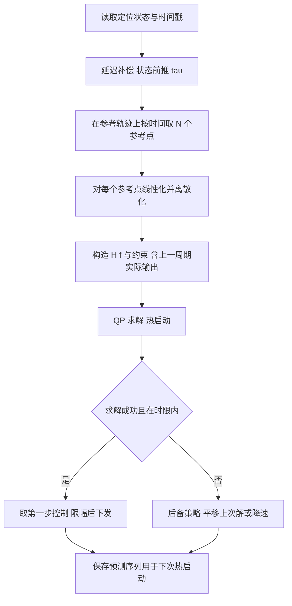

# MPC 模型预测控制

> **一句话定位**：MPC（Model Predictive Control）每个控制周期用模型向前预测一段时间，在**约束**下解一个优化问题，只执行第一步，下个周期再重来。它是你 P5 里"车式运动学模型 + 位置/航向/速度/转角约束 + 滚动时域"的数学基础，也是 LQR 的"带约束、可前瞻"的推广。

**本章学完你能：**

- 讲清滚动时域（receding horizon）的思想，并画出预测、优化、只执行第一步、再滚动的时间线；
- 从预测模型出发推导"预测矩阵"，把 MPC 写成标准二次规划（QP）：$\min\tfrac12U^THU+f^TU$，并写出约束矩阵；
- 为车式（自行车）运动学模型完整构造线性化误差模型，手算一步预测与一个小 QP；
- 解释预测时域、控制时域、权重、终端代价/约束对性能和稳定性的影响，并用数字演示"时域太短根本看不到转向的效果"；
- 说明延迟补偿、软约束、求解器选择、实时性与失败处理；
- 用英文回答"为什么用 MPC、怎么做、怎么保证实时"。

**前置知识**：[03 状态空间](./03_状态空间_可控可观_稳定性.md)（离散化、线性化）、[04 LQR](./04_LQR最优控制.md)（代价函数、Riccati）、[最优化与二次规划](../01_数学基础/04_最优化与二次规划.md)、[差速、麦克纳姆、全向轮与车辆运动学](../02_力学与动力学建模/04_差速_麦克纳姆_全向轮与车辆运动学.md)。

**目录**

1. MPC 要解决什么问题
2. 滚动时域思想
3. 预测模型与预测矩阵
4. 代价函数与约束
5. 推导 QP 形式
6. 车式运动学模型：完整构造
7. 完整手算：一步预测与一个 QP
8. 线性 MPC 与非线性 MPC
9. 预测时域、控制时域、权重
10. 终端代价与终端约束
11. 延迟补偿
12. 软约束与可行性
13. 求解器与实时性
14. 项目对应：P5
15. 常见故障
16. 面试问答
17. 要点速记、自测题、链接

---

## 1. MPC 要解决什么问题

PID 和 LQR 都是"看当前状态，立刻算输出"，没有"前瞻"，也不知道约束。但车辆跟踪轨迹时有三件事它们做不好：

1. **有硬约束**：方向盘转角有上限、转角变化率有上限、速度有上限；超过这些值，控制器给出的命令是不能执行的。
2. **要提前动作**：前方要转弯，现在就该开始打方向，而不是弯道到了才反应；
3. **参考是一条时变轨迹**，而不是常值目标。

MPC 的做法：**"我先在脑子里预演未来 N 步，在不违反约束的前提下选一串最好的动作，只做第一步，然后看实际发生了什么，再重新预演。"**

---

## 2. 滚动时域思想

```text
时间轴:   k      k+1     k+2    ...    k+N
          |-------|-------|------------|
 预测:    x_k  ->  x_{k+1} ->  x_{k+2} ... -> x_{k+N}      (用模型预测)
 决策:    u_k,    u_{k+1}, ...,          u_{k+N-1}          (一串控制, 求最优)
 执行:    只执行 u_k
 下一周期: 测得真实 x_{k+1}, 以它为新的起点, 整个窗口向前滚动一格, 重新优化
```

三个关键词：

| 术语 | 含义 |
|---|---|
| **预测时域** $N_p$ | 向前看多少步（本章记 $N$） |
| **控制时域** $N_c\le N_p$ | 优化多少步的控制量（之后保持最后一个值） |
| **滚动（receding）** | 每步只用第一个控制，之后用新测量重新优化——这使它对模型误差和扰动有"反馈"性质 |

> **为什么只执行第一步？** 模型总有误差，预测越远越不准；把第一步的结果做实，再用真实状态重新规划，把"开环预测"变成"闭环反馈"。这是 MPC 与"一次规划完直接执行"的根本区别。

---

## 3. 预测模型与预测矩阵

### 3.1 符号

离散线性模型 $x_{k+1}=Ax_k+Bu_k$（$A,B$ 已离散化，见 [03 章](./03_状态空间_可控可观_稳定性.md)）。当前状态 $x_0$（测量得到），未来控制序列 $U=[u_0;u_1;\dots;u_{N-1}]$，预测状态序列 $X=[x_1;x_2;\dots;x_N]$。

### 3.2 推导

逐步展开：

$$x_1=Ax_0+Bu_0$$
$$x_2=A^2x_0+ABu_0+Bu_1$$
$$x_3=A^3x_0+A^2Bu_0+ABu_1+Bu_2$$
$$\vdots$$
$$x_k=A^kx_0+\sum_{j=0}^{k-1}A^{k-1-j}Bu_j.$$

写成矩阵形式 $X=\mathcal F\,x_0+\mathcal G\,U$：

$$\mathcal F=\begin{bmatrix}A\\A^2\\\vdots\\A^N\end{bmatrix},\qquad\mathcal G=\begin{bmatrix}B&0&\cdots&0\\AB&B&\cdots&0\\\vdots&\vdots&\ddots&\vdots\\A^{N-1}B&A^{N-2}B&\cdots&B\end{bmatrix}.$$

$\mathcal G$ 是**下三角分块矩阵**——因果性：当前的输入不会影响过去的状态。第 $(i,j)$ 块是 $A^{i-j}B$（$i\ge j$，从 1 计起）。**这一步把"动态约束"消掉了，优化变量只剩 $U$。**（这叫"压缩/凝聚"形式，condensed；另一种"稀疏"形式把 $x$ 也留作变量，约束写成等式，适合稀疏求解器。）

---

## 4. 代价函数与约束

### 4.1 代价

跟踪参考 $x_{ref,k}$ 时（令 $\tilde x_k=x_k-x_{ref,k}$）：

$$J=\sum_{k=1}^{N-1}\tilde x_k^TQ\tilde x_k+\tilde x_N^TP_f\tilde x_N+\sum_{k=0}^{N-1}u_k^TRu_k\ \ \big(+\sum\Delta u_k^TS\,\Delta u_k\big).$$

| 项 | 含义 | 与 LQR 的联系 |
|---|---|---|
| $Q$ | 阶段状态误差权重 | 同 LQR |
| $R$ | 控制量权重 | 同 LQR |
| $S$ | 控制变化率权重（平滑转向） | LQR 里需增广状态 |
| $P_f$ | 终端代价 | 常取 LQR 的 Riccati 解，见第 10 节 |

### 4.2 约束

| 类型 | 形式 | 车辆例子 |
|---|---|---|
| 输入幅值 | $u_{min}\le u_k\le u_{max}$ | 转角 $|\delta|\le\delta_{max}$，速度 $0\le v\le v_{max}$ |
| 输入变化率 | $|u_k-u_{k-1}|\le\Delta u_{max}$ | 转角变化率（方向盘速度）、加速度 |
| 状态约束 | $x_{min}\le x_k\le x_{max}$ | 航向/横向偏差上限、走廊边界 |

所有这些约束在凝聚形式下都变成 $U$ 的**线性不等式**（因为 $X$ 是 $U$ 的仿射函数）。

---

## 5. 推导 QP 形式

记 $\bar Q=\text{blkdiag}(Q,\dots,Q,P_f)$，$\bar R=\text{blkdiag}(R,\dots,R)$，$\tilde X=X-X_{ref}$。把 $X=\mathcal Fx_0+\mathcal GU$ 代入代价：

$$J=(\mathcal Fx_0+\mathcal GU-X_{ref})^T\bar Q(\mathcal Fx_0+\mathcal GU-X_{ref})+U^T\bar RU.$$

令 $E_0=\mathcal Fx_0-X_{ref}$（"不施加控制时的预测误差"，称自由响应误差）。展开：

$$J=U^T\underbrace{(\mathcal G^T\bar Q\mathcal G+\bar R)}_{H}U+2\underbrace{(\mathcal G^T\bar QE_0)^T}_{f^T}U+\underbrace{E_0^T\bar QE_0}_{\text{常数，与}U\text{无关}}.$$

于是得到标准 QP：

$$\boxed{\min_U\ \tfrac12U^T(2H)U+(2f)^TU\quad\text{s.t.}\quad A_{in}U\le b_{in}.}$$

（工程上常把 $H,f$ 乘以 2 的因子吸收，并写成 $\min\tfrac12U^TH'U+f'^TU$，$H'=2H$。）

**要点**：

- $H\succ0$（因为 $\bar R\succ0$ 且 $\mathcal G^T\bar Q\mathcal G\succeq0$），所以是**凸 QP**，有唯一全局最优解，可以高效求解；
- **无约束解**：$U^*=-H^{-1}f$，即 $\nabla_UJ=0$。其第一个分量 $u_0^*$ 是 $x_0$ 和参考的线性函数——无约束线性 MPC 本质就是一个时变状态反馈，当 $N\to\infty$ 就是 LQR；
- **有约束**：约束激活时解落在可行域边界，控制律变成**分段线性**（显式 MPC 的结论），不能再写成一个固定增益；
- 约束矩阵例：输入幅值 $|u_k|\le u_m$：$\begin{bmatrix}I\\-I\end{bmatrix}U\le\begin{bmatrix}u_m\mathbf1\\u_m\mathbf1\end{bmatrix}$；变化率约束 $|u_k-u_{k-1}|\le\Delta_m$：用差分矩阵 $D$（对角为 1、次对角为 −1）：$-\Delta_m\mathbf 1+u_{-1}e_1\le DU\le\Delta_m\mathbf1+u_{-1}e_1$，其中 $u_{-1}$ 是上一周期实际执行的控制（所以每步 QP 的 $b_{in}$ 要更新）。

---

## 6. 车式运动学模型：完整构造

### 6.1 为什么用运动学（不是动力学）模型

低速（比如 ≲ 几米每秒）时，轮胎侧滑可忽略，车辆轨迹由几何关系决定——**自行车模型（bicycle model）**。高速或大转弯才需要动力学（侧偏刚度等）模型。参考点取后轴中心。详见 [差速、麦克纳姆、全向轮与车辆运动学](../02_力学与动力学建模/04_差速_麦克纳姆_全向轮与车辆运动学.md) 与 [轨迹跟踪：Pure Pursuit、Stanley、MPC](../08_规划与导航/04_轨迹跟踪_PurePursuit_Stanley_MPC.md)。

### 6.2 符号与模型

| 符号 | 含义 | 单位 / 正方向 |
|---|---|---|
| $(x,y)$ | 后轴中心位置 | m，世界系 |
| $\psi$ | 航向角 | rad，从 $x$ 轴逆时针为正，需归一到 $[-\pi,\pi)$ |
| $v$ | 后轴中心纵向速度 | m/s |
| $\delta$ | 前轮转角 | rad，左转为正 |
| $L$ | 轴距 | m |

$$\dot x=v\cos\psi,\qquad\dot y=v\sin\psi,\qquad\dot\psi=\frac{v}{L}\tan\delta.$$

推导最后一式：低速时后轴中心沿半径为 $R_c$ 的圆运动，几何关系 $\tan\delta=L/R_c$，所以曲率 $\kappa=1/R_c=\tan\delta/L$，角速度 $\dot\psi=v\kappa=\dfrac vL\tan\delta$。

状态 $z=[x,y,\psi]^T$，控制 $u=[v,\delta]^T$（也可把 $v$ 当状态、加速度当输入）。

### 6.3 沿参考轨迹线性化

规划器（如 Hybrid A*+TEB，见 [代价地图、局部规划、TEB](../08_规划与导航/03_代价地图_局部规划_TEB.md)）给出参考 $(x_r,y_r,\psi_r,v_r,\delta_r)$（$\delta_r=\arctan(L\kappa_r)$）。定义误差 $\tilde z=z-z_r$，$\tilde u=u-u_r$。用 [03 章](./03_状态空间_可控可观_稳定性.md) 的雅可比方法，在参考点处：

$$\frac{\partial f}{\partial z}=\begin{bmatrix}0&0&-v_r\sin\psi_r\\0&0&v_r\cos\psi_r\\0&0&0\end{bmatrix},\qquad\frac{\partial f}{\partial u}=\begin{bmatrix}\cos\psi_r&0\\\sin\psi_r&0\\\dfrac{\tan\delta_r}{L}&\dfrac{v_r}{L\cos^2\delta_r}\end{bmatrix}.$$

前向欧拉离散化（周期 $T$）：
$$\tilde z_{k+1}=A_k\tilde z_k+B_k\tilde u_k,\quad A_k=I+T\frac{\partial f}{\partial z},\ B_k=T\frac{\partial f}{\partial u}.$$

由于 $A_k,B_k$ 随参考点变化，这是**线性时变（LTV）MPC**——每个预测步用不同的 $A_k,B_k$，但仍是 QP。

### 6.4 数值例（教学示例，非项目参数）

$L=0.5$ m，$T=0.1$ s，参考点 $\psi_r=0$，$v_r=1$ m/s，$\delta_r=0$。则

$$A=\begin{bmatrix}1&0&0\\0&1&0.1\\0&0&1\end{bmatrix},\qquad B=\begin{bmatrix}0.1&0\\0&0\\0&0.2\end{bmatrix}.$$

逐项检查：$-v_r\sin\psi_r=0$；$v_r\cos\psi_r=1\Rightarrow T\times1=0.1$；$\tan\delta_r/L=0$；$v_r/(L\cos^2\delta_r)=1/0.5=2\Rightarrow T\times2=0.2$。

**物理读法**：转角偏差 $\tilde\delta$ 影响的是**航向变化率**（每步增加 $0.2\tilde\delta$ 弧度）；航向偏差再通过 $A_{23}=0.1$ 影响横向偏差 $y$。所以**转角对横向位置的影响延迟两步**——这是下面第 7 节"时域太短会看不到效果"的原因。

---

## 7. 完整手算：一步预测与一个 QP

### 7.1 非线性模型的一步预测

状态 $(x,y,\psi)=(0,0,0)$，控制 $v=1$ m/s，$\delta=0.1$ rad，$L=0.5$，$T=0.1$：

$$x_1=0+1\cdot\cos0\cdot0.1=0.1,\quad y_1=0+1\cdot\sin0\cdot0.1=0,$$
$$\psi_1=0+\frac{1}{0.5}\tan(0.1)\cdot0.1=2\times0.10033\times0.1=0.020067\ \text{rad}.$$

第二步（同控制）：$x_2=0.1+\cos(0.020067)\times0.1=0.19998$；$y_2=0+\sin(0.020067)\times0.1=0.002007$；$\psi_2=0.040134$。可以看到：前一步 $y$ 完全不变（$\sin0=0$），要到第二步才开始偏——和线性化后的结构一致。

### 7.2 构造 QP（N = 2）

设当前横向偏差 $\tilde y_0=+0.3$ m（车在参考线左侧 0.3 m），其余偏差 0：$e_0=[0,\ 0.3,\ 0]^T$。只用转角偏差 $\tilde\delta$ 作为输入（$\tilde v=0$），所以 $B_\delta=[0,0,0.2]^T$。取权重 $Q=\text{diag}(0,10,1)$（重罚横向偏差，轻罚航向），$R=1$，无终端项。

**预测矩阵**（$N=2$）：

$$\mathcal F=\begin{bmatrix}A\\A^2\end{bmatrix},\quad A^2=\begin{bmatrix}1&0&0\\0&1&0.2\\0&0&1\end{bmatrix},\qquad\mathcal G=\begin{bmatrix}B_\delta&0\\AB_\delta&B_\delta\end{bmatrix}.$$

$AB_\delta=[0,\ 0.1\times0.2,\ 0.2]^T=[0,0.02,0.2]^T$。所以 $\mathcal G$ 的两列（对应 $U=[\tilde\delta_0,\tilde\delta_1]$）：
- 第 1 列 = $[B_\delta;AB_\delta]=[0,0,0.2;\ 0,0.02,0.2]^T$；
- 第 2 列 = $[0;B_\delta]=[0,0,0;\ 0,0,0.2]^T$。

**自由响应**：$\mathcal Fe_0=[Ae_0;A^2e_0]$。$Ae_0=[0,0.3,0]$；$A^2e_0=[0,0.3,0]$（因为 $\tilde\psi_0=0$，横向偏差不变）。所以没有控制时预测 $y$ 偏差保持 0.3，代价 $J_0=2\times10\times0.09=1.8$。

**$H=\mathcal G^T\bar Q\mathcal G+\bar R$**，逐元素：

- $H_{11}=$（第 1 列在第 1 步的贡献 $Q$-范数：$0.2^2\times1=0.04$）+（第 2 步：$10\times0.02^2+1\times0.2^2=0.004+0.04=0.044$）$+R=0.084+1=1.084$；
- $H_{12}=$（第 1 列与第 2 列在第 2 步）$1\times0.2\times0.2=0.04$；
- $H_{22}=0.2^2\times1+R=0.04+1=1.04$。

**$f=\mathcal G^T\bar Q\,\mathcal Fe_0$**：自由响应第 1、2 步均为 $[0,0.3,0]$，$Q$ 乘后为 $[0,3,0]$。
- $f_1$：第 1 列第 1 步 $[0,0,0.2]\cdot[0,3,0]=0$；第 2 步 $[0,0.02,0.2]\cdot[0,3,0]=0.06$；合计 $0.06$；
- $f_2$：第 2 列第 2 步 $[0,0,0.2]\cdot[0,3,0]=0$。

故 $H=\begin{bmatrix}1.084&0.04\\0.04&1.04\end{bmatrix},\ f=\begin{bmatrix}0.06\\0\end{bmatrix}$。

**无约束解** $U^*=-H^{-1}f$。$\det H=1.084\times1.04-0.0016=1.12576$，$H^{-1}=\dfrac1{1.12576}\begin{bmatrix}1.04&-0.04\\-0.04&1.084\end{bmatrix}$：

$$\tilde\delta_0=-\frac{1.04\times0.06}{1.12576}=-0.0554\ \text{rad},\qquad\tilde\delta_1=-\frac{-0.04\times0.06}{1.12576}=+0.0021\ \text{rad}.$$

**读法**：车在左侧，于是 $\tilde\delta_0<0$（右打方向）把车拉回；但只有 −0.055 rad，几乎没动作，代价从 1.8 降到 1.7967——**因为 $N=2$ 太短：转角在两步内只能把航向改变 0.011 rad，横向位置几乎来不及变化，而控制成本 $R$ 是立即发生的，所以最优解是"几乎不动"**。

**加入约束 $|\tilde\delta|\le0.05$ rad**：无约束解的 $u_0=-0.0554$ 越界，被钳到边界 $-0.05$。固定 $u_0=-0.05$ 后，$u_1$ 单变量最优：$\partial J/\partial u_1=H_{22}u_1+(f_2+H_{12}u_0)=0\Rightarrow u_1=-\dfrac{0.04\times(-0.05)}{1.04}=+0.0019$，在约束内。这个过程就是 **active-set 法**：先解无约束，激活违反的约束，再在剩余自由度上重新优化。数值搜索验证最优为 $U=[-0.05,\ 0.002]$。

### 7.3 时域长度的影响（程序计算，同一设定）

| 预测时域 $N$ | 无约束 $\tilde\delta_0$（rad） | 加 $|\tilde\delta|\le0.05$ 后 $\tilde\delta_0$ |
|---|---|---|
| 2 | −0.055 | −0.05（越界被钳） |
| 5 | −0.409 | −0.05 |
| 10 | −0.736 | −0.05 |
| 20 | −0.772 | −0.05 |

读表：(1) $N=2$ 看不见转向的好处；$N=5$ 才看出需要明显右打；$N\ge10$ 趋于稳定，说明时域"够长"的标志是第一步解不再随 $N$ 变化；(2) $N=10$ 时无约束解 −0.736 rad（42°）**远超实际转角限制**，同时线性化的小角度假设也不成立——这就是**为什么必须加约束**，以及为什么 $R$、$S$（转角变化率权重）要调大：MPC 的"理想最优解"可能是不可执行的；(3) 约束把问题变成"在能打的最大角度内尽快回正"，每一步都贴着边界，直到误差变小。

---

## 8. 线性 MPC 与非线性 MPC

| | 线性 MPC（含 LTV） | 非线性 MPC（NMPC） |
|---|---|---|
| 模型 | $x_{k+1}=A_kx_k+B_ku_k$（对参考线性化） | 直接用 $x_{k+1}=f(x_k,u_k)$ |
| 问题类型 | **QP**（凸，唯一解，快） | NLP（非凸，可能局部最优） |
| 求解 | OSQP、qpOASES、HPIPM 等 | SQP / 内点（IPOPT）/ 实时迭代 RTI（acados） |
| 计算量 | 小，ms 量级（小规模） | 大，需要代码生成、热启动 |
| 精度 | 偏离参考较大时线性化误差明显 | 精确，可处理大角度、大偏差 |
| 适用 | 低速车辆跟踪、偏差小 | 紧急避障、大机动、漂移 |

车辆低速跟踪优先选 LTV-MPC：模型沿参考线性化后偏差本身就小，线性化误差可接受，QP 保证实时性。

**线性化的一个陷阱**：线性化点必须是**参考轨迹点**（对应的 $v_r,\psi_r,\delta_r$），而不是当前状态；偏差较大时可用上一次优化的预测轨迹作为线性化点（SQP/RTI 的做法），迭代一两次即可。

---

## 9. 预测时域、控制时域、权重

### 9.1 预测时域怎么选

目标：窗口要覆盖"系统响应的主要动态 + 约束起作用的时间"。

- 时间长度 $N\cdot T$ 至少要超过**转向响应时间**（本例 $y$ 通道延迟两步，且想看到 $y$ 被明显拉回需要十几步）和**制动距离/最大转弯所需时间**；
- 太短：只看见眼前，短视，无法提前减速或转弯，容易振荡（上例 $N=2$）；
- 太长：计算量增长（QP 变量数 $\propto N$），模型误差累积、参考不准（局部规划器的轨迹本身只有 1–3 秒有效），收益递减。

经验：**低速车辆窗口约 1–3 秒**（再长就依赖规划器的未来预测质量），具体 $N$ 与 $T$ 受 MCU/工控机算力限制。

### 9.2 控制时域 $N_c<N_p$

只优化前 $N_c$ 个控制，其余保持最后一个值，QP 变量数从 $N_p\cdot m$ 降到 $N_c\cdot m$，计算更快，且控制序列更平滑。

### 9.3 权重

- $Q$：横向偏差、航向偏差、速度偏差。先用 Bryson 规则取初值（[04 章 3.3 节](./04_LQR最优控制.md)）；
- $R$：转角、速度/加速度大小；
- $S$：转角变化率——直接决定方向盘动作的平滑程度，**车辆 MPC 调参里最常调的就是它**；
- 终端权重 $P_f$：见下一节。

---

## 10. 终端代价与终端约束

有限时域 MPC 本身**不保证**稳定性——它可能为了短期代价牺牲长期稳定性（短视）。标准的理论处理：

1. **终端代价** $x_N^TP_fx_N$：取 LQR 的 Riccati 解 $P_f=P_\infty$，表示"窗口之外用 LQR 控制的代价"。当终端状态在 LQR 不触及约束的区域内，有限时域 MPC 与无限时域最优一致；
2. **终端约束** $x_N\in\mathcal X_f$：把终端状态约束到一个不变集（在该集合内 LQR 不违反约束，且集合内状态保持在集合内）；
3. **两者结合**：保证递归可行性与闭环稳定（经典结论，Mayne 等人的 MPC 稳定性理论）；
4. 工程上常用的简化：足够长的时域 + 适当的终端权重，不严格做终端集。

---

## 11. 延迟补偿

### 11.1 问题

从测量到命令真正作用于车辆有延迟：传感器处理 + 求解时间 + 通信 + 执行器响应，合计 $\tau$（例如 100 ms）。MPC 计算时用的是**过去的状态**，而它输出的命令作用在**将来的状态**上，不补偿就会振荡。第 01 章的相位裕度分析已说明延迟吃相位裕度。

### 11.2 方法

1. **状态预测补偿**：把测量到的 $x_0$ 先用已发出但未生效的命令向前推 $\tau$，得到 $\hat x(t+\tau)$，作为 MPC 的初始状态；
2. **增广延迟状态**：把 $d$ 步延迟的输入也加入状态，$z_k=[x_k;u_{k-1};\dots;u_{k-d}]$；
3. **缩短延迟**：优化求解时间、提高传感器频率、使用时间戳对齐（[时间同步、坐标系一致性与数据有效性](../06_状态估计/06_时间同步_坐标系一致性与数据有效性.md)）。

### 11.3 手算：状态预测补偿

测得 $(x,y,\psi)=(2.0,1.0,0.1)$，已发出命令 $v=1.2$ m/s、$\delta=0.05$ rad，延迟 $\tau=0.1$ s，$L=0.5$。

$$x'=2.0+1.2\cos(0.1)\times0.1=2.0+0.1194=2.1194,$$
$$y'=1.0+1.2\sin(0.1)\times0.1=1.0+0.01198=1.0120,$$
$$\psi'=0.1+\frac{1.2}{0.5}\tan(0.05)\times0.1=0.1+2.4\times0.050042\times0.1=0.1+0.01201=0.1120.$$

用 $(2.1194,\ 1.0120,\ 0.1120)$ 作为 MPC 的初始状态，再对"参考轨迹的时间"也推后 $\tau$ 取点。**注意**：补偿依赖对已发命令的准确记录与延迟估计，延迟抖动时补偿会引入新误差。

---

## 12. 软约束与可行性

**硬约束可能无解**：当前状态已违反状态约束（如被推出走廊），或约束互相矛盾，QP 不可行（infeasible），求解器无解。处理：

- **松弛变量（slack）**：$x_k\le x_{max}+\epsilon_k,\ \epsilon_k\ge0$，在代价中加 $\rho\,\epsilon_k^2$ 或 $\rho|\epsilon_k|$；$\rho$ 很大时接近硬约束，同时保证永远可行；
- **输入约束保持硬**（它们是执行器物理极限），状态约束软化；
- 求解失败时的**后备策略**：使用上一次解的平移（把上次预测的控制序列向前移一格）、降速/停车、切到 Pure Pursuit 之类简单跟踪器。

---

## 13. 求解器与实时性

| 求解器 | 类型 | 特点 |
|---|---|---|
| OSQP | 凸 QP（ADMM） | 开源，易集成，支持热启动、稀疏；常用于 MPC 原型 |
| qpOASES | 凸 QP（active set） | 适合小规模、小变量，热启动效率高 |
| HPIPM / acados | 结构利用的 QP / OCP | 面向 MPC，实时性强，支持 NMPC（RTI） |
| CasADi + IPOPT | NLP | 建模方便，求解较慢，适合离线/NMPC 原型 |
| CVXGEN / ECOS | 代码生成 / 内点 | 嵌入式小问题 |

> 本项目（P5）的求解器、预测步长、窗口长度与约束数值取值，见本章第 14 节"项目对应：P5"中的"P5 配置"。

实时性要点：

1. 求解时间必须 **小于控制周期**，并留余量；记录最坏情况耗时，不要只看平均；
2. **热启动（warm start）**：用上一周期解平移后作为初值，通常迭代次数大幅减少；
3. 固定问题结构（约束矩阵稀疏结构不变）可以只更新数值，避免重新分配内存；
4. 变量数 $\approx N_c\cdot m$，QP 的代价大致随它的立方（稠密）或线性（稀疏求解器）增长；
5. 求解线程的优先级、与规划/感知争用 CPU 的影响（[并发多线程与实时系统八股](../../03_八股知识/01_计算机基础/07_并发多线程与实时系统八股.md)）；
6. 最坏情况超时必须有降级方案（第 12 节）。

**示意代码**（教学示例，非项目源码）——凝聚形式的构造与无约束求解：

```python
import numpy as np

def build_prediction(A, B, N):
    """返回 F, G，使 X = F x0 + G U (A: n×n, B: n×m 常数矩阵)"""
    n, m = B.shape
    F = np.vstack([np.linalg.matrix_power(A, i + 1) for i in range(N)])
    G = np.zeros((n * N, m * N))
    for i in range(N):
        for j in range(i + 1):
            G[i*n:(i+1)*n, j*m:(j+1)*m] = np.linalg.matrix_power(A, i - j) @ B
    return F, G

def mpc_unconstrained(A, B, Q, R, e0, N):
    F, G = build_prediction(A, B, N)
    Qb = np.kron(np.eye(N), Q)          # 终端权重可另行替换最后一块
    Rb = np.kron(np.eye(N), R)
    H = G.T @ Qb @ G + Rb
    f = G.T @ Qb @ F @ e0
    U = -np.linalg.solve(H, f)          # 无约束最优
    return U                             # 只执行 U[:m]
```

带约束时把 $H$、$f$ 与 $A_{in},b_{in}$ 交给 QP 求解器（例如 OSQP 的 `setup(P, q, A, l, u)` 接口，$P=2H,\ q=2f$）。

### 13.1 一个控制周期里 MPC 到底做了什么（流程图）



其中第 C 步容易被忽略：**参考点要按"时间"而不是"最近点"取**。对时间参数化的轨迹（TEB 的输出），当前时刻的参考位置是 $x_r(t)$，向前的 $N$ 个点是 $x_r(t+kT)$；若车辆落后于参考，纯按最近点取参考会使参考和时间脱节，速度跟踪变差。

### 13.2 MPC 与 Pure Pursuit、Stanley 的比较

| | Pure Pursuit | Stanley | MPC |
|---|---|---|---|
| 原理 | 几何：追前视点 | 几何：横向误差+航向误差 | 优化：预测+约束 |
| 参数 | 前视距离 | 增益 $k$，速度项 | $Q,R,S$，$N$，$T$，约束 |
| 约束处理 | 事后限幅 | 事后限幅 | 内置 |
| 前瞻 | 单点 | 无 | 整段 |
| 计算量 | 极小 | 极小 | 较大 |
| 典型问题 | 弯道切内、速度变化需调前视距离 | 低速/大弯道表现一般 | 调参多、实时性、可行性 |

选择依据：简单场景几何方法足够；需要显式约束、速度/转角协调、轨迹含速度信息时 MPC 更合适。很多系统同时保留一个几何控制器作为 MPC 失败时的后备。

### 13.3 怎么评价一个 MPC 是否"好"

调参和面试都需要可量化的指标，建议至少记录：

1. 横向误差 $e_y$ 的均值/最大值、航向误差 $e_\psi$；
2. 转角命令的平滑度（例如转角变化率的均方根），是否贴着约束边界；
3. 速度跟踪误差、到达时间；
4. 每周期求解耗时的均值与**最坏值**、超时次数、infeasible 次数；
5. 在已知扰动下（如参考突变、人为施加延迟）的鲁棒性。

没有记录就不要说"效果很好"；如实说"在车上闭环跑通，调参依据是……"，并补充你实际观察到的现象。

---

## 14. 项目对应：P5

[P5 车式移动机器人自主导航](../../01_项目课程/P5_车式移动机器人自主导航/README.md) 的末端是 **MPC 轨迹跟踪**（CV）：基于车式运动学模型，在**位置、航向、速度、转角**约束下求解滚动时域控制，把规划好的轨迹闭环到真实车辆的运动上。上游是 EKF/AMCL 定位的连续车辆状态，Hybrid-A* 全局路径，TEB 局部轨迹（输出连续的位姿与曲率参考）。几点衔接：

1. **输入来自 TEB 的位姿/曲率参考**：曲率 $\kappa_r$ 变为参考转角 $\delta_r=\arctan(L\kappa_r)$，速度参考来自时间参数化；
2. **状态来自定位**：定位的跳变（AMCL 位姿跳变）会直接传导到误差状态，造成控制突变；所以需要连续的车辆状态（P5 里正是这么处理的）；
3. **约束对应车辆的物理**：最小转弯半径 ⇒ 最大转角；速度上限；
4. **局部重规划**时参考突变——对策：参考做时间对齐、MPC 的 $S$ 项平滑、对第一步做限速。

**P5 配置（设计取值，量级；调参时按实机微调，不是实测记录）**

- 模型与向量：车式运动学模型，状态为 $[x,y,\psi]$（可选加 $v$），控制量为速度与前轮等效转角 $[v,\delta]$；本项目通常取这一形式，因为底层接口接受速度与转角指令。参考轨迹来自 TEB 的位姿与曲率，参考转角 $\delta_r=\arctan(L\kappa_r)$。
- 预测步数与步长：$N$ 取 10–20，$T$ 取 0.1 s（对应 1–2 s 预测窗口），控制周期与 $T$ 同为 0.1 s 量级（约 10 Hz）。
- 求解器：凸 QP，沿参考轨迹线性化后用 OSQP 一类的稀疏 ADMM 求解器，热启动（上一周期解整体前移一步）；这类规模（决策变量 20–40 个）单次求解通常是毫秒量级，设计目标是远小于控制周期。超时或无解时，沿用上一周期解的下一步，连续失败则减速停车。
- 约束量级：前轮转角界由最小转弯半径换算，约 $\pm30^\circ$；转角变化率约 $60^\circ/\mathrm s$（每 0.1 s 最多约 $6^\circ$）；速度范围按场地与安全要求取，低速车通常取约 0 到 1 m/s 量级（倒车另行限制）。
- 延迟补偿：把"状态采集 + 定位 + 求解 + 通信 + 底层"的总延迟估为 $\tau$（本项目量级约 0.1 s），用模型把当前状态向前预测 $\tau$ 后再作为 MPC 初始状态。
---

## 15. 常见故障

| 现象 | 原因 | 处理 |
|---|---|---|
| 沿轨迹蛇形振荡 | 延迟未补偿；$R/S$ 太小；预测时域太短；模型（轴距、转角零位）不准 | 先做延迟补偿，调大 $S$，核对 $L$ 与转角标定 |
| 弯道切内/外 | 横向权重太小/曲率参考不准/只看当前点不看前方 | 增大预测时域，核对参考曲率 |
| 求解失败（infeasible） | 状态约束与当前状态冲突；速度参考超限 | 软化状态约束；限速；后备策略 |
| 偶发控制突变 | 参考轨迹重规划跳变；定位跳变；航向未归一化 | 参考平滑；对 $\psi$ 误差归一化到 $[-\pi,\pi)$；对第一步限变化率 |
| 实时性不足 | $N$ 太大、问题未热启动、线程争用 | 减小 $N_c$；热启动；固定结构；调整优先级 |
| 低速停不住/来回抖 | 线性化在 $v\to0$ 时奇异（$\dot\psi\propto v$）；转角对航向失去作用 | 低速切换到其他策略，或对 $v$ 设最小值 |
| 航向误差突变 $\pm2\pi$ | 角度未做最短差 | 误差 $\tilde\psi=\text{wrap}(\psi-\psi_r)$ |

---

## 16. 面试问答

**Q1. What is MPC and how does it differ from LQR?**

> A: MPC uses a model to predict the future over a finite horizon, solves an optimisation problem with the constraints, applies only the first control, and repeats at the next step with the new measurement. LQR solves one infinite-horizon problem offline and gives a fixed gain, but it cannot handle constraints. With no constraints and a long horizon, MPC is essentially LQR. The main reason I used MPC for the vehicle is that I could enforce steering, speed and heading limits explicitly and look ahead along the trajectory.

（MPC 用模型预测、有约束优化、只执行第一步、滚动；LQR 离线固定增益无约束；约束与前瞻是选 MPC 的理由。）

**Q2. How do you turn MPC into a QP?**

> A: I stack the predicted states as X equals F times x0 plus G times U, where F is the stacked powers of A and G is a lower block-triangular matrix of A to the i minus j times B. Substituting into the quadratic cost gives a quadratic in U with Hessian G transpose Q-bar G plus R-bar, and the constraints on inputs, input rates and states become linear inequalities on U. Because the Hessian is positive definite, it is a convex QP, which solvers like OSQP can solve quickly.

**Q3. How do you choose the prediction horizon?**

> A: The window should cover the dominant response time and the time when constraints start to matter. For a car, a steering command affects heading first and lateral position two steps later, so a very short horizon does not see the benefit of steering. In a small hand example, with a horizon of two steps the controller barely reacts, and it only gives a sensible first action after about ten steps. On the other hand, a longer horizon costs more computation and depends on the reference being accurate, so for a slow vehicle I would use roughly a one to three second window.

（转向先影响航向、两步后才影响横向；太短短视，太长算力与参考精度问题。）——这是方法论回答；P5 的取值量级是 $N=10$–20、$T=0.1$ s。

**Q4. How do you deal with latency in MPC?**

> A: I compensate by predicting the measured state forward by the known delay using the commands that have already been sent but have not yet taken effect, and then start the optimisation from that predicted state. An alternative is to augment the state with the delayed inputs. I also keep the delay small by timestamping measurements and bounding the solver time.

**Q5. What happens if the QP becomes infeasible, and how do you guarantee real-time execution?**

> A: I keep the actuator limits as hard constraints and soften the state constraints with slack variables, so the problem is always feasible. For real-time, I warm-start the solver with the shifted previous solution, keep the problem structure fixed, monitor the worst-case solve time against the control period, and have a fallback such as using the shifted previous plan or slowing down if the solver times out.

*追问方向*：MPC 稳定性怎么保证？→ 终端代价（LQR 的 $P$）与终端约束；工程上靠足够长时域+实验验证。

---

## 本章要点速记

1. MPC = 预测 + 约束优化 + 只执行第一步 + 滚动；用"反馈"补偿模型误差。
2. 预测矩阵：$X=\mathcal Fx_0+\mathcal GU$，$\mathcal G$ 下三角，块为 $A^{i-j}B$。
3. 代价代入得 $H=\mathcal G^T\bar Q\mathcal G+\bar R$，$f=\mathcal G^T\bar Q(\mathcal Fx_0-X_{ref})$，凸 QP；无约束解 $U=-H^{-1}f$。
4. 约束都变成 $U$ 的线性不等式；变化率约束要用上一周期实际输出。
5. 车辆自行车模型：$\dot\psi=\frac vL\tan\delta$；沿参考线性化得 LTV；$\delta$ 影响 $\psi$ 再影响 $y$（两步延迟）。
6. 时域太短短视（$N=2$ 几乎不动），太长算力大；低速车辆窗口约 1–3 s。
7. 终端代价取 LQR 的 $P$，有限时域 MPC 才有稳定性保证；工程上靠长时域和验证。
8. 延迟用状态预测补偿或增广状态；约束冲突用软约束；求解器要热启动，并监控最坏耗时。
9. P5：位置/航向/速度/转角约束下的滚动时域跟踪，接 TEB 参考与 EKF/AMCL 状态。

## 自测题

1. 写出 $N=3$ 时 $\mathcal G$ 的分块形式。*答案*：$\begin{bmatrix}B&0&0\\AB&B&0\\A^2B&AB&B\end{bmatrix}$。
2. 为什么 MPC 只执行第一步？*要点*：模型误差、扰动使远期预测不准，滚动用最新测量重新优化形成反馈。
3. 双积分器 $A_d=\begin{bmatrix}1&0.1\\0&1\end{bmatrix},B_d=\begin{bmatrix}0.005\\0.1\end{bmatrix}$，求 $N=2$ 时 $\mathcal G$。*答案*：$\mathcal G=\begin{bmatrix}B_d&0\\A_dB_d&B_d\end{bmatrix}$，是 $4\times2$ 矩阵；其中 $A_dB_d=[1\times0.005+0.1\times0.1,\ 0.1]^T=[0.015,\ 0.1]^T$。
4. 说明为什么 $H$ 一定正定、QP 为凸。*要点*：$R\succ0$ 与 $\mathcal G^T\bar Q\mathcal G\succeq0$ 之和正定。
5. 车辆测得航向 3.1 rad，参考 −3.1 rad，误差应取多少？*答案*：$3.1-(-3.1)=6.2$ rad，归一化后 $6.2-2\pi=-0.083$ rad。
6. 状态约束造成不可行时怎么办？*要点*：松弛变量+大罚，输入约束保持硬；失败时用平移的上次解或降速。
7. 延迟 0.15 s，车速 1 m/s，不补偿造成的纵向位置差？*答案*：约 0.15 m（还有航向差导致的横向分量）。

## 相关链接

- 上一章：[04 LQR 最优控制](./04_LQR最优控制.md)；下一章：[06 滑模控制](./06_滑模控制.md)
- 规划与导航：[轨迹跟踪：Pure Pursuit、Stanley、MPC](../08_规划与导航/04_轨迹跟踪_PurePursuit_Stanley_MPC.md)、[导航系统架构：Nav2 与 move_base 对比](../08_规划与导航/05_导航系统架构_Nav2与move_base对比.md)
- 数学：[最优化与二次规划](../01_数学基础/04_最优化与二次规划.md)
- 八股：[控制八股](../../03_八股知识/03_机器人学/02_控制八股.md)
- 项目：[P5 车式移动机器人自主导航](../../01_项目课程/P5_车式移动机器人自主导航/README.md)
