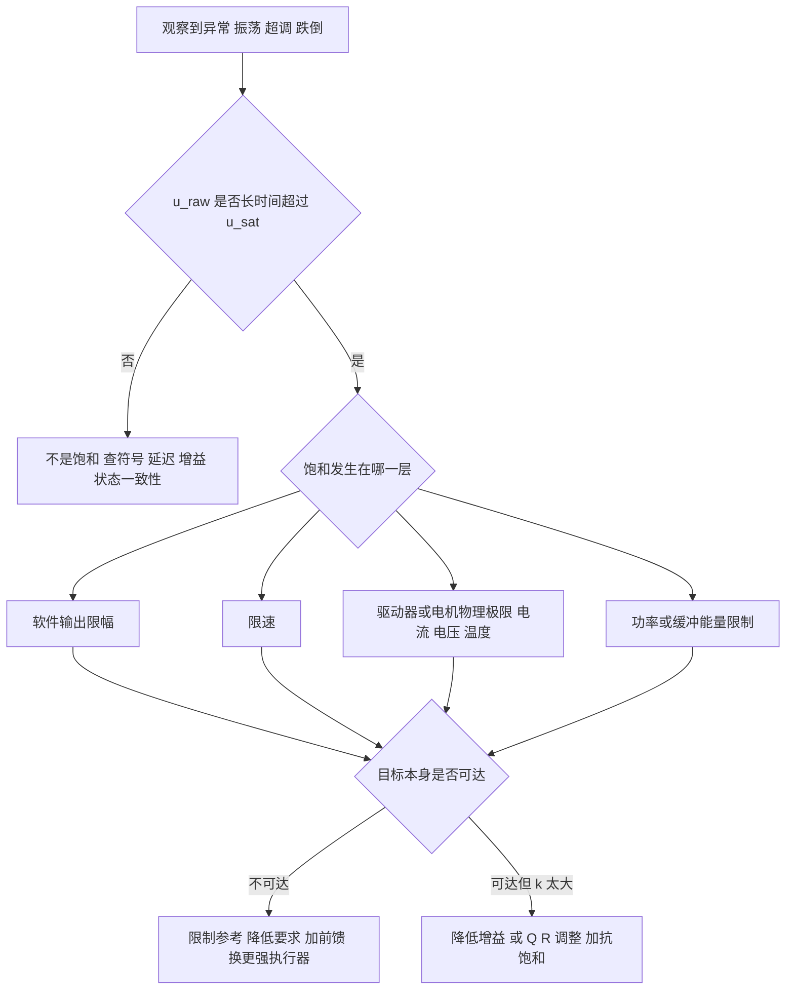

# 前馈、增益调度、限幅与饱和

> **一句话定位**：前面几章的控制器都假设"想给多大力就给多大力、模型一成不变"。真实机器人不是这样：重力是可以提前算出来的、模型会随腿长变化、电机力矩有上限。这一章讲四件事——**前馈**（把能预知的先补上）、**增益调度**（参数随工况变）、**限幅与限速**（保护执行器）、**饱和**（上限到了会发生什么、怎么定位）。它们对应你简历里的 CoM 前馈（P1）、重力补偿（P2）、变增益 PID 与功率限幅（P3）、腿长调度与力矩限制（P7）。

**本章学完你能：**

- 推导前馈 + 反馈的闭环关系，说明为什么前馈不能代替反馈、模型误差会留下残差；
- 写出重力前馈、速度前馈、质心（CoM）前馈的公式并手算；
- 设计增益调度（含变增益 PID），知道插值、滞后、变化率限制、连续性的要点；
- 正确实现输出限幅、限速，并和抗积分饱和配合；
- 解释执行器饱和为什么会让不稳定对象失去稳定性，并用一维例子算出吸引域边界；
- 给出一套"饱和定位"流程：用日志、指标、分层限制逐步判断是控制器、驱动器还是物理极限；
- 用英文回答 feedforward、gain scheduling、saturation 相关问题。

**前置知识**：[02 PID 控制全解](./02_PID控制全解.md)（抗积分饱和、串级）、[04 LQR 最优控制](./04_LQR最优控制.md)（增益调度 LQR、饱和实验）。

**目录**

1. 前馈：原理与推导
2. 三种常见前馈：重力、速度、质心
3. 增益调度与变增益 PID
4. 输出限幅与限速
5. 抗积分饱和与多环饱和
6. 执行器饱和对稳定性的影响
7. 饱和定位方法
8. 一种特殊饱和：功率限制下的整体缩放（P3 底盘）
9. 参考实现
10. 项目对应
11. 常见错误
12. 面试问答
13. 要点速记、自测题、链接

---

## 1. 前馈：原理与推导

### 1.1 它要解决什么问题

反馈必须**先有误差才动作**。如果某个扰动或目标变化是**可预知**的（重力、已知轨迹的加速度、手臂运动造成的重心偏移），就可以提前把需要的控制量算出来加上去，让反馈只处理剩下的残差。

### 1.2 推导

被控对象 $G$，反馈控制器 $C$，前馈 $F$（作用于参考）。输入 $u=C(r-y)+Fr$，$y=Gu$：
$$y=GC(r-y)+GFr\ \Rightarrow\ y=\frac{G(C+F)}{1+GC}\,r.$$
令 $F=1/G$（对象逆）：$y=\dfrac{GC+1}{1+GC}r=r$——**理想前馈使跟踪误差为零，且与 $C$ 无关**；前馈不出现在特征方程 $1+GC=0$ 里，所以**前馈不改变闭环稳定性**。

### 1.3 模型误差下的残差（手算）

真实对象增益 $G=2$，模型认为 $\hat G=1.8$，故前馈 $F=1/1.8=0.5556$。反馈取纯比例 $C=5$：

| 方案 | 输出 $y/r$ | 误差 |
|---|---|---|
| 只有反馈 $C=5$ | $\dfrac{10}{1+10}=0.909$ | 9.1% |
| 只有前馈 $F$ | $2/1.8=1.111$ | 11.1%（超） |
| 前馈 + 反馈 | $\dfrac{2(5+0.5556)}{1+10}=1.0101$ | **1.0%** |

结论：(1) 前馈把大部分稳态量"预先给了"，反馈只修正 1% 的残差；(2) 前馈带模型误差，不能单独用；(3) 因此 **PID 增益可以设小一些**（噪声、稳定性更好）。前馈错了（符号反、模型偏差大），反而会增加反馈的负担，所以必须能**单独开关做对比**。

### 1.4 前馈的三个来源

| 前馈来源 | 公式形态 | 例 |
|---|---|---|
| 对**参考**的前馈 | $u_{ff}=f(r,\dot r,\ddot r)$ | 速度前馈、加速度前馈 |
| 对**可测扰动**的前馈 | $u_{ff}=-g(d)$ | 重力补偿、已知手臂运动造成的力矩 |
| 对**状态**的非线性补偿 | $u_{ff}=h(q,\dot q)$ | 逆动力学、科氏力补偿 |

---

## 2. 三种常见前馈：重力、速度、质心

### 2.1 重力前馈

**问题**：云台 pitch 轴质心不在转轴上，重力在转轴上产生力矩，要靠控制器持续对抗。

**符号**：$m$（kg）负载质量，$l$（m）质心到转轴的距离，$\theta$ 从水平量起的俯仰角。重力矩 $\tau_g=mgl\cos\theta$（水平时最大，垂直时为 0）。前馈 $u_{ff}=mgl\cos\theta$（需把力矩换算成命令单位，如电流）。

**手算（教学示例）**：$m=0.5$ kg，$l=0.08$ m，$mgl=0.5\times9.81\times0.08=0.392$ N·m。

| $\theta$ | $\cos\theta$ | $\tau_g$（N·m） | 只用 P（$K_p=2$ N·m/rad）的稳态角偏差 $\tau_g/K_p$ |
|---|---|---|---|
| 0° | 1 | 0.392 | 0.196 rad = 11.2° |
| 30° | 0.866 | 0.340 | 0.170 rad = 9.7° |
| 60° | 0.5 | 0.196 | 0.098 rad = 5.6° |

只用 P，水平位置偏差 11°（积分最终会消除，但要时间，且姿态变化时又要重新积累）。加重力前馈后，即使 $m,l$ 有 10% 误差，残差只剩原来的 10%，积分负担很小。**P2 的 leader 臂重力补偿**（$\tau=g(q)$，由 URDF/KDL 动力学算出，见 [机械臂动力学、重力补偿、URDF、KDL](../03_运动学与坐标变换/06_机械臂动力学_重力补偿_URDF_KDL.md)）是同一思想的多关节推广：让人手拖动时几乎感觉不到臂本身的重量。

### 2.2 速度前馈

**问题**：目标是斜坡/变速轨迹时，纯反馈（尤其无积分时）总会有"跟随滞后"。

对一阶对象 $T\dot v=u-v$（稳态增益 1），目标速度 $r(t)$：要求 $v=r$，则 $T\dot r=u-r$，即
$$u_{ff}=r+T\dot r.$$
前一项 $r$ 是静态补偿，后一项 $T\dot r$ 是动态（加速度）补偿。

**手算**：目标 $r=t$（斜坡，$\dot r=1$），$T=0.15$：$u_{ff}=t+0.15$。
- 只有 P（$K_p=4$）：型别 0，斜坡误差随时间增长（理论 ∞）；
- PI（$K_p=4,T_i=0.15$）：型别 1，$K_v=K_p/T_i=26.7$，稳态斜坡误差 $=1/K_v=0.0375$；
- PI + 速度前馈：稳态误差 → 0（残差只来自模型误差）。

### 2.3 质心（CoM）前馈：P1 的做法与原理

**问题（P1）**：球形机器人（ballbot）上半身有双臂，臂运动时整机质心位置移动。平衡控制器的参考是"直立"，但质心移动后真正的平衡点不再是 0°——不补偿的话，控制器要靠反馈误差（以及积分）慢慢追上，手臂运动期间会出现姿态偏差和底盘漂移。

**做法（CV）**：由臂的关节状态，借助 URDF/Pinocchio 估计质心偏移，把 roll/pitch 方向的重力前馈加入平衡控制器，并在固定臂轨迹下**开/关补偿做对照**来验证效果。

**原理推导**：设质心相对触地点的水平偏移为 $\Delta x$，高度 $h$。静力平衡时重力矩为零，要求机身倾角使质心位于触地点正上方，即小角度近似 $\theta_{eq}\approx\Delta x/h$（或等效地补偿力矩 $mg\Delta x$）。所以前馈量 $\propto\Delta x(q_{arm})$，$\Delta x$ 由臂关节角通过正运动学+质量分布算出：
$$p_{com}(q)=\frac{\sum_im_ip_i(q)}{\sum_im_i}.$$

**手算（教学示例）**：臂伸出使质心前移 $\Delta x=0.02$ m，质心高度 $h=0.5$ m：$\theta_{eq}\approx0.02/0.5=0.04$ rad $=2.3°$。若无前馈，姿态环要先看到 2.3° 的偏差才开始纠正；有前馈，在手臂运动的同一时刻就把参考偏移 0.04 rad，姿态从一开始就接近新的平衡点。

**验证方法（回答面试官"你怎么知道有效"）**：固定手臂轨迹，重复多次，分别开/关前馈，比较姿态偏差峰值、底盘漂移距离、控制量峰值。没有对照数据，不要给出"提升百分之几"。

**P1 开/关对比的预期趋势与测试方法（趋势与设计，不是实测数字）**：固定手臂轨迹，前馈开/关交错重复多次。典型趋势是：关闭补偿时，手臂运动期间姿态偏差出现一个与质心偏移方向一致的峰值，底盘有缓慢的位置漂移（靠积分慢慢吃掉偏移），控制量在手臂运动段有持续的偏置；打开补偿后，姿态偏差峰值变小、漂移减小、控制量偏置被前馈项提前承担，反馈只处理残差。面试时的回答结构是"趋势 + 测试方法（同轨迹、开/关交错、比较姿态偏差峰值、漂移距离、控制量峰值）"，不报百分比。

### 2.4 P7 的腿长前馈

P7 用腿长 PID 协调伸缩并加**力前馈**（CV）：典型做法是以"支撑机身重量所需的腿力"作前馈（与机身质量、腿的倾角有关），PID 只处理腿长误差引起的残差。这样腿长 PID 增益可以较小，减少对噪声的放大，并让腿长变化时的力输出更平滑。

---

## 3. 增益调度与变增益 PID

### 3.1 要解决什么问题

对象参数随**工况变量**变化（腿长、负载、速度、电池电压）。固定增益在一个工况调好，换工况就偏。**增益调度（gain scheduling）**：测量或估计一个调度变量 $\sigma$，让控制器参数 $K=K(\sigma)$。

### 3.2 两类调度

| 类型 | 调度变量 | 例 |
|---|---|---|
| **工况调度** | 外部可测的、与状态分离的量 | P7：LQR 增益按腿长 $K(L)$（[04 章第 10 节](./04_LQR最优控制.md)） |
| **误差调度/变增益** | 误差大小 | P3：变增益 PID $K_p(|e|)$（[06 章第 9 节](./06_滑模控制.md)） |

### 3.3 设计流程

1. 选调度变量 $\sigma$（要可靠可测、变化比系统动态慢）；
2. 在若干 $\sigma_j$ 处建立局部模型并设计局部控制器 $K_j$；
3. 确定 $K_j\to K(\sigma)$ 的映射：**插值**（线性/样条/多项式）或查表；
4. 检查：每个冻结点稳定；点间插值后稳定；$\sigma$ 变化率限制；
5. 超出范围时钳位（clamp），不外推。

### 3.4 手算：保持回路增益恒定

对象增益随腿长变化：$K_{plant}(L)=1.0$（$L=0.15$）到 $2.0$（$L=0.5$）。若固定 $K_p=2$：回路增益在 $L=0.15$ 为 2，在 $L=0.5$ 为 4，闭环带宽翻倍，容易在大增益端振荡、小增益端过慢。调度 $K_p(L)=K_{p0}\cdot K_0/K_{plant}(L)$，取 $K_{p0}=4$：$L=0.15$ 时 $K_p=4$，$L=0.5$ 时 $K_p=2$，回路增益恒为 4。线性插值（在 $L=0.3$：$K_{plant}=1.0+(0.15/0.35)\times1.0=1.43$）：$K_p=4/1.43=2.8$。这是最简单的"增益逆补偿"式调度。

### 3.5 工程细节

| 要点 | 说明 |
|---|---|
| **连续性** | 点之间必须平滑插值；阶梯式切换会让输出跳变 |
| **滞后（hysteresis）** | 若用阈值切换多组参数，调度变量在阈值附近抖动会反复切换；加入回滞（上升与下降用不同阈值） |
| **变化率** | 冻结点稳定不保证 $\sigma$ 快变时稳定；限制 $\dot\sigma$ 或在仿真中扫描 |
| **噪声** | $\sigma$ 的测量噪声直接传进增益；对 $\sigma$ 滤波/限速 |
| **单位** | 调度变量的单位（m 还是 mm）、拟合系数的约定必须一致 |
| **范围** | 设计范围外钳位；外推无保证 |
| **积分器/内部状态** | 增益切换时，PID 积分项的"意义"改变（$K_iI$ 乘的是新增益）。把积分状态存成"输出量"（$I=K_i\int e$）可避免增益变化造成输出突跳（02 章参考实现） |

---

## 4. 输出限幅与限速

### 4.1 为什么要限

控制器计算出的命令可能超出执行器能力或安全范围：电流/力矩上限、电压上限、转速上限、机械行程。**限幅（saturation/clamp）**保证命令在能力范围内，不限幅既可能被驱动器截断（行为不可控），也可能烧毁硬件。

### 4.2 限幅的层次

```text
目标 r ──► [参考限速/限幅] ──► 外环 ──► [外环输出限幅=内环目标限幅] ──► 内环 ──► [输出限幅] ──► [限速] ──► 驱动器
                                                                                          │
                                                          驱动器内部还有: 电流限制/过流保护/温度降额
```

| 层 | 做什么 | 例 |
|---|---|---|
| 参考限幅/限速 | 防止目标阶跃带来冲击 | 速度指令限加速度 |
| 内环目标限幅 | 外环最多让内环做什么（也是安全与稳定的保证） | P1：位置外环输出的有界姿态参考 |
| 输出限幅 | 命令不超过执行器能力 | 力矩/电流上限 |
| 限速（slew rate） | 命令变化率不超过 $\Delta$ | 抑制冲击电流、避免激起机械共振 |
| 驱动器/硬件保护 | 过流、过温、功率 | 最后一道防线，不应触发 |

> **原则**：软件限幅应**比驱动器保护更早生效**，让保护成为极少触发的最后防线；一旦硬件保护动作，行为（断电、锁死）往往比软件限幅糟糕。

### 4.3 限幅的数学与手算

对称限幅：$u=\text{clip}(u_{raw},-u_{max},u_{max})$。**非对称**：$[u_{min},u_{max}]$（例如只能前进的电机、重力方向不同的上下限）。

**限速**：$u_k=u_{k-1}+\text{clip}(u_{cmd,k}-u_{k-1},\ -\Delta,\ +\Delta)$，$\Delta=\dot u_{max}T_s$。

**手算**：$\Delta=0.5$ 每周期，命令从 0 阶跃到 2：

| 周期 | $u_{cmd}$ | $u_{cmd}-u_{k-1}$ | 限后增量 | $u_k$ |
|---|---|---|---|---|
| 1 | 2 | 2 | 0.5 | 0.5 |
| 2 | 2 | 1.5 | 0.5 | 1.0 |
| 3 | 2 | 1.0 | 0.5 | 1.5 |
| 4 | 2 | 0.5 | 0.5 | 2.0 |
| 5 | 2 | 0 | 0 | 2.0 |

阶跃被平滑成斜坡，用 4 个周期爬升。限速本质上是**非线性的相位滞后**：大信号时滞后明显，小信号时不起作用。这也是第 6 节提到的"限速让线性稳定性分析失效"的原因之一。

### 4.4 软限幅

硬 clip 在边界处导数不连续。可用平滑函数（如 $u=u_{max}\tanh(u_{raw}/u_{max})$）在接近上限时逐渐压缩；代价是小信号时增益略低（$\tanh$ 在 0 附近斜率 1，所以小信号增益不变，接近上限时才降低）。平滑限幅有利于避免瞬间的力矩突变，但会让饱和判断变得模糊，诊断时需要同时记录 $u_{raw}$。

---

## 5. 抗积分饱和与多环饱和

单环的抗积分饱和（积分限幅/钳位/回算）已在 [02 章第 6 节](./02_PID控制全解.md) 详细讲过，这里补充三点。

### 5.1 回算要用"真正施加的值"

回算 $K_{aw}(u-u_{raw})$ 里的 $u$ 必须是**经过全部限制（限幅 + 限速 + 功率限制）后真正到达执行器的命令**。如果后面还有一道限速，却只拿限幅后的值回算，积分器仍会累积被限速"吃掉"的部分。

### 5.2 串级里的饱和要向外传

内环饱和（输出已贴限幅）时，外环若继续积分，会攒出一个内环无法实现的参考。做法：(1) 外环输出限幅到内环**能跟踪**的范围；(2) 把内环饱和标志传给外环，饱和时冻结外环积分（tracking back-calculation 的串级形式）；(3) 外环用内环的实际跟踪值而不是自己上一周期的输出做回算。

### 5.3 切换与重新使能

模式切换（遥控/自动）或重新上电时，积分状态要重置或用当前输出反算（bumpless transfer）。否则旧的饱和积分会在切换瞬间一次性释放。

---

## 6. 执行器饱和对稳定性的影响

### 6.1 为什么线性结论会失效

线性分析（极点、裕度、LQR 的 60° 相位裕度）假设输入无界。饱和是非线性：当 $|u_{raw}|>u_{max}$，**有效增益下降**（实际输出/期望输出 $<1$）。有效增益下降意味着回路穿越频率降低、相位裕度改变；对**开环不稳定**的对象，更严重——增益降到某个下限之下，反馈再也镇不住不稳定极点。

### 6.2 一维完整手算：吸引域边界

对象 $\dot x=x+u$（不稳定极点 $+1$），线性反馈 $u=-3x$（闭环 $\dot x=-2x$，线性意义下稳定）。执行器限幅 $|u|\le2$。

- **线性区**：$|3x|\le2\Rightarrow|x|\le0.667$，闭环 $\dot x=-2x$；
- **饱和区**：$x>0.667$ 时 $u=-2$，$\dot x=x-2$。
 - $x_0=1.5$：$\dot x=-0.5<0$，**仍收敛**（向 2 以下靠拢，进入线性区）；
 - $x_0=2$：$\dot x=0$，**临界点**；
 - $x_0=2.5$：$\dot x=+0.5>0$，**发散**。

吸引域边界 $|x|<u_{max}/a=2/1=2$（$a=1$ 为不稳定极点）。**无论增益取多大，只要 $|x_0|\ge u_{max}/a$，控制器都救不回来**——这是执行器能力决定的硬极限（零控制能力区域，null-controllable region）。把增益调大只是更快进入饱和，并不能扩大吸引域。

### 6.3 倒立摆数值（延续 04 章实验）

教学小车摆模型、LQR（$Q=\text{diag}(1,1,10,1),R=1$），初始倾角 0.3 rad：限幅 $\ge6$ N 时恢复；$u_{max}=5$ N 勉强恢复（最终倾角 0.014 rad，已很慢）；$u_{max}=4$ N 发散。同一个控制器，同一个控制律，仅限幅降低 1 N 就失稳。结论：**可恢复的最大扰动由执行器上限决定**，调参无法绕开。

### 6.4 其他由饱和引起的现象

| 现象 | 机理 |
|---|---|
| 长时间超调 | 积分饱和（第 5 节） |
| 极限环（等幅振荡） | 限速/限幅引入的非线性相位滞后 + 线性环节，形成持续振荡 |
| 方向失真（多执行器） | 各路独立限幅导致合成方向改变（第 8 节） |
| 看似"增益不够" | 其实是输出一直贴限幅，加大增益无效 |
| 响应变慢但不振荡 | 大信号下速度受限（斜坡），小信号才恢复线性 |

---

## 7. 饱和定位方法

### 7.1 必须记录的量

对每个控制回路，在日志里至少同时记录：

1. 目标 $r$、测量 $y$、误差 $e$；
2. 未限幅命令 $u_{raw}$、限幅后命令 $u_{sat}$（以及限速后的值）；
3. 各分量 $u_P,u_I,u_D$、前馈 $u_{ff}$；
4. 一个**饱和标志** `sat = (u_raw != u_sat)`，以及累计饱和时间占比；
5. 驱动器/电机反馈：实际电流、转速、温度、母线电压。

### 7.2 定位流程



具体判断：

1. **饱和占比**：若饱和时间占比 >几个百分点，且出现在异常段，基本可以认定是影响因素；
2. **贴边特征**：输出曲线出现平台（水平线）= 限幅；斜线爬升 = 限速；
3. **与扰动对应**：在大扰动（推一下、手臂快速运动、腿落地）后瞬间饱和，扰动消失后恢复，说明执行器能力不足以应对该扰动幅度；
4. **用模型反推**：用线性模型估计该扰动所需控制量（例如 04 章第 9.4 节的方法），与限幅比较；若需求 > 能力，吸引域不足；
5. **排除其他原因**：符号/状态不一致/延迟也会让输出"看起来很大"，先看误差是否在输出饱和**之前**就已增大。

### 7.3 P1 / P7 的应用

- **P1**：CV 说明 LQR 分析用作"定位状态异常与诊断执行器饱和的模型参考"。含义：当实机出现姿态异常时，先看 $u_{raw}$ 是否贴限幅；再用模型估算该姿态/速度偏差所需力矩，判断是控制器增益问题还是执行器能力问题。
- **P7**：CV 说明"将平衡异常追溯到状态不一致、力矩限制和落地接触切换"。三类原因对应：(1) 状态不一致（传感器时间/坐标不一致）——误差在饱和之前就出现；(2) 力矩限制——$u_{raw}$ 贴限幅；(3) 接触切换——腿离地/落地时 $B$ 矩阵的有效性改变，需要独立逻辑。

**P7 力矩限制的来源与诊断（典型做法；数值为量级，调参时按实机微调）**：力矩上限有三层，取其中最小者生效——电机额定/峰值力矩（轮毂电机与髋关节电机的手册值）、驱动器的电流限制、软件限幅（本项目通常设在峰值的一定比例以内，并在 MIT 帧编码范围内夹紧）。诊断"力矩限制"是某次异常原因的做法是看日志：控制器未限幅的输出 $u_{raw}$ 持续贴着上限（饱和占比升高），同时机身俯仰误差持续增大而不是振荡，说明不是增益问题而是执行器能力不够（典型发生在快速加速、腿很短时需要的轮毂力矩更大）。
**P1 的输出限幅（本项目做法）**：被限幅的量有三类——外环输出的姿态（倾角）参考（保证内环在线性区）、PID 输出与积分项（防 windup）、三轮最终命令（整体 L2 缩放，保持方向，并可加斜率限制）。与 fall-recovery safeguards 的配合是：命令长时间饱和、倾角超过去抖后的跌倒阈值、数据过期或 NaN 时，进入输出归零并锁定的保护状态，恢复前需姿态回到安全区并重新初始化积分与滤波器。

---

## 8. 一种特殊饱和：功率限制下的整体缩放（P3 底盘）

CV：P3 底盘把车体速度分配到四个麦克纳姆轮，并"根据实时功率与缓冲能量反馈估计功率需求，缩放轮速，使底盘在功率限制下保持机动性"。

**为什么是"整体缩放"而不是"逐轮限幅"？** 麦克纳姆底盘的运动方向由四个轮速的**比例**决定。逐轮限幅会改变比例，导致车体方向偏离；整体乘一个小于 1 的因子则保持方向。

**手算（教学示例）**：四轮目标 $[40,30,-20,10]$ rad/s，某限制要求最大轮速 30 rad/s。
- 逐轮 clip：$[30,30,-20,10]$——比例从 $40:30:-20:10$ 变成 $30:30:-20:10$，车体运动方向改变；
- 整体缩放：因子 $s=30/40=0.75$，得 $[30,22.5,-15,7.5]$——比例不变，只是整体变慢。

**功率限制的缩放**：功率近似与（力矩×转速）成正比，转速缩放 $s$ 时机械功率近似按 $s^2$ 减少（若力矩也 $\propto s$）。设估计的功率需求 $P_{est}$，允许 $P_{lim}$，则取 $s=\min(1,\sqrt{P_{lim}/P_{est}})$ 或 $\min(1,P_{lim}/P_{est})$ 等（具体形式取决于模型）。例：$P_{est}=200$ W，$P_{lim}=100$ W：按 $\sqrt{\cdot}$ 取 $s=0.707$。缓冲能量（超级电容/裁判系统缓冲）较低时进一步降低 $P_{lim}$。具体模型与参数以项目实现为准。

**P3 的功率估计与缩放（本项目做法，量级）**：功率估计用二次多项式模型，把四个轮电机的"转矩电流 × 转速"项与铜损等效项相加，得到缩放系数 $k$（缩放轮速目标）下的预测功率 $P(k)=ak^2+bk+c$，其中 $a,b,c$ 由当前轮速与电流反馈算出；令 $P(k)=P_{cap}$ 解二次方程取合理根，并夹在 $[0,1]$。功率上限取裁判系统给出的底盘功率限制再留几瓦余量（本项目通常取约 5 W 量级的裕度）。缓冲能量低于阈值（典型取一半左右量级）时，把缓冲短缺折算进常数项 $c$，使上限随缓冲变低而下降。裁判系统的功率与缓冲反馈只有几十 Hz 且有延迟，所以靠模型预测补足快速部分。

---

## 9. 参考实现

```c
// 教学示例：限幅 + 限速 + 回算抗饱和，注意"回算用最终施加值"
typedef struct {
    float out_min, out_max;   // 输出限幅
    float rate_max;           // 单位时间最大变化量 [unit/s]
    float u_prev;             // 上一周期实际施加的命令
    int   sat_flag;           // 本周期是否被限制
} limiter_t;

float limiter_apply(limiter_t *L, float u_raw, float dt)
{
    float u = u_raw;
    // 1) 限幅
    if (u > L->out_max) u = L->out_max;
    if (u < L->out_min) u = L->out_min;
    // 2) 限速
    float du_max = L->rate_max * dt;
    float du = u - L->u_prev;
    if (du >  du_max) du =  du_max;
    if (du < -du_max) du = -du_max;
    u = L->u_prev + du;
    // 3) 记录饱和标志与最终值
    L->sat_flag = (u != u_raw);
    L->u_prev   = u;
    return u;                 // 抗饱和应使用 (u - u_raw)，其中 u 是此处返回的最终值
}
```

调用顺序：`u_raw = u_ff + pid(...)` → `u = limiter_apply(...)` → PID 积分器用 `(u - u_raw)` 回算 → 发送到驱动器；同时把 `u_raw`、`u`、`sat_flag` 写入日志。

---

## 10. 项目对应

| 项目 | 内容 | 本章对应 |
|---|---|---|
| [P1](../../01_项目课程/P1_AIRS球形机器人平衡控制/README.md) | 质心（CoM）重力前馈；输出限幅与摔倒恢复安全；LQR 作为饱和诊断参考；外环输出有界姿态参考 | 2.3、4、6、7 |
| [P2](../../01_项目课程/P2_未来动力双臂遥操作与差速底盘/README.md) | leader 臂重力补偿；follower 位置-速度跟踪；轮速 PID 饱和 | 2.1 |
| [P3](../../01_项目课程/P3_RoboMaster英雄机器人嵌入式控制/README.md) | 变增益 PID；功率缩放；摩擦轮电流限幅 | 3、8 |
| [P7](../../01_项目课程/P7_可变腿长轮腿机器人/README.md) | 增益调度 LQR；腿长 PID + 力前馈；力矩限制与落地接触切换 | 2.4、3、6、7 |

---

## 11. 常见错误

| 错误 | 后果 / 纠正 |
|---|---|
| 前馈符号反/单位不对 | 放大而非抵消扰动；务必有"开/关前馈"对照 |
| 前馈当成反馈的替代 | 模型一变就偏；仍需反馈 |
| 增益调度范围外外推 | 增益偏离；必须钳位 |
| 逐轮独立限幅 | 多执行器方向被改变；应整体缩放 |
| 限速放在积分回算之外 | 积分被"吃掉"的部分仍累积 |
| 只看限幅后的命令 | 无法定位饱和；必须同时记录 $u_{raw}$ |
| 以为"提高增益"能解决饱和引起的问题 | 增益更大只会更快饱和，吸引域不变 |
| 硬件保护先于软件限幅触发 | 行为不可控；软件限幅应更严格 |

---

## 12. 面试问答

**Q1. What is feedforward control, and why not rely on feedback only?**

> A: Feedback needs an error before it can act, so it is always a little late. If I know something in advance, such as the gravity torque on an arm, or the centre-of-mass shift caused by a planned arm motion, I can compute the required command and add it directly. Then the feedback only handles the residual error, so I can keep its gains lower. Feedforward does not affect stability, but it depends on the model, so I always keep feedback and I check the effect by switching the feedforward on and off under the same conditions.

（前馈提前补可预知的量，反馈只处理残差；不影响稳定性但依赖模型；开/关对照验证。）

**Q2. How did you implement the centre-of-mass feedforward on your ballbot?（P1）**

> A: I estimated the centre-of-mass offset from the arm joint states using the URDF and Pinocchio, and fed a roll and pitch gravity feedforward into the balance controller. I verified it by running fixed arm trajectories with the compensation on and off, and comparing the attitude and drift. I don't remember the exact improvement figures, but the main trend was that [补充你的真实观察].

（用 URDF/Pinocchio 估计 CoM 偏移，roll/pitch 重力前馈，开关对照验证。）——方括号处必须填你自己的真实观察，否则删掉这句并只讲方法。

**Q3. What is gain scheduling and what are its risks?**

> A: It means changing controller gains as a function of a measurable operating variable, for example leg length. I design local gains at several operating points and interpolate. The risks are: stability at each frozen point does not guarantee stability while the variable changes quickly, noise in the scheduling variable passes into the gains, and extrapolating outside the design range is unsafe, so I clamp the variable and limit its rate.

**Q4. What happens when an actuator saturates, and how do you find out?**

> A: Saturation makes the effective loop gain drop, which can ruin the stability margins, especially for an unstable plant like an inverted pendulum, and the integrator can wind up. To find out, I log the raw and the saturated command and the saturation flag, and look at how long the output sits at the limit when the problem appears. If the raw command is far above the limit, I estimate with the model whether the disturbance needs more torque than the actuator can deliver. In that case higher gain will not help, because the region of attraction is set by the actuator limit.

**Q5. Why scale wheel speeds uniformly under a power limit instead of clipping each wheel?**

> A: On a Mecanum chassis the direction of motion is determined by the ratio of the wheel speeds. Clipping wheels independently changes the ratio and so changes the direction. Multiplying all wheel speeds by one factor below one keeps the direction and only slows the robot down.

---

## 本章要点速记

1. 前馈：$y=\frac{G(C+F)}{1+GC}r$，$F=1/G$ 时理想跟踪；前馈不改变稳定性；模型误差留残差，必须配反馈。
2. 重力前馈 $mgl\cos\theta$；速度前馈 $r+T\dot r$（一阶对象）；CoM 前馈 $\theta_{eq}\approx\Delta x/h$，由臂关节算 CoM。
3. 前馈必须能单独开关做对照；没有数据不报提升百分比。
4. 增益调度：选调度变量→局部设计→插值→钳位；注意连续性、滞后、变化率、噪声、单位。
5. 限幅分层：参考→内环目标→输出→限速→驱动器保护；软件限幅应早于硬件保护。
6. 限速 $u_k=u_{k-1}+\text{clip}(\cdot,\pm\Delta)$；它是非线性相位滞后。
7. 抗积分饱和回算要用最终施加的值；串级里内环饱和要向外传。
8. 饱和使有效增益降低；不稳定对象存在由执行器上限决定的吸引域：一维 $|x|<u_{max}/a$。
9. 定位饱和：同时记录 $u_{raw}$、$u_{sat}$、饱和标志、占比；用模型估算所需力矩。
10. 多执行器功率/速度限制用整体缩放保持方向，不用逐路 clip。

## 自测题

1. 对象 $G=3$，模型 $\hat G=2.7$，P 控制 $C=4$，加前馈 $F=1/\hat G$。求 $y/r$。*答案*：$\dfrac{3(4+0.3704)}{1+12}=1.0085$（误差 0.85%）。
2. 云台质心距转轴 0.1 m，负载 0.4 kg，$\theta=45°$，重力前馈力矩？*答案*：$0.4\times9.81\times0.1\times\cos45°=0.277$ N·m。
3. 一维 $\dot x=2x+u$，$|u|\le6$，吸引域半宽？*答案*：$u_{max}/a=3$。
4. 限速 $\Delta=0.2$/周期，命令从 0 跳到 1，需要几个周期到达？*答案*：5 个周期。
5. 四轮目标 $[50,-40,25,-10]$，最大轮速 40，整体缩放后的轮速？*答案*：$s=0.8$，$[40,-32,20,-8]$。
6. 为什么调高 LQR 增益不能让初始倾角 0.4 rad 恢复（假设力矩上限不变）？*要点*：吸引域由执行器上限决定，增益更高只会更快饱和。
7. 调度变量腿长从 0.2 m 突然变成 0.3 m，插值增益是否需要平滑？*要点*：需要，对 $L$ 滤波/限速，否则增益阶跃造成输出跳变。

## 相关链接

- 上一章：[06 滑模控制](./06_滑模控制.md)；下一章：[08 数字控制与实时性](./08_数字控制与实时性.md)
- 相关：[02 PID 控制全解](./02_PID控制全解.md)、[04 LQR 最优控制](./04_LQR最优控制.md)、[机械臂动力学、重力补偿、URDF、KDL](../03_运动学与坐标变换/06_机械臂动力学_重力补偿_URDF_KDL.md)、[差速、麦克纳姆、全向轮与车辆运动学](../02_力学与动力学建模/04_差速_麦克纳姆_全向轮与车辆运动学.md)
- 八股：[控制八股](../../03_八股知识/03_机器人学/02_控制八股.md)
- 项目：[P1](../../01_项目课程/P1_AIRS球形机器人平衡控制/README.md)、[P3](../../01_项目课程/P3_RoboMaster英雄机器人嵌入式控制/README.md)、[P7](../../01_项目课程/P7_可变腿长轮腿机器人/README.md)
