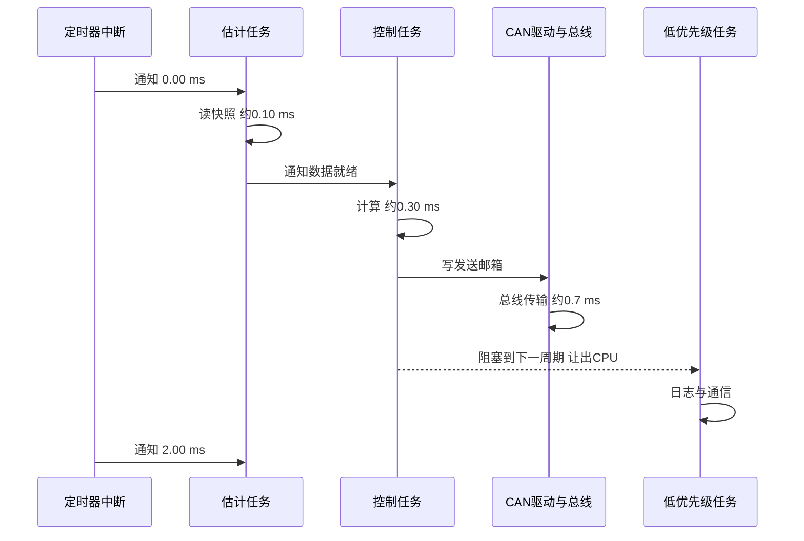

# 数字控制与实时性

> **一句话定位**：前七章的控制器在连续时间里设计，但你的控制器跑在 STM32 + FreeRTOS 上：只在离散时刻采样、计算、输出。这一章讲采样周期怎么选、连续控制器怎么离散化、延迟与抖动怎样吃掉相位裕度、任务怎样调度，以及定点/浮点的取舍。对应 P3（STM32F407/FreeRTOS/CAN）与 P7（STM32H7/FreeRTOS/FDCAN）。

**本章学完你能：**

- 解释采样、零阶保持、混叠，并按"带宽的 10–30 倍"选采样频率；
- 用前向欧拉、后向欧拉、Tustin、精确（ZOH）离散化，并手算比较差别；
- 把计算延迟、通信延迟换算成相位滞后，评估对相位裕度的影响；
- 区分延迟（latency）与抖动（jitter），说明为何 `vTaskDelayUntil` 比 `vTaskDelay` 适合控制；
- 画出"传感器 → 计算 → CAN 发送 → 执行"的时序图并估算总延迟；
- 说明定点与浮点的取舍（STM32F4/H7 的 FPU 情况）。

**前置知识**：[01 反馈控制与系统响应基础](./01_反馈控制与系统响应基础.md)（相位裕度）、[02 PID 控制全解](./02_PID控制全解.md)、[数值方法与离散化](../01_数学基础/05_数值方法与离散化.md)、[FreeRTOS 实时系统](../11_嵌入式与通信/02_FreeRTOS实时系统.md)、[CAN/FDCAN 与电机通信](../11_嵌入式与通信/03_CAN_FDCAN与电机通信.md)。

---

## 1. 采样周期怎么选

### 1.1 采样与混叠

连续信号每 $T_s$ 采一次，采样频率 $f_s=1/T_s$。**奈奎斯特定理**：要无失真恢复，信号最高频率 $<f_s/2$。高于 $f_s/2$ 的成分会"折叠"成低频假信号（混叠，aliasing）：频率 $f$ 的信号在 $f_s$ 下表现为 $|f-kf_s|$。例：$f_s=100$ Hz，90 Hz 的振动被采成 10 Hz 的假振荡——IMU 数据若不做抗混叠滤波，高频振动会冒充低频姿态误差。

### 1.2 控制用的经验规则

闭环要在采样下表现得像连续系统，采样要远快于闭环带宽：

$$f_s\approx10\sim30\times f_{bw},\qquad\text{或每个上升时间内至少 }4\sim10\text{ 个采样点}.$$

**手算**：外环带宽 10 rad/s（1.6 Hz），内环 100 rad/s（16 Hz）。内环 $f_s\ge10\times16=160$ Hz，实际取 500–1000 Hz 更稳妥。若采样 1 kHz，一个采样周期延迟对 100 rad/s 的穿越频率造成 $\omega T_s=0.1$ rad $=5.7°$，可以接受；若只有 100 Hz，同样延迟变成 $57°$，不可接受。

**采样周期的上下限**：太慢——相位滞后、响应变差；太快——测量噪声被微分放大（$K_d/T_s$）、量化噪声更显著、占满 CPU。要匹配传感器：IMU 更新率、编码器分辨率、电机反馈帧率（CAN 报文频率）决定了有意义的最快控制频率，控制循环快于反馈更新是在重复使用旧数据。

### 1.3 采样周期选取的完整手算：Ts 到底吃掉多少相位裕度

**问题**：给定一个内环，穿越频率（crossover frequency）$\omega_c=100$ rad/s，想知道采样周期 $T_s$ 取 1、2、5、10 ms 时分别还剩多少相位裕度（phase margin, PM）。

**符号**：$\omega_c$ 为开环增益等于 1 时的角频率（rad/s）；$T_s$ 为控制周期（s）；$\tau_d$ 为除采样保持以外的固定延迟（传感器、通信、驱动器），这里取 1 ms；$\tau_{\rm eff}$ 为等效总延迟。

**推导**：数字控制器每 $T_s$ 更新一次，输出被零阶保持（ZOH）。ZOH 的传递函数 $\dfrac{1-e^{-sT_s}}{s}$ 在低频近似为 $T_s\,e^{-sT_s/2}$，即一个 $T_s/2$ 的纯延迟。因此

$$\tau_{\rm eff}=\tau_d+\frac{T_s}{2},\qquad \Delta\mathrm{PM}=\omega_c\,\tau_{\rm eff}\ \text{(rad)}\ =\ 57.3^\circ\,\omega_c\,\tau_{\rm eff}.$$

设被控回路在没有延迟时是理想积分型 $L(s)=\omega_c/s$（相位恒为 $-90^\circ$，$\mathrm{PM}=90^\circ$）。则加入延迟后 $\mathrm{PM}=90^\circ-57.3^\circ\omega_c\tau_{\rm eff}$。

**手算**（教学示例，$\omega_c=100$ rad/s，$\tau_d=1$ ms）：

| $T_s$ | $\tau_{\rm eff}=1\,\mathrm{ms}+T_s/2$ | $\omega_c\tau_{\rm eff}$（rad） | 剩余 PM |
|---|---|---|---|
| 1 ms | 1.5 ms | 0.15 | $90^\circ-8.6^\circ=81.4^\circ$ |
| 2 ms | 2.0 ms | 0.20 | $90^\circ-11.5^\circ=78.5^\circ$ |
| 5 ms | 3.5 ms | 0.35 | $90^\circ-20.1^\circ=69.9^\circ$ |
| 10 ms | 6.0 ms | 0.60 | $90^\circ-34.4^\circ=55.6^\circ$ |

读表：对理想积分型回路，$T_s=10$ ms 仍留 55.6 度，似乎"够用"。但真实回路的原始 PM 通常只有 45–60 度（含对象自身的滞后），所以 $T_s=10$ ms 会把回路推向振荡边缘；而 $T_s\le2$ ms 只吃掉约 11 度，影响很小。这就是"采样频率取带宽的 10–30 倍"的由来：$f_s/f_c=10$ 时，$\omega_cT_s/2=\pi/10=0.314$ rad $=18^\circ$；$f_s/f_c=30$ 时只有 $6^\circ$（其中 $f_c=\omega_c/2\pi$，$T_s=1/f_s$，故 $\omega_cT_s/2=\pi f_c/f_s$）。

**选取流程（本项目的做法）**：

1. 先由任务确定各环的目标带宽：外环（位置/速度）数 rad/s 到十几 rad/s，内环（姿态/角速度/电流）几十到一百多 rad/s；
2. 按 $\omega_cT_s/2\le 0.1$–$0.2$ rad 反推上限：$\omega_c=100$ rad/s 时 $T_s\le2$–$4$ ms；
3. 与传感器、总线对齐：IMU 输出率、电机反馈帧率、CAN 带宽（见第 5 节）决定了可用的最快周期；
4. 留 CPU 余量：最坏执行时间（WCET）不超过周期的 50–70%；
5. 最后用实测周期与抖动复核，而不是只看配置值。

> **注意**：上面 PM 只算了延迟，没有算离散化（欧拉、Tustin）带来的相位偏差。用 Tustin 离散化时，数字控制器的相位与连续设计在 $\omega_c$ 处有微小差，$\omega_cT_s/2$ 同量级，所以统一用"$\tau_{\rm eff}$ 包含 $T_s/2$"来估算是安全的。

---

## 2. 离散化

### 2.1 要解决的问题

把连续控制器 $C(s)$（或对象模型）变成差分方程。主要方法：把 $s$ 换成 $z$ 的近似：

| 方法 | 替换 | 稳定性 |
|---|---|---|
| 前向欧拉 | $s\to\dfrac{z-1}{T}$ | 可能把稳定系统变不稳定 |
| 后向欧拉 | $s\to\dfrac{z-1}{Tz}$ | 保稳定，但引入更多滞后 |
| Tustin（双线性） | $s\to\dfrac2T\dfrac{z-1}{z+1}$ | 保稳定，频率有扭曲 |
| ZOH 精确 | $z=e^{sT}$ 作用于状态方程 | 对线性对象精确 |

### 2.2 手算：一阶极点 $a$ 的离散化

连续 $\dot x=ax$，对应离散 $x_{k+1}=\alpha x_k$，真值 $\alpha=e^{aT}$。

| $a$（1/s） | $T$（s） | 前向欧拉 $1+aT$ | Tustin $\dfrac{1+aT/2}{1-aT/2}$ | 精确 $e^{aT}$ |
|---|---|---|---|---|
| −5 | 0.1 | 0.5 | 0.6 | 0.6065 |
| −30 | 0.1 | **−2.0（发散！）** | −0.2 | 0.0498 |

读表：$aT$ 小时三者接近；$|a|T$ 大时前向欧拉的极点 $-2$ 落在单位圆外，**稳定的连续系统被离散成不稳定**；Tustin 保稳定但给出 $-0.2$（会有符号振荡），精确值 0.0498 几乎瞬间衰减。结论：采样周期要远小于最快极点的时间常数；快极点用 ZOH/Tustin。

### 2.3 PID 的离散化要点

积分 $I\mathrel{+}=K_iT_se$（矩形近似）；微分用后向差分并加滤波 $\alpha=T_f/(T_f+T_s)$（见 [02 章](./02_PID控制全解.md)）。所有 `dt` 都应使用**实际**测得的时间间隔（或固定周期且已验证），因为周期抖动会让积分、微分的数值偏离。

状态空间控制器：$u_k=-Kx_k$ 直接离散；连续 LQR 增益用于离散实现时，$T_s$ 越小越接近（[04 章 7.5 节](./04_LQR最优控制.md)：$T_s=0.1$ 时偏差约 8%，$T_s=0.001$ 时 <0.1%）。

### 2.4 手算：状态方程的 ZOH 离散化（两个典型对象）

**对象 A：双积分器**（质点，$\ddot x=u$，状态 $\mathbf s=[x,\ v]^\top$）：

$$A=\begin{bmatrix}0&1\\0&0\end{bmatrix},\quad B=\begin{bmatrix}0\\1\end{bmatrix},\quad A^2=0.$$

因为 $A^2=0$，矩阵指数只有两项：$A_d=e^{AT_s}=I+AT_s=\begin{bmatrix}1&T_s\\0&1\end{bmatrix}$，$B_d=\int_0^{T_s}e^{A\tau}B\,d\tau=\int_0^{T_s}\begin{bmatrix}\tau\\1\end{bmatrix}d\tau=\begin{bmatrix}T_s^2/2\\T_s\end{bmatrix}$。取 $T_s=0.01$ s：$A_d=\begin{bmatrix}1&0.01\\0&1\end{bmatrix}$，$B_d=[5\times10^{-5},\ 0.01]^\top$。这个结果就是匀加速运动的位移公式 $x_{k+1}=x_k+vT_s+\tfrac12uT_s^2$，直观且精确。前向欧拉会漏掉 $\tfrac12uT_s^2$ 一项（给出 $B_d=[0,T_s]^\top$），在 $T_s$ 小的时候误差不大，但速度大、周期长时位置会系统性偏差。

**对象 B：不稳定一阶极点**（倒立摆线性化后的快不稳定模态，$\dot x=ax+u$，$a=4.4$ s$^{-1}$）：

- 精确 ZOH：$a_d=e^{aT_s}$，$b_d=\dfrac{e^{aT_s}-1}{a}$；
- 前向欧拉：$a_d=1+aT_s$，$b_d=T_s$；
- Tustin：$a_d=\dfrac{1+aT_s/2}{1-aT_s/2}$。

$T_s=0.01$ s：精确 $a_d=e^{0.044}=1.04498$，$b_d=0.04498/4.4=0.010223$；欧拉 $a_d=1.044$，$b_d=0.01$；Tustin $a_d=1.04499$。$T_s=0.005$ s：精确 $a_d=1.02224$，欧拉 $1.022$。三者在这个量级几乎重合，差别在第 4 位小数。这说明：对"极点远小于采样频率"的模态，选哪种离散化无所谓；而对不稳定极点，真正危险的是**延迟**而不是离散化方法（见 3.4 节）。

**离散 LQR 的提示**：若用连续 LQR 增益直接在 $T_s$ 下实现，等价于把控制器看作连续设计再采样；更严谨的做法是用 $(A_d,B_d)$ 解离散 Riccati 方程（DARE）。$T_s$ 足够小时两者差别很小（见 [04 章 7.5 节](./04_LQR最优控制.md)）。

---

## 3. 延迟与抖动

### 3.1 延迟的构成

从物理量变化到电机响应，延迟累加：

```text
传感器采样时刻 t0
   └─ 传感器内部滤波/输出延迟 ........ d1 (IMU 数据滤波、编码器锁存)
   └─ 通信传输 (SPI/UART/CAN 帧) ..... d2
   └─ 等待控制任务被调度 ............. d3 (0 ~ 一个周期, 取决于是否同步)
   └─ 控制计算 ....................... d4
   └─ 输出经 CAN 发给驱动器 .......... d5
   └─ 驱动器处理 + 电流环响应 ........ d6
```

总延迟 $\tau=\sum d_i$。**控制计算的零阶保持**本身平均再加半个周期 $T_s/2$ 的等效延迟。

### 3.2 延迟 = 相位滞后

延迟 $\tau$ 在频率 $\omega$ 处的相位为 $-\omega\tau$（幅值不变）。相位裕度损失 $\Delta\text{PM}=\omega_c\tau\cdot57.3°$。

**手算**：穿越频率 $\omega_c=60$ rad/s：

| 总延迟 $\tau$ | $\Delta\text{PM}$ |
|---|---|
| 1 ms | 3.4° |
| 5 ms | 17.2° |
| 10 ms | 34.4° |

若设计时 PM=50°，10 ms 延迟后只剩 15.6°，实机表现为强烈振荡。**对不稳定对象（倒立摆）更苛刻**：极点 $+p$（如 4.4 s$^{-1}$）要求闭环带宽远大于 $p$，而延迟必须远小于 $1/p$（约 0.23 s 的一小部分，经验上 $\tau<0.1/p\approx20$ ms，越小越好）。

### 3.3 抖动（jitter）

延迟的**变化**。周期应为 1 ms 的任务，实际有时 0.8 ms 有时 1.3 ms。后果：积分 $\sum eT_s$、微分 $\Delta e/T_s$ 若使用固定 `dt`，则有误差；延迟变化让相位裕度随时变化。例：微分 $\Delta e=0.001$，若真实间隔 1.3 ms 却按 1 ms 计算，速度误差 30%。**对策**：硬件定时器触发采样（而非软件延时），用实际时间戳计算 `dt`，高优先级控制任务，避免临界区过长。

### 3.4 完整手算：PD 控制双积分器，延迟吃掉多少相位裕度

**对象**：$G(s)=1/s^2$（刚体转角，$u$ 为角加速度）。**控制器**：$C(s)=K(1+T_ds)$（PD）。开环 $L(s)=K(1+T_ds)/s^2$。

**设计**（教学示例）：想要 $\omega_c=60$ rad/s、无延迟时 PM 约 $59^\circ$。

1. 相位：$\angle L(j\omega)=-180^\circ+\arctan(\omega T_d)$，所以 PM $=\arctan(\omega_cT_d)$。取 $T_d=0.0278$ s：$\omega_cT_d=1.667$，PM $=\arctan1.667=59.0^\circ$。
2. 幅值：$|L(j\omega_c)|=K\sqrt{1+(\omega_cT_d)^2}/\omega_c^2=1$，故 $K=\omega_c^2/\sqrt{1+1.667^2}=3600/1.944=1851$。

**加入延迟 $\tau$**：延迟不改变幅值，所以穿越频率仍是 60 rad/s；相位再减 $\omega_c\tau$，于是

$$\mathrm{PM}(\tau)=59.0^\circ-57.3^\circ\times60\times\tau.$$

| 总延迟 $\tau$ | 相位损失 | 剩余 PM |
|---|---|---|
| 0 | 0 | $59.0^\circ$ |
| 2.8 ms | $9.6^\circ$ | $49.4^\circ$ |
| 5 ms | $17.2^\circ$ | $41.9^\circ$ |
| 10 ms | $34.4^\circ$ | $24.7^\circ$ |
| 20 ms | $68.8^\circ$ | $-9.7^\circ$（不稳定） |

**临界延迟**（延迟裕度）：令 PM$=0$，$\tau_{\max}=\dfrac{\mathrm{PM}_0\ (\mathrm{rad})}{\omega_c}=\dfrac{1.031}{60}=17.2$ ms。含义：这个回路最多容忍约 17 ms 的额外延迟，超过就持续发散振荡。工程上要求延迟只占延迟裕度的 1/3 以内，即这里 $\tau\le6$ ms。

**对不稳定对象（倒立摆）更苛刻**：不稳定极点 $p$ 要求带宽 $\omega_c>p$ 且延迟 $\tau\ll1/p$。以 $p=4.4$ s$^{-1}$ 计，$1/p=227$ ms；若把设计目标定为 $\omega_c\approx5p=22$ rad/s、PM 损失不超过 $20^\circ$，则 $\tau\le20/57.3/22=15.9$ ms。实机的总延迟若达到 10 ms 以上，平衡会变得很"脆"，这也是 P1、P7 里把总延迟压到几毫秒的原因。

### 3.5 抖动怎样吃相位裕度：最坏情形而不是平均

抖动意味着 $\tau$ 在 $[\tau_{\min},\tau_{\max}]$ 内变化，回路稳定性要按最坏的 $\tau_{\max}$ 检查。上例中名义延迟 2.8 ms 时 PM 为 $49.4^\circ$；若偶发一次执行被高优先级任务抢占，延迟临时变成 8 ms，则该时刻 PM 只有 $59.0-27.5=31.5^\circ$，响应出现一次明显的过冲，表现为"偶发的抖一下"。再有，周期抖动还使离散积分、微分的 `dt` 失准：微分项 $K_d\Delta e/\Delta t$ 里，若真实间隔是名义值的 1.3 倍而按名义值算，则速度估计偏小 23%（$1/1.3=0.77$）。

**抖动的预算方法**：测量周期直方图，取 99.9 百分位或最大值作为 $\tau_{\max}$ 代入 PM 公式；若最大值比平均值大一倍以上，先查任务优先级与临界区，而不是先改增益。

---

## 4. 控制周期与任务调度（FreeRTOS）

### 4.1 周期任务的正确写法

```c
// 教学示例：固定周期控制任务，使用 vTaskDelayUntil 避免累积漂移
void ControlTask(void *arg)
{
    TickType_t last = xTaskGetTickCount();
    const TickType_t period = pdMS_TO_TICKS(1);   // 1 kHz，需 configTICK_RATE_HZ >= 1000
    for (;;) {
        read_sensors();          // 读 IMU/电机反馈（快照，保证同一时刻）
        run_controller();        // PID/LQR/…
        send_can_commands();     // 发给驱动器
        vTaskDelayUntil(&last, period);   // 以绝对时刻为基准
    }
}
```

`vTaskDelay(n)` 是"从现在起睡 n 个 tick"，每次循环的计算时间会累加到周期里，周期实际 = 计算时间 + n，漂移；`vTaskDelayUntil` 以上一次唤醒时刻为基准，周期稳定（只要计算时间 < 周期）。

### 4.2 更严格：定时器中断触发

要求 <100 µs 抖动的内环（电流环、高速姿态环）常用硬件定时器中断（或定时器触发 ADC/DMA）直接驱动；控制任务在中断里通知（`xTaskNotifyFromISR` / 信号量），任务优先级最高，避免被低优先级任务阻塞。注意：中断里不能调用阻塞 API，要用 `FromISR` 版本。

### 4.3 多速率与优先级

```text
优先级高 -> 低
  [中断] 定时器 / DMA / CAN 接收          (微秒级, 只搬运数据)
  [任务] 内环控制 (姿态/轮速)  1 kHz      (最高任务优先级)
  [任务] 外环 / LQR 增益调度   200~500 Hz
  [任务] 状态估计 / 滤波 (若独立)           (需在内环前给出最新状态)
  [任务] 通信 / ROS 桥 / 日志  50~100 Hz   (最低, 不能阻塞控制)
```

原则：控制任务不被低优先级任务拖延；共享数据（状态、参数）用互斥/双缓冲，临界区尽量短；外环更新比内环慢时，内环保持外环目标（零阶保持），两环各用自己的实际 $T_s$。优先级反转、栈溢出、队列满丢包等问题见 [FreeRTOS 实时系统](../11_嵌入式与通信/02_FreeRTOS实时系统.md) 与 [并发多线程与实时系统八股](../../03_八股知识/01_计算机基础/07_并发多线程与实时系统八股.md)。

### 4.4 计算时间预算

**最坏执行时间（WCET）必须小于周期并留余量**（经验 ≤50–70%）。统计方法：在循环首尾读 DWT 周期计数器（Cortex-M 的 `DWT->CYCCNT`），记录最大值，而不是平均值；MPC、矩阵求逆、`sinf/cosf/atan2f` 是常见耗时点；浮点除法比乘法慢；在 ISR 中避免 `printf`。

### 4.5 本项目的任务划分、周期与时序图

**本项目的做法（设计取值，量级；实机以测量为准）**：

| 项目 | 任务/回路 | 周期（触发） | 优先级（高到低） | 内容 |
|---|---|---|---|---|
| P3（F407 + CAN） | IMU/AHRS 解算 | 约 1 kHz，由 IMU 数据就绪中断/定时器通知唤醒 | 最高 | 读陀螺仪与加速度计，更新姿态四元数 |
| P3 | 云台控制（pitch/yaw 串级） | 约 1 kHz，`vTaskDelayUntil` | 高 | 外环角度、内环角速度，输出电机电流指令 |
| P3 | 发射控制（摩擦轮转速环、拨盘位置-速度双环） | 约 1 kHz | 中高 | 摩擦轮 SMC/PID，拨盘双环 |
| P3 | 底盘控制 | 约 500 Hz（2 ms） | 中 | 麦轮分配、功率缩放、轮速 PID |
| P3 | 裁判系统/视觉/遥控接收，UI | 事件驱动或 20–100 Hz | 最低 | 串口 DMA 接收与解码，绘制 UI |
| P7（H7 + FDCAN） | 状态估计（IMU、关节、轮速） | 与控制同周期，先于控制执行 | 最高 | 一次快照：IMU、关节角、轮速 |
| P7 | 控制主循环（LQR、VMC、腿长 PID） | 约 500 Hz（2 ms），`vTaskDelayUntil`，由定时器触发 | 高 | 增益调度、虚拟腿长、力矩映射、限幅、发送 FDCAN |
| P7 | 监控/日志/上位机通信 | 10–50 Hz | 最低 | 状态上报、参数在线修改 |

两个项目都是：**定时器（或传感器就绪中断）→ 通知任务 → 任务读快照、计算、发送 → 阻塞等待下一周期**。中断只搬运数据，不做计算。



**时间轴（P7，周期 2 ms，数值为设计预算）**：

```text
t(ms)  0     0.1      0.4        1.1                     2.0
       |-----|--------|----------|-----------------------|
定时器 ^触发                                              ^下一次触发
估计   [==读快照==]
控制         [===计算+限幅===]
CAN                   [发送12帧...............]   <- 命令帧与反馈帧交错
低优先级                                 [日志/通信..........]
```

**P7 端到端延迟预算（估算，非实测）**：

| 环节 | 量级 |
|---|---|
| 传感器数据陈旧（IMU 输出率 1 kHz，平均半个周期） | 0.5 ms |
| 等待调度（定时器同步，快照在周期开始） | 约 0 |
| 快照 + 计算 | 0.4 ms |
| FDCAN 发送（12 帧中最后一帧完成） | 0.7 ms |
| 驱动器与电流环建立 | 1.0 ms |
| 零阶保持 $T_s/2$ | 1.0 ms |
| 合计 | 约 3.6 ms |

取平衡回路 $\omega_c\approx30$ rad/s：相位损失 $57.3\times30\times0.0036=6.2^\circ$，在 PM 预算内。P3 云台内环（约 1 kHz，$\omega_c$ 约 100–200 rad/s）：总延迟约 2–3 ms，损失 $11$–$34^\circ$，所以云台对延迟比底盘更敏感，也是它拿最高任务优先级的原因。若 P3 因总线繁忙使命令晚到 5 ms，则云台内环再损失约 $29^\circ$（按 $\omega_c=100$ rad/s 计），必须避免。

---

## 5. 时序图与总延迟估算

教学示例（数值为假设，请以实测替代）：1 kHz 控制，电机反馈经 CAN 周期上报，命令经 CAN 下发。

```text
时间 ->   0       0.5ms     1.0ms     1.5ms     2.0ms
 电机反馈  ^--CAN帧(上报周期 1 ms)-----------^
 IMU       ^-- SPI读取 ---^
 控制任务         |==读快照==|==计算(0.2ms)==|发送CAN|
                                        \__ 命令 ____> 驱动器 -> 电流环 -> 力矩建立
            |<---- 传感器到输出 d1~d5 ---->|<-- 驱动器+电机 d6 -->|
```

粗算：反馈数据平均陈旧半个上报周期（0.5 ms）+ 等待调度 0~1 ms（取平均 0.5）+ 计算 0.2 ms + CAN 发送 ≈0.1 ms + 驱动器响应 ≈1 ms ⇒ 约 2.3 ms，加零阶保持半周期 0.5 ms ⇒ 约 2.8 ms。穿越频率 60 rad/s 时 PM 损失 $60\times0.0028\times57.3=9.6°$，可接受；若 CAN 总线繁忙造成命令晚到 5 ms，则再损失 17°。

**CAN 帧耗时估算**：标准帧（11 位 ID）带 8 字节数据，约 108 位（不含位填充），1 Mbps 下约 108 µs，加帧间隔约 111 µs；位填充最坏再增加约 24 位。一条总线上若挂 8 个电机、每个 1 kHz 往返，帧时间合计 $\approx16\times0.11=1.8$ ms/周期——**超过 1 kHz 周期的 1 ms，总线过载**。因此 CAN 总线负载（经常要求 <60–70%）直接限制可用的控制频率与电机数量；FDCAN 的更高数据段速率与 64 字节帧有助缓解（P7 使用 FDCAN）。

### 5.1 CAN 总线负载的完整手算

**帧位数**（经典 CAN 标准帧，11 位标识符，$n$ 字节数据）：固定开销 34 位（SOF 1、ID 11、RTR 1、IDE 1、r0 1、DLC 4、CRC 15）加数据 $8n$ 位，之后 CRC 界定符 1、ACK 2、EOF 7、帧间隔 3 共 13 位。

$$N_{\rm bit}=47+8n\ (\text{无位填充}),\qquad N_{\rm worst}=N_{\rm bit}+\left\lfloor\frac{34+8n-1}{4}\right\rfloor\ (\text{最坏位填充}).$$

$n=8$：$N_{\rm bit}=47+64=111$ 位；填充上界 $\lfloor(34+64-1)/4\rfloor=24$，故 $N_{\rm worst}=135$ 位（以上位数为经典 CAN 协议的通用公式，未对照标准原文核对）。1 Mbps 时每位 1 µs：一帧 111 µs，最坏 135 µs。

**总线负载**：$U=\dfrac{N_{\rm frames}\times t_{\rm frame}}{T_{\rm cycle}}$，经验上要求 $U<60$–$70\%$。

**例 1：P3 底盘四个轮电机（教学估算）**。常见做法（DJI 系 C620 类电调，按组帧下发，未核对具体型号协议）是 1 帧同时给 4 个电机下发电流指令，每个电机各自上报 1 帧反馈。周期 1 ms：$5$ 帧 $\times111$ µs $=0.555$ ms，$U=55.5\%$；最坏位填充 $5\times135=0.675$ ms，$U=67.5\%$。已逼近上限，若同一条总线再挂云台与发射电机（又加约 6–7 帧），则 $U>100\%$，必须分两条总线（CAN1 / CAN2），或降低非关键电机的指令频率。这就是 P3 把底盘与云台/发射分到不同 CAN 口的原因。

**例 2：P7 的 6 个电机（4 个关节 + 2 个轮毂），MIT 风格单电机单帧**。每个周期 6 个命令帧 + 6 个反馈帧 $=12$ 帧：

- 经典 CAN，1 Mbps：$12\times111=1.332$ ms；周期 2 ms 时 $U=66.6\%$，最坏填充 $12\times135=1.62$ ms，$U=81\%$；周期 1 ms 时直接超过 100%。
- FDCAN（仲裁段 1 Mbps、数据段设为更高速率，例如 5 Mbps，未对照具体硬件核对）：一帧 8 字节数据约 60 µs（量级估算：仲裁段约 30 位 $\approx$ 30 µs，数据段与 CRC 约 90 位 $\approx$ 18 µs，帧尾约 13 µs）。$12\times60=0.72$ ms；周期 2 ms 时 $U=36\%$，周期 1 ms 时 $72\%$。

结论：P7 选 FDCAN 并把主循环定在 500 Hz 量级，使总线负载约 36%，留有一倍以上余量；若仍用经典 CAN，要么降到 250 Hz 以下，要么减少帧数（只上报必要状态）。

**负载高时的现象**：低优先级 ID 的帧被推迟（仲裁失败），延迟变大且不固定，等价于抖动；发送邮箱满，丢帧；表现为"电机偶发抽一下"。**对策**：降低反馈上报频率，合并帧，按重要性分配 ID（ID 越小优先级越高），关键电机（云台、腿关节）用小 ID，用 FDCAN 或多条总线。

---

## 6. 定点与浮点

| | 浮点（float） | 定点（Qm.n） |
|---|---|---|
| STM32F407（Cortex-M4F） | 有单精度 FPU，`float` 运算近似单周期乘加级；`double` 为软件实现，慢 | 无必要，除非追求确定性 |
| STM32H7（Cortex-M7） | 有 FPU（含双精度硬件），`float` 与 `double` 都较快 | 同上 |
| 无 FPU 的 MCU | `float` 软件模拟，慢几十倍 | 常用 |

**定点示例**：Q15 格式，用 16 位整数表示 $[-1,1)$，数值 $x=\text{int}/2^{15}$。两个 Q15 相乘得 Q30，右移 15 位回 Q15：$0.5\times0.25$：$16384\times8192=134217728$，右移 15 得 4096，即 $4096/32768=0.125$ ✓。注意溢出（饱和运算）、精度（Q15 分辨率 $3\times10^{-5}$）与动态范围。

**浮点的陷阱**：(1) 在单精度中把大时间戳（秒数 $>10^5$）与小增量相加会丢精度（`float` 约 7 位有效数字），时间用整数 tick 或 `double`；(2) 积分器累加长时间会因舍入漂移；(3) 比较浮点相等；(4) 角度累加不归一化导致精度损失；(5) 误用 `double` 常量使整个表达式提升为双精度，在 F4 上骤慢（`1.0` 与 `1.0f`）。

### 6.1 手算：定点 PI 与 float 时间戳的精度

**定点 PI（Q15，教学示例）**：误差 $e=0.2$（Q15 整数 6554，因 $0.2\times32768=6553.6$），比例增益 $K_p=0.5$（16384）。比例项：$6554\times16384=107\,380\,736$，右移 15 位得 3277，即 $3277/32768=0.1000$ ✓。积分项累加时，若每步加 $K_ie\cdot T_s$ 小于 1 个 LSB（$3\times10^{-5}$），则被截断为 0，积分永远"进不去"。对策：积分器用更宽的累加器（Q31 或 32 位，对应 Q30），最后再右移得到输出。

**float 时间戳**：IEEE 754 单精度有 24 位有效位。把以秒计的时间存在 `float` 里：到 $t=100000$ s（约 27.8 小时）时，相邻可表示数间隔为 $2^{-7}=0.0078$ s，也就是 7.8 ms——1 ms 的增量 $dt$ 加上去完全无效；以毫秒计的整数 tick 存成 `float`，到 $16\,777\,216$ ms（约 4.66 小时）后 $+1$ 不再变化。正确做法：时间用 `uint32_t` tick（或 64 位微秒），只对差值转浮点；比较差值时注意回绕，用无符号减法。

**H7 的 FPU 与编译选项**：H7 的 `float` 运算近似单周期，`double` 也可硬件完成，但 `sinf/cosf/atan2f/sqrtf` 仍占数十个周期；LQR 增益调度每周期约 12 个三次多项式，约几百次乘加，量级是几微秒到几十微秒，对 2 ms 周期而言不是瓶颈。真正占时间的是 CAN 发送与日志输出。

---

## 7. 项目对应

| 项目 | 数字控制要点 |
|---|---|
| [P3](../../01_项目课程/P3_RoboMaster英雄机器人嵌入式控制/README.md) | STM32F407 + FreeRTOS + CAN：云台/发射/底盘三类回路的周期、CAN 总线上多电机反馈与指令的时序；IMU/AHRS 更新率与云台内环 |
| [P7](../../01_项目课程/P7_可变腿长轮腿机器人/README.md) | STM32H7 + FreeRTOS + FDCAN：反馈与力矩输出链，LQR+VMC+腿长 PID 在同一周期内的计算量与时序一致性；状态不一致（采样时刻不同步）是异常来源之一 |
| [P1](../../01_项目课程/P1_AIRS球形机器人平衡控制/README.md) / [P2](../../01_项目课程/P2_未来动力双臂遥操作与差速底盘/README.md) | ROS 状态处理 + CAN 电机执行：上层周期与下层执行周期不同步，时间戳与延迟补偿（[时间同步](../06_状态估计/06_时间同步_坐标系一致性与数据有效性.md)） |

**P3 与 P7 各回路的周期、优先级与触发方式**见 4.5 节表格与时序图；端到端延迟估算见 4.5 节预算表，总线负载见 5.1 节。归纳如下：

- **周期**：P3 的 IMU/云台/发射约 1 kHz，底盘约 500 Hz，裁判系统/UI 为 20–100 Hz；P7 主循环约 500 Hz，状态估计与主循环同步；CAN 反馈上报约 1 kHz（P3）或与控制同周期（P7）。
- **优先级**：采集与内环最高，外环与底盘次之，通信/日志最低；中断只搬运数据。
- **触发**：高频内环由定时器（或 IMU 数据就绪中断）通知任务，周期任务用 `vTaskDelayUntil`；其余用延时即可。
- **延迟与负载（估算，非实测）**：P7 端到端约 3–4 ms；P3 底盘总线约 55–68%，P7 的 FDCAN 约 36%。设计目标是总延迟小于延迟裕度的 1/3、总线负载低于 60–70%。

---

## 8. 常见错误与故障现象

| 现象 | 原因 | 排查 |
|---|---|---|
| 调好的参数换了周期就失效 | 积分/微分没按 `dt`；周期不固定 | 检查 `dt` 来源，打印实际周期直方图 |
| 低频抖动、偶发冲击 | 抖动大；任务被抢占；CAN 掉帧 | 用 GPIO 翻转 + 示波器测周期；看优先级 |
| 微分噪声很大 | 采样太快 + 量化 + 无滤波 | 加滤波，或用陀螺速度 |
| 状态跳变、控制抖 | 不同传感器数据不同时刻拼接 | 同一周期取快照；带时间戳 |
| 越调越振荡 | 总延迟吃光相位裕度 | 测延迟，降带宽或补偿 |
| CAN 发送失败/延迟 | 总线负载过高；邮箱满 | 降报文频率、合并帧、用 FDCAN |
| 某些情况下周期超时 | 最坏计算时间过长（除法、三角函数、日志） | 用 DWT 测最坏值，优化或降频 |
| 浮点精度漂移 | `float` 累加时间/角度 | 使用整数 tick，角度归一化 |

---

## 9. 面试问答

**Q1. How do you choose the control loop frequency?**

> A: I look at the closed-loop bandwidth of the loop and sample at least ten to thirty times faster, so the discretisation and the sampling delay cost little phase margin. I also match it to the sensor update rate, because running faster than the feedback just reuses old data and amplifies noise in the derivative. For an inner loop a few hundred hertz to one kilohertz is typical on an STM32, but I check the worst-case computation time and the CAN bus load.

（按闭环带宽的 10–30 倍选，匹配传感器更新率，检查最坏计算时间与 CAN 负载。）

**Q2. What is the effect of delay on a control loop?**

> A: A delay of tau adds a phase lag of omega times tau at frequency omega, with no change in gain, so it eats the phase margin at the crossover frequency. For example, at a crossover of 60 rad/s, 5 ms of delay costs about 17 degrees. For unstable plants like an inverted pendulum it is even worse, because the delay must stay much smaller than the time constant of the unstable pole.

**Q3. What is the difference between latency and jitter, and how do you reduce jitter?**

> A: Latency is the fixed delay from measurement to actuation, jitter is the variation of the period or latency. Jitter makes the integral and derivative terms inaccurate and makes the phase margin time-varying. I use a hardware timer or vTaskDelayUntil rather than vTaskDelay, give the control task the highest task priority, keep critical sections short, and compute dt from real timestamps.

**Q4. Why did you need to care about the CAN bus load?（P3/P7）**

> A: Each motor needs a command frame and a feedback frame every control cycle. A standard 8-byte frame takes about 110 microseconds at 1 Mbps, so with several motors at 1 kHz the bus can approach full load, and then frames are delayed or dropped, which adds delay and jitter. I keep the bus load moderate, reduce the report rate where possible, and FDCAN gives more headroom.

*追问方向*：CAN 负载具体多少？→ 按 5.1 节的帧算术回答（帧数 × 帧时间 ÷ 周期），并说明实测可用总线分析仪或统计 FDCAN 错误/丢帧计数核对。

**Q5. Euler or Tustin for discretising a controller?**

> A: Forward Euler is simplest but can make a stable continuous system unstable if the sample time is not much smaller than the fastest time constant. Tustin preserves stability and is better when the sampling is not very fast, at the cost of frequency warping. In practice I sample fast enough that the difference is small, and use Tustin or an exact zero-order-hold when the dynamics are fast.

**Q6. Walk me through how delay affects a PD loop on a double integrator.**

> A: Delay does not change the gain, so the crossover frequency stays where it is, but it subtracts omega times tau from the phase. In a worked example with a crossover of 60 rad/s and a nominal phase margin of 59 degrees, 5 ms of delay leaves about 42 degrees, and the loop goes unstable at roughly 17 ms. That is why I budget the whole chain, sensor, computation, CAN and driver, and keep it below a third of the delay margin.

（延迟不改增益，只减相位；59 度裕度的回路，5 ms 剩 42 度，约 17 ms 失稳；总延迟预算压在延迟裕度的 1/3 内。）

**Q7. How did you estimate the CAN bus load on your robot?**

> A: I count frames per cycle times the frame time. A classic 8-byte frame is about 111 bits, so 111 microseconds at 1 Mbps. With one command and one feedback frame per motor and six motors on a 2 ms cycle, that is twelve frames, about 1.3 ms, roughly two thirds of the cycle, which is too high. With FDCAN the same twelve frames take well under 1 ms, so the load is around a third. These are estimates from the frame arithmetic; the real number I would confirm with a bus analyser.

（按"每周期帧数 × 帧时间"算；经典 CAN 约三分之二，FDCAN 约三分之一；实测用总线分析仪确认。）

---

## 本章要点速记

1. 采样频率取闭环带宽的 10–30 倍，并匹配传感器更新率；高频成分需抗混叠滤波。
2. 前向欧拉在 $|a|T$ 大时会把稳定系统变不稳定；Tustin 保稳定；ZOH 精确。
3. 延迟 $\tau$ 的相位滞后 $\omega\tau$；PM 损失 $=\omega_c\tau\times57.3°$；零阶保持再加半周期。
4. 抖动使积分/微分与相位裕度时变；用 `vTaskDelayUntil`、硬件定时器、实际时间戳。
5. 高频内环优先级最高，外环/通信更低；共享数据用快照/互斥，临界区要短。
6. WCET 必须远小于周期；用 DWT 测最坏值。
7. 标准 CAN 8 字节帧在 1 Mbps 约 110 µs；多电机 1 kHz 往返易过载；FDCAN 缓解。
8. F4 有单精度 FPU，H7 有双精度 FPU；避免无意的 `double` 提升与 `float` 累加时间。
9. 延迟不改幅值，只减相位 $\omega_c\tau$；PD 双积分器例：$\omega_c=60$，PM$_0=59^\circ$，延迟裕度约 17 ms，抖动按最坏延迟检查。
10. 总线负载 $U=$ 帧数 $\times$ 帧时间 $/$ 周期：P7 的 12 帧在经典 CAN 约 67%、FDCAN 约 36%（估算）。

## 自测题

1. $f_s=200$ Hz，120 Hz 的振动会被采成多少 Hz？*答案*：$|120-200|=80$ Hz（超过 100 Hz 的奈奎斯特频率，折叠为 80 Hz）。
2. 穿越频率 40 rad/s，总延迟 8 ms，PM 损失？*答案*：$40\times0.008\times57.3=18.3°$。
3. 连续极点 $a=-20$，$T=0.05$，前向欧拉的离散极点？*答案*：$1-1=0$（临界，无稳定裕量）；Tustin：$(1-0.5)/(1+0.5)=0.333$；精确 $e^{-1}=0.368$。
4. 为什么 `vTaskDelay` 会让周期漂移？*要点*：睡眠时长从调用时刻起算，计算时间累加进周期。
5. 估算 6 个电机、每电机每周期 1 个命令帧 + 1 个反馈帧、1 kHz、1 Mbps 的总线负载。*答案*：12 帧 × 约 111 µs ≈ 1.33 ms > 1 ms，过载；需降频或换 FDCAN/多总线。
6. Q15 中 $0.75\times0.5$ 的整数运算？*答案*：$24576\times16384=402653184$，右移 15 得 12288，即 0.375。

7. 一个回路 $\omega_c=100$ rad/s，$\tau_d=1$ ms，$T_s=5$ ms，理想积分型，PM 剩多少？*答案*：$\tau_{\rm eff}=3.5$ ms，$90-57.3\times100\times0.0035=69.9^\circ$。
8. 对双积分器 $T_s=0.02$ s 做 ZOH 离散化，$A_d$ 与 $B_d$？*答案*：$A_d=\begin{bmatrix}1&0.02\\0&1\end{bmatrix}$，$B_d=[2\times10^{-4},\ 0.02]^\top$。
9. 例 3.4 的 PD 回路（$\omega_c=60$ rad/s，PM$_0=59^\circ$）延迟裕度是多少毫秒？*答案*：$1.031/60=17.2$ ms。
10. 8 个电机、每周期 8 个命令帧 + 8 个反馈帧、2 ms 周期、经典 CAN 1 Mbps，总线负载？*答案*：$16\times111=1.776$ ms，$U=88.8\%$，过高。
11. 为什么 `float` 秒级时间戳在长时间运行后会让 1 ms 的 `dt` 失效？*要点*：24 位有效位，$t=10^5$ s 时间隔 7.8 ms，加 1 ms 不变；改用整数 tick 做差。

## 相关链接

- 上一章：[07 前馈、增益调度、限幅与饱和](./07_前馈_增益调度_限幅与饱和.md)；本目录起点：[01 反馈控制与系统响应基础](./01_反馈控制与系统响应基础.md)
- 嵌入式：[FreeRTOS 实时系统](../11_嵌入式与通信/02_FreeRTOS实时系统.md)、[CAN/FDCAN 与电机通信](../11_嵌入式与通信/03_CAN_FDCAN与电机通信.md)、[STM32 时钟、GPIO、中断、DMA](../11_嵌入式与通信/01_STM32_时钟_GPIO_中断_DMA.md)
- 八股：[控制八股](../../03_八股知识/03_机器人学/02_控制八股.md)、[嵌入式与机电八股](../../03_八股知识/03_机器人学/06_嵌入式与机电八股.md)
- 项目：[P3](../../01_项目课程/P3_RoboMaster英雄机器人嵌入式控制/README.md)、[P7](../../01_项目课程/P7_可变腿长轮腿机器人/README.md)
