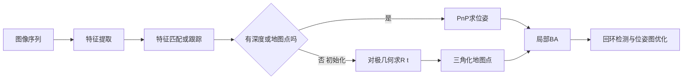

# 视觉里程计：特征、对极几何、PnP 与光束法平差

> **一句话定位**：视觉里程计（Visual Odometry, VO）用相机拍到的图像序列估计相机的运动。本章把它拆成四步：找特征、做匹配、用几何求相对位姿、再用优化（光束法平差，Bundle Adjustment, BA）精修。它是视觉 SLAM 的前端，也是面试里"视觉 SLAM 基本流程"一问的标准答案。

**本章学完你能：**

- 说出特征点（Harris、FAST、ORB）与描述子的作用，用汉明距离做匹配，并解释 RANSAC 为什么需要；
- 推导对极约束 $x_2^\top E x_1=0$，说出本质矩阵 $E=[t]_\times R$ 的性质，手算一对点是否满足约束；
- 用线性方程三角化一个三维点，算出深度，并用双目公式 $Z=fB/d$ 估计深度误差；
- 说明 PnP 的输入输出与最少点数，写出重投影误差；
- 理解 BA 的参数规模、稀疏结构与 Schur 补；
- 说出单目尺度不确定、纯旋转退化、初始化等问题；
- 对比特征点法与直接法，知道 VIO（视觉惯性里程计）为何要融合 IMU；
- 用英文回答 "Explain the visual SLAM pipeline / epipolar geometry / PnP / BA / scale ambiguity"。

**前置知识**：[相机模型与标定](../09_感知与视觉/01_相机模型与标定.md)（内参 $K$、投影）、[坐标系、旋转矩阵、齐次变换](../03_运动学与坐标变换/01_坐标系_旋转矩阵_齐次变换.md)、[线性代数](../01_数学基础/01_线性代数.md)（SVD、最小二乘）、[SLAM 问题：前端后端、位姿图](./01_SLAM问题_前端后端_位姿图优化.md)。

## 目录

1. 视觉里程计要解决什么问题
2. 整体流程
3. 特征点与描述子
4. 匹配与 RANSAC
5. 对极几何与本质矩阵
6. 手算：对极约束验证
7. 由 $E$ 恢复 $R,t$
8. 三角化（手算）
9. PnP：3D–2D 位姿求解
10. 重投影误差与光束法平差
11. 单目的尺度、初始化与退化
12. 特征点法、直接法与 VIO
13. 在本项目里怎么用
14. 常见错误与故障现象
15. 面试怎么问、怎么答
（补充）补充专题：单应矩阵、LK 光流手算与视差量级
16. 本章要点速记
17. 自测题
18. 相关链接

---

## 1. 视觉里程计要解决什么问题

相机是一种便宜、信息丰富的传感器，但它给的只是二维图像。问题是：**已知两帧（或多帧）图像，相机在这段时间里走了多远、转了多少？**

```text
 图像 I_k ──┐
            ├─> 找到"同一个物理点"在两张图上的位置 ──> 几何求解 ──> 相对位姿 (R, t)
 图像 I_k+1 ┘
```

每一帧的相对位姿累乘就得到轨迹；每个被多帧看到的点三角化后得到三维地图点。误差会累积，所以需要局部 BA、回环检测（见 [SLAM 问题](./01_SLAM问题_前端后端_位姿图优化.md)）来纠偏。

> **和激光的区别**：激光直接给出距离，所以点云配准不需要三角化；单目相机没有距离，必须靠"运动视差"恢复深度，因此带来尺度不确定的问题。

## 2. 整体流程



## 3. 特征点与描述子

### 3.1 要解决的问题

直接比对整张图像太慢、对光照敏感。我们只挑选**容易被重复找到**的点（角点、斑点），并为每个点生成一个"指纹"（描述子），在另一张图里按指纹找对应。

### 3.2 常见特征

- **Harris 角点**：计算窗口内梯度的结构矩阵 $M=\sum\begin{bmatrix}I_x^2&I_xI_y\\I_xI_y&I_y^2\end{bmatrix}$，两个特征值都大才是角点（只有一个大是边缘，两个都小是平坦区）。响应 $R=\det M-k(\operatorname{tr}M)^2$，$k\approx0.04$。**手算**：$M=\begin{bmatrix}10&2\\2&1\end{bmatrix}$，$\det=6$，$\operatorname{tr}=11$，$R=6-0.04\times121=1.16>0$，特征值 $0.576$ 与 $10.42$（Python 复核）。两个特征值都需要显著大于 0 才算角点；这里一个很小，更像边缘，阈值设置决定取舍。
- **FAST**：比较一圈（16 个）像素与中心像素的亮度，若连续 $n$ 个更亮或更暗则为角点；极快，没有描述子。
- **ORB**：Oriented FAST + Rotated BRIEF：给 FAST 角点算主方向（灰度质心法），再在旋转后的邻域内取若干对像素比较大小，得到 256 位二进制描述子。快、适合嵌入式。
- **SIFT / SURF**：浮点描述子，尺度和旋转不变性更强，更慢（SIFT 的专利问题已过期，细节未核对）。
- **SuperPoint 等学习型特征**：用网络提取，鲁棒性更好，需要 GPU/NPU。

### 3.3 描述子距离

二进制描述子用**汉明距离**（不同位数）。**手算**：两个 8 位描述子 `10110010` 与 `10011011`：异或 `00101001`，汉明距离 3。浮点描述子用欧氏距离。匹配时通常做**比值检验**（最近距离 / 次近距离 < 0.7–0.8）剔除歧义匹配。

## 4. 匹配与 RANSAC

### 4.1 为什么需要 RANSAC

匹配里总有错误（外点，outlier）：重复纹理、动态物体、光照变化。几何求解对外点极度敏感，因此用 **RANSAC（Random Sample Consensus）**：

1. 随机取最小样本（求 $E$ 用 5 或 8 对点）；
2. 求模型；
3. 统计满足模型的点（内点）个数；
4. 重复，取内点最多的模型，再用全部内点重新拟合。

所需迭代次数 $N=\dfrac{\ln(1-p)}{\ln(1-w^s)}$，$p$ 目标成功概率，$w$ 内点比例，$s$ 最小样本数。**手算**：$p=0.99$，$w=0.5$：$s=5$ 时 $N=145$；$s=8$ 时 $N=1177$（Python 复核）。最小样本越小需要的迭代越少，这是五点法比八点法在外点多时更受欢迎的原因。

### 4.2 光流跟踪

除描述子匹配外，还可以用 Lucas–Kanade 光流在相邻帧里**跟踪**特征点，不需要计算描述子，速度更快；适合帧间运动小的高帧率相机（很多 VIO 使用这条路线）。

## 5. 对极几何与本质矩阵

### 5.1 推导

设相机 1 坐标系下点 $P_1$，相机 2 下 $P_2=RP_1+t$（$R,t$ 是从相机 1 到相机 2 的变换）。归一化坐标（用内参去掉像素效应，$x=K^{-1}u$）$x_1=P_1/Z_1$，$x_2=P_2/Z_2$（齐次表示 $(X/Z,Y/Z,1)$）。

$Z_2x_2=Z_1Rx_1+t$。两边左乘 $t$ 的反对称矩阵 $[t]_\times$（使 $[t]_\times t=0$）：
$$Z_2[t]_\times x_2=Z_1[t]_\times Rx_1.$$
再左乘 $x_2^\top$：左边 $x_2^\top[t]_\times x_2=0$（任意向量与自己的叉积垂直）。所以
$$\boxed{x_2^\top E\,x_1=0,\qquad E=[t]_\times R.}$$
这就是**对极约束（epipolar constraint）**。几何意义：$x_1$ 对应的三维点必然落在由两个光心和该点张成的平面（对极面）上，因此 $x_2$ 必须在图 2 中的一条直线（对极线，$l_2=Ex_1$）上。

其中 $[t]_\times=\begin{bmatrix}0&-t_z&t_y\\t_z&0&-t_x\\-t_y&t_x&0\end{bmatrix}$。

### 5.2 性质

- $E$ 是 $3\times3$、秩 2，两个非零奇异值相等（$\sigma_1=\sigma_2$），第三个为 0。**手算验证**：旋转 $0.1$ rad 绕 $z$ 轴，$t=(1,0,0)$，$E=[t]_\times R$ 的奇异值为 $[1,1,0]$（Python 复核）。
- $E$ 有 5 个自由度（3 个旋转 + 2 个平移方向，尺度丢失），所以最少 5 对点可解（五点法）；线性八点法需要 8 对点；
- 如果相机未标定，使用基础矩阵（fundamental matrix）$F=K^{-\top}EK^{-1}$，满足 $u_2^\top Fu_1=0$（像素坐标）。

### 5.3 尺度丢失

$E$ 乘以任何常数仍然满足约束，所以从对极几何只能得到平移**方向**，不能得到长度。这就是**单目尺度不确定（scale ambiguity）**。需要外部信息来确定尺度：已知基线的双目、深度相机、IMU 或已知大小的物体。

## 6. 手算：对极约束验证

取 $R=I$，$t=(1,0,0)$（相机 2 在相机 1 的右边，其实是点相对相机移动了 $+1$）。则
$$E=[t]_\times=\begin{bmatrix}0&0&0\\0&0&-1\\0&1&0\end{bmatrix}.$$

**点 A**：$P_1=(0,0,5)$，$P_2=P_1+t=(1,0,5)$。$x_1=(0,0,1)$，$x_2=(0.2,0,1)$。$Ex_1=(0,-1,0)$，$x_2^\top Ex_1=0$ ✓。

**点 B**：$P_1=(1,2,5)$，$P_2=(2,2,5)$。$x_1=(0.2,0.4,1)$，$x_2=(0.4,0.4,1)$。$Ex_1=(0,-1,0.4)$，$x_2^\top Ex_1=0\cdot0.4+(-1)(0.4)+1\cdot0.4=0$ ✓。（Python 复核。）

这里两个点的 $y$ 坐标相同（$0.4=0.4$），这是因为纯水平平移：对极线是水平线，匹配只需沿水平方向搜索，这正是双目校正（rectification）后"行对齐"的由来。

## 7. 由 $E$ 恢复 $R,t$

对 $E$ 做 SVD：$E=U\operatorname{diag}(\sigma,\sigma,0)V^\top$。令
$$W=\begin{bmatrix}0&-1&0\\1&0&0\\0&0&1\end{bmatrix},\quad R=UWV^\top\ \text{或}\ UW^\top V^\top,\quad t=\pm u_3\ (U\text{ 的第三列}).$$
组合共 **4 个解**。正确解的判据是**手性检验（cheirality check）**：三角化出的点必须在两个相机前方（深度均为正）。实用中还要把 $\det R=+1$ 作为约束（若为 $-1$，需要把 $E$ 的符号翻转再分解）。

## 8. 三角化（手算）

已知 $R,t$ 与匹配 $(x_1,x_2)$，求深度：
$$s_2x_2=s_1Rx_1+t\ \Rightarrow\ s_1Rx_1-s_2x_2=-t.$$
这是关于 $(s_1,s_2)$ 的线性方程（3 个方程 2 个未知），噪声下用最小二乘；更严格的做法是 DLT 三角化或重投影误差最小化。

**手算**：沿用点 B：$x_1=(0.2,0.4,1)$，$x_2=(0.4,0.4,1)$，$R=I$，$t=(1,0,0)$：

- 第 3 行：$s_1-s_2=0\Rightarrow s_1=s_2=s$；
- 第 1 行：$0.2s-0.4s=-1\Rightarrow s=5$；
- 第 2 行：$0.4s-0.4s=0$ ✓。

深度 $Z_1=5$，三维点 $P_1=5\times(0.2,0.4,1)=(1,2,5)$，与真值一致（Python 复核 `[5,5]`）。

**视差越小，深度越不准**：当两帧间平移很小（基线短）或点很远时，$x_1\approx x_2$，方程近乎秩亏，深度对噪声极度敏感。这就是视觉里程计需要足够视差才能初始化的原因。

**双目**：校正后左右图同一行，视差 $d=u_L-u_R$，深度
$$Z=\frac{fB}{d}.$$
**手算**：$f=700$ px，基线 $B=0.12$ m，视差 $d=21$ px：$Z=700\times0.12/21=4.0$ m。视差误差 $\delta d=0.5$ px 时，$\delta Z\approx\dfrac{Z^2}{fB}\delta d=\dfrac{16}{84}\times0.5=0.095$ m。**深度误差随距离平方增长**：同样条件下 10 m 处 $\delta Z=100/84\times0.5=0.6$ m。

## 9. PnP：3D–2D 位姿求解

### 9.1 问题

已知若干空间点 $P_i$（世界系，来自地图）和它们在当前图像中的像素 $u_i$，求相机位姿 $(R,t)$：
$$s\,u_i=K\,(RP_i+t).$$
这就是 **PnP（Perspective-n-Point）**。有地图点之后，后续帧大多用 PnP 而不是对极几何，因为它的尺度由地图决定，没有尺度漂移。

### 9.2 解法

- **DLT**：把投影矩阵 $[R|t]$ 的 12 个元素当未知数，每个点提供 2 个方程，至少 6 个点；
- **P3P**：3 个点给出至多 4 个解，再用第 4 个点选解；速度快，常与 RANSAC 联用；
- **EPnP**：把点表示成 4 个控制点的加权和，对 $n\ge4$ 的点线性求解；
- **迭代法**：以上述结果为初值，最小化重投影误差（非线性最小二乘，高斯—牛顿/LM）。

## 10. 重投影误差与光束法平差

### 10.1 重投影误差

用当前估计把三维点投到图像，与观测像素比较：
$$e=u_{meas}-\pi\big(K(RP+t)\big),\quad \pi([X,Y,Z]^\top)=[X/Z,\ Y/Z]^\top.$$

**手算**：$K=\begin{bmatrix}500&0&320\\0&500&240\\0&0&1\end{bmatrix}$，$R=I$，$t=(0.1,0,0)$，$P=(0.5,0.2,4)$。相机系 $P_c=(0.6,0.2,4)$，$u=(500\times0.6/4+320,\ 500\times0.2/4+240)=(395,265)$。若实测像素为 $(383,265)$，误差 $(-12,0)$ px，范数 12 px。优化的目标就是调整位姿（和点）使所有误差平方和最小。

### 10.2 光束法平差（BA）

同时优化所有相机位姿 $\{T_i\}$ 和所有三维点 $\{P_j\}$：
$$\min_{\{T_i\},\{P_j\}}\ \sum_{i,j}\rho\big(\|u_{ij}-\pi(K,T_i,P_j)\|^2_{\Sigma}\big).$$
"光束"指从光心经像点到空间点的射线，BA 同时调整所有射线使其汇聚。

**参数规模手算**：10 个关键帧（每个 6 自由度）、1000 个点（每个 3 自由度）：未知数 $10\times6+1000\times3=3060$。若每个点被所有 10 帧看到，残差数 $2\times10\times1000=20000$。

**稀疏结构**：每个残差只依赖一个相机和一个点，所以雅可比与 $H$ 具有特殊块结构：
$$H=\begin{bmatrix}B&E\\E^\top&C\end{bmatrix},$$
其中 $C$ 是**块对角**（每个点 $3\times3$），因此可以先用 **Schur 补**消去点，只解相机部分的 $60\times60$ 约化系统，再回代求点。这使 BA 可以处理上百万个点，是实时 SLAM 能做局部 BA 的关键。

### 10.3 局部 BA vs 全局 BA

- **局部 BA**：只优化最近的若干关键帧与它们看到的点，固定更老的帧，每秒几次，保持实时；
- **全局 BA**：在回环闭合后对整张图优化，较慢；通常后台线程进行；
- **位姿图优化**：回环发生后先用位姿图（只调位姿）快速分摊误差，再做全局 BA。

## 11. 单目的尺度、初始化与退化

- **初始化**：单目需要两帧之间有足够平移（视差），用 $E$（或在平面场景用单应矩阵 $H$）求初始位姿并三角化初始地图，把初始基线定为 1，所有尺度以此为单位。
- **尺度漂移**：单目 VO 的尺度会随时间漂移，回环后需要 Sim(3) 优化（带尺度的相似变换）。
- **纯旋转**：平移为 0 时 $E=0$，无法三角化；此时应使用单应矩阵估计旋转，或暂时不更新地图点。
- **平面场景**：所有点共面时 $E$ 的求解退化，应改用单应矩阵 $H$ 分解。
- **快速运动/运动模糊/弱纹理**：特征不足，跟踪丢失（lost），需要重定位。
- **动态物体**：移动的行人、车辆会产生错误的匹配，需要 RANSAC 或语义过滤。

## 12. 特征点法、直接法与 VIO

| 方法 | 做法 | 优点 | 缺点 |
|---|---|---|---|
| 特征点法（如 ORB-SLAM） | 提特征→匹配→几何求解 | 对光照变化相对鲁棒，可回环 | 特征少（弱纹理）时失效，提取耗时 |
| 直接法（如 DSO、LSD-SLAM 一类，细节未核对） | 直接最小化像素灰度差（光度误差） | 无需特征，可利用梯度强的像素，速度快 | 对光照变化敏感，需要光度标定 |
| 光流法（KLT） | 跟踪像素 | 快 | 需要小运动 |

**VIO（Visual-Inertial Odometry）**：融合相机与 IMU。IMU 能给出尺度（加速度有绝对单位）、在图像模糊和快速运动时提供短时运动预测，视觉则校正 IMU 的漂移。常见做法是 **IMU 预积分（preintegration）**：把两个关键帧之间的 IMU 测量积分成一个相对运动约束，作为因子加入优化；有松耦合（各自估计再融合）和紧耦合（联合优化）两类。典型开源系统包括 VINS-Mono、OKVIS、ORB-SLAM3 的视觉惯性模式（细节未核对）。

## 13. 在本项目里怎么用

七个项目的 CV 没有视觉 SLAM 项目，所以本章主要用于**基础面试**。有关联的地方：

- **P4**：YOLO 检测是图像的另一种用法；理解相机内参与投影是把 2D 检测变成 3D 位置的前提（见 [相机模型与标定](../09_感知与视觉/01_相机模型与标定.md)）；
- **P2**：VR 手柄位姿是被"跟踪"的，原理与 VIO 相通（视觉+惯性融合，只是用在头显上）；
- **P5**：激光里程计与扫描匹配相当于 VO 的激光版，ICP 对应 PnP/BA 的位置；相机方案会把激光里程计换成 VO，但融合与回环思想相同；
- **P6**：多传感器时间戳、坐标系与有效性处理，同样适用于相机帧（曝光时间、读出延迟）。

> **注意**：不要把 VO/SLAM 说成自己做过的项目内容；被问到时，用"我理解其原理，并在项目中用到相近的几何与滤波工具"来诚实回答。

## 14. 常见错误与故障现象

| 现象 | 原因 | 处理 |
|---|---|---|
| 轨迹尺度越走越大/小 | 单目尺度漂移 | 加双目/IMU/回环 Sim(3) |
| 初始化后立刻丢失 | 初始视差不足或纯旋转 | 要求最小视差与内点数后再初始化 |
| 匹配很多但位姿乱跳 | 外点太多，RANSAC 阈值太松 | 收紧阈值，比值检验，几何验证 |
| 转弯时丢失 | 运动模糊/视野内特征不足 | 提高帧率、曝光；融合 IMU |
| 位姿有周期性抖动 | 卷帘快门（rolling shutter）未处理 | 使用全局快门或建模 |
| 重投影误差大但优化不降 | 内参/畸变未标定、时间不同步 | 先标定相机；检查时间戳 |
| 深度估计很噪 | 基线太短、点太远 | 增加基线、过滤远点 |

## 15. 面试怎么问、怎么答

**Q1. Describe the pipeline of a feature-based visual odometry system.**

> First I detect features such as ORB corners and match them between frames, using a ratio test and RANSAC to remove outliers. At initialisation I estimate the essential matrix from the matches, recover the relative pose by SVD and triangulate map points. For later frames I use PnP against the map points to get the pose, then refine poses and points with local bundle adjustment. Loop closure and pose graph optimisation correct long-term drift.

中文：提 ORB 特征匹配（比值检验+RANSAC）；初始化用本质矩阵分解位姿并三角化；之后用 PnP；局部 BA 精修；回环+位姿图纠漂移。追问：为什么用 PnP 而不是一直用对极几何？（PnP 尺度由地图固定、精度更高。）

**Q2. Why can monocular vision not recover absolute scale?**

> The essential matrix is only defined up to scale, because multiplying the translation by any constant still satisfies the epipolar constraint. Scale has to come from another source: a known baseline in stereo, depth sensing, an IMU, or a known object size.

中文：本质矩阵对平移的尺度不敏感，所以单目只能得到方向；尺度要靠双目基线、深度、IMU 或已知物体。

**Q3. What is bundle adjustment and why is it efficient?**

> It jointly optimises camera poses and 3D points by minimising reprojection error. Each residual depends on one camera and one point, so the Hessian has a sparse block structure. The point block is block-diagonal, so I eliminate the points with the Schur complement and solve a much smaller camera system.

中文：联合优化相机位姿与三维点以最小化重投影误差；每个残差只涉及一个相机一个点，$H$ 块稀疏，点块对角，用 Schur 补消去点，只解小的相机系统。

**Q4. Why does depth accuracy degrade with distance in a stereo camera?**

> Depth is Z = fB over d. The error in Z for a given disparity error grows as Z squared over fB. So long baselines and high resolution help, but distant points are inevitably noisier.

中文：$Z=fB/d$，视差误差对应的深度误差 $\propto Z^2/(fB)$，随距离平方增长；增大基线、提高分辨率有帮助。

**Q5. Why add an IMU to visual odometry?**

> The IMU provides metric scale, handles fast motion and motion blur over short periods, and gives gravity direction. Vision, in turn, corrects the IMU's drift. IMU preintegration lets me use the inertial data as a constraint between keyframes in the optimisation.

中文：IMU 提供度量尺度、短时快速运动预测和重力方向；视觉校正 IMU 漂移；预积分把 IMU 变成关键帧之间的约束。

## 补充专题：单应矩阵、LK 光流手算与视差量级

### 单应矩阵与"纯旋转"

对平面（法向量 $n$，到相机 1 的距离 $d$）上的点，两视图关系是单应矩阵
$$H=K\Big(R-\frac{tn^\top}{d}\Big)K^{-1}.$$
当平移 $t=0$（纯旋转）时，$H=KRK^{-1}$，与点的深度无关，所以纯旋转的图像变换**不含任何深度信息**——这也解释了为什么纯旋转无法三角化。

**手算**：$f=500$ px，相机绕竖直轴转 $5^\circ$，图像中心附近的点水平位移约 $f\tan5^\circ=500\times0.0875=43.7$ px（Python 复核）。对比平移：基线 $0.1$ m、点深度 $5$ m，视差 $fb/Z=500\times0.1/5=10$ px；深度 $50$ m 则只有 $1$ px。**远点（视差小）只能约束旋转，近点才能约束平移**。这也是室外大场景 VO 里要依靠近处特征估计平移、依靠远处特征估计旋转的原因，也解释了为何 IMU 对旋转很有帮助。

### Lucas–Kanade 光流：一个手算

亮度不变假设：同一个物点在相邻帧亮度不变，一阶泰勒展开得**光流约束**
$$I_xu+I_yv+I_t=0,$$
$(u,v)$ 是像素在两帧间的位移，$I_x,I_y$ 是空间梯度，$I_t$ 是时间差。一个像素只有一个方程，两个未知（孔径问题），所以 LK 假设窗口内所有像素有同样的运动，联立多个方程做最小二乘 $A[u,v]^\top=b$，$A$ 的每行为 $[I_x,I_y]$，$b=-I_t$。

**手算**：窗口取 3 个像素，梯度分别为 $(I_x,I_y,I_t)=(1,0,-0.5),(0,1,-0.2),(1,1,-0.8)$。$A=\begin{bmatrix}1&0\\0&1\\1&1\end{bmatrix}$，$b=[0.5,0.2,0.8]^\top$。法方程 $A^\top A=\begin{bmatrix}2&1\\1&2\end{bmatrix}$，$A^\top b=[1.3,1.0]^\top$，解得 $(u,v)=(0.533,0.233)$（Python 复核）。注意第三个方程若完全一致应为 $0.5+0.2=0.7$，噪声使其变成 $0.8$，最小二乘折中。**可靠性条件**：$A^\top A$ 的两个特征值都要显著大于 0（角点），否则（只有一个方向有梯度）解不唯一——这正是 Harris 角点判据与 LK 的共通点，也是选"好跟踪的特征"（Shi–Tomasi）的依据。大位移用**图像金字塔**由粗到细估计。

### 关键帧与地图点管理

为了控制计算量，不是每一帧都参与优化，而是选**关键帧**。常见准则（经验，未核对）：

- 与上一关键帧的视差超过阈值（如 15 px 平均视差）；
- 跟踪到的地图点数下降到参考关键帧的一定比例（如 70%）以下；
- 距上次关键帧已过固定时间。

地图点的质量控制：只保留被至少 2–3 个关键帧观测到、重投影误差小的点；剔除视差过小、深度不稳定、位于图像边缘的点。**跟踪丢失（lost）后**：先尝试用运动模型（匀速）预测恢复，失败则进入重定位：用词袋检索候选关键帧，再用 PnP + RANSAC 求位姿。

### 视觉里程计的最小代码骨架（教学示例，未运行核对）

```python
# 教学示例：两帧单目 VO，使用 OpenCV 的常见调用顺序
orb = cv2.ORB_create(1000)
kp1, d1 = orb.detectAndCompute(img1, None)
kp2, d2 = orb.detectAndCompute(img2, None)
matches = cv2.BFMatcher(cv2.NORM_HAMMING, crossCheck=True).match(d1, d2)
p1 = np.float32([kp1[m.queryIdx].pt for m in matches])
p2 = np.float32([kp2[m.trainIdx].pt for m in matches])
E, mask = cv2.findEssentialMat(p1, p2, K, method=cv2.RANSAC, prob=0.999, threshold=1.0)
_, R, t, mask = cv2.recoverPose(E, p1, p2, K, mask=mask)   # t 只有方向，|t|=1
```

函数名与参数以所用 OpenCV 版本文档为准。读这段代码时，对应本章的流程：ORB 特征 → Hamming 匹配 → RANSAC 估计 $E$ → 分解并做手性检验得 $R,t$（尺度为 1）。

### 补充：重投影误差的尺度与鲁棒核阈值

BA 里各观测的重投影误差通常服从标准差约 $1$ px 的高斯分布（取决于特征提取精度，经验值）。因此鲁棒核（Huber）的阈值常设为 $\delta\approx\sqrt{5.99}\approx2.45$ px（对应二维误差卡方分布 95% 分位数 5.99，这是 ORB-SLAM 类系统常用的思想，具体数值未核对）：残差超过该值的观测被视为外点，权重下调。金字塔层数越高（特征所在尺度越大），像素噪声越大，应相应放宽该观测的信息矩阵（权重与尺度平方成反比）。理解这点能解释"为什么同一个系统里有的观测权重大，有的小"。**检验流程**：优化后统计内点重投影 RMS，若显著大于 1 px 说明标定、时间同步或特征匹配存在系统性问题。

### 补充：面试里如何口述一个 VO 系统的失败模式

挑三个最有代表性的讲：(1) **弱纹理**（白墙、地面）：特征不足，跟踪丢失，对策是融合 IMU 或使用直接法利用梯度；(2) **动态物体**：外点增多，对策是 RANSAC、语义分割剔除、多假设；(3) **光照变化与曝光**：特征匹配失败，对策是自动曝光同步、使用对光照更鲁棒的描述子或学习特征。每个失败模式都要说出"现象—原因—对策"三件事，这与整个文档的故障描述格式一致，也是面试官喜欢的结构化回答。

## 16. 本章要点速记

1. 视觉里程计流程：特征→匹配→几何→优化→回环。
2. 对极约束 $x_2^\top Ex_1=0$，$E=[t]_\times R$，秩 2、两非零奇异值相等，5 自由度。
3. 单目只得平移方向，尺度不确定；需双目/IMU/深度确定。
4. $E$ 分解有 4 解，用手性检验（点在相机前方）选唯一解。
5. 三角化是线性方程，视差小时深度极不准。
6. 双目 $Z=fB/d$，深度误差 $\propto Z^2/(fB)$。
7. PnP：3D–2D，最少 3 点（P3P）+ 1 点验证，DLT 需 6 点；有地图后优先 PnP。
8. BA 最小化重投影误差；Schur 补利用点块对角加速。
9. RANSAC 迭代数 $N=\ln(1-p)/\ln(1-w^s)$。
10. VIO 解决尺度与快速运动，预积分是关键。

## 17. 自测题

1. 对 $E=[t]_\times R$，若 $t$ 放大 3 倍，约束 $x_2^\top Ex_1=0$ 还成立吗？说明什么？（仍成立；说明尺度不可观。）
2. $f=500$ px，$B=0.2$ m，视差 10 px，深度多少？（$500\times0.2/10=10$ m。）
3. 为什么纯旋转时不能用对极几何三角化？（$t=0\Rightarrow E=0$，没有视差。）
4. 10 帧、500 点，BA 的未知数个数？（$10\times6+500\times3=1560$。）
5. 内点比例 $w=0.7$，$s=8$，$p=0.99$ 的 RANSAC 迭代数？（$\ln0.01/\ln(1-0.7^8)=4.605/0.0594\approx78$；核对：$0.7^8=0.0576$，$\ln(1-0.0576)=-0.0593$，$N\approx78$。）
6. 重投影误差 $(3,4)$ px，范数多少？（5 px。）

## 18. 相关链接

- 上一章：[SLAM 问题：前端、后端与位姿图优化](./01_SLAM问题_前端后端_位姿图优化.md)
- 感知：[相机模型与标定](../09_感知与视觉/01_相机模型与标定.md)、[点云处理](../09_感知与视觉/02_点云处理_滤波_配准_ICP.md)
- 基础：[欧拉角、四元数、姿态表示](../03_运动学与坐标变换/02_欧拉角_四元数_姿态表示.md)
- 模块说明：[07_SLAM与建图 README](./README.md)
