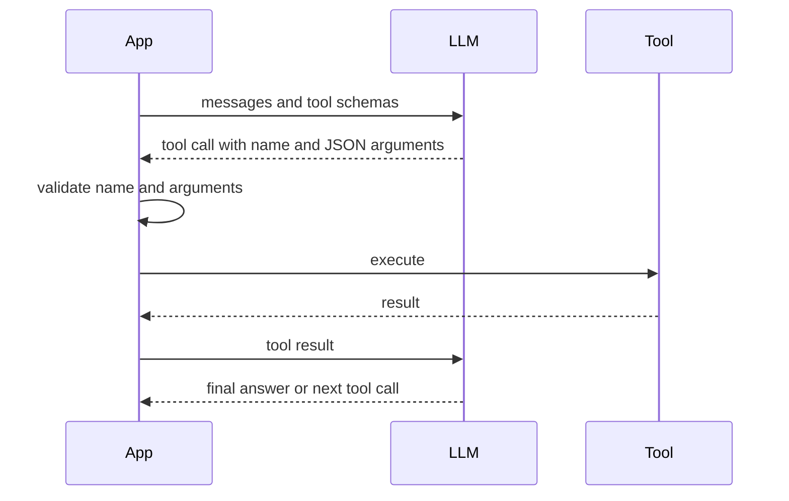
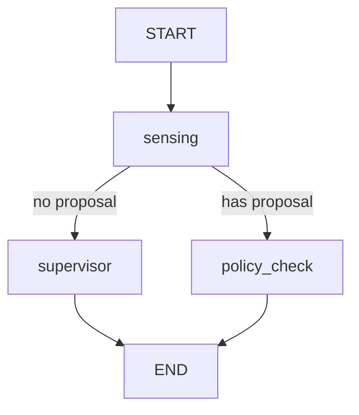

# Transformer、LLM 与 Agent、LangGraph

> **一句话定位**：先把注意力机制和 Transformer 从公式到手算讲透，再讲大模型能做什么、不能做什么，最后落到 Agent 工程：怎样用 LangGraph 搭一条"规则快速路径 + LLM"的混合决策链，并保证模型的输出只能以受约束、可校验的方式变成物理动作。这一章同时支撑你的 P4（LangGraph 决策链）和 PS 的主线（AI 决策如何变成物理动作，P6）。

**本章学完你能……**

- 推导 scaled dot-product attention，解释为什么要除以 $\sqrt{d_k}$，并手算一个 3-token 的注意力（含因果掩码）。
- 画出 Transformer 的块结构（多头注意力、前馈、残差、LayerNorm、位置编码），说清 encoder-only / decoder-only / encoder-decoder 的区别，估算参数量与 KV cache 显存。
- 解释预训练、微调、提示（prompting）的区别；说出温度、top-k、top-p 对输出的影响并手算温度。
- 解释幻觉的成因与缓解办法，并用概率说明"多步任务为什么不可靠"。
- 描述工具调用（function calling）的完整流程和 ReAct 范式，写出一个最小 ReAct 循环。
- 说清 LangGraph 的 state、node、edge、conditional edge、reducer、checkpoint，并写出可运行的小图，手工跟踪三条路径。
- 设计"规则快速路径 + LLM"混合架构，写出输出校验与白名单策略，描述 action-proposal → policy-check → execution → state-feedback 链。
- 用英文回答"What is attention? What is an agent? How do you make LLM decisions safe for a physical system?"

**前置知识**

- [02 神经网络与反向传播](./02_神经网络与反向传播.md)（softmax、LayerNorm、残差）
- [01 机器学习基础](./01_机器学习基础.md)（交叉熵、过拟合）
- [01 线性代数](../01_数学/01_线性代数.md)（矩阵乘法）

**目录**

1. 从序列模型到注意力
2. 注意力机制完整推导与手算
3. Transformer 结构
4. 预训练、微调与提示
5. LLM 的能力、局限与幻觉
6. 工具调用
7. Agent 范式：ReAct 及其他
8. LangGraph
9. 规则快速路径 + LLM 的混合架构
10. 输出校验、白名单与执行边界
11. 可靠性工程
12. 在你的项目里怎么用（P4 与 P6）
13. 常见错误与故障现象
14. 面试问答
15. 自测题

---

## 1. 从序列模型到注意力

### 1.1 它要解决什么问题

语言、传感器时间序列都是**序列**：每个位置的含义取决于上下文。早期用 RNN/LSTM 逐个读入、把历史压缩进一个隐状态。两个问题：(1) 必须串行，难并行训练；(2) 远距离依赖要穿过很多步，信息被稀释、梯度消失。

**注意力（attention）**的想法：每个位置直接"查询"序列里所有位置，按相关度加权汇总，一步就能关联任意两个位置，而且所有位置可以并行计算。Transformer（Vaswani 等，2017，*Attention Is All You Need*）完全用注意力取代循环结构。

### 1.2 类比

把注意力想成**软查字典**：

- 每个词发出一个**查询**（Query）："我在找什么样的信息？"
- 每个词也给出一个**键**（Key）："我能提供什么样的信息？"和一个**值**（Value）："我真正携带的内容"。
- 查询与每个键算相似度 → 变成权重 → 对所有值加权求和。

---

## 2. 注意力机制完整推导与手算

### 2.1 符号

- 序列长度 $n$，模型维度 $d_{model}$。输入 $X\in\mathbb R^{n\times d_{model}}$，每行是一个 token 的向量。
- 三个可学习投影：$W_Q,W_K\in\mathbb R^{d_{model}\times d_k}$，$W_V\in\mathbb R^{d_{model}\times d_v}$。
- $Q=XW_Q,\ K=XW_K,\ V=XW_V$。

### 2.2 公式

$$\mathrm{Attention}(Q,K,V)=\mathrm{softmax}\Big(\frac{QK^\top}{\sqrt{d_k}}\Big)V$$

逐步拆开：

1. $S=QK^\top\in\mathbb R^{n\times n}$：$S_{ij}=q_i\cdot k_j$，第 $i$ 个 token 对第 $j$ 个 token 的"相关度打分"。
2. $S/\sqrt{d_k}$：缩放。
3. 对**每一行**做 softmax 得到注意力权重 $A$，每行和为 1：$A_{ij}$ 表示 token $i$ 从 token $j$ 取多少信息。
4. $O=AV$：输出的第 $i$ 行是所有 $v_j$ 的加权和。

### 2.3 为什么除以 $\sqrt{d_k}$

设 $q,k$ 的各分量独立、均值 0、方差 1。则 $q\cdot k=\sum_{m=1}^{d_k}q_mk_m$，每项方差为 1，独立相加，方差为 $d_k$，标准差 $\sqrt{d_k}$。$d_k$ 大时打分幅度很大，softmax 进入饱和：一个位置接近 1，其余接近 0，梯度几乎为零。除以 $\sqrt{d_k}$ 把方差拉回 1。

手算（教学示例）：打分 $[8,0,0]$。
- 不缩放：$\mathrm{softmax}=[0.9993,\ 0.0003,\ 0.0003]$（几乎 one-hot，梯度接近 0）。
- 设 $d_k=64$，缩放 $8/\sqrt{64}=1$：$\mathrm{softmax}([1,0,0])=[0.5761,\ 0.2119,\ 0.2119]$，平滑得多。

### 2.4 完整手算：3 个 token，$d_k=2$（教学示例）

输入（每行一个 token）：
$$X=\begin{bmatrix}1&0\\0&1\\1&1\end{bmatrix},\quad W_Q=\begin{bmatrix}1&0\\0&1\end{bmatrix},\quad W_K=\begin{bmatrix}1&1\\0&1\end{bmatrix},\quad W_V=\begin{bmatrix}1&0\\1&1\end{bmatrix}$$

**投影**：
$$Q=XW_Q=\begin{bmatrix}1&0\\0&1\\1&1\end{bmatrix},\ K=XW_K=\begin{bmatrix}1&1\\0&1\\1&2\end{bmatrix},\ V=XW_V=\begin{bmatrix}1&0\\1&1\\2&1\end{bmatrix}$$

（例：$K$ 第 3 行 $=(1,1)W_K=(1\cdot1+1\cdot0,\ 1\cdot1+1\cdot1)=(1,2)$。）

**打分** $S=QK^\top$：第 $i$ 行第 $j$ 列 $=q_i\cdot k_j$。
$$S=\begin{bmatrix}1&0&1\\1&1&2\\2&1&3\end{bmatrix}$$
（例：$q_3\cdot k_3=(1,1)\cdot(1,2)=3$。）

**缩放** $\div\sqrt2=1.4142$：
$$\frac S{\sqrt2}=\begin{bmatrix}0.7071&0&0.7071\\0.7071&0.7071&1.4142\\1.4142&0.7071&2.1213\end{bmatrix}$$

**softmax（逐行）**：
- 行 1：$e^{0.7071}=2.028,\ e^0=1,\ e^{0.7071}=2.028$，和 $5.056$ → $[0.4011,\ 0.1978,\ 0.4011]$
- 行 2：$2.028,\ 2.028,\ 4.113$，和 $8.170$ → $[0.2483,\ 0.2483,\ 0.5035]$
- 行 3：$4.113,\ 2.028,\ 8.342$，和 $14.483$ → $[0.2840,\ 0.1400,\ 0.5760]$

**加权求和** $O=AV$：
- $o_1=0.4011(1,0)+0.1978(1,1)+0.4011(2,1)=(0.4011+0.1978+0.8022,\ 0+0.1978+0.4011)=(1.4011,\ 0.5989)$
- $o_2=0.2483(1,0)+0.2483(1,1)+0.5035(2,1)=(1.5035,\ 0.7517)$
- $o_3=(1.5760,\ 0.7160)$

**因果掩码（causal mask）**：语言模型生成时第 $i$ 个 token 只能看 $\le i$ 的位置。做法：在 softmax 前把"未来"位置的打分设为 $-\infty$（权重变 0）。同样的数据：
- 行 1 只能看自己：$[1,0,0]$ → $o_1=(1,0)$
- 行 2 看前两个：$\mathrm{softmax}([0.7071,0.7071])=[0.5,0.5]$ → $o_2=0.5(1,0)+0.5(1,1)=(1,\ 0.5)$
- 行 3 看全部，与无掩码时相同：$o_3=(1.576,\ 0.716)$

> **面试要点**：注意力矩阵是 $n\times n$，所以计算和显存是 $O(n^2)$；序列越长越贵。这是长上下文的核心瓶颈。

### 2.5 多头注意力（Multi-Head）

**问题**：一组 $(Q,K,V)$ 只能学一种"相关性模式"。**做法**：把 $d_{model}$ 切成 $h$ 个头，每头 $d_k=d_{model}/h$，各自独立做注意力，最后拼接并线性变换：

$$\mathrm{MHA}(X)=\mathrm{Concat}(\text{head}_1,\dots,\text{head}_h)W_O,\quad\text{head}_i=\mathrm{Attention}(XW_Q^i,XW_K^i,XW_V^i)$$

不同的头可以关注不同的关系（语法、指代、位置邻近等）。参数量：$W_Q,W_K,W_V,W_O$ 总共约 $4d_{model}^2$，与头数无关。

### 2.6 自注意力、交叉注意力

- **自注意力**：$Q,K,V$ 都来自同一序列。
- **交叉注意力**：$Q$ 来自一个序列（如解码器），$K,V$ 来自另一个（如编码器输出），用于翻译、图文对齐。多模态模型里"文本去看图像特征"就是交叉注意力。

---

## 3. Transformer 结构

### 3.1 位置编码

注意力本身对输入顺序**没有感觉**（打乱 token 顺序，输出只是跟着打乱）。需要把位置信息加进去。

- 原始 Transformer 的正弦编码：
$$PE(pos,2i)=\sin\frac{pos}{10000^{2i/d}},\qquad PE(pos,2i+1)=\cos\frac{pos}{10000^{2i/d}}$$
手算：$d=4,\ pos=1$：$i=0$：$(\sin1,\cos1)=(0.8415,0.5403)$；$i=1$：频率分母 $10000^{2/4}=100$，$(\sin0.01,\cos0.01)=(0.0100,1.0000)$。位置编码为 $[0.8415,0.5403,0.0100,1.0000]$。低维变化快、高维变化慢，像不同位数的"时钟"。
- 现代 LLM 多用**旋转位置编码 RoPE**（在 $Q,K$ 上按位置旋转，使打分只依赖相对位置）或可学习位置。

### 3.2 一个 Transformer 块

```text
x ──► LayerNorm ──► Multi-Head Attention ──┐
│                                            ▼ (+)  残差
└────────────────────────────────────────► x1
x1 ─► LayerNorm ──► FFN (线性→激活→线性) ──┐
│                                            ▼ (+)  残差
└────────────────────────────────────────► x2
```

- **前馈网络（FFN）**：对每个位置独立的两层 MLP：$d\to4d\to d$，激活 GELU/SwiGLU。注意力负责"位置间信息交换"，FFN 负责"位置内特征变换"，大部分参数在 FFN。
- **残差 + LayerNorm**：与 ResNet 同理，保证深层可训练。上图是 Pre-LN（先归一化再子层），现代 LLM 常用，训练更稳。
- 参数量手算：$d=512$：注意力 $4d^2=1{,}048{,}576$；FFN（隐藏 $4d$）$2\times d\times4d=8d^2=2{,}097{,}152$；合计约 $12d^2=3{,}145{,}728$ 每层（忽略偏置与 LN）。堆叠 $L$ 层再加词嵌入。

### 3.3 三种架构

| 类型 | 注意力 | 训练目标 | 代表 | 擅长 |
|---|---|---|---|---|
| Encoder-only | 双向 | 掩码语言模型（挖词填空） | BERT | 分类、检索、嵌入 |
| Decoder-only | 因果（单向） | 预测下一个 token | GPT 系、LLaMA 系 | 生成、对话（当前 LLM 主流） |
| Encoder-Decoder | 编码双向 + 解码因果 + 交叉注意力 | 序列到序列 | T5、原始 Transformer | 翻译、摘要 |

视觉里的 ViT 把图像切成 patch 当作 token 送入同样的 Transformer；检测里的 DETR 用 Transformer 做集合预测（见 [YOLO 章](./03_卷积网络与目标检测_YOLO.md)）。

### 3.4 推理成本与 KV cache

生成第 $t$ 个 token 时，前 $t-1$ 个 token 的 $K,V$ 其实已经算过。**KV cache** 把它们缓存，每步只算新 token 的 $Q,K,V$ 并和缓存的 $K,V$ 做注意力。省了重复计算，代价是显存。

手算（教学示例：某 7B 量级模型的典型配置，非任何具体模型的官方数据）：32 层、32 头、每头 128 维、FP16（2 字节）。每个 token 的缓存 $=2(K,V)\times32\times32\times128\times2\ \text{B}=524{,}288\ \text{B}\approx0.52\ \text{MB}$。上下文 2048 个 token：$\approx1.07\ \text{GB}$（每个并发请求）。这说明为什么长上下文、高并发会被显存卡住，以及为什么会有 GQA/MQA（共享 K、V 头）等优化。

---

## 4. 预训练、微调与提示

### 4.1 预训练（pre-training）

**目标**：在海量文本上做**下一个 token 预测**，损失为交叉熵 $L=-\sum_t\log p_\theta(x_t\mid x_{<t})$。这是自监督：标签就是文本本身的下一个词。

困惑度（perplexity）= $\exp(\text{平均每 token 的交叉熵})$。手算：模型给三个正确 token 的概率分别为 $0.5,0.25,0.125$：平均 $-\ln p=(0.693+1.386+2.079)/3=1.386$，PPL $=e^{1.386}=4$。直觉：模型平均像是在 4 个等可能选项里选。

规模定律（scaling laws）观察到：损失随参数量、数据量、算力按幂律下降，这是"越大越强"的经验依据。

### 4.2 微调

| 方法 | 做法 | 用途 |
|---|---|---|
| 监督微调（SFT） | 用"指令—回答"对继续训练 | 让模型会遵循指令、按格式回答 |
| 偏好对齐（RLHF/DPO 等） | 用人类偏好数据让回答更有用、更安全 | 对话助手 |
| 参数高效微调（LoRA） | 冻结原权重，只训练低秩增量 $\Delta W=BA$ | 小成本适配领域 |
| 继续预训练 | 在领域语料上继续预测下一词 | 注入领域知识 |

LoRA 手算：$d\times d=4096\times4096\approx1678$ 万个参数；秩 $r=8$ 时增量为 $2\times4096\times8=65{,}536$，不到原来的 0.4%。

### 4.3 提示（prompting）

不改权重，通过输入引导模型：

- **零样本/少样本**：只给指令；或给几个示例（in-context learning）。
- **角色/系统提示**：设定身份、约束、输出格式。
- **思维链（chain-of-thought）**：让模型先写推理过程再给答案，提高多步推理准确率。
- **结构化输出**：要求输出 JSON，并配合 schema 校验（第 10 节）。
- **RAG（检索增强生成）**：先从知识库检索相关片段，再塞进提示，让回答有依据。

### 4.4 解码与温度

模型输出 logits，经 softmax 得到词表分布。**温度** $T$：$p_k\propto e^{z_k/T}$。手算 $z=(2,1,0)$：

| $T$ | 概率 |
|---|---|
| 0.5 | $(0.867,\ 0.117,\ 0.016)$ |
| 1 | $(0.665,\ 0.245,\ 0.090)$ |
| 2 | $(0.507,\ 0.307,\ 0.186)$ |

$T$ 小 → 更确定、更保守；$T$ 大 → 更多样、更发散。$T\to0$ 等价贪心。**top-k**：只在概率最高的 $k$ 个里采样；**top-p（核采样）**：取累计概率达到 $p$ 的最小集合再采样。需要可复现的控制决策时用低温度/贪心，但即便如此，不同硬件/版本也可能有差异，**不能把 LLM 当作确定性函数**。

---

## 5. LLM 的能力、局限与幻觉

### 5.1 能做什么

文本理解与生成、总结、翻译、代码、结构化信息抽取、指令遵循、在示例中学习、调用工具。对机器人系统来说，最实用的是：把模糊的自然语言/多源信息，转成**结构化的建议**。

### 5.2 局限

- **幻觉（hallucination）**：生成流畅但与事实不符的内容。成因：训练目标是"最可能的下一词"，不是"最真实的下一词"；知识是压缩在参数里的统计规律，没有显式的事实核查；对没见过的情形倾向于编造而不是承认不知道。
- **时效与私有知识缺失**：训练截止后的信息、你的设备状态，模型都不知道。
- **不确定的数值与精确推理**：长算术、精确计数容易出错。
- **上下文有限**，长上下文中间的信息容易被忽略。
- **提示注入（prompt injection）**：外部输入（网页、传感器文本、用户消息）里夹带指令，诱导模型越权。
- **非确定性、延迟、成本**。

### 5.3 缓解办法

| 手段 | 作用 |
|---|---|
| 提供依据（RAG、把传感器状态写进提示） | 让回答有出处 |
| 工具调用（计算器、数据库、设备状态查询） | 精确事实交给工具 |
| 约束输出（JSON schema、枚举） | 限制可能的输出空间 |
| 外部校验（规则、白名单、范围检查） | 不信任模型，独立验证 |
| 允许"我不知道/不确定"并设置低置信度回退 | 减少瞎猜 |
| 人在回路（重要动作需确认） | 最终责任在人 |

### 5.4 多步任务的可靠性算术

设每一步独立正确的概率为 $p$，$n$ 步全对的概率 $p^n$。$p=0.95,\ n=5$：$0.95^5=0.774$；$p=0.99,\ n=5$：$0.951$；$p=0.9,\ n=3$：$0.729$。**每步 95% 看起来很高，五步下来只有 77%。** 所以 Agent 不能把物理动作的安全性押在模型每一步都对上，必须有独立的规则/校验层。

---

## 6. 工具调用（Function Calling）

### 6.1 它要解决什么问题

模型只能输出文本。要让它"查询土壤湿度""读取设备列表"，需要一种约定：模型输出结构化的"我想调用某工具，参数是……"，由**应用程序**真正执行，再把结果还给模型。**模型不执行任何东西，执行者是你的代码。**

### 6.2 流程



### 6.3 工具定义与参数校验

工具用名字、描述、参数 JSON Schema 描述，例如（教学示例）：

```json
{
  "name": "get_soil_moisture",
  "description": "Read the latest soil moisture percentage of one plant bed.",
  "parameters": {
    "type": "object",
    "properties": {"bed_id": {"type": "string", "enum": ["bed_1", "bed_2"]}},
    "required": ["bed_id"]
  }
}
```

重点：**模型给出的参数是不可信输入**，要像处理用户输入一样校验：类型、枚举、范围、权限。只读工具（查询）风险小，写工具（开泵、下发指令）必须过策略检查（第 10 节）。

---

## 7. Agent 范式

### 7.1 什么是 Agent

Agent = LLM + 工具 + 记忆/状态 + 控制循环。它不是一次问答，而是"**感知 → 思考 → 行动 → 观察结果 → 再思考**"的循环，直到达成目标或触发停止条件。与经典控制的类比：这个循环像一个反馈回路，但"控制器"是不确定的语言模型，因此更需要外层安全约束。

### 7.2 ReAct：Reasoning + Acting

交替生成"思考（Thought）—行动（Action）—观察（Observation）"：

```text
Thought: 需要知道 bed_1 的湿度才能判断是否浇水
Action: get_soil_moisture(bed_id="bed_1")
Observation: 22.0
Thought: 低于启动阈值，需要建议浇水，但要检查是否在手动模式
Action: get_mode()
Observation: auto
Thought: 可以提出浇水建议
Final: propose water_on, duration_s=300   <- 这只是"提议"，不是执行
```

最小实现骨架（教学示例）：

```python
def react_loop(llm, tools, question, max_steps=5):
    history = [question]
    for _ in range(max_steps):                      # 步数预算，防止死循环
        step = llm(history)                         # 期望返回 {"tool":..., "args":...} 或 {"final":...}
        if "final" in step:
            return step["final"]
        if step["tool"] not in tools:               # 白名单
            history.append("error: unknown tool"); continue
        obs = tools[step["tool"]](**step["args"])   # 应用代码执行工具
        history.append(obs)
    return {"error": "step budget exceeded"}        # 超预算则失败退出
```

### 7.3 其他模式

| 模式 | 要点 |
|---|---|
| Plan-and-Execute | 先让模型出完整计划，再逐步执行；计划需校验 |
| Reflection | 让模型对自己的输出做检查并改进；增加成本 |
| 多 Agent | 多个角色分工（规划者/执行者/审查者）；协调开销大 |
| 工作流（workflow）式 | 流程由人预先画好（图），LLM 只在某些节点做判断——**可控性最高**，也是 LangGraph 的典型用法 |

经验法则：**能用确定性流程解决的，不要交给自由发挥的 Agent**。控制权越多留给规则，系统越可预测。

---

## 8. LangGraph

### 8.1 它要解决什么问题

把 Agent 的流程显式地画成一张**图**：哪一步做什么、什么条件走哪条路、状态怎么传递。相比"一堆 if 嵌套的脚本"，图更清晰、可观察、可测试、可暂停恢复。

> **注意**：LangGraph 本身不是神经网络，没有权重、不需要训练；它是一张**人工设计的流程图**。节点里可以调用 LLM，也可以是纯规则函数。图的名字不保证系统"自主"或"安全"，安全来自你设计的规则与校验。

### 8.2 核心概念

| 概念 | 含义 | 类比 |
|---|---|---|
| State | 图在运行时共享的数据结构（常用 `TypedDict`/Pydantic） | 黑板 / 全局上下文 |
| Node | 一个函数：读取 state，返回**要更新的字段**（部分字典） | 流程图里的方框 |
| Edge | 固定的"下一步是谁" | 箭头 |
| Conditional edge | 一个路由函数读 state，返回下一个节点的名字 | 菱形判断框 |
| START / END | 入口与出口 | |
| Reducer | 指定某个字段如何合并更新（如列表追加而非覆盖） | 合并规则 |
| Checkpointer | 每步保存状态，支持暂停、恢复、回放、人工介入 | 存档 |

执行语义：节点返回的字典被**合并**进 state（默认同名字段覆盖；用 reducer 可改为追加）。

### 8.3 一个可运行的小图（教学示例，非项目源码；已在 langgraph 1.x 上测试）

场景：园艺决策。规则快速路径处理极端状态，其余走"监督"节点（这里用占位逻辑代替 LLM），所有动作提议最后经过策略检查。

```python
import operator
from typing import Annotated, TypedDict
from langgraph.graph import StateGraph, START, END

ALLOWED = {"water_on": {"duration_s": (1, 900)}, "water_off": {}}   # 白名单+参数范围

class GardenState(TypedDict, total=False):
    mode: str                                   # "auto" | "manual_off"
    moisture: float                             # 土壤湿度 %
    age_s: float                                # 读数年龄（秒）
    detections: list                            # 视觉事件 [{"cls":..., "conf":...}]
    proposal: dict                              # {"action":..., "args": {...}}
    log: Annotated[list, operator.add]          # reducer：日志追加
    decision: str

def sensing(state):                             # 规则快速路径：不调用 LLM
    if state["mode"] == "auto" and state["age_s"] < 10 and state["moisture"] < 25:
        return {"proposal": {"action": "water_on", "args": {"duration_s": 300}},
                "log": ["fast_path: moisture very low"]}
    return {"log": ["no fast path"]}

def route_after_sensing(state):                 # 条件边的路由函数
    return "policy_check" if state.get("proposal") else "supervisor"

def supervisor(state):                          # 这里本应是 LLM 节点，教学用占位
    if state.get("detections"):
        return {"log": ["supervisor: vision event, alert only"], "decision": "alert"}
    return {"log": ["supervisor: nothing to do"], "decision": "skip"}

def policy_check(state):                        # 独立于模型的校验
    p = state["proposal"]
    spec = ALLOWED.get(p["action"])
    if spec is None:
        return {"decision": "rejected: not whitelisted"}
    for k, (lo, hi) in spec.items():
        if not (lo <= p["args"].get(k, -1) <= hi):
            return {"decision": f"rejected: {k} out of range"}
    if state["mode"] != "auto":
        return {"decision": "rejected: manual mode has priority"}
    return {"decision": "approved", "log": ["policy: approved"]}

g = StateGraph(GardenState)
g.add_node("sensing", sensing)
g.add_node("supervisor", supervisor)
g.add_node("policy_check", policy_check)
g.add_edge(START, "sensing")
g.add_conditional_edges("sensing", route_after_sensing,
                        {"policy_check": "policy_check", "supervisor": "supervisor"})
g.add_edge("supervisor", END)
g.add_edge("policy_check", END)
app = g.compile()
```

流程图：



**手工跟踪三次运行**：

1. `mode=auto, moisture=18, age_s=3`：`sensing` 命中快速路径（auto 且读数新鲜且 $18<25$），写入 `proposal`；路由到 `policy_check`；动作在白名单、`duration_s=300` 在 $[1,900]$ 内、模式是 auto → `decision=approved`；`log=["fast_path: moisture very low","policy: approved"]`。
2. `mode=auto, moisture=40, detections=[{spot,0.8}]`：没有命中快速路径（湿度不低），路由到 `supervisor`；有视觉事件 → `decision=alert`，**只告警，不提议浇水**（病斑和土壤水分是不同变量）。
3. `mode=manual_off, moisture=18`：`sensing` 因模式不是 auto 不触发快速路径 → `supervisor` → 无事件 → `skip`。即使湿度很低，**人工模式优先**，自动逻辑不得覆盖。

> 注意阈值 25、10、900 等都是教学数值，不是项目配置。

### 8.4 LangGraph 的其他能力

- **循环**：条件边可以指回前面的节点（实现 ReAct 循环），必须加终止条件（最大步数、预算）。
- **持久化与人工介入**：配置 checkpointer 后可在某节点前中断，等人确认后继续；适合"重要动作需人工批准"。
- **子图/并行分支**：复杂流程拆分。
- **流式输出与可观测**：逐节点查看状态变化，便于排错和审计。
- 具体 API 随版本演进，面试讲"概念模型"（state/node/edge/conditional edge），写代码时查你使用的版本文档。

### 8.5 为什么用图而不是纯 if/else

可视化与评审更容易；每个节点可单独测试；状态显式，便于记录"为何这样决策"；容易插入人工审批、重试、回退；LLM 节点失败时有明确的降级路径。

---

## 9. 规则快速路径 + LLM 的混合架构

### 9.1 它要解决什么问题

纯规则：快、确定、可证明，但只能处理预先想到的情形，对复杂语境（多种信号组合、需要解释）无能为力。纯 LLM：灵活、会解释，但慢、贵、不确定、可能幻觉。**混合**：让各自做擅长的事。

### 9.2 分工原则

| 层 | 负责 | 特点 |
|---|---|---|
| 规则快速路径（fast path） | 极端、明确、时效性强的状态（如湿度严重偏低） | 毫秒级、确定、离线可用 |
| LLM / 推理节点 | 综合多源信号、生成护理建议、解释、处理长尾 | 秒级、概率性，只产生"建议" |
| 校验/策略层 | 所有会产生物理影响的提议 | 独立于模型，规则优先 |
| 执行层 | 真正下发命令、读取回执 | 带超时、幂等、反馈确认 |
| 本地闭环（设备端） | 安全相关的实时控制（如水泵状态机） | 即使上层失效也能保持安全 |

时延对比（教学示例）：规则判断约 1 ms 量级；一次远程 LLM 调用可能数百毫秒到数秒，且依赖网络。把"需要立即响应"的条件交给规则，LLM 只做不赶时间的分析。

### 9.3 设计要点

1. **规则优先于模型**：模型建议与硬规则冲突时，规则赢。
2. **模型只"提议"**：输出是结构化提案，不是命令。
3. **降级**：LLM 超时/报错/格式错误时，退回规则或"不动作并上报"，系统仍安全。
4. **新鲜度**：旧的传感器读数、旧的视觉事件不能作为强证据（见 P4 的时间戳设计）。
5. **可追溯**：每次决策记录输入状态、走了哪条路径、提议了什么、校验结果、执行结果。
6. **分层事实**：视觉事件（可能是误检）、环境读数（可能过期）、用户命令（可能冲突）各有可信度，不能一视同仁。

---

## 10. 输出校验、白名单与执行边界

### 10.1 为什么

LLM 输出不可信：可能格式错、字段缺、取值越界、被提示注入、与规则冲突。物理世界的动作可能造成损失（水泵空转、浇水过量、机械碰撞）。因此：**模型的输出是数据，不是授权。**

### 10.2 校验分层

| 层 | 检查 | 例子 |
|---|---|---|
| 语法 | 是否合法 JSON、能否解析 | 解析失败 → 丢弃 |
| Schema | 字段名、类型、必填 | Pydantic/JSON Schema |
| 白名单 | 动作名是否在允许集合 | `{"water_on","water_off","set_duration"}` 之外一律拒绝 |
| 范围 | 参数是否在安全范围 | 时长 $\in[1,900]$ 秒 |
| 能力 | 设备是否具备该能力、是否在线 | 设备注册表中查询 |
| 状态/模式 | 当前模式、互锁 | 手动模式优先；泵已在运行不重复开 |
| 新鲜度 | 依据的数据是否过期 | 读数年龄超限 → 拒绝或降级 |
| 权限 | 谁发起、是否有权 | 用户/系统来源 |
| 速率 | 防止短时间重复触发 | 冷却时间 |

注意：**JSON 可解析不等于语义合法**——`{"action":"water_on","duration_s":99999}` 语法完全正确，必须被范围检查拦下。

### 10.3 校验手算示例

提案 A：`{"action":"water_on","duration_s":300}` → 白名单 ✓、范围 ✓、模式 auto ✓、读数年龄 3 s ✓ → 通过。
提案 B：`{"action":"format_disk"}` → 不在白名单 → 拒绝。
提案 C：`{"action":"water_on","duration_s":5000}` → 超出 $[1,900]$ → 拒绝（或截断到上限，取决于策略：安全相关通常拒绝而不是悄悄截断）。
提案 D：A 的内容，但当前是手动关闭 → 模式互锁 → 拒绝。

### 10.4 动作提议 → 策略检查 → 执行 → 状态反馈

```text
┌────────────┐   ┌──────────────┐   ┌──────────┐   ┌────────────────┐
│ Action     │──►│ Policy       │──►│ Execution│──►│ State feedback │
│ proposal   │   │ check        │   │          │   │ (receipt/sensor)│
└────────────┘   └──────────────┘   └──────────┘   └───────┬────────┘
     ▲  (LLM 或规则)   (白名单/范围/模式/新鲜度)  (带幂等ID/超时)   │
     └───────────── 失败/偏差 → 重新规划或上报 ◄───────────────────┘
```

四个阶段不能互相跳过：事件"湿度 25"是测量；提议"应浇水"是决策；命令"设备 A 开泵，动作 ID 42"是执行请求；结果"继电器已吸合且流量有效"才是反馈。**模型生成一句"已经浇水"不等于真的浇了水**，必须有执行回执与物理反馈确认。幂等 ID 避免重发造成重复执行；新会话的动作 ID 不能与旧会话混淆。

这条链就是你的 PS 与 P6 的核心表述：*high-level task plans must not go directly to the robot; they pass through action proposal, policy check, execution and state feedback.* 详见 P6 项目课程。

---

## 11. 可靠性工程

| 风险 | 对策 |
|---|---|
| LLM 超时/不可用 | 超时设置；失败回退到规则；不阻塞本地闭环 |
| 输出格式错误 | 严格解析 + 有限次重试 + 最终兜底（不动作） |
| 死循环/成本失控 | 最大步数、最大 token/预算、总时限 |
| 重复触发 | 事件去重（相同事件指纹在时间窗内只处理一次）、冷却时间 |
| 旧数据驱动新决策 | 时间戳 + 新鲜度检查；多源时钟对齐 |
| 提示注入 | 外部文本视为数据；工具权限最小化；高风险动作需人工确认 |
| 命令执行失败 | 回执 + 超时 + 重试（带幂等 ID）+ 上报 |
| 人工操作被覆盖 | 手动优先级写入策略层与设备端，最终以设备端为准 |
| 难以复现 | 记录输入、提示、模型版本、输出、路径 |
| 模型/提示变更引发回归 | 固定一套回归测试用例（场景→期望提议）并自动跑 |

**测试思路**：对规则层和校验层写确定性的单元测试（输入状态 → 期望输出）；对 LLM 层用固定样例评估"格式合规率、危险提议率"，而不是只看一两次演示效果。

### 11.1 异步与并发（简述）

调用远程 LLM 是网络 I/O，等待时间远大于计算。用 `asyncio` 的协程可以在等待一个请求时去处理其他事件（如 WebSocket 推送、传感器数据），单线程即可并发多个 I/O。要点：事件循环是调度中心；`await` 处让出控制权；跨线程向事件循环提交任务要用线程安全的方式（如 `run_coroutine_threadsafe`）；在协程里做 CPU 密集或阻塞调用会卡住整个循环。

---

## 12. 在你的项目里怎么用

### 12.1 P4：环境+视觉事件的 LangGraph 决策链

CV：*"built an environment and vision-event decision chain with LangGraph, with a rule-based fast path for extreme states, issuing structured recommendations or constrained requests to the execution layer."*

对应本章：

| CV 表述 | 本章知识 |
|---|---|
| LangGraph decision chain | 第 8 节：state/node/edge/conditional edge |
| rule-based fast path for extreme states | 第 9 节：规则优先、低时延、可离线 |
| structured recommendations | 第 6、10 节：结构化输出，不是自然语言命令 |
| constrained requests to the execution layer | 第 10 节：白名单、范围、模式、新鲜度 |
| local irrigation closed loop on Hi3861（独立于 Agent） | 第 9 节"本地闭环"：上层失效不影响设备端安全 |

你的学习笔记里记录的图结构大致为：sensing（纯规则判断快速路径）→ 命中则 execution；未命中则 supervisor 再分流到 care / alert / skip。其中 execution 节点对命令做白名单验证，并明确"建议不等于执行成功"。面试时讲结构与原则，具体阈值不要背，以代码为准。

诚实边界：Agent 链只发出建议或受约束请求；真正的水泵启停由设备端状态机（独立启停阈值、人工优先）完成。视觉事件是弱证据（confidence 不是准确率），不能单独触发物理动作。

【待你补全：P4 里用的是哪个 LLM（云端 API 还是本地）、是否有 RAG/记忆、LLM 节点的输入输出格式、快速路径的触发条件和阈值、校验层具体检查哪几项、LLM 失败时的回退行为、是否有事件去重】

### 12.2 P6 与 PS 主线

CV 中 P6：*"gated task plans through an action-proposal, policy-check, execution and state-feedback chain."* 这与第 10.4 节是同一思想在多机器人平台上的工程化：上层（可以是人、规则或将来接入的 AI 计划）只能产出 proposal；策略检查决定"能不能做、该不该做"；执行层通过设备抽象下发；状态反馈闭环确认。PS 里"AI 决策如何变成物理动作"的答案正是这条链。

项目入口：[P4 OpenHarmony 智能园艺系统](../../01_项目课程/P4_OpenHarmony智能园艺系统/README.md)、[P6 深开鸿 M-Robots 平台软件](../../01_项目课程/P6_深开鸿M-Robots平台软件/README.md)。

---

## 13. 常见错误与故障现象

| 现象 | 原因 | 对策 |
|---|---|---|
| 模型"说"已浇水但实际没执行 | 把文本当成执行结果 | 以执行回执和物理反馈为准 |
| 人工关闭后又被自动打开 | 手动优先级没进策略层/设备端 | 互锁写在校验与设备端 |
| 同一事件反复触发 | 没有去重/冷却 | 事件指纹 + 时间窗 |
| 图无限循环 | 条件边无终止条件 | 步数预算、状态计数 |
| LLM 输出 JSON 偶尔解析失败 | 格式不稳定 | 严格解析 + 重试 + 兜底 |
| 旧传感器数据引起错误决策 | 没检查新鲜度 | 年龄阈值、降级 |
| 把图的名字当安全保证 | 概念误解 | 安全来自规则与校验 |
| 在协程里调用阻塞函数卡住事件循环 | 同步阻塞 | 放线程池或用异步库 |
| 提示里混入外部文本导致越权 | 提示注入 | 外部文本隔离；工具最小权限 |

---

## 14. 面试问答（英文）

**Q1. Explain the attention mechanism.**

> Each token produces a query, a key and a value. The query of a token is compared with the keys of all tokens by dot product, scaled by the square root of the key dimension, and passed through softmax to get weights. The output is the weighted sum of the values. The scaling keeps the softmax from saturating when the dimension is large. Multi-head attention runs several of these in parallel so the model can capture different relations. The cost is quadratic in sequence length.

中文要点：Q·K 打分 → 缩放 → softmax → 加权 V；缩放防饱和；多头多种关系；复杂度 $O(n^2)$。
追问：*Why do we need positional encoding?* — 注意力对顺序不敏感，需显式加入位置信息。

**Q2. How do you stop an LLM from hallucinating in a system that controls hardware?**

> I don't rely on the model to be right. I give it grounded inputs, restrict it to structured proposals, and put an independent policy layer between the model and the actuators. That layer checks a whitelist, parameter ranges, the current mode and data freshness. Hard safety conditions are handled by deterministic rules and by the device-side controller, so even a wrong or missing LLM answer cannot cause an unsafe action.

**Q3. What is an agent, and what is ReAct?**

> An agent is an LLM in a control loop with tools and state. ReAct interleaves reasoning and acting: the model writes a thought, chooses a tool call, I execute it in my own code, and the observation goes back into the context. I put a step budget on the loop and validate every tool call.

**Q4. What are the core concepts in LangGraph?**

> A graph has a shared state, nodes that are functions returning partial state updates, edges that define the next node, and conditional edges whose router function reads the state to choose the next node. Reducers define how fields are merged, and a checkpointer allows saving and resuming, for example to wait for human approval. LangGraph itself is not trained; it is an explicit workflow.

**Q5. Why a rule-based fast path alongside the LLM in your gardening system?**

> Extreme conditions such as very low soil moisture need a fast, deterministic and offline-capable response, and they are easy to define as rules. An LLM call is slow, costly and probabilistic. So the fast path handles clear-cut cases, the LLM handles ambiguous or explanatory cases, and everything that could affect hardware passes through a validation and execution layer.

**Q6. Did you train or fine-tune an LLM?**（诚实）

> No. I used an existing model as a component inside a structured decision chain. My work was the workflow design, the interface contract and the safety checks around it. 【如果你确有微调或评估，请据实改写】

---

## 15. 自测题

1. 若 $d_k=100$，为什么要除以 10？
   **答案**：点积方差随 $d_k$ 线性增大，标准差 $\sqrt{d_k}=10$；除以它使打分方差回到 1，避免 softmax 饱和。
2. 用 2.4 节的数据，若只看 token 2（因果掩码），它的输出是多少？
   **答案**：权重 $[0.5,0.5,0]$，输出 $(1,0.5)$。
3. 一个 12 层、$d=768$ 的 Transformer，忽略嵌入和偏置，每层参数约多少？总共多少？
   **答案**：每层 $12d^2=12\times589{,}824=7{,}077{,}888$；12 层约 $8.5\times10^7$。
4. 每步正确率 0.98，十步任务全对的概率？
   **答案**：$0.98^{10}=0.817$。
5. LangGraph 节点返回 `{"log":["a"]}`，字段 `log` 有 reducer `operator.add`，原值 `["x"]`，更新后？
   **答案**：`["x","a"]`（追加）；若无 reducer 则被覆盖为 `["a"]`。
6. 为什么说"JSON 可解析不等于语义合法"？举例。
   **答案**：`{"duration_s":99999}` 语法正确但超出安全范围，必须由范围检查拦截。
7. 手动模式下 LLM 提议开泵，应由谁拒绝？为什么不能只靠提示词告诉模型"手动模式不要开泵"？
   **答案**：策略层/设备端拒绝；提示词不是保证，模型可能忽略或被注入，硬约束必须在确定性代码里。
8. 把温度从 1 降到 0.5，对分布有什么影响？
   **答案**：分布更尖锐，高概率项更突出，输出更确定、多样性下降。

---

## 本章要点速记

1. 注意力 $=\mathrm{softmax}(QK^\top/\sqrt{d_k})V$；除 $\sqrt{d_k}$ 防饱和；因果掩码实现自回归；复杂度 $O(n^2)$。
2. 多头注意力并行学习不同关系；位置编码补充顺序信息；FFN 占大部分参数；残差+LayerNorm 保稳定。
3. Decoder-only 是主流 LLM；KV cache 以显存换速度。
4. 预训练=下一词预测；SFT/偏好对齐/LoRA 是适配手段；提示/少样本/RAG 不改权重。
5. 温度控制分布尖锐度；LLM 不是确定性函数。
6. 幻觉来自"最可能"而非"最真实"；缓解靠依据、工具、约束输出、独立校验。
7. 多步可靠性按 $p^n$ 衰减，物理安全不能押在模型每步都对。
8. 工具调用：模型只给"调用意图"，执行者是你的代码；参数是不可信输入。
9. LangGraph = state + node + edge + conditional edge（+ reducer、checkpointer）；它是人工设计的流程图，不是训练出来的。
10. 混合架构：规则快速路径处理极端明确状态；LLM 只提议；校验白名单/范围/模式/新鲜度；提议→检查→执行→反馈四段不可跳。

## 相关链接

- 上一章：[04 模型量化与边缘部署 RKNN](./04_模型量化与边缘部署_RKNN.md)
- 下一章：[06 强化学习与具身智能入门](./06_强化学习与具身智能入门.md)
- 相关项目：[P4 OpenHarmony 智能园艺系统](../../01_项目课程/P4_OpenHarmony智能园艺系统/README.md)、[P6 深开鸿 M-Robots 平台软件](../../01_项目课程/P6_深开鸿M-Robots平台软件/README.md)
- 八股速查：[Transformer 与大模型八股](../../03_八股知识/02_人工智能/04_Transformer与大模型八股.md)、[Agent 与 RAG 八股](../../03_八股知识/02_人工智能/07_Agent与RAG八股.md)
