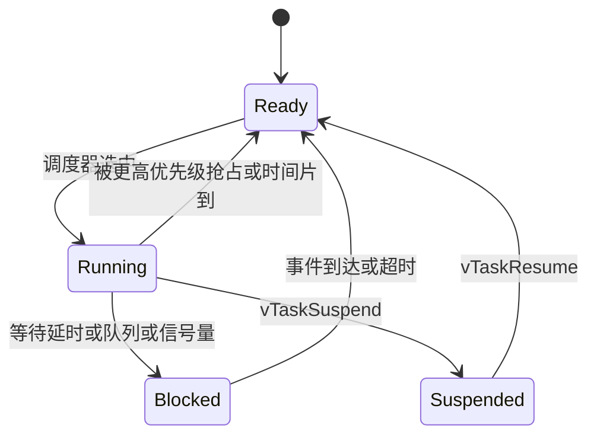

# FreeRTOS 实时系统：任务、调度、同步与控制任务设计

> **一句话定位**：这一章讲清"一颗单核 MCU 如何同时跑 IMU 读取、控制环、CAN 通信、遥控解析等多个任务"，以及优先级、周期、同步原语、中断与任务的边界——是读懂 P3（STM32F407 + FreeRTOS）和 P7（STM32H7 + FreeRTOS）控制工程的核心。

**本章学完你能：**

- 区分"任务""中断""优先级""周期""频率"，并明确**优先级不等于频率**；
- 说出 FreeRTOS 的抢占式调度、时间片、Tick、PendSV 上下文切换；
- 选择并正确使用队列、信号量、互斥量、事件组、任务通知；
- 举例并手算**优先级反转**，说明优先级继承为什么能缓解；
- 在 ISR 里正确使用 `FromISR` API 与 `portYIELD_FROM_ISR`；
- 用 `vTaskDelayUntil` 写固定周期控制任务，并说出为什么用 `vTaskDelay` 会导致周期漂移；
- 对一组任务做利用率与响应时间的手算检查；
- 设计一个"采集—估计—控制—通信—保护"的典型任务划分，并用英文讲清。

**前置知识：**[STM32 时钟、GPIO、中断、DMA](./01_STM32_时钟_GPIO_中断_DMA.md)（尤其中断优先级与 BASEPRI）；C 语言指针与结构体。

**相关项目：**[P3](../../01_项目课程/P3_RoboMaster英雄机器人嵌入式控制/README.md)、[P7](../../01_项目课程/P7_可变腿长轮腿机器人/README.md)。控制理论里的采样周期见 [数字控制与实时性](../04_控制理论/08_数字控制与实时性.md)。

## 目录

1. 为什么需要 RTOS
2. 任务、状态与调度
3. Tick、延时与周期任务
4. 同步与通信原语
5. 优先级反转与优先级继承
6. 临界区与中断
7. 栈、堆与溢出
8. 软件定时器
9. 实时性分析：利用率与响应时间手算
10. 控制系统的典型任务划分
11. 常见错误与故障现象
12. 面试问答
13. 要点速记、自测题、链接

---

## 1. 为什么需要 RTOS

### 1.1 它要解决什么问题

一个机器人板子同时要做很多"节奏不同"的事：IMU 每 1 ms 一次、姿态/平衡控制每 1–2 ms 一次、位置外环每 10–20 ms 一次、遥控数据随机到来、CAN 反馈随时到来、LED/日志慢吞吞。若把它们全塞进 `while(1)` 一个大循环（"前后台系统"），任何一段变长都会拖慢所有环节，而且代码互相耦合。

**RTOS（实时操作系统）** 提供：**任务（task）**——每个任务像一个独立的 `while(1)`；**调度器**——决定当下谁占 CPU；**同步/通信原语**——任务间安全交换数据。"实时"不是"快"，而是"**在规定时间内一定响应**"（可预测）。

### 1.2 FreeRTOS 的定位

FreeRTOS 是体积很小的开源 RTOS，内核核心只有几个 C 文件（`tasks.c`、`queue.c`、`list.c`、`timers.c`、`event_groups.c`、`stream_buffer.c`），再加一个与芯片相关的移植层（Cortex-M4F 用 `ARM_CM4F`，M7 用 `ARM_CM7`）。STM32CubeMX 默认通过 **CMSIS-RTOS V2** 封装（`osThreadNew` 等）；底层直接调用 FreeRTOS 原生 API（`xTaskCreate` 等）也很常见。两者可混用但要清楚名字对应。

---

## 2. 任务、状态与调度

### 2.1 任务

一个任务 = 一个**函数**（永不返回）+ 一块**私有栈** + 一个**任务控制块 TCB**（保存优先级、栈指针、状态等）。

```c
void ControlTask(void *arg)
{
    for (;;) {
        // 等待某事件，计算，发送
    }
}
// 创建：名字、栈深度(单位：字，Cortex-M 一字=4 字节)、参数、优先级、句柄
xTaskCreate(ControlTask, "ctrl", 256, NULL, 5, &hCtrl);
```

这里 256 个字 = 1024 字节栈。"优先级数值越大越高"——**与 NVIC 相反**，这是新手最容易混淆的点。

### 2.2 任务状态



- **Running**：正在占 CPU（单核同一时刻只有一个）；
- **Ready**：可以运行，但有更高（或同级先到）的任务在跑；
- **Blocked**：等待某事件（延时到期、队列有数据、信号量可用）。**阻塞中的任务不占 CPU**，这是 RTOS 能"同时"做很多事的关键；
- **Suspended**：被显式挂起，不参与调度。

### 2.3 调度规则

FreeRTOS（默认配置 `configUSE_PREEMPTION = 1`、`configUSE_TIME_SLICING = 1`）：

1. **总是运行"就绪态中优先级最高"的任务**（抢占）：一旦有更高优先级的任务变为就绪（例如其等待的信号量被释放），立刻抢占当前任务；
2. **相同优先级的就绪任务轮转**（时间片）：每个 Tick 切换一次；
3. Idle 任务优先级 0，没有其他就绪任务时运行（可 `configUSE_IDLE_HOOK` 里放低功耗或统计）。

### 2.4 优先级 ≠ 频率（最重要的澄清）

**优先级只回答一个问题：多个任务同时就绪时，谁先拿 CPU。** 它不回答"多久运行一次"（那是周期）、"一次运行多久"（那是执行时间）。

> **常见误解**：把 IMU 任务设成 idle 优先级、云台设成高优先级，就以为"云台更新更快"。实际上，云台任务每次循环里调用了 `vTaskDelay(1)`，它每 1 ms 左右就绪一次；优先级高只保证它**就绪时**能立刻抢占低优先级任务，不会让它更频繁地就绪。反过来，一个低优先级但从不阻塞的任务（死循环）会把更低优先级的任务全部饿死。

手算：任务 A 优先级 5，周期 2 ms，每次工作 0.4 ms；任务 B 优先级 2，周期 1 ms，每次工作 0.3 ms。B 就绪时若 A 正在运行，B 要等 A 做完（最多延迟 0.4 ms），然后 B 运行。再次 A 就绪时会立刻抢占 B。即**优先级影响延迟，周期由代码里的延时/事件决定**。

### 2.5 上下文切换：PendSV

Cortex-M 上，切换任务通过 **PendSV**（可挂起的系统调用）异常，设置成最低优先级：

1. 触发（Tick 中断发现更高优先级任务就绪，或任务主动阻塞）→ 置 PendSV 挂起；
2. 所有更紧急的中断处理完后，才进入 PendSV；
3. PendSV 把当前任务的 R4–R11（以及 FPU 的 S16–S31）压入**当前任务的栈**（R0–R3、R12、LR、PC、xPSR 已由硬件压栈），把栈指针存入 TCB；
4. 选下一任务，装载其栈指针（PSP），弹出寄存器，返回——此时 CPU 就在新任务里"接着跑"。

**手算（教学示例）**：切换保存的字数 = 硬件 8 + 软件 R4–R11 的 8 = 16 字 = 64 字节；若用了 FPU，再加 S0–S15（硬件 + 状态 = 18 字）和 S16–S31（16 字，软件）。上下文切换量级在 F4 168 MHz 上是约一到几 μs，可用 DWT 周期计数器实测，**本项目通常取：用 DWT 周期计数器在任务首尾取差，控制任务单次执行耗时在百微秒量级，远小于 1 ms 周期，量级供参考，具体以实机统计为准**。

---

## 3. Tick、延时与周期任务

### 3.1 Tick

内核需要一个周期性中断作"心跳"，通常用 SysTick，`configTICK_RATE_HZ = 1000` 即 1 ms 一个 tick。每次 tick：计数 +1，检查有没有延时到期的任务，触发时间片切换。

注意 CubeMX 常把 HAL 的时基（`HAL_Delay`）也放在 SysTick，导致冲突，所以生成代码里 HAL 时基通常改用另一个定时器（如 TIM6/TIM14）。这就是为什么看工程里有"TIM14 interrupt callback 调 `HAL_IncTick`"的原因。

### 3.2 毫秒到 tick 的换算

用 `pdMS_TO_TICKS(ms) = ms × configTICK_RATE_HZ / 1000`（整数除法）。

**手算**：tick = 1000 Hz，`pdMS_TO_TICKS(2)` = 2；若 tick = 100 Hz（10 ms 一个），`pdMS_TO_TICKS(2)` = 2×100/1000 = 0（整数截断）→ `vTaskDelay(0)` 不会阻塞——这是一个会让控制任务"全速空转"的 bug。

### 3.3 `vTaskDelay` 与 `vTaskDelayUntil`

- `vTaskDelay(n)`：**从调用时刻起**阻塞 n 个 tick。周期 = 工作时间 + n。
- `vTaskDelayUntil(&lastWake, n)`：**绝对时间**，保证每次唤醒间隔为 n 个 tick（只要每次工作时间 < n）。

**手算**：任务每次工作 0.4 ms，之后 `vTaskDelay(1)`：

- 周期 ≈ 0.4 ms + (1 tick，且因为 tick 对齐有 0–1 ms 误差) ≈ 1.4 ms，频率 ≈ 714 Hz，而不是 1 kHz；
- 若工作时间随负载波动，周期随之抖动。

换成 `vTaskDelayUntil`：

```c
TickType_t last = xTaskGetTickCount();
for (;;) {
    DoControl();
    vTaskDelayUntil(&last, pdMS_TO_TICKS(1));  // 1 ms 一次
}
```

只要 DoControl 在 1 ms 内完成，唤醒时刻严格是 last+1, last+2, …，**长期平均频率精确**。若某次超时（耗时 1.3 ms），内核会发现目标时刻已过，立即返回，试图追赶，但不会补偿多次。

**更关键的**：tick 的分辨率是 1 ms，所以 `vTaskDelayUntil` 能做的最短周期是 1 ms；更快（如 4 kHz）的环要么用硬件定时器中断，要么用任务通知由定时器 ISR 唤醒任务。

### 3.4 配置周期 ≠ 实测周期

源码里写 `vTaskDelay(1)` 或宏 `PERIOD = 2` 只表示**设计意图**。实际周期受：本任务工作时间、被更高优先级任务/中断抢占的时间、临界区、阻塞等待共同影响。要说"控制频率是 1 kHz"，需要有**实测证据**：用 DWT->CYCCNT 或定时器记录相邻两次进入任务的时间戳，统计均值/最大值/抖动。面试里如果你没有实测，诚实说 "the loop is designed to run at 1 kHz; I verified the period with ... / I did not measure the jitter precisely"，并指出会怎样测。本项目的设计值是：P3（F407）与 P7（H7）的控制任务按 1 kHz（1 ms）设计，高层/通信任务取 100–200 Hz；抖动的验证办法就是上面的 DWT 时间戳统计，我们的做法是以“最大周期不超过标称的 1.5 倍”作为合格标准。

---

## 4. 同步与通信原语

### 4.1 它要解决什么问题

任务之间有三种需求：**传数据**（IMU 任务把姿态交给控制任务）、**通知事件**（CAN 来了新帧，唤醒解析任务）、**互斥**（两个任务不能同时写一个结构体或同时用一个 SPI）。

### 4.2 队列（Queue）

先进先出的、**值拷贝**的消息缓冲。创建：`xQueueCreate(长度, 单个元素字节数)`；发送 `xQueueSend`；接收 `xQueueReceive(q, &buf, timeout)`，没数据时可阻塞等待。

- 优点：生产者—消费者解耦，天然线程安全；
- 缺点：元素是**拷贝**，大结构体开销大（可传指针但要管生命周期）；
- **控制系统里一种特别有用的变体：`xQueueOverwrite` + 长度为 1 的队列**，实现"邮箱"：永远只保留最新值，写入不阻塞，读到的总是最新。这正是"传感器最新状态"的语义。

### 4.3 信号量（Semaphore）

- **二值信号量**：像一个标志——ISR `give`，任务 `take`，用来**唤醒任务**（"事件发生了"）；
- **计数信号量**：计数事件次数或资源个数；
- 二值信号量**没有所有权**、**没有优先级继承**，不应用来做互斥。

### 4.4 互斥量（Mutex）

互斥量是**带所有权**的二值信号量：谁 take，谁 give；且**支持优先级继承**。用法：

```c
xSemaphoreTake(mtx, portMAX_DELAY);
shared.roll  = r;
shared.gyro  = g;
xSemaphoreGive(mtx);
```

**不能在 ISR 里用 mutex**（ISR 不是任务，不能阻塞，也没有"所有者"概念）。临界区内不要调用可能阻塞很久的函数（如 CAN 发送等待）。

### 4.5 事件组（Event Group）

一个 24 位（32 位 tick 类型时）的位集合，每位代表一个事件。任务可等待"任意一位"或"所有位"：`xEventGroupWaitBits(eg, BIT_IMU | BIT_CAN, clearOnExit, waitAll, timeout)`。适合"必须 IMU 和 CAN 都就绪才能开始闭环"这样的**多条件汇合**。

### 4.6 任务通知（Task Notification）

每个任务自带一个 32 位通知值，`xTaskNotifyGive` / `ulTaskNotifyTake` 当作轻量二值/计数信号量，比信号量更快、不占额外 RAM。ISR 里用 `vTaskNotifyGiveFromISR`。控制类工程里常见"定时器/SPI-DMA 完成中断 → 通知 IMU 任务"。

### 4.7 选择指南（表）

| 需求 | 首选 | 备注 |
|---|---|---|
| ISR 唤醒一个任务 | 任务通知 / 二值信号量 | 通知更快 |
| 传一串数据，不丢 | 队列 | 注意长度与溢出策略 |
| 只要最新值 | 长度 1 的队列 + Overwrite，或加锁共享结构体 | |
| 保护共享资源 | 互斥量 | 有优先级继承 |
| 等多个条件 | 事件组 | |
| 超短保护（几条指令） | 临界区 | 不能阻塞 |

### 4.8 手算：共享快照的"撕裂读"

IMU 任务更新 `{roll, gyro}`：旧 = (0.10, 0.20)，新 = (0.12, 0.40)。写任务先写 roll（0.12），尚未写 gyro 就被控制任务抢占。控制任务读到 (0.12, 0.20)——一个**从未真实存在过的状态**（roll 是新的，gyro 是旧的）。控制器若用 gyro 做微分/阻尼，输出就包含错误成分。三种修复：

1. mutex 保护整个结构体读/写；
2. 队列 Overwrite 以整个结构体为元素；
3. 双缓冲 + 原子切换索引。

注意：`volatile` **不能**解决，它只保证每次真读内存，不保证多个字段一致。

---

## 5. 优先级反转与优先级继承

### 5.1 问题

低优先级任务 L 持有互斥量；高优先级任务 H 需要它，被迫阻塞等待 L；这时一个**中优先级任务 M**（与该资源无关）就绪，抢占 L；于是 H 实际在等 M——"优先级反转"。火星探路者号（Mars Pathfinder）1997 年就因此反复重启，是教科书案例（公开资料，具体细节以原始报道为准，这里仅作类比）。

### 5.2 完整手算（教学示例）

任务：H（高）、M（中）、L（低）。t = 0 时 L 取得 mutex，临界区需 5 ms。t = 1 ms 时 H、M 同时就绪：H 要 mutex；M 要运行 20 ms（不用 mutex）。

**没有优先级继承：**

- t = 0–1：L 运行 1 ms（还剩 4 ms）；
- t = 1：H 就绪、抢占 L，尝试 take → 阻塞；M 就绪。此时就绪的是 M 与 L，M 优先级更高 → M 运行 t = 1–21；
- t = 21–25：L 做完剩余 4 ms 并释放 mutex；
- t = 25：H 终于拿到 mutex。**H 被阻塞 24 ms**，且阻塞时间取决于 M 的长度（不确定上界）。

**有优先级继承（FreeRTOS 互斥量的行为）：**

- t = 1：H 阻塞于 mutex 时，内核把 L 的有效优先级提升为 H 的优先级；
- 此时 M 无法抢占 L → L 运行 t = 1–5（4 ms），释放 mutex，优先级恢复；
- t = 5：H 拿到 mutex。**H 被阻塞 4 ms**（上界 = 临界区长度）。

### 5.3 注意

- 优先级继承只对 mutex 有效，二值信号量没有；
- 它缓解而不是消除问题：H 仍要等 4 ms，所以**临界区要尽量短**；
- 更好的设计：避免让高优先级控制任务去抢共享的锁，改用"邮箱/Overwrite 队列"，控制任务读最新值不用等待。

---

## 6. 临界区与中断

### 6.1 临界区

- `taskENTER_CRITICAL()` / `taskEXIT_CRITICAL()`：在 Cortex-M 上通过 BASEPRI 屏蔽**优先级数值 ≥ configMAX_SYSCALL_INTERRUPT_PRIORITY** 的中断，中途不发生任务切换；
- ISR 内版本：`taskENTER_CRITICAL_FROM_ISR()`；
- `vTaskSuspendAll()`：只关调度器、不关中断，适合"期间不允许任务切换但允许中断"；
- 临界区内**不能调用会阻塞的 API**，也要尽量短（几条指令），否则会拉长所有被屏蔽中断的延迟。

### 6.2 在 ISR 里用 FreeRTOS

规则（来自第 [STM32 章 6.4](./01_STM32_时钟_GPIO_中断_DMA.md) 的 BASEPRI 机制）：

1. 只能用以 `FromISR` 结尾的 API；
2. 这些 ISR 的 NVIC 优先级数值必须 ≥ `configMAX_SYSCALL_INTERRUPT_PRIORITY`；
3. `FromISR` 的最后一个参数 `pxHigherPriorityTaskWoken`：如果这次 give/send 唤醒了比当前被打断任务优先级更高的任务，内核把它置 `pdTRUE`；ISR 末尾调用 `portYIELD_FROM_ISR(xHigherPriorityTaskWoken)`，**退出中断后立即切换**到那个任务，而不是等到下一个 tick。

```c
void CAN_RxCallback(void)               // 在中断上下文
{
    BaseType_t woken = pdFALSE;
    CanMsg msg = ReadHardwareFifo();     // 取出帧（短）
    xQueueSendFromISR(canQ, &msg, &woken);
    portYIELD_FROM_ISR(woken);
}
```

**手算延迟**：没有 `portYIELD_FROM_ISR` 时，被唤醒的高优先级任务要等到下一次 tick（最坏 1 ms）才得到运行；有它则在 ISR 返回时立刻运行（延迟 ≈ 几 μs）。对 1 kHz 控制来说，1 ms 的额外延迟相当于一整个周期，必须避免。

### 6.3 "CAN 反馈在 ISR 里解码还是在任务里解码"

两种常见设计：

- **ISR 内直接解码**：接收回调里按 ID 把 8 字节转成速度/角度/电流，写入全局电机结构体。优点：延迟最低；缺点：ISR 变长，数据写入需考虑与控制任务的一致性（可能出现一半新一半旧）。很多 RoboMaster 工程用这种方式，**因为解码只有几次移位和赋值，足够短**。
- **ISR 只入队，任务里解码**：ISR 极短、抖动小；多一次任务切换延迟。

选择标准是 ISR 的执行时间能否接受、数据一致性怎么保证。无论哪种，都要给每个电机记录 `last_seen` 时间戳，控制任务据此判断**反馈是否过期**（见 [CAN 章](./03_CAN_FDCAN与电机通信.md)）。

---

## 7. 栈、堆与溢出

### 7.1 内存模型

FreeRTOS 的任务栈、TCB、队列都从 **FreeRTOS 堆**（`configTOTAL_HEAP_SIZE`，常用 `heap_4`）分配。每个任务的栈独立，深度是创建时给定的。

### 7.2 栈溢出

症状：随机 HardFault、变量莫名被改、任务只在特定输入下崩溃。原因：局部大数组、递归、`printf` 系列（占栈很大）、浮点格式化。

检测：

- `configCHECK_FOR_STACK_OVERFLOW = 2`：创建任务时把栈填充魔数 0xA5，切换任务时检查栈尾若干字节是否被改，发现则调用 `vApplicationStackOverflowHook`；
- `uxTaskGetStackHighWaterMark(handle)`：返回**历史最小剩余栈（单位：字）**。

**手算**：任务栈 256 字 = 1024 B。运行一段时间后 high-water mark = 40 字 = 160 B 剩余。最深使用 = 1024 − 160 = 864 B（84%）。经验：留 20–30% 余量，所以应加到 384 字。

总堆估算：8 个任务各 256 字栈 = 8 × 1 KB = 8 KB，再加 TCB（约 100 B/个）、队列（长度×元素大小 + ~80 B）。若堆设为 15 KB，要核对 `xPortGetFreeHeapSize()`。**创建失败（返回 NULL）不检查**是常见隐患。

### 7.3 其他

- `configUSE_MALLOC_FAILED_HOOK` 抓取内存耗尽；
- 不要在控制环里动态创建/销毁对象（碎片化、不确定时间）；初始化时一次分配完。

---

## 8. 软件定时器

FreeRTOS 软件定时器由一个名为 **Timer Service Task**（守护任务）执行回调。回调是**任务上下文**，但：

- 不能阻塞（否则阻塞整个定时器服务）；
- 优先级由 `configTIMER_TASK_PRIORITY` 决定，应低于关键控制任务；
- 精度只有 tick（1 ms），且受 Timer 任务被抢占影响；
- 适合"超时检测（通信看门狗）""慢速 LED 闪烁"，**不适合 kHz 级控制环**。

典型用法："每次收到遥控数据就重启 100 ms 定时器；定时器超时回调把期望速度置零" = 遥控断线保护。

---

## 9. 实时性分析：利用率与响应时间手算

### 9.1 CPU 利用率

任务 $i$ 的周期 $T_i$、最坏执行时间 $C_i$，利用率 $U=\sum C_i/T_i$。**速率单调调度（RMS：周期短 → 优先级高）** 的充分条件：$U\le n(2^{1/n}-1)$，n = 3 时约 0.78，n → ∞ 为 ln 2 ≈ 0.693。

教学示例：
| 任务 | $C$ (ms) | $T$ (ms) | 优先级（RMS） |
|---|---|---|---|
| A 姿态控制 | 0.2 | 1 | 高 |
| B 状态估计 | 0.5 | 2 | 中 |
| C 通信与日志 | 2.0 | 10 | 低 |

$U = 0.2/1 + 0.5/2 + 2/10 = 0.2 + 0.25 + 0.2 = 0.65 \le 0.78$ ✓。

### 9.2 最坏响应时间（精确）

迭代公式：$R_i^{(k+1)} = C_i + \sum_{j\in hp(i)} \lceil R_i^{(k)}/T_j \rceil C_j$，直到收敛。

- A：$R_A = 0.2$ ms；
- B：$R_B^{(0)}=0.5$；→ $0.5 + \lceil 0.5/1\rceil\times 0.2 = 0.7$；→ $0.5+\lceil 0.7/1\rceil\times0.2 = 0.7$ 收敛，$R_B = 0.7$ ms ≤ 2 ✓；
- C：$R^{(0)}=2$；→ $2 + \lceil 2/1\rceil 0.2 + \lceil 2/2\rceil 0.5 = 2.9$；→ $2 + \lceil 2.9\rceil 0.2 + \lceil 1.45\rceil 0.5 = 2+0.6+1.0=3.6$；→ $2+4\times0.2+2\times0.5=3.8$；→ $2+4\times0.2+2\times0.5=3.8$ 收敛，$R_C = 3.8$ ms ≤ 10 ✓。

结论：该组任务可调度，余量充足。**真实系统还要加：中断占用、临界区阻塞、mutex 阻塞时间、tick 对齐的 1 ms 误差。**

### 9.3 如何测

用 DWT 周期计数器（`DWT->CYCCNT`）在任务开始/结束处取差，即得 $C_i$ 实测；`vTaskGetRunTimeStats`（需一个比 tick 快的定时器作为统计时钟）可得各任务 CPU 占比。本项目的做法是：用 DWT 取差统计控制任务耗时，并在调试阶段开启运行时统计观察各任务 CPU 占比，确认控制任务占用远低于周期。

---

## 10. 控制系统的典型任务划分

下面是一类机器人电控工程里**常见的**划分（教学示例，非项目源码；P3/P7 的实际任务表请核对源码）：

```text
中断层（硬件）
  SPI/DMA 完成 -> 通知 IMU 任务
  CAN 接收     -> 解码电机反馈 或 入队
  UART/DMA空闲  -> 通知 遥控/视觉 解析任务
任务层（优先级 大 = 高）
  IMU/姿态任务      (高)  1 kHz  读 IMU，姿态融合(Mahony/EKF)，写最新姿态"邮箱"
  控制任务(底盘/云台/腿)(次高) 500 Hz-1 kHz 读姿态+电机反馈，算控制量，限幅，发 CAN
  通信/解析任务     (中)  事件触发  遥控、视觉、裁判系统(或上位机)解析
  保护/监测任务     (中低) 100 Hz  掉线检测、过温、堵转、电源
  UI/日志/LED       (低)  10-50 Hz
  Idle              (0)
```

设计要点：

1. **控制任务的输入是"最新快照"**：IMU、电机反馈都有时间戳/有效位；控制任务不自己去读硬件，只读邮箱；
2. **采集—控制—发送的数据流是单向的**，避免回环依赖；
3. **看门狗/保护独立**：保护任务检测"控制任务心跳超时 / 反馈过期"后，把输出置零或进入安全态——它不依赖控制任务本身；
4. **关键环最高优先级**，但必须定期阻塞（`vTaskDelayUntil` 或等待通知），否则饿死别人；
5. **慢任务不持有快任务需要的锁**；
6. **初始化顺序**：先建队列/互斥量，再建任务；反馈有效后再使能闭环；
7. 外环慢、内环快：外环任务（20 ms）输出的参考通过邮箱交给内环任务（2 ms），内环永远读最新参考。积分用**真实 $\Delta t$**（或固定设计值且保证确实固定），不要外环每 20 ms 一次却用 2 ms 做积分步长。

**手算：dt 使用错误的后果**。外环积分 $I \mathrel{+}= K_i e\,dt$。若实际每 20 ms 执行一次，却用 dt = 2 ms，则积分增长速度只有设计值的 1/10，Ki 等效缩小 10 倍，积分项"像失效"。

**在 P3/P7 里的对应**：P3 的 STM32F407/FreeRTOS 上承载云台、发射、底盘三类闭环（见 [P3 README](../../01_项目课程/P3_RoboMaster英雄机器人嵌入式控制/README.md)）；P7 的 STM32H7/FreeRTOS 上承载"IMU/关节/轮速 → LQR/VMC → FDCAN 力矩输出"的链路（见 [P7 README](../../01_项目课程/P7_可变腿长轮腿机器人/README.md)）。具体任务名、优先级、周期以源码/实测为准。

---

## 11. 常见错误 / 边界 / 故障现象

| 现象 | 原因 | 对策 |
|---|---|---|
| 控制周期比设计慢、抖动 | 用 `vTaskDelay`；任务耗时过长；被高优先级抢占 | `vTaskDelayUntil`；实测耗时 |
| 系统偶发死锁 | 锁顺序不一致；ISR 里 take mutex | 统一锁顺序；ISR 只用 FromISR |
| 低优先级任务永远不运行 | 高优先级任务不阻塞（忙等） | 保证周期任务有阻塞点 |
| 偶发 HardFault | 栈溢出；ISR 调 API 优先级不符 | 开栈检查；核对 NVIC 优先级 |
| 读到半新半旧数据 | 共享变量无保护 | mutex/邮箱队列 |
| 高优先级任务被莫名卡住 | 优先级反转 | 用 mutex；缩短临界区 |
| `xQueueSend` 失败却无人发现 | 队列满、返回值未检查 | 检查返回值；策略：丢最旧/丢最新 |
| 反馈中断后控制器仍用旧值 | 无时间戳/有效位 | 反馈超时即进入安全态 |
| 创建任务后不运行 | 堆不足返回 NULL；忘 `osKernelStart` | 检查返回值与堆 |
| 调试断点后系统异常 | Tick 继续、看门狗复位 | 调试时冻结 IWDG/定时器 |

---

## 12. 面试怎么问、怎么答

**Q1. What is the difference between task priority and execution frequency?**

> Priority only decides who gets the CPU when several tasks are ready. Frequency comes from how often a task becomes ready — a periodic delay or an event. In my control firmware, the control task is high priority so it preempts lower ones when it wakes up, but it still runs at the period that the delay or timer defines. And configured period is not measured period: I would log timestamps to check the real jitter.

中文：优先级只管就绪时谁先；频率由延时/事件决定；配置周期要用时间戳实测。追问：高优先级任务死循环会怎样？（饿死低优先级）。

**Q2. How do you share IMU data between a sensor task and a control task safely?**

> I give the control task a consistent snapshot. Either the producer writes a whole struct under a mutex, or I use a length-one queue with overwrite, so the consumer always reads the latest complete sample. I also timestamp it so the controller can reject stale data. I avoid relying on volatile because it does not guarantee that multiple fields belong to the same sample.

**Q3. Explain priority inversion and how FreeRTOS handles it.**

> A low-priority task holds a mutex, a high-priority task waits for it, and a medium-priority task preempts the low one, so the high task effectively waits for the medium one. FreeRTOS mutexes use priority inheritance: the holder is temporarily raised to the waiter's priority, so the medium task can't preempt it. The wait is bounded by the critical section length, so I keep critical sections short or use mailbox-style data passing instead.

结合项目：IMU 解算任务写姿态、控制任务读姿态这类“一写多读”的共享结构体，本项目通常用关临界区的短拷贝或双缓冲处理，避免控制任务读到写了一半的数据；这就是上面通用回答在 P3/P7 里的具体落点。

**Q4. Why can't you call a normal FreeRTOS API from an ISR, and what is portYIELD_FROM_ISR for?**

> Normal APIs may block and assume a task context. In an ISR I use the FromISR versions, and the ISR's NVIC priority has to be numerically at or below the configured limit, because FreeRTOS masks interrupts with BASEPRI. If the call wakes a higher-priority task, I pass a flag and call portYIELD_FROM_ISR, so the context switch happens right when the ISR returns, not on the next tick.

**Q5. How do you make a periodic 1 kHz control task?**

> I use vTaskDelayUntil with a one-tick period, so the wake-up times are absolute and do not drift with the execution time. For rates above the tick rate, I trigger the task from a hardware timer interrupt through a task notification. Either way I measure the execution time to confirm it fits inside the period.

---

## 本章要点速记

1. FreeRTOS 数值越大优先级越高，NVIC 相反；
2. 优先级决定就绪时谁先，**不决定频率**；周期由延时/事件决定；
3. 配置周期 ≠ 实测周期，用时间戳统计均值/最大/抖动；
4. 周期任务用 `vTaskDelayUntil`，不要 `vTaskDelay`；
5. 数据传递：队列（拷贝）、长度 1 + Overwrite（最新值）、任务通知（轻量唤醒）；互斥用 mutex（有继承），不用二值信号量；
6. 优先级反转：L 持锁、M 抢占、H 被卡；继承把 H 的等待上界缩为临界区长度；
7. ISR 只用 `FromISR`，优先级数值 ≥ 上限，末尾 `portYIELD_FROM_ISR`；
8. 栈溢出：开检查，看 high-water mark，留 20–30% 余量；
9. RMS 利用率界 n(2^{1/n}−1)，响应时间迭代公式；
10. 反馈必须有时间戳/有效位，过期即进入安全态。

## 自测题

1. 任务 A 优先级 3、B 优先级 3，都永不阻塞，会怎样？（要点：时间片轮转，每 tick 切换，各占约一半 CPU；若 A 优先级 4 则 B 饿死。）
2. tick = 500 Hz，`pdMS_TO_TICKS(5)` 是多少？`pdMS_TO_TICKS(1)` 呢？（要点：2.5 → 2；0.5 → 0，延时 0 不阻塞。）
3. 任务工作 0.3 ms，`vTaskDelay(1)`，近似周期和频率？换 `vTaskDelayUntil(…,1)` 呢？（要点：约 1.3 ms，约 770 Hz；后者 1 ms、1 kHz。）
4. 用 5.2 的参数，若 L 的临界区改为 2 ms，有继承时 H 最多被阻塞多久？（要点：最多 2 ms 的剩余部分，不超过临界区长度。）
5. 任务 A(C=0.3,T=2)、B(C=1,T=5)、C(C=3,T=20)，按 RMS 求 U 与 $R_C$。（要点：U = 0.15+0.2+0.15 = 0.5；$R_C$ 迭代：3 → 3+⌈3/2⌉0.3+⌈3/5⌉1 = 4.6 → 3+⌈4.6/2⌉0.3+⌈4.6/5⌉1 = 3+0.9+1 = 4.9 → 3+⌈4.9/2⌉0.3+⌈4.9/5⌉1 = 4.9 收敛。）
6. 为什么 mutex 不能在 ISR 中使用？（要点：有所有权概念、可能阻塞、ISR 不是任务。）

## 相关链接

- 上一章：[STM32 时钟、GPIO、中断、DMA](./01_STM32_时钟_GPIO_中断_DMA.md)；下一章：[CAN / FDCAN 与电机通信](./03_CAN_FDCAN与电机通信.md)
- 理论：[数字控制与实时性](../04_控制理论/08_数字控制与实时性.md)
- 八股：[并发多线程与实时系统八股](../../03_八股知识/01_计算机基础/07_并发多线程与实时系统八股.md)
- 项目：[P3](../../01_项目课程/P3_RoboMaster英雄机器人嵌入式控制/README.md)、[P7](../../01_项目课程/P7_可变腿长轮腿机器人/README.md)
