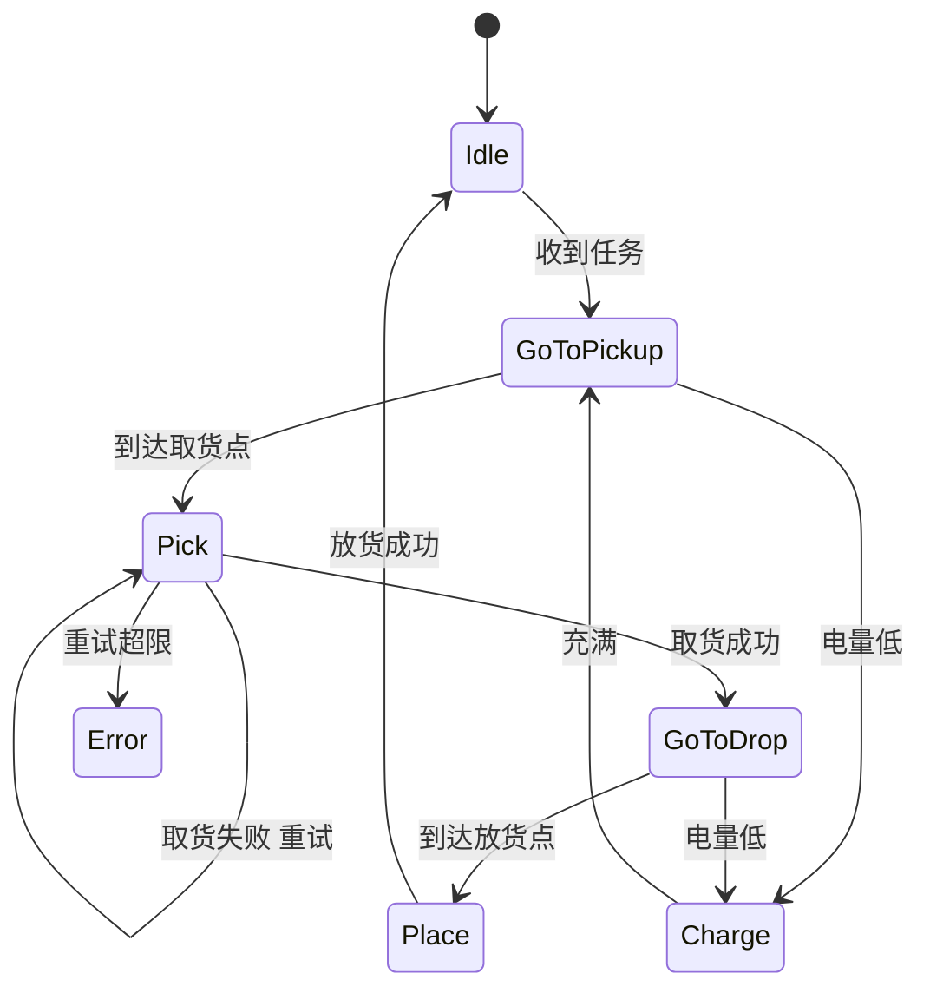

# 行为树与任务规划：有限状态机、行为树与 PDDL

> **一句话定位**：路径规划回答"怎么走"，任务规划回答"做什么、按什么顺序、失败了怎么办"。本章讲三种表达任务逻辑的工具：有限状态机（FSM，简单直观但易爆炸）、行为树（BT，模块化、可组合，是 Nav2 的流程引擎）、PDDL 式符号规划（自动推导动作序列）；并说明它们和运动规划如何结合（任务与运动规划，TAMP），以及它们与 P4 的状态机、P6 的"计划—策略检查—执行"链的关系。

**本章学完你能：**

- 画出 FSM 的状态、事件、转移，说出它在状态增多时的"转移爆炸"问题，并解释层次状态机为何缓解；
- 解释行为树三种返回值（SUCCESS/FAILURE/RUNNING）与 Sequence、Fallback、并行、装饰器的语义，手算一段 tick 序列；
- 对比 FSM 与 BT 的可读性、复用性、响应性；
- 说出 Nav2 行为树里常见节点（`ComputePathToPose`、`FollowPath`、`RecoveryNode`、`RateController` 等）的作用，并读懂一棵 `NavigateToPose` 树；
- 写出 STRIPS/PDDL 风格的动作（前提、效果），手算一个小域的状态空间与 BFS 规划；
- 理解任务规划与运动规划的接口（符号层 vs 几何层），以及 LLM 规划需要什么样的安全执行链；
- 用英文回答 "FSM vs behaviour tree / How does Nav2 use behaviour trees / What is PDDL / How would you combine task and motion planning"。

**前置知识**：[导航系统架构：Nav2 与 move_base 对比](./05_导航系统架构_Nav2与move_base对比.md)（Nav2 服务器、行为树简介）、[图搜索：Dijkstra 与 A*](./01_图搜索_Dijkstra_A星.md)、[信息论与图论基础](../01_数学基础/07_信息论与图论基础.md)、[ROS2 Humble 核心概念与 ROS1 对比](../12_机器人软件/04_ROS2_Humble核心概念与ROS1对比.md)（action 接口）。

## 目录

1. 任务级规划要解决什么问题
2. 符号与约定
3. 有限状态机
4. FSM 的问题
5. 行为树：节点与返回值
6. 控制节点与装饰器
7. 手算：一段 tick 序列
8. FSM 与 BT 的取舍
9. Nav2 中的行为树
10. PDDL 与符号规划
11. 手算：一个送货任务
12. 任务与运动规划结合（TAMP）
13. LLM 规划与安全执行链
14. 在本项目里怎么用
15. 常见错误与故障现象
16. 面试怎么问、怎么答
17. 本章要点速记
18. 自测题
19. 相关链接

---

## 1. 任务级规划要解决什么问题

假设你的移动机器人接到命令："把 B 房间的包裹送到 C 房间"。分解一下：

1. 先去 B 房间；
2. 如果门关着，先开门（或呼叫电梯）；
3. 拿起包裹；
4. 去 C 房间；
5. 放下包裹；
6. 途中电量低则去充电；路径被堵则重新规划；抓取失败则重试三次再上报。

这里既有**顺序**（先 1 后 3），又有**条件**（门关着就先开门），还有**失败处理**（重试、上报）和**优先级打断**（电量低）。这些逻辑不是几何问题，不能用 A* 或 MPC 解决。**任务级规划**就是组织这些高层逻辑的方法：

| 层 | 问题 | 方法 |
|---|---|---|
| 任务规划 | 做什么，以什么顺序 | PDDL 符号规划、HTN、LLM |
| 任务执行/编排 | 怎么把步骤按顺序、条件、失败处理地执行 | FSM、行为树 |
| 运动规划 | 具体怎么动 | A*、Hybrid A*、TEB、MoveIt |
| 控制 | 把轨迹变成电机指令 | PID、MPC、LQR |

> **提示**：面试回答时可以先画这个四层图。行为树/FSM 属于"编排"这一层，它调用下面的规划和控制，而不是替代它们。

## 2. 符号与约定

| 符号/名词 | 含义 |
|---|---|
| 状态（State） | 系统所处的离散模式，如 IDLE、NAVIGATING |
| 事件（Event） | 触发转移的信号，如"到达目标""电量低" |
| 转移（Transition） | 从一个状态到另一个状态的规则 |
| tick | 行为树被"驱动"一次：从根节点向下遍历执行 |
| SUCCESS / FAILURE / RUNNING | 行为树节点的三种返回值 |
| 黑板（Blackboard） | 行为树节点共享数据的键值存储 |
| 谓词（Predicate） | PDDL 里描述世界的原子事实，如 `at(robot, A)` |
| 前提（Precondition） | 动作可执行的条件 |
| 效果（Effect） | 动作执行后增加（add）或删除（delete）的事实 |
| 世界状态 | 当前所有为真的谓词集合 |

## 3. 有限状态机

有限状态机（Finite State Machine, FSM）：由有限个**状态** $S$、**事件** $E$、**转移函数** $\delta:S\times E\to S$ 和**初始状态**构成。机器人在任一时刻处于且仅处于一个状态；事件来了，按转移函数切换；每个状态有对应的**动作**（进入时、停留时、离开时）。

一个送货机器人的 FSM（示意）：



FSM 的优点：**直观、易实现、行为确定**，且可以直接用状态转移表验证。嵌入式系统几乎处处是 FSM：协议解析、按键消抖、电机启停、灌溉水泵的开关逻辑。

两个重要的变体：

- **滞回状态机**：转移条件带迟滞（启动阈值 ≠ 停止阈值），防止在阈值附近来回抖动（见 [P4 Hi3861 滞回状态机](../../01_项目课程/P4_OpenHarmony智能园艺系统/04_Hi3861滞回状态机_继电器与手动优先.md)）；
- **层次状态机**（Hierarchical FSM / statecharts）：状态可以嵌套，子状态继承父状态的转移（如所有"工作中"的子状态都响应"急停"事件）。

## 4. FSM 的问题

随着功能增加，FSM 暴露出结构性问题：

1. **转移爆炸**：若 $n$ 个状态里都要响应"电量低 → 充电"，就要写 $n$ 条转移边。最坏情况全连接需要 $n(n-1)$ 条边：$n=4,8,12$ 时分别为 12、56、132 条（Python 复核）。层次状态机能缓解，但不能根除；
2. **复用困难**：状态之间通过显式转移耦合，想把"取货"这个子过程搬到另一个机器人，要拆线；
3. **难以表达"失败后回退"**：恢复逻辑要在每个状态里单独写；
4. **响应性**：一个状态内部的长循环可能不及时处理高优先级事件，需要仔细设计；
5. **可读性**：状态图一多就像蜘蛛网。

> **注意**：这不是说 FSM 不好。状态少、结构固定（例如水泵的开/关）时，FSM 是最合适的工具；当需要复杂的、可复用的、带失败恢复的任务流程时，行为树更有优势。

## 5. 行为树：节点与返回值

行为树（Behavior Tree, BT）起源于游戏 AI，现在是机器人任务编排的主流，Nav2 把它作为导航流程引擎。核心思想：**用一棵树描述"先做什么、做不成怎么办"**，每一次 tick 从根节点向下，节点返回执行状态，父节点据此决定接下来 tick 哪个子节点。

### 5.1 三种返回值

| 返回值 | 含义 |
|---|---|
| SUCCESS | 任务完成 / 条件为真 |
| FAILURE | 任务失败 / 条件为假 |
| RUNNING | 还在执行，下个 tick 继续 |

RUNNING 是行为树能处理**长耗时动作**的关键：导航是一个持续数十秒的过程，FollowPath 每个 tick 都返回 RUNNING，直到到达返回 SUCCESS 或出错返回 FAILURE。

### 5.2 节点类型

| 类型 | 作用 | 举例 |
|---|---|---|
| 控制节点（Control） | 决定子节点的执行顺序和逻辑 | Sequence、Fallback、Parallel |
| 装饰节点（Decorator） | 修饰单个子节点的行为或结果 | Inverter、Retry、RateController、Timeout |
| 叶子节点：动作（Action） | 调用具体行为，可能耗时 | `FollowPath`、`BackUp` |
| 叶子节点：条件（Condition） | 检查条件，立即返回 | `IsBatteryLow`、`GoalReached` |

## 6. 控制节点与装饰器

### 6.1 Sequence（顺序，逻辑"与"）

依次 tick 子节点：

- 某子节点返回 FAILURE → 自己返回 FAILURE；
- 某子节点返回 RUNNING → 自己返回 RUNNING；
- 全部返回 SUCCESS → 自己返回 SUCCESS。

两个重要变体：**带记忆的 Sequence** 会记住已经成功的子节点，下次 tick 从正在 RUNNING 的子节点继续（不重复执行前面成功的）；**ReactiveSequence / 无记忆** 每次 tick 都从第一个子节点重新检查（适合把"条件检查"放在前面，每个周期都要重新验证）。

### 6.2 Fallback（回退，逻辑"或"，也称 Selector）

依次尝试子节点：

- 某子节点返回 SUCCESS → 自己返回 SUCCESS；
- 某子节点返回 RUNNING → 自己返回 RUNNING；
- 全部返回 FAILURE → 自己返回 FAILURE。

Fallback 天然表达"主方案不行就用备选方案"，是恢复逻辑的基本构件。

### 6.3 Parallel

同时 tick 多个子节点，按成功/失败的数量阈值决定自己的结果，用于"边走边监测"。

### 6.4 常用装饰器

| 装饰器 | 作用 |
|---|---|
| Inverter | SUCCESS 与 FAILURE 互换 |
| RetryUntilSuccessful(N) | 子节点失败时重试最多 N 次 |
| RateController | 限制子节点被 tick 的频率，如 1 Hz 重规划 |
| Timeout | 限时 |
| ForceSuccess / ForceFailure | 强制返回 |

### 6.5 黑板

节点间通过黑板传数据（如目标位姿、规划得到的路径）。行为树 XML 中用端口（port）把节点输入输出与黑板的键绑定，使节点自身可复用。

## 7. 手算：一段 tick 序列

示例（非项目实测，用一个 30 行的 Python 微型行为树运行得到）。树：

```text
Sequence(无记忆)
├─ BatteryOK            (条件，始终 SUCCESS)
└─ Fallback
     ├─ Sequence(无记忆)
     │    ├─ ComputePath   (动作，按脚本返回)
     │    └─ FollowPath    (动作，按脚本返回)
     └─ ClearCostmap       (恢复动作，SUCCESS)
```

脚本规定：`ComputePath` 依次返回 SUCCESS、SUCCESS、FAILURE、SUCCESS、…；`FollowPath` 依次返回 RUNNING、RUNNING、FAILURE、RUNNING、…

逐 tick 的执行过程（Python 复核）：

| tick | 执行顺序与返回 | 整树返回 |
|---|---|---|
| 0 | BatteryOK=S → ComputePath=S → FollowPath=**R** | RUNNING |
| 1 | BatteryOK=S → ComputePath=S → FollowPath=**R** | RUNNING |
| 2 | BatteryOK=S → ComputePath=**F** → ClearCostmap=S | SUCCESS（恢复分支成功） |
| 3 | BatteryOK=S → ComputePath=S → FollowPath=**F** → ClearCostmap=S | SUCCESS（恢复分支成功） |

观察：

1. **tick 0、1**：FollowPath 返回 RUNNING，整树返回 RUNNING——系统在"边走边执行"；
2. 因为用的是**无记忆** Sequence，每个 tick 都要重新检查 `BatteryOK`，并**重新 tick ComputePath**——这对应 Nav2 中 `PipelineSequence` 的思想：持续重规划与持续跟踪并行进行；
3. **tick 2**：规划失败，Sequence 返回 FAILURE，Fallback 转去尝试 `ClearCostmap`，成功后整树 SUCCESS——这里整树的 SUCCESS 仅表示"恢复动作成功"，不是"到达目标"。真实的 Nav2 把主分支和恢复分支放在 `RecoveryNode` 里，**恢复成功后会重试主分支**，而不是直接结束；
4. 如果电池条件返回 FAILURE，整个 Sequence 在第一步就 FAILURE，实现了"高优先级条件打断"。

这段手算体现了行为树的核心：**逻辑由树的形状决定，而不是由散落在各处的转移边决定**。

## 8. FSM 与 BT 的取舍

| 维度 | FSM | 行为树 |
|---|---|---|
| 表达的重点 | 当前处于什么模式，事件引起模式切换 | 一个任务由哪些子任务以何种逻辑组成 |
| 模块化 | 状态间显式耦合，难搬运 | 子树可作为模块复用 |
| 失败处理 | 每个状态各自处理 | Fallback / Retry 统一表达 |
| 响应性 | 取决于状态内的事件检查 | 每个 tick 从根重新评估（无记忆节点），优先级清晰 |
| 可读性 | 状态少时直观；状态多时混乱 | 树形层次清晰，可可视化监控 |
| 扩展新行为 | 要添加状态和一堆转移 | 在合适位置添加子树 |
| 适合 | 少量固定模式、嵌入式底层逻辑 | 复杂任务流程、需要恢复策略的机器人行为 |
| 缺点 | 转移爆炸 | tick 频率和副作用要小心设计 |

经验规则：**底层模式切换（灌溉泵开关、电机使能）用 FSM；高层任务编排（导航、取物）用行为树**。两者可以嵌套：行为树的叶子节点内部可以是一个小 FSM。

## 9. Nav2 中的行为树

Nav2 的 `bt_navigator` 加载一份 XML 行为树，处理 `NavigateToPose` 等动作请求。节点由 BehaviorTree.CPP 库驱动（Humble 版本所用的库版本此处未核对）。常见节点：

| 节点 | 类型 | 作用 |
|---|---|---|
| `ComputePathToPose` | Action | 调用 planner_server 计算全局路径，写入黑板 |
| `FollowPath` | Action | 调用 controller_server 沿路径控制，持续 RUNNING |
| `RateController` | Decorator | 限频，如 1 Hz 触发重规划 |
| `PipelineSequence` | Control | 类似 Sequence，但前面的节点每个 tick 都继续被 tick（边规划边跟踪） |
| `RecoveryNode` | Control | 第一个子节点失败时，执行第二个（恢复）子节点，然后重试，最多 N 次 |
| `ClearEntireCostmap` | Action | 清除代价地图 |
| `Spin`、`BackUp`、`Wait` | Action | 恢复行为：原地旋转、后退、等待 |
| `GoalUpdated` / `GoalReached` | Condition | 检测新目标/是否到达 |

示意树（概念性，非发行版 XML 原文）：

```text
NavigateWithReplanning
└─ RecoveryNode (重试 N 次)
   ├─ PipelineSequence
   │   ├─ RateController (1 Hz) ─ ComputePathToPose
   │   └─ FollowPath
   └─ ReactiveFallback / Sequence
       ├─ ClearEntireCostmap (局部、全局)
       ├─ Spin
       ├─ Wait
       └─ BackUp
```

读这棵树的方法：先看根（`RecoveryNode`）：左子树是**正常流程**，右子树是**失败后的恢复**；正常流程里，`PipelineSequence` 让规划（1 Hz）和控制同时推进；任一失败，整个流程回到 `RecoveryNode`，执行一次恢复，再重来。

**自定义节点**：可以用 C++ 写 BT 插件（同步动作节点、有状态的异步动作节点），在 XML 里注册后使用。如果任务逻辑是 "到达 → 触发某个工作 → 继续去下一个点"，只需添加自己的动作节点，不需要改 Nav2 源码。

> **面试要点**：能说出 Nav2 的行为树是"**可配置的流程**"，换恢复顺序只需改 XML，这是相对 move_base 固定状态机的最大改进。

## 10. PDDL 与符号规划

### 10.1 想法

FSM 和行为树都是**人写好**的流程。符号规划（symbolic / classical planning）让机器自己推出动作序列：把世界描述成一组原子事实，把动作描述成"前提 + 效果"，规划器通过搜索找到从初始状态到目标的动作序列。

PDDL（Planning Domain Definition Language）是描述这类问题的标准语言（起源于 1998 年国际规划竞赛，细节未核对），由两部分组成：

- **域（domain）**：谓词和动作模式，与具体对象无关；
- **问题（problem）**：具体对象、初始状态、目标。

STRIPS 风格的动作：

- **前提**：动作执行前必须为真的事实集合；
- **效果**：执行后新增的事实（add list）和被删除的事实（delete list）。

### 10.2 一个送货域（PDDL 示意）

```text
(define (domain delivery)
  (:predicates (at-robot ?l) (at-pkg ?l) (holding) (adj ?x ?y))
  (:action move
    :parameters (?x ?y)
    :precondition (and (at-robot ?x) (adj ?x ?y))
    :effect (and (at-robot ?y) (not (at-robot ?x))))
  (:action pick
    :parameters (?l)
    :precondition (and (at-robot ?l) (at-pkg ?l))
    :effect (and (holding) (not (at-pkg ?l))))
  (:action drop
    :parameters (?l)
    :precondition (and (at-robot ?l) (holding))
    :effect (and (at-pkg ?l) (not (holding)))))
```

（教学示例，语法为示意，未经过具体规划器验证。）

### 10.3 规划算法

最直接的做法是在世界状态空间上做图搜索（见 [图搜索](./01_图搜索_Dijkstra_A星.md)）：节点是世界状态，边是适用的动作，目标是满足目标条件的任意状态。纯 BFS 能找最短（步数最少）计划，但状态空间随对象数**指数**增长，所以现代规划器用**启发式**（如忽略删除效果的松弛问题的代价，这类思路见 FF 规划器，细节未核对）加速。

规划和 A* 的联系：目标是同一件事（找到从初态到目标的最短路径），不同在于状态由一组谓词表示，动作按前提效果自动展开，而不是预先给出的栅格邻接。

ROS2 中已有基于 PDDL 的规划框架（如 PlanSys2，细节未核对），可以把规划得到的动作序列映射到 ROS2 action 去执行。

## 11. 手算：一个送货任务

示例（非项目实测，Python 实际运行 BFS 复核）。位置 A、B、C，相邻关系 A–B、B–C。机器人初始在 A，包裹在 B，目标：包裹在 C。

**状态表示**：(机器人位置, 包裹位置或"手中")。机器人位置有 3 种，包裹有 3 个位置 + "手中" 共 4 种，所有状态 $3\times4=12$ 个（Python 复核）。

**BFS 过程**：

```text
初始 (A, B)
 动作适用：move A B
展开 (B, B)  ← 第1层
 动作适用：move B A, move B C, pick B
展开 ...
最终找到目标 (?, C)
```

BFS 找到的最短计划（4 步）：

```text
1. move A B
2. pick pkg B
3. move B C
4. drop pkg C
```

规划器共展开 8 个状态、生成 9 个状态（Python 复核）。要注意几点：

- 状态空间只有 12 个，所以 BFS 即可；若有 10 个位置、5 个包裹，状态数约 $10\times(10+1)^5\approx1.6\times10^6$，BFS 开始变重（粗略估计，包裹各自独立）；
- 计划里的"前提—效果"保证了顺序合理：必须先 move 到 B 才能 pick，必须先 pick 才能 drop；
- 如果某步执行失败（例如抓取失败），计划就不再有效，需要**重规划**，或者让行为树/FSM 在执行层负责重试。这就是为什么符号规划通常配合执行监控使用。

## 12. 任务与运动规划结合（TAMP）

符号规划假设动作是原子的、一定成功，但机器人动作有几何约束：`move A B` 要真有一条无碰撞的路；`pick` 要有可行的抓取姿态和 IK 解；`drop` 的位置要不被占用。任务与运动规划（Task And Motion Planning, TAMP）要解决的就是这种耦合。

常见做法：

1. **分层**：符号层先生成计划，几何层逐步检验每个动作的可行性（调用路径规划、IK、碰撞检测）；若某步不可行，把失败原因（"从 A 到 B 被堵"）作为新约束反馈给符号层，重新规划；
2. **约束采样**：把几何参数（抓取姿态、放置位置）作为连续变量，与符号动作一起搜索；
3. **学习引导**：用学习模型预测哪些动作更可能几何可行，剪枝搜索。

对工程来说，可操作的做法通常是：**符号/行为树层只管任务逻辑，每个"原语动作"内部封装一个运动规划调用（Nav2 / MoveIt）并返回成功/失败**，失败由上层树的 Fallback 处理。这也是 Nav2 + 自定义 BT 节点的常见模式。

## 13. LLM 规划与安全执行链

近年来出现了用大语言模型把自然语言任务转成动作序列的做法（见 [大语言模型预训练、微调、RAG 与 VLA](../10_机器学习与深度学习/08_大语言模型预训练_微调_RAG与VLA.md)）。它的优点是灵活，缺点是**不保证前提满足、不保证安全、可能幻觉出不存在的动作**。与符号规划比较：

| 维度 | 符号规划（PDDL） | LLM 规划 |
|---|---|---|
| 正确性 | 在模型内可证明 | 无保证 |
| 灵活性 | 需要预先建模域 | 自然语言输入灵活 |
| 失败处理 | 需要显式重规划 | 可再生成，但可能重复错误 |

因此一个稳妥的架构是：**LLM 提出（proposal）→ 策略检查（policy check，验证动作在白名单内、参数在限幅内、前提满足）→ 执行（execution）→ 状态反馈（feedback）**，并可由行为树/FSM 做执行编排，用符号规划器或规则做校验。这正是 P6 的"动作提议—策略检查—执行—状态反馈"链的思路，P4 的"执行边界：白名单、幂等和设备反馈"也是同一类设计。

## 14. 在本项目里怎么用

- **P4 滞回状态机**：土壤湿度驱动水泵的启停，采用**独立的启动/停止阈值**与**手动优先覆盖**，是一个典型的 FSM（状态：关、开、手动开、手动关）。对应本章第 3 节的"滞回状态机"，见 [P4 Hi3861 滞回状态机：继电器与手动优先](../../01_项目课程/P4_OpenHarmony智能园艺系统/04_Hi3861滞回状态机_继电器与手动优先.md)。
- **P4 的决策链**：LangGraph 把环境与视觉事件转成决策，有"规则快路径处理极端状态"，其余走 LLM 推荐，最后由执行层约束——是一种"提议—约束—执行"的结构，参见 [LangGraph 决策链](../../01_项目课程/P4_OpenHarmony智能园艺系统/10_LangGraph决策链.md) 与 [执行边界：白名单、幂等与设备反馈](../../01_项目课程/P4_OpenHarmony智能园艺系统/11_执行边界_白名单_幂等与设备反馈.md)。
- **P6 任务分发与安全执行链**：CV 写明实现了"设备发现、能力注册、状态同步与任务分发"，并让任务计划经过 action-proposal → policy-check → execution → state-feedback 链。这是本章第 13 节的工程落点。注意 CV 并没有说使用了 PDDL 或 BehaviorTree.CPP，面试时不要声称用过。见 [任务规划与实时控制的分层](../../01_项目课程/P6_深开鸿M-Robots平台软件/07_任务规划与实时控制的分层.md)、[安全执行链](../../01_项目课程/P6_深开鸿M-Robots平台软件/08_安全执行链.md)。
- **P5 导航**：P5 的导航栈按 Nav2 体系组织（bt_navigator 等），行为树是 Nav2 的流程引擎；恢复行为（清图、旋转、后退、等待）是本章第 9 节的实例。见 [P5 系统总览与导航栈分层](../../01_项目课程/P5_车式移动机器人自主导航/01_系统总览与导航栈分层.md)。
- **P1 / P3 / P7**：底层控制环用状态机处理模式切换（如 P1 的状态初始化与倒地恢复保护），属于 FSM 的应用，不涉及行为树。

诚实表述：我在项目中用过状态机（水泵滞回、安全保护/初始化流程），导航栈按 Nav2 体系组织，行为树是其流程引擎（是否改过行为树 XML，以你的实际经历为准，被追问时按概念回答）；我没有用 PDDL 或自己写过大规模行为树，但清楚它们的适用边界。

## 15. 常见错误与故障现象

| 现象 | 原因 | 处理 |
|---|---|---|
| FSM 状态图越画越乱 | 转移爆炸 | 引入层次状态机；或改用行为树 |
| 状态在阈值附近来回抖动 | 没有迟滞 | 启动/停止阈值分开，加最小保持时间 |
| 行为树一直 RUNNING，永不结束 | 叶子节点没有终止条件或超时 | 加 Timeout、检查动作返回值 |
| 条件检查只在开头做一次，之后失效 | 使用了带记忆的 Sequence | 需要持续检查的条件用无记忆/Reactive 节点 |
| 恢复后又陷入同样的失败循环 | 恢复行为不改变环境，重试上限不够 | 恢复序列应有实际作用（清图、后退），并设置总重试上限 |
| 黑板键拼写不一致，节点读到空值 | 端口与黑板键名不匹配 | 使用统一常量，启动时校验 |
| 计划在真机上失败 | PDDL 域里没有建模几何/资源约束 | 在原语动作内封装几何检查，失败后重规划 |
| 在 tick 回调里做耗时操作 | 阻塞了整棵树 | 耗时动作用异步（RUNNING）实现 |
| LLM 生成的动作被直接执行 | 缺乏校验层 | 白名单、参数限幅、前提检查、人工确认 |
| 多个节点同时控制同一执行器 | 并行分支冲突 | 资源互斥：同一执行器只由一个分支控制 |

## 16. 面试怎么问、怎么答

**Q1. What is the difference between a finite state machine and a behaviour tree?**

> A finite state machine describes which mode the system is in and which events switch modes, so the logic is spread across transition edges. A behaviour tree describes a task as a hierarchy of sub-tasks with control nodes like sequence and fallback, and every tick re-evaluates from the root. Behaviour trees scale better because sub-trees are reusable modules and recovery logic is expressed uniformly with fallbacks. For a small, fixed set of modes, like a pump on and off with hysteresis, a state machine is simpler.

中文：FSM 描述模式与事件转移，逻辑散在转移边上；行为树把任务描述成子任务层次，用 Sequence/Fallback 组合，每次 tick 从根评估；行为树复用性好、恢复逻辑统一；模式少而固定（如水泵滞回）用 FSM 更简单。

**Q2. How does Nav2 use behaviour trees?**

> The bt_navigator server loads an XML behaviour tree and executes it when a navigation action goal arrives. The main branch ticks a rate-controlled ComputePathToPose, to replan at about one hertz, and FollowPath, which keeps returning running while the controller tracks the path. A recovery node wraps this: if either action fails, it runs a recovery branch, such as clearing the costmaps, spinning, waiting or backing up, then retries. Changing the recovery order only needs an edit to the XML.

中文：bt_navigator 加载 XML 行为树，目标到来时执行；主分支以约 1 Hz 重规划并持续跟踪；RecoveryNode 失败时执行清图、旋转、等待、后退再重试；改恢复顺序只需改 XML。

**Q3. What does RUNNING mean in a behaviour tree and why does it matter?**

> RUNNING tells the parent that an action has started but has not finished yet, for example following a path that takes thirty seconds. The tree is then ticked again at the next cycle and the action continues, so the tree never blocks. It also lets a higher-priority condition interrupt a running action, because each tick re-checks the conditions at the front of a reactive sequence.

中文：RUNNING 表示动作已开始但未完成；下个周期继续 tick，树不阻塞；高优先级条件在响应式 Sequence 里每次 tick 都被重新检查，因此能打断正在执行的动作。

**Q4. What is PDDL, and how do you handle the fact that real robot actions can fail or be geometrically infeasible?**

> PDDL describes a planning domain with predicates and actions defined by preconditions and effects, and a problem with the initial state and goal. A planner searches for an action sequence. In practice I treat each symbolic action as a primitive that internally calls motion planning, and if it fails I either retry in the execution layer, such as a behaviour tree fallback, or feed the failure back to the symbolic planner to replan. That is the idea behind task and motion planning.

中文：PDDL 用谓词和带前提/效果的动作描述域，问题给出初始和目标；规划器搜索动作序列；实际中每个符号动作封装运动规划调用，失败时在执行层重试或把失败反馈给符号层重规划，这就是 TAMP。

**Q5. Would you let an LLM directly command a robot? What safeguards would you add?**

> No, not directly. A language model can propose a plan, but it may hallucinate actions, violate preconditions or ignore safety limits. I would put a policy check between the proposal and execution that validates the action against a whitelist, checks parameter limits and preconditions, and rejects anything outside the allowed set. Execution is then idempotent, with state feedback so the system can detect failure and stop. This proposal, check, execute, feedback chain is the design I used on the multi-robot platform.

中文：不直接下发。LLM 可提议，但会幻觉、违反前提、无视安全限制；在提议和执行间加策略检查（白名单、参数限幅、前提检查）；执行幂等、带状态反馈；提议—检查—执行—反馈链是我在多机器人平台采用的设计。

## 17. 本章要点速记

1. 任务层级：任务规划 → 编排（FSM/BT）→ 运动规划 → 控制；FSM/BT 属于编排层。
2. FSM = 状态 + 事件 + 转移；少量固定模式的最佳选择；缺点是转移爆炸（全连接 $n(n-1)$ 条边）。
3. 层次状态机、滞回状态机分别缓解爆炸与抖动。
4. 行为树三种返回值：SUCCESS / FAILURE / RUNNING；RUNNING 让长动作不阻塞。
5. Sequence 是"与"，Fallback 是"或"；无记忆（Reactive）每次从头检查，带记忆从上次继续。
6. 装饰器：Inverter、Retry、RateController、Timeout；节点间用黑板共享数据。
7. Nav2：`RecoveryNode` 包住 `PipelineSequence`（`ComputePathToPose` 限频 + `FollowPath`），恢复分支清图、旋转、等待、后退。
8. PDDL：域（谓词、动作的前提/效果）+ 问题（对象、初态、目标），规划本质是在状态空间里搜索。
9. TAMP：符号层与几何层相互反馈；工程上把运动规划封装为原语动作，失败由 Fallback 或重规划处理。
10. LLM 规划必须经过策略检查层；P6 的 proposal → policy-check → execution → feedback 是该思想的落点。

## 18. 自测题

1. 8 个状态的全连接 FSM 最多有多少条转移？（$8\times7=56$。）
2. Sequence 的三个子节点依次返回 SUCCESS、RUNNING、（未执行）；Sequence 返回什么？（RUNNING；到第二个子节点就停止。）
3. Fallback 的子节点依次返回 FAILURE、FAILURE、SUCCESS，Fallback 返回什么？（SUCCESS。）
4. 为什么把条件检查放在无记忆 Sequence 的最前面？（每个 tick 都重新检查，条件一旦为假就能立即打断后面正在运行的动作。）
5. 初始 (机器人 A，包裹 B)，目标包裹在 C，相邻 A–B、B–C，最短计划几步？（4 步：move A B、pick、move B C、drop。）

## 19. 相关链接

- 上一章：[机械臂运动规划：碰撞检测、MoveIt 与 CHOMP](./07_机械臂运动规划_碰撞检测_MoveIt_CHOMP.md)
- 下一章：[多机器人路径规划：MAPF 与编队](./09_多机器人路径规划_MAPF_编队.md)
- 前置：[导航系统架构：Nav2 与 move_base 对比](./05_导航系统架构_Nav2与move_base对比.md)
- 项目：[P4 OpenHarmony 智能园艺系统 README](../../01_项目课程/P4_OpenHarmony智能园艺系统/README.md)、[P6 M-Robots 平台 README](../../01_项目课程/P6_深开鸿M-Robots平台软件/README.md)、[P5 车式移动机器人导航 README](../../01_项目课程/P5_车式移动机器人自主导航/README.md)
- 模块说明：[08_规划与导航 README](./README.md)
