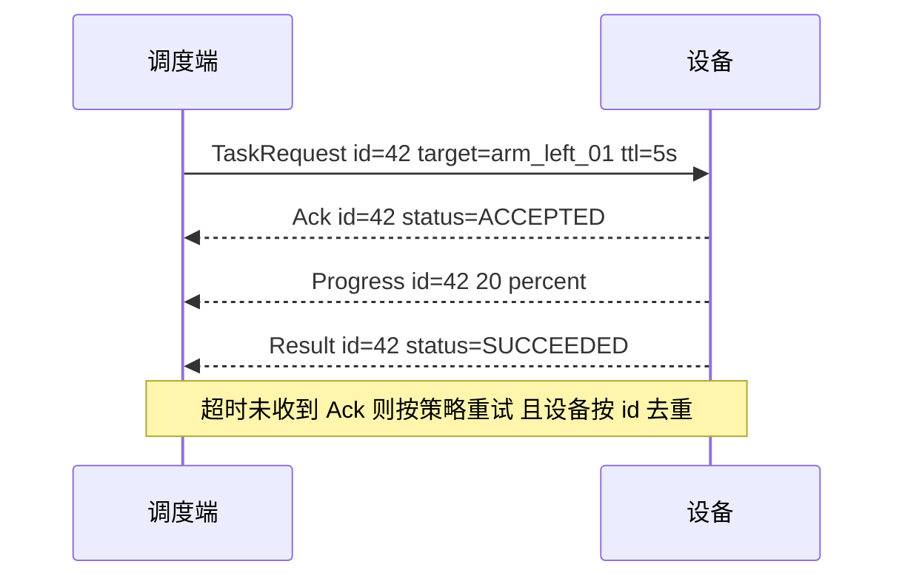
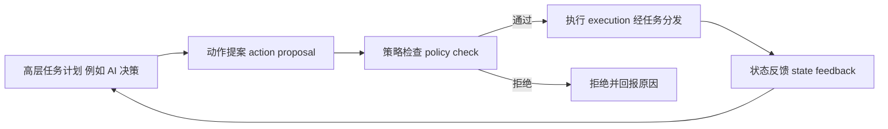

# 05 DDS 与分布式通信

> **一句话定位**：DDS（Data Distribution Service）是一套"以数据为中心"的发布/订阅中间件标准，ROS2 的通信底层就是它；理解了 DDS 的实体、发现、QoS 和传输，你就理解了 ROS2 为什么能去中心化，也能为多机器人系统设计"设备发现—能力注册—状态同步—任务分发"这套典型机制。

**本章学完你能：**

- 讲清楚为什么多机器人/多模块系统需要通信中间件，以及 DDS 与"自己写 socket""ZeroMQ""MQTT"各自的位置；
- 画出 DDS 的实体关系（Domain、DomainParticipant、Topic、Publisher/Subscriber、DataWriter/DataReader），并说出 RTPS 线协议的要点；
- 手算一次 Reliable 通信里"丢包—心跳—ACKNACK—重传"的过程，手算 Domain 对应的 UDP 端口；
- 逐条解释 reliability、durability、history、deadline、liveliness、lifespan 的含义，并判断两端 QoS 是否兼容；
- 解释 SPDP / SEDP 两阶段发现，以及多播被禁、Wi-Fi 丢包、跨网段时怎么办；
- 说出共享内存传输与零拷贝的价值与限制；
- 设计一个"设备发现 / 能力注册 / 状态同步 / 任务分发"的典型方案，并说明幂等、有效期、会话、失联处理这些关键细节；
- 在面试里用"典型做法"的措辞谈 P6 的 M-DDS，而不编造平台私有接口。

**前置知识：**

- [ROS1 / ROS2 核心概念](./04_ROS1_ROS2核心概念.md)（话题、QoS 入门、去中心化）
- [UART、SPI、I2C、以太网、TCP](../08_嵌入式与通信/04_UART_SPI_I2C_以太网_TCP.md)（UDP / TCP、端口、多播）
- [OpenHarmony、Hi3861、RK3588 平台基础](../08_嵌入式与通信/06_OpenHarmony_Hi3861_RK3588平台基础.md)（P6 平台背景）

**目录**

1. 分布式通信要解决什么问题
2. DDS 是什么：标准、实现与 ROS2 的关系
3. 核心实体：Domain、Participant、Topic、Pub/Sub、Writer/Reader
4. RTPS 线协议与可靠传输手算
5. 发现机制：SPDP 与 SEDP
6. QoS 策略详解
7. 传输层：UDP、共享内存与大消息
8. 与 ZeroMQ、MQTT 的对比
9. 多机器人协同的典型设计
10. 在本项目里怎么用（P6 与 P2 / P5）
11. 常见错误与故障现象
12. 面试怎么问、怎么答
13. 自测题
14. 本章要点速记与相关链接

---

## 1. 分布式通信要解决什么问题

### 1.1 场景

三台机器人 A、B、C 和一台调度服务器在同一个局域网里：

- 机器人上线时，调度要**知道有谁在线**（设备发现）；
- 要知道每台机器人**能干什么**：有几个轴、最大速度多少、带不带夹爪（能力注册）；
- 要持续知道它们**现在怎么样**：位置、电量、是否故障（状态同步）；
- 要能给某台机器人**下发任务**，并确认它收到、是否执行、做完没有（任务分发）。

### 1.2 自己用 socket 写会遇到的问题

| 问题 | 为什么难 |
|---|---|
| 谁在线？地址是什么？ | 要写发现协议；IP 会变；设备随时上下线 |
| 一对多广播 | 要自己管订阅关系 |
| 丢包与重传 | UDP 不可靠，TCP 的队头阻塞又对实时数据不友好 |
| 数据格式兼容 | 字段增删、字节序、对齐 |
| 慢订阅者拖累发布者 | 要自己做背压或丢弃策略 |
| 晚加入者要不要历史数据 | 要自己缓存重发 |
| 失联检测 | 要自己写心跳 |

中间件的价值，就是把这些"每个项目都要重写一遍"的东西标准化，并通过**配置**（QoS）而不是**代码**去选取行为。

---

## 2. DDS 是什么：标准、实现与 ROS2 的关系

### 2.1 以数据为中心

DDS 由 OMG（Object Management Group）制定。核心思想是 **data-centric publish-subscribe**：应用不关心"对方是谁、在哪台机器、地址是什么"，只关心"某个**主题**（topic）下的**数据**"。发布者往主题写数据，订阅者从主题读数据，中间件负责发现、路由、可靠性、缓存。

### 2.2 标准分层（要能一口气说出来）

| 标准 | 管什么 |
|---|---|
| DCPS（Data-Centric Publish-Subscribe） | **应用 API**：实体、主题、读写、QoS 的编程接口 |
| DDSI-RTPS（Real-Time Publish-Subscribe wire protocol） | **线协议**：不同厂商的 DDS 之间怎么在网络上互通 |
| DDS-XTypes | 类型系统与类型演化（字段兼容性） |
| DDS-Security | 认证、访问控制、加密 |
| IDL（Interface Definition Language） | 用来描述数据类型的语言，类似 `.msg` |

**因为线协议是标准的，所以不同厂商的 DDS 实现在原则上可互通。** 这是 DDS 与"每家自己的私有协议"的根本区别。

### 2.3 常见实现

| 实现 | 备注 |
|---|---|
| eProsima Fast DDS | ROS2 许多发行版的默认 RMW |
| Eclipse Cyclone DDS | ROS2 常见替代选项，风格简洁 |
| RTI Connext DDS | 商用，工业/航空领域常见 |

具体哪个发行版默认哪个实现，以官方发行说明为准。

### 2.4 ROS2 与 DDS 的关系

ROS2 并不是"直接用 DDS API"，而是中间隔了 **rmw**（ROS middleware interface）：

```text
 你的代码 (rclcpp / rclpy)
        |
      rcl  (C 接口)
        |
      rmw  (抽象接口: 创建节点/发布者/订阅者/QoS)
        |
 rmw_fastrtps_cpp / rmw_cyclonedds_cpp / ...   (适配层)
        |
 DDS 实现 (Fast DDS / Cyclone DDS / ...)
```

- ROS2 的 **节点（Node）** 对应 DDS 的 **DomainParticipant**（实现细节随版本可能有差异：多个节点可共享参与者）；
- ROS2 的 **话题** 对应 DDS 的 **Topic**，话题名会加上前缀（如 `rt/`）；
- ROS2 的 **QoS profile** 对应 DDS 的 QoS 策略子集；
- **服务/动作** 在 DDS 之上用话题对（request/response）实现。

> **面试要点**：能说出 "ROS2 does not expose DDS directly; it goes through the rmw layer, so you can switch implementations with `RMW_IMPLEMENTATION`." 即可。

---

## 3. 核心实体：Domain、Participant、Topic、Pub/Sub、Writer/Reader

### 3.1 实体关系

```text
 Domain (域, 数字 ID)
 └── DomainParticipant (参与者, 一个应用/进程的"入网身份")
      ├── Topic "imu"  (主题 = 名字 + 数据类型 + QoS)
      ├── Publisher  ──► DataWriter<Imu>  (写 Topic "imu")
      └── Subscriber ──► DataReader<Imu>  (读 Topic "imu")
```

| 实体 | 作用 |
|---|---|
| **Domain** | 逻辑隔离的"网络"。不同 Domain ID 的参与者**互相看不见**，类似 VLAN。ROS2 里由 `ROS_DOMAIN_ID` 选，默认 0 |
| **DomainParticipant** | 进入某个 Domain 的入口，是其它所有实体的工厂；一个进程可以有多个 |
| **Topic** | 数据通道：**名字 + 类型**。同名但不同类型是不同的、不能匹配的 |
| **Publisher / Subscriber** | 把一组 Writer / Reader 组织在一起，可统一设置分区（partition）等 QoS |
| **DataWriter / DataReader** | 真正写入/读取某个 Topic 数据的对象，**QoS 主要挂在这里** |
| **Instance / Key** | 主题可以声明键字段（如 `robot_id`），同一主题下不同键对应不同"实例"，历史按实例保留 |

### 3.2 匹配（matching）条件

一个 DataWriter 和一个 DataReader 要建立连接，必须同时满足：

1. 同一个 **Domain**；
2. **Topic 名称相同**且**类型名相同**（类型结构兼容）；
3. **QoS 兼容**（见第 6 章的 request-vs-offered 规则）；
4. （如果配置了）**Partition** 有交集。

任何一条不满足，两端都"看得见对方存在但不匹配"，数据不流动。这是调试 DDS/ROS2 时最常见的现象。

### 3.3 Key / Instance 的直觉

一个话题 `robot_state`，类型里有 `robot_id`（声明为 key）。则 `robot_state[A]`、`robot_state[B]` 是两个实例：History 的 KEEP_LAST depth=1 表示"**每个实例**保留最新一条"，而不是整个话题只保留一条。这对多机器人状态同步非常有用：用一个话题承载全部机器人的最新状态，订阅者始终能拿到"每个机器人的最新状态"。（ROS2 的 `.msg` 本身不支持 key；这是原生 DDS 的能力，所以"典型做法"里常见的是**每台机器人一个话题名**或**命名空间**。）

---

## 4. RTPS 线协议与可靠传输手算

### 4.1 它解决什么问题

DDSI-RTPS 规定了不同厂商 DDS 之间在网络上互通的报文格式与交互规则。底层通常跑在 UDP 上（也有 TCP、共享内存等扩展）。

### 4.2 报文结构（概念）

一个 RTPS 报文 = **头部**（协议标识、版本、厂商 ID、**GUID 前缀**）+ 若干 **子消息（submessage）**：

| 子消息 | 作用 |
|---|---|
| `INFO_TS` | 携带时间戳 |
| `DATA` / `DATA_FRAG` | 一个样本（`DATA_FRAG` 为大样本的分片） |
| `HEARTBEAT` | Writer 告诉 Reader："我手里有序号 [first, last] 的样本" |
| `ACKNACK` | Reader 回答："我已收到到 N 为止，缺失这些序号" |
| `GAP` | Writer 说："这些序号我不会再发了（已被覆盖）" |

### 4.3 手算：一次 Reliable 通信里丢包与重传

示例（教学数值）：Writer 依次发送序号 1、2、3、4、5，Reader 只收到 1、2、4、5（3 丢了），QoS 为 RELIABLE + KEEP_LAST(depth=10)。

| 步骤 | 事件 |
|---|---|
| ① | Writer 发 DATA(1..5)；Reader 收到 1、2、4、5，**记录"缺 3"**；Reader 不能把 4、5 交给应用（可靠 + 有序语义下，要等 3 到才按序交付；实现细节因配置而异） |
| ② | Writer 周期性发 `HEARTBEAT(first=1,last=5)` |
| ③ | Reader 回 `ACKNACK(已收到到2, 缺失={3})` |
| ④ | Writer 从历史缓存里取出 3，重发 `DATA(3)` |
| ⑤ | Reader 收到 3，补齐，按 3、4、5 交付 |

**关键推论：**

- 可靠传输依赖 Writer 的**历史缓存**：如果 depth 太小，3 被新样本覆盖，Writer 无法重传，只能发 `GAP`，Reader 就永久少了 3；所以"RELIABLE 也可能丢数据"——前提是历史被覆盖；
- 重传延迟 ≈ 心跳周期 + 往返时间，所以高频实时数据常用 BEST_EFFORT：宁可丢，也不为一个旧样本等待。

### 4.4 手算：Domain 与 UDP 端口

DDSI-RTPS 规定了缺省端口映射（Linux 上常用实现遵循）。参数：$PB=7400,\ DG=250,\ PG=2,\ d_0=0,\ d_1=10,\ d_2=1,\ d_3=11$。

- 发现用多播端口：$PB + DG\times\text{domainId} + d_0$
- 用户数据多播端口：$PB + DG\times\text{domainId} + d_2$
- 发现用单播端口：$PB + DG\times\text{domainId} + d_1 + PG\times\text{participantId}$
- 用户数据单播端口：$PB + DG\times\text{domainId} + d_3 + PG\times\text{participantId}$

代入 Domain 0、participantId 0：发现多播 7400；用户多播 7401；发现单播 7410；用户单播 7411。Domain 1：发现多播 $7400+250=7650$。participantId=1 的同一机器上的第二个参与者：单播端口 7412 / 7413。

从中得出两个实用结论：

1. Domain ID 不是随意取的：$DG=250$ 使 Domain 上限受端口范围约束，ROS 官方建议使用 0–101 的范围以保证在各平台上不撞端口；
2. 防火墙/容器网络如果只放行了部分 UDP 端口，会出现"发现成功但数据不通"或"互相看不见"的怪现象——**先查端口**。

> **提示**：以上端口公式是 RTPS 规范的缺省值，具体实现可配置；写在文档里只是为了让你能"推出来"，不必背数字。

---

## 5. 发现机制：SPDP 与 SEDP

### 5.1 为什么需要两阶段

要让 Writer 和 Reader 配对，需要知道"对方有哪些端点、什么主题、什么 QoS"。DDS 把发现分成两步：

1. **SPDP（Simple Participant Discovery Protocol）**：先发现"**参与者**"。每个参与者周期性地向一个已知的多播地址和端口（上节 7400 系）发布自己的**参与者信息**（GUID、可用的单播/多播地址和端口、支持的内置端点等）。别人收到后就知道"这里有个参与者，我可以通过这些地址联系它"。
2. **SEDP（Simple Endpoint Discovery Protocol）**：参与者之间建立起内置的**可靠**端点连接后，互相交换各自所有 **DataWriter / DataReader** 的信息：主题名、类型名、QoS、GUID。收到后对每个本地端点做**匹配检查**（Domain/主题/类型/QoS/分区）。匹配成功才开始传用户数据。

```text
  参与者 A                                     参与者 B
     |--- SPDP 多播: "我是A, 地址 a:7410..." --->|
     |<-- SPDP 多播: "我是B, 地址 b:7410..." ----|
     |                                          |
     |==== 内置可靠端点互联 (SEDP) ====          |
     |--- SEDP: "A有Writer: topic=imu,type=Imu,QoS=..." --->|
     |<-- SEDP: "B有Reader: topic=imu,type=Imu,QoS=..." ----|
     |  各自做匹配检查 → 匹配成功                              |
     |====== 用户数据 DATA / HEARTBEAT / ACKNACK ======>|
```

### 5.2 参与者的"存活"

SPDP 报文带**租约时间（lease duration）**：在租约期内没再收到某参与者的公告，就认为它**已离线**并清理它的所有端点。这是 DDS 自带的失联检测，粒度是"参与者"。粒度更细的"某个 Writer 还活着吗"，由 **Liveliness** QoS 负责（第 6 章）。

手算示例（教学数值，非任何实现的默认值）：公告周期 3 s、租约 10 s。参与者 X 在 t = 0 s 发出最后一次公告，随即掉线。其它参与者的租约计时从最后一次收到公告起算，所以在 t = 10 s 判定 X 离线，**检测延迟 ≈ 租约时间**（从"最后一次存活证据"算起）。租约要取公告周期的数倍：本例 10 s ≈ 3.3 个周期，意味着连续丢 2 次公告（3 s、6 s 各丢一次，9 s 的那次到达）仍不会误判；若租约只有 3 s，一次丢包就会误判下线。租约太短 → 误判；太长 → 故障发现慢。

### 5.3 现实里发现为什么常常失败

| 现象 | 原因 | 处理 |
|---|---|---|
| 同一台机器能发现，跨机器不能 | 网络禁用多播（交换机/路由器/企业 Wi-Fi 的 IGMP、AP 隔离） | 配置单播 initial peers；或使用 Discovery Server |
| 有线正常，Wi-Fi 不稳 | Wi-Fi 对多播用低速率或丢弃，丢包严重 | 有线；缩小多播范围；单播发现 |
| 虚拟机/容器之间看不见 | 网桥模式、网络命名空间 | host 网络模式；检查多播路由 |
| 发现慢，参与者很多时 CPU 高 | 全网状发现，消息量 $O(N^2)$ | Discovery Server（星型）；限制发现范围 |
| 一台机器上的多个人"串台" | 都用默认 Domain 0 | 设不同 Domain ID，或 ROS 的"仅本机"发现选项 |

**发现消息量的手算：** 若每个参与者与其它所有参与者都互相建立 SEDP 会话，N 个参与者就有 $N(N-1)/2$ 对会话。N=10 → 45 对；N=50 → 1225 对；每对还要交换全部端点信息。这就是 Discovery Server 把它变成"每个参与者只和服务器通信"的 $O(N)$ 的动机（Fast DDS 提供该机制；ROS2 里通过环境变量启用，名称以所用版本文档为准）。

### 5.4 动态发现意味着"可能还没发现"

发现是异步的：节点刚启动，立刻 `publish` 一条消息，此时对方的 Reader 可能还没完成 SEDP 匹配，这条消息等于发给了"零个订阅者"，会被丢掉。典型对策：

- 发布后**等匹配**（检查订阅者数量 > 0，或使用 `wait_for_service`）再发关键命令；
- 关键的"状态/能力"类数据使用 **TRANSIENT_LOCAL**，让晚到的订阅者在匹配成功后立即收到最近一份。

---

## 6. QoS 策略详解

QoS（Quality of Service）是 DDS 最有价值的部分：**行为通过配置声明，而不是写代码**。

### 6.1 兼容性模型：Request vs Offered（RxO）

大部分策略遵循：Writer **提供（offered）**，Reader **请求（requested）**；**提供的必须不弱于请求的**，才能匹配。若不满足，DDS 通知双方"incompatible QoS"（ROS2 里会有事件/警告，但往往不显眼）。

### 6.2 Reliability：可靠性

- `BEST_EFFORT`：发出去就不管，不重传。延迟最低，适合传感器流。
- `RELIABLE`：带序号 + 心跳 + 重传（见 4.3），保证（在历史未被覆盖的前提下）按序送达。

RxO：RELIABLE > BEST_EFFORT。Writer 提供 BEST_EFFORT、Reader 请求 RELIABLE → 不匹配。

### 6.3 Durability：持久性

- `VOLATILE`：只给匹配成功**之后**的样本。
- `TRANSIENT_LOCAL`：Writer 为晚到的 Reader 保留历史样本（受 History depth 限制）。
- `TRANSIENT` / `PERSISTENT`：通过外部服务/磁盘保留（ROS2 一般用不到）。

RxO：TRANSIENT_LOCAL（强）> VOLATILE（弱）。典型用途：`/tf_static`、地图、设备能力公告、配置。

### 6.4 History 与 Depth：历史

- `KEEP_LAST(n)`：每个实例只保留最新 n 个样本，满了覆盖最旧的；
- `KEEP_ALL`：全部保留，直到资源上限（`RESOURCE_LIMITS`）。

History 不参与 RxO 匹配，但与 Reliability/Durability 一起决定行为：RELIABLE + KEEP_LAST(1) 意味着"最新值可靠，旧值可被覆盖"；RELIABLE + KEEP_ALL 在慢订阅者面前会让发布者阻塞或内存增长。

### 6.5 Deadline：期限

声明"同一实例至少每 $T$ 秒更新一次"。Writer 超过 $T$ 没写，或 Reader 超过 $T$ 没收到，都会触发 `DEADLINE_MISSED` 事件。

RxO：Writer 提供的 deadline **周期 ≤** Reader 请求的 deadline 周期（越小越严格）。

手算示例：状态话题约定 10 Hz，Reader 请求 deadline = 200 ms。Writer 正常间隔 100 ms，遇到一次 250 ms 的停顿 → 触发一次 deadline 错过事件。这样应用可以在回调里设置"数据陈旧"标志，转入降级或安全模式，比自己写定时器更统一。

### 6.6 Liveliness：存活性

声明"我这个 Writer 还活着"的方式与期限：

- 种类：`AUTOMATIC`（中间件自动发心跳）、`MANUAL_BY_PARTICIPANT`、`MANUAL_BY_TOPIC`（应用必须定期写数据或显式 assert，才算存活）；
- `lease_duration`：多久没有存活信号，就认为 Writer 不再存活，Reader 收到 `LIVELINESS_CHANGED` 事件。

RxO：Writer 提供的种类 ≥ Reader 请求的种类，且 Writer 的 lease ≤ Reader 请求的 lease。

**与 Deadline 的区别：** Deadline 关心"**数据**有没有按时更新"；Liveliness 关心"**这个 Writer** 还在不在"。一个 Writer 活着但没有新数据是合理的（deadline 报，liveliness 不报）；一个线程卡死的 Writer，若用 AUTOMATIC，中间件线程仍在发心跳（liveliness 不报）——这就是为什么需要 MANUAL_BY_TOPIC：**只有应用逻辑真的在跑才算活着**。

### 6.7 Lifespan：样本寿命

每个样本的有效期。超过 lifespan 的样本在 Reader 侧不再交付（被丢弃）。与 deadline 的区别：deadline 是"更新间隔"，lifespan 是"**单个样本的有效时间**"。

手算示例：任务请求样本 lifespan = 5 s。Reader 在 t=7 s 才匹配上（晚到），Writer 为 TRANSIENT_LOCAL 保留了 t=0 时发的样本 → 该样本已过期，**不会再交付**。这天然防止了"重连后执行一条很久以前的旧命令"，对安全执行链很重要（第 9 章）。

### 6.8 其它常见策略

| 策略 | 作用 |
|---|---|
| Resource Limits | 限制 max_samples、max_instances 等，防内存失控 |
| Ownership | 多个 Writer 写同一实例时，由谁"说了算"（EXCLUSIVE 时按强度） |
| Destination Order | 按接收时间还是源时间排序 |
| Latency Budget / Transport Priority | 提示传输优先级 |
| Partition | 在 Topic 下再分逻辑分区（字符串匹配） |
| Time-Based Filter | Reader 端最小间隔过滤 |
| Content Filter | 按内容过滤（ContentFilteredTopic） |

### 6.9 ROS2 的预设

| 预设 | 组合 | 用途 |
|---|---|---|
| 默认 | RELIABLE + VOLATILE + KEEP_LAST(10) | 通用 |
| 传感器数据 | BEST_EFFORT + VOLATILE + KEEP_LAST(小) | 激光、图像、IMU |
| 服务 | RELIABLE + VOLATILE | 请求/应答 |
| 参数 | RELIABLE + VOLATILE + 较深 history | 参数事件 |
| 静态 TF | RELIABLE + TRANSIENT_LOCAL | `/tf_static`、地图 |

### 6.10 兼容性小测验（完整手算表）

| Writer（提供） | Reader（请求） | 匹配？ | 理由 |
|---|---|---|---|
| RELIABLE, VOLATILE | BEST_EFFORT, VOLATILE | 是 | 提供更强 |
| BEST_EFFORT, VOLATILE | RELIABLE, VOLATILE | **否** | 可靠性不足 |
| RELIABLE, TRANSIENT_LOCAL | RELIABLE, VOLATILE | 是 | 持久性更强 |
| RELIABLE, VOLATILE | RELIABLE, TRANSIENT_LOCAL | **否** | 无法提供历史 |
| deadline=100 ms | deadline=200 ms | 是 | 提供更严 |
| deadline=300 ms | deadline=200 ms | **否** | 提供更松 |
| liveliness lease=1 s | lease=3 s | 是 | 提供更严 |
| AUTOMATIC | MANUAL_BY_TOPIC | **否** | 种类较弱 |

---

## 7. 传输层：UDP、共享内存与大消息

### 7.1 UDP 多播/单播

缺省使用 UDP：多播用于发现和（可选）数据，单播用于点对点数据。局域网内表现最好。

### 7.2 共享内存传输（Shared Memory）

同一台机器上的两个进程，经过网络栈（环回口）传数据要多次拷贝和系统调用。**共享内存传输**让参与者把数据写到共享内存段，对端直接映射读取，省去网络栈。Fast DDS 提供内置 SHM 传输（同机自动启用，具体行为随版本）；Cyclone DDS 可结合 Eclipse iceoryx 提供共享内存。

**零拷贝（loaned message）**更进一步：发布者直接向中间件**借**一块内存，在里面填写消息，发布时不再拷贝；订阅者读到的是同一块内存的只读引用。限制：

- 消息类型通常必须是**定长（plain/POD）**，含 `string`、变长数组的消息不满足；
- 要求 API 版本和 RMW 实现支持；
- 同机进程间有效，跨机仍走网络。

### 7.3 大消息分片的手算

示例：一帧约 1 MB 的点云，通过 UDP 发送，单个 RTPS 报文有效载荷按以太网 MTU 取约 1400 B（示例）：

$$
\text{分片数} \approx \left\lceil \frac{1{,}000{,}000}{1400} \right\rceil = 715
$$

若 Wi-Fi 丢包率 1%（示例）且 RELIABLE 要求整帧所有分片到齐，则整帧无损到达的概率约为 $0.99^{715}\approx 7.6\times10^{-4}$ ——几乎每帧都需要重传。这解释了：大消息 + 无线 + RELIABLE 的组合**非常容易拥塞与延迟爆炸**。对策：压缩、降采样、BEST_EFFORT、调整发送缓冲/流控、改走有线或压缩图像话题。

### 7.4 回环与本机优化

同一台机器上的多个进程，优先共享内存或进程内通信（intra-process communication，一个进程内多个节点共享指针，避免序列化）。需要把多个节点放进同一进程（composition）。

---

## 8. 与 ZeroMQ、MQTT 的对比

### 8.1 三者定位

| 维度 | DDS | ZeroMQ | MQTT |
|---|---|---|---|
| 本质 | 标准化的数据中心中间件（有规范、有互通） | 高性能消息**库**（socket 的增强，不是标准协议栈） | 基于 broker 的轻量发布订阅**协议** |
| 拓扑 | 无 broker（对等） | 无 broker（库内部处理） | **需要 broker**（如 Mosquitto） |
| 发现 | 内置（SPDP/SEDP） | 无（需知道对端地址，或自己搭代理） | 靠 broker（客户端连 broker 即可） |
| 类型系统 | 有（IDL） | 无（传字节，自己序列化） | 无（传字节） |
| QoS | 丰富（20+ 策略） | 少（HWM、模式本身语义） | 3 级：0 至多一次 / 1 至少一次 / 2 恰好一次；另有 retained、LWT |
| 传输 | UDP 为主，TCP、SHM 可选 | TCP、IPC、inproc、PGM | TCP（WebSocket 亦可） |
| 实时性 | 好（可配置） | 好（低延迟） | 一般（broker 转发 + TCP） |
| 适用 | 机器人内部、多机、工业、航空 | 自建分布式系统、高吞吐 | 物联网、云端、弱网设备 |

### 8.2 概念映射

| DDS | MQTT | 说明 |
|---|---|---|
| TRANSIENT_LOCAL | Retained message | 新订阅者拿到"最后一条" |
| Liveliness | Last Will and Testament（LWT） | 设备异常掉线时的通知 |
| RELIABLE | QoS 1/2 | 到达保证 |
| Partition / 主题层级 | Topic 层级与通配符（`+`、`#`） | 过滤 |

### 8.3 如何选

- **机器人内部、多模块、低延迟、需要类型和 QoS** → DDS（ROS2 已内置）。
- **只需要在两三个进程之间点对点快速传字节、不想引入重框架** → ZeroMQ。
- **大量低功耗设备上云、弱网、需要一个中心 broker 做认证与转发** → MQTT。
- 现实中常**组合**：机器人内部 DDS，对外（云）经桥接节点转 MQTT。

> **面试要点**：回答"为什么机器人用 DDS 而不用 MQTT"时，不要说 MQTT 差，而要说**场景**：机器人内部要的是低延迟、对等、类型安全和细粒度 QoS，MQTT 的 broker 是额外的单点和一跳延迟，适合云/IoT 边缘。

---

## 9. 多机器人协同的典型设计

> 本章是**通用设计思路**，用"典型做法"的措辞。P6 平台里具体的 M-DDS 主题名、类型、API 属于平台内部事实，以你自己的项目为准，下文不做假设。

### 9.1 总体分层

```text
  任务层 (调度 / 规划 / AI 决策)
      │  任务计划 (action proposal)
  ┌───▼──────────────────────────────────┐
  │ 协同层                                 │
  │  ① 设备发现    ② 能力注册              │
  │  ③ 状态同步    ④ 任务分发              │
  └───▲──────────────────────────────────┘
      │ 通信中间件 (DDS 类)
  设备层 (机器人 A、B、C … 的驱动 / 控制)
```

### 9.2 ① 设备发现

目标：知道"现在有哪些设备在线"。

典型做法：

- **DDS 自带层**：参与者发现（SPDP）已提供"谁在网络里"；
- **应用层再做一层**"设备公告（announce）"：设备上线时发布一条包含 `device_id`、类型、软件版本、**会话号**（session/epoch，每次上线自增或随机）的消息；
- **离线判定**：用 Liveliness（MANUAL_BY_TOPIC）+ lease，或应用层心跳 + 超时。

注意区分三个"在线"：**网络可达**（SPDP 看得到）、**应用活着**（周期性心跳）、**可执行任务**（已完成能力注册且状态健康）。设备管理里常用三态：`offline → synchronizing → online`（以及 `fault`）。

### 9.3 ② 能力注册

目标：把设备"能做什么"结构化地告诉系统。

一份典型的**能力描述（capability descriptor）**：

```text
 device_id       : "arm_left_01"
 device_type     : MANIPULATOR | MOBILE_BASE | SENSOR ...
 capabilities[]  : [ {name:"joint_position_control", limits:{...}},
                     {name:"gripper", range:[0,1]} ... ]
 interfaces      : [ 控制话题、状态话题、坐标系名 ]
 schema_version  : 2
 session_id      : 随每次上线更新
```

典型做法与理由：

- 发布在 **RELIABLE + TRANSIENT_LOCAL + KEEP_LAST(1 每设备)** 的"设备注册"主题上，使晚启动的调度端也能拿到所有现役设备的最新能力；
- 能力描述带**版本号**，使调度端可处理新旧设备混用；
- 能力是**数据**而非代码：调度端据此做"匹配"（这个任务需要关节位置控制 + 夹爪，谁满足）；
- 这与"统一能力模型"的思想一致：对传感器、执行器、控制器用同一套描述方式（见 [P6 项目文档](../../01_项目课程/P6_深开鸿M-Robots平台软件/README.md)）。

### 9.4 ③ 状态同步

目标：调度端和各设备对"机器人现在怎么样"达成一致。

典型做法：

- **分两类数据**：
  - **高频状态**（位置、速度）：BEST_EFFORT 或 RELIABLE + KEEP_LAST(1) + deadline；丢一两帧无所谓，新值覆盖旧值；
  - **低频关键状态**（模式、故障码、使能状态）：RELIABLE + TRANSIENT_LOCAL，**变化时必发**，同时低频周期重发作为兜底；
- 每条状态带**时间戳**、**序号**、**坐标系**、**有效性标志**；订阅端检查序号是否倒退（旧数据）、时间戳是否过老；
- 失联后重连：**先同步再放行**——设备重新上线时（会话号变化），调度端清掉该设备的旧状态缓存，等第一份新状态到达后才允许新任务；
- 状态一致性的难点是**多源时间对齐**，见 [时间同步、坐标系一致性与数据有效性](../05_状态估计/06_时间同步_坐标系一致性与数据有效性.md)。

序号检查的手算：订阅端记录上一条序号 $s_{\text{prev}}$。收到 $s$：

- $s = s_{\text{prev}}+1$：正常；
- $s > s_{\text{prev}}+1$：丢了 $s - s_{\text{prev}} - 1$ 条（BEST_EFFORT 下可接受，记录统计）；
- $s \le s_{\text{prev}}$：重复或乱序旧包，丢弃；
- 会话号变化：重置计数。

### 9.5 ④ 任务分发

目标：把任务可靠地交给正确的设备，并知道结果。

典型做法（和 RPC 类似，但用话题实现，保留异步）：



关键设计点：

| 设计点 | 做法 | 为什么 |
|---|---|---|
| 任务 ID | 全局唯一 `task_id`/`action_id` | 去重、追踪、取消 |
| **幂等** | 设备记录最近处理过的 `task_id`；重复请求只回上次的回执，**不重复执行** | 重试不应造成物理动作重复 |
| **有效期（TTL / lifespan）** | 请求带 `expire_at` 或使用 Lifespan | 重连后不执行过期旧命令 |
| **会话号** | 请求带目标设备的 `session_id` | 设备重启后旧会话的任务作废 |
| **回执分层** | `RECEIVED`（收到）→ `ACCEPTED`（通过检查）→ `RUNNING` → `SUCCEEDED/FAILED/REJECTED` | "命令已收到""协议写成功""目标已达到"是三回事 |
| 取消 | `CancelRequest(task_id)` | 与 action 语义对齐 |
| 超时与重试 | 重试 $n$ 次，间隔指数退避 | 防止拥塞与重放 |

**重试时间的手算：** Ack 超时 200 ms，最多重试 3 次，退避因子 2，则等待序列 200、400、800 ms，最坏确认时间约 1.4 s（200+400+800）；若业务要求 1 s 内必须有结果，这个策略就不够，要么缩短初始超时，要么在上层降级。

**去重窗口的手算：** 设备去重缓存保存最近 $K$ 个 `task_id`。若调度端每秒最多发 5 个任务、重试窗口最长 2 s，则同一任务的重复请求至多在 $5\times2=10$ 个新任务之内再现，因此 $K \ge 10$ 即可去重，取 $K=64$ 留足余量（示例）。

### 9.6 与"安全执行链"的衔接

CV 中 P6 描述了任务计划必须经 **action-proposal → policy-check → execution → state-feedback** 的链路。放到上面的分层里理解：



要点：

- 高层计划**不直接**下发到设备，必须先变成结构化的"动作提案"；
- **策略检查**依据当前设备状态和能力（来自 ②③）判断是否允许：设备在线吗？能力满足吗？参数在限幅内吗？此时有冲突任务吗？
- **执行**通过 ④ 的任务分发通道，带 ID、TTL、会话号；
- **状态反馈**回到决策端，形成闭环；拒绝与失败要有原因码，便于追溯。

这也是为什么"设备注册"和"状态同步"要做得可靠且带有效性标志：**策略检查是建立在它们之上的**。

### 9.7 典型主题与 QoS 一览（教学示例）

| 主题（示意） | 内容 | Reliability | Durability | History | 其它 |
|---|---|---|---|---|---|
| `device/announce` | 设备公告 + 能力 | RELIABLE | TRANSIENT_LOCAL | KEEP_LAST(1)/设备 | liveliness |
| `device/<id>/state` | 高频状态 | BEST_EFFORT 或 RELIABLE | VOLATILE | KEEP_LAST(1) | deadline |
| `device/<id>/mode` | 模式/故障（低频关键） | RELIABLE | TRANSIENT_LOCAL | KEEP_LAST(深些) | — |
| `task/request` | 任务请求 | RELIABLE | VOLATILE | KEEP_ALL(有上限) | lifespan |
| `task/ack` `task/result` | 回执 | RELIABLE | VOLATILE | KEEP_ALL(有上限) | — |

（表中主题名为教学示意，不代表任何平台的真实命名。）

### 9.8 IDL 示例（教学示例，非任何平台的真实类型）

```text
// device.idl  教学示例
module robotics {
  enum DeviceState { OFFLINE, SYNCHRONIZING, ONLINE, FAULT };

  struct Capability {
    string name;
    double min_value;
    double max_value;
  };

  struct DeviceAnnounce {
    string device_id;       //@key
    string device_type;
    unsigned long schema_version;
    unsigned long long session_id;
    sequence<Capability> capabilities;
  };

  struct TaskRequest {
    unsigned long long task_id;
    string target_device;
    unsigned long long target_session;
    long long expire_at_ns;   // 绝对时间，需时钟同步
    string payload;           // 结构化参数，如 JSON
  };
};
```

时钟问题：`expire_at` 用绝对时间需要两端时钟已同步（NTP/PTP）；否则改用"相对 TTL + 接收时刻"。这是跨设备设计里**最容易被追问**的点。

---

## 10. 在本项目里怎么用

### 10.1 P6：深开鸿 M-Robots 平台

[P6 项目文档](../../01_项目课程/P6_深开鸿M-Robots平台软件/README.md)。CV 原文：*implemented device discovery, capability registration, state synchronisation and task dispatch over M-DDS, and gated task plans through an action-proposal, policy-check, execution and state-feedback chain.*

本章对应关系：

| CV 条目 | 本章位置 |
|---|---|
| device discovery | 5（SPDP/SEDP）、9.2 |
| capability registration | 9.3、6.3（TRANSIENT_LOCAL） |
| state synchronisation | 9.4、6.5~6.6（deadline、liveliness） |
| task dispatch | 9.5、6.7（lifespan）、幂等 |
| gate task plans through the chain | 9.6 |

面试时的稳妥表述：先讲**问题**（多设备怎么发现、怎么知道能力、状态如何一致、任务如何可靠下发），再讲**典型机制**（本章），最后讲**你自己做的部分**。涉及 M-DDS 的内部 API、主题命名、QoS 参数的具体取值，只讲你亲手做过并记得的；记不清就按下面的诚实模板。

【待你补全：M-DDS 与标准 DDS 的关系（是否基于 Fast DDS / Cyclone DDS / 自研）；你们实际的主题划分与 QoS 选择；设备离线的判定方式与时间；任务请求是否带去重/过期；设备数量规模；发现是否依赖多播】

### 10.2 P2 / P5 中的 ROS2

P2 的"ROS2-CAN 执行链"、P5 的导航栈在 ROS2 下都运行在 DDS 之上，本章解释了其中"话题收不到""多机发现慢"等现象的底层原因。对应项目文档：[P2](../../01_项目课程/P2_未来动力双臂遥操作与差速底盘/README.md)、[P5](../../01_项目课程/P5_车式移动机器人自主导航/README.md)。

---

## 11. 常见错误与故障现象

| 现象 | 原因 | 排查 |
|---|---|---|
| 同机能通，跨机不通 | 多播被禁/防火墙/不同子网 | `ros2 multicast`（如有）、`tcpdump`；配置 peers 或 Discovery Server |
| 话题看得到、数据收不到 | QoS 不兼容；类型名不同；分区不同 | `topic info -v`，看 incompatible QoS 事件 |
| 偶发丢数据 | BEST_EFFORT + 丢包；RELIABLE 但 depth 太小被覆盖 | 调 depth；统计序号缺口 |
| 延迟越来越大 | RELIABLE + KEEP_ALL + 慢订阅者；大消息拥塞 | 改 KEEP_LAST；压缩；降频 |
| 重连后执行旧命令 | 无 lifespan/TTL/会话号 | 命令带有效期，重连先同步 |
| 同一命令执行两次 | 重试无幂等 | `task_id` 去重 |
| Domain 之间串台 | 都用默认 Domain 0 | 设置 `ROS_DOMAIN_ID`；命名空间 |
| 参与者越多越卡 | 全网状发现 $O(N^2)$ | Discovery Server；缩小发现范围 |
| 设备"假在线" | 只看 SPDP；应用已卡死但中间件线程在发心跳 | MANUAL_BY_TOPIC 或应用层心跳 |
| 时间戳比较出怪值 | 多机时钟未同步 | NTP/PTP；用相对 TTL |

---

## 12. 面试怎么问、怎么答

**Q1. What is DDS, and why does ROS2 use it?**

> DDS is a data-centric publish-subscribe standard. Applications publish and subscribe to topics, and the middleware handles discovery, delivery and buffering based on QoS settings. ROS2 uses it because it gives decentralized discovery with no master, a standard wire protocol called RTPS so different vendors interoperate, and rich QoS like reliability and durability. ROS2 hides it behind the rmw layer, so we can change the implementation.

中文：DDS 是以数据为中心的发布订阅标准，发现、投递、缓存由中间件按 QoS 处理。ROS2 用它因为无 master 的发现、标准线协议 RTPS 可跨厂商互通、QoS 丰富；并通过 rmw 层隔离实现。
追问：RTPS 是什么？（线协议，通常跑在 UDP 上。）

**Q2. How does discovery work in DDS?**

> It has two phases. In SPDP, each participant periodically announces itself, typically by multicast, so others learn its address. Then in SEDP, participants exchange the details of their readers and writers: topic name, type and QoS. Each side checks compatibility and matches endpoints. If multicast is blocked, I would configure unicast peers or use a discovery server.

中文：两阶段：SPDP 周期公告参与者（常用多播）；SEDP 交换读写端点的主题、类型、QoS，并做兼容性匹配；多播被禁就用单播 peers 或 Discovery Server。
追问：为什么 Wi-Fi 上经常发现失败？（多播丢包或被屏蔽。）

**Q3. Explain reliability, durability and history. Give an example of each.**

> Reliability decides whether lost samples are retransmitted; I use best effort for lidar and reliable for commands. Durability decides whether late joiners receive past samples; I use transient local for static transforms or device capability announcements. History decides how many samples are kept; keep-last with depth one is the common choice for the latest state. A subscriber's request must not be stronger than the publisher's offer, otherwise they do not match.

中文：可靠性决定是否重传（激光尽力而为，命令可靠）；持久性决定晚加入者能否拿到历史（静态 TF、设备能力公告用 transient local）；历史决定保留多少（最新状态用 keep-last 1）；订阅请求不能强于发布提供，否则不匹配。

**Q4. How would you design device discovery, capability registration, state sync and task dispatch for multiple robots?**（对应 P6，务必用"典型做法"口吻）

> A typical design uses a few topics with different QoS. Devices publish an announcement with an ID, a session ID and a capability description on a reliable, transient-local topic, so a late scheduler still sees them. State goes on a separate topic, with timestamps and sequence numbers, and a deadline so that stale state is detected. Tasks carry a unique ID, an expiry time and the target session, and the device deduplicates by ID, so a retry never executes twice. In my work on the platform I implemented these four functions, and the tasks pass through a proposal, policy check, execution and feedback chain before they reach a device.

中文：用几个不同 QoS 的主题：设备公告（可靠 + transient local）带 ID、会话号、能力；状态带时间戳、序号和 deadline，检测陈旧；任务带唯一 ID、过期时间、目标会话，设备按 ID 去重，重试不重复执行；我在平台上实现了这四项功能，并让任务经"提案—策略检查—执行—反馈"链再到设备。
注意：最后一句只陈述 CV 里的事实；具体主题名与参数需你补全。若被追问不记得的细节："I don't have the exact figure in front of me, but the idea is that the timeout was a few multiples of the update period."（仅在确实如此时使用。）

**Q5. DDS versus MQTT versus ZeroMQ?**

> DDS is brokerless with built-in discovery, typed data and many QoS policies, which fits robots on a local network. MQTT needs a broker but is lightweight and good for cloud and IoT with weak networks. ZeroMQ is a messaging library: very fast and flexible, but it has no discovery or type system, so you build more yourself. I would bridge DDS inside the robot to MQTT for the cloud if needed.

中文：DDS 无 broker、内置发现/类型/QoS，适合局域网内机器人；MQTT 要 broker，轻量，适合云/IoT 弱网；ZeroMQ 是消息库，快且灵活但无发现与类型；需要上云就用桥接。

**Q6. A command was executed twice after a reconnect. What happened and how do you prevent it?**

> Probably the sender retried because it did not get an acknowledgement, and the receiver had no deduplication, or the old command was replayed after reconnect. I would give every command an ID and an expiry time, make the receiver idempotent by remembering recent IDs, and tie commands to a session ID so that commands of an old session are rejected after the device reconnects.

中文：很可能是未收到回执而重试且接收端没去重，或重连后重放了旧命令。给命令加 ID 和有效期，接收端按 ID 幂等，并绑定会话号，重连后拒绝旧会话命令。

---

## 13. 自测题

1. DDS 中 Domain、DomainParticipant、Topic 各是什么？不同 Domain 的参与者能互相发现吗？
   *要点：Domain 是逻辑隔离的网络；Participant 是入网身份；Topic = 名字 + 类型；不能。*
2. 一个 Writer 提供 BEST_EFFORT + TRANSIENT_LOCAL，Reader 请求 RELIABLE + VOLATILE，能匹配吗？
   *要点：不能；可靠性提供弱于请求。*
3. Domain 2 上，第一个参与者（participantId=0）的发现多播端口和用户单播端口是多少？
   *要点：发现多播 $7400+250\times2=7900$；用户单播 $7400+500+11+0=7911$。*
4. 比较 Deadline、Liveliness、Lifespan 各管什么。
   *要点：数据更新间隔 / Writer 是否还活着 / 单个样本的有效时间。*
5. RELIABLE + KEEP_LAST(1) 的 Writer 在 Reader 慢时可能丢数据吗？为什么？
   *要点：可能；旧样本被覆盖后无法重传，只能 GAP。*
6. 1 MB 消息、MTU 约 1400 B，分片大概多少？为什么无线 + RELIABLE 容易出问题？
   *要点：约 715 片；整帧到齐概率随片数指数下降，重传多。*
7. 设计任务分发时，如何防止重连后重复或过期执行？
   *要点：任务 ID 幂等、TTL/lifespan、会话号、回执分层、重连先同步。*
8. 为什么说 MANUAL_BY_TOPIC 比 AUTOMATIC 更能反映"应用是否健康"？
   *要点：自动心跳由中间件线程发，应用卡死也还在；手动要求应用逻辑真实运行。*

---

## 14. 本章要点速记与相关链接

**要点速记**

1. DDS = 以数据为中心的发布订阅标准；DCPS 是 API，RTPS 是线协议；ROS2 经 rmw 使用它。
2. 实体：Domain → Participant → Topic / Publisher+DataWriter / Subscriber+DataReader；QoS 主要挂在读写端。
3. 匹配条件：同 Domain、同主题名与类型、QoS 兼容（提供 ≥ 请求）、分区有交集。
4. 可靠传输 = 序号 + HEARTBEAT + ACKNACK + 重传，依赖 Writer 历史缓存；depth 太小仍会丢。
5. 发现两阶段：SPDP 找参与者，SEDP 交换端点并匹配；多播受限是现实中失败的头号原因。
6. Deadline 看数据更新，Liveliness 看 Writer 存活，Lifespan 看样本寿命。
7. 同机优先共享内存 / 零拷贝；大消息 + 无线 + RELIABLE 容易拥塞。
8. DDS 无 broker、有发现和类型；MQTT 有 broker、轻量；ZeroMQ 是库、无发现。
9. 多机协同典型设计：公告（可靠 + transient local）、状态（带时间戳序号）、任务（ID + TTL + 会话号 + 幂等 + 回执分层）。
10. 高层计划不直接到设备，经 proposal → policy check → execution → feedback。

**相关链接**

- 上一章：[ROS1 / ROS2 核心概念](./04_ROS1_ROS2核心概念.md)
- 下一章：[MuJoCo / Pinocchio / KDL 工具链](./06_MuJoCo_Pinocchio_KDL_工具链.md)
- 基础：[时间同步、坐标系一致性与数据有效性](../05_状态估计/06_时间同步_坐标系一致性与数据有效性.md)，[UART、SPI、I2C、以太网、TCP](../08_嵌入式与通信/04_UART_SPI_I2C_以太网_TCP.md)
- 八股：[ROS 与机器人软件八股](../../03_八股知识/03_机器人学/05_ROS与机器人软件八股.md)
- 项目：[P6](../../01_项目课程/P6_深开鸿M-Robots平台软件/README.md) · [P2](../../01_项目课程/P2_未来动力双臂遥操作与差速底盘/README.md) · [P5](../../01_项目课程/P5_车式移动机器人自主导航/README.md)
