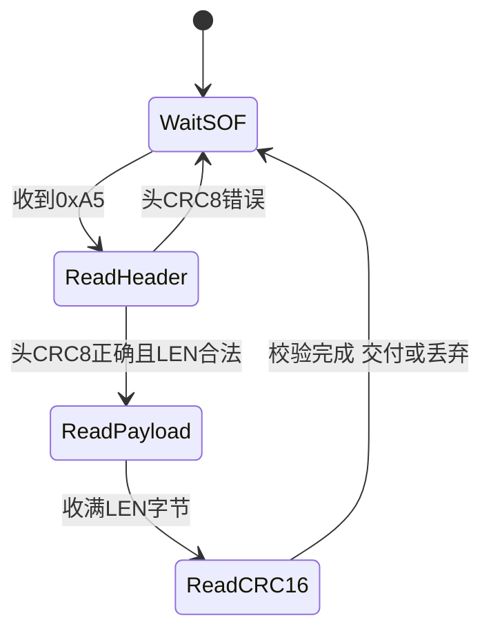

# UART / SPI / I2C / 以太网 / TCP 与自定义协议设计

> **一句话定位**：CAN 之外，机器人里还有一大批"板内—板间—机器间"的通信：串口接遥控器/视觉主机/裁判系统，SPI 接 IMU，I2C 接小传感器，以太网/TCP 接上位机。这一章讲每种链路的物理规则、速率与耗时手算，然后重点讲**字节流上怎么切出完整的帧**（帧头/长度/CRC、TCP 粘包、DMA 空闲中断收包）——这是所有"自定义通信协议"的共同核心。

**本章学完你能：**

- 讲清 UART 帧结构、波特率误差、一个字节占多少位，并手算"这个数据量需要多少波特率"；
- 用"DMA + 空闲中断"（IDLE）收不定长数据，并解释它为什么比"每字节一次中断"好；
- 说清 SPI 的四种模式（CPOL/CPHA）与读寄存器的时序，I2C 的地址/ACK/重复起始/上拉；
- 区分以太网、IP、TCP、UDP 各层作用，解释 TCP 是**字节流**所以会"粘包/拆包"，并用长度前缀解决；
- 设计一个带帧头、长度、序号、CRC 的串口协议，写出接收状态机；
- **手算** CRC（多项式长除法与按位法），并理解它为什么比校验和强；
- 用英文讲出"为什么选 UDP/TCP""如何保证一帧不被错解"。

**前置知识：**[STM32 时钟、GPIO、中断、DMA](./01_STM32_时钟_GPIO_中断_DMA.md)；[CAN 章](./03_CAN_FDCAN与电机通信.md) 中的字节序、补码、`last_seen` 概念。

**相关项目：**[P3](../../01_项目课程/P3_RoboMaster英雄机器人嵌入式控制/README.md)（遥控器/视觉/IMU 的 SPI 等）、[P4](../../01_项目课程/P4_OpenHarmony智能园艺系统/README.md)（设备—服务器通信）、[P6](../../01_项目课程/P6_深开鸿M-Robots平台软件/README.md)（分布式通信背景）、[P2](../../01_项目课程/P2_未来动力双臂遥操作与差速底盘/README.md)（VR 到机器人的数据链）。

## 目录

1. UART
2. SPI
3. I2C
4. 以太网、IP、TCP、UDP
5. 字节流 vs 报文：粘包、拆包、长度前缀
6. 串口协议设计：帧头/长度/序号/CRC
7. CRC 手算
8. 接收状态机与 DMA 空闲中断收包
9. 常见错误与故障现象
10. 面试问答
11. 要点速记、自测题、链接

---

## 1. UART

### 1.1 它要解决什么问题

用最少的线（TX、RX、GND）在两个设备间异步传字节。"异步"= 没有时钟线，双方事先约定好**波特率**，靠起始位同步每个字节。

### 1.2 帧结构与符号

常见配置 **8N1**：1 起始位（低）+ 8 数据位（**低位先发**）+ 无校验 + 1 停止位（高）。空闲线为高。一个字节占 **10 位**。

```text
空闲 ──┐ 起始 D0 D1 D2 D3 D4 D5 D6 D7 停止 ┌── 空闲
高     └─低──────────────────────────────┘高
```

- 波特率（baud）：每秒符号数，UART 里等于每秒位数（bps）；
- **有效字节率** = 波特率 / 10（8N1）；
- 常用：9600、115200、460800、921600、1 Mbps、数 Mbps（受收发器/线长限制）；
- 电平：TTL（0/3.3 V）、RS232（±3~15 V）、RS485/RS422（差分）。DBUS/SBUS 之类遥控协议可能使用**反相电平、特殊波特率（如 100 kbps、偶校验、2 停止位）**——此时必须先按协议配置 UART，否则乱码。

### 1.3 波特率误差（手算）

STM32 USART 波特率 $=\dfrac{f_{PCLK}}{16\times USARTDIV}$（过采样 16 时），USARTDIV 的小数部分只有 4 位（1/16 分辨率）。

教学示例：F407 的 USART1 挂在 APB2，$f_{PCLK2}=84$ MHz，目标 115200：

1. USARTDIV = 84e6 / (16 × 115200) = 45.5729；
2. 整数 45，小数 0.5729 × 16 = 9.17 → 取 9，故 USARTDIV = 45 + 9/16 = 45.5625；
3. 实际波特率 = 84e6 / (16 × 45.5625) = 84e6 / 729 = 115226；
4. 误差 = (115226 − 115200)/115200 = +0.023%。

UART 允许总误差约 ±2%~±3%（10 位累计误差小于半位，即 5%，两端各担一半），所以 0.023% 完全没问题。但如果时钟源不对（如 HSE 实际 25 MHz 却当 8 MHz 配置），误差就是几倍，立刻乱码——这是"时钟树配错最先暴露在串口"的原因。

### 1.4 数据量与波特率的匹配（手算）

需求：视觉主机每 1 ms 向 MCU 发一包 20 字节目标信息（1 kHz）。

- 字节率 = 20 B/ms = 20000 B/s；
- 需波特率 ≥ 20000 × 10 = 200000 bps；
- 115200 不够（只能 11520 B/s）；选 460800 或 921600，并留余量（建议利用率 < 50%）：20000 × 10 / 460800 = 43% 可用，921600 则 22%。

另一个：发送 100 字节一帧，115200 下耗时 100 × 10 / 115200 = 8.68 ms。若控制环 1 ms，**阻塞发送**（`HAL_UART_Transmit`）会让控制环超时 8 倍——必须 DMA 或中断发送。

### 1.5 三种收发方式（回顾）

轮询（阻塞）→ 中断（每字节一次中断）→ DMA（整块搬运）。**对不定长数据最优的组合：DMA 接收 + 空闲中断（IDLE）**（见第 8 节）。

### 1.6 在项目里怎么用

P3：典型 RoboMaster 控制板有多个串口——遥控器接收机、上位机/视觉主机（USB 或串口）、裁判系统串口。这些协议的帧头、长度、CRC 都要在固件里解析。本项目通常取：遥控器接收机用 DBUS（100 kbps、8E1、反相，DMA 接收固定 18 字节帧）；视觉主机用串口或 USB 虚拟串口，波特率 115200–921600，自定义帧（帧头、长度、数据、CRC16）；裁判系统串口 115200，按官方帧格式解析。。P4：Hi3861 与 RK3588/PC 之间可能用串口或 Wi-Fi/TCP 通信，见 [平台基础章](./06_OpenHarmony_Hi3861_RK3588平台基础.md)。

### 1.7 常见错误

- 乱码：波特率/校验/停止位不匹配、电平不匹配、时钟配错；
- 丢字节：接收 ISR 太慢，溢出标志 ORE 未处理（ORE 不清会一直不再接收）；
- 发送卡死：阻塞发送遇到总线/时钟问题，一直等待；
- TX/RX 接反，没共地。

---

## 2. SPI

### 2.1 它要解决什么问题

在近距离板内以高速（MHz 到几十 MHz）和外设（IMU、Flash、屏幕、ADC）通信。SPI 是**同步、全双工、主从**：主机提供时钟。

### 2.2 信号

- SCLK：时钟（主机发）；MOSI：主出从入；MISO：主入从出；CS/NSS：片选（低有效，每个从机一根）。

### 2.3 四种模式

| 模式 | CPOL | CPHA | 空闲时钟 | 采样边沿 |
|---|---|---|---|---|
| 0 | 0 | 0 | 低 | 第 1 个边沿（上升） |
| 1 | 0 | 1 | 低 | 第 2 个边沿（下降） |
| 2 | 1 | 0 | 高 | 第 1 个边沿（下降） |
| 3 | 1 | 1 | 高 | 第 2 个边沿（上升） |

- CPOL：时钟空闲电平；CPHA：在第几个边沿采样。必须与器件手册一致，否则读到全 0/全 FF 或错位的数据。许多 IMU 同时支持 mode 0 和 mode 3。

### 2.4 典型读寄存器时序与手算

多数 IMU：第 1 字节 = 寄存器地址（最高位 = 1 表示读），随后连续读 N 字节。读加速度计 6 字节（X、Y、Z 各 16 位）：

1. CS 拉低；
2. 发 1 字节地址（带读标志）；
3. 发 6 个哑字节（dummy），同时在 MISO 上收 6 字节数据（某些芯片读第一字节无效，要多读 1 字节，查手册）；
4. CS 拉高。

**耗时**：SCLK = 10 MHz，总共 7 字节 × 8 位 = 56 位 → 5.6 μs（加上 CS 建立/保持约几 μs）。对 1 kHz 的采集来说只占 0.6%。若 SCLK = 1 MHz：56 μs，仍可。**但如果用 HAL 的阻塞 API，CPU 一直等**；因此 1 kHz 以上多用 **SPI + DMA + 完成中断**：DMA 搬数据时 CPU 做别的，传完回调里通知任务（FreeRTOS 通知，见 [FreeRTOS 章 4.6](./02_FreeRTOS实时系统.md)）。

### 2.5 补码拼接

加速度计原始值 = 高字节 << 8 | 低字节，转 `int16_t`。量程 ±4 g、16 位：灵敏度 = 32768/4 = 8192 LSB/g。读到 0x2000 = 8192 → 1 g；读到 0xE000 = −8192 → −1 g。字节序（低字节先还是高字节先）取决于芯片，**不是协议统一的**。

### 2.6 项目里的位置

IMU 到姿态解算的流程见 [IMU、编码器、激光雷达](../06_状态估计/01_传感器_IMU_编码器_激光雷达.md) 与 [互补滤波与 Mahony](../06_状态估计/02_互补滤波与Mahony_AHRS.md)。很多 RoboMaster 板上 IMU 用 SPI（典型做法是 SPI + DMA + 外部中断，数据就绪脚 INT 触发读取）。

### 2.7 常见错误

- 模式错：读回固定值；
- CS 时序：事务之间没拉高，或多从机共线时 MISO 冲突；
- 速度超过器件上限；
- H7 上 DMA 缓冲 Cache 一致性问题（见 [STM32 章 8.3](./01_STM32_时钟_GPIO_中断_DMA.md)）。

---

## 3. I2C

### 3.1 它要解决什么问题

只用 2 根线（SCL、SDA）挂多个低速器件（温度传感器、气压计、EEPROM、磁力计）。**开漏 + 上拉**，主从，7 位地址。

### 3.2 事务

```text
START | 地址(7位)+R/W(1位) | ACK | 数据字节 | ACK | ... | STOP
```

- 每个字节后接收方在第 9 个时钟拉低 SDA 表示 ACK；
- 读寄存器：START + 地址(W) + 寄存器号 + **重复起始(Repeated START)** + 地址(R) + 读 N 字节（最后一字节主机回 NACK）+ STOP；
- 速率：标准 100 kHz、快速 400 kHz、快速+ 1 MHz。

### 3.3 手算：读 2 字节寄存器耗时

400 kHz（周期 2.5 μs），每字节 9 个时钟（8 数据 + 1 ACK）：地址 9 + 寄存器号 9 + 重复起始后的地址 9 + 2 个数据字节 18 = 45 个时钟，再加起始/停止约 2–3 个时钟 ≈ 48 × 2.5 μs = 120 μs。如果 100 kHz，则 480 μs。**I2C 比 SPI 慢一个量级**，所以 1 kHz 级别的 IMU 不用 I2C。

### 3.4 上拉电阻

见 [STM32 章 4.4](./01_STM32_时钟_GPIO_中断_DMA.md)：$t_r\approx0.847RC$ 必须满足模式要求。

### 3.5 常见错误

- 地址：7 位地址与带 R/W 位的 8 位地址混淆，如 0x68（7 位）→ 写 0xD0、读 0xD1；
- SDA 被从机拉低卡死总线（从机在读到一半时主机复位）：恢复方法 = 手动输出最多 9 个 SCL 脉冲再发 STOP；
- 没有上拉或上拉太大；
- 时钟拉伸（clock stretching）从机拉住 SCL，主机必须等。

---

## 4. 以太网、IP、TCP、UDP

### 4.1 它要解决什么问题

机器人与上位机、服务器、其他机器人之间需要**远距离、高带宽、可路由**的通信。以太网 + IP 是互联网的基础，在其上有两种常用传输协议：**TCP**（可靠字节流）和**UDP**（尽力而为的数据报）。

### 4.2 分层（自底向上）

| 层 | 作用 | 单位 |
|---|---|---|
| 以太网（链路层） | 同一局域网内按 MAC 地址传帧；有 CRC32 | 帧（载荷 ≤ 1500 B，即 MTU） |
| IP（网络层） | 按 IP 地址跨网络路由，尽力而为 | 包（头 20 B） |
| TCP / UDP（传输层） | 按端口区分应用；TCP 提供可靠、有序、流控 | 段 / 数据报 |
| 应用层 | HTTP、MQTT、WebSocket、DDS、自定义协议 | 消息 |

### 4.3 手算：一个 TCP 包能装多少数据

MTU = 1500 B；IP 头 20 B，TCP 头 20 B（无选项）→ **MSS = 1500 − 20 − 20 = 1460 B**。UDP 头 8 B → 一个不分片 UDP 数据报最大载荷 = 1500 − 20 − 8 = 1472 B。

有效载荷效率：发 100 字节数据，经 TCP/IP/以太网的总线路开销 = 100 + 20 + 20 + 14（以太网头）+ 4（FCS）+ 8（前导）+ 12（帧间隙）= 178 B 左右；**效率 = 100/178 = 56%**。小包很不经济，所以高频小消息常合并。

### 4.4 TCP vs UDP

| | TCP | UDP |
|---|---|---|
| 连接 | 三次握手建立 | 无连接 |
| 可靠 | 有序、重传、去重 | 不保证 |
| 流控/拥塞 | 有 | 无 |
| 边界 | **字节流，无消息边界** | **保留数据报边界** |
| 延迟 | 丢包时重传等待导致延迟尖峰（队头阻塞） | 低且稳定，丢就丢 |
| 典型用途 | 配置、文件、指令（要可靠） | 实时状态流、视频、遥操作（新数据比旧数据重要） |

**为什么遥操作/实时状态常用 UDP**：控制指令是"新的比旧的有用"，TCP 因某个旧包丢了而让后面的新包排队等待重传，反而增加延迟（队头阻塞）。UDP 丢一个就丢一个，下一个包就带来了新值。但用 UDP 时，**可靠性、顺序、去重**要自己处理（序号 + 时间戳 + 丢弃过期包）。

### 4.5 嵌入式端的 TCP/IP

STM32 上常用 LwIP 协议栈（H7 有以太网 MAC + PHY）；Hi3861 用 Wi-Fi + LwIP；Linux 直接 socket。API（Berkeley sockets）：`socket → bind/connect → listen/accept → send/recv → close`。

### 4.6 在项目里怎么用

P4：设备端（Hi3861）与服务器/边缘端的通信；P6：M-DDS 在 UDP/组播之上做发现与可靠性（见 [DDS 与分布式通信](../12_机器人软件/05_DDS与分布式通信.md)）；P2：VR 控制器数据到机器人控制端的链路。具体协议选择：P2 的 VR 数据到控制端用网络（UDP/TCP 均可，低延迟优先时用 UDP），机器人内部走 ROS2 DDS；P4 设备端与服务器用 TCP（含 WebSocket 到网页推送）。

---

## 5. 字节流 vs 报文：粘包、拆包、长度前缀

### 5.1 问题

**TCP 和 UART 都只保证字节顺序，不保留"一次 send 就是一条消息"的边界。** 接收端的一次 `recv()`/一次 DMA 中断拿到的字节数是任意的。

### 5.2 手算：粘包与拆包

发送方连续发 3 条消息，每条 10 字节：M1、M2、M3（共 30 字节）。接收方可能：

- 一次 `recv` 收到 30 字节（**粘包**：3 条连在一起）；
- 一次 `recv` 收到 12 字节（M1 全部 + M2 前 2 字节），下一次收到 18 字节（**拆包**：M2 被拆成两段）；
- 任何其它切分。

如果接收端写成"一次 recv 就当作一条消息"，必然出错。

### 5.3 解决：定义消息边界

三种常用方法：

1. **定长**：每条固定 N 字节（简单，浪费）；
2. **分隔符**：以特殊字节结尾（如换行），负载不能含分隔符或需转义；
3. **长度前缀**（最常用）：先发固定长度的头，头里有负载长度 L，再发 L 字节。

**手算（长度前缀解析）**：约定头 = 2 字节小端长度。接收缓冲累积字节：`05 00 | 41 42 43 44 45 | 03 00 | 61 62 | `（最后一条没收完）。

1. 缓冲区至少 2 字节 → 读长度 L = 0x0005 = 5；
2. 缓冲区剩余 ≥ 5 → 取出 `41 42 43 44 45`，一条完整消息，从缓冲区移除 7 字节；
3. 再读头 L = 3；缓冲区剩余只有 2 字节 < 3 → **等待更多数据**，不能处理；
4. 下一次 recv 到 `63` → 缓冲区有 3 字节 → 取出 `61 62 63`。

**两个必要的健壮性措施**：(a) 对 L 设上限（如 > 1024 视为非法），防止错位读到巨大 L 而一直"等待"；(b) 在字节流有可能错位的链路（UART）上，加**帧头同步字节 + CRC**，找不到有效帧时能重新同步（见下一节）。

TCP 本身不会丢/错位字节，所以长度前缀足够；UART 可能因干扰丢字节造成错位，所以要帧头 + CRC。

### 5.4 字节序

网络字节序 = **大端**（`htons`/`htonl`）；ARM Cortex-M、x86 都是**小端**；自定义协议要在文档里明确"小端还是大端"，否则两端不一致，数值错得离谱（0x0005 读成 0x0500 = 1280）。

### 5.5 TCP 里的小细节

- **Nagle 算法**：把小包攒着合并发送以节省带宽，会引入最多约 40 ms（与对端延迟确认交互）的延迟；低延迟控制数据要设 `TCP_NODELAY`；
- **半关闭、断线检测**：TCP 本身对网线拔掉很久才发现，应用层要有**心跳**（定时发小包，超时视为断线）。

---

## 6. 串口协议设计：帧头 / 长度 / 序号 / CRC

### 6.1 设计目标

在可能出错、可能错位的字节流上，保证：能同步到帧起点、能知道帧长、能判断数据是否正确、能发现丢帧/乱序。

### 6.2 帧格式（教学示例，非项目源码；与裁判系统等协议的思路类似）

```text
| SOF | LEN(2, LE) | SEQ | CRC8 | PAYLOAD (LEN B) | CRC16(2, LE) |
|0xA5 |  payload长 |  1  |头校验|   (含类型字节)   | 全帧校验     |
```

- **SOF**：同步字节，接收机找到它才开始解析；
- **LEN**：负载长度；
- **SEQ**：序号 0–255 循环，发现丢帧/重复；
- **CRC8**：只保护前 4 字节头，**先校验头**再相信 LEN（避免 LEN 错导致"等待"一个根本不存在的大帧）；
- **PAYLOAD**：第 1 字节常用作类型/命令码；
- **CRC16**：保护整帧（头 + 负载）。

### 6.3 完整手算示例

负载 = `01 12 34 56 78`（5 字节，类型 0x01，数据 4 字节），序号 = 1。

1. 头前 4 字节：`A5 05 00 01`；
2. CRC8（多项式 0x07，初值 0）对这 4 字节 = **0x76**（计算方法见第 7 节）；
3. 头完整 5 字节：`A5 05 00 01 76`；
4. 整帧前 10 字节 `A5 05 00 01 76 01 12 34 56 78` 的 CRC16-CCITT（多项式 0x1021，初值 0xFFFF）= **0xE7DD**，小端发送 `DD E7`；
5. 整帧共 12 字节：`A5 05 00 01 76 01 12 34 56 78 DD E7`。

总开销 = 5（头）+ 2（尾）= 7 字节，负载 5 字节，效率 5/12 = 42%；负载越大效率越高。

### 6.4 设计检查清单

- 帧头尽量选不常出现的字节；但负载里可能出现，所以不能只靠它——靠 CRC 确认；
- 每条消息有**类型**，版本字段（后续扩展）；
- 保留错误计数：CRC 失败次数、丢帧次数（序号不连续）、超时次数——可在调试时直接看出链路质量；
- 接收超时：太久没收到有效帧 → 标记失效（和 CAN 的 `last_seen` 同理）；
- 命令帧要有**限幅与合法性检查**（目标速度超范围就拒绝），不要因为 CRC 对就信任数值；
- 浮点数在协议里可直接 4 字节 IEEE754（双方同为小端时），或量化成定点（同 CAN MIT 帧）。

---

## 7. CRC 手算

### 7.1 它要解决什么问题

检测传输中的位错误。**校验和**（把字节加起来）太弱：

- 两个字节交换位置，和不变：`12 34` 与 `34 12` 校验和都是 0x46；
- 可以被互相抵消的错误骗过。

CRC（循环冗余校验）把整个数据看成一个**巨大的二进制多项式**，除以一个固定的**生成多项式**，余数就是 CRC。它能保证检测所有长度不超过 CRC 位数的突发错误，以及所有奇数个位错误（多项式含 $(x+1)$ 因子时），对随机错误漏检概率约 $2^{-n}$。

### 7.2 完整手算 1：3 位 CRC（理解原理）

生成多项式 $G(x)=x^3+x+1$，二进制 `1011`。数据 `1101`。

步骤：

1. 数据后面补 3 个 0（CRC 位数）：`1101000`；
2. 做**模 2 长除法**（减法 = 异或）：

```text
1101000
1011        <- 对齐首位的 1 并异或
-------
0110000     得 110000 (去掉前导 0)
 1011       <- 再对齐
-------
0011100     得 11100
  1011
-------
0001010     得 1010
   1011
-------
0000001     余数 = 001
```

3. 余数 = `001`，发送码字 = 数据 + CRC = `1101001`；
4. **接收端验证**：用同样方法除 `1101001`，余数为 0 则认为无错。验算：`1101001 ⊕ 1011000 = 0110001`；`⊕ 0101100 = 0011101`；`⊕ 0010110 = 0001011`；`⊕ 0001011 = 0` ✓。

5. 翻转一位（`1101001` → `1100001`），余数不再为 0 → 检出。

### 7.3 完整手算 2：CRC-8（按位算法，对应代码）

CRC-8，多项式 0x07，初值 0，输入一个字节 0x31：

```c
uint8_t crc8(const uint8_t *p, size_t n)   // 教学示例
{
    uint8_t crc = 0x00;
    while (n--) {
        crc ^= *p++;                       // 把字节异或进 CRC 高位
        for (int i = 0; i < 8; i++)
            crc = (crc & 0x80) ? (uint8_t)((crc << 1) ^ 0x07) : (uint8_t)(crc << 1);
    }
    return crc;
}
```

对 0x31（`0011 0001`）逐步：

| 步 | 当前 crc | 最高位 | 操作 | 结果 |
|---|---|---|---|---|
| 1 | 0x31 | 0 | 左移 | 0x62 |
| 2 | 0x62 | 0 | 左移 | 0xC4 |
| 3 | 0xC4 | 1 | 左移得 0x88，异或 0x07 | 0x8F |
| 4 | 0x8F | 1 | 左移得 0x1E，异或 0x07 | 0x19 |
| 5 | 0x19 | 0 | 左移 | 0x32 |
| 6 | 0x32 | 0 | 左移 | 0x64 |
| 7 | 0x64 | 0 | 左移 | 0xC8 |
| 8 | 0xC8 | 1 | 左移得 0x90，异或 0x07 | **0x97** |

所以 CRC8(0x31) = 0x97。

**对比校验和**：数据 `12 34` 与 `34 12`——校验和都是 0x46；CRC-8 分别是 **0xF1** 和 **0xD3**，不同 → CRC 能检出字节顺序错误。

### 7.4 CRC16 与查表

CRC-16/CCITT-FALSE（多项式 0x1021，初值 0xFFFF）：对 ASCII "123456789" 的结果是 **0x29B1**（标准校验值，用来验证你的实现是否正确，这叫"测试向量"）。逐位实现 8 次循环/字节；嵌入式常用 **256 项查表**，把 8 次循环变成 1 次查表，代价是 512 B 表。

```c
uint16_t crc16_ccitt(const uint8_t *p, size_t n)   // 教学示例
{
    uint16_t crc = 0xFFFF;
    while (n--) {
        crc ^= (uint16_t)(*p++) << 8;
        for (int i = 0; i < 8; i++)
            crc = (crc & 0x8000) ? (uint16_t)((crc << 1) ^ 0x1021) : (uint16_t)(crc << 1);
    }
    return crc;
}
```

**注意**：CRC 有很多"变种"（多项式、初值、是否反射输入输出、最终异或）。两端不一致就永远校验失败。**对接别人的协议时，先用测试向量对一遍**。

STM32 有硬件 CRC 单元（只支持 CRC32 的某些配置，H7 可配置多项式），也可以软件查表。

---

## 8. 接收状态机与 DMA 空闲中断收包

### 8.1 为什么要状态机

字节流到来的方式是任意的（见 5.2），解析器要能处理"帧在任意一个字节处被切断"。所以解析器必须**保存状态**，每来一字节（或一块）就推进：



关键行为：头 CRC 错或 LEN 越界 → 丢弃这个 `0xA5`，从下一个字节重新找 SOF（而不是丢掉整个缓冲区）。

### 8.2 DMA + IDLE 中断：不定长接收

**问题**：遥控器、视觉主机等发来的数据长度可变或频率不固定，不能用"收满 N 字节才触发"的 DMA 传输完成中断（会一直等不到）；"每字节一次中断"又太频繁（921600 baud 时每 10.8 μs 一次中断，CPU 压力大）。

**IDLE 检测**：UART 硬件在线路**空闲一帧时间**（一字节的时间，10 位）后置位 IDLE 标志，意思是"对方暂时说完了"。所以：

1. DMA 以**循环模式**把收到的字节自动存到缓冲区；
2. 一包数据收完，线路空闲 → 触发 IDLE 中断；
3. ISR 里读 DMA 剩余计数 NDTR，算出这一包有多少字节，通知任务处理。

**手算**：缓冲区 256 字节。上次处理到 `read_pos = 30`。IDLE 中断发生时 NDTR = 190 → `write_pos = 256 − 190 = 66`，新数据 = buf[30..65] = 36 字节；处理后 `read_pos = 66`。回绕情形：`read_pos = 250`，NDTR = 240 → write_pos = 16 < read_pos，新数据 = buf[250..255]（6 字节）+ buf[0..15]（16 字节）= 22 字节。

HAL 把它封装成：

```c
// 教学示例，非项目源码
uint8_t rx_buf[256];
HAL_UARTEx_ReceiveToIdle_DMA(&huart1, rx_buf, sizeof(rx_buf));
__HAL_DMA_DISABLE_IT(huart1.hdmarx, DMA_IT_HT);   // 常关半传输中断，避免重复回调

void HAL_UARTEx_RxEventCallback(UART_HandleTypeDef *h, uint16_t size) // size = 当前写到缓冲区的位置
{
    // 在中断上下文：只计算新数据区间、通知任务，不做重活
    xTaskNotifyFromISR(parserTask, size, eSetValueWithOverwrite, &woken);
    portYIELD_FROM_ISR(woken);
}
```

在任务里把 `[read_pos, size)`（含回绕情形）的字节逐个喂给第 8.1 节状态机。

### 8.3 补充

- **H7 Cache**：DMA 接收缓冲 32 字节对齐，处理前 Invalidate；
- 若上游连续不停发（无空闲间隔），IDLE 不触发 → 要加半传输/完成中断兜底或定时轮询 NDTR；
- 可靠做法：**即使 IDLE 把两包粘在一起，状态机也能从字节流里切出两个帧**——协议设计要依赖帧头/长度/CRC，而不是依赖"一次中断 = 一帧"。

---

## 9. 常见错误 / 边界 / 故障现象

| 现象 | 原因 |
|---|---|
| 串口乱码 | 波特率、时钟、电平、校验位 |
| 偶尔丢包，长度对不上 | 一次中断当作一帧；没处理粘包拆包 |
| 解析器卡死等不存在的数据 | LEN 无上限；头无 CRC |
| CRC 总是失败 | 变种不匹配；字节序；CRC 范围不一致 |
| 浮点数收到 NaN 或离谱值 | 字节序错、对齐（`*(float*)p` 在未对齐地址上崩溃，应用 `memcpy`） |
| I2C 读回 0xFF / 总线锁死 | 地址、上拉、从机拉住 SDA |
| SPI 读回固定值 | 模式、CS、速度 |
| UDP 偶发乱序/重复 | 正常行为；用序号处理 |
| TCP 延迟忽高忽低 | 丢包重传、Nagle、拥塞 |
| 断网后很久才报错 | 缺心跳 |

> **注意（对齐）**：协议里把字节流直接转成结构体指针（`(Frame*)buf`）有三重风险：未对齐访问、结构体填充（padding）、字节序。稳妥做法是逐字段 `memcpy` 或手动移位拼装，或使用 `__attribute__((packed))` 并只在已知安全的架构上使用。

---

## 10. 面试怎么问、怎么答

**Q1. How do you receive variable-length data on a UART without losing bytes?**

> I use DMA in circular mode together with the UART idle-line interrupt. DMA writes bytes into a ring buffer without CPU involvement. When the line goes idle, the interrupt fires, and I compute how many bytes arrived from the DMA remaining-count register. I pass that range to a parser task through a notification. The parser is a state machine that finds the header, checks the header CRC, reads the payload, and checks a full-frame CRC, so it doesn't matter if two packets arrive together or one is split.

中文：DMA 循环 + IDLE；用 NDTR 算新字节；状态机解析，不依赖"一次中断一帧"。追问：IDLE 不触发怎么办？（连续数据流时加半传输/定时兜底）。

**Q2. Why does TCP have "sticky packets", and how do you handle it?**

> TCP is a byte stream, not a message stream. One send may be split across several receives, or several sends may be merged into one receive. The application must define message boundaries. I use a length prefix: read the header, get the payload length, wait until that many bytes have arrived, then deliver one message. I also bound the length so a corrupted header can't make the receiver wait forever.

**Q3. Why might you choose UDP rather than TCP for teleoperation or state streaming?**

> For real-time control, a fresh sample is worth more than a retransmitted old one. TCP delivers in order, so one lost packet delays everything behind it. With UDP I accept loss and add a sequence number and timestamp, so the receiver can drop stale or out-of-order packets and fall back to a safe state if nothing arrives within a timeout.

**Q4. Why use a CRC rather than a simple checksum?**

> A sum can't detect swapped bytes or errors that cancel out. A CRC divides the data, as a polynomial, by a generator polynomial. It detects all burst errors up to its length and almost all random errors with probability about one minus two to the minus n. It's cheap in hardware or with a lookup table. I check the header CRC first so a corrupted length field can't break framing.

结合项目：P3 里遥控器、裁判系统是现成帧格式，我们实现了解析与校验；与视觉主机的帧格式按“帧头+长度+数据+CRC”自己约定。可以说：“I used existing frame formats for the remote and referee, and defined a simple header-length-CRC frame for the vision link.”

---

## 本章要点速记

1. UART 8N1：一字节 10 位，字节率 = 波特率/10；波特率误差来自 USARTDIV 的 1/16 分辨率；
2. 阻塞发送 100 字节 @115200 = 8.68 ms，控制环里必须 IT/DMA；
3. SPI 四模式由 CPOL/CPHA 决定，必须和器件一致；读 7 字节 @10 MHz ≈ 5.6 μs；
4. I2C 开漏 + 上拉，每字节 9 个时钟；比 SPI 慢；
5. MSS = MTU − IP 头 − TCP 头 = 1460；UDP 最大不分片载荷 1472；
6. TCP 是字节流，会粘包/拆包 → 长度前缀（并限制上限）；
7. 实时状态流常用 UDP + 序号 + 时间戳；指令类用 TCP 或加确认；
8. 串口协议三件套：帧头同步、长度（先头 CRC）、整帧 CRC；
9. CRC 优于校验和：能检出交换字节；变种多，用测试向量验证（CRC16-CCITT-FALSE "123456789" = 0x29B1）；
10. DMA 循环 + IDLE + 状态机 = 不定长串口接收标准做法；
11. 协议设计要有超时、错误计数、限幅与合法性检查。

## 自测题

1. 视觉主机以 500 Hz 发 32 字节，8N1，最低波特率与建议值？（要点：500×32×10 = 160000 bps；建议 460800 或以上，利用率 35%。）
2. 一个 UART 缓冲 128 字节，read_pos = 120，IDLE 时 NDTR = 100，新数据范围和字节数？（要点：write_pos = 28，回绕；buf[120..127] 8 字节 + buf[0..27] 28 字节 = 36 字节。）
3. 用生成多项式 `1011` 对数据 `1010` 计算 3 位 CRC。（要点：补零 `1010000`；1010000 ⊕ 1011000 = 0001000；→ 1000 ⊕ 1011 = 0011，余数 `011`。）
4. 接收缓冲 `04 00 AA BB CC DD 02 00 EE`（长度前缀 2 字节小端），能交付几条完整消息，还差多少字节？（要点：第 1 条 4 字节 AA BB CC DD 完整；第 2 条 L = 2，已有 1 字节，还差 1 字节。）
5. 为什么要先校验头再信任 LEN？（要点：LEN 错会让接收器等待不存在的数据或越界；头 CRC 错就丢弃并重新找 SOF。）
6. I2C 器件 7 位地址 0x3C，写地址和读地址字节是？（要点：写 0x78，读 0x79。）

## 相关链接

- 上一章：[CAN / FDCAN 与电机通信](./03_CAN_FDCAN与电机通信.md)；下一章：[电机、编码器、驱动与力矩控制](./05_电机_编码器_驱动与力矩控制.md)
- 相关：[STM32 DMA](./01_STM32_时钟_GPIO_中断_DMA.md)、[DDS 与分布式通信](../12_机器人软件/05_DDS与分布式通信.md)
- 八股：[计算机网络](../../03_八股知识/01_计算机基础/03_计算机网络.md)、[C语言与嵌入式八股](../../03_八股知识/01_计算机基础/04_C语言与嵌入式八股.md)
- 项目：[P3](../../01_项目课程/P3_RoboMaster英雄机器人嵌入式控制/README.md)、[P4](../../01_项目课程/P4_OpenHarmony智能园艺系统/README.md)
