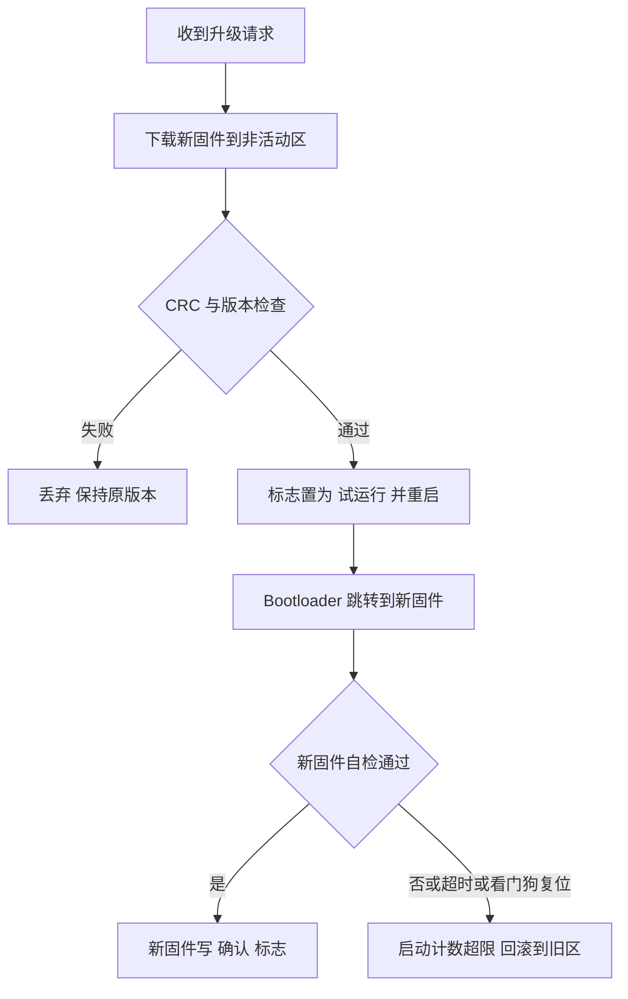

# 电源管理、低功耗、看门狗、Bootloader 与 OTA 升级

> **一句话定位**：控制算法写得再好，板子在电机启动时电压一掉就复位、程序一跑飞就没人救、固件升级一断电就变砖，机器人也不能用。这一章讲嵌入式系统"活下来"的四件事：供电与掉电检测、低功耗模式与功耗预算、独立/窗口看门狗、Bootloader 分区与带回滚的 OTA。

**本章学完你能：**

- 画出机器人控制板的典型电源树，说明 LDO 与开关电源的取舍、纹波与电机反灌对 MCU 的影响，解释 BOR/PVD 的作用；
- 区分 Sleep、Stop、Standby 三类低功耗模式，会做占空比平均电流与电池续航的手算；
- 用公式算 IWDG 超时、WWDG 窗口，并说出两种看门狗各防什么；
- 设计"喂狗"策略：为什么不能在定时器中断里无条件喂狗；
- 描述 Bootloader 的启动判定与跳转步骤（设置 MSP、VTOR、关外设再跳），区分单区、A/B 双区；
- 估算 OTA 传输时间与 Flash 擦写时间，设计"校验—试运行—确认—回滚"的升级流程；
- 用英文讲清 watchdog 与 OTA 的设计。

**前置知识：**[Cortex-M 体系与启动流程](./07_Cortex-M体系_启动_链接脚本_内存映射.md)（向量表、VTOR、MSP）；[STM32 一章](./01_STM32_时钟_GPIO_中断_DMA.md)；[FreeRTOS](./02_FreeRTOS实时系统.md)（任务与监控）。

**相关项目：**[P7 软件结构](../../01_项目课程/P7_可变腿长轮腿机器人/10_STM32H7_FreeRTOS_FDCAN软件结构.md)（监控任务喂独立看门狗）、[P3 调试与实战故障案例](../../01_项目课程/P3_RoboMaster英雄机器人嵌入式控制/11_调试与实战故障案例.md)（供电掉电致电机离线）、[P1 ROS-CAN 安全执行闭环](../../01_项目课程/P1_AIRS球形机器人平衡控制/08_ROS_CAN安全执行闭环.md)（驱动侧命令看门狗）。

## 目录

1. 为什么要关心"活下来"
2. 符号与单位
3. 电源树、掉电检测与复位源
4. 低功耗模式与功耗预算
5. 看门狗：IWDG 与 WWDG
6. Bootloader：启动判定、分区与跳转
7. OTA 升级：传输、校验、回滚
8. 完整手算汇总
9. 在七个项目里怎么用
10. 常见错误与故障现象
11. 英文面试问答
12. 要点速记、自测题、相关链接

---

## 1. 为什么要关心"活下来"

### 1.1 机器人上的三类"硬故障"

1. **供电故障**：电机堵转或急加速时，电池电压下陷、地线抖动，MCU 电压跌破复位阈值而复位。表现为"急加速时整车重启"。P3 的赛场故障里，"供电掉电致电机离线"就属这一类，参见 [P3 调试与实战故障案例](../../01_项目课程/P3_RoboMaster英雄机器人嵌入式控制/11_调试与实战故障案例.md)。
2. **软件卡死**：某个任务死循环、中断风暴或死锁，控制周期不再运行，而电机驱动器保持最后一条命令。这时需要硬件级的"最后防线"：看门狗。
3. **升级变砖**：固件升级到一半断电，Flash 里一半新一半旧，无法启动。需要带校验和回滚的升级流程。

### 1.2 与"功能安全"的关系

看门狗与电源监控是"检测"，使电机进入安全状态是"响应"。两者合在一起才是闭环：检测到异常 → 把输出置于已知安全状态（电机力矩为零或刹车）→ 报告。更系统的功能安全概念见 [13_系统工程与安全](../13_系统工程与安全/README.md)。

---

## 2. 符号与单位

| 符号 | 含义 | 单位 |
|---|---|---|
| $V_{in}$、$V_{out}$ | 稳压器输入、输出电压 | V |
| $P_{LDO}$ | LDO 耗散功率 | W |
| $\eta$ | 开关电源效率 | 无量纲 |
| $I_{run}$、$I_{sleep}$ | 运行、睡眠电流 | mA、$\mu$A |
| $D$ | 工作占空比 | 无量纲 |
| $C_{bat}$ | 电池容量 | mAh |
| $f_{LSI}$ | 内部低速 RC 振荡器频率 | Hz（F4 标称约 32 kHz，范围较宽） |
| PR、RL | IWDG 预分频值与重装载值 | 无 |
| $T_{wd}$ | 看门狗超时 | s |
| $t_{erase}$、$t_{prog}$ | Flash 擦除、编程时间 | s |

---

## 3. 电源树、掉电检测与复位源

### 3.1 典型电源树

```text
 电池 (如 24 V 或 6S 锂电)
   |
   +--> 电机驱动器 / 电调（大电流，电机反电动势可能反灌）
   |
   +--> 降压 DC-DC  --> 12 V / 5 V（传感器、Jetson 或工控机、相机）
          |
          +--> 5 V 降压/LDO --> 3.3 V 数字电源 --> MCU、IMU、CAN 收发器
                                     |
                                     +--> 磁珠 + 电容 --> 3.3 V 模拟电源 (VDDA，给 ADC)
```

要点：

- **LDO（低压差线性稳压器）**：简单、低噪声，但耗散功率 $P_{LDO}=(V_{in}-V_{out})\,I$，压差大电流大时发热严重。
- **开关电源（Buck）**：效率高（$\eta$ 常见 85%–95%），但有开关纹波，需要滤波；模拟电源常在 Buck 之后再接一级 LDO 或磁珠 + 电容，以免纹波进入 ADC。
- **电机与逻辑分开**：大电流回路与小信号地的"星形接地"或单点接地，避免电机电流在公共地线上产生压降，进而被 MCU、IMU、编码器当作信号。

### 3.2 手算：LDO 发热

5 V 经 LDO 到 3.3 V，MCU 与外设共 150 mA。$P=(5-3.3)\times0.15=0.255$ W。若 LDO 封装热阻为 60 ℃/W（教学示例），温升 $=0.255\times60=15.3$ ℃。再加上环境 40 ℃，就是约 55 ℃，可接受。若输入改为 12 V，$P=(12-3.3)\times0.15=1.305$ W，温升 78 ℃，加环境 40 ℃ 到 118 ℃，必须换开关电源或加两级降压。

### 3.3 掉电检测：POR、PDR、BOR、PVD

| 单元 | 作用 |
|---|---|
| POR/PDR | 上电复位/掉电复位，电压低于约 1.7 V 量级保持复位（以数据手册为准） |
| BOR | 欠压复位，可选 3 个等级（F4：约 2.1 V / 2.4 V / 2.7 V 量级，需查手册） |
| PVD | 可编程电压检测，阈值可选约 2.0–2.9 V，**不复位**，而是产生中断（EXTI 线 16），让软件有机会在掉电前保存数据或让电机进入安全状态 |

实用组合：BOR 设到较高一档，防止 Flash 在欠压下写坏；PVD 中断作"掉电预警"，在里面把电机力矩置零、保存关键参数（如果 Flash 写入时间够）。

### 3.4 复位源与复位标志

STM32 的 `RCC->CSR`（F4）有复位标志位：IWDGRSTF、WWDGRSTF、BORRSTF、PINRSTF、PORRSTF、SFTRSTF（软件复位）。启动时**先读标志，再清标志**，把复位原因记入日志。这是排查"偶发重启"的第一步：知道是看门狗复位，就去查死循环；是 BOR，就去查电源。

---

## 4. 低功耗模式与功耗预算

### 4.1 三类模式（以 STM32F4 为例的概念）

| 模式 | 进入方式 | CPU | 时钟 | RAM | 唤醒源 | 典型唤醒时间量级 |
|---|---|---|---|---|---|---|
| Sleep | `WFI` / `WFE` | 停止 | 外设时钟仍可运行 | 保持 | 任意中断 | 几个周期 |
| Stop | `PWR` 设置 + `WFI` | 停止 | 高速时钟（HSE/PLL）停 | 保持 | EXTI、RTC 等 | 几微秒到几十微秒 |
| Standby | `PWR` 设置 + `WFI` | 停止 | 1.2 V 域断电 | 丢失（备份域可保持） | WKUP 引脚、RTC、IWDG、复位 | 数十到数百微秒，等同复位 |

`WFI`（Wait For Interrupt）：等待中断；`WFE`（Wait For Event）：等待事件。RTOS 的 Idle 任务可调用 `WFI`，这样在无任务运行时 CPU 休眠，FreeRTOS 提供 tickless idle（`configUSE_TICKLESS_IDLE`）让 SysTick 也停下，直到下一个任务到期。

### 4.2 机器人的低功耗吗

电池供电的整车一般**不追求 MCU 低功耗**——电机功率是 MCU 的几百倍。低功耗设计主要出现在 **P4 的 Hi3861 灌溉节点**（电池/太阳能）这类 IoT 节点。因此本节的手算既用于面试"功耗预算怎么做"，也要诚实说明：P3/P7 的控制板没有使用 Stop/Standby。

### 4.3 完整手算：占空比平均电流与续航

场景（教学示例，非项目实测）：一个土壤湿度节点，每 10 s 醒来一次：

- 活动：电流 $I_{run}=40$ mA，持续 $t_{on}=0.2$ s（读传感器、发数据）；
- 睡眠（Stop）：电流 $I_{sleep}=50\ \mu$A $=0.05$ mA，持续 $t_{off}=9.8$ s；
- 周期 $T=10$ s。

平均电流：

$$
I_{avg}=\frac{I_{run}t_{on}+I_{sleep}t_{off}}{T}=\frac{40\times0.2+0.05\times9.8}{10}=\frac{8+0.49}{10}=0.849\ \text{mA}.
$$

电池 2000 mAh，理想续航 $2000/0.849=2356$ h $\approx 98$ 天。对照：一直运行（40 mA）只有 $2000/40=50$ h，约 2 天。可见**占空比远比睡眠电流本身重要**：此例中 94% 的能耗来自 0.2 s 的活动期（$8/8.49$）。优化方向是缩短活动时间（比如让 Wi-Fi 发送更快完成），而不是继续压睡眠电流。

```python
Irun, ton, Isleep, toff = 40.0, 0.2, 0.05, 9.8
Iavg = (Irun*ton + Isleep*toff) / (ton + toff)
print(Iavg, 2000/Iavg, 2000/Iavg/24)   # 0.849 2355.7 98.2
```

> **注意**：实际电池有自放电、低温容量衰减、稳压器静态电流，上面的理想值通常再打 7 折左右（经验，需实测）。

---

## 5. 看门狗：IWDG 与 WWDG

### 5.1 要解决的问题

软件不会总是按预期运行：死循环、死锁、栈溢出、硬件损坏后 HardFault 死循环（见 [上一章](./07_Cortex-M体系_启动_链接脚本_内存映射.md)）。看门狗是一个**硬件定时器**：软件必须在规定时间内"喂狗"（重装计数器），否则计数到 0 触发复位。因为它是硬件，即使 CPU 卡死也会起作用。

### 5.2 IWDG（独立看门狗）

- 时钟来自内部低速 RC（LSI，F4 标称约 32 kHz，实际范围约 17–47 kHz，所以超时有 ±30% 级的误差），**独立于主时钟**，主时钟故障也能工作；
- 12 位递减计数器，预分频 PR ∈ {4, 8, 16, 32, 64, 128, 256}，重装载值 RL ∈ [0, 4095]；
- 一旦启动（写 `0xCCCC` 到 KR），**不能关闭**（除复位）；
- 喂狗：写 `0xAAAA` 到 KR。

超时公式：

$$
T_{wd}=\frac{PR\times (RL+1)}{f_{LSI}}.
$$

**手算**（按 $f_{LSI}=32$ kHz 标称）：

- PR = 64，RL = 499：$T=64\times500/32000=1.0$ s；
- PR = 4，RL = 3999：$T=4\times4000/32000=0.5$ s；
- 最大：PR = 256，RL = 4095：$T=256\times4096/32000=32.8$ s。

由于 LSI 误差，**不可用 IWDG 做精确定时**，只作"时间量级"的安全网。

### 5.3 WWDG（窗口看门狗）

- 时钟来自 APB1（PCLK1），因此**精度高但依赖主时钟**；
- 7 位递减计数器，范围 0x7F 到 0x40，计数器从 0x40 变为 0x3F（位 6 变为 0）触发复位；
- 另有"窗口值"：**只有计数器小于窗口值时才允许喂狗**，过早喂狗也触发复位——这样既能检测"卡死"（不喂），又能检测"跑飞到喂狗代码但时序不对"（喂得太频繁）。
- 提前唤醒中断（EWI）：计数到 0x40 时可产生中断，用于最后保存现场。

计数器时钟：

$$
f_{WWDG}=\frac{PCLK1}{4096\times WDGTB},\qquad T_{wd}=\frac{(T[5:0]+1)}{f_{WWDG}}.
$$

其中 WDGTB 为预分频 {1, 2, 4, 8}。

**手算**（F407，PCLK1 = 42 MHz，WDGTB = 8，教学示例）：

- $f_{WWDG}=42\times10^6/(4096\times8)=1281.7$ Hz，一步 $0.780$ ms；
- 计数器从 0x7F 开始：到 0x3F 需 $0x7F-0x3F=64$ 步，$T=64\times0.780=49.9$ ms；
- 设窗口值 0x50：计数器 ≤ 0x50 时才允许喂狗，即至少已过 $0x7F-0x50=47$ 步 $=36.7$ ms；
- 所以喂狗窗口约为 **36.7–49.9 ms**，对周期约 40 ms 的任务正好。

```python
import math
pclk, tb = 42e6, 8
step = 4096*tb/pclk
print(step*1e3, 64*step*1e3, (0x7F-0x50)*step*1e3)   # 0.780  49.93  36.67
```

### 5.4 两者对比

| 项目 | IWDG | WWDG |
|---|---|---|
| 时钟 | LSI（独立） | PCLK1（依赖主时钟） |
| 检测 | 软件卡死 | 卡死 + 过早/过晚喂狗（时序异常） |
| 精度 | 低（±30% 量级） | 高 |
| 超时量级 | 毫秒到数十秒 | 毫秒级（几十毫秒内） |
| 能否停止 | 否 | 否（启动后不可关） |
| 调试时 | 可通过 DBGMCU 冻结（避免断点时复位） | 同 |

### 5.5 喂狗策略：最重要的工程点

**错误做法**：在 SysTick 或定时器中断里无条件喂狗。这样即使主程序已卡死，中断仍然运行，狗被喂饱，看门狗形同虚设。

**正确做法**：只在**确认所有关键任务都健康**时喂狗。典型实现（也是 [P7](../../01_项目课程/P7_可变腿长轮腿机器人/10_STM32H7_FreeRTOS_FDCAN软件结构.md) 采用的结构）：监控任务周期运行，检查每个关键任务的"心跳计数器"是否在上个周期内更新；全部更新才喂狗。

```c
/* 教学示例：心跳位掩码式监控 */
#define HB_CTRL   (1u << 0)
#define HB_IMU    (1u << 1)
#define HB_COMM   (1u << 2)
#define HB_ALL    (HB_CTRL | HB_IMU | HB_COMM)

volatile uint32_t g_hb;           /* 各任务运行时 g_hb |= HB_xxx（用原子或关中断） */

void MonitorTask(void *arg)
{
    TickType_t last = xTaskGetTickCount();
    for (;;) {
        vTaskDelayUntil(&last, pdMS_TO_TICKS(10));
        uint32_t hb = __atomic_exchange_n(&g_hb, 0, __ATOMIC_SEQ_CST);
        if ((hb & HB_ALL) == HB_ALL) {
            HAL_IWDG_Refresh(&hiwdg);
        } else {
            motors_set_safe();     /* 先使电机进入安全状态，再等复位 */
        }
    }
}
```

注意：控制任务 2 ms 一周期，监控任务 10 ms 检查一次，则每 10 ms 内控制任务至少应更新 5 次；检查"至少更新一次"即可。IWDG 超时（例如 100 ms）要大于监控检查周期的数倍，又小于"电机无控制时可接受的最长时间"。

### 5.6 看门狗复位后的安全状态

复位后 MCU 重新初始化，GPIO 回到默认（通常是高阻/输入）。驱动器应能在"命令超时"后自行停止，否则 MCU 复位的几十毫秒内电机还会按旧命令转。P1 在驱动侧设了 100 ms 命令看门狗（超时则轮速命令置零，见 [P1 第 8 章](../../01_项目课程/P1_AIRS球形机器人平衡控制/08_ROS_CAN安全执行闭环.md)），这是系统级看门狗；它与 MCU 的 IWDG 层次不同，互为补充。

> **诚实边界**：读 P2 底盘固件时发现 `Error_Handler` 是死循环，且没有启用 IWDG 的代码（见 [P2 固件解读](../../01_项目课程/P2_未来动力双臂遥操作与差速底盘/09_STM32H7_FDCAN底盘固件解读.md)）。这是读码发现的隐患，不是自己的贡献，面试时只能说成"我在读固件时注意到这个风险，并会怎么改"。

---

## 6. Bootloader：启动判定、分区与跳转

### 6.1 为什么需要 Bootloader

没有 Bootloader，升级固件要接调试器。Bootloader 是一段**常驻小程序**，位于 Flash 起始，上电先运行，职责：

1. 判定是否进入升级模式（按键、特殊 CAN 帧、应用写入的标志）；
2. 若不升级，校验应用并跳转；
3. 升级时接收新固件，写入 Flash，校验。

### 6.2 Flash 分区（F407 1 MB 示例，教学示例）

F407 的 Flash 扇区：Sector 0–3 各 16 KB（共 64 KB），Sector 4 为 64 KB，Sector 5–11 各 128 KB。

| 区域 | 地址 | 大小 | 用途 |
|---|---|---|---|
| Bootloader | 0x0800_0000 | Sector 0–1（32 KB） | 启动判定、升级 |
| 配置/标志区 | 0x0800_8000 | Sector 2（16 KB） | 升级标志、版本、启动计数 |
| 保留 | 0x0800_C000 | Sector 3（16 KB） | 校准参数等 |
| 应用 A | 0x0801_0000 | Sector 4–6（64 + 128 + 128 = 320 KB） | 当前应用 |
| 应用 B | 0x0806_0000 | Sector 7–9（384 KB）|备用/新版本 |

**擦除的最小单位是扇区**，不是字节，所以分区必须以扇区边界为界；同一扇区里不能同时放"不可擦的配置"和"要升级的代码"。

### 6.3 跳转到应用的完整步骤

```c
typedef void (*pFunc)(void);

void jump_to_app(uint32_t app_addr)
{
    uint32_t msp = *(volatile uint32_t*)app_addr;           /* 应用向量表第0项 */
    uint32_t rst = *(volatile uint32_t*)(app_addr + 4);     /* 复位向量 */

    /* 1. 合法性检查：栈顶应在 RAM 范围，复位向量应在 Flash 范围 */
    if ((msp & 0x2FFE0000u) != 0x20000000u) return;
    if ((rst < 0x08000000u) || (rst > 0x080FFFFFu)) return;

    /* 2. 关闭所有中断、关 SysTick、清挂起 */
    __disable_irq();
    SysTick->CTRL = 0; SysTick->LOAD = 0; SysTick->VAL = 0;
    for (int i = 0; i < 8; i++) { NVIC->ICER[i] = 0xFFFFFFFF; NVIC->ICPR[i] = 0xFFFFFFFF; }

    /* 3. 反初始化用过的外设（HAL_DeInit / 时钟复位），H7 还要关 Cache */
    HAL_RCC_DeInit();

    /* 4. 设置向量表与栈指针，再跳转 */
    SCB->VTOR = app_addr;
    __set_MSP(msp);
    ((pFunc)rst)();
}
```

每一步的"为什么"：

- 检查栈顶与复位向量范围，防止跳到空白 Flash（全 0xFF 的栈顶 0xFFFFFFFF 会通不过检查）；
- 关中断和 SysTick，避免应用尚未设好向量表时被 Bootloader 的中断打断；
- 反初始化外设，使应用拿到一个接近复位状态的芯片；
- **先 VTOR 后 MSP 再跳**：应用的 `Reset_Handler` 假设自己是"刚复位"，但此时 MSP 还指向 Bootloader 的栈，所以要手工设置。

应用端同样需要配置：链接脚本把 Flash 起始地址改为 `0x0801_0000`，并在 `SystemInit` 里设置 `VTOR`（CubeMX 生成的 `VECT_TAB_OFFSET`）。**忘了改其中一个，中断一发生就跳到错误的地方。**

### 6.4 镜像头与校验

在应用开头（或固定位置）放一个头部：

| 字段 | 说明 |
|---|---|
| magic | 固定魔数，如 0xA5A5A5A5，识别有效镜像 |
| version | 版本号 |
| size | 镜像大小 |
| crc32 | 镜像 CRC32 |
| 签名（可选） | 防篡改，非对称签名（量产场景；本章不展开密码学细节） |

Bootloader 在跳转前计算 CRC32 并比较；CRC 能发现传输错误和断电损坏，**不能防止恶意篡改**（需要签名）。

### 6.5 A/B 双区与单区升级

| 方案 | 做法 | 优点 | 缺点 |
|---|---|---|---|
| 单区（覆盖升级） | Bootloader 把新固件直接擦写到应用区 | Flash 占用最小 | 升级中途断电即变砖，只能靠 Bootloader 再次进入升级模式 |
| 暂存区 + 拷贝 | 新固件先收进暂存区，校验通过后再拷到应用区 | 传输中断不影响现有应用 | 拷贝阶段仍有断电风险，需断点续拷 |
| A/B 双区 | 新固件写到非活动区，校验通过后切换启动标志 | 任何时刻至少有一份完整可用的固件，可回滚 | Flash 需要两倍 |

A/B 切换用"标志区"保存：当前活动区、试运行状态、启动计数。标志区更新要**原子**：写入一个带 CRC 的记录，上电时读两份副本（或用递增序号）取较新的有效一份。

---

## 7. OTA 升级：传输、校验、回滚

### 7.1 OTA 的完整流程



核心思想：**新固件必须自己"证明"能正常工作，才算升级成功**。试运行期间 Bootloader 记录启动次数，若新固件连续 N 次（如 3 次）启动都没写"确认"标志（看门狗复位、HardFault 都会导致未确认），就回滚到旧区。看门狗在这里扮演"试运行失败检测器"。

### 7.2 传输方式与时间估算

**UART**：115200 波特，8N1 每字节 10 位，吞吐 $115200/10=11520$ B/s。传 256 KiB 固件：$262144/11520=22.8$ s。若提高到 921600 波特：$921600/10=92160$ B/s，$262144/92160=2.84$ s。

**CAN（1 Mbps）**：标准 8 字节数据帧约 111 位（含位填充的估计，见 [CAN 一章](./03_CAN_FDCAN与电机通信.md)），每秒约 $10^6/111=9009$ 帧，净载荷 $9009\times8=72072$ B/s。传 256 KiB：$262144/72072=3.64$ s。这是理想值，实际要加上应答、重传和 Flash 写入等待。**机器人上常常通过 CAN 升级各节点，因为总线已经存在**，但会占满总线，所以需要停止正常控制才能升级，不能在运行中升级运动控制节点。

```python
size = 256*1024
print(size/(115200/10))             # 22.76 s
print(size/(921600/10))             # 2.84 s
print(size/(1e6/111*8))             # 3.64 s
```

### 7.3 Flash 擦写时间与分块

Flash 擦除很慢（量级：一个 128 KB 扇区几百毫秒到 2 秒，以数据手册为准；本章为教学量级），期间**读 Flash 被阻塞**（F4 单 bank 下，擦除时 CPU 取指会停顿），所以：

- 在应用里做 OTA 时，擦写代码必须放在 RAM 中执行，或接受停顿；
- 擦写期间所有控制任务停摆——这就是为什么运动控制节点升级时必须先使电机安全；
- 分块写入（例如每 256 B 或 1 KB 一包），每包校验，失败重传。

**手算**：256 KiB 应用占 Sector 4 开始的 64 + 128 + 128 = 320 KB 区，需要擦 3 个扇区。假设擦除总共 2.5 s（教学示例），编程速率 $\approx 100$ KB/s（32 位并行编程的量级估计），则编程 $256/100=2.56$ s。总升级时间（CAN 传输 3.64 s 与擦除可部分流水）约 $2.5+3.64+0.5(\text{校验与重启})\approx6.6$ s（保守串行估计）。

### 7.4 回滚的状态机

标志区状态：`ACTIVE_A_CONFIRMED`、`PENDING_B`（待试运行）、`TRIAL_B`（试运行，计数 n）、`ACTIVE_B_CONFIRMED`。转换：

- 下载并校验成功：`ACTIVE_A_CONFIRMED` → `PENDING_B`；
- 重启后 Bootloader 看到 `PENDING_B`，改为 `TRIAL_B(n=1)` 并启动 B；
- B 自检通过写 `ACTIVE_B_CONFIRMED`；
- 若 B 没写确认而重启，Bootloader 看到 `TRIAL_B(n)`，n < 3 则 n+1 再试，n ≥ 3 则回滚 `ACTIVE_A_CONFIRMED`。

标志区的更新必须保证**断电安全**：写新记录再让旧记录失效（先写后废），不要"先擦后写"同一个记录。

### 7.5 安全性（简述）

OTA 引入了攻击面：未经认证的固件可能控制机器人电机。工程上应有签名校验、版本防回退（防止降级到有漏洞的版本）、传输加密。这些属于更大的主题，面试只需知道"CRC 不等于安全"。本仓库不展开密码学，相关引用若需要请查阅一手资料（未核对）。

---

## 8. 完整手算汇总

| 项 | 公式 | 结果（教学示例） |
|---|---|---|
| LDO 发热 | $(V_{in}-V_{out})I$ | 5 V→3.3 V 150 mA：0.255 W；12 V：1.305 W |
| 平均电流 | $\sum I_k t_k/T$ | 0.849 mA；2000 mAh 约 98 天 |
| IWDG 超时 | $PR(RL+1)/f_{LSI}$ | PR64、RL499：1.0 s |
| WWDG 超时 | $(T+1)\cdot 4096\cdot WDGTB/PCLK1$ | 49.9 ms，窗口 36.7–49.9 ms |
| UART 传 256 KiB | 大小 / (波特率/10) | 22.8 s（115200），2.84 s（921600） |
| CAN 传 256 KiB | 大小 / (帧率×8) | 3.64 s |

---

## 9. 在七个项目里怎么用

| 项目 | 关联点 | 性质 |
|---|---|---|
| P7（STM32H7） | 软件结构里的看门狗行：独立看门狗，由监控任务在所有任务健康时喂；HardFault 与看门狗相关中断优先级为 0，进入后立即失能电机（见 [P7 软件结构](../../01_项目课程/P7_可变腿长轮腿机器人/10_STM32H7_FreeRTOS_FDCAN软件结构.md) 的设计取值） | 项目设计取值 |
| P3（F407） | CV 与课程文档中没有写 IWDG；有软件层面的 detect 任务（10 ms）做离线检测：DBUS 100 ms、电机反馈 50 ms、视觉 100 ms、板间 100 ms 超时即 RELAX；供电掉电致电机离线是赛场故障之一 | 事实：软件离线检测；IWDG 为延伸知识 |
| P1 | 驱动侧 100 ms 命令看门狗：控制节点失效则轮速命令置零 | 项目事实（系统级看门狗） |
| P2 | 读码发现 `Error_Handler` 死循环、未启用 IWDG：读码发现的隐患，不是自己的贡献 | 读码发现 |
| P4（Hi3861） | 电池/低功耗是 IoT 节点的典型问题；OTA 在 OpenHarmony 轻量系统上有对应机制，细节未核对；CV 与课程未写 P4 做过 OTA 或低功耗 | 延伸知识 |
| P5 / P6 | 上位机侧运行在 Linux/OpenHarmony；P6 的"安全执行链"是软件层面的"检测—响应"，与本章看门狗是同一思想的不同层次 | 概念类比 |

> **面试提示**：如果面试官问"你的项目里用看门狗了吗"，对 P7 可以说"监控任务在所有关键任务心跳正常时才喂独立看门狗，并且 HardFault 里先失能电机"（这是本项目取值）；对 P3 可以说"我们用软件离线检测，没有依赖 IWDG；如果重做，我会加上"。这样不夸大。

---

## 10. 常见错误与故障现象

1. **在定时器中断里喂狗**：任务死了狗还活着，等于没装。
2. **IWDG 超时设得太短**：Flash 擦除、日志输出等偶发长操作触发复位，表现为"偶尔重启"。
3. **调试时被看门狗复位**：断点停住后 IWDG 照常计数，一会儿就复位。需要在 `DBGMCU->APB1FZ` 里冻结看门狗。
4. **没读复位标志**：重启原因不明，只能猜。
5. **Bootloader 跳转前没关中断/SysTick**：SysTick 在应用设好向量表前触发，跳到错误地址。
6. **应用链接地址与实际烧录地址不一致**：应用以 0x0800_0000 链接却烧在 0x0801_0000，绝对地址全错，现象是跳转后立刻 HardFault。
7. **OTA 无回滚**：新版本有 bug 就无法回到旧版本，现场只能拆机用调试器。
8. **擦除期间读 Flash**：F4 单 bank 擦除时执行 Flash 中的代码会停顿；若控制中断仍在 Flash 中执行，控制周期会被拖长十倍以上。
9. **标志区"先擦后写"**：擦完断电，标志丢失，无法判断状态。
10. **低功耗唤醒后时钟没恢复**：Stop 模式唤醒后 MCU 回到 HSI，需要重配 PLL，否则 UART 波特率错误。

---

## 11. 英文面试问答

### Q1. What is the difference between an independent watchdog and a window watchdog?

**Answer.** The independent watchdog runs from a separate low-speed oscillator, so it still works if the main clock fails. It only checks that the software feeds it before the timeout, but its accuracy is low. The window watchdog runs from the peripheral clock, so it is more accurate, and it also has a window: if you refresh it too early, it resets the chip. That means it can detect both a stuck program and a runaway program that refreshes at the wrong time. I would use the independent one as a last safety net, and the window one when timing matters.

**中文译文**：独立看门狗用单独的低速振荡器，主时钟故障时也能工作，只检查是否在超时前喂狗，但精度低。窗口看门狗用外设时钟，精度更高，并且有窗口：喂得太早也会复位，所以既能发现程序卡死，也能发现在错误时刻喂狗的跑飞程序。我把独立看门狗作为最后一道安全网，对时序敏感时用窗口看门狗。

**Follow-up 1:** Why not feed the watchdog from a timer interrupt? — Because the interrupt keeps running even if the main tasks are dead, so the watchdog would never fire. Feed it only when all critical tasks have shown a heartbeat. （中断在主任务死掉后仍会运行，狗永远不会触发；应在所有关键任务心跳正常时才喂。）

**Follow-up 2:** What should the motors do while the chip is resetting? — The driver should have its own command timeout, so it stops on its own. （驱动器应有自己的命令超时，自行停止。）

### Q2. How do you design a safe firmware update over CAN?

**Answer.** I would use a bootloader with two application slots. The new image is downloaded into the inactive slot in small blocks, each with a checksum, and the whole image is checked with a CRC and a version check. Then I set a trial flag and reboot. The new firmware must confirm itself after its self-test. If it resets or the watchdog fires before confirming, the bootloader counts the attempts and rolls back to the old slot after three tries. The motors must be in a safe state during the update, because the bus is fully used and flash erase stalls the CPU.

**中文译文**：我会用带两个应用区的 Bootloader。新镜像分小块下载到非活动区，每块带校验，整个镜像再做 CRC 和版本检查。然后置试运行标志并重启。新固件自检通过后必须自己确认；若确认前复位或看门狗触发，Bootloader 计数，三次后回滚到旧区。升级期间电机必须处于安全状态，因为总线被占满，Flash 擦除也会让 CPU 停顿。

**Follow-up 1:** Does a CRC protect against a malicious image? — No, CRC detects accidental errors only. You need a signature to authenticate the image. （CRC 只能发现偶然错误；要防恶意镜像需要签名。）

**Follow-up 2:** What is the risk of updating a single-slot system? — If power is lost during the write, the device may be left without a valid application. （写入时断电可能没有有效应用。）

### Q3. How would you estimate battery life for a sensor node?

**Answer.** I compute the average current from the duty cycle. For example, if the node is active for 0.2 seconds every 10 seconds at 40 milliamps, and sleeps the rest of the time at 50 microamps, the average is about 0.85 milliamps. A 2000 milliamp-hour battery gives roughly 98 days in the ideal case. The important point is that most of the energy goes to the short active period, so the best optimisation is to shorten the active time, not to reduce the sleep current. This is a teaching example, not a figure from my projects.

**中文译文**：我用占空比计算平均电流。例如每 10 秒活动 0.2 秒、电流 40 mA，其余时间睡眠 50 μA，平均约 0.85 mA；2000 mAh 电池理想情况下约 98 天。关键是大部分能量花在短暂的活动期，所以最好的优化是缩短活动时间而不是降低睡眠电流。这是教学示例，不是我项目里的数据。

**Follow-up 1:** What else reduces the real battery life? — Self-discharge, low temperature, regulator quiescent current, and wake-up transients. （自放电、低温、稳压器静态电流、唤醒瞬态。）

**Follow-up 2:** Is low power important in your robot projects? — Not for the controller boards; motors dominate the power. It matters more for battery-powered IoT nodes like the irrigation controller. （控制板不重要，电机主导功耗；对电池供电的 IoT 节点如灌溉控制器更重要。）

### Q4. Why does a robot sometimes reboot when the motors accelerate hard?

**Answer.** The usual cause is a supply dip. A sudden current demand pulls the battery voltage down, or the ground bounces, and the controller supply goes below the brown-out threshold. I would check the reset flags first to see if it was a brown-out or a watchdog reset, then measure the supply rail with an oscilloscope during acceleration. Fixes include better grounding between the power stage and the logic, a larger bulk capacitor, a separate regulator for logic, limiting acceleration current, and using the programmable voltage detector to put the motors in a safe state before the reset.

**中文译文**：通常是供电跌落：突然的大电流使电池电压下降或地线弹跳，控制器电源低于欠压阈值。我先看复位标志判断是欠压还是看门狗复位，再用示波器在加速时测电源轨。办法包括功率级与逻辑的地线处理、更大的储能电容、给逻辑单独稳压、限制加速电流，以及用可编程电压检测在复位前让电机进入安全状态。

**Follow-up 1:** How do you tell a brown-out reset from a watchdog reset? — Read the reset flag register at startup, before clearing it. （启动时先读复位标志寄存器再清除。）

**Follow-up 2:** Did you see this in your projects? — In the RoboMaster robot, power loss causing motors to go offline was one of the field failures, and I handled it with offline detection and a safe state. （在 RoboMaster 项目里，掉电导致电机离线是赛场故障之一，我用离线检测和安全状态处理。）

---

## 12. 要点速记、自测题、相关链接

### 要点速记

1. LDO 发热 $=(V_{in}-V_{out})I$；压差大电流大就换开关电源。
2. BOR 复位，PVD 只发中断；PVD 适合做掉电预警。
3. 启动先读复位标志，再清除，记录日志。
4. Sleep 只停 CPU，Stop 停高速时钟保 RAM，Standby 丢 RAM。
5. 平均电流 $=\sum I_k t_k/T$；占空比比睡眠电流更重要。
6. IWDG：独立 LSI，$T=PR(RL+1)/f_{LSI}$，精度低；WWDG：PCLK1，有窗口。
7. 看门狗不能在中断里无条件喂；要看所有关键任务的心跳。
8. Bootloader 跳转：校验、关中断、反初始化、设 VTOR、设 MSP、跳转。
9. 擦除以扇区为单位；A/B 分区 + 试运行 + 回滚是安全 OTA 的核心。
10. CRC 防偶发错误，签名防恶意篡改。

### 自测题

1. 5 V 降到 3.3 V，电流 200 mA，LDO 耗散多少？改用 90% 效率的 Buck 又耗散多少？
2. PR = 32，RL = 999，$f_{LSI}=32$ kHz，IWDG 超时是多少？若 LSI 实际为 40 kHz，超时变为多少？
3. 为什么窗口看门狗能发现"跑飞但仍在喂狗"的程序？
4. Bootloader 跳转到 0x0801_0000 的应用，需要哪三个关键动作？
5. 256 KiB 固件通过 500 kbps CAN 传输需要多久（用 111 位/帧、8 字节载荷估算）？

**参考答案要点**：1. $(5-3.3)\times0.2=0.34$ W；Buck 输出功率 0.66 W，损耗 $0.66\times(1/0.9-1)=0.073$ W。2. $32\times1000/32000=1.0$ s；$32000/40000=0.8$ s。3. 太早喂狗（计数器大于窗口值）会复位。4. 设 VTOR、设 MSP、跳到复位向量（并先关中断/外设）。5. 帧率 $500000/111=4505$ 帧/s，净载荷 36036 B/s，$262144/36036\approx7.3$ s。

### 相关链接

- 上一章：[Cortex-M 体系、启动与内存映射](./07_Cortex-M体系_启动_链接脚本_内存映射.md)
- 下一章：[ADC、PWM、定时器与 FOC 电机控制原理](./09_ADC_PWM_定时器_FOC电机控制原理.md)
- 相关：[CAN 与 FDCAN](./03_CAN_FDCAN与电机通信.md)、[FreeRTOS](./02_FreeRTOS实时系统.md)、[嵌入式调试](./10_嵌入式调试_JTAG_SWD_逻辑分析仪_故障定位.md)、[OpenHarmony/Hi3861/RK3588 平台](./06_OpenHarmony_Hi3861_RK3588平台基础.md)
- 八股：[嵌入式与机电八股](../../03_八股知识/03_机器人学/06_嵌入式与机电八股.md)
- 项目：[P3](../../01_项目课程/P3_RoboMaster英雄机器人嵌入式控制/README.md)、[P7](../../01_项目课程/P7_可变腿长轮腿机器人/README.md)、[P1](../../01_项目课程/P1_AIRS球形机器人平衡控制/README.md)
