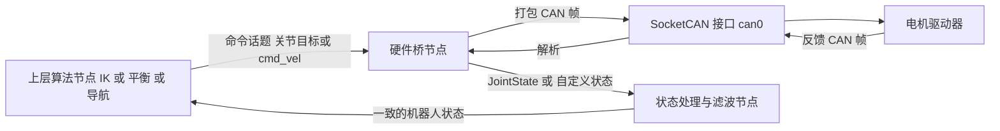

# 04 ROS2 Humble 核心概念（ROS1 仅作对比）

> **一句话定位**：本章以 **ROS2 Humble（Ubuntu 22.04）** 为主线，ROS1（Noetic 等）只在需要解释设计来历或应对面试对比题时出现，标题和表格里会明确标注“ROS1 对比”。ROS（Robot Operating System）不是操作系统，而是一套"让很多个进程按统一接口交换数据、复用别人写好的机器人软件"的中间件加工具链；本章把它讲到"能在真机上排错、能在面试里讲清楚设计取舍"的程度。

**本章学完你能：**

- 用自己的话讲清节点、话题、服务、动作、参数、launch 各自解决什么问题，什么时候该用哪一个；
- 画出 ROS1（有 master）与 ROS2（去中心化、基于 DDS）的架构差别，并解释"为什么 ROS2 没有 roscore"；
- 读懂一个 `.msg` / `.srv` / `.action` 文件，手算一条消息的大致字节数，知道为什么消息里要带 `header.stamp` 和 `frame_id`；
- 判断两个节点的 QoS 能不能匹配，解释"话题名对了却收不到数据"的最常见原因；
- 解释 ROS2 执行器（executor）与回调组（callback group）怎样决定"回调是否并发"，并手算一次回调阻塞造成的控制抖动；
- 正确使用仿真时间（`use_sim_time`、`/clock`），理解 rosbag / ros2 bag 回放时哪些东西会出错；
- 区分 catkin 与 colcon/ament，知道 overlay / underlay、`source` 的含义；
- 说出 ros_control / ros2_control 的"硬件接口—控制器管理器—控制器"三层结构；
- 按固定顺序排查真机问题，并能讲出一条典型的 "ROS2 → CAN → 电机" 执行链及其安全层。

**前置知识：**

- [Linux 与 Shell、Git](./01_Linux与Shell_Git.md)（环境变量、进程、`source`、终端多开）
- [C++ 现代特性与工程实践](./02_C++现代特性与工程实践.md)（智能指针、lambda、`std::chrono`、线程与锁）
- [Python 工程与科学计算](./03_Python工程与科学计算.md)（包、虚拟环境、`rclpy` 示例要用）
- [CAN / FDCAN 与电机通信](../11_嵌入式与通信/03_CAN_FDCAN与电机通信.md)（第十三章的执行链会用到）

**目录**

1. ROS 要解决什么问题
2. 计算图：节点、话题、服务、动作、参数、launch
3. ROS2 的去中心化架构（对比 ROS1 的 master 架构）
4. 消息与 `.msg`：接口合同
5. QoS：服务质量策略（入门版）
6. 执行器与回调组：回调到底在哪个线程跑
7. 时间：系统时间、ROS 时间、仿真时间
8. rosbag / ros2 bag：录制与回放
9. TF 速览
10. 构建系统：colcon / ament（对比 ROS1 catkin）
11. ros2_control（对比 ROS1 ros_control）
12. 真机调试常用命令与排错顺序
13. 典型的 ROS2 → CAN 执行链
14. 在本项目里怎么用（P1 / P2 / P5 / P6）
15. 常见错误与故障现象
16. 面试怎么问、怎么答
17. 自测题
18. 本章要点速记与相关链接

---

## 1. ROS 要解决什么问题

### 1.1 直觉

一台机器人的软件至少包含：读传感器的驱动、状态估计、规划、控制、电机驱动、可视化、日志。如果它们都写在一个 `main()` 里，换一个传感器就要改全局；如果每个模块是独立进程，又需要回答三个问题：

1. 进程之间怎么**传数据**（IMU 读数从驱动进程到估计进程）；
2. 怎么**找到对方**（谁在发？地址是什么？）；
3. 怎么**复用**别人写好的模块（激光雷达驱动、导航栈、TF、可视化）。

ROS 就是对这三个问题的一套标准回答：**统一的通信抽象（话题、服务、动作）+ 统一的消息格式 + 发现机制 + 一大批按此接口写好的功能包 + 构建与调试工具。**

> **注意**：ROS 并不提供实时性保证。它的通信栈跑在普通 Linux 上，回调线程会被调度器抢占。真正需要硬实时的内环（比如 1 kHz 的电机电流环）放在 MCU 或实时线程里，ROS 通常负责"上层"（见第 13 章）。

### 1.2 版本地图

| 项目 | ROS1 | ROS2 |
|---|---|---|
| 常见发行版 | Melodic（Ubuntu 18.04）、Noetic（Ubuntu 20.04，ROS1 的最后一个长期支持版） | Foxy / Galactic（较老）、Humble（Ubuntu 22.04）、Jazzy（Ubuntu 24.04） |
| 通信底层 | 自研 TCPROS / UDPROS + 中心化 master | DDS / RTPS（通过 rmw 抽象层选实现） |
| 构建系统 | catkin（`catkin_make` / `catkin build`） | ament + colcon |
| 实时 / 多机 / 安全 | 弱 | 设计目标之一（QoS、去中心化、可加 DDS-Security） |
| 生命周期 | Noetic 已到官方维护期终点 | 持续发行 |

> **提示**：各发行版的支持截止时间请以 ROS 官方 REP-2000 / 发行版页面为准，本文不写具体月份，避免过期。面试里只需要知道"ROS1 已进入收尾期，新项目倾向 ROS2，但存量机器人和课程代码大量仍是 ROS1"。

---

## 2. 计算图：节点、话题、服务、动作、参数、launch

ROS 把整个系统看成一张图（computation graph）：**节点是顶点，通信是边。**

```text
  [imu_driver] --/imu/data--> [estimator] --/odom--> [controller] --/cmd--> [motor_bridge]
        ^                         ^                       ^
        |                         |                       |
   参数: frame_id          服务: reset_filter      动作: go_to_pose
```

### 2.1 节点（Node）

- **是什么**：一个负责单一功能的可执行单元（通常是一个进程，也可以在一个进程里放多个节点，叫 composition / nodelet）。
- **解决什么**：把系统拆成可独立开发、重启、替换的模块。
- **粒度原则**：按"变化原因"拆。驱动一个节点，估计一个节点，控制一个节点；不要把"读串口 + 滤波 + 控制 + 日志"塞进一个节点，否则某一块卡住会拖住全部。

### 2.2 话题（Topic）：发布 / 订阅

- **模式**：多对多、异步、无应答。发布者不知道谁在听，订阅者不知道谁在发。
- **适合**：连续数据流（传感器读数、状态、速度指令）。
- **关键属性**：话题名、消息类型、（ROS2）QoS。
- **类比**：广播电台。电台不管有没有听众；听众自己调频，且要求"频道名 + 节目格式"对得上。

### 2.3 服务（Service）：请求 / 应答

- **模式**：一对一、同步语义（客户端发请求，等应答），有请求类型和应答类型两部分，定义在 `.srv`。
- **适合**：短、快、返回确定结果的操作，如"重置滤波器""查询当前模式""保存地图"。
- **不适合**：耗时长、需要进度、需要中途取消的任务。服务在服务端回调里一直不返回，客户端就一直等。

### 2.4 动作（Action）：带进度、可取消的长任务

- **结构**：goal（目标）、feedback（过程反馈）、result（最终结果），加上取消机制。定义在 `.action`，三段用 `---` 分隔。
- **适合**：导航到点、机械臂执行轨迹、抓取。
- **本质**：ROS1 里是在话题上封装的一套协议（`goal/cancel/status/feedback/result` 五个话题）；ROS2 里基于服务 + 话题实现，并成为一等公民。
- **选型一句话**：连续流用话题；短查询用服务；"做一件要花几秒、要看进度、可能要取消"的事用动作。

### 2.5 参数（Parameter）

- **是什么**：节点的可配置键值（PID 增益、话题名、frame 名、限幅阈值）。
- **ROS1**：全局参数服务器（挂在 master 上），所有节点共享一棵键值树，用 `/ns/name` 访问。
- **ROS2**：参数属于**各个节点自己**，节点要先**声明**（`declare_parameter`）才能被设置；运行中可通过 `ros2 param set` 改，并可注册回调校验。没有全局服务器。
- **经验**：增益、限幅、frame 名一律走参数，不要写死在代码里；但改参数能热生效不等于改得安全——积分项、限幅在运行中被改要考虑切换瞬间的冲击。

### 2.6 launch：一次性启动一组节点

- **ROS1**：XML `.launch`，`roslaunch pkg file.launch`。
- **ROS2**：推荐 Python `launch.py`（也支持 XML / YAML），`ros2 launch pkg file.launch.py`。
- **能做什么**：启动多个节点、设置参数、话题重映射（remap）、命名空间、条件启动、包含其它 launch、传命令行参数。

ROS2 Python launch 的最小示例（教学示例，非项目源码，未运行核对）：

```python
from launch import LaunchDescription
from launch_ros.actions import Node

def generate_launch_description():
    return LaunchDescription([
        Node(
            package="my_driver",
            executable="imu_node",
            name="imu_driver",
            parameters=[{"frame_id": "imu_link", "rate_hz": 200.0}],   # 示例数值
            remappings=[("imu/data_raw", "/imu/data")],
        ),
        Node(package="my_ctrl", executable="balance_ctrl", name="balance",
             parameters=["config/balance.yaml"]),
    ])
```

> **面试要点**：能说出"launch 的价值是把'系统怎么起来'变成可版本管理的文本，而不是人手开七个终端"。

### 2.7 五种通信方式对比表

| 方式 | 方向 | 同步 | 典型用途 | 典型反例（用错） |
|---|---|---|---|---|
| 话题 | 多对多 | 异步 | IMU、里程计、`cmd_vel` | 用话题发"重置"命令却不确认是否生效 |
| 服务 | 一对一 | 请求—应答 | 查询、开关、重置 | 用服务做 10 秒的导航 |
| 动作 | 一对一 | 目标—反馈—结果 | 导航、轨迹执行 | 用动作传 1 kHz 的控制量 |
| 参数 | 节点内键值 | 读写 | 增益、阈值、名字 | 用参数当实时数据通道 |
| launch | 启动期 | — | 编排启动 | 在 launch 里写业务逻辑 |

---

## 3. ROS2 的去中心化架构（对比 ROS1 的 master 架构）

### 3.1 ROS1 对比：以 master 为中心（旧架构，仅作对照）

ROS1 里必须先有 `roscore`（含 master、参数服务器、rosout）。流程（以话题为例）：

```text
  Publisher 节点                 Master (roscore)                 Subscriber 节点
       |  1. registerPublisher(topic,type,自己的URI) ->|                    |
       |                                               |<- 2. registerSubscriber(topic) --|
       |                                               |-- 3. 通知：该 topic 的发布者是 URI_P --> |
       |<-------------- 4. requestTopic(topic, 协议=TCPROS) -------------------|
       |--------------- 5. 返回 TCPROS 地址端口 ------------------------------>|
       |<=============== 6. 两节点之间直接建立 TCP 连接，传数据 =================>|
```

要点：

1. master 只做**名字服务**（"谁发这个话题"），**数据不经过 master**，节点之间直连（TCPROS）。
2. 节点之间的握手用 XML-RPC。
3. 多机时必须配置环境变量：`ROS_MASTER_URI`（master 在哪）和 `ROS_IP` / `ROS_HOSTNAME`（我自己的地址，别人用它回连我）。
4. **单点故障**：master 挂了，已建立的连接还能继续传数据，但新节点无法互相发现，参数服务器不可用。
5. 所有节点名、话题名在同一个全局命名空间，节点名重复时后启动的会把前一个"踢下线"。

手算一个典型的多机配置（示例地址，非项目实测）：

| 机器 | 角色 | `ROS_MASTER_URI` | `ROS_IP` |
|---|---|---|---|
| 机器人上位机 | 跑 master + 驱动 | `http://192.168.1.10:11311` | `192.168.1.10` |
| 开发笔记本 | 跑 rviz、调试 | `http://192.168.1.10:11311` | `192.168.1.20` |

如果笔记本的 `ROS_IP` 写错（或写成无法被机器人解析的主机名），现象是：`rostopic list` 能看到话题，但 `rostopic echo` 没有数据——因为订阅方向机器人回连笔记本失败。这是 ROS1 多机最经典的坑。

### 3.2 ROS2（主线）：去中心化

ROS2 没有 master。节点在启动时用 DDS 的**发现协议**互相寻找：同一个 Domain 里的参与者（participant）广播自己的存在，再交换各自的读写端点信息（话题名、类型、QoS）。细节在 [DDS 与分布式通信](./05_DDS与分布式通信.md)。

```text
        ROS2 节点 A                        ROS2 节点 B
   +----------------------+          +----------------------+
   | rclcpp / rclpy       |          | rclcpp / rclpy       |
   | rcl (C 接口)          |          | rcl                  |
   | rmw (中间件抽象接口)   |          | rmw                  |
   | DDS 实现 (如 Fast DDS |<-------->| DDS 实现             |
   |  或 Cyclone DDS)     |  RTPS/UDP | (可以是同一家)        |
   +----------------------+          +----------------------+
```

分层的意义：应用代码只依赖 `rclcpp/rclpy`；换 DDS 实现只需改环境变量 `RMW_IMPLEMENTATION`，不改代码。常见发行版默认使用 Fast DDS，也可以切换到 Cyclone DDS 等。

### 3.3 对比

| 维度 | ROS1 | ROS2 |
|---|---|---|
| 发现 | master 集中 | DDS 分布式（多播或指定 peers / discovery server） |
| 单点故障 | 有（master） | 无 |
| 数据路径 | TCPROS 直连 | RTPS，可 UDP / 共享内存 / 零拷贝（视实现） |
| 隔离 | 靠 `ROS_MASTER_URI` 不同端口 | `ROS_DOMAIN_ID`（数字 0–101 为常用安全范围，详见第 05 章） |
| QoS | 几乎没有（只有队列长度、tcp_nodelay 等） | 丰富（可靠性、持久性、历史、deadline 等） |
| 参数 | 全局服务器 | 每个节点自己的参数 |
| 生命周期 | 节点起来就是 active | 有 lifecycle node（unconfigured/inactive/active/finalized） |
| 多线程 | 每个 spinner 线程数自己配 | 执行器 + 回调组模型 |
| 构建 | catkin | colcon + ament_cmake / ament_python |

> **面试要点（英文速答）**：*In ROS1 a central master only handles name lookup and data flows peer to peer, but it is still a single point of failure. ROS2 removes the master and uses DDS discovery, so nodes find each other without a central process, and we also get configurable QoS.*
> 中文：ROS1 的 master 只管"名字查询"，数据点对点直连，但它仍是单点故障；ROS2 取消 master，用 DDS 发现，节点无需中心进程，还多了可配置的 QoS。

---

## 4. 消息与 `.msg`：接口合同

### 4.1 它解决什么问题

两个独立开发的节点要交换数据，必须在"有哪些字段、什么类型、什么单位、什么坐标系"上达成一致。`.msg` 文件把它写成机器可读的合同，编译时生成 C++/Python 类。

### 4.2 语法

```text
# MotorCmd.msg  （教学示例，非项目源码）
std_msgs/Header header     # 含 stamp（时间戳）与 frame_id（坐标系名）
uint8   motor_id
float32 position           # rad
float32 velocity           # rad/s
float32 torque_ff          # N*m，前馈力矩
```

- 基础类型：`bool, int8..int64, uint8..uint64, float32, float64, string, time, duration`；
- 数组：`float64[] data`（变长）、`float64[3] xyz`（定长）；
- 嵌套：直接用别的消息类型，如 `geometry_msgs/Vector3 linear`；
- 常量：`uint8 MODE_POS=0`；
- `.srv`：请求与应答用 `---` 分隔；`.action`：goal / result / feedback 用两个 `---` 分隔。

```text
# SetMode.srv
string mode
---
bool ok
string message
```

### 4.3 为什么几乎所有传感器消息都带 `header`

`std_msgs/Header` 含两个对机器人至关重要的字段：

- `stamp`：**这条数据对应的物理采样时刻**（不是"节点收到的时刻"）；
- `frame_id`：数据是在哪个坐标系下表达的。

如果丢掉这两个字段，下游无法回答两个问题："这个读数是不是旧的？"和"这个向量的 x 轴指向哪里？"。这正是 P6 里"标准化时间戳、坐标系与有效性检查"要解决的问题，见 [07 章](./07_URDF_TF_坐标系实践.md) 第七章。

### 4.4 手算：一条消息序列化后多大

ROS2 的消息在 DDS 里通常用 CDR 序列化，规则要点：每个基本类型按**自身大小对齐**，对齐是相对数据流起点计算的；数据流前面还有 4 字节的封装头（encapsulation header）。

对上面的简化版消息（去掉 header，只保留 `uint8 motor_id; float32 position; float32 velocity`）手算：

| 字段 | 大小 | 起始偏移（相对数据体） | 说明 |
|---|---|---|---|
| `motor_id` | 1 | 0 | uint8，无需对齐 |
| 填充 | 3 | 1–3 | 让 float32 对齐到 4 的倍数 |
| `position` | 4 | 4 | |
| `velocity` | 4 | 8 | |
| 合计数据体 | 12 | | |
| 加封装头 | +4 | | 总计约 16 字节 |

若以 1 kHz 发布：16 B × 1000 = 16 kB/s（示例，仅演示算法；实际字节数以所用 rmw 的序列化为准，且 DDS 还有 RTPS 头等开销）。

**教训**：字段顺序影响填充；把大字段排前面可以少浪费字节（对高频小消息有意义）。

### 4.5 版本与兼容

消息一旦发布，不要随意改字段顺序或类型。ROS1 用 MD5 校验消息定义，两端 MD5 不同直接拒绝连接；ROS2 用类型哈希/类型名匹配。改了 `.msg` 却只重编一端，是"话题名对了但收不到"的常见原因之一。

---

## 5. QoS：服务质量策略（入门版）

> 完整的 QoS 策略、兼容性规则、手算在 [05 章](./05_DDS与分布式通信.md)。本章只给 ROS 用户必须知道的部分。

### 5.1 它解决什么问题

不同数据对"丢不丢""旧不旧""晚来者能不能补"的要求不同：

- 激光雷达 / 图像：新的来了旧的就没用，宁可丢也别积压 → 尽力而为（best effort）；
- 控制命令、任务请求：不能悄悄丢 → 可靠（reliable）；
- 地图、`/tf_static`：晚启动的订阅者也要能拿到"最后一份" → 持久性 transient local。

### 5.2 四个最常碰到的策略

| 策略 | 取值 | 含义 |
|---|---|---|
| Reliability | `RELIABLE` / `BEST_EFFORT` | 是否确认并重传 |
| Durability | `VOLATILE` / `TRANSIENT_LOCAL` | 后加入的订阅者能否收到历史样本 |
| History | `KEEP_LAST(depth)` / `KEEP_ALL` | 队列保留策略 |
| Depth | 整数 | `KEEP_LAST` 时的队列长度 |

rclcpp 里常用的预设：默认 `QoS(10)` 为 reliable + volatile + keep last 10；`SensorDataQoS()` 为 best effort + volatile + 浅队列；"静态 TF"用 transient local。

### 5.3 兼容性手算（核心一条规则：订阅方"要求"不能高于发布方"提供"）

| 发布者提供 | 订阅者要求 | 能连通吗 | 原因 |
|---|---|---|---|
| RELIABLE | RELIABLE | 能 | 一致 |
| RELIABLE | BEST_EFFORT | 能 | 提供更强，满足要求 |
| BEST_EFFORT | RELIABLE | **不能** | 提供弱于要求 |
| TRANSIENT_LOCAL | VOLATILE | 能 | 提供更强 |
| VOLATILE | TRANSIENT_LOCAL | **不能** | 订阅者想要历史，发布者不存 |

典型故障：驱动用 `SensorDataQoS`（best effort）发布激光，你自己写的订阅者用默认 `QoS(10)`（reliable）→ 两端静默不匹配，`ros2 topic echo` 默认 QoS 也可能收不到。排查：`ros2 topic info /scan -v` 会列出每个端点的 QoS，对照即可；`ros2 topic echo --qos-reliability best_effort /scan` 可用来验证。

### 5.4 队列深度手算

发布者 100 Hz，订阅回调每条要处理 15 ms（只能处理约 66 Hz），订阅者 keep last depth = 5，best effort：每秒到 100 条、处理 66 条，约 34 条/秒被覆盖丢弃；队列里的最新样本年龄受 depth 限制，最旧不超过约 5 × 10 ms = 50 ms 再加上正在处理的那条。若用 reliable + keep all，则队列无限增长，延迟越积越大，最终内存撑爆——**"不丢"与"不延迟"通常不可兼得**，控制类数据一般更怕延迟。

---

## 6. 执行器与回调组：回调到底在哪个线程跑

这是 ROS2 里面试最容易被追问、真机上最容易出隐蔽 bug 的部分。

### 6.1 问题

节点里有定时器回调（控制周期）、订阅回调（收传感器）、服务回调（改模式）。谁来调它们？**执行器（executor）**：`rclcpp::spin(node)` 背后就是一个执行器，它从 DDS 里取就绪的事件，调度对应回调。

### 6.2 执行器种类

| 执行器 | 行为 | 特点 |
|---|---|---|
| `SingleThreadedExecutor` | 一个线程顺序执行所有回调 | 无并发，不用担心数据竞争；但一个回调慢，其他全部等 |
| `MultiThreadedExecutor` | 线程池并发执行回调 | 能并行；但共享数据必须加锁 |
| （较新版本）`EventsExecutor` 等 | 事件驱动实现 | 版本相关，不展开 |

### 6.3 回调组（Callback Group）

回调组决定**哪些回调能同时运行**（只在多线程执行器下有意义）：

- `MutuallyExclusive`（默认）：同组的回调**互斥**，同一时刻最多一个在跑；
- `Reentrant`：同组的回调**可并发**，甚至同一个回调可以被多个线程同时进入（重入）；
- 不同组之间的回调可以并发。

每个节点创建时自带一个默认回调组（互斥型），所有订阅、定时器、服务默认挂在它上面。因此：**默认情况下，即使用了多线程执行器，一个节点的回调之间也互斥**，并没有真并发。想并发，要显式建多个回调组。

### 6.4 手算：回调阻塞怎样让控制周期抖动

示例（教学数值，非项目实测）：同一节点，单线程执行器，三个回调：

| 回调 | 触发 | 单次耗时 |
|---|---|---|
| 控制定时器 | 100 Hz（周期 10 ms） | 2 ms |
| IMU 订阅 | 200 Hz（周期 5 ms） | 0.5 ms |
| 图像订阅 | 20 Hz（周期 50 ms） | 30 ms |

CPU 占用（执行器线程的忙碌占比）：

$$
U = 100\times 2\,\text{ms} + 200\times 0.5\,\text{ms} + 20\times 30\,\text{ms} = 200 + 100 + 600 = 900\ \text{ms/s} = 90\%
$$

总占用 90%，看似还有余量，但**最坏响应时间**才是控制关心的：一个图像回调开始执行后会独占线程 30 ms，期间 3 个控制周期（10 ms × 3）到期无法执行。图像回调一结束，控制定时器才能补跑，于是控制周期出现最多约 30 ms 的抖动（ROS2 定时器在被延迟后会按已错过的次数处理，具体行为取决于版本与定时器类型）。

**修法**（按优先级）：

1. 把耗时回调（图像处理）放到**另一个节点/进程**；
2. 或用多线程执行器 + 把控制定时器放在**独立的互斥回调组**，图像订阅放在另一个组，则控制不被图像阻塞；
3. 回调里只做"取数据、写缓存"，计算在定时器里做（见 6.6）。

### 6.5 代码：两个回调组（教学示例，非项目源码，未运行核对）

```cpp
#include <rclcpp/rclcpp.hpp>
#include <sensor_msgs/msg/imu.hpp>
using namespace std::chrono_literals;

class BalanceNode : public rclcpp::Node {
 public:
  BalanceNode() : Node("balance") {
    // 两个互斥回调组：控制与重计算互不阻塞
    g_ctrl_ = create_callback_group(rclcpp::CallbackGroupType::MutuallyExclusive);
    g_heavy_ = create_callback_group(rclcpp::CallbackGroupType::MutuallyExclusive);

    rclcpp::SubscriptionOptions opt;
    opt.callback_group = g_heavy_;
    sub_ = create_subscription<sensor_msgs::msg::Imu>(
        "imu/data", rclcpp::SensorDataQoS(),
        [this](sensor_msgs::msg::Imu::SharedPtr m) {
          std::lock_guard<std::mutex> lk(mtx_);   // 只写缓存
          latest_ = *m;
        },
        opt);

    timer_ = create_wall_timer(10ms, [this] { control_step(); }, g_ctrl_);
  }

 private:
  void control_step() {
    sensor_msgs::msg::Imu snap;
    { std::lock_guard<std::mutex> lk(mtx_); snap = latest_; }  // 取一致快照
    // 用 snap 计算控制量并发布 ...
  }
  rclcpp::CallbackGroup::SharedPtr g_ctrl_, g_heavy_;
  rclcpp::Subscription<sensor_msgs::msg::Imu>::SharedPtr sub_;
  rclcpp::TimerBase::SharedPtr timer_;
  std::mutex mtx_;
  sensor_msgs::msg::Imu latest_;
};

int main(int argc, char** argv) {
  rclcpp::init(argc, argv);
  rclcpp::executors::MultiThreadedExecutor exec;   // 多线程执行器，回调组才有并发意义
  exec.add_node(std::make_shared<BalanceNode>());
  exec.spin();
}
```

### 6.6 设计原则："回调是搬运工，不是控制周期"

一条消息到来不等于一次控制周期。常见稳健做法：订阅回调只更新缓存（并记下消息时间戳）；**定时器**按固定周期读取缓存快照做一次完整计算并发布。这样控制频率不受消息到达频率影响，也容易检查"这份数据的年龄"。

### 6.7 经典死锁：回调里同步等服务

在单线程执行器的某个回调里，同步调用 `client->async_send_request(...).get()`（或 `spin_until_future_complete`）等待服务应答：应答的处理也需要这个唯一的执行线程，但它正卡在等待里 → 死锁。解法：异步回调、不要在回调里阻塞等待；或把客户端放在 Reentrant 组并用多线程执行器。

---

## 7. 时间：系统时间、ROS 时间、仿真时间

### 7.1 三种时钟

| 时钟 | 含义 | 用途 | 特性 |
|---|---|---|---|
| System time | 墙上时钟（wall clock），Unix 纪元 | 记录日志时间、跨机器对时 | 可被 NTP 调整，**可能跳变甚至回退** |
| Steady time | 单调时钟 | 测间隔、做超时 | 只增不减 |
| ROS time | 默认等于 system time；开启仿真时间后由 `/clock` 话题驱动 | 消息时间戳、TF、定时器 | 可被"暂停""倍速""回放" |

rclcpp 里：`node->now()` 返回 ROS time；`rclcpp::Clock(RCL_STEADY_TIME)` 用于超时。**测"已经过了多久"用 steady，打"这条数据发生在何时"用 ROS time。**

### 7.2 仿真时间（sim time）

仿真器（Gazebo 等）或回放 bag 时，系统希望所有节点用"仿真世界的时间"而不是墙钟：

1. 某个节点（仿真器或 `ros2 bag play --clock`）发布 `/clock`（`rosgraph_msgs/msg/Clock`）；
2. 其它节点设置参数 `use_sim_time:=true`（ROS1 里是全局参数 `/use_sim_time`）；
3. 这些节点的 `now()` 不再读墙钟，而是返回最近收到的 `/clock` 值。

典型启动：

```bash
# ROS2：回放 bag，并让所有消费节点用 sim time
ros2 bag play my_bag --clock
ros2 run my_pkg my_node --ros-args -p use_sim_time:=true
```

### 7.3 手算：回放时的时间换算

示例：bag 内录制了 10:00:00 到 10:01:00 共 60 s 数据；用 `-r 0.5`（半速）回放：

- 墙钟需要 60 / 0.5 = 120 s；
- `/clock` 在这 120 s 里从 10:00:00 走到 10:01:00（每走 1 s 的 sim time 花 2 s 墙钟）；
- 一个设了 `use_sim_time` 的 10 Hz 定时器，按 sim time 每 0.1 s 触发，即每 0.2 s 墙钟触发一次，回放期间共触发约 600 次，与实时跑一致。

### 7.4 常见时间错误

| 现象 | 原因 |
|---|---|
| `lookupTransform` 报"未来外推" | 某节点没开 `use_sim_time`，用墙钟查询，而 TF 里是仿真时间（或反之） |
| 回放时 TF 乱跳 | bag 里录了 `/tf`，同时现场的 `robot_state_publisher` 也在发 → 两个来源写同一条边 |
| 定时器不触发 | 开了 sim time 但没人发 `/clock` |
| 时间戳是 0 | 驱动忘了填 `header.stamp`（0 表示"无时间"，TF 会按"最新"处理，掩盖延迟） |
| 暂停 / 倍速后控制失常 | 控制里用了墙钟 `dt`，没用消息 / ROS 时间 |

> **注意**：多台机器时钟不同步（没有 NTP/PTP）时，跨机器的时间戳比较没有意义。时间对齐的更多讨论见 [时间同步、坐标系一致性与数据有效性](../06_状态估计/06_时间同步_坐标系一致性与数据有效性.md)。

---

## 8. rosbag / ros2 bag：录制与回放

### 8.1 它解决什么问题

真机跑一次很贵（场地、电池、安全）。把某次运行的话题数据完整录下来，之后可以离线复现、调算法、写回归测试。

### 8.2 常用命令

```bash
# ROS2
ros2 bag record -o run01 /imu/data /odom /scan /tf /tf_static   # 指定话题
ros2 bag record -a                                              # 全部话题（大）
ros2 bag info run01                                             # 时长、消息数、话题类型
ros2 bag play run01 --clock -r 1.0 --loop                       # 回放，发布 /clock

# ROS1
rosbag record -O run01.bag /imu/data /odom /scan /tf /tf_static
rosbag info run01.bag
rosbag play run01.bag --clock
```

ROS2 bag 的存储后端因发行版而异（常见有 sqlite3 与 mcap），以所用版本文档为准。

### 8.3 录什么、不录什么

- **必录**：原始传感器话题（IMU、编码器、激光）、`/tf`、`/tf_static`、控制指令、关键状态；
- **回放算法时不要同时回放**：被测节点自己会重新产生的话题（如它输出的 `/odom`、`/cmd_vel`），否则回放数据和实时输出"打架"；
- `/tf_static` 要在回放开始时就可用（QoS 是 transient local），中途启动的 bag 可能漏掉；
- 不录原始图像或点云会很省空间；录的话考虑压缩话题。

### 8.4 手算存储量

示例（教学数值）：IMU 200 Hz，每条约 300 B；激光 10 Hz，每帧 720 点 × 4 B ≈ 2.9 kB（加头部取 3 kB）；一分钟：

- IMU：200 × 60 × 300 B = 3.6 MB；
- 激光：10 × 60 × 3 kB = 1.8 MB；
- 合计约 5.4 MB/min，一小时约 324 MB。图像若 640×480×3 B ≈ 0.92 MB/帧、30 Hz → 约 27.6 MB/s，一分钟约 1.6 GB，所以实机调试通常只录压缩图像或关键片段。

### 8.5 bag 的价值不止回放

bag 是"最便宜的回归测试"：把一次失败工况录下来，修改算法后用同一 bag 回放对比输出，比反复上真机更可复现。需要注意回放速度与实时性：算法耗时过长时回放会堆积，结论要标明"离线回放，非实时"。

---

## 9. TF 速览

TF（transform）是 ROS 维护"坐标系之间怎么变换"的一套系统：所有坐标系组成一棵**树**（每个坐标系只有一个父），节点把变换发布到 `/tf`（动态）和 `/tf_static`（静态），任意节点可以查询"两个坐标系在某一时刻的相对位姿"。

```text
        map
         |  (定位节点发布，允许跳变)
        odom
         |  (里程计发布，连续但会漂)
      base_link
       /      \
  laser_link  imu_link      (静态外参，由 URDF 与 robot_state_publisher 发布)
```

本节只建立印象，语法、时间语义、故障排查全部在 [07 章](./07_URDF_TF_坐标系实践.md)。

---

## 10. 构建系统：colcon / ament（对比 ROS1 catkin）

### 10.1 概念对照

| | ROS1 | ROS2 |
|---|---|---|
| 工作空间结构 | `src/` `build/` `devel/`（`install/`） | `src/` `build/` `install/` `log/` |
| 构建命令 | `catkin_make` 或 `catkin build` | `colcon build` |
| 环境生效 | `source devel/setup.bash` | `source install/setup.bash` |
| 包描述 | `package.xml` + `CMakeLists.txt`（catkin） | `package.xml` + `CMakeLists.txt`（ament_cmake）或 `setup.py`（ament_python） |
| 依赖安装 | `rosdep install` | `rosdep install` |

### 10.2 colcon 常用

```bash
cd ~/ws
rosdep install --from-paths src --ignore-src -r -y     # 装系统依赖
colcon build --symlink-install                         # Python/launch/yaml 改了不用重编
colcon build --packages-select my_ctrl                 # 只编一个包
colcon build --cmake-args -DCMAKE_BUILD_TYPE=Release   # 控制类代码务必 Release
source install/setup.bash
```

`--symlink-install`：安装时对 Python 脚本、launch 文件、参数文件创建符号链接，改源文件立刻生效。C++ 仍需重编。

### 10.3 overlay / underlay 与 `source`

`source /opt/ros/<发行版>/setup.bash` 把系统安装的 ROS 加进当前终端的环境变量（`AMENT_PREFIX_PATH`、`PYTHONPATH`、`LD_LIBRARY_PATH` 等）——这是 **underlay**。再 `source ~/ws/install/setup.bash` 叠上你的工作空间——**overlay**，同名包以 overlay 的为准。`source` 只影响**当前终端**，新开终端要重做（常写进 `~/.bashrc`，但多工作空间时要小心顺序）。

### 10.4 一个 ament_cmake 包的最小骨架

```text
my_ctrl/
├── package.xml
├── CMakeLists.txt
├── include/my_ctrl/...
├── src/balance_node.cpp
├── launch/balance.launch.py
└── config/balance.yaml
```

`CMakeLists.txt` 关键行（示意）：

```cmake
find_package(ament_cmake REQUIRED)
find_package(rclcpp REQUIRED)
find_package(sensor_msgs REQUIRED)
add_executable(balance_node src/balance_node.cpp)
ament_target_dependencies(balance_node rclcpp sensor_msgs)
install(TARGETS balance_node DESTINATION lib/${PROJECT_NAME})
install(DIRECTORY launch config DESTINATION share/${PROJECT_NAME})
ament_package()
```

漏掉 `install(DIRECTORY launch ...)` 是"launch 文件找不到"的常见原因；`package.xml` 里漏写 `<depend>` 是"别的机器上编不过"的常见原因。

---

## 11. ros2_control（对比 ROS1 ros_control）

### 11.1 它解决什么问题

机器人有各种关节执行器（电机驱动板、CAN 电机、仿真关节）和各种控制算法（位置、速度、力矩、轨迹）。如果每个控制器直接写具体硬件，换硬件就要重写控制器。ros_control（ROS1）/ ros2_control（ROS2）用**接口抽象**把二者解耦。

### 11.2 三层结构（概念）

```text
   上层：MoveIt / 导航 / 你的节点
        | (话题 / 动作：目标轨迹、速度命令)
   +----v-----------------------------+
   | 控制器 Controller                  |  例：关节轨迹控制器、diff_drive_controller、
   | (在实时循环里被周期调用 update())    |  joint_state_broadcaster
   +----^--------------+--------------+
        | 读 state      | 写 command
   +----+--------------v--------------+
   | 硬件接口 Hardware Interface         |  你实现：read() 读编码器，write() 发命令
   | 暴露 state_interface / command_interface
   +----^--------------+--------------+
        |              |
      硬件 / 仿真（CAN 电机、串口驱动、Gazebo、MuJoCo 等）
```

- **接口（interface）**：以"关节名 / 量类型"命名的可读写变量，如 `joint1/position`（state）、`joint1/effort`（command）。
- **控制器管理器（controller manager）**：以固定频率运行循环 `read → update → write`；负责加载、配置、启动、停止控制器；检查资源冲突（两个控制器不能同时写同一个命令接口）。
- **硬件接口**：你为具体硬件写的插件。`read()` 把电机反馈写进 state 接口；`write()` 把 command 接口的值发往电机。

### 11.3 ROS1 与 ROS2 的差异（概念层）

| | ros_control | ros2_control |
|---|---|---|
| 硬件抽象 | `RobotHW` 子类，接口如 `JointStateInterface`、`EffortJointInterface` | `hardware_interface::SystemInterface` 等，接口为统一的 state / command interface（字符串命名） |
| 配置 | yaml 参数 + 控制器 spawner | URDF 中的 `<ros2_control>` 标签 + 控制器 yaml |
| 生命周期 | 无 | 硬件组件与控制器都有生命周期状态 |
| 常用命令 | `rosservice call /controller_manager/...` | `ros2 control list_controllers`、`ros2 control list_hardware_interfaces` |

### 11.4 什么时候用、什么时候不用

用：关节多、控制器要复用、要用 MoveIt、要对接标准控制器（轨迹控制、差速）。不用也很常见：只有两三个电机、控制算法与硬件强耦合（比如平衡车的整体姿态控制不是"逐关节控制器"），往往直接写一个节点，自己 `read` 反馈、算、`write` 命令更直观。面试里能说出"ros2_control 的价值是接口复用与标准控制器，代价是学习和调试成本"就够了。

> **注意**：ros2_control 的控制循环频率与实时性取决于线程优先级、内核配置；放在普通 Linux 上并不自动变成硬实时。

---

## 12. 真机调试常用命令与排错顺序

### 12.1 命令速查（ROS2 为主，ROS1 对照列仅供对比）

| 目的 | ROS2 | ROS1 |
|---|---|---|
| 列话题 | `ros2 topic list -t` | `rostopic list` |
| 看一条 | `ros2 topic echo /imu/data` | `rostopic echo /imu/data` |
| 看频率 | `ros2 topic hz /imu/data` | `rostopic hz /imu/data` |
| 看带宽 | `ros2 topic bw /scan` | `rostopic bw /scan` |
| 看延迟 | `ros2 topic delay /imu/data`（需带 header） | 无同名命令，自己算 `now - stamp` |
| 端点与 QoS | `ros2 topic info /scan -v` | `rostopic info /scan` |
| 手发一条 | `ros2 topic pub -1 /cmd_vel geometry_msgs/msg/Twist "{linear: {x: 0.1}}"` | `rostopic pub -1 /cmd_vel geometry_msgs/Twist ...` |
| 节点信息 | `ros2 node list` / `ros2 node info /balance` | `rosnode list` / `rosnode info` |
| 调服务 | `ros2 service call /set_mode my_msgs/srv/SetMode "{mode: 'safe'}"` | `rosservice call` |
| 看消息定义 | `ros2 interface show sensor_msgs/msg/Imu` | `rosmsg show` |
| 参数 | `ros2 param list/get/set/dump` | `rosparam list/get/set` |
| 启动 | `ros2 run pkg exe` / `ros2 launch pkg f.launch.py` | `rosrun` / `roslaunch` |
| 健康体检 | `ros2 doctor` | 无 |
| 计算图 | `rqt_graph` | `rqt_graph` |
| 绘图 | `rqt_plot` / PlotJuggler | 同 |
| 可视化 | `rviz2` | `rviz` |
| TF | `ros2 run tf2_tools view_frames`、`ros2 run tf2_ros tf2_echo ...` | `rosrun tf view_frames`、`tf_echo` |

> **提示**：`ros2 topic echo` 看不到数据时，先怀疑 QoS 不匹配（第 5 章），再怀疑话题名/命名空间，再怀疑 `ROS_DOMAIN_ID` 不同。

### 12.2 排错顺序：数据有没有 → 内容对不对 → 时间对不对 → 控制有没有发布

这是一个值得背下来的四步法：

1. **数据有没有**：`ros2 topic list`、`topic hz`。没有就查：节点是否在跑（`node list`）、Domain 是否一致、网络（多机）、QoS 是否匹配（`topic info -v`）。
2. **内容对不对**：`topic echo` 看数值量级、单位、符号、NaN；对照物理（静止 IMU 的 $a_z\approx 9.8\,\text{m/s}^2$ 吗？编码器转一圈数值对吗？）。
3. **时间对不对**：`header.stamp` 是否在走、是否与 `now()` 差很大、是否 0；`topic delay`；TF 能否查到对应时刻。
4. **控制有没有发布、有没有被执行**：控制节点是否输出（`echo /cmd`）、频率对不对、下游是否在用（硬件节点是否因超时保护而忽略）、是否被限幅。

手算一个例子：期望 `/cmd` 100 Hz，`topic hz` 显示平均 62 Hz，标准差大。依次怀疑：控制定时器所在回调组被阻塞（第 6 章）、CPU 占满（`top`）、CPU 亲和性与线程优先级、日志打印过多（同步 I/O 拖慢回调）。**先量化再下结论。**

### 12.3 真机上的安全习惯

- 第一次上电，先把驱动使能关掉，只读反馈、核对符号与单位；
- 先低增益、小幅度、轮子悬空或机械臂不接负载；
- 随时可用的急停（硬件优先，软件为辅）；
- 命令超时保护（见第 13 章）：上层节点崩溃时，底层要自己归零或进入安全模式；
- 参数在线修改前，先想清楚积分项和限幅的切换瞬间。

---

## 13. 典型的 ROS2 → CAN 执行链

> 下面是这一类系统**常见的分层架构**，用于帮你组织讲述；各项目具体的话题名、频率、节点划分见第 14 章。

### 13.1 链路总览



### 13.2 每一层的职责

| 层 | 典型职责 | 要小心的点 |
|---|---|---|
| 上层算法节点 | 产生目标：关节角/速度、`cmd_vel`、力矩前馈 | 控制周期由定时器驱动；输出带时间戳；限幅前置 |
| 硬件桥节点（driver / bridge） | 把 ROS 消息翻译成电机协议；把电机反馈翻译成 ROS 消息 | 单位换算（rad ↔ 电机编码值）、符号、减速比、零位偏置；CAN ID 与关节的映射表；**命令超时看门狗**；使能与失能状态机 |
| SocketCAN / 驱动 | Linux 里把 CAN 控制器当作网络接口 | 波特率一致；总线负载；`can0` 需要 `ip link set can0 up type can bitrate ...` |
| 电机驱动器 / MCU | 电流环、速度环、位置环（硬实时在这里） | 驱动器自己的限流、过温保护 |
| 状态处理节点 | 把多源反馈（编码器、IMU）对齐时间戳与坐标系，输出统一状态 | 见 07 章与 P6 的"状态管理" |

SocketCAN 常用命令（教学示例，具体接口名与波特率以硬件为准）：

```bash
sudo ip link set can0 up type can bitrate 1000000      # 示例波特率
candump can0                                           # 看总线上的原始帧
cansend can0 123#1122334455667788                      # 手发一帧（测试用，真机慎用）
ip -details -statistics link show can0                 # 看错误计数、bus-off
```

CAN 协议本身（仲裁、ID、帧格式、错误处理）见 [CAN / FDCAN 与电机通信](../11_嵌入式与通信/03_CAN_FDCAN与电机通信.md)。

### 13.3 命令看门狗（watchdog）手算

硬件桥应当"**超过 $T_{\text{wd}}$ 没收到新命令就进入安全状态**"（保持零速、零力矩、或按驱动器配置抱闸）。若上层控制 100 Hz（周期 10 ms），允许偶尔丢 2 帧而不触发，则取

$$
T_{\text{wd}} = 3 \times 10\ \text{ms} = 30\ \text{ms}\quad(\text{示例})
$$

太短会因为正常抖动误触发，太长则上层崩溃后电机会按旧命令多转一段。例如旧命令是 0.5 m/s 的前进速度，$T_{\text{wd}}=300\ \text{ms}$ 时，在上层死机后车还会向前冲约 $0.5\times0.3=0.15\ \text{m}$（忽略减速），这就是看门狗时间要结合速度和场地选择的原因。

### 13.4 启动与停止顺序

1. 起 CAN 接口 → 起硬件桥（只读，不使能）→ 核对反馈；
2. 状态处理节点 → 通过"有效性检查"后才放行；
3. 上层算法节点 → 先输出"保持当前位置"的命令；
4. 使能电机 → 渐入；
5. 停止：上层先停，再失能（有重力负载的关节，失能前先确认已安全托住）。

### 13.5 反馈链的"一致性"

硬件桥发布的关节反馈，其 `header.stamp` 应是**CAN 帧到达/采样时刻**（或估计的采样时刻），而不是"消息被发布的时刻"。后者会让下游以为数据比实际更新鲜，控制相位裕度被悄悄吃掉。

---

## 14. 在本项目里怎么用（P1 / P2 / P5 / P6）

> 下面的描述严格限于 CV 所述事实；"典型做法"明确标出。

### 14.1 P1：AIRS 球形机器人平衡控制

[P1 项目文档](../../01_项目课程/P1_AIRS球形机器人平衡控制/README.md)。CV：*integrated ROS state processing with CAN motor execution and implemented state initialisation, output limiting and fall-recovery safeguards*。

- ROS 在这里扮演"状态处理"的角色：IMU、轮速等反馈在 ROS 节点里被处理成控制器需要的状态，经 CAN 到电机；
- 本章的知识直接支撑：回调与定时器分离（第 6.6）、命令看门狗（13.3）、启动顺序（13.4）、输出限幅；
- 本项目的做法：P1 所在平台的存量代码是 ROS1 风格（命令行工具链为 `rostopic`、`rosbag` 一类），CV 只写“ROS state processing”，面试时按“话题、定时器、回调分离”的概念来讲即可，ROS2 Humble 下的等价写法见本章第 2、6 节。节点大致分四个：IMU 驱动节点、级联 PID 控制节点、质心节点（URDF/Pinocchio 估计质心）、CAN 电机驱动节点。控制主循环 100 Hz（10 ms），由控制节点内的定时器驱动，IMU 反馈约 100 Hz，臂关节状态约 50 Hz，质心节点整机运行时 50 Hz；CAN 桥是驱动节点自写的，总线 1 Mbit/s（量级，调参时按实机微调）。

### 14.2 P2：未来动力双臂 / 底盘

[P2 项目文档](../../01_项目课程/P2_未来动力双臂遥操作与差速底盘/README.md)。CV：*all validated on real hardware through the ROS2-CAN execution chain*。

- 本章第 13 章的架构就是这一类"ROS2 → CAN"链路的通用描述；VR 遥操作的目标（话题）、IK 求解、关节命令经硬件桥到 CAN 电机，是典型的"算法节点 + 硬件桥"分层；
- 底盘：速度命令 → 轮速目标 → PID（编码器反馈）→ 里程计，节点间用话题耦合；
- 本项目的做法：VR 路径的关节目标发布在 `/dual_xarm/joints`（双臂 2×7=14 个数，单位 rad，顺序固定）；底盘速度命令用 `geometry_msgs/Twist`（话题 `/cmd_vel`，约 20–50 Hz）。硬件桥是自写的 Python 节点（每条 CAN 总线一个封装对象，双臂分两条总线，每臂 7 个电机，总线 1 Mbit/s）。限幅与"目标年龄"看门狗放在硬件桥，底盘板另有上位机心跳超时置零速；没有使用 ros2_control，算法节点与硬件桥直接用话题耦合。

### 14.3 P5：车式移动机器人自主导航

[P5 项目文档](../../01_项目课程/P5_车式移动机器人自主导航/README.md)。CV：EKF/AMCL 定位、Hybrid-A*、TEB、MPC，处理"inconsistent timing, frames and motion direction"。

- 导航栈天然是 ROS 的强项：`map→odom→base_link` TF 树、`/scan`、`/odom`、`/cmd_vel`、全局/局部规划器的话题与动作接口；
- 本章的 TF、时间、QoS 部分是"漂移与位姿跳变"问题的底层知识；
- 本项目的做法：P5 使用 ROS2 Humble（Ubuntu 22.04）与 Nav2 体系，不是 `move_base`。Hybrid-A*（Smac）与 AMCL 以 Nav2 插件/节点接入，TEB 使用 ROS2 移植版，MPC 是自写节点（20 Hz，取 TEB 最新轨迹）。TF 树：`odom→base_link` 由 `robot_localization` 的 EKF 发布，`map→odom` 由 AMCL 发布，`base_link→laser_link/imu_link` 是静态变换（由 URDF 经 `robot_state_publisher` 发布）。

### 14.4 P6：深开鸿 M-Robots 平台

[P6 项目文档](../../01_项目课程/P6_深开鸿M-Robots平台软件/README.md)。CV：*mapped ROS/ROS2 motion commands to low-level drivers*；*standardised timestamps, coordinate frames and validity checks*。

- "统一运动接口"：上层以 ROS/ROS2 的运动命令语义（如速度、关节目标）表达意图，平台把它映射到底层驱动。理解 ROS 的 `cmd_vel`、`JointState`、`JointTrajectory` 这类消息语义，是做映射的前提；
- 设计上要点（典型做法）：**接口合同**（单位、坐标系、时间戳）要在适配层显式化——正是第 4 章强调的 header 与单位；
- 本项目的做法：映射的是速度语义（`cmd_vel` / `Twist`，即线速度与角速度）和关节目标（`JointState` 一类）。ROS2 侧用 rclcpp 适配节点订阅这些话题，经命令映射器转成统一能力命令再送给驱动；ROS1 经 `ros1_bridge` 转入同一个适配节点，两套共用一份映射逻辑，适配层只做互转、不放业务逻辑。与 M-DDS 的衔接是：适配层产出的统一命令与状态，再作为 M-DDS 的 Topic 发布和订阅。

---

## 15. 常见错误与故障现象

| 现象 | 常见原因 | 排查 |
|---|---|---|
| `ros2 topic list` 能看到话题，`echo` 没数据 | QoS 不兼容；多机网络/多播受限；Domain 不同 | `topic info -v`；换 QoS 试；`ROS_DOMAIN_ID` |
| ROS1 多机 `rostopic list` 有但 `echo` 无数据 | `ROS_IP`/主机名无法反向解析 | 双方互 `ping`；设 `ROS_IP` |
| 控制周期抖动 / 频率不够 | 回调阻塞；单线程执行器；日志太多；CPU 满 | `topic hz`；拆回调组；`top -H` |
| 改了 launch / yaml 没生效 | 没 `--symlink-install` 或没重新 `source`；用了旧 install | 重编、重新 `source` |
| 找不到包 / 可执行文件 | 没 `source install/setup.bash`；`CMakeLists` 没 install | `ros2 pkg list`；检查 install 段 |
| 回放时一切乱 | 没设 `use_sim_time`；bag 与现场节点同时发 TF | 第 7、8 章 |
| 节点崩溃后电机继续转 | 没有命令看门狗 | 13.3 |
| 消息字段被篡改 | 改了 `.msg` 只重编一端 | 全部重编；清理 build |
| 同名节点互相踢 | 节点名重复（ROS1 尤甚） | 用命名空间或 `anonymous` |
| 回调里等服务卡死 | 单线程执行器同步等待 | 6.7 |

---

## 16. 面试怎么问、怎么答

**Q1. What is the difference between a topic, a service and an action in ROS?**

> A topic is an asynchronous, many-to-many data stream, for example IMU or odometry. A service is a one-to-one request and response, good for short queries like resetting a filter. An action is for long-running tasks that need feedback and cancellation, like navigating to a goal. I choose by asking: is it a stream, a quick query, or a task that takes seconds?

中文：话题是异步多对多的数据流；服务是一对一请求—应答，适合短查询；动作用于需要反馈和取消的长任务。选型就问：是流、是快查询，还是要花几秒的任务。
追问方向：为什么不用服务做导航？（服务不带进度和取消，阻塞调用方。）

**Q2. How is ROS2 different from ROS1 architecturally?**

> ROS1 has a central master for name lookup, and data goes peer to peer over TCPROS. It is a single point of failure. ROS2 removes the master and builds on DDS, so discovery is distributed, and we get QoS policies like reliability and durability. The build system also changed from catkin to colcon with ament.

中文：ROS1 有 master 负责名字查询，数据点对点；是单点故障。ROS2 取消 master，建在 DDS 上，发现是分布式的，还多了 QoS；构建也从 catkin 换成 colcon + ament。
追问：多机时 ROS1 要配什么？（`ROS_MASTER_URI` 与 `ROS_IP`。）ROS2 怎么隔离多机器人？（`ROS_DOMAIN_ID`、命名空间。）

**Q3. Topic name is right but the subscriber receives nothing. What do you check?**

> First QoS compatibility. A best-effort publisher cannot satisfy a reliable subscriber, and it fails silently. I run `ros2 topic info -v` to compare the two endpoints. Then I check the domain ID, the namespace and the message type. For multi-machine setups I also check multicast and the network.

中文：先查 QoS 兼容（尽力而为的发布者满足不了要求可靠的订阅者，而且是静默失败）；用 `topic info -v` 对比两端；再查 domain、命名空间、消息类型；多机还要查多播和网络。
追问：什么 QoS 组合会不匹配？（见 5.3 的表。）

**Q4. How do callback groups and executors affect your control loop?**

> By default all callbacks of a node are in one mutually exclusive group, so even with a multi-threaded executor they do not run in parallel. A slow callback, such as image processing, can delay the control timer. I keep subscription callbacks light, only caching the latest data with a timestamp, and let the control timer read a snapshot. If needed I put the heavy work in a separate callback group or a separate node.

中文：默认一个节点的回调在同一个互斥组里，即便多线程执行器也不并行；慢回调会拖住控制定时器。我让订阅回调只缓存最新数据和时间戳，由控制定时器读快照；必要时把重计算放进独立回调组或独立节点。
追问：Reentrant 组有什么风险？（同一回调可被多线程同时进入，共享数据要加锁。）

**Q5. Describe the execution chain from a ROS2 command to a motor on real hardware.**（对应 P2 / P1）

> The algorithm node publishes targets, for example joint commands. A hardware bridge node converts units and maps joints to CAN IDs, then sends frames through SocketCAN to the motor drivers. Feedback comes back the same way and is turned into joint states. I add limits and a command watchdog in the bridge, so if the upper layer stops, the motors go to a safe state. The high-rate current loop runs inside the driver, not in ROS.

中文：算法节点发目标；硬件桥做单位换算和关节—CAN ID 映射，经 SocketCAN 发到驱动器；反馈原路返回转成关节状态；桥里做限幅和命令看门狗；高频电流环在驱动器内部，不在 ROS 里。
本项目的取值（量级，调参时按实机微调）：算法节点按上层命令周期发布，约 20–50 Hz；硬件桥用固定周期定时器读取"最新缓存目标"并下发，周期取 100 Hz 量级；命令看门狗取上层周期的 3–4 倍，约 100–200 ms，超时后保持、降增益或失能（P1 驱动侧为 100 ms，P6 平台层约 200 ms）。

**Q6. What is use_sim_time and when do you need it?**

> It makes a node read time from the `/clock` topic instead of the wall clock. I need it when replaying a bag or running in simulation, so timestamps, TF lookups and timers all share the same time base. A common bug is that one node has it off, which causes extrapolation errors in TF.

中文：让节点从 `/clock` 取时间而不是墙钟；回放 bag 或仿真时需要，使时间戳、TF、定时器同一时间基；常见 bug 是某个节点没开，导致 TF 外推错误。

---

## 17. 自测题

1. 一个 100 Hz 的控制定时器和一个耗时 30 ms 的图像回调在同一个单线程执行器上，控制周期最多会被推迟多少？怎样改？
   *要点：约 30 ms（3 个周期）；拆独立节点或独立回调组 + 多线程执行器；订阅回调只缓存。*
2. 发布者 `BEST_EFFORT`，订阅者 `RELIABLE`，能通信吗？反过来呢？
   *要点：前者不能；后者能。规则是"提供 ≥ 要求"。*
3. 手算：消息 `uint8 id; float32 a; float32 b;` 数据体多少字节？为什么？
   *要点：1 + 3 填充 + 4 + 4 = 12，加封装头 4 约 16；float32 要 4 字节对齐。*
4. 为什么控制超时应用 steady 时钟，而数据时间戳应用 ROS 时间？
   *要点：steady 单调不跳变，适合测间隔；ROS time 可跟随仿真/回放，适合表达数据发生时刻。*
5. ROS1 的 master 挂了，已建立的话题连接会断吗？新节点能订阅吗？
   *要点：已建立连接保持；新节点无法通过 master 发现发布者，参数服务器不可用。*
6. 命令看门狗时间怎么选？给出一个考虑速度的算例。
   *要点：取若干控制周期，兼顾抖动容忍与失控距离；如 0.5 m/s × 0.3 s = 0.15 m。*
7. 回放 bag 时为何不能同时回放 `/tf` 又运行 `robot_state_publisher`？
   *要点：同一条 TF 边有两个来源，数值冲突造成跳变。*

---

## 18. 本章要点速记与相关链接

**要点速记**

1. ROS = 通信抽象 + 消息合同 + 发现 + 工具链 + 生态，不等于实时性。
2. 流用话题，快查询用服务，长任务用动作，配置用参数，编排用 launch。
3. ROS1 master 只做名字查询、数据直连，但是单点故障；ROS2 用 DDS 发现，无 master。
4. 消息里的 `stamp` 与 `frame_id` 是机器人数据的"何时、在哪"，不要丢。
5. QoS 规则：订阅者的要求不能高于发布者的提供，否则静默不连。
6. 默认回调组是互斥的；回调只搬运，控制由定时器按快照计算。
7. 测间隔用 steady，打数据时间用 ROS time；仿真/回放用 `use_sim_time` + `/clock`。
8. bag 是最便宜的回归测试，但别让回放数据和现场输出打架。
9. ros2_control = 硬件接口 + 控制器管理器 + 控制器，价值是复用，不是实时。
10. 真机排错四步：数据有没有、内容对不对、时间对不对、控制有没有发布；命令必须有看门狗。

**相关链接**

- 上一章：[Python 工程与科学计算](./03_Python工程与科学计算.md)
- 下一章：[DDS 与分布式通信](./05_DDS与分布式通信.md)
- 同组：[MuJoCo / Pinocchio / KDL 工具链](./06_MuJoCo_Pinocchio_KDL_工具链.md)，[URDF、TF 与坐标系实践](./07_URDF_TF_坐标系实践.md)
- 基础：[时间同步、坐标系一致性与数据有效性](../06_状态估计/06_时间同步_坐标系一致性与数据有效性.md)，[导航系统架构：Nav2 与 move_base 对比](../08_规划与导航/05_导航系统架构_Nav2与move_base对比.md)，[CAN / FDCAN 与电机通信](../11_嵌入式与通信/03_CAN_FDCAN与电机通信.md)
- 八股：[ROS 与机器人软件八股](../../03_八股知识/03_机器人学/05_ROS与机器人软件八股.md)
- 项目：[P1](../../01_项目课程/P1_AIRS球形机器人平衡控制/README.md) · [P2](../../01_项目课程/P2_未来动力双臂遥操作与差速底盘/README.md) · [P5](../../01_项目课程/P5_车式移动机器人自主导航/README.md) · [P6](../../01_项目课程/P6_深开鸿M-Robots平台软件/README.md)
