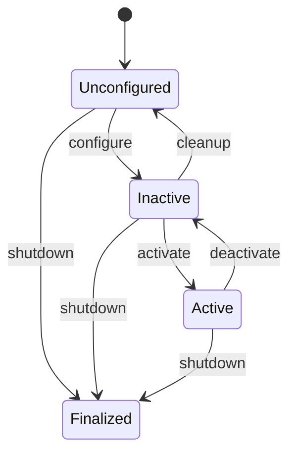

# 08 ROS2 Humble 实战：launch、参数、生命周期、组件与 QoS 调优

> **一句话定位**：[第 04 章](./04_ROS2_Humble核心概念与ROS1对比.md)讲了 ROS2 的"名词"（节点、话题、QoS、执行器），本章讲"怎么真的把一套系统启动起来并管住它"：用 Python launch 文件拉起一组节点，用参数文件和动态回调配置它们，用生命周期节点保证"先配置、后激活、可降级"，用组件容器把多个节点放进同一进程消除拷贝，最后用 QoS 把"该丢的丢、该留的留"调对。

**本章学完你能：**

- 写出一份带参数、重映射、条件启动、包含子 launch 的 Python launch 文件，并解释每个 action 的作用；
- 区分"声明参数、读取参数、动态修改参数"三件事，写出参数文件 YAML 与 `add_on_set_parameters_callback` 校验；
- 画出生命周期节点的状态图，说明为什么执行层节点应该做成生命周期节点，以及 `on_configure`/`on_activate` 各该做什么；
- 解释组件（component）与进程内通信（intra-process）省掉了什么，估算一个相机话题的拷贝量；
- 判断两个端点的 QoS 是否兼容，并按"传感器流 / 命令流 / 配置流"三类选 QoS；
- 用 `ros2 topic info -v`、`ros2 param`、`ros2 lifecycle`、`ros2 component` 排查常见故障；
- 说明这些机制在 P1/P2/P5/P6 里分别对应什么，并诚实区分"项目做过"与"延伸知识"。

**前置知识：**

- [ROS2 Humble 核心概念与 ROS1 对比](./04_ROS2_Humble核心概念与ROS1对比.md)（节点、话题、服务、动作、执行器、回调组）
- [DDS 与分布式通信](./05_DDS与分布式通信.md)（发现、QoS 策略的含义）
- [Linux 与 Shell、Git](./01_Linux与Shell_Git.md)（环境变量、进程）

> **关于代码的说明**：本机没有安装 ROS2，所以 launch 与节点代码**未在 ROS 环境运行核对**，只做了 Python 语法检查，仅作结构示意；QoS 兼容性判断函数、参数 YAML 解析、拷贝量与队列算术都在本地 Python 里运行复核（文中标"Python 复核"）。所有数值是**教学示例（非项目实测）**。

**目录**

1. 为什么需要"启动与配置"这一层
2. launch：用 Python 描述一个系统
3. 参数：声明、文件、动态修改
4. 生命周期节点：给节点一个"可管理的人生"
5. 组件与进程内通信
6. QoS 调优：兼容规则与三类场景
7. 完整示例：一个速度限幅节点的全套配置
8. 在本项目里怎么用
9. 常见错误与排查
10. 面试怎么问、怎么答
11. 本章要点速记
12. 自测题
13. 相关链接

---

## 1. 为什么需要"启动与配置"这一层

### 1.1 要解决的问题

一台机器人上通常有二三十个节点：驱动、滤波、定位、规划、控制、桥接。如果每个都在一个终端里手工 `ros2 run`，会出现四类问题：

1. **启动顺序**：控制节点先于驱动启动，读到的第一帧状态是空的或旧的；
2. **配置散落**：同一个"最大速度"在三个节点里各写一遍，改一处漏两处；
3. **运行时不可管理**：节点一旦在跑，你无法让它"暂停输出但保留连接"，只能杀掉重来；
4. **资源浪费**：相机图像在发布节点、检测节点、录制节点之间来回序列化，CPU 和带宽被拷贝吃掉。

本章的四件工具各自对应：launch 管启动与组织，参数管配置，生命周期管状态，组件管进程内共享，QoS 管"链路语义"。它们合起来就是"把一堆算法节点变成一个可运维的系统"。

### 1.2 整体地图

```text
launch 文件 (Python)
   ├─ 声明参数 launch argument（外部可改：use_sim_time, config）
   ├─ 加载参数文件 YAML（节点内部配置）
   ├─ Node / LifecycleNode / ComposableNodeContainer（真正的进程）
   └─ IncludeLaunchDescription（子系统复用）
          │
          ▼
  节点内部：declare_parameter → 读取 → set_parameters_callback 校验
          │
          ▼
  生命周期：Unconfigured → Inactive → Active → Finalized
          │
          ▼
  通信：QoS 兼容才能连通；进程内通信省掉序列化
```

> **面试要点**：把本章压缩成一句话——"launch 决定谁起来、参数决定怎么配、生命周期决定何时生效、QoS 决定数据怎么流"。

---

## 2. launch：用 Python 描述一个系统

### 2.1 为什么用 Python 而不是 XML

ROS2 的 launch 支持 Python、XML、YAML 三种格式，Python 是功能最全的：可以写条件、循环、读文件、拼路径。ROS1 的 `.launch` 是 XML，没有"程序"能力，复杂时只能靠 `<arg>` 和 `if=` 硬撑。Humble 里推荐的写法是返回一个 `LaunchDescription`，里面是一串 action。

### 2.2 概念表

| 概念 | 作用 | 常用类 |
|---|---|---|
| Action | 一个"要做的事"：启动节点、设置环境变量、包含别的 launch | `Node`、`SetEnvironmentVariable`、`IncludeLaunchDescription` |
| Substitution | 延迟求值的占位，直到真正启动才取值 | `LaunchConfiguration`、`PathJoinSubstitution`、`FindPackageShare` |
| Condition | 满足条件才执行某 action | `IfCondition`、`UnlessCondition` |
| Event handler | 节点退出、启动等事件的响应 | `OnProcessExit`、`RegisterEventHandler` |

**Substitution 为什么存在**：launch 文件在"解析阶段"只是在**构造**一棵 action 树，此时 `use_sim_time:=true` 这类命令行参数还没确定；`LaunchConfiguration('use_sim_time')` 是一个"稍后取值"的句柄，到执行阶段才被替换成字符串。把它当普通 Python 变量去 `if` 判断是最常见的坑（见第 9 章）。

### 2.3 一份最小而完整的 launch 文件

```python
# 教学示例（非项目源码）：launch/chassis.launch.py
from launch import LaunchDescription
from launch.actions import DeclareLaunchArgument
from launch.conditions import IfCondition
from launch.substitutions import LaunchConfiguration, PathJoinSubstitution
from launch_ros.actions import Node
from launch_ros.substitutions import FindPackageShare


def generate_launch_description():
    use_sim_time = LaunchConfiguration('use_sim_time')
    params = PathJoinSubstitution(
        [FindPackageShare('demo_chassis'), 'config', 'chassis.yaml'])

    return LaunchDescription([
        DeclareLaunchArgument('use_sim_time', default_value='false'),
        DeclareLaunchArgument('with_viz', default_value='false'),

        Node(
            package='demo_chassis',
            executable='speed_limiter',
            name='speed_limiter',
            namespace='robot1',
            parameters=[params, {'use_sim_time': use_sim_time}],
            remappings=[('cmd_vel_in', '/cmd_vel'),
                        ('cmd_vel_out', 'cmd_vel_safe')],
            output='screen',
            respawn=False,
        ),
        Node(
            package='rviz2', executable='rviz2', name='rviz2',
            condition=IfCondition(LaunchConfiguration('with_viz')),
        ),
    ])
```

逐项解释：

- `DeclareLaunchArgument`：声明命令行可改的参数，`ros2 launch demo_chassis chassis.launch.py use_sim_time:=true with_viz:=true`；
- `parameters=[文件, 字典]`：**后者覆盖前者**，所以 launch 参数能压过 YAML；
- `namespace='robot1'`：节点的全名变成 `/robot1/speed_limiter`，相对话题名 `cmd_vel_safe` 变成 `/robot1/cmd_vel_safe`，多机时靠它区分；
- `remappings`：把节点代码里写死的名字 `cmd_vel_in` 映射到系统里的真实话题 `/cmd_vel`（以 `/` 开头为绝对名，不受命名空间影响）；
- `respawn`：节点崩溃自动重启。**执行层节点慎用**：自动重启会让一个带崩溃缺陷的节点反复冲击硬件，更好的做法是让监督者（systemd、上层状态机）决定要不要重启；
- `condition=IfCondition(...)`：只在 `with_viz:=true` 时启动 rviz。

**Python 复核**：本文件已通过 `ast.parse` 语法检查（无 ROS 环境，未执行 import）。

### 2.4 包含子 launch 与分层组织

实际工程把 launch 分层：`bringup.launch.py` 包含 `drivers.launch.py`、`localization.launch.py`、`navigation.launch.py`。

```python
from launch.actions import IncludeLaunchDescription
from launch.launch_description_sources import PythonLaunchDescriptionSource

drivers = IncludeLaunchDescription(
    PythonLaunchDescriptionSource(
        PathJoinSubstitution([FindPackageShare('demo_bringup'),
                              'launch', 'drivers.launch.py'])),
    launch_arguments={'use_sim_time': use_sim_time}.items(),
)
```

好处：仿真与实机可以共用 `navigation.launch.py`，只在 `bringup_sim.launch.py`/`bringup_real.launch.py` 里换驱动层。这也是 [P5 项目](../../01_项目课程/P5_车式移动机器人自主导航/01_系统总览与导航栈分层.md)分层的软件表现。

### 2.5 启动顺序：别指望 launch 保证"先后"

launch 默认是**并发**启动所有 action，不等前一个"准备好"。要表达依赖，有三条路：

1. **事件触发**：`RegisterEventHandler(OnProcessStart(target_action=driver, on_start=[controller]))`，但"进程启动"不等于"节点就绪"；
2. **生命周期**：这是正解——驱动节点启动后在 Inactive 等待，由上层按顺序 `configure` → `activate`（第 4 节）；
3. **应用层握手**：控制节点自己订阅"驱动就绪"话题或等待服务可用。

> **注意**：`TimerAction(period=3.0, ...)` 延时启动是最常见的"伪解法"。它在慢机器或冷启动时会失效，且掩盖了真正的依赖关系。面试里能说出"延时不是依赖"是加分项。

---

## 3. 参数：声明、文件、动态修改

### 3.1 要解决的问题

参数是节点的"可调配置"。ROS2 的设计原则：**参数属于节点，必须先声明才能使用**（Humble 默认不允许未声明参数，除非 `allow_undeclared_parameters`）。这比 ROS1 的全局参数服务器更严格，好处是每个节点的配置面可枚举、可校验、可动态改。

### 3.2 三个层次

| 层次 | 做什么 | 谁来做 |
|---|---|---|
| 声明 | 告诉系统"我有这个参数、默认值、类型、范围" | 节点代码 `declare_parameter` |
| 赋初值 | 启动时从 YAML 或 launch 注入 | launch 的 `parameters=` |
| 动态修改 | 运行中用 CLI/服务改，节点回调校验后生效 | `ros2 param set` + 回调 |

### 3.3 参数文件 YAML 的格式

```yaml
# config/chassis.yaml（教学示例）
/**:
  ros__parameters:
    use_sim_time: false

robot1:
  speed_limiter:
    ros__parameters:
      max_vel: 0.8          # m/s
      max_acc: 1.0          # m/s^2
      cmd_timeout_ms: 200   # ms
      frames:
        base: base_link
        odom: odom
```

- 顶层键是**节点全名或通配**：`/**` 匹配所有节点；`robot1.speed_limiter` 嵌套写法对应 `/robot1/speed_limiter`；
- 必须有 `ros__parameters` 这一层（两个下划线）；
- 嵌套字典会被展平成点号名：`frames.base`；
- 类型由 YAML 值决定：`200` 是整数，`200.0` 是浮点——**声明为 double 却给整数，在 Humble 会报类型不匹配**，这是高频错误。

**Python 复核**：用 PyYAML 解析上述结构得到 `{'nav_driver': {'ros__parameters': {...}}}` 形式的嵌套字典，嵌套键 `frames` 解析为字典，整数与浮点分别为 `int` 与 `float`。

### 3.4 在节点里声明与读取（C++ 与 Python 各一例）

```cpp
// 教学示例：C++ 节点构造函数
#include <rcl_interfaces/msg/parameter_descriptor.hpp>
#include <rclcpp/rclcpp.hpp>

class SpeedLimiter : public rclcpp::Node {
 public:
  SpeedLimiter() : Node("speed_limiter") {
    rcl_interfaces::msg::ParameterDescriptor d;
    d.description = "maximum linear speed [m/s]";
    d.floating_point_range.resize(1);
    d.floating_point_range[0].from_value = 0.0;
    d.floating_point_range[0].to_value = 2.0;
    d.floating_point_range[0].step = 0.0;
    max_vel_ = declare_parameter<double>("max_vel", 0.8, d);
    timeout_ms_ = declare_parameter<int>("cmd_timeout_ms", 200);

    cb_handle_ = add_on_set_parameters_callback(
        [this](const std::vector<rclcpp::Parameter>& ps) {
          rcl_interfaces::msg::SetParametersResult r;
          r.successful = true;
          for (const auto& p : ps) {
            if (p.get_name() == "max_vel" && p.as_double() <= 0.0) {
              r.successful = false;
              r.reason = "max_vel must be positive";
            }
          }
          if (r.successful) {
            for (const auto& p : ps)
              if (p.get_name() == "max_vel") max_vel_ = p.as_double();
          }
          return r;
        });
  }
 private:
  double max_vel_;
  int timeout_ms_;
  rclcpp::node_interfaces::OnSetParametersCallbackHandle::SharedPtr cb_handle_;
};
```

```python
# 教学示例：Python 节点
import rclpy
from rclpy.node import Node
from rcl_interfaces.msg import SetParametersResult


class SpeedLimiter(Node):
    def __init__(self):
        super().__init__('speed_limiter')
        self.declare_parameter('max_vel', 0.8)
        self.declare_parameter('cmd_timeout_ms', 200)
        self.max_vel = self.get_parameter('max_vel').value
        self.add_on_set_parameters_callback(self.on_params)

    def on_params(self, params):
        for p in params:
            if p.name == 'max_vel' and p.value <= 0.0:
                return SetParametersResult(successful=False,
                                           reason='max_vel must be positive')
        for p in params:
            if p.name == 'max_vel':
                self.max_vel = p.value
        return SetParametersResult(successful=True)
```

三个要点：

1. **回调里先校验、后生效**：整批参数要么全接受要么全拒绝（"原子性"）；校验失败返回 `successful=False` 并给理由，`ros2 param set` 会把理由显示出来；
2. **参数范围写进描述符**：范围在 `ros2 param describe` 可见，也能被 GUI 工具读取；
3. **不是所有参数都应该可动态改**：改了就要立刻生效且安全的才开放（限幅阈值、增益）；改了需要重建资源的（话题名、CAN 通道）应声明为只读（`read_only = true`）或要求重新配置（走生命周期 `configure`）。

### 3.5 命令行操作

```bash
ros2 param list /robot1/speed_limiter
ros2 param get  /robot1/speed_limiter max_vel
ros2 param set  /robot1/speed_limiter max_vel 0.6
ros2 param describe /robot1/speed_limiter max_vel
ros2 param dump /robot1/speed_limiter > current.yaml   # 导出当前值，可回灌 YAML
```

`dump` 的价值在于"现场调好了参数，把它固化回仓库"。P1/P3 这类实机调参工作里，把最终调好的值固化为文件并纳入 Git，是复现与回滚的前提（见 [P1 工程化实践](../../01_项目课程/P1_AIRS球形机器人平衡控制/20_工程化实践_频率周期与问题解决.md) 的调参流程）。

### 3.6 参数的三条工程纪律

1. **单位写进名字或注释**：`cmd_timeout_ms` 而不是 `cmd_timeout`；
2. **默认值必须是安全值**：忘了配置时机器人应当"慢而保守"，而不是"快而危险"；
3. **一个事实一个来源**：最大速度只在一个参数里定义，其它节点通过话题或服务读取，不要各存一份。

---

## 4. 生命周期节点：给节点一个"可管理的人生"

### 4.1 要解决的问题

普通节点构造完就开始干活。但硬件驱动、控制器这类节点需要更细的状态：

- 构造时只创建对象，不打开串口/CAN（打开失败怎么办？）；
- 配置阶段申请资源、读参数、建立连接，但**不输出**；
- 激活后才真正向硬件发命令；
- 出错时能"停止输出但保留资源"，等人工或上层确认再恢复。

这就是**受管节点（managed node / lifecycle node）**，在 ROS2 里由 `rclcpp_lifecycle::LifecycleNode` 实现。

### 4.2 状态与转移



四个**主状态**：Unconfigured、Inactive、Active、Finalized；另有若干**过渡状态**（Configuring、Activating 等）以及出错的 ErrorProcessing。每个转移对应一个回调：`on_configure`、`on_activate`、`on_deactivate`、`on_cleanup`、`on_shutdown`、`on_error`。回调返回 `SUCCESS`、`FAILURE` 或 `ERROR`：

- `SUCCESS`：转移完成；
- `FAILURE`：转移失败但状态回到原地（例如 configure 失败，仍是 Unconfigured，可以重试）；
- `ERROR`：进入错误处理，`on_error` 决定能否恢复。

**Python 复核**：用转移表模拟 `configure → activate → deactivate → cleanup`，得到 inactive → active → inactive → unconfigured，与上图一致。

### 4.3 每个回调该做什么

| 回调 | 该做 | 不该做 |
|---|---|---|
| `on_configure` | 读参数、创建发布者/订阅者/定时器（不启动）、申请内存、打开设备但不使能 | 向执行器发任何输出 |
| `on_activate` | 激活发布者（`pub->on_activate()`）、使能设备、启动控制定时器 | 做耗时初始化（应在 configure） |
| `on_deactivate` | 停止输出、发零命令、失能执行器、停止定时器 | 释放资源（保留以便快速重新激活） |
| `on_cleanup` | 释放资源，回到刚构造的状态 | 保留旧状态 |
| `on_shutdown` | 最终清理 | — |

**关键点**：`LifecyclePublisher` 在 Inactive 状态下 `publish` 会被丢弃（并给出警告）。这意味着"未激活的控制器"即使代码里有 bug 在发命令，也**物理上发不出去**——这是生命周期用作安全机制的原因之一。

### 4.4 极简生命周期节点骨架

```cpp
// 教学示例：未在 ROS 环境编译
#include <lifecycle_msgs/msg/state.hpp>
#include <rclcpp_lifecycle/lifecycle_node.hpp>
using CallbackReturn =
    rclcpp_lifecycle::node_interfaces::LifecycleNodeInterface::CallbackReturn;

class WheelDriver : public rclcpp_lifecycle::LifecycleNode {
 public:
  WheelDriver() : LifecycleNode("wheel_driver") {
    declare_parameter<std::string>("can_if", "can0");
  }
  CallbackReturn on_configure(const rclcpp_lifecycle::State&) override {
    can_if_ = get_parameter("can_if").as_string();
    // 打开 socket，失败则返回 FAILURE，保持 Unconfigured
    if (!open_can(can_if_)) return CallbackReturn::FAILURE;
    pub_ = create_publisher<sensor_msgs::msg::JointState>("wheel_state", 10);
    return CallbackReturn::SUCCESS;
  }
  CallbackReturn on_activate(const rclcpp_lifecycle::State&) override {
    pub_->on_activate();
    enable_motors();     // 使能：先发零命令，再放开
    return CallbackReturn::SUCCESS;
  }
  CallbackReturn on_deactivate(const rclcpp_lifecycle::State&) override {
    send_zero_and_disable();
    pub_->on_deactivate();
    return CallbackReturn::SUCCESS;
  }
};
```

CLI 操作：

```bash
ros2 lifecycle get /wheel_driver                 # 查当前状态
ros2 lifecycle set /wheel_driver configure
ros2 lifecycle set /wheel_driver activate
ros2 lifecycle list /wheel_driver                # 可用转移
```

launch 里用 `launch_ros.actions.LifecycleNode`，并可结合事件处理器在节点进入 Inactive 后自动发 `ACTIVATE` 转移；Nav2 的 `nav2_lifecycle_manager` 就是按顺序管理一组生命周期节点的现成实现（其"bond"心跳机制的细节**未核对**，不展开）。

### 4.5 为什么执行层适合做生命周期节点

与 [P1 的使能状态机](../../01_项目课程/P1_AIRS球形机器人平衡控制/08_ROS_CAN安全执行闭环.md)、[P6 的生命周期与配置](../../01_项目课程/P6_深开鸿M-Robots平台软件/15_生命周期_配置与可观测性.md)相呼应：使能序列（先读到有效数据 → 采偏置 → 目标=当前 → 清积分 → 零命令后放开）本质上就是 Configure/Activate 两段式。生命周期节点把这个"约定"从各人手写的 `if enabled` 升级为框架级状态，并可被外部统一监督。

> **面试要点**：能说出"Inactive 状态下 LifecyclePublisher 不会真正发布"，以及"activate 失败应保持 Inactive 而不是半激活"，就说明你理解了它是安全工具而不是仪式。

---

## 5. 组件与进程内通信

### 5.1 要解决的问题

默认每个节点是一个独立进程。两个节点通过话题通信时：发布者把消息**序列化**，经 DDS 传输层（共享内存或网络）送出，订阅者**反序列化**。对小消息（速度命令几十字节）开销可忽略；对大消息（图像、点云）就是显著成本。

**Python 复核**：640×480、3 通道、8 位的图像一帧 921 600 B；30 fps 下一份拷贝约 27.6 MB/s。如果有 1、3、5 个订阅者且都走序列化路径，序列化流量分别约 27.6、82.9、138.2 MB/s（未计 DDS 内部拷贝，仅作量级）。这还只是数据量，实际 CPU 占用取决于实现，不能直接换算成百分比。

### 5.2 组件模型

**组件（component）**：把节点写成一个可被动态加载的共享库类，构造函数接收 `rclcpp::NodeOptions`，用宏注册：

```cpp
#include <rclcpp_components/register_node_macro.hpp>
RCLCPP_COMPONENTS_REGISTER_NODE(demo::Detector)
```

CMake 里：

```cmake
add_library(detector_component SHARED src/detector.cpp)
ament_target_dependencies(detector_component rclcpp rclcpp_components sensor_msgs)
rclcpp_components_register_node(detector_component
  PLUGIN "demo::Detector" EXECUTABLE detector_node)
```

这样同一份代码既能编成独立可执行（`detector_node`），也能被加载进**容器进程**（container）。容器里的多个组件共享一个进程、一个（或多个）执行器。

### 5.3 在 launch 里组合

```python
from launch_ros.actions import ComposableNodeContainer
from launch_ros.descriptions import ComposableNode

container = ComposableNodeContainer(
    name='perception_container',
    namespace='',
    package='rclcpp_components',
    executable='component_container_mt',   # 多线程执行器版本
    composable_node_descriptions=[
        ComposableNode(package='demo_perception', plugin='demo::Camera',
                       name='camera',
                       extra_arguments=[{'use_intra_process_comms': True}]),
        ComposableNode(package='demo_perception', plugin='demo::Detector',
                       name='detector',
                       extra_arguments=[{'use_intra_process_comms': True}]),
    ],
)
```

运行时也可以动态加载：`ros2 component load /perception_container demo_perception demo::Detector`，`ros2 component list` 查看。

### 5.4 进程内通信省掉了什么

当发布者与订阅者在**同一进程**、且都开了 `use_intra_process_comms`，并且发布使用 `std::unique_ptr<Msg>`：

- 不序列化、不过 DDS；
- 只有一个订阅者时可以**零拷贝移交**所有权（`unique_ptr` 被 move 过去）；
- 有多个订阅者时需要拷贝，但仍是内存拷贝而非序列化。

必须注意的限制与代价：

1. **所有权语义**：发布后原指针不能再用（已 move）；
2. **QoS 子集**：进程内通信对 QoS 的支持在 Humble 里有限制（例如某些 durability 配置的行为**未核对**），关键链路要实测；
3. **故障域合并**：同一进程里一个组件崩溃，容器里的所有组件一起死。性能换来了**更大的故障域**。这条在第 13 章（系统架构）会再次出现；
4. **线程模型**：组件共享执行器，回调组配置不当会互相阻塞（见 5.5）。

### 5.5 执行器与回调组：延迟的来源

单线程执行器按顺序执行回调。若某定时器周期 20 ms、回调耗时 12 ms，CPU 占用 60%；若同一执行器里还有另一个 12 ms 的回调，最坏连续阻塞 24 ms，超过周期 20 ms，定时器就会**错过**触发点（Python 复核：利用率 0.6，最坏阻塞 24 ms）。解决：

- 把耗时回调放进**独立回调组**并用多线程执行器；
- 控制相关的定时器放在 `MutuallyExclusive` 组，避免同一个控制器的两个回调并发读写同一状态；
- 感知等重计算放独立进程或独立线程，控制回路与之隔离。

---

## 6. QoS 调优：兼容规则与三类场景

### 6.1 QoS 要解决的问题

DDS 的 QoS 是"发布者承诺什么、订阅者要求什么"的合同。ROS2 常用的策略：

| 策略 | 取值 | 含义 |
|---|---|---|
| Reliability | Reliable / BestEffort | 是否重传保证到达 |
| Durability | Volatile / TransientLocal | 晚加入的订阅者能否收到历史样本 |
| History + Depth | KeepLast(N) / KeepAll | 队列保留多少 |
| Deadline | 时长 | 承诺的最大更新间隔 |
| Liveliness + Lease | 类型 + 时长 | 判断对端存活 |
| Lifespan | 时长 | 样本有效期 |

### 6.2 兼容规则（Request/Offer）

核心原则：**发布者"提供"（offer）的必须不低于订阅者"要求"（request）的**。否则两端**无法连通**，且默认只打一条警告，是极易被忽略的静默故障。

| 发布者 | 订阅者 | 结果 |
|---|---|---|
| BestEffort | Reliable | 不兼容 |
| Reliable | BestEffort | 兼容 |
| Volatile | TransientLocal | 不兼容 |
| TransientLocal | Volatile | 兼容 |
| Deadline 发布者 0.1 s | 订阅者 0.05 s | 不兼容（承诺的间隔比要求的大） |
| Deadline 发布者 0.05 s | 订阅者 0.1 s | 兼容 |

**Python 复核**：用一个按上述规则实现的 `compat(pub, sub)` 函数跑六个用例，输出依次为 False、True、False、True、False、True，与表一致。（该函数是对规则的教学实现，不是 DDS 库本身；规则取自 DDS 标准的 request-offer 模型，Humble 下各 RMW 的边角行为**未逐一核对**。）

### 6.3 队列深度的算术

KeepLast(depth=10)，发布 100 Hz，订阅者回调只能处理 20 Hz：队列填满时间 $= 10/(100-20)=0.125$ s，此后每秒丢弃约 80 条（**Python 复核**）。结论：

- 想要"总是最新"：depth=1，丢旧留新（传感器、命令）；
- 想要"不丢事件"：Reliable + 较大 depth，并保证消费速度不低于生产速度；
- 深度不是越大越好：队列越深，数据越"旧"，控制看到的是几百毫秒前的世界。

### 6.4 三类场景的推荐配置

| 场景 | 例子 | 推荐 | 理由 |
|---|---|---|---|
| 高频传感器流 | IMU、激光、图像、里程计 | BestEffort + Volatile + KeepLast(1~5)；rclcpp 里有预设 `SensorDataQoS` | 丢一帧不致命，重传反而造成队头阻塞，延迟变大 |
| 命令流 | `cmd_vel`、关节目标 | Reliable 或 BestEffort + KeepLast(1) + Deadline；命令带时间戳和有效期 | 要"最新"，过期命令不如不发；超时由接收端看门狗处理 |
| 配置/状态流 | 地图、机器人描述、能力注册、一次性参数 | Reliable + TransientLocal + KeepLast(1) | 晚启动的节点也要拿到最近一次值（"锁存"，对应 ROS1 的 latched） |
| 事件/服务回执 | 任务回执、报警 | Reliable + Volatile + KeepLast(10) | 不能丢，但不需要给晚来者补历史 |

排查工具：

```bash
ros2 topic info /scan -v        # 显示每个端点的 QoS（Reliability、Durability、Deadline 等）
ros2 topic hz /scan
ros2 topic echo /scan --qos-reliability best_effort
```

经典现象：rviz 里看不到激光——激光驱动发 BestEffort，rviz 默认以 Reliable 订阅，不兼容；或相反，订阅者设了 TransientLocal 而发布者是 Volatile。

### 6.5 QoS 与 DDS 实现

Humble 默认 RMW 是 Fast DDS（`rmw_fastrtps_cpp`），也可用 `RMW_IMPLEMENTATION=rmw_cyclonedds_cpp` 切换到 Cyclone DDS（需已安装）。不同实现在发现行为、共享内存、多机网络配置上有差异；切换 RMW 是排查"莫名连不上/延迟大"的常用手段之一，但具体性能结论依赖环境，不做一般性断言（见 [DDS 与分布式通信](./05_DDS与分布式通信.md)）。

---

## 7. 完整示例：一个速度限幅节点的全套配置

把前面的东西合成一个小系统，作为"可复现的最小包"的设计图（命令按 Humble 习惯，**未在 ROS 环境运行核对**）：

```text
demo_chassis/
├── package.xml
├── CMakeLists.txt
├── config/chassis.yaml
├── launch/chassis.launch.py
└── src/speed_limiter.cpp      （生命周期节点）
```

**行为规格**（教学设计）：

1. 订阅 `cmd_vel_in`（BestEffort，depth=1），发布 `cmd_vel_out`；
2. `max_vel`、`max_acc` 来自参数，可动态改但必须 > 0；
3. 若超过 `cmd_timeout_ms` 没收到新命令，输出零速度；
4. 节点是生命周期节点：configure 创建订阅与发布者，activate 才开始输出，deactivate 立即发一帧零命令；
5. 限幅公式：线速度 $v_{out}=\mathrm{clip}(v_{in}, -v_{max}, v_{max})$；加速度限幅 $v_{k}=v_{k-1}+\mathrm{clip}(v_{in}-v_{k-1},\ -a_{max}\Delta t,\ a_{max}\Delta t)$。

**手算（教学示例）**：$v_{max}=0.8$ m/s，$a_{max}=1.0$ m/s²，$\Delta t=0.05$ s（20 Hz）。输入阶跃到 2.0 m/s：第 1 步 $v=\min(0+0.05, \ldots)=0.05$；每步加 0.05，第 16 步达到 0.8 后被速度上限夹住。到达 0.8 m/s 需要 $0.8/(1.0\times0.05)=16$ 步，即 0.8 s。

```python
v, vin, vmax, a, dt = 0.0, 2.0, 0.8, 1.0, 0.05
steps = 0
while v < vmax - 1e-9:
    v += max(-a*dt, min(a*dt, vin - v))
    v = min(v, vmax)
    steps += 1
print(steps, round(steps*dt, 2))     # Python 复核：16 0.8
```

运行结果为 `16 0.8`，与手算一致。启动与调试：

```bash
ros2 launch demo_chassis chassis.launch.py use_sim_time:=false
ros2 lifecycle set /robot1/speed_limiter configure
ros2 lifecycle set /robot1/speed_limiter activate
ros2 param set /robot1/speed_limiter max_vel 0.5
ros2 topic info /robot1/cmd_vel_safe -v
```

这里的"命令超时 200 ms、速度 0.8 m/s、加速度 1.0 m/s²"沿用 P6 统一口径（见 P6 README 自查表第 8 项），是项目设计取值，不是对本示例的实测。

---

## 8. 在本项目里怎么用

| 项目 | 对应关系 | 性质 |
|---|---|---|
| [P1](../../01_项目课程/P1_AIRS球形机器人平衡控制/08_ROS_CAN安全执行闭环.md) | CV 写 "integrated ROS state processing with CAN motor execution"；节点定时器、参数化的限幅与阈值、使能状态机，对应本章的定时器与"先使能后放开" | 项目做过（ROS 存量代码为 ROS1 风格，面试按概念讲） |
| [P2](../../01_项目课程/P2_未来动力双臂遥操作与差速底盘/10_ROS2_CAN执行链.md) | ROS2-CAN 执行链：数组消息、"只取最新"的 QoS、定时器与回调、目标年龄与分层看门狗 | 项目做过（ROS2） |
| [P5](../../01_项目课程/P5_车式移动机器人自主导航/01_系统总览与导航栈分层.md) | ROS2 Humble 下的导航栈：多层节点、launch 组织、参数文件、传感器话题的 QoS；Nav2 本身用生命周期管理节点 | 项目做过；生命周期管理器细节为通用知识 |
| [P6](../../01_项目课程/P6_深开鸿M-Robots平台软件/15_生命周期_配置与可观测性.md) | 启动/就绪/关闭状态机、配置作为数据、健康模型；CV 写适配 ROS/ROS2 命令 | 项目设计口径；平台自身不是 rclcpp 生命周期，二者是"同一思想的两种实现" |
| 组件容器、进程内通信 | CV 没有写 | **延伸，非项目所做** |

> **面试要点**：被问"你们用过 lifecycle node 吗"时，诚实答案是——"我熟悉其状态机，并在执行链上按同样的思想做了使能与降级；如果是 ROS2 标准节点，我会用它把 configure 与 activate 分开。"不要声称做过自己没做的事。

---

## 9. 常见错误与排查

| 现象 | 常见原因 | 排查与修复 |
|---|---|---|
| 改了 launch 参数没生效 | 参数文件里的节点名与实际全名不匹配（命名空间、`name=` 不一致） | `ros2 param list` 看实际全名；YAML 顶层键写成 `/**` 先验证 |
| `parameter 'x' has not been declared` | 没 `declare_parameter` 就读写 | 在构造函数声明；或明确允许未声明（不推荐） |
| 类型不匹配 | YAML 写 `1` 而声明 double | 写成 `1.0`；或声明时用对应类型 |
| launch 里 `if use_sim_time == 'true'` 永远为假 | 把 Substitution 当字符串比较 | 用 `IfCondition(PythonExpression([...]))` 或直接传 `LaunchConfiguration` |
| 订阅不到数据，但话题列表里有 | QoS 不兼容（BestEffort 对 Reliable） | `ros2 topic info -v`，对齐 QoS |
| 订阅者启动晚，拿不到"一次性"消息 | 发布者 Volatile | 改为 TransientLocal（双方都要） |
| 生命周期节点 activate 后没输出 | 发布者没 `on_activate`；或仍在 Inactive | `ros2 lifecycle get`；检查 `pub_->on_activate()` |
| 节点崩溃后反复重启冲击硬件 | `respawn=True` | 执行层不自动重启，交给监督者并在重启后重新走使能序列 |
| 图像延迟随时间增大 | 订阅者处理慢，队列深度大；或 Reliable 在丢包网络上重传 | 减小 depth；传感器流改 BestEffort；订阅者降频 |
| 定时器"丢拍" | 单线程执行器被长回调阻塞 | 拆回调组/多线程；重计算移出控制进程 |
| 仿真正常，实机时间错乱 | `use_sim_time` 在部分节点没设置 | 在 launch 层统一注入 `use_sim_time`；实机必须为 false |

---

## 10. 面试怎么问、怎么答

**Q1. What is the difference between a ROS 2 launch argument and a node parameter?**

> A launch argument belongs to the launch file. It decides how the system is assembled, for example whether to use simulation time or to start a visualiser. A node parameter belongs to one node and configures its behaviour, such as a speed limit. The launch file can pass an argument down into a parameter, but they live at different levels. Parameters must be declared in the node, and they can be changed at runtime if the node allows it.

中文译文：launch 参数属于 launch 文件，决定系统怎么拼装（是否仿真时间、是否开可视化）；节点参数属于某个节点，配置它的行为（如限速）。launch 参数可以向下传给节点参数，但二者层级不同；节点参数必须声明，若节点允许还可以运行时修改。

追问方向：参数覆盖顺序是什么？（答：`parameters=[...]` 列表里后者覆盖前者。）参数改了怎么保证安全？（回调里先校验再生效，范围写进描述符。）

**Q2. Why would you make a hardware driver a lifecycle node?**

> Because I want a clear separation between preparing and acting. In configure, I open the device and create interfaces, but nothing moves. Only in activate do I enable the actuators. If activation fails, the node stays inactive instead of half-working. And a lifecycle publisher does not publish while inactive, so a bug in an unconfigured controller cannot reach the hardware. It also lets a supervisor bring the whole system up in a defined order.

中文译文：因为想把"准备"和"动作"分开：configure 只开设备、建接口，不动；activate 才使能执行器。激活失败就停在 Inactive，不会半工作；生命周期发布者在 Inactive 时不发布，未配置控制器的 bug 触达不了硬件；监督者还能按固定顺序拉起整个系统。

追问方向：`on_deactivate` 该做什么？（发零命令、失能、保留资源。）FAILURE 与 ERROR 的区别？（FAILURE 回到原状态可重试；ERROR 进入错误处理。）

**Q3. Two nodes are both running but the subscriber receives nothing. How do you debug it?**

> First I check that the topic names match, including namespaces and remappings, with `ros2 topic list` and `ros2 node info`. Then I run `ros2 topic info -v` to compare the QoS of both ends. The most common cause is that a best-effort publisher cannot match a reliable subscriber, or a volatile publisher cannot serve a transient-local subscriber. Then I check domain ID and, on multi-machine setups, multicast and the network interface.

中文译文：先核对话题名（含命名空间与重映射），再用 `ros2 topic info -v` 比较两端 QoS——最常见的是 BestEffort 发布者对不上 Reliable 订阅者，或 Volatile 发布者对不上 TransientLocal 订阅者；再查 Domain ID，多机时查多播与网卡。

追问方向：为什么默认只警告不报错？（QoS 不兼容是"静默不连通"，DDS 只通知事件。）如何把这类问题变成启动时的显式失败？（订阅者设置 QoS 事件回调并记录日志，或在集成测试里断言连通。）

**Q4. What do composable nodes and intra-process communication give you, and what do they cost?**

> If publisher and subscriber live in the same process, intra-process communication can pass a unique pointer instead of serialising the message through DDS. For images and point clouds that saves a lot of copying and latency. The cost is a larger failure domain, because one crash takes down every component in the container, and you need to design callback groups carefully so heavy callbacks do not block control. For safety-critical loops I would isolate them in their own process.

中文译文：同进程内可以传 unique_ptr，省掉经 DDS 的序列化；图像、点云收益大。代价是故障域变大（一个崩溃拖垮整容器）、回调组要仔细设计；安全关键回路我会单独放一个进程。

追问方向：多个订阅者时还能零拷贝吗？（不能，需要内存拷贝。）它对 QoS 有什么限制？（Humble 下边角行为需实测。）

---

## 11. 本章要点速记

1. launch 在解析阶段只构造 action 树，`LaunchConfiguration` 是延迟求值的占位，不能当普通字符串判断。
2. `parameters=[文件, 字典]`，后者覆盖前者；YAML 需要 `ros__parameters`，整数与浮点要写对。
3. 参数必须先声明；动态修改在回调里"先校验、后生效"，返回理由字符串。
4. 延时启动不是依赖管理；依赖用生命周期或应用层握手表达。
5. 生命周期四个主状态：Unconfigured、Inactive、Active、Finalized；configure 建资源，activate 才输出。
6. Inactive 时生命周期发布者不发布，这是它能充当安全机制的原因。
7. 组件 + 进程内通信省掉序列化，但合并了故障域，且依赖回调组设计。
8. QoS 兼容：发布者提供 ≥ 订阅者要求；BestEffort 发布者对不上 Reliable 订阅者，Volatile 发布者对不上 TransientLocal 订阅者。
9. 传感器流用 BestEffort + 小深度；配置流用 Reliable + TransientLocal；队列深度越大数据越旧。
10. 排错三件套：`ros2 topic info -v`、`ros2 param list/get/describe`、`ros2 lifecycle get`。

## 12. 自测题

1. 为什么 `respawn=True` 不适合执行层节点？应由谁决定是否重启？
2. YAML 中把 `max_vel: 1` 给一个声明为 double 的参数，会发生什么？如何修正？
3. 写出生命周期节点从 Unconfigured 到 Active 再回到 Unconfigured 的转移序列。
4. 发布者 Reliable + Volatile、订阅者 BestEffort + TransientLocal，能否连通？为什么？
5. 发布 100 Hz、消费 20 Hz、depth=10：队列多久填满？此后每秒丢多少条？

**答案要点**：(1) 自动重启会让带缺陷节点反复冲击硬件、掩盖故障，应由监督者/状态机在安全检查后重启并重新走使能序列；(2) 类型不匹配报错，写成 `1.0`；(3) configure → activate → deactivate → cleanup；(4) 不能，Volatile 发布者对不上 TransientLocal 订阅者（Reliable 对 BestEffort 本身是兼容的）；(5) 0.125 s，约 80 条/秒。

## 13. 相关链接

- 上一章：[URDF、TF 与坐标系实践](./07_URDF_TF_坐标系实践.md)
- 下一章：[ROS2 测试与 CI](./09_ROS2测试与CI_launch_testing_gtest_rosbag回放.md)
- 概念前置：[ROS2 Humble 核心概念](./04_ROS2_Humble核心概念与ROS1对比.md)、[DDS 与分布式通信](./05_DDS与分布式通信.md)
- 相关：[数字控制与实时性](../05_控制理论/08_数字控制与实时性.md)、[系统架构设计](../13_系统工程与安全/01_机器人系统架构设计_分层_接口_需求.md)
- 模块：[12 机器人软件 README](./README.md)
