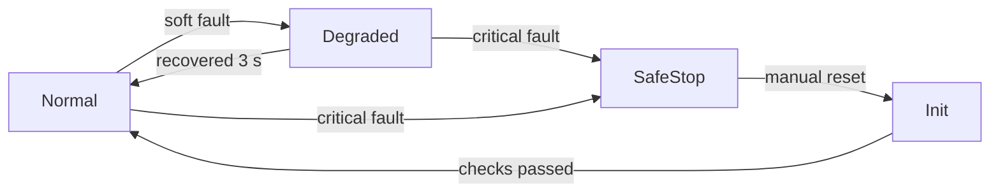

# 可靠性与故障诊断：FMEA、故障树、MTBF 与可用性、冗余、看门狗与降级

> **一句话定位**：可靠性回答"系统能持续正常工作多久、坏了多久能修好"，故障诊断回答"坏了能不能被发现、发现后怎么办"。本章讲 FMEA（失效模式与影响分析）与故障树（FTA）两种互补的分析方法，用指数失效模型手算 MTBF、可靠度、可用度，推导串联、并联、表决（k-of-n）冗余的公式，并给出看门狗、故障隔离与降级恢复的设计方法。

**本章学完你能：**

- 解释失效率 $\lambda$、MTBF、MTTR、可靠度 $R(t)$、可用度 $A$ 的定义与相互关系，并区分"可靠"和"可用"；
- 做一张完整的 FMEA 表，计算 RPN（风险优先数），按优先级给出改进措施，并复算改进后的 RPN；
- 画出故障树，求最小割集，用 AND/OR 门计算顶事件概率；
- 推导串联、并联、2oo3 表决系统的可靠度，用 Python 复核；
- 设计看门狗（命令看门狗、心跳、窗口看门狗），确定超时并核对停车距离；
- 设计降级与恢复策略，给出"检测—隔离—降级—恢复"的状态流程；
- 用英文回答 "what is FMEA / how do you detect and handle sensor failure / difference between reliability and availability"。

**前置知识**：[02 功能安全基础](./02_功能安全基础_急停_安全链_ISO13849与IEC61508.md)（危险失效、诊断覆盖、共因）、[概率统计与高斯分布](../01_数学基础/03_概率统计与高斯分布.md)（指数分布、独立事件）、[01 系统架构设计](./01_机器人系统架构设计_分层_接口_需求.md)（故障域）。

## 目录

1. 要解决的问题
2. 符号与术语
3. 失效率模型：指数分布与浴盆曲线
4. 串联、并联与表决系统的可靠度
5. MTBF、MTTR 与可用度
6. FMEA：方法与 RPN
7. 故障树分析（FTA）
8. 故障检测、隔离与诊断
9. 看门狗设计
10. 降级与恢复策略
11. 完整手算示例
12. 在七个项目里怎么用
13. 常见错误与故障现象
14. 面试怎么问、怎么答
15. 本章要点速记
16. 自测题
17. 相关链接

---

## 1. 要解决的问题

机器人在实验室的演示里能跑一次不代表它能跑一整天。真实运行会遇到：电缆接头偶尔松动，传感器偶尔卡死，通信偶尔丢包，电池电压在大电流时下降，CAN 偶尔进入总线关闭（bus-off）。工程上需要做三件事：

1. **预见**：在出事之前，系统地列出"可能怎么坏"，评估后果与概率，优先处理最危险的（FMEA、FTA）。
2. **量化**：用 MTBF、可靠度、可用度表达系统能否满足任务时长（比赛一场 7 分钟，还是仓库连续运行 8 小时）。
3. **应对**：设计检测、隔离、降级和恢复机制，让局部故障不演变为整机失控或整机宕机。

注意可靠性不等于安全：可靠性高说明少坏，不说明坏的时候是否安全。因此本章与上一章配套——上一章决定"坏时落在哪个安全状态"，本章回答"多久会坏、怎么发现、怎么应付"。

## 2. 符号与术语

| 符号/术语 | 含义 | 单位 |
|---|---|---|
| $\lambda$ | 失效率（常数），每小时失效概率 | 1/h |
| $R(t)$ | 可靠度：时间 $[0,t]$ 内不失效的概率，$R(t)=e^{-\lambda t}$ | 无量纲 |
| $F(t)$ | 不可靠度，$F(t)=1-R(t)$ | 无量纲 |
| MTBF | 平均故障间隔时间（可修复系统），$=1/\lambda$（指数模型） | h |
| MTTF | 平均失效前时间（不可修复部件） | h |
| MTTR | 平均修复时间 | h |
| $A$ | 稳态可用度，$A=\text{MTBF}/(\text{MTBF}+\text{MTTR})$ | 无量纲 |
| FMEA | 失效模式与影响分析（Failure Modes and Effects Analysis） | — |
| S, O, D | 严重度、发生度、探测度，常用 1～10 评分 | — |
| RPN | 风险优先数，$RPN=S\times O\times D$ | — |
| FTA | 故障树分析（Fault Tree Analysis） | — |
| 最小割集 | 能导致顶事件发生的、最小的底事件组合 | — |
| $k$-out-of-$n$ | $n$ 个冗余单元中至少 $k$ 个正常系统才正常（记 $k$oo$n$ 表示良好个数） | — |
| 看门狗（watchdog） | 监视某个行为是否按时发生，超时触发保护 | — |

## 3. 失效率模型：指数分布与浴盆曲线

### 3.1 浴盆曲线

典型电子器件的失效率随时间呈"浴盆"形：早期失效期（初期偏高，由制造缺陷或设计问题引起）→ 偶然失效期（失效率近似常数）→ 耗损期（磨损、老化，失效率上升）。工程分析里常把**偶然失效期**当作主要阶段，用常数失效率 $\lambda$。早期失效靠"老化筛选"（burn-in）和调试阶段暴露；耗损期靠预防性更换（电池、轴承、继电器触点）。

### 3.2 常数失效率与指数分布的推导

设在时间 $t$ 未失效的单元，在接下来的极短时间 $dt$ 内失效的条件概率为 $\lambda\,dt$（与已运行多久无关，即"无记忆"）。则可靠度满足

$$\frac{dR}{dt}=-\lambda R,\qquad R(0)=1\ \Rightarrow\ R(t)=e^{-\lambda t}$$

寿命的期望（MTTF）：

$$\text{MTTF}=\int_0^\infty R(t)\,dt=\int_0^\infty e^{-\lambda t}dt=\frac{1}{\lambda}$$

**一个常见误解**：MTBF = 5000 h 不表示"能用 5000 小时"。在 $t=\text{MTBF}$ 时 $R=e^{-1}\approx0.368$，也就是约 63% 的单元在 MTBF 之前已经失效。MTBF 是**统计平均**，不是保证寿命。

### 3.3 例：任务可靠度

设某模块 $\text{MTBF}=5000$ h，则 $\lambda=2\times10^{-4}$ /h。一段 $t=100$ h 的运行：

$$R(100)=e^{-2\times10^{-4}\times100}=e^{-0.02}=0.9802$$

即约 2% 的概率在这段时间内至少出一次故障。一场 7 分钟（约 0.117 h）的比赛对应 $R\approx0.99998$，这说明了为什么**比赛机器人更多输在系统性问题（接线松、参数错、热插拔）而不是随机寿命**。

## 4. 串联、并联与表决系统的可靠度

设各单元独立，单元可靠度为 $R_i$。

### 4.1 串联（任一失效则系统失效）

$$R_{\text{series}}=\prod_i R_i=e^{-\sum\lambda_i t}$$

失效率相加：$\lambda_{sys}=\sum\lambda_i$，$\text{MTBF}_{sys}=1/\sum\lambda_i$。直觉：环节越多越脆弱。控制链 传感器→总线→控制器→驱动→电机 就是串联。

### 4.2 并联（全部失效才失效）

$$R_{\text{par}}=1-\prod_i(1-R_i)$$

两个相同单元：$R=1-(1-R)^2=2R-R^2$。

### 4.3 $k$-out-of-$n$ 表决

$n$ 个相同独立单元，至少 $k$ 个正常系统才正常，则

$$R_{k/n}=\sum_{j=k}^{n}\binom{n}{j}R^j(1-R)^{n-j}$$

特例 2oo3（三取二）：

$$R_{2/3}=3R^2(1-R)+R^3=3R^2-2R^3$$

2oo3 的好处：一个单元坏了仍可靠（与并联类似）；同时一个单元误报也不会引起误动作（因为需要两个一致才表决）。并联偏重"不丢失功能"（对安全失效友好），串联偏重"不误动作"，2oo3 兼顾两者，代价是 3 倍硬件。

### 4.4 数值示例

设三个相同单元 $R=e^{-100/5000}=0.9802$：

| 结构 | 公式 | 结果 |
|---|---|---|
| 单个 | $R$ | 0.9802 |
| 三个串联 | $R^3$ | 0.9418 |
| 两个并联 | $1-(1-R)^2$ | 0.99961 |
| 2oo3 | $3R^2-2R^3$ | 0.99884 |

**Python 复核：**

```python
import math
R = math.exp(-100 / 5000)
print(round(R, 4))                          # 0.9802
print(round(R ** 3, 4))                     # 0.9418
print(round(1 - (1 - R) ** 2, 5))           # 0.99961
print(round(3 * R ** 2 - 2 * R ** 3, 5))    # 0.99884
```

**注意**：这些公式假设独立。若有共因失效（同一电源、同一总线），并联与表决的收益会大打折扣，见 02 章的 $\beta$ 因子。

## 5. MTBF、MTTR 与可用度

### 5.1 可用度

对可修复系统，运行—故障—修复交替进行。平均每个循环：正常运行 MTBF，修复 MTTR。稳态可用度

$$A=\frac{\text{MTBF}}{\text{MTBF}+\text{MTTR}}$$

**可靠度与可用度的区别**：可靠度问"这段时间里会不会出一次故障"；可用度问"在任意时刻系统可用的概率"。快速恢复（小 MTTR）的系统，即使 MTBF 不高，可用度也可以很高。这是 P6 里设计"重启、重连、重发"机制的理论依据：平台的目标不是永不故障，而是故障后快速自愈。

### 5.2 例

$\text{MTBF}=5000$ h，$\text{MTTR}=2$ h：

$$A=\frac{5000}{5002}=0.9996$$

若串联三个子系统，可用度分别为 0.999、0.9995、0.998，则系统可用度为连乘 $0.9965$。每年 8760 小时里不可用时间约 $(1-0.9965)\times8760\approx30.6$ h。

### 5.3 提升可用度的两条路

1. 增大 MTBF：更可靠的器件、减少环节、降额使用、冗余。
2. 减小 MTTR：自动检测、自动重启、热备份、模块化可替换、清晰的诊断信息（知道坏在哪）。

对软件系统，第 2 条通常更划算：看门狗重启一个节点只要几秒，远比"保证永不崩溃"容易。

## 6. FMEA：方法与 RPN

### 6.1 FMEA 是什么

FMEA 是一种**自下而上**（bottom-up）的分析：从每个组件/功能出发，问"它可能怎么失效？失效后对上层有什么影响？现在能不能检测到？应该怎么改进？" 结果是一张表。

### 6.2 表格列

| 列 | 内容 |
|---|---|
| 项目/功能 | 被分析的部件或功能 |
| 失效模式 | 具体怎么坏（如"数据陈旧""卡死""输出饱和""误触发"） |
| 影响（局部/系统） | 失效对本模块和整机的后果 |
| 严重度 S | 后果的严重程度，1（无影响）～10（危及安全） |
| 原因 | 为什么会发生 |
| 发生度 O | 发生频率，1（几乎不会）～10（几乎必然） |
| 现行控制/检测 | 现有的预防和检测手段 |
| 探测度 D | 失效到达用户/造成后果前被检测到的难度，1（一定检测到）～10（几乎检测不到） |
| RPN | $S\times O\times D$ |
| 建议措施 | 降低 S、O 或 D 的措施 |
| 措施后 S/O/D/RPN | 复算 |

### 6.3 评分标准（教学示例，不同组织不同）

| 分 | 严重度 S | 发生度 O | 探测度 D |
|---|---|---|---|
| 1～2 | 几乎无影响 | 几乎不会发生 | 一定被检测（自动、必然） |
| 3～4 | 轻微，可自行恢复 | 偶尔 | 很可能被检测 |
| 5～6 | 功能降级，需要干预 | 较常见 | 可能被检测 |
| 7～8 | 任务失败或设备损坏 | 经常 | 不太可能被检测 |
| 9～10 | 危及人身安全 | 几乎必然 | 几乎无法检测 |

### 6.4 RPN 的局限

- 乘积会掩盖"高 S 低 O"的组合。例如 $S=10,O=1,D=1$ 得 10，远低于 $S=5,O=5,D=5$ 的 125，但前者涉及人身安全。**所以高 S（如 $S\ge9$）的项不论 RPN 多小都要单独处理。**
- 评分具有主观性，需要多人评审达成一致。
- 不同 $(S,O,D)$ 可得相同 RPN，含义不同。
- 有些组织改用"行动优先级"（AP）表来替代 RPN（具体表格未核对）。

实践建议：用 RPN 排序，同时用"S 阈值"做硬性筛选。

### 6.5 过程步骤

1. 画出系统功能框图，列出要分析的功能/组件；
2. 对每个，头脑风暴失效模式（卡死、漂移、间歇、陈旧、误报、饱和、断线、粘连、延迟、乱序）；
3. 写影响，并追到系统级；
4. 评 S、O、D；
5. 计算 RPN，排序；
6. 制定措施，指派负责人和验证方式；
7. 措施落实后复评，闭环。FMEA 是**活文档**，随设计更新。

## 7. 故障树分析（FTA）

### 7.1 方法

FTA 是**自上而下**（top-down）的：先选一个**顶事件**（不希望发生的系统级事件，如"机器人失控持续运动"），再逐层追问"什么条件会导致它"，用逻辑门连接到底事件：

- **OR 门**：任一输入发生，输出发生；
- **AND 门**：全部输入发生，输出才发生。

两种方法互补：FMEA 从部件出发，不容易发现多个失效同时发生的组合；FTA 从后果出发，擅长组合，但需要先想到顶事件。

### 7.2 示例故障树（文本）

顶事件 T："上层失联后机器人仍持续运动"

```text
T = G1 OR C
G1 = A AND B
A: 上层命令中断
B: 命令看门狗失效（未触发）
C: 驱动器输出级故障，持续输出（独立路径）
```

### 7.3 概率计算

设底事件概率（教学示例，非项目实测，单位为一次任务内）：$P(A)=10^{-3}$，$P(B)=2\times10^{-3}$，$P(C)=5\times10^{-4}$，且相互独立。

- AND：$P(G1)=P(A)P(B)=2\times10^{-6}$
- OR：$P(T)=1-(1-P(G1))(1-P(C))=1-(1-2\times10^{-6})(1-5\times10^{-4})\approx5.02\times10^{-4}$

**最小割集**：$\{A,B\}$ 和 $\{C\}$。割集大小代表所需的失效数：**单点故障（大小为 1 的割集）**是最危险的，上例 $\{C\}$ 就是单点故障，它贡献了顶事件概率的几乎全部（$5\times10^{-4}$ vs $2\times10^{-6}$）。所以改进的重点是处理 $C$（例如再加一道硬件切断），而不是继续优化看门狗。

### 7.4 Python 复核

```python
pA, pB, pC = 1e-3, 2e-3, 5e-4
pG1 = pA * pB
pT = 1 - (1 - pG1) * (1 - pC)
print(pG1, pT)   # 2e-06  0.000502
```

输出与手算一致。

## 8. 故障检测、隔离与诊断

### 8.1 四个步骤

1. **检测（detection）**：发现异常。
2. **隔离（isolation）**：判断是哪个部件/哪条路径出了问题。
3. **降级或安全化（reaction）**：采取动作。
4. **恢复（recovery）**：条件恢复后回到正常。

### 8.2 常用检测手段

| 手段 | 能发现的故障 | 局限 |
|---|---|---|
| 超时/心跳 | 通信中断、进程挂起 | 不能发现"数据是旧的但心跳还在" |
| 时间戳新鲜度 | 数据陈旧 | 需要可信的时钟 |
| 序号连续性 | 丢帧、乱序 | 无法发现内容错误 |
| 校验（CRC、校验和） | 比特错误 | 无法发现逻辑错误 |
| 范围/合理性检查 | 传感器卡值超限、跳变 | 范围内的错值检测不到 |
| 冗余比对（交叉校验） | 一个传感器漂移 | 需要冗余硬件，共因时失败 |
| 模型残差（观测器） | 与物理模型不符 | 模型不准时误报 |
| 卡死检测 | 值长时间完全不变 | 真实静止时需要噪声判据 |
| 回读（read-back） | 输出未执行 | 增加通信 |
| 周期抖动监控 | 调度问题、过载 | 只是症状 |

### 8.3 隔离：多源数据的投票

当有 $n\ge3$ 个同类传感器时，可以用中值或表决隔离出异常者。有两个时只能检测"不一致"，无法判断谁错，需要借助第三个信息（模型预测、另一种传感器）。这是 P5 里 EKF 融合编码器、IMU、激光时的基本逻辑：不一致即降低相应来源的权重或拒绝其更新。

### 8.4 诊断信息的质量

好的故障信息回答四个问题：**什么坏了、什么时候、证据是什么、应该怎么办**。例如 `IMU stale: age=83ms > 50ms, last_seq=1204, action=FAULT latched` 远好于 `error`。日志与诊断细节见 [05 数据与日志](./05_数据与日志_可观测性_回放与复盘.md)。

## 9. 看门狗设计

### 9.1 看门狗的类型

| 类型 | 监视什么 | 触发后的动作 |
|---|---|---|
| 命令看门狗 | 是否仍在收到有效命令 | 减速停车 |
| 心跳看门狗 | 对端进程是否仍活着 | 切换到备份/进入降级 |
| 硬件独立看门狗（IWDG） | 固件主循环是否仍在运行 | 复位 MCU |
| 窗口看门狗 | 喂狗时刻是否落在合法窗口内 | 复位 |
| 任务级看门狗 | 每个关键任务是否按时报到 | 记录并复位/降级 |

### 9.2 设计参数

1. **监视周期** $T_{cmd}$：被监视事件的正常周期（命令 20 Hz 则 50 ms）。
2. **超时** $T_w=m\,T_{cmd}$：取 $m$ 个周期。$m$ 太小（如 2）则网络抖动一次就误停；$m$ 太大（如 8）则失联后冲得太远。常见取 3～5，P6 取 4 并要求连续 2 次判定。
3. **停车距离校核**：$d=vT_w+\dfrac{v^2}{2a}\le d_{\text{safe}}$。
4. **动作**：不是简单"断电"，而是视安全状态定义来选：斜坡降零、保持位置、抱闸。
5. **恢复**：看门狗触发之后，收到有效命令是否自动恢复？对于低风险的命令超时可以自动恢复；对于故障锁定（如 P1 的 FAULT）要人工复位。
6. **喂狗位置**：只在**整个关键路径完整走完**之后才喂狗，不要在中断或独立定时器里喂——否则主逻辑死了狗也被喂饱。

### 9.3 窗口看门狗为什么存在

普通看门狗只检测"太久没喂"。但如果软件陷入死循环，而死循环里恰好有喂狗调用，就检测不出来。窗口看门狗规定喂狗必须在 $[t_{min},t_{max}]$ 之间，太早也算故障，这样"高速死循环里的喂狗"也会被发现。

### 9.4 一个反例：喂狗放错位置

```c
/* 反例：教学示例，非项目源码 */
void TIM_IRQHandler(void) {     /* 1 kHz 定时中断 */
    HAL_IWDG_Refresh(&hiwdg);   /* 错误：中断一直在跑，主循环死了也会被喂 */
}
void control_task(void) {       /* 如果这里死锁，狗并不会咬 */
    for (;;) { read(); compute(); write(); }
}
```

正确做法是：控制任务在完整一圈（读—算—写）正常结束时设置"我活着"标志位，监督任务检查所有关键任务的标志都已置位，才喂狗并清除标志。

## 10. 降级与恢复策略

### 10.1 降级层级

把功能按重要性分级，当资源或输入不足时，逐级放弃非关键功能而不是整体停机：

| 级别 | 状态 | 能力 | 触发 |
|---|---|---|---|
| L0 | 正常 | 全部功能 | — |
| L1 | 降级 | 降低速度上限、关闭可选功能（如视觉辅助） | 非关键传感器掉线、通信丢包率偏高 |
| L2 | 受限 | 只响应安全停止和手动操作 | 关键数据质量下降 |
| L3 | 安全停机 | 输出为零、失能 | 关键数据陈旧、跌倒、FAULT |

### 10.2 迟滞避免来回切换

进入降级和退出降级用**不同阈值或持续时间**（迟滞），避免在临界点反复切换。P4 的泵控制里"独立的开泵、关泵阈值"（滞回）就是同一个设计思想用于状态切换；故障恢复同理，进入时快（去抖 5 个周期），退出时慢（连续正常 N 秒）。

### 10.3 恢复的三条规则

1. 恢复条件必须**明确且可检查**（数据新鲜且连续 1 s、自检通过）。
2. 严重故障恢复须**人工确认**。
3. 恢复后先走**缓启动**（斜坡），不要一下子回到满输出。

### 10.4 心智模型：状态机



## 11. 完整手算示例

### 11.1 FMEA 表：P1 平衡链（教学示例，非项目实测评分）

以 P1 的平衡执行链为对象，评分是教学示例：

| 项目 | 失效模式 | 影响 | S | O | D | RPN |
|---|---|---|---|---|---|---|
| IMU | 数据帧丢失/陈旧 | 姿态用旧值，可能失稳 | 8 | 4 | 3 | 96 |
| CAN 命令 | 命令帧丢失 | 轮子保持上一命令，可能偏离 | 7 | 3 | 3 | 63 |
| 轮电机 | 堵转/打滑 | 控制量饱和，无法平衡 | 6 | 3 | 5 | 90 |
| 臂状态 | 数据陈旧 | 质心前馈错误 | 5 | 4 | 4 | 80 |
| 跌倒检测 | 误触发 | 无故失能 | 6 | 2 | 2 | 24 |
| 偏置采样 | 采样时机体不静止 | 零偏错误，整机持续倾斜 | 7 | 5 | 6 | 210 |

按 RPN 排序：偏置采样（210）> IMU 丢帧（96）> 轮电机堵转（90）> 臂状态陈旧（80）> CAN 命令丢帧（63）> 跌倒误触发（24）。

**措施与复算**（以最高 RPN 项为例）：偏置采样的探测度高（D=6）是因为"不静止"难以发现。措施：在采样窗口内同时检查陀螺模值是否小于阈值（P1 设计取值 0.05 rad/s）、采完后检查偏置是否在合理范围，不满足则拒绝使能。措施后：O 从 5 降到 3（有了判据），D 从 6 降到 2（自动检测），S 不变：

$$RPN_{\text{新}}=7\times3\times2=42$$

从 210 降到 42。再检查"S≥9 单独处理"的规则：本表没有 S≥9，但"平衡机器人跌倒伤人"的整机级危险需要在系统级（扶持、围栏、限幅）另外处理。

**Python 复核：**

```python
rows = [("IMU stale", 8, 4, 3), ("CAN cmd lost", 7, 3, 3),
        ("wheel stall", 6, 3, 5), ("arm stale", 5, 4, 4),
        ("fall false trip", 6, 2, 2), ("bias not still", 7, 5, 6)]
for name, s, o, d in sorted(rows, key=lambda r: -r[1] * r[2] * r[3]):
    print(name, s * o * d)
print(7 * 3 * 2)   # 42
```

输出顺序为 210、96、90、80、63、24，与手算一致。

### 11.2 串联可用度与 MTBF

三个串联子系统失效率 $\lambda=(1,\,2,\,0.5)\times10^{-4}$ /h：$\lambda_{sys}=3.5\times10^{-4}$，$\text{MTBF}_{sys}=1/3.5\times10^{-4}=2857$ h。若 MTTR=2 h，则 $A=2857/2859=0.99930$。**串联使 MTBF 小于任一部分**，这解释了为什么减少环节是提高可靠性最直接的办法（Python 复核见下）。

```python
lams = [1e-4, 2e-4, 5e-5]
L = sum(lams); mtbf = 1 / L
print(L, round(mtbf), round(mtbf / (mtbf + 2), 5))   # 0.00035 2857 0.9993
```

### 11.3 看门狗超时核对

命令 20 Hz，$T_{cmd}=50$ ms，取 $m=4$ 得 $T_w=0.2$ s，再加 0.05 s 的连续两次判定余量，共 0.25 s。$v=0.8$ m/s，$a=1.0$ m/s²：$d=0.8\times0.25+0.32=0.52$ m。若安全距离只有 0.45 m，则必须改：降速到 0.6 m/s 得 $d=0.6\times0.25+0.18=0.33$ m，满足。这一计算与 [01 章](./01_机器人系统架构设计_分层_接口_需求.md) 一致，说明了超时、速度、停车距离之间的耦合。

## 12. 在七个项目里怎么用

| 项目 | 可靠性/诊断做法 | 看哪里 |
|---|---|---|
| P1 | 数据三级校验（范围、新鲜度、连续性）；IMU 50 ms、臂 200 ms 新鲜度；轮反馈 50 ms 判掉线；驱动侧 100 ms 看门狗；FAULT 锁定 | [P1 安全执行闭环](../../01_项目课程/P1_AIRS球形机器人平衡控制/08_ROS_CAN安全执行闭环.md)、[P1 调试案例](../../01_项目课程/P1_AIRS球形机器人平衡控制/09_调试案例与故障排查.md) |
| P2 | 链路超时、限位、总线负载余量（主臂循环总线负载 36%） | [P2 调试与故障案例](../../01_项目课程/P2_未来动力双臂遥操作与差速底盘/11_调试与故障案例.md) |
| P3 | detect 任务 10 ms 周期，对遥控/视觉/板间 100 ms、电机 50 ms 离线判定；堵转 1 s 内识别；离线进 RELAX | [P3 调试与实战故障](../../01_项目课程/P3_RoboMaster英雄机器人嵌入式控制/11_调试与实战故障案例.md) |
| P4 | 传感有效性（失效不开泵）；泵最长开启与冷却保护；滞回避免抖动；手动优先 | [P4 故障与测试](../../01_项目课程/P4_OpenHarmony智能园艺系统/13_故障与测试.md) |
| P5 | 融合时检查时间、坐标、运动方向一致性；陈旧数据拒绝；定位跳变处理 | [P5 联调与故障](../../01_项目课程/P5_车式移动机器人自主导航/11_联调与故障案例.md) |
| P6 | 租约/心跳掉线判定（公告 1 s、租约 3 s）；命令看门狗；幂等去重；故障注入矩阵；故障案例库 | [P6 故障案例库](../../01_项目课程/P6_深开鸿M-Robots平台软件/11_故障案例库.md)、[P6 测试与验证](../../01_项目课程/P6_深开鸿M-Robots平台软件/10_测试与验证方法.md) |
| P7 | 状态不一致、力矩限幅、离地切换的故障手册 | [P7 调试与故障手册](../../01_项目课程/P7_可变腿长轮腿机器人/11_调试与故障手册.md) |

> **面试要点**：FMEA 做法可以这样口述："I list each function, think of how it can fail, rate severity, occurrence and detection, and sort by RPN, but I always review high-severity items separately." 项目里的"实机细节自查表"和故障案例库就是这种思维的成果；不必声称你写过正式 FMEA 文档，说"用 FMEA 的思路梳理"即可。

## 13. 常见错误与故障现象

1. **把 MTBF 当寿命。** MTBF=5000 h 并非"用 5000 小时"。
2. **忽略独立性假设。** 并联公式在共因失效下严重乐观。
3. **RPN 唯分数论。** 高 S 低 O 的项被淹没。
4. **FMEA 一次性写完不更新。** 设计变了表没变，等于没做。
5. **只做 FMEA 不做 FTA（或反之）。** 漏掉多重故障组合，或漏掉底层部件。
6. **看门狗在中断里喂。** 主逻辑死了也被喂饱。
7. **超时过短造成误停。** 网络抖动即停车，操作员关闭保护。
8. **超时过长。** 失联后冲出安全距离。
9. **检测到了但没有动作**，只打印警告。
10. **恢复无迟滞**，在临界值附近反复进出降级状态。
11. **对"卡死"没有检测**，传感器值恒定不变，但仍在新鲜时间戳内，被当作有效。
12. **冗余没有独立供电与走线**，一次接线松动同时拿掉两路。

## 14. 面试怎么问、怎么答

**Q1. What is FMEA and how would you apply it to a robot?**

> FMEA is a bottom-up method. For each function I list how it can fail, what the effect is, and score severity, occurrence and detection, then multiply to get a risk priority number. For a balancing robot, an IMU that goes stale or a bias sampled while the robot is moving would rank high. I fix the top items first, for example by adding a freshness check and a stillness check before enabling, and then re-score. I also review high-severity items separately because a product can hide them.

中文译文：FMEA 是自下而上的方法。对每个功能列出怎么失效、影响是什么，给严重度、发生度、探测度打分，相乘得到风险优先数。对平衡机器人，IMU 数据陈旧或在运动中采零偏会排得很高。我先处理排名靠前的，例如加新鲜度检查和使能前的静止检查，然后重新评分。高严重度项我会单独审视，因为乘积会把它们藏起来。

*Follow-up: What are the limits of RPN? —* It is subjective, and different score combinations can give the same number.（追问：RPN 的局限？主观，且不同评分组合可能得到同样数字。）

**Q2. What is the difference between reliability and availability?**

> Reliability is the probability that a system runs for a given time without failing. Availability is the fraction of time it is ready to work, which also depends on how fast it recovers. A system with a modest MTBF can still have high availability if the repair or restart time is short, which is why I like automatic restart and clear diagnostics.

中文译文：可靠度是在给定时间内不失效的概率；可用度是系统随时可工作的时间比例，还取决于恢复多快。MTBF 一般的系统只要修复或重启够快也能有很高的可用度，所以我喜欢自动重启和清晰的诊断。

*Follow-up: Give a formula. —* $A=\text{MTBF}/(\text{MTBF}+\text{MTTR})$; for 5000 h and 2 h it is about 0.9996.（追问：给公式。如上，5000 h 与 2 h 时约 0.9996。）

**Q3. How do you detect and handle a failed sensor?**

> I use several layers: timeouts and sequence numbers for communication, timestamp freshness, range and rate checks, and cross-checks against another source or a model. When a check fails, I do not keep the last value. The consumer either switches to a degraded mode or latches a fault, depending on how critical the signal is. For the balance controller a stale IMU latches a fault and the output goes to zero.

中文译文：分几层检查：通信用超时和序号，数据用时间戳新鲜度、范围和变化率检查，并与另一来源或模型交叉校验。检查失败时不保持上一个值，而是按信号重要性切换到降级模式或锁定故障。平衡控制器里 IMU 陈旧就锁定故障并输出归零。

*Follow-up: How do you avoid false alarms? —* Debounce over several samples and use hysteresis on recovery.（追问：怎么避免误报？多采样去抖，恢复时用迟滞。）

**Q4. Does adding a redundant sensor always improve reliability?**

> No. Redundancy helps only if failures are independent and I can tell which channel is wrong. With two sensors I can detect disagreement but not decide who is right. With three I can vote. Also a shared power supply or a shared software bug is a common cause that can dominate. Redundancy also increases complexity and the chance of false alarms, so I would calculate it, for example 2-out-of-3 gives R equal to 3R squared minus 2R cubed.

中文译文：不一定。冗余只有在失效独立且能判断哪一路出错时才有帮助。两个传感器只能发现不一致，不能判断谁对；三个才能表决。共用电源或共用软件 bug 这类共因可能占主导。冗余还增加复杂度和误报概率，所以要计算，比如 2oo3 的可靠度是 3R² − 2R³。

*Follow-up: What does 2-out-of-3 buy you? —* It tolerates one failed unit without either losing function or acting on one wrong value.（追问：2oo3 带来什么？容忍一个单元失效，既不丢功能也不被单个错误值误导。）

## 15. 本章要点速记

1. 指数模型：$R=e^{-\lambda t}$，MTBF=$1/\lambda$；$t=$MTBF 时 $R=0.368$。
2. 串联：$\lambda$ 相加；并联：$1-\prod(1-R_i)$；2oo3：$3R^2-2R^3$。
3. 可用度 $A=\text{MTBF}/(\text{MTBF}+\text{MTTR})$；减小 MTTR 常比增大 MTBF 更划算。
4. FMEA 自下而上，RPN=S×O×D；高 S 项单独处理；措施后要复评。
5. FTA 自上而下，最小割集；大小为 1 的割集是单点故障。
6. 检测手段：超时、新鲜度、序号、CRC、范围、冗余比对、模型残差、卡死检测。
7. 隔离需要至少 3 个来源才能表决；2 个只能发现不一致。
8. 看门狗超时 = 若干命令周期，并用 $d=vT_w+v^2/2a$ 核对；喂狗要放在关键路径尾部，不要放在中断里。
9. 降级分级，进入快、退出慢（迟滞）；严重故障人工确认；缓启动。
10. 冗余有共因与复杂度代价；先算再加。

## 16. 自测题

1. MTBF=2000 h 的单元，运行 50 h 的可靠度是多少？*答案：$e^{-0.025}=0.9753$。*
2. 三个单元串联，$R=0.99$，求系统可靠度；若改为 2oo3，结果是多少？*答案：串联 $0.9703$；2oo3 为 $3(0.9801)-2(0.970299)=0.99970$（Python 复核）。*
3. 一项 FMEA 条目 $S=9,O=2,D=2$，RPN=36，另一项 $S=4,O=5,D=5$，RPN=100。应该先处理哪个？*要点：先单独评审 S=9 的项，不能只按 RPN。*
4. 画出"机器人在上层失联后仍然运动"的故障树，并指出单点故障。*要点：OR 门含独立的输出级故障；AND 门含命令中断与看门狗失效。*
5. 为什么不应在定时中断里喂看门狗？*要点：中断仍在跑时，主逻辑死了也会被喂；应在关键路径正常走完后喂。*

## 17. 相关链接

- 上一章：[02 功能安全基础](./02_功能安全基础_急停_安全链_ISO13849与IEC61508.md)
- 下一章：[04 测试策略](./04_测试策略_仿真在环_硬件在环_回归.md)
- 相关基础：[概率统计与高斯分布](../01_数学基础/03_概率统计与高斯分布.md)、[时间同步与数据有效性](../06_状态估计/06_时间同步_坐标系一致性与数据有效性.md)
- 相关项目：[P3 调试与实战故障案例](../../01_项目课程/P3_RoboMaster英雄机器人嵌入式控制/11_调试与实战故障案例.md)、[P6 故障案例库](../../01_项目课程/P6_深开鸿M-Robots平台软件/11_故障案例库.md)
