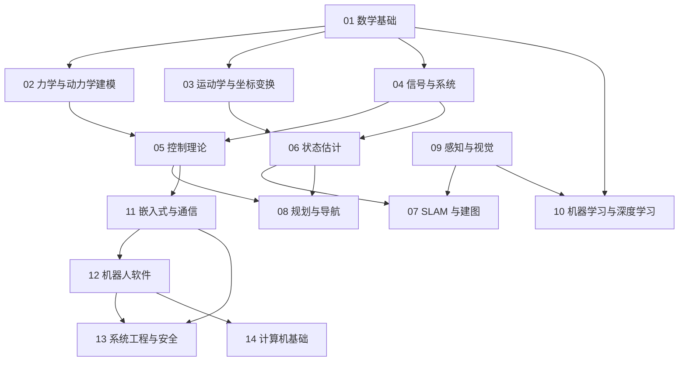

# 基础知识结构说明与扩展计划

> **一句话定位**：本文件说明 `02_基础知识` 为什么、怎样从"项目驱动的 9 个模块"重组为"面向港澳硕士机器人 / AI / CS 方向英文面试的 14 个知识模块"，列出新旧文件对照、本轮已完成的新增主题，以及下一轮需要补写的每个文件的主题、要点和预期篇幅。接手下一轮的人只读本文件就应该知道该写什么、写到什么程度。

**本文件包含：**

1. 重组的目标与原则
2. 新目录总览（14 个模块 + 依赖关系）
3. 新旧文件对照表（原有 53 个章节全部保留）
4. 本轮新增并完成的主题（13 篇）
5. 下一轮待写清单（每个文件的主题、要点、预期篇幅）
6. 下一轮写作要求与收尾步骤
7. 口径对齐记录（ROS2 Humble 等）

---

## 1. 重组的目标与原则

用户的目标：**通过知识文档学会机器人 / AI / CS 方向硕士面试可能涉及的全部知识**（面试用英文，讲解用中文，术语给英文）。因此基础知识不再只覆盖七个项目用到的内容，而要覆盖这个方向的完整知识版图。重组遵循五条原则：

1. **按学科而不是按项目分模块**：模块名称对应面试官脑子里的学科分类（数学、动力学、运动学、信号与系统、控制、估计、SLAM、规划、感知、机器学习、嵌入式、软件、系统工程、计算机基础）；项目与基础的对应关系放在各章"在本项目里怎么用"一节和总览的依赖表。
2. **编号体现依赖顺序**：数字小的模块是数字大的模块的前置（数学 → 动力学/运动学 → 信号 → 控制 → 估计 → SLAM → 规划 → 感知 → 学习 → 嵌入式 → 软件 → 系统工程 → 计算机基础）。每个模块有 README，写明前置关系和阅读顺序。
3. **保留历史**：所有原有章节用 `git mv` 迁移，文件名除 ROS 与 Nav2 两章外保持不变，历史可追溯。
4. **口径一致**：ROS 统一以 ROS2 Humble 为主、ROS1 仅作对比；导航统一以 Nav2 为主、move_base 作对照（P5 已确认使用 ROS2）。
5. **宁缺毋滥**：尚未写成的章节只在 README 和本文件中以文字列出，不放链接，保证全仓库无断链。

## 2. 新目录总览

```text
02_基础知识/
├── 00_总览与学习路线.md
├── 结构说明与扩展计划.md        （本文件）
├── 01_数学基础/                    已有 5 章，计划 3 章
├── 02_力学与动力学建模/                    已有 5 章，计划 2 章
├── 03_运动学与坐标变换/                    已有 6 章，计划 2 章
├── 04_信号与系统/                    已有 2 章，计划 2 章
├── 05_控制理论/                    已有 10 章，计划 4 章
├── 06_状态估计/                    已有 6 章，计划 4 章
├── 07_SLAM与建图/                    已有 2 章，计划 5 章
├── 08_规划与导航/                    已有 5 章，计划 5 章
├── 09_感知与视觉/                    已有 2 章，计划 5 章
├── 10_机器学习与深度学习/                    已有 10 章，计划 5 章
├── 11_嵌入式与通信/                    已有 6 章，计划 6 章
├── 12_机器人软件/                    已有 7 章，计划 7 章
├── 13_系统工程与安全/                    已有 0 章，计划 7 章
├── 14_计算机基础/                    已有 0 章，计划 8 章
```

依赖关系（箭头表示"先读"）：



| 模块 | 回答的问题 | README |
|---|---|---|
| 01_数学基础 | 所有后续章节的公共语言：向量与矩阵、变化率与微分方程、不确定性、最优选择、离散化与数值计算。 | [README](./01_数学基础/README.md) |
| 02_力学与动力学建模 | 把机器人写成方程：刚体力学、拉格朗日动力学、倒立摆线性化、轮式底盘运动学，以及动力学算法、接触与阻抗。 | [README](./02_力学与动力学建模/README.md) |
| 03_运动学与坐标变换 | 位置与姿态怎么表示、关节到末端怎么算、速度与力怎么传递，以及 URDF/KDL 动力学建模。 | [README](./03_运动学与坐标变换/README.md) |
| 04_信号与系统 | 传感器数据怎么看、滤波器怎么设计、控制器为什么稳定的共同语言：卷积、傅里叶、拉普拉斯、Z 变换、采样与滤波。 | [README](./04_信号与系统/README.md) |
| 05_控制理论 | 让系统按要求运动：反馈、PID、状态空间、LQR、MPC、滑模、前馈与饱和、数字实现，以及非线性、鲁棒与自适应控制。 | [README](./05_控制理论/README.md) |
| 06_状态估计 | 带噪传感器怎样得到可信状态：传感器模型、互补滤波、卡尔曼与 EKF、里程计融合、粒子滤波与时间/坐标一致性。 | [README](./06_状态估计/README.md) |
| 07_SLAM与建图 | 未知环境里一边建图一边定位：问题形式、前后端、位姿图优化、视觉里程计与（后续）激光/视惯融合。 | [README](./07_SLAM与建图/README.md) |
| 08_规划与导航 | 从 A 到 B 怎么走：图搜索、Hybrid A*、代价地图与局部规划、轨迹跟踪，以及 Nav2（ROS2 Humble）导航系统架构。 | [README](./08_规划与导航/README.md) |
| 09_感知与视觉 | 机器人如何"看"：相机模型与标定、点云处理与配准，以及（后续）立体视觉、检测分割跟踪、3D 感知与传感器融合。 | [README](./09_感知与视觉/README.md) |
| 10_机器学习与深度学习 | 从线性回归到大模型与具身智能：机器学习基础、神经网络、CNN/检测、量化部署、Transformer/LLM/Agent、强化学习、模仿学习与 VLA。 | [README](./10_机器学习与深度学习/README.md) |
| 11_嵌入式与通信 | 代码怎样在芯片上实时跑、怎样与电机和上位机通信：STM32、FreeRTOS、CAN/FDCAN、串口/SPI/I2C/以太网、电机驱动与平台基础。 | [README](./11_嵌入式与通信/README.md) |
| 12_机器人软件 | 软件工程与机器人中间件：Linux/Git、C++、Python、ROS2 Humble（ROS1 仅对比）、DDS、仿真与动力学工具链、URDF/TF。 | [README](./12_机器人软件/README.md) |
| 13_系统工程与安全 | 把算法变成可交付、可维护、安全的系统：架构、需求与接口、功能安全、可靠性、测试、可观测性。 | [README](./13_系统工程与安全/README.md) |
| 14_计算机基础 | CS 硕士面试的底座：算法与数据结构、操作系统、网络、体系结构、并发、编译链接、数据库与软件工程。本模块先给出概览与学习路径，现有的八股速查已覆盖基础问答。 | [README](./14_计算机基础/README.md) |

## 3. 新旧文件对照表

原有 53 个章节文件（另有总览一份）全部保留，只改变所在目录名；两个文件因口径对齐而改名。

| 原路径（相对 `02_基础知识/`） | 新路径（相对 `02_基础知识/`） | 变化 |
|---|---|---|
| 00_总览与学习路线.md | 00_总览与学习路线.md | 内容重写（模块、依赖表、路线更新） |
| 01_数学/01_线性代数.md | 01_数学基础/01_线性代数.md | 目录改名 |
| 01_数学/02_微积分与常微分方程.md | 01_数学基础/02_微积分与常微分方程.md | 目录改名 |
| 01_数学/03_概率统计与高斯分布.md | 01_数学基础/03_概率统计与高斯分布.md | 目录改名 |
| 01_数学/04_最优化与二次规划.md | 01_数学基础/04_最优化与二次规划.md | 目录改名 |
| 01_数学/05_数值方法与离散化.md | 01_数学基础/05_数值方法与离散化.md | 目录改名 |
| 02_力学与建模/01_牛顿欧拉与刚体力学.md | 02_力学与动力学建模/01_牛顿欧拉与刚体力学.md | 目录改名 |
| 02_力学与建模/02_拉格朗日方程与机器人动力学.md | 02_力学与动力学建模/02_拉格朗日方程与机器人动力学.md | 目录改名 |
| 02_力学与建模/03_倒立摆建模与线性化.md | 02_力学与动力学建模/03_倒立摆建模与线性化.md | 目录改名 |
| 02_力学与建模/04_差速_麦克纳姆_全向轮与车辆运动学.md | 02_力学与动力学建模/04_差速_麦克纳姆_全向轮与车辆运动学.md | 目录改名 |
| 03_坐标变换与运动学/01_坐标系_旋转矩阵_齐次变换.md | 03_运动学与坐标变换/01_坐标系_旋转矩阵_齐次变换.md | 目录改名 |
| 03_坐标变换与运动学/02_欧拉角_四元数_姿态表示.md | 03_运动学与坐标变换/02_欧拉角_四元数_姿态表示.md | 目录改名 |
| 03_坐标变换与运动学/03_正逆运动学与雅可比.md | 03_运动学与坐标变换/03_正逆运动学与雅可比.md | 目录改名 |
| 03_坐标变换与运动学/04_奇异性_阻尼最小二乘_零空间.md | 03_运动学与坐标变换/04_奇异性_阻尼最小二乘_零空间.md | 目录改名 |
| 03_坐标变换与运动学/05_闭链并联机构与五连杆运动学.md | 03_运动学与坐标变换/05_闭链并联机构与五连杆运动学.md | 目录改名 |
| 03_坐标变换与运动学/06_机械臂动力学_重力补偿_URDF_KDL.md | 03_运动学与坐标变换/06_机械臂动力学_重力补偿_URDF_KDL.md | 目录改名 |
| 04_控制理论/01_反馈控制与系统响应基础.md | 05_控制理论/01_反馈控制与系统响应基础.md | 目录改名 |
| 04_控制理论/02_PID控制全解.md | 05_控制理论/02_PID控制全解.md | 目录改名 |
| 04_控制理论/03_状态空间_可控可观_稳定性.md | 05_控制理论/03_状态空间_可控可观_稳定性.md | 目录改名 |
| 04_控制理论/04_LQR最优控制.md | 05_控制理论/04_LQR最优控制.md | 目录改名 |
| 04_控制理论/05_MPC模型预测控制.md | 05_控制理论/05_MPC模型预测控制.md | 目录改名 |
| 04_控制理论/06_滑模控制.md | 05_控制理论/06_滑模控制.md | 目录改名 |
| 04_控制理论/07_前馈_增益调度_限幅与饱和.md | 05_控制理论/07_前馈_增益调度_限幅与饱和.md | 目录改名 |
| 04_控制理论/08_数字控制与实时性.md | 05_控制理论/08_数字控制与实时性.md | 目录改名 |
| 05_状态估计/01_传感器_IMU_编码器_激光雷达.md | 06_状态估计/01_传感器_IMU_编码器_激光雷达.md | 目录改名 |
| 05_状态估计/02_互补滤波与Mahony_AHRS.md | 06_状态估计/02_互补滤波与Mahony_AHRS.md | 目录改名 |
| 05_状态估计/03_卡尔曼滤波与EKF.md | 06_状态估计/03_卡尔曼滤波与EKF.md | 目录改名 |
| 05_状态估计/04_里程计与传感器融合.md | 06_状态估计/04_里程计与传感器融合.md | 目录改名 |
| 05_状态估计/05_粒子滤波与AMCL.md | 06_状态估计/05_粒子滤波与AMCL.md | 目录改名 |
| 05_状态估计/06_时间同步_坐标系一致性与数据有效性.md | 06_状态估计/06_时间同步_坐标系一致性与数据有效性.md | 目录改名 |
| 06_规划与导航/01_图搜索_Dijkstra_A星.md | 08_规划与导航/01_图搜索_Dijkstra_A星.md | 目录改名 |
| 06_规划与导航/02_Hybrid_A星与车辆运动学约束.md | 08_规划与导航/02_Hybrid_A星与车辆运动学约束.md | 目录改名 |
| 06_规划与导航/03_代价地图_局部规划_TEB.md | 08_规划与导航/03_代价地图_局部规划_TEB.md | 目录改名 |
| 06_规划与导航/04_轨迹跟踪_PurePursuit_Stanley_MPC.md | 08_规划与导航/04_轨迹跟踪_PurePursuit_Stanley_MPC.md | 目录改名 |
| 06_规划与导航/05_导航系统架构_move_base与Nav2.md | 08_规划与导航/05_导航系统架构_Nav2与move_base对比.md | 目录改名；文件改名并按 ROS2 Humble / Nav2 口径调整 |
| 07_感知与机器学习/01_机器学习基础.md | 10_机器学习与深度学习/01_机器学习基础.md | 目录改名 |
| 07_感知与机器学习/02_神经网络与反向传播.md | 10_机器学习与深度学习/02_神经网络与反向传播.md | 目录改名 |
| 07_感知与机器学习/03_卷积网络与目标检测_YOLO.md | 10_机器学习与深度学习/03_卷积网络与目标检测_YOLO.md | 目录改名 |
| 07_感知与机器学习/04_模型量化与边缘部署_RKNN.md | 10_机器学习与深度学习/04_模型量化与边缘部署_RKNN.md | 目录改名 |
| 07_感知与机器学习/05_Transformer_LLM与Agent_LangGraph.md | 10_机器学习与深度学习/05_Transformer_LLM与Agent_LangGraph.md | 目录改名 |
| 07_感知与机器学习/06_强化学习与具身智能入门.md | 10_机器学习与深度学习/06_强化学习与具身智能入门.md | 目录改名 |
| 08_嵌入式与通信/01_STM32_时钟_GPIO_中断_DMA.md | 11_嵌入式与通信/01_STM32_时钟_GPIO_中断_DMA.md | 目录改名 |
| 08_嵌入式与通信/02_FreeRTOS实时系统.md | 11_嵌入式与通信/02_FreeRTOS实时系统.md | 目录改名 |
| 08_嵌入式与通信/03_CAN_FDCAN与电机通信.md | 11_嵌入式与通信/03_CAN_FDCAN与电机通信.md | 目录改名 |
| 08_嵌入式与通信/04_UART_SPI_I2C_以太网_TCP.md | 11_嵌入式与通信/04_UART_SPI_I2C_以太网_TCP.md | 目录改名 |
| 08_嵌入式与通信/05_电机_编码器_驱动与力矩控制.md | 11_嵌入式与通信/05_电机_编码器_驱动与力矩控制.md | 目录改名 |
| 08_嵌入式与通信/06_OpenHarmony_Hi3861_RK3588平台基础.md | 11_嵌入式与通信/06_OpenHarmony_Hi3861_RK3588平台基础.md | 目录改名 |
| 09_机器人软件/01_Linux与Shell_Git.md | 12_机器人软件/01_Linux与Shell_Git.md | 目录改名 |
| 09_机器人软件/02_C++现代特性与工程实践.md | 12_机器人软件/02_C++现代特性与工程实践.md | 目录改名 |
| 09_机器人软件/03_Python工程与科学计算.md | 12_机器人软件/03_Python工程与科学计算.md | 目录改名 |
| 09_机器人软件/04_ROS1_ROS2核心概念.md | 12_机器人软件/04_ROS2_Humble核心概念与ROS1对比.md | 目录改名；文件改名并按 ROS2 Humble / Nav2 口径调整 |
| 09_机器人软件/05_DDS与分布式通信.md | 12_机器人软件/05_DDS与分布式通信.md | 目录改名 |
| 09_机器人软件/06_MuJoCo_Pinocchio_KDL_工具链.md | 12_机器人软件/06_MuJoCo_Pinocchio_KDL_工具链.md | 目录改名 |
| 09_机器人软件/07_URDF_TF_坐标系实践.md | 12_机器人软件/07_URDF_TF_坐标系实践.md | 目录改名 |

合计 53 个章节文件迁移（另有 `00_总览与学习路线.md` 重写）。

## 4. 本轮新增并完成的主题

以下 13 篇均按写作规范完成：中文讲解、术语给英文、完整手算（数值用 Python 复核）、英文面试问答附中文译文、自测题、与项目的联系、常见错误。汉字数为实际统计（仅统计汉字）。

| 路径 | 主题 | 汉字数 |
|---|---|---|
| [02_力学与动力学建模/05_机器人动力学进阶_操作空间_接触_阻抗.md](./02_力学与动力学建模/05_机器人动力学进阶_操作空间_接触_阻抗.md) | RNEA/ABA、操作空间、接触、ZMP、阻抗/导纳 | 5444 |
| [04_信号与系统/01_信号与系统基础_卷积_傅里叶_拉普拉斯_Z变换.md](./04_信号与系统/01_信号与系统基础_卷积_傅里叶_拉普拉斯_Z变换.md) | LTI、卷积、频域、传递函数、Z 变换 | 5549 |
| [04_信号与系统/02_数字滤波器_FIR_IIR_采样与混叠.md](./04_信号与系统/02_数字滤波器_FIR_IIR_采样与混叠.md) | 混叠、FIR/IIR、EMA、Butterworth、陷波、dirty derivative | 5011 |
| [05_控制理论/09_李雅普诺夫稳定性与非线性控制.md](./05_控制理论/09_李雅普诺夫稳定性与非线性控制.md) | Lyapunov、LaSalle、反馈线性化、反步法、PD+重力补偿 | 5082 |
| [05_控制理论/10_鲁棒与自适应控制.md](./05_控制理论/10_鲁棒与自适应控制.md) | S/T、小增益、DOB/ESO、MRAC、Slotine-Li | 5014 |
| [07_SLAM与建图/01_SLAM问题_前端后端_位姿图优化.md](./07_SLAM与建图/01_SLAM问题_前端后端_位姿图优化.md) | 概率形式、EKF/RBPF/图优化、位姿图、占据栅格 | 5114 |
| [07_SLAM与建图/02_视觉里程计_特征_对极几何_PnP_BA.md](./07_SLAM与建图/02_视觉里程计_特征_对极几何_PnP_BA.md) | 特征、对极几何、三角化、PnP、BA、VIO 概览 | 5068 |
| [09_感知与视觉/01_相机模型与标定.md](./09_感知与视觉/01_相机模型与标定.md) | 针孔、畸变、张正友、手眼 | 5127 |
| [09_感知与视觉/02_点云处理_滤波_配准_ICP.md](./09_感知与视觉/02_点云处理_滤波_配准_ICP.md) | 体素/离群点、RANSAC、Kabsch、ICP/NDT | 5099 |
| [10_机器学习与深度学习/07_序列模型_残差网络_ViT与生成模型.md](./10_机器学习与深度学习/07_序列模型_残差网络_ViT与生成模型.md) | RNN/LSTM、ResNet、ViT、VAE、扩散、流匹配 | 5072 |
| [10_机器学习与深度学习/08_大语言模型预训练_微调_RAG与VLA.md](./10_机器学习与深度学习/08_大语言模型预训练_微调_RAG与VLA.md) | BPE、预训练、LoRA、DPO、RAG、VLM、VLA | 5415 |
| [10_机器学习与深度学习/09_强化学习进阶_策略梯度_PPO_SAC.md](./10_机器学习与深度学习/09_强化学习进阶_策略梯度_PPO_SAC.md) | 策略梯度、GAE、PPO、SAC、奖励设计、sim-to-real | 5053 |
| [10_机器学习与深度学习/10_模仿学习_行为克隆_DAgger_扩散策略.md](./10_机器学习与深度学习/10_模仿学习_行为克隆_DAgger_扩散策略.md) | BC、DAgger、ACT、扩散策略、数据采集 | 5804 |
| 合计 | | 67852 |

此外，本轮同时完成：14 个模块 README；`00_总览与学习路线.md` 重写；ROS 相关文档对齐；全仓库相对链接修复。

## 5. 下一轮待写清单

下表列出每个待写文件的预定文件名、主题、要点与预期篇幅。**每个文件的最低要求**：不少于 5000 汉字，按写作规范"八步讲解"（问题 → 符号单位 → 推导 → 完整手算（Python 复核）→ 在本项目里怎么用 → 常见错误 → 面试问答（英文 + 中文译文）→ 自测题）。篇幅列是目标量级，超出无妨。

### 01_数学基础

| 预定文件 | 主题与要点 | 手算 / 联系 | 篇幅 |
|---|---|---|---|
| `06_李群李代数与流形优化入门.md` | SO(3)/SE(3) 群结构，指数/对数映射，伴随，扰动模型，左右雅可比，流形上的高斯牛顿 | 手算 SO(3) 指数映射与小角度近似；与四元数、位姿图优化、ESKF 的联系；英文问答与自测 | 约 6000 汉字 |
| `07_信息论与图论基础.md` | 熵、交叉熵、KL 散度、互信息；图的表示、树、最短路、最小生成树、二分图匹配 | 手算熵与 KL；与分类损失、VAE、SLAM 图优化、路径规划的联系 | 约 5000 汉字 |
| `08_数值线性代数与稀疏求解.md` | LU、Cholesky、QR、SVD 的用法与代价；条件数；稀疏矩阵与填充；共轭梯度 | 手算 2x2 条件数与误差放大；与位姿图 H 稀疏、MPC 的 QP 求解联系 | 约 5500 汉字 |

### 02_力学与动力学建模

| 预定文件 | 主题与要点 | 手算 / 联系 | 篇幅 |
|---|---|---|---|
| `06_质心动力学_LIPM_ZMP与足式轮足建模.md` | 质心动量方程，LIPM、捕获点（capture point）、ZMP 判据，轮足/轮腿模型（P7 相关），变腿长对极点的影响 | 手算 LIPM 轨迹与 ZMP 约束；与 P7 变腿长增益调度联系；英文问答 | 约 6000 汉字 |
| `07_柔性关节_弹性驱动_摩擦_接触建模.md` | 串联弹性执行器（SEA）、谐波减速器柔性、Stribeck 摩擦、接触刚度与阻尼、弹簧-阻尼接触模型 | 手算两质量弹簧系统共振；辨识摩擦；与仿真器接触参数联系 | 约 5000 汉字 |

### 03_运动学与坐标变换

| 预定文件 | 主题与要点 | 手算 / 联系 | 篇幅 |
|---|---|---|---|
| `07_DH参数_POE_旋量理论.md` | 标准/改进 DH 约定，指数积（POE）公式，旋量（twist）与螺旋轴，空间雅可比与体雅可比 | 手算 2R/3R 的 DH 表与 POE；两种方法对比；与 URDF 的对应；英文问答 | 约 6000 汉字 |
| `08_机械臂轨迹生成_多项式_梯形速度_S曲线.md` | 关节空间与笛卡尔空间插值，三次/五次多项式，梯形与 S 曲线，时间最优参数化（TOPP）入门 | 手算五次多项式系数与速度加速度边界；与 P2 平滑、限速联系 | 约 5500 汉字 |

### 04_信号与系统

| 预定文件 | 主题与要点 | 手算 / 联系 | 篇幅 |
|---|---|---|---|
| `03_频谱分析_FFT_窗函数_PSD与振动诊断.md` | FFT 实用细节、窗函数选择、功率谱密度（Welch）、频谱泄漏、振动与共振诊断流程 | 手算窗函数增益与分辨率；对 IMU/电机数据找共振；工具链（numpy/scipy）示例 | 约 5500 汉字 |
| `04_随机信号_自相关_功率谱_白噪声与Allan方差.md` | 随机过程、自相关与功率谱关系、白噪声与有色噪声、Allan 方差辨识 IMU 噪声参数 | 手算 Allan 方差曲线上的 ARW 与零偏不稳定性；与卡尔曼 Q/R 取值联系 | 约 5500 汉字 |

### 05_控制理论

| 预定文件 | 主题与要点 | 手算 / 联系 | 篇幅 |
|---|---|---|---|
| `11_频域设计_根轨迹_奈奎斯特_伯德_超前滞后校正.md` | 根轨迹绘制规则，奈奎斯特判据，伯德图设计，增益/相位裕度，超前/滞后/PID 校正器的频域设计 | 手算超前校正使相位裕度达标；与 PID 整定对照；英文问答 | 约 7000 汉字 |
| `12_力控与阻抗_导纳_混合力位控制.md` | 力/位混合控制，阻抗/导纳的控制器设计与稳定性，接触稳定性（被动性），力传感器噪声处理 | 手算一维接触的稳定边界；与 P2 拖动示教联系 | 约 6000 汉字 |
| `13_最优控制与轨迹优化_iLQR_DDP_直接配点.md` | 变分法与 Pontryagin，iLQR/DDP 推导，直接配点/射击法，MPC 的求解器与实时迭代 | 手算 iLQR 一次迭代；与 LQR/MPC 联系；轨迹优化在机器人上的应用 | 约 6500 汉字 |
| `14_系统辨识与参数整定.md` | 阶跃/频率响应辨识，最小二乘与预测误差法，激励信号设计，辨识后模型验证，自动整定（继电反馈） | 手算一阶加延迟模型的辨识；与 P1/P3 调参流程联系 | 约 6000 汉字 |

### 06_状态估计

| 预定文件 | 主题与要点 | 手算 / 联系 | 篇幅 |
|---|---|---|---|
| `07_UKF_信息滤波_卡尔曼平滑.md` | 无迹变换与 UKF，信息形式滤波，RTS 平滑，固定滞后平滑 | 手算 sigma 点传播；UKF 与 EKF 对比；离线平滑用于轨迹后处理 | 约 6000 汉字 |
| `08_IMU预积分与因子图估计.md` | IMU 运动模型，预积分推导，偏置建模，因子图与增量平滑（iSAM2 思想） | 手算一段预积分；与 VIO/LIO 联系 | 约 6500 汉字 |
| `09_误差状态卡尔曼ESKF与流形上的滤波.md` | 名义状态/误差状态，四元数误差，ESKF 的 predict/update/inject，与 EKF 对比 | 手算小角度误差更新；与 P1 姿态估计联系 | 约 6000 汉字 |
| `10_估计一致性_可观性分析_NEES与NIS.md` | 可观性矩阵与不可观方向，滤波一致性检验，协方差失配诊断，调参流程 | 手算 NEES；EKF-SLAM 不一致的来源；调参排错清单 | 约 5500 汉字 |

### 07_SLAM与建图

| 预定文件 | 主题与要点 | 手算 / 联系 | 篇幅 |
|---|---|---|---|
| `03_激光SLAM_LOAM_LIO-SAM_Cartographer.md` | LOAM 特征与扫描匹配，LIO-SAM 的因子图，Cartographer 子图与分支定界，gmapping/slam_toolbox 对比 | 手算曲率特征；点到线/面残差；系统对比表（细节标注未核对） | 约 6500 汉字 |
| `04_视觉惯性里程计VIO_预积分_滑动窗口.md` | 紧耦合 VIO 的状态与因子，滑动窗口与边缘化，初始化，时间偏移标定 | 手算边缘化 Schur 补；与 IMU 预积分章联系 | 约 6500 汉字 |
| `05_回环检测与重定位_词袋_ScanContext.md` | 视觉词袋，倒排索引，Scan Context，几何验证，重定位流程 | 手算 TF-IDF 与相似度；精确率召回率权衡 | 约 5500 汉字 |
| `06_建图表示_栅格_八叉树_NDT_TSDF_ESDF.md` | 占据栅格、OctoMap、NDT 地图、TSDF/ESDF 及其在规划中的用途 | 手算 TSDF 融合一步；存储与分辨率估算 | 约 6000 汉字 |
| `07_多机SLAM与长期地图维护.md` | 地图合并、相对位姿估计、动态环境更新、地图版本管理 | 手算两机位姿图合并；与 P6 多机平台联系 | 约 5000 汉字 |

### 08_规划与导航

| 预定文件 | 主题与要点 | 手算 / 联系 | 篇幅 |
|---|---|---|---|
| `06_采样规划_RRT_RRT星_PRM.md` | RRT/RRT*/PRM 的原理，渐近最优，碰撞检测，采样策略与后处理平滑 | 手算 RRT 一次扩展与 RRT* 重连；与 A* 对比 | 约 6000 汉字 |
| `07_机械臂运动规划_碰撞检测_MoveIt_CHOMP.md` | 配置空间，碰撞检测（GJK/FCL 概念），MoveIt 流水线，CHOMP/TrajOpt 轨迹优化 | 手算配置空间障碍；与 P2 约束 IK 联系 | 约 6500 汉字 |
| `08_行为树与任务规划_PDDL_有限状态机.md` | FSM 与行为树的取舍，Nav2 BT 节点，PDDL 基础，任务与运动规划结合 | 手算 BT tick 序列；与 P6 任务分发联系 | 约 5500 汉字 |
| `09_多机器人路径规划_MAPF_编队.md` | 冲突类型，CBS/优先级规划，编队与一致性控制，通信约束 | 手算两机器人冲突与 CBS 约束；与 P6 协调联系 | 约 5000 汉字 |
| `10_局部规划进阶_DWA_MPPI_ORCA.md` | DWA 采样、MPPI 采样式 MPC、ORCA 动态避障 | 手算 DWA 打分；MPPI 权重；与 TEB 对比 | 约 6000 汉字 |

### 09_感知与视觉

| 预定文件 | 主题与要点 | 手算 / 联系 | 篇幅 |
|---|---|---|---|
| `03_立体视觉_对极几何_深度估计.md` | 校正，视差与深度，块匹配/半全局匹配，ToF/结构光对比，深度图后处理 | 手算校正与视差；深度误差随距离的预算；深度相机选型 | 约 5500 汉字 |
| `04_目标检测_分割_跟踪_评价指标.md` | 检测器家族（锚框/无锚框/Transformer），NMS，实例/语义分割，多目标跟踪（SORT/ByteTrack 思想），IoU/mAP | 手算 IoU、NMS、mAP；与 P4 YOLO 联系 | 约 7000 汉字 |
| `05_3D感知_点云检测_BEV_占据网络.md` | 点云体素/柱化网络，BEV 融合，占据预测，自动驾驶与机器人 3D 感知概述 | 手算体素化与柱化尺寸；与激光雷达章联系（细节标注未核对） | 约 6000 汉字 |
| `06_传感器融合_相机雷达_时空对齐.md` | 外参/时间标定，投影对齐，早期/晚期融合，置信度融合 | 手算雷达点投影到图像；时间偏移对位置的影响 | 约 5500 汉字 |
| `07_图像处理基础_滤波_边缘_形态学_颜色空间.md` | 卷积滤波，边缘（Sobel/Canny），形态学，颜色空间，直方图与阈值 | 手算 Sobel 卷积；与特征点章联系 | 约 5500 汉字 |

### 10_机器学习与深度学习

| 预定文件 | 主题与要点 | 手算 / 联系 | 篇幅 |
|---|---|---|---|
| `11_经典机器学习补充_SVM_树模型_聚类_降维.md` | SVM 与核技巧，决策树与集成（随机森林/梯度提升），K-means/GMM，PCA/t-SNE | 手算 SVM 间隔、基尼系数、K-means 一轮、PCA 投影 | 约 6500 汉字 |
| `12_概率图模型_贝叶斯方法_高斯过程.md` | 贝叶斯推断，共轭先验，HMM，高斯过程回归，变分推断概述 | 手算贝叶斯更新、GP 预测；与卡尔曼联系 | 约 6000 汉字 |
| `13_基于模型的强化学习_离线RL_与MPC结合.md` | Dyna/MBPO/Dreamer 思想，离线 RL 保守性，MPC 与学习结合（学习动力学/价值） | 手算模型误差累积；与 MPC 章联系（细节标注未核对） | 约 5500 汉字 |
| `14_世界模型与具身基础模型综述.md` | 世界模型思想，具身基础模型分类，数据规模与评测基准 | 结构梳理与比较表；面向"研究兴趣"面试回答（标注未核对） | 约 5500 汉字 |
| `15_大模型训练与推理工程.md` | 数据并行/张量并行/流水并行，ZeRO 思想，混合精度，推理服务，评测与红队 | 手算显存估算（权重/梯度/优化器/激活）；吞吐估算 | 约 5500 汉字 |

### 11_嵌入式与通信

| 预定文件 | 主题与要点 | 手算 / 联系 | 篇幅 |
|---|---|---|---|
| `07_Cortex-M体系_启动_链接脚本_内存映射.md` | 启动流程，向量表，栈与堆，链接脚本，内存映射，FPU 与 MPU | 手算栈使用与内存布局；常见 HardFault 排查 | 约 6000 汉字 |
| `08_电源管理_低功耗_看门狗_Bootloader_OTA.md` | 电源树，低功耗模式，独立/窗口看门狗，Bootloader 分区，OTA 升级与回滚 | 手算功耗预算；OTA 失败恢复设计 | 约 5500 汉字 |
| `09_ADC_PWM_定时器_FOC电机控制原理.md` | ADC 采样同步，PWM 死区，Clarke/Park 变换，电流环与 FOC 流程 | 手算 Clarke/Park；电流采样时序 | 约 7000 汉字 |
| `10_嵌入式调试_JTAG_SWD_逻辑分析仪_故障定位.md` | 调试接口，断点与 trace，逻辑分析仪与示波器使用，常见硬件/软件故障案例 | 故障案例排查流程；与 P3/P7 联调联系 | 约 5000 汉字 |
| `11_实时调度理论_RMS_EDF_优先级反转.md` | 周期任务模型，RMS/EDF 可调度性判据，优先级反转与继承/天花板协议 | 手算 RMS 利用率界与响应时间分析 | 约 5500 汉字 |
| `12_嵌入式Linux_设备树_驱动_RT-Preempt.md` | 设备树，字符设备驱动，实时内核补丁，用户态与内核态时延 | 手算时延预算；与 RK3588 平台联系 | 约 6000 汉字 |

### 12_机器人软件

| 预定文件 | 主题与要点 | 手算 / 联系 | 篇幅 |
|---|---|---|---|
| `08_ROS2_Humble实战_launch_参数_生命周期_组件.md` | Python launch 文件，参数声明与动态重配置，生命周期节点，组件与进程内通信，QoS 调优 | 给出可复现的最小包与命令；故障案例；与 P5/P6 联系 | 约 7000 汉字 |
| `09_ROS2测试与CI_launch_testing_gtest_rosbag回放.md` | 单元测试与集成测试，launch_testing，rosbag2 回放基准，CI 流水线 | 最小测试示例；回归测试设计 | 约 5500 汉字 |
| `10_仿真平台_Gazebo_Isaac_MuJoCo对比.md` | 物理引擎差异，传感器仿真，ROS2 接入，随机化与批量仿真 | 对比表；选型建议（标注未核对） | 约 5500 汉字 |
| `11_CMake_ament_构建系统与依赖管理.md` | CMake 基础，ament_cmake/ament_python，依赖与导出，交叉编译 | 最小 CMakeLists；常见链接错误 | 约 5500 汉字 |
| `12_Docker与部署_交叉编译_systemd.md` | 容器化机器人环境，镜像分层，设备映射，systemd 自启动，交叉编译到 ARM | 最小 Dockerfile 与 service 文件 | 约 5500 汉字 |
| `13_日志_诊断_性能剖析_perf_tracing.md` | 结构化日志，diagnostics，perf/火焰图，ros2_tracing 思想 | 性能排查案例；延迟预算 | 约 5500 汉字 |
| `14_ros2_control与硬件接口实战.md` | 硬件接口，控制器管理器，控制器链，实时性与 CAN 桥接 | 最小硬件接口示例；与 P1/P2 执行链联系 | 约 6000 汉字 |

### 13_系统工程与安全

| 预定文件 | 主题与要点 | 手算 / 联系 | 篇幅 |
|---|---|---|---|
| `01_机器人系统架构设计_分层_接口_需求.md` | 需求到架构，分层与接口，频率与延迟预算，故障域，P1/P2/P5/P6 的架构对比 | 画出分层架构与数据流；延迟预算表；英文系统设计问答 | 约 6000 汉字 |
| `02_功能安全基础_急停_安全链_ISO13849与IEC61508.md` | 安全功能、PL/SIL 概念、急停与安全链、软件安全措施（限幅/看门狗/状态机） | 概念梳理，标注标准细节未核对；与 P1 安全闭环、P6 策略检查联系 | 约 6000 汉字 |
| `03_可靠性与故障诊断_FMEA_看门狗_降级策略.md` | FMEA 方法，故障检测与隔离，降级与恢复，冗余 | 做一张 FMEA 表；看门狗设计 | 约 5500 汉字 |
| `04_测试策略_仿真在环_硬件在环_回归.md` | 测试金字塔，SIL/HIL，回归与回放测试，实机试验安全流程 | 设计一份实机上线 checklist；回放基准 | 约 5500 汉字 |
| `05_数据与日志_可观测性_回放与复盘.md` | 日志分级，指标，rosbag 策略，故障复盘模板 | 给出复盘模板与案例 | 约 5000 汉字 |
| `06_信息安全与权限_DDS-Security_OTA安全.md` | 威胁模型，认证与加密，DDS-Security 概念，OTA 签名 | 概念梳理（标注未核对） | 约 5000 汉字 |
| `07_人机共融_伦理与法规概览.md` | 人机协作安全，隐私，责任划分，AI 系统风险管理 | 概览与英文表达（标注未核对） | 约 4500 汉字 |

### 14_计算机基础

| 预定文件 | 主题与要点 | 手算 / 联系 | 篇幅 |
|---|---|---|---|
| `01_算法与数据结构复习_复杂度_图_动态规划.md` | 复杂度分析，排序/查找，图算法，动态规划，贪心，常见面试题型 | 手算若干典型题；与规划（A*、Dijkstra）联系 | 约 7000 汉字 |
| `02_操作系统_进程线程_内存_调度_同步.md` | 进程线程，虚拟内存，调度，同步原语，死锁，IO 模型 | 手算页表与调度；与 FreeRTOS/Linux 实时联系 | 约 7000 汉字 |
| `03_计算机网络_TCP_UDP_以太网_时延.md` | 分层模型，TCP 拥塞控制，UDP，时延与吞吐，DDS 对比 | 手算时延带宽积；与 ROS2 通信联系 | 约 6000 汉字 |
| `04_计算机体系结构_缓存_流水线_SIMD_GPU.md` | 缓存与局部性，流水线与分支，SIMD，GPU 并行模型，内存带宽瓶颈 | 手算缓存命中率与带宽瓶颈；与 NPU 部署联系 | 约 6500 汉字 |
| `05_并发与内存模型_锁_原子_无锁.md` | 数据竞争，内存序，锁、条件变量、原子，无锁队列，C++ 内存模型 | 手算竞争条件；与 ROS2 回调组联系 | 约 6000 汉字 |
| `06_编译链接加载_C_C++_ABI.md` | 预处理到链接，静态/动态库，符号，ABI，常见链接错误 | 手算对象文件布局；与 CMake/ament 联系 | 约 6000 汉字 |
| `07_数据库与分布式基础_一致性_时钟.md` | 事务，索引，CAP，一致性模型，逻辑时钟与时间同步 | 手算向量时钟；与多机时间同步联系 | 约 5500 汉字 |
| `08_软件工程_设计模式_测试_代码评审.md` | 设计原则，常用模式，测试驱动，代码评审，技术债 | 给出评审清单；与项目工程化联系 | 约 5000 汉字 |

合计待写 65 个文件。建议优先级：① 05_控制理论/11、12、13（面试高频）；② 06_状态估计/07、08；③ 07_SLAM 03、04；④ 08_规划 06、07；⑤ 09_感知 03、04；⑥ 10_机器学习 11、12；⑦ 11_嵌入式 09、11；⑧ 12_机器人软件 08、09；⑨ 13_系统工程与安全；⑩ 14_计算机基础（与 `03_八股知识/01_计算机基础` 配合，避免重复，深入原理与例题）。

## 6. 下一轮写作要求与收尾步骤

1. 先读 [写作规范](../06_维护说明/写作规范.md)、[CV 事实基线](../06_维护说明/CV事实基线.md)，再读已完成的新增主题中任意两篇作为格式样板（推荐 [信号与系统基础](./04_信号与系统/01_信号与系统基础_卷积_傅里叶_拉普拉斯_Z变换.md) 与 [强化学习进阶](./10_机器学习与深度学习/09_强化学习进阶_策略梯度_PPO_SAC.md)）。
2. 文件结构：`#` 标题 → 一句话定位 → **本章学完你能** → 前置知识（带链接）→ 目录 → 正文章节 → 在本项目里怎么用 → 常见错误 → 面试怎么问怎么答 → 本章要点速记 → 自测题 → 相关链接。
3. 所有手算必须用 Python 复核，并在文中标"Python 复核"；教学数值标"示例（非项目实测）"；项目数字只写 CV 与项目文档中已有的取值。
4. 外部事实（具体论文、产品参数、标准条文、版本接口）凡无法确认的，标"未核对"，不要编造文献、网址、数据。
5. 与 CV 的边界：CV 没有写的内容（如训练 VLA、实现 SLAM、整套 FOC）只作为通用知识讲，并在"在本项目里怎么用"里诚实说明"属于延伸，不是项目内容"。
6. ROS 内容统一 ROS2 Humble 口径，ROS1 仅作对比；导航统一 Nav2。
7. 写完一个文件后：(a) 在对应模块 README 中把该行从"后续章节"表移到"学习顺序（已完成）"表并加链接；(b) 在 [03_目录结构与文件职责](../06_维护说明/03_目录结构与文件职责.md) 补一行；(c) 在 [总览与学习路线](./00_总览与学习路线.md) 的模块表补链接；(d) 运行 `python -X utf8 -I 01_项目学习/06_维护说明/工具/check_all.py`，确认无断链和控制字符。
8. 不要 `git commit`/`push`，由总负责人统一提交。

## 7. 口径对齐记录

- **ROS 版本**：P5 README 已确认使用 ROS2 Humble（Ubuntu 22.04）。[ROS2 Humble 核心概念与 ROS1 对比](./12_机器人软件/04_ROS2_Humble核心概念与ROS1对比.md) 已改为以 ROS2 Humble 为主线，ROS1（master、catkin、`rostopic` 等）只在标题带"对比"的小节出现；P1 的存量代码平台为 ROS1 风格，已在该章 14.1 节说明：CV 只写 "ROS state processing"，面试按概念讲即可。
- **导航栈**：[导航系统架构：Nav2 与 move_base 对比](./08_规划与导航/05_导航系统架构_Nav2与move_base对比.md) 标题、定位与"本项目的做法"已改为 Nav2 为主，move_base 各节标注"ROS1 对照"。
- **目录改名后的链接**：全仓库相对链接与文本路径已按新目录名修复（约 1200 处链接，涉及约 130 个文件，另有目录名与显示文本的同步替换）。

## 8. 相关链接

- [基础知识总览与学习路线](./00_总览与学习路线.md)
- [项目学习 README](../README.md)
- [目录结构与文件职责](../06_维护说明/03_目录结构与文件职责.md)
