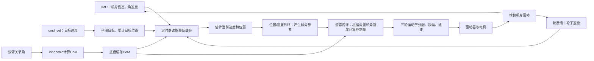

# P1 本对话问答逐字稿

> 本文按原始对话时间顺序收录 P1 范围内的 66 组用户提问与助手最终答复，共 132 条消息。每条消息正文逐字取自本地对话记录；只添加问答编号、说话者标签和 Markdown 代码围栏，便于辨认并保留原始标点、公式、代码与换行。

> 对话范围：2026-10-03 05:29:38 UTC 至 2026-10-04 12:43:50 UTC。平台环境提示、页面状态提示、工具调用及助手过程性 commentary 不属于问答正文，未列入。

---

## 第 01 组

### 用户提问

````text
现在开始学习项目1，球形底盘由一个球承载身体，三个驱动轮接触球面，通过球转动移动接触点。身体在球上相当于直立摆，会受重力倾覆；双臂动作改变质心。目标同时是移动到位置、跟踪速度、保持身体姿态，不能只让轮子转到某个速度。  没看懂这个机械结构应该是怎么样的 可以结合图细讲
````

### 助手答复

````text
先看图：蓝色大球是唯一直接接触地面的部分；橙色小轮装在机身支架上，压着大球。俯视图中，三只小轮绕球心约隔 **120°**。


### 按零件看

1. **大球**：像一个没有固定车轴、能向不同方向滚动的大轮子。它的底部接触地面。
2. **三只小驱动轮**：它们装在机身框架上，轮面压着大球。小轮本身不碰地面。
3. **机身和框架**：电脑、电池、IMU、手臂都在机身一侧；框架固定小轮，让它们保持与大球接触。
4. **双臂**：手臂移动会改变整台机器人的质心，也就是整机质量的“平均位置”。

图用于理解传动关系，**不是项目的精确 CAD 图**。课程资料确认了三轮接触方位约隔120°，但没有机械 CAD 图，因此不能仅凭示意图断定小轮精确的高度、朝向或内外安装方式。可以再看[结构与传感器章节](F:/27fall/申请材料/01_项目学习/02_项目课程/P1_AIRS球形机器人/01_原理与子系统/01_结构传感器与平衡状态.md)和[三轮球体运动学章节](F:/27fall/申请材料/01_项目学习/02_项目课程/P1_AIRS球形机器人/01_原理与子系统/02_三轮球体运动学分配.md)。

### 力是怎样传到地面的？

它有两处重要接触：

**小轮 ↔ 大球：**电机让小轮转动。轮面和球面之间的摩擦力带动大球转起来。

**大球 ↔ 地面：**大球转动后，球和地面的摩擦力让球向前、向后或侧向滚动，机器人就跟着移动。

所以运动链是：

> **电机转小轮 → 小轮带大球转 → 大球在地面滚 → 机身移动**

如果小轮对球打滑，或大球在地上打滑，电机转了也不一定产生预计的位移。

### “接触点移动”是什么意思？

小轮和机身框架的位置基本固定。变化的是**球面上经过小轮的那一小块材料**：球转动时，原先贴着小轮的球面部分会滚开，新的部分滚到接触位置。大球和地面的接触部分也会随滚动更换。

因此，不是三只小轮绕着大球跑；而是**小轮在固定位置转，大球表面从小轮下面滚过**。

### 为什么还要控制机身姿态？

机器人整体的质心在球的支撑位置上方，有点像“把直杆立在滚动的球上”。机身一旦倾斜，重力就会产生让它继续倾倒的力矩。控制器要让大球及时滚动，使支撑位置跟上机身，避免机器人倒下。

双臂伸出去时，质心会移动，重力对机身造成的倾倒作用也会改变。即使球和小轮没有变，控制器面对的平衡任务已经不同了。

### 为什么不只是“把轮子转到某个速度”？

轮速只是最后发给执行器的命令；机器人真正要完成的是同时**去目标位置、跟踪目标速度、保持机身平衡**。例如，机器人已经到达目标位置但还在快速移动，就需要减速；只看位置会漏掉这件事。

项目控制链可以先记成：

> **测量机身姿态和三轮状态 → 估计球与机身的运动 → 根据位置、速度和姿态算控制量 → 分配成三轮速度 → 再读取反馈**

一句话记住结构：**小轮固定在机身上并驱动大球；大球接触地面并带机器人移动；控制器持续调整三轮，让机器人既能走又不倒。**
````

## 第 02 组

### 用户提问

````text
**# 02 三轮球体运动学分配**

先修：[基础课程]\(../../../01_通用基础/00_基础课程总览.md)。项目：P1。目标：把公式对应到实际变量与调用。源码：[文件地图]\(../02_源码阅读与运行/01_源码版本与文件地图.md)。实验：[P1]\(../../../03_代码实验/02_项目实验/P1/README.md)。


**## 1. 从球面速度投影到驱动轮**

球角速度ω=[ωx,ωy,ωz]，球面接触点速度ω×r_contact。驱动轮只能沿有效驱动切向约束这部分速度，投影后除轮半径r得到轮轴角速。固定接触纬度θ、方位α_i=0/120/240°，源码约定得到：

\\[s_i=-\frac{R}{r}[\sin\theta\cos\alpha_i,\sin\theta\sin\alpha_i,-\cos\theta]\omega.\\]

具体负号来自原机轴与接触定义，不是所有球轮通用符号。θ参数是degree，代码先radians；α已是rad。R/r无量纲，所以球角速→轮角速均rad/s。

**## 2. 矩阵每行都代表一只轮**

叠三行成ik，轮速s=ik ω。fk=ik⁻¹恢复球角速。本源码linear_model.BWRDynamics.kinematics生成矩阵并写model_params，C++readConfig读预先生成的数。

θ=0时sinθ=0，x/y控制能力消失；θ=90°时cosθ=0，z转动分配退化。需要合法几何与满秩，不能所有纬度都直接inv。

**## 3. 完整手算**

使用教学R/r=2、θ=45°、ω=[1,0,0]。sin=cos=.707107，各轮s=[-1.414214,.707107,.707107]rad/s。若ω=[0,0,1]，各轮均+1.414214。将已知ik与s解线性方程应恢复原ω。

现存yaml R=.11,r=.0635,θ=40°，ik第一行[-1.11349,0,1.327006]等；这里只引用配置，不宣称参数测量或源码生成器已运行。

**## 4. 实际输出路径的特殊点**

controlLoop的angular_cmd变量名带tau，但最终通过ik进入v_des速度字段。它不是直接发布三只电机t_ff力矩。源代码先把姿态PID乘K_t2v，又在ik结果后再乘一次K_t2v；前馈在两者之间加入，所以反馈与前馈缩放次数不同，解释时不能省略。

limitVector用整体L2范数限幅8（当前wheel o_clamp），不是每轮单独clip8，也不是max绝对值缩放。整组同比例保持该线性映射方向，但执行器真实最大速度仍需独立核对。

**## 5. 代码与失败**

[ball_wheel_mapping教学实验]\(../../../03_代码实验/02_项目实验/P1/README.md)只复现几何往返，不连接轮。失败：latitude rad当degree；球半径与轮半径互换；轮序错；纬度退化；把输出当线速度。

**## 6. 英文与练习**

“The mapping projects the ball's contact velocity onto each wheel's drive direction. It maps ball angular velocity to wheel angular velocity, so it differs from a planar omni-wheel body-velocity matrix.”

追问：How is the output limited in this source? The wheel-command vector is scaled using its Euclidean norm.

1\. 概念：ik在这里求角度位置吗？答：名称ik，但此处速度线性分配。
2\. 计算：上例ω=[0,0,-1]？答：三轮-1.414214rad/s。
3\. 代码：θ=0怎样处理？答：报告映射奇异，不任意求逆。
4\. 解释：三轮同速为什么是yaw而非前进？答：按此球接触几何，同速对应球z轴转动。


下一步：[完整周期]\(../02_源码阅读与运行/02_一个周期的调用与数据流.md)。

**## 精读补充：把中间步骤讲清楚**

**### 本章在完整周期中的位置**

矩阵每行是一只接触轮，输入是球角速而非平面车速度。用纯x、纯y、纯z三组输入看列作用，再把轮反馈反解检查轮序。限幅8是L2整向量范数，反馈与CoM前馈经过t2v的次数不同。

先回到[完整源码周期]\(../02_源码阅读与运行/02_一个周期的调用与数据流.md)，定位本章之前输入由谁产生、之后结果被谁消费；再读[对应基础推导]\(../../../01_通用基础/03_坐标_运动学与动力学/05_机械臂FKIK与雅可比.md)。不要只背中间一个函数或矩阵。

**### 用纸笔完成这一页的验收**

1\. 从本章数值例重算每个中间量，写单位和输入形状。
2\. 对照[源文件地图]\(../02_源码阅读与运行/01_源码版本与文件地图.md)，指出活动分支和被注释的区别。
3\. 解释上述特有误读点，并给一条能区分原因的日志字段。
4\. 先用中文说清输入→计算→输出，再用本章英文口述；涉及个人贡献时查材料证据，不把教学重建说成历史部署。
没看懂
````

### 助手答复

````text
先只抓住一句话：

> **这个矩阵把“大球想怎样转”，换算成“三只小轮各要转多快”。**

它的输入是大球的角速度，输出是三只驱动轮的角速度。它**不是**“机器人要往哪儿走”的直接公式，也不是机械臂那种关节位置 IK。

可以把它想成：大球要向某个方向转，三只轮子分别压在球面不同位置，所以每只轮子需要不同的转速和方向。

## 1. 公式里的量分别是什么？

原式写成：

\[
s_i=-\frac{R}{r}
[\sin\theta\cos\alpha_i,\ \sin\theta\sin\alpha_i,\ -\cos\theta]
\begin{bmatrix}\omega_x\\\omega_y\\\omega_z\end{bmatrix}
\]

| 符号 | 简单解释 | 单位 |
|---|---|---|
| \(\omega_x,\omega_y,\omega_z\) | **大球**绕三个轴转得多快 | rad/s |
| \(s_i\) | 第 \(i\) 只**小驱动轮**转得多快 | rad/s |
| \(R\) | 大球半径 | m |
| \(r\) | 小驱动轮半径 | m |
| \(\theta\) | 轮子接触球面的位置参数 | 角度 |
| \(\alpha_i\) | 第 \(i\) 只轮子绕球分布在哪个方位 | 角度 |

\(\alpha_i\) 取 \(0^\circ,120^\circ,240^\circ\)，意思是从俯视方向看，三只轮子的方位均匀分布在球周围。

前面的负号表示：项目约定的轮子正转方向与公式选定的球面运动方向之间有一个方向翻转。它是**坐标轴和电机正方向的约定**，不是所有机器人的公式都必须带这个负号。

## 2. 为什么会有 \(R/r\)？

球面上的点离球心约 \(R\) 米。大球以角速度 \(\omega\) 转时，球面接触处的线速度大小与 \(R\omega\) 成正比。小轮半径是 \(r\)，要产生同样大小的轮缘线速度，它的角速度大约是：

\[
\text{小轮角速度}=\frac{\text{小轮轮缘线速度}}{r}
\]

因此会出现：

\[
\frac{R\omega}{r}=\frac{R}{r}\omega
\]

\(R/r\) 是两个长度相除，没有单位，所以输入输出仍都是角速度。

更完整的物理过程是：

\[
\text{大球转动}
\rightarrow
\text{球面接触处产生线速度 }\boldsymbol\omega\times\mathbf r
\rightarrow
\text{取出沿小轮驱动方向的那部分速度}
\rightarrow
\text{除以小轮半径 }r
\rightarrow
s_i
\]

小轮只能沿自己的有效驱动方向带动球面。不同轮子的位置和朝向不同，所以它们“看到”的球面速度分量也不同。把这些几何关系整理后，就得到题目中的公式。

## 3. 一行矩阵乘法是什么意思？

先记：

\[
k=\frac{R}{r},\qquad s=\sin\theta,\qquad c=\cos\theta
\]

取三只轮子的方位角 \(0^\circ,120^\circ,240^\circ\)，逐一代入，公式变成：

\[
\begin{aligned}
s_1 &= k(-s\omega_x+c\omega_z)\\
s_2 &= k\left(\frac{s}{2}\omega_x-\frac{\sqrt3s}{2}\omega_y+c\omega_z\right)\\
s_3 &= k\left(\frac{s}{2}\omega_x+\frac{\sqrt3s}{2}\omega_y+c\omega_z\right)
\end{aligned}
\]

例如第一行：

\[
s_1=k(-s\omega_x+0\cdot\omega_y+c\omega_z)
\]

就是“把三个球角速度分量分别乘以对应系数，再把结果相加”。它和普通的行乘列一样。

三行叠起来就是矩阵：

\[
\begin{bmatrix}s_1\\s_2\\s_3\end{bmatrix}
=
\underbrace{
k\begin{bmatrix}
-s&0&c\\
\frac{s}{2}&-\frac{\sqrt3s}{2}&c\\
\frac{s}{2}&+\frac{\sqrt3s}{2}&c
\end{bmatrix}}_{\text{ik}}
\begin{bmatrix}\omega_x\\\omega_y\\\omega_z\end{bmatrix}
\]

这里：

- **每一行对应一只轮子**：告诉你这只轮子该转多快；
- **每一列对应大球绕一个轴转动的影响**：告诉你球绕这个轴转时，三只轮分别会怎样转。

这也说明为什么叫 \(s=\text{ik}\,\omega\)：当前程序里的 `ik` 是一个从“大球角速度”到“三轮角速度”的映射。名字叫 `ik`，不表示这里在求角度位置。

## 4. 用数字算一次

教材例子给：

\[
\frac Rr=2,\qquad \theta=45^\circ,\qquad
\boldsymbol\omega=
\begin{bmatrix}1\\0\\0\end{bmatrix}\text{ rad/s}
\]

\(45^\circ\) 时，\(\sin\theta=\cos\theta\approx0.7071\)。球只绕 \(x\) 轴转，因此：

\[
\begin{aligned}
s_1&=2(-0.7071\times1+0.7071\times0)=-1.4142\\
s_2&=2(0.5\times0.7071\times1)=+0.7071\\
s_3&=2(0.5\times0.7071\times1)=+0.7071
\end{aligned}
\]

所以：

\[
\mathbf s=
\begin{bmatrix}-1.4142\\+0.7071\\+0.7071\end{bmatrix}
\text{ rad/s}
\]

含义是：为了让大球按这个方向转，轮1反向转，轮2和轮3同向、但速度较小。

再看球绕 \(z\) 轴转：

\[
\boldsymbol\omega=
\begin{bmatrix}0\\0\\1\end{bmatrix}
\quad\Longrightarrow\quad
\mathbf s=
\begin{bmatrix}1.4142\\1.4142\\1.4142\end{bmatrix}
\text{ rad/s}
\]

三只轮子同速转，是因为俯视时三只轮子对称；这个球体几何下，三轮同速对应球绕 \(z\) 轴转，而不是平面前进。

| 大球的转动 | 三只轮子的速度模式（此例） |
|---|---|
| 只绕 \(x\) 轴 | \([-1.414,\ +0.707,\ +0.707]\) |
| 只绕 \(y\) 轴 | \([0,\ -1.225,\ +1.225]\) |
| 只绕 \(z\) 轴 | \([+1.414,\ +1.414,\ +1.414]\) |

## 5. `fk = ik⁻¹` 是怎么反过来的？

刚才的方向是：

\[
\text{球角速度 }\boldsymbol\omega
\rightarrow
\text{三轮角速度 }\mathbf s
\]

如果传感器读到了三只轮子的速度，想估计球在怎样转，就反过来解同一组三个方程：

\[
\mathbf s=\text{ik}\,\boldsymbol\omega
\]

在矩阵可逆时：

\[
\boldsymbol\omega=\text{ik}^{-1}\mathbf s
\]

所以代码里的 `fk` 在这个上下文里是“从轮速恢复球角速度”的映射。知道输入输出是什么，比单看 `ik` 或 `fk` 这个名字更可靠。

这个例子还能手算反解。令 \(y_i=s_i/k\)，把上面的三行方程组合：

\[
\begin{aligned}
y_2+y_3-2y_1&=3\sin\theta\,\omega_x\\
y_3-y_2&=\sqrt3\sin\theta\,\omega_y\\
y_1+y_2+y_3&=3\cos\theta\,\omega_z
\end{aligned}
\]

于是：

\[
\begin{aligned}
\omega_x&=\frac{s_2+s_3-2s_1}{3k\sin\theta}\\
\omega_y&=\frac{s_3-s_2}{\sqrt3k\sin\theta}\\
\omega_z&=\frac{s_1+s_2+s_3}{3k\cos\theta}
\end{aligned}
\]

把刚才的三轮速度代回去，会恢复原来的 \([1,0,0]^\mathsf T\)。这就是“正向算一遍，再反向恢复”的意思。

## 6. 为什么某些角度不能求逆？

看反解公式的分母：

- 当 \(\theta=0^\circ\)，\(\sin\theta=0\)，无法从轮速恢复球的 \(x,y\) 方向转动；
- 当 \(\theta=90^\circ\)，\(\cos\theta=0\)，无法从轮速恢复球的 \(z\) 方向转动。

这时矩阵丢失了独立信息，叫**奇异**。不是计算器不够好，而是这种几何下轮速确实无法区分或驱动全部三个方向。

实际项目取 \(\theta=40^\circ\)。这时正弦和余弦都不为零，矩阵不处于上述两个退化角度。配置中的第一行约为：

\[
[-1.11349,\ 0,\ 1.327006]
\]

这是把 \(\theta=40^\circ\) 和 \(R/r=0.11/0.0635\) 代入第一行得到的系数。

注意角度单位：手算器可以用角度模式；Python 的 `sin`、`cos` 通常需要弧度，所以代码要先把 \(40^\circ\) 转成弧度再计算。

## 7. “整体 L2 限幅 8”是什么意思？

三只轮子的命令组成向量 \(\mathbf s\)，它的整体大小定义为：

\[
\|\mathbf s\|_2=\sqrt{s_1^2+s_2^2+s_3^2}
\]

例如 \(\mathbf s=[6,8,0]^\mathsf T\)，整体大小是 10。若上限是 8，整体乘 \(8/10=0.8\)：

\[
[6,8,0]^\mathsf T\longrightarrow[4.8,6.4,0]^\mathsf T
\]

三只轮子的比例和方向都保留下来。这和“每只轮子各自截到 8”不是同一种做法。实际电机能不能安全达到这个上限，还要看电机和驱动器的规格。

## 8. 先把项目代码里的特殊细节放一边

你看到的 `angular_cmd`、`tau`、`K_t2v` 是控制器实现中的变量和缩放。变量名里有 `tau`，**不代表最后发送的一定是力矩**；当前学习到的输出路径经过轮速分配后进入 `v_des` 速度字段。先理解上面的运动学映射：它的输入是球角速度，输出是三轮角速度。再读具体代码时，才需要追踪每个缩放因子出现了几次。

最短记忆：

> **大球角速度 \(\omega\) → 几何矩阵 `ik` → 三轮角速度 \(s\)。**  
> **读到三轮角速度 \(s\) → 用 `fk` 反解 → 估计大球角速度 \(\omega\)。**  
> 每行看一只轮，每列看球绕一个轴转动的影响。

项目里关于接触几何、方位角和源码映射的说明见[三轮球体运动学章节](F:/27fall/申请材料/01_项目学习/02_项目课程/P1_AIRS球形机器人/01_原理与子系统/02_三轮球体运动学分配.md)。
````

## 第 03 组

### 用户提问

````text
## 3. 一行矩阵乘法是什么意思？

先记：

\\[ k=\frac{R}{r},\qquad s=\sin\theta,\qquad c=\cos\theta \\]

取三只轮子的方位角 \\(0^\circ,120^\circ,240^\circ\\)，逐一代入，公式变成：

\\[ \begin{aligned} s_1 &= k(-s\omega_x+c\omega_z)\\\ s_2 &= k\left(\frac{s}{2}\omega_x-\frac{\sqrt3s}{2}\omega_y+c\omega_z\right)\\\ s_3 &= k\left(\frac{s}{2}\omega_x+\frac{\sqrt3s}{2}\omega_y+c\omega_z\right) \end{aligned} \\]

例如第一行：

\\[ s_1=k(-s\omega_x+0\cdot\omega_y+c\omega_z) \\]

就是“把三个球角速度分量分别乘以对应系数，再把结果相加”。它和普通的行乘列一样。

三行叠起来就是矩阵：

\\[ \begin{bmatrix}s_1\\\s_2\\\s_3\end{bmatrix} = \underbrace{ k\begin{bmatrix} -s&0&c\\\ \frac{s}{2}&-\frac{\sqrt3s}{2}&c\\\ \frac{s}{2}&+\frac{\sqrt3s}{2}&c \end{bmatrix}}\_{\text{ik}} \begin{bmatrix}\omega_x\\\\\omega_y\\\\\omega_z\end{bmatrix} \\]

这里：

- **每一行对应一只轮子**：告诉你这只轮子该转多快；
- **每一列对应大球绕一个轴转动的影响**：告诉你球绕这个轴转时，三只轮分别会怎样转。

这也说明为什么叫 \\(s=\text{ik}\\,\omega\\)：当前程序里的 `ik` 是一个从“大球角速度”到“三轮角速度”的映射。名字叫 `ik`，不表示这里在求角度位置。这个以及之后的都看不懂了 
````

### 助手答复

````text
前面解释一次引入了矩阵、反解和奇异，跨度太大了。我从一个具体数字重新讲。先把这条箭头记住：

\[
\boxed{\text{大球的转速 }[\omega_x,\omega_y,\omega_z]
\quad\xrightarrow{\ \text{ik}\ }\quad
\text{三只小轮的转速 }[s_1,s_2,s_3]}
\]

这里的 \(\omega\) 是**大球绕三个轴转多快**；\(s_1,s_2,s_3\) 是**三只小轮各转多快**。它们都是速度，不是角度位置。

## 1. 一行矩阵乘法，就是“乘完再相加”

例如：

\[
\begin{bmatrix}2&3&4\end{bmatrix}
\begin{bmatrix}5\\6\\7\end{bmatrix}
\]

结果是一个数：

\[
2\times5+3\times6+4\times7=56
\]

就按“横着一行”对应“竖着一列”：一对一相乘，再把三个结果加起来。

现在先用章节里的例子：

\[
\frac Rr=2,\quad \theta=45^\circ
\]

因为 \(\sin45^\circ=\cos45^\circ\approx0.707\)，矩阵算出来是：

\[
\begin{bmatrix}
s_1\\s_2\\s_3
\end{bmatrix}
=
\begin{bmatrix}
-1.414&0&1.414\\
0.707&-1.225&1.414\\
0.707&1.225&1.414
\end{bmatrix}
\begin{bmatrix}
\omega_x\\\omega_y\\\omega_z
\end{bmatrix}
\]

这个矩阵只是把三个计算公式排在一起。第一行算轮1，第二行算轮2，第三行算轮3。

## 2. 用第一行实际算轮1

假设大球只绕 \(x\) 轴转：

\[
\begin{bmatrix}\omega_x\\\omega_y\\\omega_z\end{bmatrix}
=
\begin{bmatrix}1\\0\\0\end{bmatrix}
\]

这表示：\(\omega_x=1\)，另外两个轴当前不转。

轮1对应矩阵第一行，所以：

\[
s_1=(-1.414)\times1+0\times0+1.414\times0=-1.414
\]

轮2：

\[
s_2=0.707\times1+(-1.225)\times0+1.414\times0=0.707
\]

轮3：

\[
s_3=0.707\times1+1.225\times0+1.414\times0=0.707
\]

所以结果是：

\[
\begin{bmatrix}s_1\\s_2\\s_3\end{bmatrix}
=
\begin{bmatrix}-1.414\\0.707\\0.707\end{bmatrix}
\]

意思是：要让大球按这个例子绕 \(x\) 轴转，轮1要反向转，轮2和轮3同向转。

## 3. 为什么说“每行一只轮，每列一个球轴”？

看刚才的矩阵：

\[
\begin{bmatrix}
\color{blue}{-1.414}&0&1.414\\
\color{blue}{0.707}&0&1.414\\
\color{blue}{0.707}&0&1.414
\end{bmatrix}
\]

第一列是大球绕 \(x\) 轴转时，三只轮子对应的速度比例。刚才 \(\omega_x=1\)，所以得到的正是第一列：

\[
\begin{bmatrix}-1.414\\0.707\\0.707\end{bmatrix}
\]

第二列描述绕 \(y\) 轴转的影响；第三列描述绕 \(z\) 轴转的影响。

大球如果同时绕多个轴转，就把每一列按对应的 \(\omega\) 倍数缩放，再加起来。矩阵只是帮我们一次算完三只轮的速度。

> 还有个容易混淆的地方：章节把 \(\sin\theta\) 简写为小写 \(s\)，三轮速度也写成向量 \(\mathbf s\)。它们不是同一个东西。下面我把 \(\sin\theta\) 写成 \(\sigma\)，把轮速向量继续写成 \(\mathbf s\)。

## 4. `fk` 是把计算倒过来

`ik` 做的是：

\[
\text{已知大球转速}\ \boldsymbol\omega
\quad\rightarrow\quad
\text{算三只轮速}\ \mathbf s
\]

但机器人实际可以测到三只轮子的转速。想知道大球转得怎样，就把三只轮速代入三个公式，解出未知的 \(\omega_x,\omega_y,\omega_z\)。这就像：

> 已知 \(x\)，算出三个结果；现在已知三个结果，反过来求 \(x\)。

数学上就是解这个方程组：

\[
\mathbf s=\text{ik}\,\boldsymbol\omega
\]

矩阵不退化时，可以用 `fk` 做反解。这里的 `fk` 可以理解为“从轮速恢复球角速度”；不要被 `ik`、`fk` 的名字绕住，先看它们各自输入什么、输出什么。

拿刚才的轮速 \([-1.414,0.707,0.707]\) 反解，确实会恢复出大球转速 \([1,0,0]\)。反解过程的关键是组合三条方程，而不是神秘地“翻转矩阵”。

## 5. 为什么有时不能反解？

如果三个轮子的速度变化无法区分某个球轴的转动，就没有足够信息反推那个轴的速度。这叫映射退化。

- \(\theta=0^\circ\) 时，\(\sin\theta=0\)，矩阵里代表 \(x,y\) 转动的系数消失了。轮速只反映 \(z\) 方向，无法据此恢复 \(x,y\) 转速。
- \(\theta=90^\circ\) 时，\(\cos\theta=0\)，代表 \(z\) 转动的系数消失了，轮速看不出球的 \(z\) 转速。

所以“不能求逆”不是计算器算不动，而是这些轮速本身没带着所需的信息。项目配置的 \(\theta=40^\circ\) 不在这两个退化角度上。

## 6. `L2` 限幅只是限制三轮命令整体有多大

三轮速度可以看成一个三维向量。例如：

\[
\mathbf s=[6,8,0]^\mathsf T
\]

它的整体大小是：

\[
\sqrt{6^2+8^2+0^2}=10
\]

如果代码把整体上限设为8，就把三个数都乘 \(8/10=0.8\)：

\[
[6,8,0]^\mathsf T
\rightarrow
[4.8,6.4,0]^\mathsf T
\]

这样三只轮子的相对比例不变。它不是分别把每个轮子单独截到8。这个“8”是代码中的命令限幅；是否对应电机真实可承受的速度，还要看电机和驱动器的规格。

## 7. `tau` 和 `K_t2v` 暂时这样理解

源码里有些变量叫 `tau`，看起来像力矩，但变量名不能单独证明发出去的是力矩。这个控制路径最后把命令放进 `v_des` 速度字段，所以学习时要分清“变量名”和“实际消息字段”。

`K_t2v` 是这条源码路径中的缩放因子，会影响送给轮子的数值。它属于控制器的实现细节，和刚才的矩阵几何是两件事；**先掌握矩阵如何把球转速变成轮速**，再追踪源码里这个因子乘了几次。

最简版本：

1. 矩阵一行算一只轮子：每行乘以球的三轴转速，再相加。
2. 矩阵三列分别表示球绕三个轴转动对三只轮的影响。
3. `ik` 从球转速算轮速；`fk` 从轮速反算球转速。
4. 几何退化时，某些球轴的转动无法从轮速里分辨出来。
````

## 第 04 组

### 用户提问

````text
\[ s_i=-\frac{R}{r} [\sin\theta\cos\alpha_i,\ \sin\theta\sin\alpha_i,\ -\cos\theta] \begin{bmatrix}\omega_x\\\omega_y\\\omega_z\end{bmatrix} \]  不需要解释这么多 只需要告诉我\[ s_i=-\frac{R}{r} [\sin\theta\cos\alpha_i,\ \sin\theta\sin\alpha_i,\ -\cos\theta] \begin{bmatrix}\omega_x\\\omega_y\\\omega_z\end{bmatrix} \]  这一部分是为什么即可
````

### 助手答复

````text
这个式子来自两步：**球转动时，球面接触点会有线速度；小轮必须跟上这个速度在自身驱动方向上的分量。**

球第 \(i\) 个接触点的位置可写成 \(R\mathbf n_i\)，所以它的线速度是：

\[
\mathbf v_i=\boldsymbol\omega\times(R\mathbf n_i)
\]

小轮半径是 \(r\)。把球面速度投影到小轮的驱动方向，再除以 \(r\)，就得到小轮角速度 \(s_i\)。按照项目采用的接触位置、轮子方向和正转约定，这个投影化简后正是：

\[
s_i=-\frac{R}{r}
[\sin\theta\cos\alpha_i,\ \sin\theta\sin\alpha_i,\ -\cos\theta]
\boldsymbol\omega
\]

因此，方括号里的三个数是：**大球分别绕 \(x,y,z\) 轴转动，对第 \(i\) 只轮的速度贡献系数**。负号来自项目定义的正转方向；换一套坐标或电机方向，符号可能改变。

它不是所有球形机器人的通用公式；系数取决于这台机器人的轮子接触几何。
````

## 第 05 组

### 用户提问

````text
\[ s_i=-\frac{R}{r} [\sin\theta\cos\alpha_i,\ \sin\theta\sin\alpha_i,\ -\cos\theta] \boldsymbol\omega \]  这个怎么来的
````

### 助手答复

````text
从**球面接触点的速度**推出来。设：

- \(\mathbf n_i\)：从球心指向第 \(i\) 个接触点的单位方向；
- \(\mathbf e_i\)：小轮驱动球面的方向；
- \(\boldsymbol\omega\)：大球的角速度。

球转起来时，接触点的线速度是：

\[
\mathbf v_i=\boldsymbol\omega\times(R\mathbf n_i)
\]

小轮只需要匹配这个速度在驱动方向上的分量。小轮轮缘速度是 \(r s_i\)，所以按项目的正方向约定：

\[
r s_i=-\mathbf e_i^\mathsf T\mathbf v_i
\]

代入球面速度，并用叉乘的点积恒等式整理：

\[
s_i=-\frac Rr(\mathbf n_i\times\mathbf e_i)^\mathsf T\boldsymbol\omega
\]

接着把这台机器人的接触位置、轮子方向用 \(\theta,\alpha_i\) 表示，几何计算得到：

\[
\mathbf n_i\times\mathbf e_i
=
[\sin\theta\cos\alpha_i,\ \sin\theta\sin\alpha_i,\ -\cos\theta]
\]

代回去，就是你问的公式：

\[
\boxed{
s_i=-\frac{R}{r}
[\sin\theta\cos\alpha_i,\ \sin\theta\sin\alpha_i,\ -\cos\theta]
\boldsymbol\omega
}
\]

所以，方括号里的三个系数来自**轮子与球的接触几何**：分别表示球绕 \(x,y,z\) 轴转动，对这只轮子的驱动速度有多大影响。乘 \(R\) 是把球角速度换成球面线速度；除以 \(r\) 是把轮缘线速度换成小轮角速度。前面的负号来自项目定义的正转方向。

补充：项目源码的 `kinematics()` 函数是直接按这组几何系数生成矩阵；上面是它背后的运动学推导。
````

## 第 06 组

### 用户提问

````text
看不懂 仔细讲解 一步一步讲
````

### 助手答复

````text
前面把“轮子与球的几何关系”一步跳到了方括号里的三个系数，所以你会觉得它们像是突然冒出来的。这里从接触点开始推。

### 第一步：球转动，接触点就会移动

把球想成一个旋转的刚体。球绕轴转时，球面上的点会沿着圆周运动。

第 \(i\) 只小轮接触球的位置，离球心的距离是 \(R\)。记它的方向为单位向量 \(\mathbf n_i\)，那么接触点位置是：

\[
\mathbf p_i=R\mathbf n_i
\]

球的角速度是 \(\boldsymbol\omega\)，接触点的线速度是刚体运动公式：

\[
\mathbf v_i=\boldsymbol\omega\times\mathbf p_i
\]

这里的 \(\times\) 是叉乘，用来计算“绕轴转动时，这个点朝什么方向、以多快速度移动”。

### 第二步：小轮只关心沿自己驱动方向的速度

接触点的速度可能朝各个方向，但小轮只能沿自己的驱动方向带动球。记这个方向为 \(\mathbf t_i\)。

把球面速度投影到小轮的驱动方向，得到：

\[
\mathbf t_i^\mathsf T\mathbf v_i
\]

小轮半径为 \(r\)。轮子转一圈，轮缘走的距离是 \(2\pi r\)，所以把轮缘的线速度除以 \(r\)，就能换算成轮子的角速度。

因此，大小关系是：

\[
\text{小轮角速度}
=
\frac{\text{球面沿小轮方向的线速度}}{r}
\]

轮子正转方向和球面正方向的约定会影响正负号。

### 第三步：把“投影”改写成对 \(\boldsymbol\omega\) 的计算

把 \(\mathbf p_i=R\mathbf n_i\) 代入接触点速度，再整理叉乘和点积，可以得到：

\[
s_i=-\frac Rr(\mathbf n_i\times\mathbf t_i)^\mathsf T\boldsymbol\omega
\]

所以，小轮速度取决于：

1. 球的角速度 \(\boldsymbol\omega\)；
2. 球面接触位置和小轮驱动方向共同决定的向量 \(\mathbf n_i\times\mathbf t_i\)；
3. 半径比例 \(R/r\)。

### 第四步：为什么出现 \(\sin\theta\)、\(\cos\alpha_i\)？

这个叉乘向量由轮子的接触几何决定。按项目采用的角度和坐标定义，它写成：

\[
\mathbf n_i\times\mathbf t_i=
\begin{bmatrix}
\sin\theta\cos\alpha_i\\
\sin\theta\sin\alpha_i\\
-\cos\theta
\end{bmatrix}
\]

可以先把它看成一个方向向量：

- \(\alpha_i\) 决定它在水平 \(x,y\) 平面朝哪个方位；
- \(\theta\) 决定水平部分和竖直部分各占多少；
- 最后的负号来自竖直轴和正转方向的约定。

因此：

\[
\begin{aligned}
(\mathbf n_i\times\mathbf t_i)^\mathsf T\boldsymbol\omega
={}&
\sin\theta\cos\alpha_i\,\omega_x\\
&+\sin\theta\sin\alpha_i\,\omega_y\\
&-\cos\theta\,\omega_z
\end{aligned}
\]

代回第三步，就得到原公式：

\[
s_i=-\frac{R}{r}
[\sin\theta\cos\alpha_i,\ \sin\theta\sin\alpha_i,\ -\cos\theta]
\boldsymbol\omega
\]

举个小例子：如果 \(\theta=45^\circ,\alpha_i=0^\circ\)，方括号就是

\[
[0.707,\ 0,\ -0.707]
\]

若球只绕 \(x\) 轴以 \(1\ \mathrm{rad/s}\) 转，括号与角速度相乘就是：

\[
0.707\times1+0\times0-0.707\times0=0.707
\]

再乘 \(-R/r\)，就得到这只轮子的速度。

**一句话总结：**先算球面接触点的速度，取小轮能驱动的方向分量，再除以小轮半径；接触几何把这个计算化简成方括号里的三个系数。

补充一个资料边界：项目的 `kinematics()` 源码直接写入了这组系数，没有在函数中逐步计算接触点向量和小轮方向；课程资料也没有机械 CAD 图。因此，以上解释了公式的运动学来由，但若要从真实安装角度独立推导出方括号的具体分量，还需要每只轮的接触位置和驱动方向定义。
````

## 第 07 组

### 用户提问

````text
\(\mathbf n_i\times\mathbf t_i\)；  \[ \mathbf n_i\times\mathbf t_i= \begin{bmatrix} \sin\theta\cos\alpha_i\\ \sin\theta\sin\alpha_i\\ -\cos\theta \end{bmatrix} \]  这两步 还是没看懂
````

### 助手答复

````text
这一步要把两个方向写出来，再按叉乘公式逐项算。以下按项目公式采用的坐标约定：\(z\) 轴向上，\(\theta\) 是接触点纬度，\(\alpha_i\) 是它绕 \(z\) 轴的方位角。

### 1. 写出球心指向接触点的方向 \(\mathbf n_i\)

从球心到接触点的距离是球半径 \(R\)。把这个方向写成单位向量：

\[
\mathbf n_i=
\begin{bmatrix}
\cos\theta\cos\alpha_i\\
\cos\theta\sin\alpha_i\\
\sin\theta
\end{bmatrix}
\]

为什么这样写？水平投影长度是 \(\cos\theta\)，再由方位角 \(\alpha_i\) 分到 \(x,y\) 方向；高度方向分量是 \(\sin\theta\)。

### 2. 写出小轮的驱动方向 \(\mathbf t_i\)

小轮沿接触点周围的切线方向驱动球面。按本公式采用的正方向约定：

\[
\mathbf t_i=
\begin{bmatrix}
\sin\alpha_i\\
-\cos\alpha_i\\
0
\end{bmatrix}
\]

它是水平的，而且和接触点的半径方向垂直，所以确实沿着球面：

\[
\mathbf n_i^\mathsf T\mathbf t_i=0
\]

### 3. 按叉乘公式计算

如果

\[
\mathbf n=
\begin{bmatrix}n_x\\n_y\\n_z\end{bmatrix},
\qquad
\mathbf t=
\begin{bmatrix}t_x\\t_y\\t_z\end{bmatrix},
\]

那么

\[
\mathbf n\times\mathbf t=
\begin{bmatrix}
n_y t_z-n_z t_y\\
n_z t_x-n_x t_z\\
n_x t_y-n_y t_x
\end{bmatrix}
\]

把上面两组分量代进去：

\[
\mathbf n_i\times\mathbf t_i
=
\begin{bmatrix}
\cos\theta\sin\alpha_i\cdot0-\sin\theta(-\cos\alpha_i)\\
\sin\theta\sin\alpha_i-\cos\theta\cos\alpha_i\cdot0\\
\cos\theta\cos\alpha_i(-\cos\alpha_i)
-\cos\theta\sin\alpha_i(\sin\alpha_i)
\end{bmatrix}
\]

逐项整理：

\[
=
\begin{bmatrix}
\sin\theta\cos\alpha_i\\
\sin\theta\sin\alpha_i\\
-\cos\theta(\cos^2\alpha_i+\sin^2\alpha_i)
\end{bmatrix}
\]

因为 \(\cos^2\alpha_i+\sin^2\alpha_i=1\)，所以：

\[
\boxed{
\mathbf n_i\times\mathbf t_i=
\begin{bmatrix}
\sin\theta\cos\alpha_i\\
\sin\theta\sin\alpha_i\\
-\cos\theta
\end{bmatrix}
}
\]

这就是方括号中的向量。

### 用一只轮的位置检查

若 \(\alpha_i=0^\circ\)，则：

\[
\mathbf n_i=
\begin{bmatrix}\cos\theta\\0\\\sin\theta\end{bmatrix},
\qquad
\mathbf t_i=
\begin{bmatrix}0\\-1\\0\end{bmatrix}
\]

直接叉乘：

\[
\mathbf n_i\times\mathbf t_i
=
\begin{bmatrix}\sin\theta\\0\\-\cos\theta\end{bmatrix}
\]

正好就是一般结果在 \(\alpha_i=0^\circ\) 时的样子。三只轮子只要把 \(\alpha_i\) 换成 \(0^\circ,120^\circ,240^\circ\)，就得到各自对应的向量。

因此，原公式中的方括号来自这个几何叉乘；再把它代入接触速度与轮缘速度的关系，就得到 \(s_i\)。其中整体正负号还取决于球和电机的正转方向定义。
````

## 第 08 组

### 用户提问

````text
投影这些都没看懂 整体也都没看懂 能不能画个图 将以上的知识点都放在图中解释
````

### 助手答复

````text
我把推导画成了四步图。请按图中 **1 → 4** 看：先定义接触点和轮子的方向，再看球面速度，接着算叉乘，最后换算成小轮转速。


最关键的几何计算先看 \(\alpha=0^\circ\) 的那只轮：

\[
\mathbf n=(\cos\theta,0,\sin\theta),\qquad
\mathbf t=(0,-1,0)
\]

按叉乘分量公式算：

\[
\mathbf n\times\mathbf t
=
\begin{bmatrix}
\sin\theta\\
0\\
-\cos\theta
\end{bmatrix}
\]

对其他轮子，只是把方位角从 \(0^\circ\) 改成 \(\alpha_i\)，水平的 \(x,y\) 分量随之转动，就得到方括号里的三个系数。

“投影”看图中第 2 步：球面实际速度可能是斜的，小轮只取它**沿着自己驱动方向**的那一段。最后除以小轮半径 \(r\)，把线速度换成轮子角速度；球面速度中带着大球半径 \(R\)，所以最终出现 \(R/r\)。
````

## 第 09 组

### 用户提问

````text
\[
\mathbf n\times\mathbf t
=
\begin{bmatrix}
\sin\theta\\
0\\
-\cos\theta
\end{bmatrix}
\] 为什么要叉乘 整体很多还是没看懂 我是小白 继续解释
````

### 助手答复

````text
先只解决一个问题：**为什么会算 \(\mathbf n\times\mathbf t\)？**

它的作用是找出：**球绕哪个方向转，接触点才会沿着小轮的驱动方向 \(\mathbf t\) 移动。**

- \(\mathbf n\)：从球心指向接触点。
- \(\mathbf t\)：接触点处小轮的驱动方向。
- \(\mathbf n\times\mathbf t\)：一个新的方向，可以把它理解成“能让接触点沿 \(\mathbf t\) 运动的球旋转轴”。

拿图里的 \(\alpha=0^\circ,\theta=45^\circ\) 做例子：

\[
\mathbf n=(0.707,0,0.707),\qquad
\mathbf t=(0,-1,0)
\]

按叉乘的分量公式算：

\[
\mathbf n\times\mathbf t=(0.707,0,-0.707)
\]

这个结果为什么有用？假设球就绕这个方向转：

\[
\boldsymbol\omega=(0.707,0,-0.707)
\]

接触点的速度方向由 \(\boldsymbol\omega\times\mathbf n\) 决定。算出来：

\[
\boldsymbol\omega\times\mathbf n=(0,-1,0)=\mathbf t
\]

也就是说，**球绕 \(\mathbf n\times\mathbf t\) 这个方向转，接触点正好沿着小轮的驱动方向动。**这就是“为什么要叉乘”：它找到了对应的旋转轴。

如果球绕别的方向转，接触点速度可能斜着走。小轮只用其中沿 \(\mathbf t\) 的部分。因此，一般的球转速 \(\boldsymbol\omega\) 中，只有沿 \(\mathbf n\times\mathbf t\) 的那部分会推动这只轮：

\[
\text{接触点沿小轮方向的速度}
=R\boldsymbol\omega\cdot(\mathbf n\times\mathbf t)
\]

再除以小轮半径 \(r\)，把线速度换成轮子的角速度；正负号按项目的轮子转向约定确定：

\[
s_i=-\frac Rr(\mathbf n_i\times\mathbf t_i)\cdot\boldsymbol\omega
\]

因此，叉乘不是额外加进去的物理动作，而是一个**找方向的数学方法**：它找出哪种球体转动会让接触点沿小轮方向移动。
````

## 第 10 组

### 用户提问

````text
没看懂 叉乘的物理意义是什么
````

### 助手答复

````text
叉乘 \(\mathbf a\times\mathbf b\) 可以先当成一个**找方向的运算**：

- 结果方向同时垂直于 \(\mathbf a\) 和 \(\mathbf b\)；
- 用右手定则判断方向：食指指向 \(\mathbf a\)，中指指向 \(\mathbf b\)，拇指就是 \(\mathbf a\times\mathbf b\)。

在这个球轮问题里：

- \(\mathbf n\) 从球心指向球面接触点；
- \(\mathbf t\) 是接触点处小轮驱动的方向；
- \(\mathbf n\times\mathbf t\) 找到一个**球的旋转轴方向**：球绕这个方向转，接触点就会沿 \(\mathbf t\) 移动。

拿图里的方向看：\(\mathbf n\) 指向右上，\(\mathbf t\) 指向纸内。按右手定则，\(\mathbf n\times\mathbf t\) 指向右下。这个“右下”表示球应该绕哪个方向转，才能让接触点沿小轮驱动方向运动。

所以这里的叉乘不是在算一股力，也不是说 \(\mathbf n\) 和 \(\mathbf t\) 相撞了。它是在根据“接触点朝哪儿”与“小轮推哪儿”，找出对应的球体旋转轴。
````

## 第 11 组

### 用户提问

````text
没看懂
````

### 助手答复

````text
那我换个想象方式：**在球面接触点贴一张小贴纸。**

- \(\mathbf n\)：从球心指向贴纸。
- \(\mathbf t\)：我们希望贴纸朝哪个方向移动。
- 球在转时，贴纸会沿着球面滑过。球的旋转轴必须同时垂直于“球心到贴纸的方向”和“贴纸移动方向”。

\(\mathbf n\times\mathbf t\) 就是用来找这个旋转轴方向的。它的物理意思可以记成：

> **球绕 \(\mathbf n\times\mathbf t\) 这个方向转，接触点就会沿 \(\mathbf t\) 移动。**

拿图中的例子：贴纸位置 \(\mathbf n\) 指向右上，目标移动方向 \(\mathbf t\) 朝纸内。右手食指指向 \(\mathbf n\)、中指指向 \(\mathbf t\)，拇指指出的方向就是 \(\mathbf n\times\mathbf t\)，也就是球该绕的轴。

叉乘在这里**只找旋转轴的方向**，不告诉我们转多快。转速大小是后面才算的。
````

## 第 12 组

### 用户提问

````text
还是没看懂 更仔细讲解 叉乘我都不懂
````

### 助手答复

````text
先**只学叉乘这一件事**。暂时不管轮速公式，也不要求你一下看懂整张图。


## 1. 叉乘会得到什么？

普通数字相乘，结果还是一个数字。叉乘不同：

\[
\mathbf a\times\mathbf b
\]

它把**两个方向**组合起来，得到一个**新的方向**。这个新方向同时垂直于 \(\mathbf a\) 和 \(\mathbf b\)。

先记住三个坐标方向的规则：

\[
\mathbf x\times\mathbf y=\mathbf z
\]

交换顺序，方向就反过来：

\[
\mathbf y\times\mathbf x=-\mathbf z
\]

图里采用右手坐标系：\(x\) 向右，\(z\) 向上，所以 \(y\) 正方向是**进纸面**。图中的 \(t=-y\)，因此它是**出纸面**，用“圆圈里的点”表示。

## 2. 一步一步算 \(\mathbf n\times\mathbf t\)

先看图里的这一只轮。为了好算，令 \(\theta=45^\circ\)，但下面推导对其他角度也成立。

接触点方向是：

\[
\mathbf n=(\cos\theta,0,\sin\theta)
\]

这表示：\(\mathbf n\) 有一部分朝右，有一部分朝上。

把这两部分写成坐标方向：

\[
\mathbf n=\cos\theta\,\mathbf x+\sin\theta\,\mathbf z
\]

轮子推动球的方向是：

\[
\mathbf t=(0,-1,0)=-\mathbf y
\]

于是：

\[
\mathbf n\times\mathbf t
=(\cos\theta\,\mathbf x+\sin\theta\,\mathbf z)\times(-\mathbf y)
\]

叉乘可以像括号乘法一样分开：

\[
=-\cos\theta(\mathbf x\times\mathbf y)
-\sin\theta(\mathbf z\times\mathbf y)
\]

前面记过 \(\mathbf x\times\mathbf y=\mathbf z\)。另外：

\[
\mathbf z\times\mathbf y=-\mathbf x
\]

代进去：

\[
=-\cos\theta\,\mathbf z
-\sin\theta(-\mathbf x)
\]

所以：

\[
\boxed{\mathbf n\times\mathbf t
=\sin\theta\,\mathbf x-\cos\theta\,\mathbf z
=(\sin\theta,0,-\cos\theta)}
\]

得到的方向是**朝右、朝下**。这就是公式里那个方括号在 \(\alpha=0\) 时的结果。

## 3. 这个新方向有什么用？

球面上的接触点沿着球心指向接触点的方向 \(\mathbf n\)，离球心距离是球半径 \(R\)。球转动时，接触点会沿球面切线运动。旋转产生的切线速度关系是：

\[
\mathbf v=\boldsymbol\omega\times(R\mathbf n)
\]

这里 \(\boldsymbol\omega\) 是球的转动方向和快慢。

小轮只关心球在它**推动方向 \(\mathbf t\)** 上的速度。因此计算时需要找出：球的转动有多少能让接触点沿着 \(\mathbf t\) 运动。叉乘 \(\mathbf n\times\mathbf t\) 正好给出了与这种转动对应的方向。

所以，叉乘在这里不是“多算一个力”，而是在找一个**转动方向**。

先把这一小步记住就好：

\[
\boxed{\text{接触点方向 }\mathbf n
\quad\text{和轮子推动方向 }\mathbf t
\quad\longrightarrow\quad
\mathbf n\times\mathbf t\text{ 给出对应的转动方向}}
\]

有了这个方向后，原公式再用点积从实际球角速度 \(\boldsymbol\omega\) 中取出对应部分。
````

## 第 13 组

### 用户提问

````text
\\[\
\mathbf n\times\mathbf t\
\=\
\begin{bmatrix}\
\sin\theta\\\\\
0\\\\\
-\cos\thet&#x61;**&#x20;没看懂**\
\end{bmatrix}\
\\]
````

### 助手答复

````text
我们只算这三个分量。已知：

\[
\mathbf n=(\cos\theta,\,0,\,\sin\theta),\qquad
\mathbf t=(0,\,-1,\,0)
\]

叉乘的分量计算规则是：

\[
(a_x,a_y,a_z)\times(b_x,b_y,b_z)
=
\big(
a_yb_z-a_zb_y,\;
a_zb_x-a_xb_z,\;
a_xb_y-a_yb_x
\big)
\]

把 \(\mathbf n\) 和 \(\mathbf t\) 的分量分别代进去：

\[
\mathbf n\times\mathbf t
=
\left(
\underbrace{0\cdot0-\sin\theta\cdot(-1)}_{\text{x 分量}},
\underbrace{\sin\theta\cdot0-\cos\theta\cdot0}_{\text{y 分量}},
\underbrace{\cos\theta\cdot(-1)-0\cdot0}_{\text{z 分量}}
\right)
\]

逐个算：

- **x 分量：**\(0-\sin\theta(-1)=\sin\theta\)。负数乘负数变正数。
- **y 分量：**两个乘积都是 0，所以是 \(0\)。
- **z 分量：**\(\cos\theta(-1)-0=-\cos\theta\)。

因此：

\[
\boxed{
\mathbf n\times\mathbf t
=
(\sin\theta,\,0,\,-\cos\theta)
=
\begin{bmatrix}
\sin\theta\\
0\\
-\cos\theta
\end{bmatrix}}
\]

拿 \(\theta=45^\circ\) 检查：\(\sin45^\circ=\cos45^\circ\approx0.707\)，结果就是

\[
\mathbf n\times\mathbf t\approx(0.707,\,0,\,-0.707)
\]

也就是 **x 方向为正、y 方向为零、z 方向为负**。
````

## 第 14 组

### 用户提问

````text
\[ \boxed{\text{接触点方向 }\mathbf n \quad\text{和轮子推动方向 }\mathbf t \quad\longrightarrow\quad \mathbf n\times\mathbf t\text{ 给出对应的转动方向}} \]   为什跟转动方向有关 看不懂 球体直接延t的方向动不就好了
````

### 助手答复

````text
你这个问题问到关键了：**球面接触点确实可以沿着 \(\mathbf t\) 方向运动。**但这里的 \(\mathbf n\times\mathbf t\) **不是球面移动的方向**，它表示“要让接触点沿 \(\mathbf t\) 运动，球应该绕哪个方向转”。

分清这三个方向：

- \(\mathbf n\)：从球心指向接触点；
- \(\mathbf t\)：接触点在球面上运动的方向；
- \(\boldsymbol\omega\)：球绕着转的轴向。

球转动时，接触点的运动方向由下面关系决定：

\[
\text{接触点的速度方向}
=
\boldsymbol\omega\times\mathbf n
\]

可以把它想成：**接触点绕着球心转圈，它走的方向是圆的切线；球的转轴垂直于这个圆面。**

在本例里，想让接触点沿 \(\mathbf t\) 运动，球的转轴方向就是：

\[
\mathbf n\times\mathbf t
\]

用图里的 \(\theta=45^\circ\) 检查一下：

\[
\mathbf n\approx(0.707,0,0.707),\qquad
\mathbf t=(0,-1,0)
\]

已经算出：

\[
\mathbf n\times\mathbf t\approx(0.707,0,-0.707)
\]

把这个方向当作球的转轴，再看接触点的运动方向：

\[
(0.707,0,-0.707)\times(0.707,0,0.707)
=(0,-1,0)
=\mathbf t
\]

所以，\(\mathbf n\times\mathbf t\) 的作用是：**告诉我们球该绕哪个轴转，才能让接触点沿 \(\mathbf t\) 运动。**

“球直接沿 \(\mathbf t\) 动”描述的是接触点的**线运动方向**；公式要找的是造成这个线运动的**球体转动轴**。这两个方向不是同一个东西。
````

## 第 15 组

### 用户提问

````text
现在懂了 那α是什么 \(\mathbf n\times\mathbf t\)  再乘以w表示什么 没看懂 你刚刚这个解释的很清晰 以后都按这个标准解释
````

### 助手答复

````text
收到。之后我会按这个方式讲：先说清每个量代表什么，再一步步算，最后用一个具体例子检查。

## \(\alpha_i\) 是什么？

\(\alpha_i\) 表示**第 \(i\) 只轮子绕球体的水平圆周放在什么方位**。它是轮子的位置角，不是球正在转了多少，也不是轮子转了多少。

可以把球想成地球：

- \(\alpha_i\)：像经度，决定绕球一圈的方位；
- \(\theta\)：像纬度，决定接触点离赤道有多高。

三只轮子均匀分布时，方位角是：

\[
\alpha_1=0^\circ,\qquad
\alpha_2=120^\circ,\qquad
\alpha_3=240^\circ
\]

比如 \(\alpha_1=0^\circ\)，表示先看位于 \(x\) 方向这一侧的轮子。

## \(\mathbf n\times\mathbf t\) 再乘 \(\boldsymbol\omega\)，表示什么？

把叉乘得到的向量先叫作 \(\mathbf q\)：

\[
\mathbf q=\mathbf n\times\mathbf t
\]

我们刚刚理解了：\(\mathbf q\) 是“让接触点沿轮子推动方向 \(\mathbf t\) 运动”所对应的**球体转轴方向**。

而 \(\boldsymbol\omega=(\omega_x,\omega_y,\omega_z)\) 是球当前真实的角速度。计算

\[
\mathbf q\cdot\boldsymbol\omega
\]

就是在问：

> 球当前的转动里，有多少是沿着这个轮子所需要的转轴方向？

这里的“乘”是**点积**。结果是一个数，表示沿 \(\mathbf q\) 方向的角速度分量。

展开后就是：

\[
\mathbf q\cdot\boldsymbol\omega
=
q_x\omega_x+q_y\omega_y+q_z\omega_z
\]

所以公式中的方括号乘角速度列向量，实际是在做“对应分量相乘，再相加”。

## 用一个数值例子看

取 \(\theta=45^\circ,\ \alpha_1=0^\circ\)，那么：

\[
\mathbf q
=
\begin{bmatrix}
\sin45^\circ\\
0\\
-\cos45^\circ
\end{bmatrix}
\approx
\begin{bmatrix}
0.707\\
0\\
-0.707
\end{bmatrix}
\]

假设球的角速度是：

\[
\boldsymbol\omega=
\begin{bmatrix}
1\\
0\\
0
\end{bmatrix}
\ \text{rad/s}
\]

点积为：

\[
\mathbf q\cdot\boldsymbol\omega
=0.707\times1+0\times0+(-0.707)\times0
=0.707\ \text{rad/s}
\]

意思是：球虽然在绕 \(x\) 轴转，但其中有 \(0.707\ \text{rad/s}\) 对应到这只轮所需要的转轴方向。

整个公式再乘 \(-R/r\)，把这个角速度分量换算成小轮角速度；前面的负号来自项目对轮子正转方向的规定。
````

## 第 16 组

### 用户提问

````text
角速度的方向怎么看 “乘”是**点积**。结果是一个数，表示沿 \\(\mathbf q\\) 方向的角速度分量  为什么 \\(\alpha_i\\) 是什么？  还是不懂
````

### 助手答复

````text
我们把 **\(\alpha_i\)** 和 **角速度方向**分开看，它们是两件不同的事。

## 1. \(\alpha_i\)：这只轮子装在球的哪个方位？

想象从球的正上方往下看。三只轮子绕球心分布在一圈上。先从 \(+x\) 方向开始，沿水平圆周转一圈，\(\alpha_i\) 表示第 \(i\) 只轮子所在的方位：

```text
                    +y
                     ↑
          轮2 ●      │
             α₂=120° │
                     │
 -x  ←────────────── O ──────────────→ +x
                                   轮1 ●
                                   α₁=0°
          轮3 ●
             α₃=240°
```

所以：

- \(\alpha_1=0^\circ\)：轮1在 \(+x\) 方位；
- \(\alpha_2=120^\circ\)：轮2在绕球心转过 \(120^\circ\) 的方位；
- \(\alpha_3=240^\circ\)：轮3在绕球心转过 \(240^\circ\) 的方位。

**\(\alpha_i\) 是轮子安装位置的角度，固定不变；它不是球的角速度，也不是轮子当前转过的角度。**

## 2. 角速度方向：球绕哪个轴转？

角速度 \(\boldsymbol\omega\) 是一个箭头，箭头指向球的**转轴方向**。

例如：

\[
\boldsymbol\omega=
\begin{bmatrix}1\\0\\0\end{bmatrix}
\]

意思是球绕 \(+x\) 轴转；\(\boldsymbol\omega\) 的长度表示转得多快。用右手判断转动方向：**大拇指指向角速度箭头，四指弯曲的方向就是球的转动方向。**

\(\mathbf q=\mathbf n\times\mathbf t\) 则是针对某一只轮算出的“有效转轴方向”。点积

\[
\mathbf q\cdot\boldsymbol\omega
\]

像是在量：**实际角速度箭头 \(\boldsymbol\omega\)，沿着 \(\mathbf q\) 方向有多少。**可以把它想成取影子：

- \(\boldsymbol\omega\) 和 \(\mathbf q\) 同方向：取到全部；
- 两者垂直：取到 \(0\)；
- 两者反方向：取到负值。

## 3. 放回轮子的公式里

每只轮子位置不同，所以各自的 \(\alpha_i\) 不同，算出的 \(\mathbf q_i=\mathbf n_i\times\mathbf t_i\) 也不同。随后，公式用 \(\mathbf q_i\cdot\boldsymbol\omega\) 计算：**球当前的转动里，有多少会让第 \(i\) 只轮接触处沿它的推动方向运动。**

一句话记：

\[
\boxed{\alpha_i\text{ 选轮子的位置；}\quad
\boldsymbol\omega\text{ 描述球怎么转；}\quad
\mathbf q_i\cdot\boldsymbol\omega\text{ 取出这只轮相关的转动部分。}}
\]
````

## 第 17 组

### 用户提问

````text
点积不是两个向量的模乘以夹角 不一定是投影吗 α在公式里什么时候用
````

### 助手答复

````text
对，点积和投影有关，但公式是：

\[
\mathbf a\cdot\mathbf b
=|\mathbf a|\,|\mathbf b|\cos\phi
\]

\(\phi\) 是两个向量的夹角。这里乘的是**夹角的余弦**，不是角度本身。

当 \(\mathbf q\) 是单位向量时：

\[
\mathbf q\cdot\boldsymbol\omega
\]

就是角速度 \(\boldsymbol\omega\) 在 \(\mathbf q\) 方向上的**带正负号的投影长度**。本例里的 \(\mathbf q=\mathbf n\times\mathbf t\) 是单位向量，所以可以这样理解。

## \(\alpha_i\) 在哪里用？

它在算每只轮子的 \(\mathbf q_i\) 时就用上了：

\[
\mathbf q_i=\mathbf n_i\times\mathbf t_i
=
\begin{bmatrix}
\sin\theta\cos\alpha_i\\
\sin\theta\sin\alpha_i\\
-\cos\theta
\end{bmatrix}
\]

\(\alpha_i\) 根据轮子安装方位，改变 \(\mathbf q_i\) 的水平分量。之后才把这个方向与球的角速度做点积：

\[
s_i=-\frac Rr\left(\mathbf q_i\cdot\boldsymbol\omega\right)
\]

例如第一只轮子 \(\alpha_1=0^\circ\)：

\[
\mathbf q_1=
\begin{bmatrix}
\sin\theta\\0\\-\cos\theta
\end{bmatrix},
\qquad
\mathbf q_1\cdot\boldsymbol\omega
=\sin\theta\,\omega_x-\cos\theta\,\omega_z
\]

第二只轮子 \(\alpha_2=120^\circ\)：

\[
\mathbf q_2=
\begin{bmatrix}
-\frac12\sin\theta\\
\frac{\sqrt3}{2}\sin\theta\\
-\cos\theta
\end{bmatrix}
\]

它取到的角速度分量就不同，因为它安装在球的另一个方位。

所以计算顺序是：

\[
\boxed{\alpha_i\text{ 表示轮子方位}
\ \longrightarrow\
\text{算出该轮的 }\mathbf q_i
\ \longrightarrow\
\mathbf q_i\cdot\boldsymbol\omega\text{ 取出相关投影}}
\]
````

## 第 18 组

### 用户提问

````text
**# 03 级联PID与实机执行链**

先修：[基础课程]\(../../../01_通用基础/00_基础课程总览.md)。项目：P1。目标：把公式对应到实际变量与调用。源码：[文件地图]\(../02_源码阅读与运行/01_源码版本与文件地图.md)。实验：[P1]\(../../../03_代码实验/02_项目实验/P1/README.md)。


**## 1. 外环给倾角，内环改变球运动**

controlLoop先将世界位置和目标转回机体系，roll_d=-YLoop(by,vy,by_d,vy_d)，pitch_d=XLoop(bx,vx,bx_d,vx_d)。位置误差与速度差共同形成倾角参考；外环o_clamp=.1使倾角参考有界。

姿态环用roll/pitch与IMU角速，目标为外环倾角；YawLoop目标来自cmd_vel角速度积分。底层轮速度/阻抗模式再追踪v_des，整个链多层反馈，不能把姿态输出直接说成位置。

**## 2. PID类的真实实现**

pid_controller.cpp中error=target-current，角通道wrap[-π,π]，积分error×dt后按max_intg截断，输出再按max_output截断。

若xd!=0，D用目标速度-实际速度；若xd==0，D改用误差差分。这用数值0作为分支条件，不等于“有无速度反馈”的显式有效标志，真实角速恰好0也会走差分。此版本积分限幅不是本教材回算antiwindup，不应混称同一实现。

**## 3. 手算外环到参考**

当前bx=0,vx=0，目标bx_d=.2,vx_d=0，配置XLoop kp=.06,kd=.3,ki=0，若误差稳定、上一误差也是.2，则D差分0，输出pitch_d=.012rad，未达.1限幅。若首次误差从0跳.2且xd=0，D=.2/.01=20，原始输出6.012，被截到.1。这说明参考平滑、历史初始化与D分支都影响突跳。

姿态环配置kp161,kd46.8，当前pitch=.02,pitch_d=.012、角速=.1，D=-.1，输出161×(-.008)+46.8×(-.1)=-5.968，乘t2v=.75得-4.476，再经ik与后一次缩放。数值是静态手算，没有实机稳定性结论。

**## 4. cmd_vel与周期**

cmdVelCallback用cmd_smooth=.25平滑vx_d/vy_d，按cmd_dt=1/cmd_freq积分目标位置；控制定时器按dt=1/freq积分估计位置。消息实际间隔与配置cmd_freq不一致时参考积分会失准，该代码没直接以消息时间差更新。

**## 5. 输出字段与故障**

setVelocityCommand mode0设置p_kp=0、p_kd=wheel Kp、v_des=轮速、t_ff=0；mode1设置v_des/v_kp/v_ki。launch默认mode0，源码构造默认1，最终看launch传值与driver模式一致。当前type已由CMake指向非copy.cpp。

失败：控制和driver模式不一致；参考变化过快；D分支切换；命令频率假设错；限幅掩盖不可达目标。代码实验PID/LQR比较仅为教学模型，不复刻全部实机环。

**## 6. 英文与练习**

“The outer position loop generates a bounded tilt reference, and the inner attitude loop uses both angle and angular rate. I also check the motor command mode because the controller publishes desired wheel velocities rather than direct torque feedforward fields.”

追问：Is its anti-windup back-calculation? No. This source clamps the accumulated error and output.

1\. 概念：roll_d属于电机命令吗？答：内环姿态参考。
2\. 计算：首次.2位置误差上例参考？答：被限到.1rad。
3\. 代码：xd=0分支有什么限制？答：0可能是合法测量，不能当数据无效标志。
4\. 解释：环运行100Hz就内环足够快吗？答：还需测闭环动态、延迟与饱和。


下一步：[完整周期]\(../02_源码阅读与运行/02_一个周期的调用与数据流.md)。


**## 完整数字链与实现细节补充**

[一个周期详解]\(../02_源码阅读与运行/02_一个周期的调用与数据流.md)给出从滤波后轮速 \`[0,1,-1]\` 到限幅前后三轮命令的完整手算，以及回调、滤波历史、默认参数和驱动字段解释。\`world2Body2D\`只旋转，不包含平移；分别旋转当前/目标再相减得到机身方向位置误差。IMU角速度并非任意姿态下的欧拉角导数，滤波也不自动保留原消息Header。当前 \`yaw_angular_d\_\`平滑变量没有作为YawLoop第四个参数传入。上述实现语义均在详解中对照现存源码，不表示已运行验证。

**## 精读补充：把中间步骤讲清楚**

**### 本章在完整周期中的位置**

外环输出倾角参考、内环输出虚拟控制量、最终字段是轮速度。world2Body只旋转当前/目标，平移误差由二者相减得到。xd==0的D分支是实现条件，不等于测量失效；yaw平滑变量未全部消费。

先回到[完整源码周期]\(../02_源码阅读与运行/02_一个周期的调用与数据流.md)，定位本章之前输入由谁产生、之后结果被谁消费；再读[对应基础推导]\(../../../01_通用基础/05_控制与优化/04_级联前馈与多速率.md)。不要只背中间一个函数或矩阵。

**### 用纸笔完成这一页的验收**

1\. 从本章数值例重算每个中间量，写单位和输入形状。
2\. 对照[源文件地图]\(../02_源码阅读与运行/01_源码版本与文件地图.md)，指出活动分支和被注释的区别。
3\. 解释上述特有误读点，并给一条能区分原因的日志字段。
4\. 先用中文说清输入→计算→输出，再用本章英文口述；涉及个人贡献时查材料证据，不把教学重建说成历史部署。
看不懂 写的太简单 并且太术语了 写的像给机器看的 不是给人看的 你要写的给人看
````

### 助手答复

````text
你说得对，这段像源码备注，把变量名、控制器和异常情况堆在一起了。我按机器人实际经历的顺序重讲。

## 先想象机器人怎样向前走

球形底盘要向前移动，身体需要稍微向前倾，三个轮子再转动球，让球滚到身体下面。身体倾得太多会摔，倾得太少又走不动。

所以控制器分两层做事：

```text
离目标位置还差多远
        ↓
决定身体应该稍微向哪边倾
        ↓
检查身体现在倾了多少、正在怎么转
        ↓
决定轮子该怎样转
        ↓
电机带动球，机器人移动
```

这就是**级联控制**：外层先给内层一个中间目标，内层再把它变成轮子命令。

---

## 外环：位置误差变成“倾斜目标”

假设机器人当前位置是 \(b_x=0\)，目标是 \(b_{x,d}=0.2\text{ m}\)。它离目标还差 \(0.2\text{ m}\)。

外环不会直接说“每个轮子转多少”，而是先说：

> 为了往目标方向走，身体应该稍微向前倾一点。

这个倾斜目标叫 `pitch_d`。侧向移动时，程序用 `roll_d` 表示侧倾目标。

程序还会看速度。例如，机器人已经很快地向目标移动，即使位置还没到，也应该减小倾斜，避免冲过头。因此外环同时参考：

- **位置误差**：离目标多远；
- **速度误差**：现在移动得和期望一样快吗。

`o_clamp=0.1` 是倾角参考的上限。这里 \(0.1\) 通常按弧度算，大约是 \(5.7^\circ\)。它表示外环不会要求身体倾得超过这个范围。

例子中，位置误差 \(0.2\text{ m}\)，`XLoop` 的比例参数是 \(0.06\)，速度差和变化项暂时为零：

\[
pitch_d=0.06\times0.2=0.012\text{ rad}
\]

\(0.012\text{ rad}\) 约等于 \(0.69^\circ\)。这只是身体的**倾斜目标**，不是电机命令。

---

## 内环：看身体姿态，再决定怎样驱动轮子

内环收到 `pitch_d=0.012` 后，会比较它和当前倾角。

假设：

- 目标倾角 `pitch_d`：\(0.012\text{ rad}\)；
- 当前倾角 `pitch`：\(0.020\text{ rad}\)；
- 当前角速度：\(0.1\text{ rad/s}\)。

当前倾角比目标大：

\[
0.012-0.020=-0.008\text{ rad}
\]

而且身体还在朝倾角增加的方向转。内环会综合这两件事，算出一个控制量，让轮子及时把球滚到身体下面，帮助姿态回到目标附近。

这里的负号表示程序按自身的坐标和正方向约定，算出的修正方向。它不是说“电机一定向后转”；还要经过后面的坐标映射才能知道每只轮子的方向。

**姿态内环的输出仍不一定是最终电机命令。**它还要被换算、分配到三只轮子。

---

## 那段 PID 数字是什么意思？

上面例子里，姿态误差是 \(-0.008\)。角速度误差是 \(0-0.1=-0.1\)。按文中给的参数计算：

\[
161\times(-0.008)+46.8\times(-0.1)
=-1.288-4.68=-5.968
\]

可以把它理解为：姿态误差和旋转速度共同要求控制器向负方向修正。乘上代码里的 `K_t2v=0.75` 后，得到 \(-4.476\)。

这个数还要经过 `ik` 矩阵，分配成三只轮子的速度。文档还指出，当前源码在 `ik` 后对这条反馈路径又乘了一次 `K_t2v`；所以 \(-4.476\) 也还不是最终发布给电机的完整结果。

---

## PID 三个字母在这里分别做什么？

可以先这样理解：

- **P（比例）**：现在差得越多，修正越大。
- **I（积分）**：误差持续很久时，把一直没补上的部分慢慢累积起来。
- **D（微分）**：看误差变化得多快，像提前减速，减少冲过头。

这份代码有一个需要特别留意的细节：如果传入的目标速度 `xd` 不等于零，D 项用“目标速度减当前速度”；如果 `xd` 恰好等于零，D 项改用“这次误差减上次误差，再除以时间”。

所以 `xd==0` **只表示这个数刚好是零**，不表示“速度测量无效”。零是很常见的目标速度，这个分支会影响 D 项实际怎么算。

代码也对积分值和 PID 输出分别做了限幅：

- 积分限幅：防止误差累积得过大；
- 输出限幅：防止这次算出的命令过大。

这和“输出饱和后把积分主动拉回来”的回算式抗积分饱和不是同一做法。

---

## `cmd_vel`、时间和位置目标是什么关系？

`cmd_vel` 通常表示“希望机器人以多快速度移动”。例如，收到向前 \(0.2\text{ m/s}\) 的指令，程序可以逐渐调整目标速度，再按时间把速度累积成目标位置。

速度乘时间就是这一小段时间内移动的距离：

\[
0.2\text{ m/s}\times0.1\text{ s}=0.02\text{ m}
\]

代码里 `cmd_dt=1/cmd_freq` 是它用于这部分计算的时间间隔；控制循环另有 `dt=1/freq`。如果程序假设每次相隔 \(0.01\) 秒，实际却隔了 \(0.02\) 秒，按速度累积的位置就会算偏。因此控制频率和实际运行周期都要确认。

`world2Body2D` 是把位置方向从世界坐标转到机器人自身坐标：也就是把“世界里的前后左右”换成“机器人自己的前后左右”。文档说它只做方向旋转，不负责平移；当前位置和目标位置都转到机身坐标后再相减，才得到机器人自身方向上的位置误差。

---

## 最后，程序怎样把轮速交给电机？

经过姿态控制和 `ik` 分配后，程序得到三只轮子的目标速度。命令中的 `v_des` 是目标轮速字段，因此这条链路的结果是**轮速命令**，不能仅因为变量叫控制量，就把它说成电机力矩。

`mode0` 和 `mode1` 会让驱动器按不同字段解释命令。文档指出，launch 启动配置传入 `mode0`，虽然类本身的默认值是 `mode1`。实际运行要看启动时传入的值，以及它是否和驱动器使用的模式一致。

## 把整件事连起来

\[
\boxed{
\text{位置离目标多远}
\rightarrow
\text{外环给倾斜目标}
\rightarrow
\text{内环稳定身体}
\rightarrow
\text{ik分配三轮速度}
\rightarrow
\text{驱动器转动轮子}
}
\]

最容易混淆的地方是：**外环输出的是倾角目标；内环输出的是控制量；经过运动学分配和驱动器接口后，才得到每只轮子的目标速度。**
````

## 第 19 组

### 用户提问

````text
保持平衡 速度为0，和向前开，速度不为0，这些的PID具体讲讲，输入输出，内环外环的
````

### 助手答复

````text
先把“速度为 0”和“电机不动”分开：**速度为 0 是希望机器人整体别移动；不代表轮子完全不转。**球形底盘靠轮子不断调整球的位置来撑住身体，所以机器人停在原地时，轮子也可能短暂转动，把身体扶回来。

## 两层 PID 各看什么、输出什么？

```text
外环：机器人离目标位置多远、移动速度对不对
      输出：身体应该稍微倾向哪里
                  ↓
内环：身体实际倾角、身体正在转多快
      输出：球需要怎样转来跟上倾角目标
                  ↓
运动学分配：把球的运动要求分给三只轮
                  ↓
电机收到三只轮各自的目标速度
```

| 控制环 | 它比较什么 | 它输出什么 | 可以把它想成 |
|---|---|---|---|
| 外环：位置/速度环 | 目标位置和当前位置；目标速度和当前速度 | `pitch_d`、`roll_d`，也就是倾角目标 | “为了去目标位置，身体该往哪边倾、倾多少” |
| 内环：姿态环 | 倾角目标和实际倾角；目标转动速度和陀螺仪测得的转动速度 | 球体的控制量，再换算成轮子速度 | “身体现在偏了多少、还在往哪边倒，轮子该怎样救回来” |

前向移动主要看 `XLoop`，它根据 `bx`、`vx` 和它们各自的目标算出 `pitch_d`。侧向移动主要看 `YLoop`，算出 `roll_d`。代码里的负号来自坐标方向约定；先把它理解成“把侧向位置误差换成侧倾目标”即可。

## 情况一：希望停在原地

外环的目标是：

- 目标位置固定；
- 目标速度 \(v_d=0\)。

如果机器人真的在目标位置，当前速度也为零，那么位置误差和速度误差都为零，外环给出的倾角目标就接近零。

内环接着努力让身体保持这个倾角。理想情况下，身体完全直立、也没有转动，内环输出可以是零。现实中机器人总会有一点晃动或测量误差，所以内环会不断发出小修正。

如果机器人往前飘了一点，虽然目标速度仍是零，但“当前速度”不再为零，位置也偏离了目标。外环就会给出一个修正倾角，内环再驱动轮子把身体扶稳并拉回去。

**所以，目标速度为零时，PID 仍然在工作；轮子也可能转，只是它们的作用是阻止机器人继续漂走。**

## 情况二：给机器人一个向前速度

假设给出的目标速度是向前 \(0.2\text{ m/s}\)，但机器人刚开始还没动：

\[
v_d=0.2,\qquad v=0
\]

此时外环发现“希望向前走，实际还没走”，会给出向前移动所需的倾角目标 `pitch_d`。内环不会直接把 \(0.2\text{ m/s}\) 当成倾角，而是接收这个 `pitch_d`，比较身体实际姿态，然后调整球和轮子，让机器人跟上目标。

随着机器人加速，实际速度 \(v\) 接近 \(v_d\)，速度误差变小，外环通常会逐渐减小额外的倾斜要求。到达稳定速度时，身体可能接近直立，但轮子仍可能需要保持转动。具体轮速还要看整条代码链中的前馈、`ik` 分配和驱动器速度控制，不能只看姿态 PID 的一个输出判断。

## 用数字看外环刚开始怎么反应

文档中的 `XLoop` 参数是 \(K_p=0.06\)、\(K_d=0.3\)，积分参数为零。假设刚开始位置误差是零，但目标速度为 \(0.2\text{ m/s}\)，当前速度为零。如果 D 项按目标速度和实际速度之差计算，它会包含：

\[
0.3\times(0.2-0)=0.06
\]

这会形成一个倾角参考分量。它的意思不是“轮子速度是 0.06”，而是“外环要求内环产生一定的倾斜目标”。随后内环才根据实际倾角和陀螺仪角速度，算出后续控制量。

## 最重要的区别

- **外环回答：**“机器人要去哪、要多快？身体需要怎样倾？”
- **内环回答：**“身体现在倾了多少、正在怎样转？球和轮子怎样调整才能跟上？”
- **电机命令回答：**“三只轮子各自的目标转速是多少？”

因此，向前开时不是把“目标前进速度”直接塞进姿态 PID；它先影响外环的倾角目标，再由内环稳定身体，最后经过运动学分配成为轮速。
````

## 第 20 组

### 用户提问

````text
更细的讲，特别是速度不为0时，外环都是给出姿态吗，那这样机器人怎么会往前走呢，卡这不理解了
````

### 助手答复

````text
你卡住的点是：**外环给的是姿态目标，那“前进速度”从哪里来？**

关键在于，**倾斜不是速度本身，而是让机器人加速的办法。**球面底盘稍微前倾时，控制器会驱动球向前滚，机身就开始向前加速。速度是加速一段时间后累积出来的。

## 先看这条物理过程

```text
外环要求身体稍微前倾
        ↓
内环驱动球，让身体达到这个倾角，同时避免它倒下
        ↓
球在地面向前滚
        ↓
整个机器人向前加速，速度逐渐增加
```

想象站在一个滚动的球上：你身体向前倾，球就需要向前滚到你身体下面，才能继续支撑你。机器人也是类似的过程，只是它用三个驱动轮控制球。

所以内环并不是永远要求“身体必须完全直立”。它会努力让身体跟随外环给出的**倾角目标**。加速时，这个倾角目标可以是一个小的前倾角。

## P1 外环究竟做什么？

对前后方向，源码调用可以理解为：

\[
\texttt{pitch\_d = XLoop(当前位置, 当前速度, 目标位置, 目标速度)}
\]

外环同时看两种差距：

\[
\text{位置差}=\text{目标位置}-\text{当前位置}
\]

\[
\text{速度差}=\text{目标速度}-\text{当前速度}
\]

在文档给出的配置下，它近似按这个意思计算：

\[
pitch_d
=
\operatorname{clip}\big(
0.06(\text{位置差})+
0.3(\text{速度差}),
-0.1,\ 0.1
\big)
\]

这里的 `clip` 表示把结果限制在 \(-0.1\) 到 \(0.1\) 弧度之间。注意：这个公式算出来的 `pitch_d` **是身体倾角目标，不是速度，也不是轮子转速**。

## 机器人从静止开始向前走

比如机器人在原地，当前速度为 \(0\)，我们希望它向前运动：

\[
v_d=0.4\text{ m/s},\qquad v=0
\]

假设此时目标位置已经比当前位置靠前 \(0.05\text{ m}\)，那么：

\[
\text{位置差}=0.05,\qquad \text{速度差}=0.4
\]

外环计算出的倾角目标约为：

\[
pitch_d=0.06(0.05)+0.3(0.4)=0.123\text{ rad}
\]

但上限是 \(0.1\text{ rad}\)，所以实际参考被限制到 \(0.1\text{ rad}\)，约 \(5.7^\circ\)。

这表示：

> 机器人还没走到目标，速度也还不够，所以请身体向前倾一些，开始向前加速。

接下来内环比较 `pitch_d` 和实际倾角，再结合陀螺仪测得的角速度，计算控制动作。动作经过 `ik` 分到三只轮子，轮子带动球滚动，于是机器人向前加速。

## 速度已经上来了会怎样？

当机器人加速后，当前速度 \(v\) 越来越接近目标速度 \(v_d\)，速度差就会变小：

\[
v_d-v\longrightarrow 0
\]

外环要求的前倾通常也会减小。它不是一直让机器人越倾越多，而是持续根据“现在的位置和速度”调整倾角目标。

从物理上看：

- **加速时**需要合适的倾斜和轮子动作；
- **匀速时**不需要持续增加速度，倾角目标可以减小；
- **减速时**如果当前速度高于目标速度，速度差会要求反方向修正，让机器人减速；
- **停住后**目标速度回到零，位置目标也固定，系统再保持原地平衡。

理想情况下，一个已经在运动的物体可以保持匀速，不需要一直加速。真实机器人有摩擦、扰动和电机限制，因此控制器还需要不断修正；具体修正量要看整条实机链，包括姿态 PID、质心补偿、轮速分配和驱动器。

## `cmd_vel` 怎样参与前进？

这份实现里，速度命令不会简单地原样变成三只轮子的速度。它先变成两种“希望值”：

1. **希望的速度 \(v_d\)**：机器人期望以多快速度前进；
2. **希望的位置 \(x_d\)**：代码把速度乘以时间，逐步向前更新目标位置。

外环再比较 \(x_d\) 与实际位置、\(v_d\) 与实际速度，算出倾角目标。

所以完整过程是：

```text
前进速度命令
  ↓
生成目标速度，并让目标位置随时间向前移动
  ↓
外环比较目标位置/速度与实际位置/速度
  ↓
外环给出前倾目标 pitch_d
  ↓
内环控制球和身体跟上这个姿态目标
  ↓
ik 分配三只轮子的目标速度
  ↓
机器人向前运动
```

这也回答了你的问题：**对，这个实现的前后外环输出姿态目标；机器人靠倾斜引起的加速，以及轮子带球滚动，逐渐获得前进速度。**倾角是“怎样改变运动”的中间目标，速度是运动过程中形成并由反馈不断修正的状态。
````

## 第 21 组

### 用户提问

````text
你身体向前倾，球就需要向前滚到你身体下面，才能继续支撑你   没看懂 怎么让倾角变化，倾角变化后，不是为了达到目标倾角吗，轮子为什么会动
````

### 助手答复

````text
你问得对。我刚才说“球滚到身体下面”太粗了，容易让人以为“球只要往前滚，身体就一定向前倾”。实际方向关系没这么简单，取决于球、机身和电机的坐标约定。

最重要的一点是：**机器人没有一个单独的“倾角电机”。它靠驱动轮转动球，再通过球和机身之间的受力，让机身倾角改变。**

## 轮子怎样改变倾角？

可以把结构想成这样：

```text
        机身和 IMU
      ┌──────────┐
      │ 电机 → 小轮 │
      └─────○────┘
            ↓ 接触、推动
          （大球）
        ─────────── 地面
```

一个控制周期里，大致发生这些事：

1. 外环提出倾角目标，例如 `pitch_d = 0.05 rad`。
2. IMU 测得当前倾角，例如 `pitch = 0`。身体还没达到目标。
3. 内环发现倾角差是 \(0.05-0=0.05\)，于是产生控制命令。
4. 这个命令经过 `ik` 分配，变成三只小轮各自的目标转速。
5. 小轮转动，通过接触摩擦推动大球；电机和机身也会受到相应的反作用力。
6. 球和机身的相对运动改变，机身倾角随之改变。IMU 再测一次，内环继续修正。

所以，**轮子会动，正是因为它们是改变球和机身状态的执行器**。`pitch_d` 是希望达到的倾角；轮子转动是实现这个目标的手段。

## 为什么到达目标角度后，轮子还可能继续动？

因为内环不只看“角度差”，还看身体正在转多快。

假设目标是 \(0.05\text{ rad}\)：

- 当前是 \(0\)：角度还差 \(0.05\)，轮子要推动系统接近目标；
- 当前到 \(0.04\)：只差 \(0.01\)，角度修正通常会减小；
- 当前到 \(0.05\)，但身体还在继续倾：角速度项会让控制器继续修正，避免它冲过头；
- 当前是 \(0.05\)，而且已经不再转：姿态反馈产生的修正可以接近零。

真实代码还可能叠加质心补偿、其他轴的控制和输出滤波，所以某一时刻的轮速不能只根据角度差判断。

## 那向前运动和倾角又是什么关系？

对前后方向，外环会根据“位置差”和“速度差”算 `pitch_d`。机器人太慢、目标还在前方时，外环会要求一个前后倾角；内环再通过轮子驱动球，改变机器人的运动。**倾角是控制运动的中间目标，轮子运动才是执行动作。**

但不要只凭“前倾”两个字判断某只轮子该正转还是反转。具体方向要经过项目的坐标约定和 `ik` 矩阵计算。可以先记住这个因果关系：

\[
\boxed{\text{倾角目标}
\rightarrow\text{倾角误差}
\rightarrow\text{PID控制量}
\rightarrow\text{三轮转动}
\rightarrow\text{球和机身运动}
\rightarrow\text{IMU反馈}}
\]
````

## 第 22 组

### 用户提问

````text
机器人会向前走是因为在达到目前倾角中会超调，然后轮子得往前走补上多的倾角，这个时候离目标位置和目标速度近了，所以目标倾角又再次变小，所以又需要往前走补上倾角，直到到目标位置吗，是这个逻辑吗，那如果刚开始就没超调呢
````

### 助手答复

````text
不是靠“倾角先超调”才让机器人向前走。**超调是实际倾角越过目标倾角，通常是控制器想避免的情况。**

把两个倾角分清：

- `pitch_d`：外环要求身体达到的倾角；
- `pitch`：IMU 测到的实际倾角。

假设外环刚给出一个向前倾的目标：

\[
pitch_d=0.05\text{ rad},\qquad pitch=0
\]

此时身体还没达到目标，倾角误差已经是 \(0.05\text{ rad}\)。内环马上会根据这个误差和当前角速度发出控制命令，轮子带动球运动，身体就**开始朝目标倾角变化**。只要它平顺地从 \(0\) 走到 \(0.05\)，完全不需要超调。

```text
实际倾角 0° ─────────────→ 目标倾角约 2.9°
               轮子持续调节
               不必越过目标
```

轮子会动，是因为它们是改变球和机身状态的执行器。内环发现“实际姿态还没达到目标”，就通过轮子推动球，改变机身姿态。实际角度越接近目标，角度误差通常越小；如果身体还转得很快，角速度反馈也会继续修正，避免它冲过头。

## 那机器人什么时候开始向前走？

外环不是等身体超调之后才命令移动。它看当前位置、目标位置、当前速度和目标速度，提前算出倾角参考。身体倾角变化、球滚动时，机器人就开始加速；测得的速度也会随之增加。

程序每个控制周期都会重新比较状态：

```text
当前速度低于目标速度
        ↓
外环继续要求向前加速所需的倾角
        ↓
内环驱动轮子，让身体跟上倾角目标
        ↓
机器人速度上升
```

速度接近目标后，速度差变小，外环会减少这部分加速要求。但它还同时看位置差，所以倾角目标不一定立刻变成零：

- 位置还落后、速度也偏低：继续请求向前修正；
- 位置落后、但速度已经太快：可能要求减速；
- 位置和速度都跟上目标：倾角参考才会接近零。

**倾角参考由位置差和速度差共同决定，不能只看“离终点还有多远”。**你贴的章节里有一个例子：目标还在前面，但机器人已经向前运动；因为目标速度是零，速度项会要求它减速，算出的倾角参考甚至会朝制动方向。

## 如果一开始就没有超调呢？

这正是正常、理想的跟踪过程：身体从当前倾角平顺地接近 `pitch_d`，轮子在这个过程中持续调节，机器人也随球的滚动开始运动。

如果某一瞬间实际倾角已经**正好等于** `pitch_d`，而且角速度也为零，那么单看姿态误差，PID 的反馈项可能很小。这时持续运动需要看完整控制链里的其他项和真实动力学，例如速度误差、位置误差、质心补偿和驱动器的轮速控制。不能只凭“倾角正好等于目标”就断定轮子一定停止或一定继续转。

所以这段逻辑不是“先超调，再补救”，而是：

\[
\boxed{
\text{位置/速度误差}
\rightarrow\text{生成倾角目标}
\rightarrow\text{轮子驱动球来跟踪姿态目标}
\rightarrow\text{机器人加速、减速或保持运动}
}
\]

外环决定“需要怎样的姿态来修正运动”，内环用轮子让机器人尽量达到这个姿态。超调是过程中可能出现的误差，不是机器人必须靠它才能前进。
````

## 第 23 组

### 用户提问

````text
向前的倾角不是需要机器人的轮子向后运动吗
````

### 助手答复

````text
是的，你抓住了我刚才没讲清的地方。**如果说的是“刚开始让直立的身体向前倾”，支撑点往往要先相对身体向后移动。**但随后要接住身体、让机器人向前走，支撑点又需要向前运动。这是两个阶段，方向可以相反。

把球想成脚下的滑板：

```text
① 想让身体开始前倾
   支撑点短暂向后移
   身体因惯性相对支撑点向前倾

② 身体已经有了前倾趋势
   支撑点向前移来接住身体
   整个机器人开始向前运动
```

这不需要倾角先超过目标。假如目标是前倾 \(5^\circ\)，控制器可以让身体从 \(0^\circ\) 平顺地接近 \(5^\circ\)：先调整球来产生倾斜，再根据身体倾斜速度调整球，避免身体继续倒下。

还有一点容易混淆：P1 里说的“三只轮子”，是压着大球转动的小驱动轮；“球向后滚”说的是**大球相对地面的运动**。小轮的转向和大球的滚动方向还要经过接触几何和 `ik` 矩阵换算，不能仅凭“前倾”判断每只小轮正转还是反转。

所以“外环给前倾目标”没有规定轮子始终向后或始终向前。内环会根据**当前倾角与目标的差、身体正在转多快，以及坐标符号约定**持续改变轮子命令。刚开始造出前倾和之后向前移动时，轮子的方向可能不同。
````

## 第 24 组

### 用户提问

````text
所以轮子整体往后动时，什么时候会开始往前动，为什么会开始往前动，并后续也持续往前动，你要把这部分讲清楚
````

### 助手答复

````text
这里要把“轮子往后、往前”说准确：我前面说的方向，指的是**大球相对机身和地面的运动趋势**。P1 有三只小驱动轮，它们各自的转向由 `ik` 矩阵分配，不能简单说三只小轮一定同时向后或向前。

按“身体向前倾”为正，过程可以这样想：

```text
身体直立
  ↓
大球短暂向后调整，身体开始向前倾
  ↓
身体已在向前转，控制器开始让大球向前“接住”身体
  ↓
机器人向前运动，控制器继续按目标速度修正
```

### 什么时候开始“接住”身体？

不是等身体倾角超过目标才开始。内环同时看：

- **还差多少角度**：倾角目标减去实际倾角；
- **身体正在转多快**：IMU 测到的俯仰角速度。

比如目标是 \(0.05\text{ rad}\)，身体到了 \(0.03\text{ rad}\)，还没到目标；但如果身体已经很快地继续向前倾，控制器会提前减小、甚至反转控制动作，让大球开始向前接住身体，防止倾角越过目标。

这就是内环里角速度项的作用。按文档中的参数，简化地看：

\[
u=161(pitch_d-pitch)+46.8(0-\dot{pitch})
\]

假设：

\[
pitch_d=0.05,\quad pitch=0.03,\quad \dot{pitch}=0.1
\]

那么：

\[
u=161(0.02)+46.8(-0.1)=3.22-4.68=-1.46
\]

虽然身体还没到 \(0.05\)，角速度项已经提示“它正向目标冲过去”，所以总控制动作转向制动。这是**提前接住**，不是先超调再补救。

### 为什么接住以后还能继续向前？

这时机器人已经获得了向前速度。达到目标速度后，不需要一直继续加速；就像推车达到速度后可以少用力，车仍会因已有速度继续走。现实中有摩擦和扰动，控制器会继续做小幅修正；如果速度低于目标，它会再推动，如果高于目标，它会减速。

这份代码的速度命令先形成目标速度和向前移动的目标位置，再由外环算倾角目标；它**没有把 `cmd_vel` 直接复制成三只小轮的转速**。实际每只小轮何时正转、反转，要看当时的姿态误差、角速度、`ik` 矩阵和电机符号约定。

因此记住这个因果关系：

\[
\boxed{
\text{先调整支撑来改变身体倾斜}
\rightarrow
\text{身体开始向前转时提前制动、接住}
\rightarrow
\text{机器人获得向前速度}
\rightarrow
\text{按速度误差继续修正}
}
\]
````

## 第 25 组

### 用户提问

````text
比如目标是 \\(0.05\text{ rad}\\)，身体到了 \\(0.03\text{ rad}\\)，还没到目标；但如果身体已经很快地继续向前倾，控制器会提前减小、甚至反转控制动作，让大球开始向前接住身体，防止倾角越过目标。
这就是内环里角速度项的作用。按文档中的参数，简化地看：
\\[ u=161(pitch_d-pitch)+46.8(0-\dot{pitch}) \\]
假设：
\\[ pitch_d=0.05,\quad pitch=0.03,\quad \dot{pitch}=0.1 \\]
那么：
\\[ u=161(0.02)+46.8(-0.1)=3.22-4.68=-1.46 \\]
虽然身体还没到 \\(0.05\\)，角速度项已经提示“它正向目标冲过去”，所以总控制动作转向制动。这是**提前接住**，不是先超调再补救。这个详细讲，这个角速度环你之前都没讲过
````

### 助手答复

````text
对，前面我直接用了角速度项，却没有先讲它是什么。这一项属于**姿态内环里的“刹车”作用**，不是另一层独立的角速度控制器。

## 先把三个量说清楚

假设：

- 目标倾角 `pitch_d = 0.05 rad`，约 \(2.9^\circ\)；
- 当前倾角 `pitch = 0.03 rad`，约 \(1.7^\circ\)；
- 当前俯仰角速度 \(\dot{pitch}=0.1\text{ rad/s}\)，约每秒继续向前倾 \(5.7^\circ\)。

因此身体还差：

\[
pitch_d-pitch=0.05-0.03=0.02\text{ rad}
\]

但身体已经在向目标方向转了。**角度告诉控制器“还差多少”，角速度告诉它“正以多快的速度接近”。**

## 内环同时做两件事

文档里的简化公式是：

\[
u=161(pitch_d-pitch)+46.8(0-\dot{pitch})
\]

目标角度暂时不变，所以目标角速度是 \(0\)。

### 第一项：角度误差，想把身体推向目标

\[
161(0.05-0.03)=161(0.02)=3.22
\]

这一项是正的，意思是：“还没到目标，继续朝目标方向修正。”

### 第二项：角速度，想阻止身体转得太快

\[
46.8(0-0.1)=46.8(-0.1)=-4.68
\]

这一项是负的，因为身体正在朝目标方向转。它的作用像刹车：“身体已经在往目标方向转了，别再推得那么猛。”

两项合在一起：

\[
u=3.22-4.68=-1.46
\]

在这个简化例子里，角速度项比角度项更强，所以控制动作已经转向制动。**身体还没到 \(0.05\text{ rad}\)，控制器就开始刹车**，因为身体正在快速靠近目标。这样可以减少冲过目标的可能。

## 控制器什么时候会转向制动？

这个例子里，剩下的角度误差是 \(0.02\text{ rad}\)。当角速度达到约：

\[
\dot{pitch}=\frac{3.22}{46.8}\approx0.069\text{ rad/s}
\]

两项刚好抵消。角速度再快一些，制动项就会占上风。

这不是一个固定的“到某个角度才反转”的规则。它每个周期都重新比较：

- 角度还差多少；
- 身体正在转多快。

角度误差大时，控制器更想推向目标；转动速度大时，控制器更想刹住转动。

## 一个日常类比

你推一个正在靠近墙的小车：

- 离墙还有多远，对应**角度误差**；
- 小车正以多快速度靠近墙，对应**角速度**。

只看距离，你会一直推到墙边；同时看速度，你就能在到墙前提前减力或刹车。姿态内环也是这样，只不过它看的是身体倾角和倾斜速度。

最后区分一下：这里的 \(\dot{pitch}\) 是**身体倾斜的角速度**，单位是 rad/s；外环里的 `vx` 是机器人向前移动的线速度，单位是 m/s。它们不是同一种速度。

在这份代码里，内环算出的 \(u\) 还会经过缩放和 `ik` 分配，最终变成轮子命令；所以 \(u=-1.46\) 本身不能直接读成“某只轮子向前转多少”。
````

## 第 26 组

### 用户提问

````text
所以，现在给出整体的控制流程和包含的环，完整详细有逻辑的说明
````

### 助手答复

````text
可以。下面按**一个控制周期实际发生的顺序**讲。先记住这条主线：

\[
\boxed{
\text{传感器告诉控制器机器人现在怎样}
\rightarrow
\text{外环决定身体该倾向哪里}
\rightarrow
\text{内环让身体跟上倾角目标}
\rightarrow
\text{三轮带动球}
\rightarrow
\text{机器人运动}
\rightarrow
\text{传感器重新测量}
}
\]

## 先分清三个不同的“目标”

- **目标位置、目标速度**：机器人想去哪、想移动多快。
- **目标倾角** `pitch_d / roll_d`：外环为了实现位置和速度目标，要求身体倾向哪里。
- **三只轮子的目标速度** `v_des`：最后交给驱动器的执行命令。

它们不是同一个量。特别是，`cmd_vel` 里的前进速度**不会直接原样变成某个轮子的转速**。

## 一个控制周期的完整过程

### 1. 收到“向前走”的命令

假设收到前进速度命令。代码会先把它平滑一下，避免目标速度突然跳变。然后根据目标速度和时间，逐步更新目标位置：

\[
\text{目标位置下一步}
\approx
\text{目标位置现在}+\text{目标速度}\times\text{时间}
\]

所以向前走的命令会形成一条不断向前移动的目标轨迹。

### 2. 传感器告诉控制器机器人现在怎样

控制器会读取并整理当前状态，主要包括：

- IMU 测得的身体倾角，如 `pitch`、`roll`；
- IMU 测得的身体角速度，即身体正在倾斜得多快；
- 编码器测得的轮速。

轮速经过运动学换算，可以得到球和机身的运动速度。代码还会积分速度，估计当前位置。随后把当前位置和目标位置转到机身坐标下，算出前后、左右的误差。

### 3. 外环：从位置、速度误差算出倾角目标

前后方向的外环会看：

- 目标位置与当前位置差多少；
- 目标速度与当前速度差多少。

它把这些差距变成 `pitch_d`。直观地说：

> 机器人落后于目标、速度又偏慢，就要求一个有利于向前加速的倾角；如果已经太快，就减少前倾，甚至要求向制动方向修正。

项目参数下，外环可以近似理解为：

\[
pitch_d=
\operatorname{clip}
\left(
0.06(x_d-x)+0.3(v_d-v),
-0.1,\ 0.1
\right)
\]

也就是：

- 位置差提供“还差多远”的修正；
- 速度差提供“当前追得够不够快”的修正；
- `clip` 把倾角目标限制在 \(\pm0.1\text{ rad}\)，约 \(\pm5.7^\circ\)。

这个式子是帮助理解的简化形式。源码对速度恰好为零的情况还有一个特殊分支，不能把这个近似式当成每一种输入下完全相同的实现。

左右方向类似，外环输出 `roll_d`。偏航方向还有自己的目标角度和控制器。

### 4. 内环：让身体达到倾角目标，并抑制身体继续转动

内环接收外环给的 `pitch_d`，再读取 IMU 当前的 `pitch` 和俯仰角速度。

可以把俯仰控制粗略写成：

\[
u_{\text{pitch}}
=
161(pitch_d-pitch)
+
46.8(0-\dot{pitch})
\]

它做两件事：

- **角度误差项**：身体还没到目标角度时，推动它靠近目标；
- **角速度项**：身体已经向目标转得很快时，提前减小或反转控制动作，防止它冲过目标。

因此，大球和身体的运动可能在倾角到达目标前就开始“接住”身体。刚才算出的 \(u_{\text{pitch}}\) 是姿态控制中的中间量，**不是直接的某个小轮转速，也不是可直接当成电机力矩的最终命令**。

### 5. 手臂动作改变质心时，控制器会加补偿

手臂位置变化会移动机器人质心。控制器根据质心位置估算重力带来的额外倾覆作用，再把补偿加到姿态控制结果里。

这相当于提前说：

> 手臂让身体重心偏到这边了，我先加一点补偿，别等身体真的偏了很多才完全依靠反馈纠正。

它是前馈补偿；IMU 姿态反馈仍负责处理剩下的误差。

### 6. `ik`：把三个方向的控制量分给三只轮

此时控制器手上有前后、左右、偏航三个方向的控制量。`ik` 矩阵根据三只轮子的安装方向，计算出每只轮子需要的速度。

一个轮子的命令通常同时受到多个方向控制的影响，因此不能简单理解成“一只轮只负责前进”。

计算后，代码还会：

1. 乘比例系数；
2. 检查三轮命令的整体大小，超过上限时按比例缩小；
3. 对命令做滤波；
4. 填入电机消息并发布。

当前这份代码最终填的是轮子的 `v_des` 目标速度。变量名中出现 `tau`，不代表最后给驱动器发送的就是电机力矩。

### 7. 电机执行后，下一周期再测

驱动器收到三只轮子的目标速度后，让电机和小轮转动。小轮与大球之间的接触带动大球，球和地面的滚动使机器人移动。新的 IMU 和编码器数据回来后，控制器再计算下一周期。

因此它不是“一次算好轮子，然后就结束”，而是不断重复：

\[
\text{算状态}
\rightarrow
\text{算倾角目标}
\rightarrow
\text{算轮子命令}
\rightarrow
\text{执行}
\rightarrow
\text{再测状态}
\]

## 静止、起步、匀速、刹车时分别怎样？

### 保持在原地

目标位置固定、目标速度为零。若机器人确实在目标位置且没有运动，外环给出的倾角目标接近零；内环继续保持身体稳定。

如果机器人受扰动向前漂了一点，当前位置和速度就不再符合目标。外环会要求修正，内环再驱动轮子把姿态和运动拉回来。**所以目标速度为零，不代表轮子永远不动。**

### 从静止开始向前

目标速度开始变成正值，目标位置也开始向前移动。当前机器人还没动，外环看到速度不足，就给出向前加速所需的倾角目标。内环通过轮子驱动球，机器人开始获得向前速度。

刚开始使身体产生前倾的支撑调整，和随后接住身体、推动机器人向前的动作，方向可能不同。控制器根据实时倾角和角速度连续调整，不是固定执行“后退几秒，再前进几秒”。

### 接近目标速度

当前速度越来越接近目标速度，速度差变小，外环就会减少加速要求。如果机器人仍落后于正在向前移动的目标位置，位置误差还会继续要求修正；所以倾角目标由**位置差和速度差共同决定**。

### 匀速前进

速度已经符合目标、位置也跟上目标轨迹时，外环产生的额外倾斜要求可以变小。机器人此时已有向前速度；达到速度不等于速度立刻变成零。真实系统有摩擦和扰动，控制器还会进行小幅修正。

具体这一份程序每个时刻发出怎样的 `v_des`，要看姿态反馈、质心补偿、`ik`、限幅和滤波的合成结果，不能单看 `pitch_d` 推断。

### 减速或停止

把目标速度降到零时，如果机器人还在向前运动，速度差会要求它减速；位置控制也会避免它越过目标。内环通过姿态和轮子动作完成制动。速度降下来、位置误差变小后，倾角目标逐渐回到接近直立的状态。

## 最后用三句话记整条链

- **外环管“要去哪里、要多快”，输出身体倾角目标。**
- **内环管“身体实际倾得怎样、还在转多快”，输出身体控制量。**
- **`ik` 和电机接口把控制量变成三只轮子的目标速度，传感器再把实际结果反馈回来。**

源码中的周期调用、数字例子和字段解释在[一个周期的调用与数据流](F:/27fall/申请材料/01_项目学习/02_项目课程/P1_AIRS球形机器人/02_源码阅读与运行/02_一个周期的调用与数据流.md)。
````

## 第 27 组

### 用户提问

````text
**# 04 四状态倒立摆与LQR分析**

先修：[基础课程]\(../../../01_通用基础/00_基础课程总览.md)。项目：P1。目标：把公式对应到实际变量与调用。源码：[文件地图]\(../02_源码阅读与运行/01_源码版本与文件地图.md)。实验：[P1]\(../../../03_代码实验/02_项目实验/P1/README.md)。


**## 1. 源码模型的结构**

BalanceBotDynamics定义A11=m+Jw/R²+M，A12=Ml，A22=Ml²+I，Δ=A11A22-A12²。小角度耦合方程可写：A11 ẍ+A12 θ̈=τ/R，A12 ẍ+A22 θ̈=Mglθ。解两式得到ẍ=-M²gl²θ/Δ+A22τ/(ΔR)，θ̈=A11Mglθ/Δ-A12τ/(ΔR)。

因此A_c[0,1]=1，A_c[1,2]=-M²gl²/Δ，A_c[2,3]=1，A_c[3,2]=A11Mgl/Δ；B_c[1]=A22/(ΔR),B_c[3]=-A12/(ΔR)。状态顺序[x,ẋ,θ,θ̇]。

输入τ是该简化模型的等效驱动力矩。它没有完整三球轮、双臂动态和接触模型；不能把B_c的τ与实际ROS v_des同一单位混用。

**## 2. 完整教学手算**

教学m=1,R=1,Jw=0,M=1,l=1,I=1,g=10，A11=2,A12=1,A22=2,Δ=3。ẍ=-(10/3)θ+(2/3)τ，θ̈=(20/3)θ-(1/3)τ。θ=.03,τ=0时ẍ=-.1，θ̈=.2，角度偏离继续长，体现直立不稳定。

参数只是易算的教学值，不是配置中的18kg机身。实际物理量要从质量/惯量/半径来源追踪。

**## 3. LQR的证据边界**

linear_model.py调用control.lqr(Ax,Bx,Q,R)，输入为连续A/B，因此是连续设计，不是solve_discrete_are。脚本还手动缩放K位置/速度项，再换算成PID比例关系，已不等于原未调整最优K。

原脚本最后会写model_params.yaml，不能当只读示例随意运行；本轮不执行它。CV口述区分“部署级联PID”和“四状态LQR分析”，不说该脚本证明实机长期运行LQR。

**## 4. 教学比较怎样公平**

固定模型/初态/扰动/时间，LQR按同一A/B求K，PID用明确映射和输入限幅；报告倾角、位置、力矩峰值和恢复。模拟输入τ统一，别让一边用m/s另一边用N·m。

[balance_compare教学实验]\(../../../03_代码实验/02_项目实验/P1/README.md)使用该结构教学参数，连续LQR和简化PD对照，不等于原机PID整链，也不把示例输出当实机提升。

**## 5. 失败、英文与练习**

失败：连续/离散K混；Δ≤0模型无效；原机质量源不明；初值太大越过小角度范围；饱和后仍声称线性最优保证。

“I used the four-state model as an analysis tool and distinguish that from the cascaded PID execution path. The model gives insight into the position–tilt coupling, but its assumptions and input units must be kept explicit.”

个人“used”仅在本人确认该分析工作后使用；否则说“The available analysis script uses…”

1\. 概念：连续LQR公式和离散相同吗？答：Riccati方程不同，输入模型不同。
2\. 计算：教学θ=.03,τ=.3，θ̈？答：.2-.1=.1rad/s²。
3\. 代码：为什么不直接运行原linear_model？答：会改源码配置，且依赖未核对。
4\. 解释：教学LQR好不能证明什么？答：原机部署/个人性能提升/完整接触稳定性。


下一步：[完整周期]\(../02_源码阅读与运行/02_一个周期的调用与数据流.md)。

**## 教学代码的连续LQR设计入口**

本项目独立教学脚本使用连续状态模型，调用 \`solve_continuous_are(A,B,Q,R)\` 求P，再求 \`K=solve(R,B.T@P)\`。从短时间Bellman关系到CARE、标量手算及与离散LQR的对照，见[连续LQR详解]\(../../../01_通用基础/05_控制与优化/06_LQR二次代价与反馈推导.md)。脚本随后按dt积分，是离散数值模拟；增益并非自动成为该dt下的离散最优增益。源码中的实机控制、离线模型与教学重建仍分别标注。

**## 精读补充：把中间步骤讲清楚**

**### 本章在完整周期中的位置**

离线模型输入等效力矩，实机ROS输出轮速度，两者之间不能直接复用B。连续LQR、人工缩放后的K、PID执行参数分别追踪；原生成器会写配置，不能当无副作用的教学脚本。

先回到[完整源码周期]\(../02_源码阅读与运行/02_一个周期的调用与数据流.md)，定位本章之前输入由谁产生、之后结果被谁消费；再读[对应基础推导]\(../../../01_通用基础/05_控制与优化/06_LQR二次代价与反馈推导.md)。不要只背中间一个函数或矩阵。

**### 用纸笔完成这一页的验收**

1\. 从本章数值例重算每个中间量，写单位和输入形状。
2\. 对照[源文件地图]\(../02_源码阅读与运行/01_源码版本与文件地图.md)，指出活动分支和被注释的区别。
3\. 解释上述特有误读点，并给一条能区分原因的日志字段。
4\. 先用中文说清输入→计算→输出，再用本章英文口述；涉及个人贡献时查材料证据，不把教学重建说成历史部署。
这个也是 与PID控制一样的 非常详细的解释 我是小白
````

### 助手答复

````text
这章讲的是：**把球形底盘暂时简化成“车轮底座上托着一根倒立的身体”，用这个简化模型分析为什么它会倒，以及怎样用 LQR 把它扶住。**

先记住一个重要区别：这一章的四状态模型和 LQR 是**离线分析模型**。它帮助理解运动规律；它的输入是等效力矩 \(\tau\)。而前面看的实机级联 PID 最后发布的是轮子速度 `v_des`。两者还没有建立完整的单位换算和执行接口，不能把它们当作同一套实机控制。

## 1. 先看这个倒立摆模型长什么样

把机器人简化成：

```text
             机身质量 M
                 ● 质心
                 |\
             l   | \ θ：向前倾的角度
                 |  \
          ───────●───────  球和轮子的支撑部分
              接地点/底座
────────────────────────── 地面
         x：底座的前后位置
```

模型只研究前后方向，暂时不考虑左右、偏航、双臂、三只轮各自的运动细节。

符号可以这样看：

| 符号 | 含义 | 直观理解 |
|---|---|---|
| \(x\) | 底座的水平位置 | 机器人前后到了哪里 |
| \(\dot x\) | 水平速度 | 正在向前或向后移动多快 |
| \(\theta\) | 身体倾角 | 身体偏离直立多少 |
| \(\dot\theta\) | 倾角变化速度 | 身体正在往哪边倒、倒得多快 |
| \(M\) | 机身质量 | 上方身体有多重 |
| \(l\) | 支撑点到机身质心的距离 | 身体质心离球心/支撑点多高 |
| \(I\) | 机身转动惯量 | 机身转起来有多难 |
| \(m\) | 滚动部分的质量项 | 球和轮等平动部分的质量 |
| \(J_w\) | 轮子的转动惯量 | 轮子本身转起来有多难 |
| \(R\) | 滚动半径 | 力矩换算成地面推力时用到的半径 |
| \(\tau\) | 模型里的等效驱动力矩 | 简化模型假设执行器施加的力矩 |

这里的 \(x\) 是一个位置数字；稍后说的四维状态向量也用另一个符号表示，避免把两者混在一起。

## 2. 为什么直立是“不稳定”的？

普通摆锤的重心在悬点下面。偏了一点，重力会把它拉回去。

倒立摆的重心在支撑点上面。身体向前偏一点，重力反而会让它继续往前倒。模型里这件事体现在：

\[
Mgl\theta
\]

这个项上。它与 \(\theta\) 同号：如果角度向前偏，重力产生的转动趋势也继续朝前偏。

所以机器人不能只靠“把身体摆正后放着不管”。它必须不断驱动球和轮子来纠正姿态。

---

## 3. \(A_{11}, A_{12}, A_{22}\) 表示什么？

源码把平动和转动的惯性关系缩写成三个系数：

\[
A_{11}=m+\frac{J_w}{R^2}+M,\qquad
A_{12}=Ml,\qquad
A_{22}=Ml^2+I
\]

可以先从用途上理解：

- \(A_{11}\)：水平移动有多难。它把底座、机身质量以及轮子转动惯量折算到平动方向的影响合在一起。
- \(A_{22}\)：身体绕支撑处倾斜有多难。它包括机身自身的转动惯量 \(I\)，以及质心离支撑点较远产生的惯量 \(Ml^2\)。
- \(A_{12}\)：水平移动和身体倾斜之间的耦合。身体在上方、质心离支撑点越远，水平移动与身体转动越会互相影响。

为什么轮子转动惯量会出现 \(J_w/R^2\)？滚动时，轮子转速和底座速度相关：

\[
\omega_w=\frac{\dot x}{R}
\]

轮子的转动能量为 \(\frac12J_w\omega_w^2\)。把上式代入后：

\[
\frac12J_w\left(\frac{\dot x}{R}\right)^2
=
\frac12\left(\frac{J_w}{R^2}\right)\dot x^2
\]

因此 \(J_w/R^2\) 像一个额外的“等效质量”，被加进平动惯性里。

---

## 4. 两条方程在说什么？

源码里的简化运动方程是：

\[
A_{11}\ddot x+A_{12}\ddot\theta=\frac{\tau}{R}
\]

\[
A_{12}\ddot x+A_{22}\ddot\theta=Mgl\theta
\]

这里：

- \(\ddot x\)：底座的水平加速度；
- \(\ddot\theta\)：身体倾角的角加速度；
- \(\tau/R\)：力矩除以半径，换成等效的水平推力；
- \(Mgl\theta\)：小角度时，身体倾斜导致的重力倾覆作用。

为什么每条方程左边同时有 \(\ddot x\) 和 \(\ddot\theta\)？因为移动球会影响身体倾斜，身体倾斜也会反过来影响球的运动。它们不是两个独立系统。

\(\tau\) 不是前面 ROS 里的 `v_des`。它是这个简化模型假设施加的等效力矩。前者单位是轮速，后者是力矩，不能直接代换。

---

## 5. \(\Delta\) 是怎么来的？

把两条方程当成有两个未知数的联立方程，未知数是 \(\ddot x\) 和 \(\ddot\theta\)：

\[
\begin{bmatrix}
A_{11}&A_{12}\\
A_{12}&A_{22}
\end{bmatrix}
\begin{bmatrix}
\ddot x\\
\ddot\theta
\end{bmatrix}
=
\begin{bmatrix}
\tau/R\\
Mgl\theta
\end{bmatrix}
\]

解两个联立方程时会出现这个分母：

\[
\Delta=A_{11}A_{22}-A_{12}^2
\]

这就是左边那个 \(2\times2\) 矩阵的行列式。它不是新的物理力量；它是“解这组互相耦合的方程”时出现的共同分母。

解出来：

\[
\ddot x=
-\frac{M^2gl^2}{\Delta}\theta
+
\frac{A_{22}}{\Delta R}\tau
\]

\[
\ddot\theta=
\frac{A_{11}Mgl}{\Delta}\theta
-
\frac{A_{12}}{\Delta R}\tau
\]

读法是：

- 第一条告诉我们倾角和驱动力矩会怎样影响水平加速度；
- 第二条告诉我们倾角和驱动力矩会怎样影响身体的角加速度。

---

## 6. 用教学数字手算一次

这组数字只是为了好算，不是机器人的实际参数：

\[
m=1,\quad R=1,\quad J_w=0,\quad
M=1,\quad l=1,\quad I=1,\quad g=10
\]

先算：

\[
A_{11}=1+0+1=2
\]

\[
A_{12}=1\times1=1
\]

\[
A_{22}=1\times1^2+1=2
\]

\[
\Delta=2\times2-1^2=3
\]

代入运动方程：

\[
\ddot x=-\frac{10}{3}\theta+\frac23\tau
\]

\[
\ddot\theta=\frac{20}{3}\theta-\frac13\tau
\]

假设身体向前倾了：

\[
\theta=0.03\text{ rad},\qquad\tau=0
\]

那么：

\[
\ddot\theta=\frac{20}{3}\times0.03=0.2\text{ rad/s}^2
\]

角度是正的，角加速度也是正的：身体会继续向前倒。这就是直立状态不稳定。

同时：

\[
\ddot x=-\frac{10}{3}\times0.03=-0.1\text{ m/s}^2
\]

支撑部分会受到耦合影响而向相反方向加速。这也解释了为什么“让身体开始倾斜”和“接住身体、让机器人向前移动”可能对应不同阶段的支撑运动。

如果再给 \(\tau=0.3\)：

\[
\ddot\theta
=
\frac{20}{3}\times0.03-\frac13\times0.3
=0.2-0.1=0.1\text{ rad/s}^2
\]

力矩把角加速度从 \(0.2\) 降到了 \(0.1\)，开始抵消倾覆趋势。

---

## 7. 为什么写成四个状态？

LQR 要把位置、速度、角度和角速度一起交给控制器。于是定义：

\[
\mathbf z=
\begin{bmatrix}
x\\
\dot x\\
\theta\\
\dot\theta
\end{bmatrix}
\]

这是“四状态”：

1. 位置 \(x\)；
2. 位置变化速度 \(\dot x\)；
3. 身体倾角 \(\theta\)；
4. 倾角变化速度 \(\dot\theta\)。

状态的导数是：

\[
\dot{\mathbf z}
=
\begin{bmatrix}
\dot x\\
\ddot x\\
\dot\theta\\
\ddot\theta
\end{bmatrix}
\]

把刚才求出的 \(\ddot x,\ddot\theta\) 填进去，就能写成：

\[
\dot{\mathbf z}=A_c\mathbf z+B_c\tau
\]

这就是连续状态空间模型。矩阵中的 \(1\) 也有直接含义：

- 位置的变化率就是速度，所以 \(A_c[0,1]=1\)；
- 角度的变化率就是角速度，所以 \(A_c[2,3]=1\)。

其余矩阵系数来自刚才两条加速度公式：

\[
A_c=
\begin{bmatrix}
0&1&0&0\\
0&0&-\frac{M^2gl^2}{\Delta}&0\\
0&0&0&1\\
0&0&\frac{A_{11}Mgl}{\Delta}&0
\end{bmatrix}
\]

\[
B_c=
\begin{bmatrix}
0\\
\frac{A_{22}}{\Delta R}\\
0\\
-\frac{A_{12}}{\Delta R}
\end{bmatrix}
\]

所以 `A` 描述“不施加新输入时，状态之间怎样互相影响”；`B` 描述“输入力矩 \(\tau\) 会怎样改变状态”。

---

## 8. LQR 在这个模型里做什么？

LQR 读入四个状态：

\[
[x,\dot x,\theta,\dot\theta]
\]

然后一次性算出一个等效力矩：

\[
\tau=-K\mathbf z
\]

若目标不是 \(x=0\)，实际计算时应把 \(\mathbf z\) 理解为相对目标平衡状态的误差，例如 \(x-x_{\text{target}}\)。

\(K\) 可以写成：

\[
K=
\begin{bmatrix}
k_x&k_v&k_\theta&k_\omega
\end{bmatrix}
\]

展开后：

\[
\tau
=
-\left(
k_xx+k_v\dot x+k_\theta\theta+k_\omega\dot\theta
\right)
\]

这表示 LQR 同时考虑：

- 位置偏了多少；
- 正在移动多快；
- 身体倾斜多少；
- 身体倾斜得多快。

它和前面级联 PID 的组织方式不同：级联 PID 先算倾角目标，再由姿态环控制；这个四状态 LQR 则把四种状态误差一起放进一个线性反馈公式里。

### \(Q\) 和 \(R\) 在这里怎么用？

LQR 设计时给不同状态和控制输入“扣分”：

\[
J=\int_0^\infty
\left(
\mathbf z^\mathsf TQ\mathbf z+\tau^\mathsf TR\tau
\right)dt
\]

- \(Q\) 里某个状态权重越大，LQR 越不愿意让那个状态偏离目标。例如增大倾角权重，控制器会更重视保持身体直立。
- \(R\) 越大，控制器越不愿意用很大的力矩；它会倾向于更温和地控制。

软件通过连续 Riccati 方程算出 \(P\)，再由 \(P\) 算出 \(K\)。设计好之后，运行时的主要计算就是读四个状态误差，算出 \(-K\mathbf z\)。

这里的 LQR \(P\) 是代价计算中的矩阵，不是机身质量或惯量。

---

## 9. 这章里的 LQR 为什么不能直接说是实机控制？

有三层原因：

1. **模型简化了机器人。**它只看一个前后方向的倒立摆，没有完整描述三只轮、球面接触、双臂运动和各种摩擦。
2. **输入不是同一种量。**模型里的 \(\tau\) 是等效力矩；实机消息里最后发布的是轮子速度 `v_des`。要连接起来，必须有明确的电机和运动学换算。
3. **脚本人工改过增益。**它调用 `control.lqr(Ax,Bx,Q,R)` 算出 \(K\)，之后又手动缩放了某些分量。缩放后的 \(K\) 不再是原始 \(Q,R\) 对应的未修改最优增益。

此外，`linear_model.py` 把连续模型交给连续 LQR 设计。后续用时间步长 `dt` 做数值模拟，并不会自动把设计变成离散 LQR。真正设计离散 LQR，需要先使用离散模型，再解离散 Riccati 方程。

项目脚本最后会写入 `model_params.yaml`，所以它不是可以随便运行的只读演示脚本。

## 10. 怎样公平比较 LQR 和 PID？

比较之前，要让两边面对同一件事：

- 同一个模型；
- 同一个初始位置、速度和倾角；
- 同一个扰动；
- 同一个控制周期；
- 同样的力矩上限。

并且两边都要输出这个简化模型要求的 \(\tau\)。不能一边给模型输入 \(0.3\text{ N·m}\)，另一边却输入轮子速度 \(0.3\text{ rad/s}\)，再比较谁更好。

可以观察：

- 身体最大倾角；
- 位置偏差；
- 恢复到直立需要多久；
- 力矩最大值；
- 是否因力矩限幅而无法跟踪。

即使教学模型里的 LQR 表现较好，也只能说明它在**这个模型和这些条件下**表现如何，不能直接证明原机器人已经部署 LQR，或实机性能得到提升。

## 整章最重要的逻辑

\[
\boxed{
\text{倒立摆物理模型}
\rightarrow
\text{列出位置、速度、倾角、角速度}
\rightarrow
\text{写成 }A_c,B_c
\rightarrow
\text{LQR根据四个状态误差算等效力矩}
}
\]

它和实机级联 PID 的关系是：两者都在研究“怎样稳住机器人”，但**模型、控制器组织方式和输入输出都不同**。更多源码对应说明见[一个周期的调用与数据流](F:/27fall/申请材料/01_项目学习/02_项目课程/P1_AIRS球形机器人/02_源码阅读与运行/02_一个周期的调用与数据流.md)。
````

## 第 28 组

### 用户提问

````text
看不懂 再写详细清楚有逻辑一点
````

### 助手答复

````text
我前面还是把“物理模型、矩阵、LQR、源码边界”一下塞在一起了。现在按一个顺序讲：**机器人是什么 → 两条公式在说什么 → 四个状态怎样组成矩阵 → LQR怎样用这些状态控制它 → 这和实机 PID 有什么关系。**

## 1. 这章先把机器人简化成什么？

暂时把球形底盘想成一个简单模型：

```text
             机身和质心 M
                  ●
                 /|
                / |  l
             θ /  |
              /   |
        ─────●───────  球和轮子的支撑部分
────────────────────── 地面
        x：前后位置
```

模型只看前后方向：

- \(x\)：底座的前后位置；
- \(\dot x\)：底座正在移动的速度；
- \(\theta\)：机身倾角，直立时为 0；
- \(\dot\theta\)：机身倾斜得多快；
- \(\tau\)：简化模型假设电机施加的等效力矩。

这四个量就是本章说的**四状态**：

\[
\mathbf z=
\begin{bmatrix}
x\\
\dot x\\
\theta\\
\dot\theta
\end{bmatrix}
\]

这里用粗体 \(\mathbf z\) 表示“装着四个数的状态向量”，避免和单独的位置 \(x\) 搞混。

这只是分析用的小模型。它没有完整描述三只小轮、球面接触、双臂运动等所有实机情况。

## 2. 为什么机器人会倒？

当机身直立时，重力大致通过支撑点，身体暂时平衡。

如果身体向前倾了一点，质心就偏到支撑点前方。重力会继续让身体向前倒，而不是自动把它拉回直立。这就是倒立摆不稳定的原因。

在公式里，这个效果表现为：

\[
Mgl\theta
\]

当 \(\theta\) 向前偏时，这个重力项也会继续推动它向前偏。机器人必须靠电机、轮子和球持续纠正。

## 3. \(A_{11}\)、\(A_{12}\)、\(A_{22}\) 是什么？

它们是描述“移动和倾斜有多难”的几个系数：

\[
A_{11}=m+\frac{J_w}{R^2}+M,\qquad
A_{12}=Ml,\qquad
A_{22}=Ml^2+I
\]

先看意思，不用急着背：

- \(A_{11}\)：让底座水平移动需要克服的总惯性。
- \(A_{22}\)：让机身绕支撑处倾斜需要克服的总惯性。
- \(A_{12}\)：水平移动和机身倾斜之间的互相影响。

为什么会有 \(A_{12}\)？因为身体质量 \(M\) 位于支撑点上方，离支撑点有距离 \(l\)。底座移动时，上方身体也会受影响；身体倾斜时，底座也会受影响。

\(J_w/R^2\) 是把轮子的转动惯量折算成平动方向的“等效惯性”。不用它的话，就会漏掉“轮子本身转起来也需要用力”这件事。

## 4. 两条运动方程分别在说什么？

\[
A_{11}\ddot x+A_{12}\ddot\theta=\frac{\tau}{R}
\]

第一条主要描述**水平移动**：

- \(\ddot x\)：底座的水平加速度；
- \(\ddot\theta\)：身体倾斜的角加速度，也会影响水平运动；
- \(\tau/R\)：把电机力矩按半径 \(R\) 换成等效水平推力。

第二条主要描述**身体倾斜**：

\[
A_{12}\ddot x+A_{22}\ddot\theta=Mgl\theta
\]

- 底座加速会影响身体怎么倾；
- 身体自身的角加速度也需要力矩；
- 重力项 \(Mgl\theta\) 会让倒立的身体继续朝倾斜方向倒。

两条公式里都有 \(\ddot x\) 和 \(\ddot\theta\)，说明移动与倾斜是耦合的：**球动会影响身体，身体倾斜也会影响球。**

注意：这里的 \(\tau\) 是模型里的力矩，单位是 N·m。实机消息里的 `v_des` 是轮子目标速度，单位是 rad/s。它们不是同一个输入，不能直接代替。

## 5. \(\Delta\) 为什么出现？

两条方程里有两个未知数：\(\ddot x\) 和 \(\ddot\theta\)。这和初中联立解方程很像：

\[
\begin{aligned}
A_{11}\ddot x+A_{12}\ddot\theta&=\tau/R\\
A_{12}\ddot x+A_{22}\ddot\theta&=Mgl\theta
\end{aligned}
\]

解这种两个未知数的联立方程时，会出现共同分母：

\[
\Delta=A_{11}A_{22}-A_{12}^2
\]

解出来是：

\[
\ddot x=
-\frac{M^2gl^2}{\Delta}\theta
+\frac{A_{22}}{\Delta R}\tau
\]

\[
\ddot\theta=
\frac{A_{11}Mgl}{\Delta}\theta
-\frac{A_{12}}{\Delta R}\tau
\]

这一步只是把两条相互关联的方程解开，得到“输入和倾角分别会造成什么加速度”。

## 6. 用一组容易算的数字看看倒立为什么会继续倒

教学例子取：

\[
m=1,\ R=1,\ J_w=0,\ M=1,\ l=1,\ I=1,\ g=10
\]

逐项计算：

\[
A_{11}=1+0+1=2
\]

\[
A_{12}=1\times1=1
\]

\[
A_{22}=1\times1^2+1=2
\]

\[
\Delta=2\times2-1^2=3
\]

代入后：

\[
\ddot x=-\frac{10}{3}\theta+\frac23\tau
\]

\[
\ddot\theta=\frac{20}{3}\theta-\frac13\tau
\]

现在假设机身已经向前偏了一点：

\[
\theta=0.03\text{ rad},\qquad \tau=0
\]

\(0.03\text{ rad}\) 约为 \(1.7^\circ\)。此时：

\[
\ddot\theta=\frac{20}{3}\times0.03=0.2\text{ rad/s}^2
\]

角度是正的，角加速度也是正的，表示身体还会继续朝前倾的方向转。**没有电机帮助时，它不会自己恢复直立。**

如果给它一个 \(\tau=0.3\) 的纠正力矩：

\[
\ddot\theta=
\frac{20}{3}\times0.03-\frac13\times0.3
=0.2-0.1=0.1\text{ rad/s}^2
\]

身体仍有向前倾的趋势，但趋势减弱了。这个简化例子说明，电机输入可以改变身体倾倒的加速度。

## 7. 四状态矩阵是怎样拼出来的？

四个状态是：

\[
\mathbf z=
\begin{bmatrix}
x\\\dot x\\\theta\\\dot\theta
\end{bmatrix}
\]

它们随时间怎么变化？

\[
\dot{\mathbf z}=
\begin{bmatrix}
\dot x\\
\ddot x\\
\dot\theta\\
\ddot\theta
\end{bmatrix}
\]

逐行看：

1. 位置变化速度就是水平速度：\(\dot x=\dot x\)；
2. 水平速度变化快慢就是水平加速度：\(\ddot x\)；
3. 倾角变化速度就是角速度：\(\dot\theta\)；
4. 角速度变化快慢就是角加速度：\(\ddot\theta\)。

把刚才两条加速度公式放进去，就能写成：

\[
\dot{\mathbf z}=A_c\mathbf z+B_c\tau
\]

其中：

\[
A_c=
\begin{bmatrix}
0&1&0&0\\
0&0&-\frac{M^2gl^2}{\Delta}&0\\
0&0&0&1\\
0&0&\frac{A_{11}Mgl}{\Delta}&0
\end{bmatrix},
\qquad
B_c=
\begin{bmatrix}
0\\
\frac{A_{22}}{\Delta R}\\
0\\
-\frac{A_{12}}{\Delta R}
\end{bmatrix}
\]

这两个矩阵可以这样读：

- \(A_c\)：不额外施加力矩时，四个状态之间怎样互相影响；
- \(B_c\)：施加力矩 \(\tau\) 后，四个状态会受到怎样的影响。

矩阵里第一行的第二个数字是 1，因为“位置的变化率就是速度”；第三行的第四个数字是 1，因为“角度的变化率就是角速度”。

## 8. LQR 怎样用四个状态？

LQR 不是只看倾角。它把四个状态一起放进一个计算里：

\[
\tau=-K\mathbf z
\]

把 \(K\) 展开：

\[
K=
\begin{bmatrix}
k_x&k_v&k_\theta&k_\omega
\end{bmatrix}
\]

就得到：

\[
\tau=-(k_xx+k_v\dot x+k_\theta\theta+k_\omega\dot\theta)
\]

这表示控制器同时考虑：

- 位置偏离目标多少；
- 机器人移动多快；
- 身体倾斜多少；
- 身体倾斜速度多快。

它最终输出一个模型中的力矩 \(\tau\)，用来改变机器人运动。

\(K\) 不是凭感觉写出来的。设计程序先根据 \(A_c,B_c,Q,R\) 求解 Riccati 方程，得到 \(P\)，再由 \(P\) 算出 \(K\)。可以把过程记成：

\[
\text{机器人模型 }A_c,B_c
+\text{误差偏好 }Q
+\text{用力代价 }R
\rightarrow P
\rightarrow K
\rightarrow \tau=-K\mathbf z
\]

其中：

- \(Q\)：哪些状态误差更不能接受。例如倾角权重高，控制器会更重视身体别倒；
- \(R\)：多大的控制输入会被认为代价高。权重高时，控制器倾向少用力；
- \(P\)：Riccati 求解器算出的中间矩阵，表示未来误差代价；
- \(K\)：最终反馈增益；
- \(\tau\)：控制器给模型的力矩输入。

这里的 LQR 矩阵 \(P\) 是数学计算中的代价矩阵，不是机器人质量或惯量。

## 9. 这和前面实机 PID 的关系是什么？

两条链要分开看：

```text
实机级联 PID：
位置/速度误差 → 倾角目标 → 姿态控制 → ik → 三只轮子的 v_des

本章教学 LQR：
四状态模型 → LQR 的 K → 等效力矩 τ
```

实机链先经过外环，再经过姿态内环；教学 LQR 把位置、速度、倾角、角速度同时用于反馈。并且实机输出是轮子速度，教学模型输入是等效力矩。还没有把这两种输入的物理单位和执行器模型完整接起来，因此不能说这个教学 LQR 已经部署到原机器人。

## 10. 连续模型与离散模拟

\[
\dot{\mathbf z}=A_c\mathbf z+B_c\tau
\]

这里的点表示“连续时间变化率”。模拟程序每隔一小段时间 `dt` 更新一次状态，例如：

\[
\mathbf z_{\text{next}}\approx\mathbf z+\dot{\mathbf z}\,dt
\]

这是用离散步骤近似连续运动。脚本调用连续 LQR 计算 \(K\)，之后再用 `dt` 做模拟，并不会自动变成离散 LQR。离散 LQR 要先建立离散模型，再用对应的离散 Riccati 方程求增益。

另外，脚本求出 \(K\) 后还手动缩放了一些分量。缩放后的控制器已不是原始 \(Q,R\) 对应的未经修改的 LQR 最优解。原脚本还会写 `model_params.yaml`，不能当作只读示例随意运行。

## 最后把这章浓缩成一条线

\[
\boxed{
\begin{array}{c}
\text{机身偏了会继续倒}\\
\downarrow\\
\text{用动力学方程描述位置、速度、倾角和角速度}\\
\downarrow\\
\text{把方程排成 }A_c,B_c\\
\downarrow\\
\text{LQR根据四个状态误差算模型力矩 }\tau\\
\downarrow\\
\text{但这只是简化模型分析，不能直接等同于实机轮速命令}
\end{array}}
\]

这一章的重点不是记住矩阵，而是理解：**机器人直立不稳定；底座移动和身体倾斜相互影响；LQR把位置、速度、倾角、角速度一起考虑，计算应该施加怎样的等效力矩。**
````

## 第 29 组

### 用户提问

````text
\\[ A\_{11}=m+\frac{J_w}{R^2}+M,\qquad A\_{12}=Ml,\qquad A\_{22}=Ml^2+I \\]   \\[ A\_{11}\ddot x+A\_{12}\ddot\theta=\frac{\tau}{R} \\]  \\[ A\_{12}\ddot x+A\_{22}\ddot\theta=Mgl\theta \\]  \\(K\\) 不是凭感觉写出来的。设计程序先根据 \\(A_c,B_c,Q,R\\) 求解 Riccati 方程，得到 \\(P\\)，再由 \\(P\\) 算出 \\(K\\)。可以把过程记成：

\\[ \text{机器人模型 }A_c,B_c +\text{误差偏好 }Q +\text{用力代价 }R \rightarrow P \rightarrow K \rightarrow \tau=-K\mathbf z \\]

其中：\\(Q\\)：哪些状态误差更不能接受。例如倾角权重高，控制器会更重视身体别倒；

1. \\(R\\)：多大的控制输入会被认为代价高。权重高时，控制器倾向少用力；
2. \\(P\\)：Riccati 求解器算出的中间矩阵，表示未来误差代价；
3. \\(K\\)：最终反馈增益；
4. \\(\tau\\)：控制器给模型的力矩输入。 这些知识都不是很懂 其中涉及的物理公式 实际应该如果算R Q P K这些
````

### 助手答复

````text
先把这段拆成两件事：

1. **用机器人的质量、尺寸和转动惯量建立物理模型**，算出 \(A_c,B_c\)；
2. **用 \(Q,R_u\) 告诉 LQR“哪些误差更重要、控制用力有多贵”**，再由软件算出 \(P,K\)。

这里最容易混淆的是字母 \(R\)：它在物理模型里表示**球的半径**，在 LQR 里又表示**控制输入的代价权重**。下面我把它们改名：

- 球半径写成 \(\rho\)；
- LQR 的输入代价写成 \(R_u\)。

---

# 一、物理参数怎样得到？

物理模型中的

\[
A_{11}=m+\frac{J_w}{\rho^2}+M,\qquad
A_{12}=Ml,\qquad
A_{22}=Ml^2+I
\]

不是 PID 参数，也不是 LQR 权重。它们由机器人实际的质量、几何尺寸和转动惯量计算。

| 物理量 | 表示什么 | 实际怎样获得 |
|---|---|---|
| \(m\) | 滚动部分参与水平运动的质量 | 称重或 CAD 质量统计 |
| \(M\) | 机身质量 | 称重或 CAD 质量统计 |
| \(J_w\) | 轮子的转动惯量 | CAD 质量属性；需要时用实验测量 |
| \(\rho\) | 滚动半径 | 量球的半径或模型中对应的有效半径 |
| \(l\) | 支撑点到机身质心的距离 | 用 CAD、质心模型或测量得到 |
| \(I\) | 机身绕质心转动的惯量 | CAD 质量属性或实验测量 |
| \(g\) | 重力加速度 | 地球表面通常取 \(9.81\text{ m/s}^2\) |

特别注意：\(l\) 是**到质心的距离**，不是随便量机身有多高。\(I\) 也不是机身质量；它表示质量分布让机身转起来有多难。

公式里的 \(Ml^2+I\) 可以理解为机身绕支撑点转动的总惯量。它使用了平行轴定理：

\[
\text{绕支撑点的惯量}
=
\text{绕质心的惯量}+Ml^2
\]

## \(J_w/\rho^2\) 为什么加进 \(A_{11}\)？

轮子滚动时，平动速度和轮子转速相关：

\[
\omega_w=\frac{\dot x}{\rho}
\]

所以轮子转动也需要能量。把它折算成水平运动的等效质量，就得到：

\[
\frac{J_w}{\rho^2}
\]

因此 \(A_{11}\) 可以先通俗地理解成：**机器人水平方向运动时，总共有多少惯性需要克服。**

---

# 二、两条物理方程在算什么？

\[
A_{11}\ddot x+A_{12}\ddot\theta=\frac{\tau}{\rho}
\]

\[
A_{12}\ddot x+A_{22}\ddot\theta=Mgl\theta
\]

先看符号：

- \(\ddot x\)：水平加速度，单位是 \(\text{m/s}^2\)；
- \(\ddot\theta\)：身体倾角的角加速度，单位是 \(\text{rad/s}^2\)；
- \(\tau\)：模型假设的等效电机力矩，单位是 \(\text{N·m}\)。

第一条主要描述**水平运动**。力矩除以半径会变成等效的水平推力，因为：

\[
\tau=\rho F
\quad\Longrightarrow\quad
F=\frac{\tau}{\rho}
\]

第二条主要描述**机身转动**。倾角 \(\theta\) 越大，重力造成的倾覆作用 \(Mgl\theta\) 越大。

两条方程都有 \(\ddot x\) 和 \(\ddot\theta\)，因为底座移动与身体倾斜会相互影响。它们必须联立求解。

---

# 三、\(A_{11},A_{12},A_{22}\) 怎样进入方程？

给一组容易手算的**教学数字**：

\[
m=1,\quad J_w=0,\quad \rho=1,\quad
M=1,\quad l=1,\quad I=1
\]

则：

\[
A_{11}=1+\frac{0}{1^2}+1=2
\]

\[
A_{12}=1\times1=1
\]

\[
A_{22}=1\times1^2+1=2
\]

这些教学数字不是项目机器人的真实质量或惯量。它们只是让计算简单。

把它们放进两条方程：

\[
2\ddot x+\ddot\theta=\tau
\]

\[
\ddot x+2\ddot\theta=10\theta
\]

这是两个未知数的联立方程，未知数是：

\[
\ddot x,\quad \ddot\theta
\]

解开后：

\[
\ddot x=-\frac{10}{3}\theta+\frac{2}{3}\tau
\]

\[
\ddot\theta=\frac{20}{3}\theta-\frac{1}{3}\tau
\]

例如，身体向前偏了 \(0.03\text{ rad}\)，没有施加力矩 \(\tau=0\)：

\[
\ddot\theta=\frac{20}{3}\times0.03=0.2\text{ rad/s}^2
\]

这表示身体还会继续向前倾——倒立摆不稳定。

如果施加 \(\tau=0.3\)：

\[
\ddot\theta=\frac{20}{3}\times0.03-\frac{1}{3}\times0.3
=0.2-0.1=0.1\text{ rad/s}^2
\]

这次身体仍有向前倾的趋势，但比没有控制时弱。控制输入正在改变它的运动。

---

# 四、为什么要整理成四个状态？

LQR 要同时看四件事：

\[
\mathbf z=
\begin{bmatrix}
x\\
\dot x\\
\theta\\
\dot\theta
\end{bmatrix}
\]

每个位置对应一个状态：

1. \(x\)：在哪里；
2. \(\dot x\)：水平移动多快；
3. \(\theta\)：身体倾斜多少；
4. \(\dot\theta\)：身体倾斜变化多快。

四个量的变化率是：

\[
\dot{\mathbf z}
=
\begin{bmatrix}
\dot x\\
\ddot x\\
\dot\theta\\
\ddot\theta
\end{bmatrix}
\]

第一行为什么是 \(\dot x\)？因为位置的变化率就是速度。

第三行为什么是 \(\dot\theta\)？因为角度的变化率就是角速度。

再把刚才算出的 \(\ddot x,\ddot\theta\) 放进去，就得到：

\[
\dot{\mathbf z}=A_c\mathbf z+B_c\tau
\]

这句话读作：

> 当前的位置、速度、倾角和角速度，按照矩阵 \(A_c\) 的关系自然变化；电机力矩 \(\tau\) 通过矩阵 \(B_c\) 改变这些状态。

这里 \(A_c\) 是 \(4\times4\) 矩阵，\(B_c\) 是 \(4\times1\) 矩阵。下标 \(c\) 表示这是连续时间模型。

---

# 五、\(Q\) 和 \(R_u\) 是怎样选的？

\(A_c,B_c\) 来自物理参数。**\(Q,R_u\) 不从质量和半径公式里算出来**；它们是设计者用来表达控制偏好的权重。

LQR 设计时，粗略地给两件事记分：

\[
\text{总扣分}
=
\text{状态偏差的扣分}
+
\text{控制用力的扣分}
\]

写成公式：

\[
J=\int_0^\infty
\left(
\mathbf z^\mathsf TQ\mathbf z+
\tau^\mathsf TR_u\tau
\right)dt
\]

- \(Q\)：身体和位置偏差的扣分规则；
- \(R_u\)：施加力矩的扣分规则。

### 怎样给 \(Q\) 一个初始值？

先规定各个状态允许偏差的大致上限。例如，纯教学用地设：

- 位置偏差最多 \(0.5\text{ m}\)；
- 速度偏差最多 \(0.5\text{ m/s}\)；
- 倾角偏差最多 \(0.1\text{ rad}\)；
- 角速度偏差最多 \(1\text{ rad/s}\)。

一种常见起步方法是：每项权重取“允许偏差的平方的倒数”。

\[
Q=
\operatorname{diag}
\left(
\frac1{0.5^2},
\frac1{0.5^2},
\frac1{0.1^2},
\frac1{1^2}
\right)
=
\operatorname{diag}(4,4,100,1)
\]

为什么倾角这一项是 \(100\)？因为允许的倾角误差只有 \(0.1\text{ rad}\)，比其他状态更严格；偏一点就会扣更多分。**这只是选权重的起点，不是机器人唯一正确的 \(Q\)。**

### 怎样给 \(R_u\) 一个初始值？

先规定模型最多允许的力矩。假设教学上限是 \(2\text{ N·m}\)，同样用上限平方的倒数作起点：

\[
R_u=\frac1{2^2}=0.25
\]

\(R_u\) 越大，控制器越不愿意使用大力矩；\(R_u\) 越小，控制器越愿意积极施力。

这些 \(Q,R_u\) 数值只是演示怎样选初值，**不是项目机器人的实际安全参数**。实际数值要根据允许倾角、速度、力矩和实验表现来定。

---

# 六、\(P\) 和 \(K\) 由软件怎样算？

有了物理模型 \(A_c,B_c\) 和权重 \(Q,R_u\) 后，连续 LQR 求解器解一个 Riccati 方程：

\[
A_c^\mathsf TP+PA_c
-PB_cR_u^{-1}B_c^\mathsf TP+Q=0
\]

初学阶段不用手算这个 \(4\times4\) 方程。可以这样理解：

- 软件找到一个合适的矩阵 \(P\)；
- \(P\) 汇总了未来状态偏差的代价；
- 再用 \(P\) 计算反馈增益矩阵 \(K\)。

公式是：

\[
K=R_u^{-1}B_c^\mathsf TP
\]

最后控制器使用：

\[
\tau=-K\mathbf z
\]

维度是：

- \(P\)：\(4\times4\)；
- \(K\)：\(1\times4\)；
- \(\mathbf z\)：\(4\times1\)；
- \(\tau\)：一个数，也就是模型的等效力矩。

把 \(K\) 展开：

\[
K=
\begin{bmatrix}k_x&k_v&k_\theta&k_\omega\end{bmatrix}
\]

控制公式就变成：

\[
\tau
=
-\left(
k_xx+k_v\dot x+k_\theta\theta+k_\omega\dot\theta
\right)
\]

也就是说，四个状态各自乘一个由软件算出的增益，然后加起来，得到力矩命令。

> \(P\) 和 \(K\) 不是设计者凭感觉填写的。物理模型和 \(Q,R_u\) 确定以后，LQR 求解器数值计算它们。

## 在程序里实际怎么调用？

概念上类似这样：

```python
P = solve_continuous_are(Ac, Bc, Q, Ru)
K = np.linalg.solve(Ru, Bc.T @ P)
tau = -K @ z
```

或者项目脚本用的形式：

```python
K, P, poles = control.lqr(Ac, Bc, Q, Ru)
```

这只是说明计算步骤。要算出项目机器人的实际 \(P,K\)，还必须有可信的质量、惯量、尺寸、\(Q\)、\(R_u\) 和输入单位。缺少这些数据，就不能声称某组数值是真实机器人的增益。

---

# 七、算出 \(K\) 以后，还要调吗？

需要检查实际表现。通常按下面顺序调：

1. **身体倾角太大、恢复不够积极**：提高 \(Q\) 中倾角相关权重；
2. **力矩命令太大、电机频繁到上限**：提高 \(R_u\)，让控制器更节制；
3. **位置恢复太慢**：检查位置和速度的权重；
4. **仿真和实机不一致**：检查模型参数、单位、延迟、摩擦和执行器限制。

调 \(Q,R_u\) 后，必须重新计算 \(P,K\)。如果先算出 \(K\)，再手动把某些元素乘一个比例，就不再是原来那组 \(Q,R_u\) 对应的未修改 LQR 增益。你贴的脚本确实有手动缩放，因此应称为“LQR 计算后又调整过的增益”。

---

# 八、它和实机级联 PID 为什么不能直接混用？

本章 LQR 的链路是：

\[
[x,\dot x,\theta,\dot\theta]
\rightarrow
LQR
\rightarrow
\tau\text{（等效力矩）}
\]

实机级联 PID 的链路是：

\[
\text{位置/速度}
\rightarrow
pitch_d,roll_d
\rightarrow
\text{姿态控制量}
\rightarrow
ik
\rightarrow
v_{\text{des}}\text{（轮子目标速度）}
\]

一个输出是模型中的力矩，另一个最终输出是轮子速度。要把 LQR 接到实机，必须继续推导并验证“模型力矩怎样转换成三只轮子的速度或电机指令”。当前这份简化分析并没有自动完成这一步。

另外，脚本调用连续 LQR 求 \(K\)，再用时间步长做模拟；这仍是**连续模型设计、离散数值模拟**，并不会自动成为离散 LQR。脚本还会写入 `model_params.yaml`，所以不能把它当成没有副作用的只读示例随意运行。

## 最后浓缩成一句话

\[
\boxed{
\begin{aligned}
&\text{测量质量、尺寸和惯量}
\rightarrow A_c,B_c\\
&\text{决定误差重要程度和用力代价}
\rightarrow Q,R_u\\
&\text{软件解 Riccati 方程}
\rightarrow P\\
&\text{由 }P\text{ 计算反馈增益}
\rightarrow K\\
&\text{把四个状态输入控制律}
\rightarrow \tau=-K\mathbf z
\end{aligned}}
\]

其中，**物理参数建立模型；\(Q,R_u\) 表达控制偏好；\(P,K\) 由求解器计算；\(\tau\) 是这个简化模型的力矩输出。**
````

## 第 30 组

### 用户提问

````text
\[ A_{11}=m+\frac{J_w}{\rho^2}+M,\qquad A_{12}=Ml,\qquad A_{22}=Ml^2+I \]  这个你要非常详细的解释 里面涉及到的物理知识我都是不会的，一个一个细讲，\[ A_{11}\ddot x+A_{12}\ddot\theta=\frac{\tau}{\rho} \]\[ A_{12}\ddot x+A_{22}\ddot\theta=Mgl\theta \]  这个两个也是 以及为什么时力矩，AB分别是什么，为什么是-k，不是k
````

### 助手答复

````text
先把记号分开。这里有两种完全不同的“\(A\)”和“\(R\)”：

- \(A_{11},A_{12},A_{22}\)：三个**物理系数**；
- \(A_c\)：后面组成的 **4×4 状态矩阵**；
- \(\rho\)：球或滚动部分的半径；
- \(R_u\)：LQR 中惩罚控制输入的权重。

这样就不会把“半径”和“LQR 的 \(R\)”混为一谈。

# 1. 先把简化机器人画出来

模型把机器人想成：一个带轮子的支撑部分，上面立着机身。只看前后运动：

```text
           机身质心 M
                ●
                |\
              l | \ θ
                |  \
           ─────●─────  球和轮子的支撑部分
─────────────────────── 地面
                 x →
```

- \(x\)：支撑部分的水平位置；
- \(\theta\)：机身相对直立方向的倾角；
- \(M\)：上方机身质量；
- \(l\)：支撑点到机身质心的距离；
- \(m\)：参与水平滚动的部分质量；
- \(\rho\)：滚动半径；
- \(J_w\)：轮子的转动惯量；
- \(I\)：机身绕自身质心转动时的惯量；
- \(\tau\)：电机施加的等效力矩。

这里把“球、轮、机身”等复杂结构简化成几个质量和转动惯量。真实机器人比这个模型复杂得多。

# 2. \(A_{11}\)：水平移动的惯性从哪里来？

\[
A_{11}=m+\frac{J_w}{\rho^2}+M
\]

可以分成三部分看：

\[
\underbrace{m}_{\text{滚动部分质量}}
+
\underbrace{\frac{J_w}{\rho^2}}_{\text{轮子转动折算成的等效质量}}
+
\underbrace{M}_{\text{机身随底座一起移动的质量}}
\]

为什么轮子的转动惯量 \(J_w\) 会折算成“质量”？

轮子滚动时，底座速度和轮子转速有关：

\[
\dot x=\rho\omega_w
\quad\Longrightarrow\quad
\omega_w=\frac{\dot x}{\rho}
\]

轮子转动需要能量：

\[
E_{\text{轮转}}=\frac12J_w\omega_w^2
\]

把 \(\omega_w=\dot x/\rho\) 代进去：

\[
E_{\text{轮转}}
=\frac12J_w\left(\frac{\dot x}{\rho}\right)^2
=\frac12\left(\frac{J_w}{\rho^2}\right)\dot x^2
\]

这和普通平动物体的动能公式：

\[
E_{\text{平动}}=\frac12m\dot x^2
\]

形式一样。所以轮子的旋转惯量可以等效成一项 \(J_w/\rho^2\)，加进水平运动的“等效质量”中。

因此，\(A_{11}\) 大，意思是：**要让整个支撑系统加速，通常需要更大的力。**

# 3. \(A_{12}=Ml\)：为什么移动和倾斜会互相影响？

机身质心不在球心，而是在支撑点上方 \(l\) 的位置。

当机身倾斜时，质心会横向移动；当底座移动时，上方的质心也会跟着移动。因此，水平移动和身体倾斜不是互不相关的。

用动能可以直接看到这个关系。小角度时，机身质心的水平速度近似为：

\[
\dot x_{\text{质心}}\approx\dot x+l\dot\theta
\]

含义是：质心的水平运动有两部分：

1. 底座自身平移，速度为 \(\dot x\)；
2. 机身绕支撑点倾斜，质心也因此横向移动，约为 \(l\dot\theta\)。

机身质心的平动动能是：

\[
\frac12M(\dot x+l\dot\theta)^2
\]

把括号展开：

\[
\frac12M\dot x^2
+Ml\dot x\dot\theta
+\frac12Ml^2\dot\theta^2
\]

中间这一项：

\[
Ml\dot x\dot\theta
\]

同时含有水平速度 \(\dot x\) 和倾角速度 \(\dot\theta\)，它表示两种运动互相耦合。它前面的系数就是：

\[
A_{12}=Ml
\]

所以 \(A_{12}\) 越大，底座平移和机身倾斜的相互影响越明显。

# 4. \(A_{22}=Ml^2+I\)：身体为什么有转动惯量？

当机身倾斜时，它绕支撑位置转动。总的转动惯量由两部分组成：

\[
A_{22}
=
\underbrace{Ml^2}_{\text{质心离支撑点较远的影响}}
+
\underbrace{I}_{\text{机身自身的转动惯量}}
\]

\(I\) 描述机身绕自己的质心转起来有多难；\(Ml^2\) 描述整块机身的质量离转动中心有距离带来的额外困难。这是平行轴定理的形式：

\[
\text{绕支撑点的惯量}
=
\text{绕质心的惯量}+Ml^2
\]

因此，\(A_{22}\) 大，意思是：**要让身体倾斜加速，需要更大的转动作用。**

# 5. 两条方程里的每一项是什么？

\[
A_{11}\ddot x+A_{12}\ddot\theta=\frac{\tau}{\rho}
\]

\[
A_{12}\ddot x+A_{22}\ddot\theta=Mgl\theta
\]

先认识点号：

- \(\dot x\)：水平速度；
- \(\ddot x\)：水平加速度；
- \(\dot\theta\)：角速度；
- \(\ddot\theta\)：角加速度。

## 第一条：水平运动的力平衡

\[
A_{11}\ddot x+A_{12}\ddot\theta=\frac{\tau}{\rho}
\]

右边 \(\tau/\rho\) 是水平力。为什么？

力矩和切向力的关系是：

\[
\tau=\rho F
\]

所以：

\[
F=\frac{\tau}{\rho}
\]

例如，力矩单位是 N·m，半径单位是 m，相除后单位是 N，也就是力。

左边第一项 \(A_{11}\ddot x\) 是水平运动需要克服的惯性；第二项 \(A_{12}\ddot\theta\) 是身体倾斜加速度对水平运动造成的影响。

因此这条方程大意是：

> 电机产生水平推力；这股推力既要改变底座的水平运动，也会受到机身倾斜运动的影响。

## 第二条：机身倾斜的转动平衡

\[
A_{12}\ddot x+A_{22}\ddot\theta=Mgl\theta
\]

右边 \(Mgl\theta\) 是重力产生的倾覆力矩：

- \(M g\)：机身重力；
- \(l\)：质心到支撑点的距离，也就是力臂；
- \(\theta\)：小角度下，倾斜造成的力臂偏移近似与角度成比例。

普通的力矩公式是：

\[
\text{力矩}=\text{力}\times\text{力臂}
\]

更一般地写是 \(\boldsymbol\tau=\mathbf r\times\mathbf F\)。本模型在小角度附近，把重力力矩近似成 \(Mgl\theta\)。

左边第一项 \(A_{12}\ddot x\) 表示底座加速也会影响机身倾斜；第二项 \(A_{22}\ddot\theta\) 是机身本身转起来所需要的惯性作用。

为什么第二条右边没有显式写 \(\tau\)？这是这个简化模型对电机输入的建模方式：电机力矩先作为水平推动作用出现在第一条方程里，再通过两条方程的耦合影响身体倾斜。**联立求解之后，\(\tau\) 仍然会影响 \(\ddot\theta\)。**

单位也能帮忙检查：

- 第一条左右两边单位都是 N；
- 第二条左右两边单位都是 N·m。

例如 \(A_{12}\ddot x\) 的单位是：

\[
(\text{kg·m})(\text{m/s}^2)=\text{N·m}
\]

这正是力矩单位。

# 6. 为什么要把两条方程联立解开？

两条方程里有两个未知量：

\[
\ddot x,\qquad \ddot\theta
\]

把它们当成普通的二元联立方程。令：

\[
F=\frac{\tau}{\rho},\qquad G=Mgl\theta
\]

方程变成：

\[
\begin{aligned}
A_{11}\ddot x+A_{12}\ddot\theta&=F\\
A_{12}\ddot x+A_{22}\ddot\theta&=G
\end{aligned}
\]

解两个未知数时，分母是：

\[
\Delta=A_{11}A_{22}-A_{12}^2
\]

最后得到：

\[
\ddot x=
-\frac{M^2gl^2}{\Delta}\theta+
\frac{A_{22}}{\Delta\rho}\tau
\]

\[
\ddot\theta=
\frac{A_{11}Mgl}{\Delta}\theta
-\frac{A_{12}}{\Delta\rho}\tau
\]

这两条新公式的好处是：它们直接告诉我们，当前倾角和电机输入分别会造成多少水平、转动加速度。

# 7. \(A_c\) 和 \(B_c\) 又是什么？

这里又用了字母 \(A\)，但它与 \(A_{11}\) 不是一回事：

- \(A_{11},A_{12},A_{22}\)：前面的三个物理系数；
- \(A_c\)：把四个状态的变化关系放在一起的 \(4\times4\) 矩阵；
- \(B_c\)：描述力矩输入怎样影响这四个状态的 \(4\times1\) 矩阵。

令：

\[
\mathbf z=
\begin{bmatrix}
x\\
\dot x\\
\theta\\
\dot\theta
\end{bmatrix}
\]

它随时间的变化为：

\[
\dot{\mathbf z}=
\begin{bmatrix}
\dot x\\
\ddot x\\
\dot\theta\\
\ddot\theta
\end{bmatrix}
\]

代入刚才算出的两个加速度公式，就得到：

\[
\dot{\mathbf z}=A_c\mathbf z+B_c\tau
\]

其中：

\[
A_c=
\begin{bmatrix}
0&1&0&0\\
0&0&-\frac{M^2gl^2}{\Delta}&0\\
0&0&0&1\\
0&0&\frac{A_{11}Mgl}{\Delta}&0
\end{bmatrix}
\]

\[
B_c=
\begin{bmatrix}
0\\
\frac{A_{22}}{\Delta\rho}\\
0\\
-\frac{A_{12}}{\Delta\rho}
\end{bmatrix}
\]

先只理解矩阵各自的工作：

- **\(A_c\)**：如果不加新的力矩，已有的位置、速度、倾角、角速度会怎样互相影响；
- **\(B_c\)**：施加一个力矩 \(\tau\)，这些状态会受到怎样的影响。

为什么 \(B_c\) 的第 2、4 项非零？因为力矩直接进入两个加速度方程，改变 \(\ddot x\) 和 \(\ddot\theta\)。它不会在同一瞬间直接改变位置 \(x\) 或角度 \(\theta\)，所以相应位置是 0。

# 8. \(Q,R_u,P,K\) 各自负责什么？

LQR 使用模型：

\[
\dot{\mathbf z}=A_c\mathbf z+B_c\tau
\]

希望同时做到：

- 位置、速度、倾角、角速度误差不要太大；
- 也别为了纠正误差而施加无限大的力矩。

于是定义一个“扣分”：

\[
J=\int_0^\infty
\left(
\mathbf z^\mathsf TQ\mathbf z+\tau^\mathsf TR_u\tau
\right)dt
\]

### \(Q\)：给四种状态误差定权重

例如，倾角误差最危险，就给倾角较大的权重；位置误差暂时没那么要紧，就给位置较小的权重。

\(Q\) 通常是 \(4\times4\) 矩阵，因为有四个状态。初学时常先选对角矩阵：

\[
Q=
\begin{bmatrix}
q_x&0&0&0\\
0&q_v&0&0\\
0&0&q_\theta&0\\
0&0&0&q_\omega
\end{bmatrix}
\]

这些权重不是由质量公式自动算出的，而是设计者根据允许的误差和安全要求来选择。

### \(R_u\)：给控制力矩定代价

本模型只有一个输入 \(\tau\)，所以 \(R_u\) 是正数。它越大，LQR 越不愿意使用大的力矩；它越小，LQR 越愿意积极施力。

实际选取时，应根据电机能提供的最大等效力矩，而不是随意猜一个数字。

### \(P\)：求解器算出的未来代价矩阵

\(P\) 不是质量或惯量。它是连续 Riccati 方程的解，综合模型、\(Q\) 和 \(R_u\)，表示不同状态偏差对未来总扣分的影响。

### \(K\)：由 \(P\) 算出的反馈增益

连续 LQR 使用：

\[
K=R_u^{-1}B_c^\mathsf TP
\]

四个状态一起乘以 \(K\)，得到一个力矩命令。

# 9. 为什么用 \(-K\mathbf z\)，负号从哪里来？

控制律写成：

\[
\tau=-K\mathbf z
\]

先看最简单的情况：机器人向前偏了，\(x>0\)。如果控制器的增益 \(k_x>0\)，负号会让控制方向倾向于把偏差拉回来：

\[
\tau=-k_x x
\]

- \(x>0\)，命令带负号，往回纠正；
- \(x<0\)，命令自动变正，也往回纠正。

负号表达的是**负反馈：发现偏差后，施加会抵消偏差的控制作用**。如果同样条件下写 \(+K\mathbf z\)，偏差可能越大，控制反而越推它继续偏，形成正反馈。

不过 \(K\) 的每个元素不保证都是正数。真正的方向还由 \(A_c,B_c\)、坐标定义和执行器符号共同决定。标准公式把负号写在外面，方便表达“反馈用于稳定系统”。

# 10. 实际上怎么计算？

顺序是：

1. 从 CAD、称重和测量得到 \(m,M,J_w,\rho,l,I\)；
2. 计算 \(A_{11},A_{12},A_{22},\Delta\)；
3. 组成 \(A_c,B_c\)；
4. 按允许的位置、速度、倾角、角速度和最大力矩，选择 \(Q,R_u\)；
5. 用连续 LQR 求解器算 \(P,K\)；
6. 用 \(\tau=-K\mathbf z\) 算模型力矩；
7. 检查力矩是否超过电机能力，再仿真和调整权重。

软件中通常这样算：

```python
P = solve_continuous_are(Ac, Bc, Q, Ru)
K = np.linalg.solve(Ru, Bc.T @ P)
tau = -K @ z
```

\(4\times4\) 的 \(P\) 和 \(1\times4\) 的 \(K\)，通常交给数值求解器计算，不要求手工展开求解。要得到这台机器人的真实数值，还必须确认真实物理参数、允许倾角和电机等效力矩；这几个资料缺失时，只能做教学计算。

最后，模型里的输出 \(\tau\) 是等效力矩；项目实机链路最终发布的是三只轮子的目标速度 `v_des`。**从 \(\tau\) 到 `v_des` 还需要一套经过验证的执行器和运动学转换，不能把 LQR 算出的力矩直接当作轮速。**
````

## 第 31 组

### 用户提问

````text
机身绕支撑点倾斜，质心也因此横向移动，约为 \(l\dot\theta\)。   为什么是\(l\dot\theta\)  
````

### 助手答复

````text
这里要先更正我前面的说法：**\(l\dot\theta\) 表示质心因身体倾斜产生的水平速度，不是水平位移。**

设支撑点到机身质心的距离是 \(l\)，身体倾角 \(\theta\) 从竖直方向量起：

```text
          ● 质心
         /|
      l / | 竖直方向
       /θ |
      ●───┘
    支撑点
```

身体倾斜后，质心相对支撑点的**水平位移**是：

\[
x_{\text{相对}}=l\sin\theta
\]

身体还在转动，所以对时间求导，得到质心相对支撑点的**水平速度**：

\[
\dot x_{\text{相对}}
=\frac{d}{dt}(l\sin\theta)
=l\cos\theta\,\dot\theta
\]

这里用了链式法则：\(\sin\theta\) 对时间求导，要乘上 \(\dot\theta\)。

当身体接近直立时，\(\theta\) 很小，\(\cos\theta\approx1\)，因此：

\[
\dot x_{\text{相对}}\approx l\dot\theta
\]

如果支撑点本身也在移动，质心的总水平速度是：

\[
\dot x_{\text{质心}}
=
\dot x_{\text{支撑点}}+l\cos\theta\,\dot\theta
\approx
\dot x+l\dot\theta
\]

例如 \(l=0.5\text{ m}\)，身体以 \(\dot\theta=0.2\text{ rad/s}\) 倾斜，且接近直立，那么质心因倾斜产生的水平速度约为：

\[
l\dot\theta=0.5\times0.2=0.1\text{ m/s}
\]

所以记住：

\[
\boxed{\text{倾斜造成的水平位移约为 }l\theta；
\quad\text{倾斜造成的水平速度约为 }l\dot\theta。}
\]
````

## 第 32 组

### 用户提问

````text
\(Ml^2\) 描述整块机身的质量离转动中心有距离带来的额外困难  为什么是\[
\text{绕支撑点的惯量}
=
\text{绕质心的惯量}+Ml^2
\]
````

### 助手答复

````text
先从“转起来有多难”说起。**转动惯量**可以先理解为转动版的质量：

\[
\text{转动惯量}=\sum_i m_i r_i^2
\]

每一小块质量 \(m_i\)，离转轴越远 \(r_i\) 越大，它对“转起来有多难”的贡献就越大。

## 先看最简单的情况：一个点质量

如果把整块机身想成一个质量为 \(M\) 的点，放在离支撑点 \(l\) 的地方，那么它绕支撑点转动的惯量就是：

\[
I_{\text{点质量}}=Ml^2
\]

这说明同样的机身，质心离支撑点越远，转起来越难。距离是平方关系：距离加倍，这部分惯量变成四倍。

## 真实机身不是一个点

真实机身的质量分布在质心周围。即使把机身放在质心位置，它自身也有转动惯量 \(I\)，因为机身的各部分离质心都有距离。

现在让它绕一个与质心处转轴平行、但偏开距离 \(l\) 的支撑点转动，总转动惯量就是：

\[
\boxed{I_{\text{支撑点}}=I_{\text{质心}}+Ml^2}
\]

两部分分别表示：

- \(I_{\text{质心}}\)：机身质量分散在质心周围带来的惯量；
- \(Ml^2\)：整个机身的质心离支撑点有距离带来的额外惯量。

所以模型写成：

\[
A_{22}=I+Ml^2
\]

这里的 \(I\) 必须是**机身绕质心、且绕相同方向转轴**的转动惯量。如果 \(I\) 已经是“绕支撑点量出来的”，就不能再加一次 \(Ml^2\)。

## 算一个小例子

机身质量 \(M=2\text{ kg}\)，质心离支撑点 \(l=0.5\text{ m}\)，机身绕质心的惯量 \(I=0.1\text{ kg·m}^2\)：

\[
Ml^2=2\times0.5^2=0.5\text{ kg·m}^2
\]

因此：

\[
I_{\text{支撑点}}=0.1+0.5=0.6\text{ kg·m}^2
\]

机身并没有变重；只是它绕支撑点转时，质量整体离转轴更远了，所以转起来更难。对应的力学关系是：

\[
\tau=I_{\text{支撑点}}\ddot\theta
\]

同样的力矩下，转动惯量越大，角加速度 \(\ddot\theta\) 越小。
````

## 第 33 组

### 用户提问

````text
为什么是\(Mgl\theta\)  
````

### 助手答复

````text
\(\,Mgl\theta\,\) 是**重力让倒立机身继续倾倒的力矩**。从一个很简单的力臂图来看：

```text
             ● 质心，质量 M
            /|
         l / |  重力 Mg 向下
          /θ ↓
         O──────── 竖直方向
       支撑点
```

这里 \(\theta\) 从竖直方向量起。身体倾斜后，质心离开竖直线，重力的作用线也不再穿过支撑点，于是重力会绕支撑点产生转动作用。

## 第一步：算重力的力臂

质心到支撑点的距离是 \(l\)，它的水平偏移是：

\[
l\sin\theta
\]

这个水平偏移就是重力相对支撑点的力臂。

## 第二步：力乘力臂得到力矩

机身重力是 \(Mg\)，因此重力力矩的大小是：

\[
\tau_g=Mg(l\sin\theta)=Mgl\sin\theta
\]

## 第三步：小角度时用 \(\theta\) 近似 \(\sin\theta\)

这个倒立摆模型只分析直立附近的小角度。角度用弧度表示时：

\[
\sin\theta\approx\theta
\]

于是：

\[
\boxed{\tau_g\approx Mgl\theta}
\]

例如 \(\theta=0.03\text{ rad}\) 时，\(\sin(0.03)\approx0.029995\)，几乎等于 \(0.03\)。

对于倒立摆，机身向前偏，重力也让它继续向前倒，所以这个力矩与 \(\theta\) **同方向**，方程里写成 \(+Mgl\theta\)。普通垂下来的钟摆则相反：重力会把它拉回最低点。

最后注意：式子里的 \(Mgl\theta\) 是**重力产生的力矩**；第一条方程里的 \(\tau\) 是**电机输入力矩**，虽然都叫力矩，来源不同。
````

## 第 34 组

### 用户提问

````text
\[ A_c= \begin{bmatrix} 0&1&0&0\\ 0&0&-\frac{M^2gl^2}{\Delta}&0\\ 0&0&0&1\\ 0&0&\frac{A_{11}Mgl}{\Delta}&0 \end{bmatrix} \]\[ B_c= \begin{bmatrix} 0\\ \frac{A_{22}}{\Delta\rho}\\ 0\\ -\frac{A_{12}}{\Delta\rho} \end{bmatrix} \]  为什么A B是这样 前面不是只有速度，角速度之间的关系吗
````

### 助手答复

````text
你前面看到的两条方程是在算**加速度**：

\[
\ddot x=
-\frac{M^2gl^2}{\Delta}\theta
+\frac{A_{22}}{\Delta\rho}\tau
\]

\[
\ddot\theta=
\frac{A_{11}Mgl}{\Delta}\theta
-\frac{A_{12}}{\Delta\rho}\tau
\]

它们说：**当前身体倾角 \(\theta\) 和电机力矩 \(\tau\)，会造成水平加速度 \(\ddot x\) 和角加速度 \(\ddot\theta\)。**

为了写成 \(A_c,B_c\)，我们把位置、速度、角度、角速度都列入状态：

\[
\mathbf z=
\begin{bmatrix}
x\\
\dot x\\
\theta\\
\dot\theta
\end{bmatrix}
\]

现在对这个状态向量求时间变化率：

\[
\dot{\mathbf z}=
\begin{bmatrix}
\dot x\\
\ddot x\\
\dot\theta\\
\ddot\theta
\end{bmatrix}
\]

所以一共有四行：第一行是位置如何变化，第二行是水平速度如何变化，第三行是角度如何变化，第四行是角速度如何变化。

## 一行一行填进矩阵

第一行：

\[
\dot x=1\cdot\dot x
\]

所以第一行是 \([0,1,0,0]\)：位置的变化率就是水平速度。

第二行来自水平加速度公式：

\[
\ddot x
=
0\cdot x
+0\cdot\dot x
-\frac{M^2gl^2}{\Delta}\theta
+0\cdot\dot\theta
+\frac{A_{22}}{\Delta\rho}\tau
\]

因此 \(A_c\) 第二行的 \(\theta\) 那一格是负系数；\(B_c\) 第二行是力矩对水平加速度的影响。

第三行：

\[
\dot\theta=1\cdot\dot\theta
\]

所以 \(A_c\) 第三行是 \([0,0,0,1]\)：角度的变化率就是角速度。

第四行来自角加速度公式：

\[
\ddot\theta
=
0\cdot x
+0\cdot\dot x
+\frac{A_{11}Mgl}{\Delta}\theta
+0\cdot\dot\theta
-\frac{A_{12}}{\Delta\rho}\tau
\]

因此得到：

\[
A_c=
\begin{bmatrix}
0&1&0&0\\
0&0&-\frac{M^2gl^2}{\Delta}&0\\
0&0&0&1\\
0&0&\frac{A_{11}Mgl}{\Delta}&0
\end{bmatrix}
\]

\[
B_c=
\begin{bmatrix}
0\\
\frac{A_{22}}{\Delta\rho}\\
0\\
-\frac{A_{12}}{\Delta\rho}
\end{bmatrix}
\]

## 直接乘开检查

状态空间写法是：

\[
\dot{\mathbf z}=A_c\mathbf z+B_c\tau
\]

把矩阵乘法展开，得到：

\[
\begin{bmatrix}
\dot x\\
\ddot x\\
\dot\theta\\
\ddot\theta
\end{bmatrix}
=
\begin{bmatrix}
\dot x\\[2pt]
-\frac{M^2gl^2}{\Delta}\theta+\frac{A_{22}}{\Delta\rho}\tau\\[2pt]
\dot\theta\\[2pt]
\frac{A_{11}Mgl}{\Delta}\theta-\frac{A_{12}}{\Delta\rho}\tau
\end{bmatrix}
\]

这正好就是前面两条加速度公式，加上两条基本关系：

\[
\dot x=\text{水平速度},\qquad
\dot\theta=\text{角速度}
\]

所以，**\(A_c\) 里既有位置和速度的基本关系，也有加速度的动力学关系；\(B_c\) 则只列出力矩 \(\tau\) 对状态变化的影响。**

\(B_c\) 的第一、三项为零，是因为模型中的力矩不会在同一个瞬间直接改变位置 \(x\) 或角度 \(\theta\)，它先改变加速度，再逐渐改变速度和位置。

这份简化模型里没有摩擦和阻尼，所以 \(A_c\) 中速度 \(\dot x,\dot\theta\) 对加速度的系数是零。若模型加入摩擦或阻尼，矩阵里通常会出现与速度有关的项。
````

## 第 35 组

### 用户提问

````text
将以上今天问到的问题，以及我的疑惑点等等，都归纳总结，写进文档，不是简单的把问答写进去，而是要总结归纳，以文档归档的形式，有逻辑性的写进文档
````

### 助手答复

````text
这里容易把两种不同的矩阵关系混在一起了：

- 如果你说的是前面的球轮公式 \( \mathbf{s}=ik\boldsymbol{\omega} \)，它确实是**速度到速度的换算**：球怎么转，三只轮就各自转多快。
- \(A_c,B_c\) 来自另一套公式。它们描述的是：**机器人当前是什么状态、施加力矩后，状态会怎样变化**。

关键是先把状态排好：

\[
\mathbf z=
\begin{bmatrix}
x\\
\dot{x}\\
\theta\\
\dot{\theta}
\end{bmatrix}
\]

它依次表示：底座位置、底座速度、机身倾角、机身角速度。对整个状态求时间变化率：

\[
\dot{\mathbf z}=
\begin{bmatrix}
\dot{x}\\
\ddot{x}\\
\dot{\theta}\\
\ddot{\theta}
\end{bmatrix}
\]

这一步只是把每个量“每秒怎么变”写出来：位置的变化率是速度，速度的变化率是加速度；倾角的变化率是角速度，角速度的变化率是角加速度。

前面的动力学方程联立后，已经得到：

\[
\ddot{x}=
-\frac{M^2gl^2}{\Delta}\theta
+\frac{A_{22}}{\Delta\rho}\tau
\]

\[
\ddot{\theta}=
\frac{A_{11}Mgl}{\Delta}\theta
-\frac{A_{12}}{\Delta\rho}\tau
\]

把这两个加速度放回 \(\dot{\mathbf z}\)，得到：

\[
\dot{\mathbf z}=
\begin{bmatrix}
\dot{x}\\
-\frac{M^2gl^2}{\Delta}\theta+\frac{A_{22}}{\Delta\rho}\tau\\
\dot{\theta}\\
\frac{A_{11}Mgl}{\Delta}\theta-\frac{A_{12}}{\Delta\rho}\tau
\end{bmatrix}
\]

现在只是把这串式子按“状态本身的影响”和“力矩的影响”分组，就得到 \(A_c\) 和 \(B_c\)：

\[
\dot{\mathbf z}=A_c\mathbf z+B_c\tau
\]

\(A_c\) 每一行对应一个状态变化率，里面的数字表示各状态对它的影响；\(B_c\) 每一行表示力矩 \(\tau\) 对该状态变化率的影响。位置和倾角不会因为力矩在同一瞬间直接改变，所以 \(B_c\) 第 1、3 项为零；力矩先影响加速度，所以它出现在第 2、4 项。

我已把这个区别和推导补进 [04 四状态倒立摆与 LQR 分析](F:/27fall/申请材料/01_项目学习/02_项目课程/P1_AIRS球形机器人/01_原理与子系统/04_四状态倒立摆与LQR分析.md)，并核对了关键公式、矩阵行和文档结构；没有运行程序。
````

## 第 36 组

### 用户提问

````text
以上所有的问题，今天问到的所有关于这个项目的问题
````

### 助手答复

````text
已把**今天关于 P1 球形机器人的问题和卡住的概念**按学习顺序归纳进项目文档，没有把对话原样堆成问答。阅读路线是：先认识机器人和传感器，再看球轮怎样运动，接着理解控制器如何让它平衡、加速和停车，最后从物理模型走到 LQR。

- [P1 学习路线](F:/27fall/申请材料/01_项目学习/02_项目课程/P1_AIRS球形机器人/README.md)：列出今天问题对应的章节顺序。
- [结构、传感器与平衡状态](F:/27fall/申请材料/01_项目学习/02_项目课程/P1_AIRS球形机器人/01_原理与子系统/01_结构传感器与平衡状态.md)：解释机身、三只驱动轮、大球和地面的关系，以及质心、坐标系、四元数、IMU 加速度和 Kalman 状态估计；同时标明哪些原理能帮助理解项目、哪些算法不能仅凭原理就说成源码已实现。
- [三轮球体运动学分配](F:/27fall/申请材料/01_项目学习/02_项目课程/P1_AIRS球形机器人/01_原理与子系统/02_三轮球体运动学分配.md)：从球面接触点速度开始，解释叉乘、点积投影、方位角 \(\alpha_i\)、轮速公式、矩阵行列含义，以及逆矩阵、伪逆和几何退化。
- [级联 PID 与实机执行链](F:/27fall/申请材料/01_项目学习/02_项目课程/P1_AIRS球形机器人/01_原理与子系统/03_级联PID与实机执行链.md)：区分身体倾斜、球相对机身运动和整机相对地面移动，逐步讲解静止平衡、向前加速、保持非零速度、减速停车，以及角速度反馈为何能在角度到达目标前制动。
- [四状态倒立摆与 LQR](F:/27fall/申请材料/01_项目学习/02_项目课程/P1_AIRS球形机器人/01_原理与子系统/04_四状态倒立摆与LQR分析.md)：从质量、转动惯量和重力力矩解释 \(A_{11},A_{12},A_{22}\) 与两条耦合方程，再说明它们如何组成状态矩阵 \(A_c,B_c\)，以及 \(Q,R_u,P,K\) 和负反馈从哪里来。也区分了分析模型的等效力矩输入与实机轮速命令。

我检查了这五份文档的本地链接、配图路径、章节编号和公式/代码围栏；静态检查通过。按你的要求，没有运行教学程序、C++ 或机器人代码。
````

## 第 37 组

### 用户提问

````text
**# 05 双臂CoM与重力前馈**

先修：[基础课程]\(../../../01_通用基础/00_基础课程总览.md)。项目：P1。目标：把公式对应到实际变量与调用。源码：[文件地图]\(../02_源码阅读与运行/01_源码版本与文件地图.md)。实验：[P1]\(../../../03_代码实验/02_项目实验/P1/README.md)。


**## 1. 手臂动了，身体的质心也动**

所有部件位置要同系，总质心r_com=Σm_i r_i/Σm_i。它不是末端平均位置，也不能把每根杆当相同质量。URDF提供质量、质心与惯量，关节角决定部件位姿，Pinocchio计算当前系统CoM。

手算教学机身8kg在[0,0,.5]，左右臂各1kg在[.3,.2,.6]和[.3,-.2,.6]，总10kg，x_com=.06m,y=0,z=.52m。单臂向后到[-.3,-.2,.6]时x_com=0。臂对称左右并不保证前后质心不动。

**## 2. 为什么提前补重力**

重力作用在质心，相对球支撑点力臂产生roll/pitch倾覆矩。近似x偏移.06、总10kg时y方向重力矩大小mgx=5.886N·m。期望平衡补偿方向要与倾覆相反。

实际节点在tau_roll加K_tff_g×m_torso×g×y_com，在tau_pitch减同系数×x_com。要结合源码符号和后续t2v速度缩放解释，不把变量tau直接等于电机N·m输出。

**## 3. 实际Pinocchio数据链**

CompensationNode订阅/left/Arm/JointState与/right/Arm/JointState，按left_arm_joint_1..4等名称寻找模型q索引，填pin_q与pin_dq，调用centerOfMass(model,data,q,dq)，发布/com_pos及/com_vel（Pose2D的x/y字段）。

底盘comPosCallback订阅/com_pos并滤波，保存x_com/y_com；/com_vel虽然上游发布，此底盘版本速度订阅被注释，K_tff_a读取也不代表加速度前馈启用。不能说当前链已用CoM速度/加速度全面补偿。

**## 4. 版本里的边界**

has_velocity=true是launch默认；false分支首帧访问之前JointState与把msg.velocity写成标量等逻辑存在问题，应在阅读讲义列为该分支待修，不把它当可靠速度估计。

q与v索引仅简单关节模型时可能对应，Pinocchio一般idx_q与idx_v需分别处理；missing joint name或数量不符会使赋值错误。Pose2D没有Header，当前/com_pos时效与frame语义需另外约定。

**## 5. 实验与失败**

[com_feedforward]\(../../../03_代码实验/02_项目实验/P1/README.md)用合成固定臂轨迹展示CoM与重力矩，不依赖Pinocchio。失败：URDF质量/质心错；模型关节名错；两臂数据不同步；CoM参考系错；前馈方向错。固定臂轨迹学习不扩写成实时双臂复杂任务规划。

**## 6. 英文与练习**

“Arm motion changes the center of mass, which changes the gravity moment on the balancing body. A model-based feedforward term compensates the predictable part, while feedback handles the remaining error.”

追问：Does this source use the published CoM velocity? The checked controller subscribes to CoM position; the velocity subscription is commented out.

1\. 概念：CoM是两个手末端均值吗？答：不是，要所有质量加权。
2\. 计算：10kg、x=.02m的重力矩大小？答：1.962N·m。
3\. 代码：has_velocity=false能直接启用吗？答：先修首帧/数组/时间问题并核对，不将此版当可靠。
4\. 解释：有前馈仍倾斜？答：模型/时效/符号/动态扰动及限幅，不能前馈保证全部稳定。


下一步：[完整周期]\(../02_源码阅读与运行/02_一个周期的调用与数据流.md)。

**## 精读补充：把中间步骤讲清楚**

**### 本章在完整周期中的位置**

先质量加权算CoM，再用r×mg算倾覆矩，最后按源符号补偿。CoM坐标原点/模型质量需匹配支撑参考；位置前馈已调用不证明加速度前馈也启用。

先回到[完整源码周期]\(../02_源码阅读与运行/02_一个周期的调用与数据流.md)，定位本章之前输入由谁产生、之后结果被谁消费；再读[对应基础推导]\(../../../01_通用基础/01_数学与物理基础/11_力力矩惯量与功率.md)。不要只背中间一个函数或矩阵。

**### 用纸笔完成这一页的验收**

1\. 从本章数值例重算每个中间量，写单位和输入形状。
2\. 对照[源文件地图]\(../02_源码阅读与运行/01_源码版本与文件地图.md)，指出活动分支和被注释的区别。
3\. 解释上述特有误读点，并给一条能区分原因的日志字段。
4\. 先用中文说清输入→计算→输出，再用本章英文口述；涉及个人贡献时查材料证据，不把教学重建说成历史部署。
像前几章那样非常详细的解释，这样写完全看不懂
````

### 助手答复

````text
我把第 05 章整体改写成从物理直觉到源码数据流的教程，也把它加入了 P1 的学习路线：[双臂 CoM 与重力前馈](F:/27fall/申请材料/01_项目学习/02_项目课程/P1_AIRS球形机器人/01_原理与子系统/05_双臂CoM与重力前馈.md)、[P1 学习路线](F:/27fall/申请材料/01_项目学习/02_项目课程/P1_AIRS球形机器人/README.md)。

先抓住这条因果链：

> 手臂关节转动 → 手臂连杆的位置改变 → 整机质心移动 → 重力的倾覆作用改变 → 控制器加入补偿 → 球轮矩阵把控制量分配给轮子

**质心不是两只手的位置平均。**它是所有有质量部件的质心按质量加权后的平均。比如 8 kg 机身在 \(x=0\)，两条各 1 kg 的手臂都在 \(x=0.3\) m，那么：

\[
x_{\text{CoM}}=\frac{8\times0+1\times0.3+1\times0.3}{8+1+1}=0.06\text{ m}
\]

也就是说，两臂虽然各自前伸 30 cm，整机质心只前移 6 cm，因为机身更重。

**质心偏移会改变重力力矩。**重力是 \(M\mathbf g\)，力矩是“力乘垂直力臂”的三维写法：

\[
\boldsymbol\tau=\mathbf r\times M\mathbf g
\]

若总质量为 10 kg、质心水平偏移 6 cm，简化模型中的力矩大小约为 \(10\times9.81\times0.06=5.886\text{ N·m}\)。正负方向要根据坐标轴和源码约定判断。

**前馈和 PID 分工不同。**前馈根据已知手臂姿势提前估算重力影响；PID 根据 IMU 实际测到的姿态误差继续修正。前馈不能代替反馈，也不能保证模型误差、扰动和延迟都被消除。

源码链也已逐站说明：双臂 `JointState` → Pinocchio 计算 CoM → 发布 `/com_pos`、`/com_vel` → 底盘控制器使用 CoM 位置加入补偿 → `ik` 分配到轮子。文档特别区分了**理想物理力矩**和代码里的 `tau_roll/tau_pitch` 中间命令；这些命令后续还会经过缩放、轮速映射和限幅，不能直接说成电机实际输出的 N·m 力矩。

我还把关节数组顺序、Pinocchio 的 `idx_q/idx_v`、左右臂消息时间不同步、`has_velocity=false` 分支问题，以及当前调用链没有消费 CoM 速度/加速度等源码边界写清楚了。

静态检查确认两份文档的本地链接、公式分隔和代码围栏正常；**没有运行教学程序、节点或机器人代码**。
````

## 第 38 组

### 用户提问

````text
**# 06 启动限幅跌倒与恢复**

先修：[基础课程]\(../../../01_通用基础/00_基础课程总览.md)。项目：P1。目标：把公式对应到实际变量与调用。源码：[文件地图]\(../02_源码阅读与运行/01_源码版本与文件地图.md)。实验：[P1]\(../../../03_代码实验/02_项目实验/P1/README.md)。


**## 1. 从文件看真实启动状态**

initializeROS最后enable(false)，reset各PID/滤波器/目标，发布零速度命令；只有enable服务才请求启动。enable(true)等待IMU与JointState，达到max_wait会警告但继续enabled=true。之后controlLoop缺数据时返回。

这与“初始化失败绝不使能”并不相同。面试应描述原版实际行为，再说明完善方案，不能把建议写成已实现。

**## 2. 跌倒分支到底做了什么**

abs(roll)>0.5或abs(pitch)>0.5rad时reset并return。reset清内部状态，但此分支没有显式enable(false)或调用setZeroVelocityCommand。驱动/电机是否超时停机需继续追下游，不能仅凭这段断言“已经可靠切断输出”。

手算0.5rad≈28.65°。roll=.51触发；roll=.49不触发。传感器过期/NaN不能由这个阈值自动可靠处理；NaN比较通常不为true，应明确有效性检查。

**## 3. 限幅是整体范数**

轮向量[6,8,0]范数10，maxMagnitude=8，比例.8，输出[4.8,6.4,0]。逐轮clip8会保留[6,8,0]范数10，非源码同一策略。限幅不会自动避免积分、通信旧命令和机械倾倒。

**## 4. 保护完善的学习方案**

进入FAULT时定义：锁定使能、发明确零/制动命令、记录reason、检查驱动失联超时。恢复条件包括姿态/速度范围、传感与电机新鲜、人工重新使能、清积分/参考平滑。此为可讨论的工程设计，不声称源码已有完整状态机。

driver队列取最新命令并清旧队列，这是避免积压的一点；源码中的timeout_ms=1000/pub_freq是循环调度时间，不可误读为电机命令失联保护超时。继续检查最后命令时间与停止策略才可确认。

**## 5. 实验和失败**

三教学实验不连接硬件。可以在模拟加大初倾角、输入限幅/延迟观察失败，先记录触发条件。失败：旧指令保持；状态复位却输出未归零；NaN未检；启用数据无时效；模式切换不一致。

**## 6. 英文与练习**

“The checked source detects excessive tilt and resets controller state. I would not claim that this alone guarantees motor shutdown, because the explicit zero-output and driver timeout paths must also be traced.”

追问：What would a complete recovery contract include? Fresh feedback, acceptable posture and speed, cleared controller state, and an explicit re-enable condition.

1\. 概念：reset等于电机一定停？答：不，内部状态与下游输出不同。
2\. 计算：向量[6,8,0]范数限8？答：[4.8,6.4,0]。
3\. 代码：NaN倾角如何保护？答：显式有限性/有效检查。
4\. 解释：CV安全表述怎样说？答：区分有阈值检测与完整停机证据，缺日志/驱动路径不夸大。


下一步：[完整周期]\(../02_源码阅读与运行/02_一个周期的调用与数据流.md)。

**## 精读补充：把中间步骤讲清楚**

**### 本章在完整周期中的位置**

reset清内部历史与目标，不等于电机收到零命令。沿倾角阈值分支追到最终输出、驱动缓存/超时，再定义恢复。限幅后滤波还依赖历史，不能只给当前三个输入声称已算最终命令。

先回到[完整源码周期]\(../02_源码阅读与运行/02_一个周期的调用与数据流.md)，定位本章之前输入由谁产生、之后结果被谁消费；再读[对应基础推导]\(../../../01_通用基础/07_通信_实时系统与实验方法/04_设备生命周期通信与状态机.md)。不要只背中间一个函数或矩阵。

**### 用纸笔完成这一页的验收**

1\. 从本章数值例重算每个中间量，写单位和输入形状。
2\. 对照[源文件地图]\(../02_源码阅读与运行/01_源码版本与文件地图.md)，指出活动分支和被注释的区别。
3\. 解释上述特有误读点，并给一条能区分原因的日志字段。
4\. 先用中文说清输入→计算→输出，再用本章英文口述；涉及个人贡献时查材料证据，不把教学重建说成历史部署。
这个也是一样 详细解释
````

### 助手答复

````text
已把第 06 章改写成面向初学者的完整讲解，并把它加入 P1 学习路线：

- [06 启动、限幅、跌倒检测与恢复](F:/27fall/申请材料/01_项目学习/02_项目课程/P1_AIRS球形机器人/01_原理与子系统/06_启动限幅跌倒与恢复.md)
- [P1 课程导航](F:/27fall/申请材料/01_项目学习/02_项目课程/P1_AIRS球形机器人/README.md)

文档按“启动等待 → 倾角检测 → reset 实际作用 → 三轮命令限幅 → 驱动如何处理命令 → 故障恢复建议”逐步解释，包含 `[6,8,0]` 的限幅手算、源码行为与改进建议的区分，以及英文面试回答。

我检查了文档公式分隔符和内部链接；**没有运行 ROS 节点、教学程序或电机硬件**。
````

## 第 39 组

### 用户提问

````text
可以按四步理解： 
 
**URDF 提供机器人模型信息。**它描述连杆怎样连接，通常还包括每个连杆的质量、局部质心和惯量。 
 
**关节角  
q 
q 决定连杆姿态。**手臂改变关节角后，各连杆在机器人模型中的位置随之改变。 
 
**先把每个连杆的局部质心变到同一坐标系。**若连杆  
i 
i 的局部质心为  
r 
i 
, 
local 
r  
i,local 
​ 
 ，它相对机身的位置和朝向是  
p 
i 
( 
q 
) 
, 
R 
i 
( 
q 
) 
p  
i 
​ 
 (q),R  
i 
​ 
 (q)，则用下一行公式把这个局部点变到机身坐标。 
 
r 
i 
body 
= 
R 
i 
( 
q 
) 
r 
i 
, 
local 
+ 
p 
i 
( 
q 
) 
r  
i 
body 
​ 
 =R  
i 
​ 
 (q)r  
i,local 
​ 
 +p  
i 
​ 
 (q) 
**Pinocchio 按质量加权求和。**它根据 URDF 和输入的  
q 
q 计算整机 CoM；提供关节速度  
q 
˙ 
q 
˙ 
​ 
  时，还可以计算 CoM 速度。 
 
所以，“Pinocchio 算 CoM”不是凭空猜一个位置，而是先用关节状态更新模型几何，再把各个有质量部件的质心统一到一个坐标系，最后做质量加权平均。这里没看懂 特别是中间的这个公式
````

### 助手答复

````text
关键是分清：公式里的两个位置分别是**相对不同原点**说的。

\[
\mathbf r_i^{\text{body}}
=
R_i(q)\mathbf r_{i,\text{local}}
+
\mathbf p_i(q)
\]

它做的事是：先把“连杆自己的坐标尺”上的质心位置，转成“机身坐标尺”上的方向和距离；再加上连杆本身在机身中的位置。

### 先看图

```text
机身坐标系的原点 O_body
       ───────────────→  连杆原点 O_i
                              ↗
                    连杆自己的质心 C_i
```

- \(\mathbf r_{i,\text{local}}\)：从连杆原点 \(O_i\) 指向质心 \(C_i\)，用**连杆自己的坐标轴**表示。
- \(R_i(q)\)：把这个方向转到**机身坐标轴**的朝向。
- \(\mathbf p_i(q)\)：从机身原点 \(O_{\text{body}}\) 到连杆原点 \(O_i\) 的位置，用**机身坐标轴**表示。
- \(\mathbf r_i^{\text{body}}\)：最后得到的结果——质心 \(C_i\) 相对机身原点的位置，用**机身坐标轴**表示。

### 用数字一步一步算

假设连杆原点在机身前方 1 米：

\[
\mathbf p_i=
\begin{bmatrix}1\\0\\0\end{bmatrix}\text{ m}
\]

连杆绕 \(z\) 轴转了 \(90^\circ\)。它自己的质心在连杆原点沿着自己的 \(x\) 轴前方 0.2 米：

\[
\mathbf r_{i,\text{local}}=
\begin{bmatrix}0.2\\0\\0\end{bmatrix}\text{ m}
\]

连杆转了 \(90^\circ\) 后，“沿连杆自己的 \(x\) 轴前方”变成“沿机身的 \(y\) 轴前方”。所以旋转这一步得到：

\[
R_i(q)\mathbf r_{i,\text{local}}
=
\begin{bmatrix}0\\0.2\\0\end{bmatrix}\text{ m}
\]

这还只是**从连杆原点到质心**的位移。要知道质心相对机身原点在哪里，还要把连杆原点的位置加进去：

\[
\mathbf r_i^{\text{body}}
=
\begin{bmatrix}1\\0\\0\end{bmatrix}
+
\begin{bmatrix}0\\0.2\\0\end{bmatrix}
=
\begin{bmatrix}1\\0.2\\0\end{bmatrix}\text{ m}
\]

也就是说，质心在机身原点前方 1 米、左侧 0.2 米处。

**为什么要“乘 \(R\)，再加 \(\mathbf p\)”？**

- 乘 \(R\)：把局部坐标里的方向转到机身坐标方向；
- 加 \(\mathbf p\)：从“连杆原点的位置”走到“质心的位置”。

只乘 \(R\) 会忽略连杆原点离机身原点有多远；只加 \(\mathbf p\) 会忽略连杆本身转了多少。

### \(q\) 在哪里起作用？

关节角 \(q\) 改变时，连杆会转动或移动，因此它的朝向和位置都会变：

\[
q \longrightarrow R_i(q),\ \mathbf p_i(q)
\longrightarrow \mathbf r_i^{\text{body}}
\]

对每根连杆都这样算出质心在机身坐标系中的位置，然后再按质量加权平均，得到整机 CoM。这里的 \(\mathbf p_i(q)\) 特指**连杆原点在机身坐标系里的位置**，不是质心位置。
````

## 第 40 组

### 用户提问

````text
```cpp
tau_roll  += K_tff_g_ * m_torso * g * y_com_;
tau_pitch -= K_tff_g_ * m_torso * g * x_com_; 没看懂 怎么讲重力补偿力矩与姿态环算出的力矩加起来，他们的性质是一样的吗，对象都是谁，第 2 站：把关节值放进 Pinocchio 的状态数组
节点从 URDF 建 Pinocchio 模型，建立位置数组 pin_q 和速度数组 pin_dq。代码按 left_arm_joint_1...4、right_arm_joint_1...4 这些预期名称查询模型关节索引，再把消息中的位置和速度写到相应数组。Pinocchio 还是不太懂
```
````

### 助手答复

````text
## 一、两种“力矩”为什么能加起来？它们作用在谁身上？

先把这两行改写成普通加法：

\[
\begin{aligned}
\tau_{\text{roll}} &=
\tau_{\text{姿态反馈}}+\tau_{\text{重力补偿}}\\
\tau_{\text{pitch}} &=
\tau_{\text{姿态反馈}}+\tau_{\text{重力补偿}}
\end{aligned}
\]

代码里的 `+=` 就是“在原来的值上，再加一份补偿”。

### 它们分别从哪里来？

- **姿态环算出的部分**：IMU 告诉控制器机身现在歪了多少、正在转多快。PID 根据这些误差算出“需要怎样调整”。
- **重力补偿部分**：手臂位置告诉控制器 CoM 偏到了哪里。控制器据此估计，重力会让机身往哪个方向倾，再提前加一份补偿。

可以把它想成两个人一起扶住同一块板：

- 姿态环的人看板子已经歪了，赶紧推回来；
- 重力补偿的人知道板子上有重物偏在一边，提前多用一些力。

两份作用都要帮助控制同一个东西：**球形底盘上方的机身姿态**。

### 公式里的重力补偿量为什么和 CoM 有关？

以 pitch 方向为例，简化地看，重力产生的倾覆力矩大小与下面三项有关：

\[
\text{力矩大小}\approx
\text{质量}\times\text{重力加速度}\times\text{水平偏移}
\]

即：

\[
\tau_g\approx mgx_{\text{com}}
\]

因为 \(mg\) 是重量，\(x_{\text{com}}\) 是质心相对参考位置的偏移距离。质量或偏移越大，重力越容易把机身往一边掀。

代码中的 `K_tff_g_` 是补偿系数；正负号则取决于这份程序对轴方向的定义。它写成：

\[
\begin{aligned}
\tau_{\text{roll}} &\mathrel{+}=K_{\text{tff\_g}}m_{\text{torso}}g y_{\text{com}}\\
\tau_{\text{pitch}} &\mathrel{-}=K_{\text{tff\_g}}m_{\text{torso}}g x_{\text{com}}
\end{aligned}
\]

意思是：横向 CoM 偏移会影响 roll 通道，前后 CoM 偏移会影响 pitch 通道。代码用加号还是减号，必须连同它的坐标轴和球轮矩阵一起看；不能单独根据正负号判断机身最终会往哪边动。

### 它们是完全一样性质的“物理力矩”吗？

**概念上，它们被加进同一条 roll 或 pitch 控制通道；但不能因此断言在这份程序里，它们都是单位明确的真实 N·m 力矩。**

如果一套物理模型里，两个数都是“绕同一根轴、相对同一个参考点、单位都是 N·m”的力矩，就可以直接相加。

但这份源码里，姿态 PID 输出经过了 `K_t2v_` 缩放；重力补偿项随后加进来；两者合成后又经过球轮矩阵和一次 `K_t2v_` 缩放，最后成为轮速命令。因此，变量名虽然叫 `tau_roll`、`tau_pitch`，它们更稳妥的理解是：**送入后续轮速计算的中间控制量**。源码中的缩放顺序没有直接证明两部分都处于严格一致的物理力矩单位。

整条链可以这样看：

```text
IMU 的姿态和角速度 → 姿态 PID ─┐
                                 ├→ 合成 roll/pitch 控制量
手臂关节角 → CoM → 重力补偿 ───┘
                                      ↓
                                  球轮矩阵
                                      ↓
                             三只轮子的速度命令
```

所以，代码不是把两种力直接加在电机上，而是把两种**控制作用**加在一起，再换算成轮速指令。

---

## 二、Pinocchio 到底是什么？

先用一句话概括：

> **URDF 是机器人的结构说明书；关节角是机器人现在的姿势；Pinocchio 是根据说明书和姿势，计算各个部件在哪里、质心在哪里的计算工具。**

它不会控制手臂，也不会让机器人真的动。它只是根据输入的关节数据，算出模型认为机器人此刻的几何位置和质心。

### 用一条两关节手臂想象

假设手臂有肩关节和肘关节：

```text
机身 ── 肩关节(q1) ── 上臂 ── 肘关节(q2) ── 前臂
```

只要知道 \(q_1\) 和 \(q_2\)，再知道上臂、前臂各有多长，模型就能算出：

- 上臂现在指向哪里；
- 前臂现在指向哪里；
- 每段连杆的质心在哪里；
- 整条手臂的质心在哪里。

如果机器人模型还包含身体、另一只手臂和其他连杆，也可以把这些部分一起算进去，得到整机 CoM。

### `pin_q` 是什么？

Pinocchio 要求关节位置按模型规定的顺序放进一个数组。这个数组在项目代码里叫 `pin_q`。

简单的两关节例子可以想成：

\[
\text{pin\_q}=
\begin{bmatrix}
\text{肩关节角}\\
\text{肘关节角}
\end{bmatrix}
\]

它不是一张神秘矩阵，只是一张按固定顺序排列的关节角清单。

### 为什么要按关节名字找索引？

ROS 发来的 JointState 里有每个关节的名字和位置。Pinocchio 自己也有模型中的关节顺序。两边顺序未必一样，所以程序要根据名称找到对应位置，再把角度放进 `pin_q`。

可以把它想成通讯录：

```text
模型里的“左肩关节”位置 → 把传感器测到的左肩角度填进去
模型里的“左肘关节”位置 → 把传感器测到的左肘角度填进去
```

放错位置，模型就会误以为“肩膀的角度是肘关节的角度”，算出来的连杆位置和 CoM 也会错。

### `pin_dq` 是什么？

它的结构和 `pin_q` 类似，不过里面放的是**关节转动速度**：

\[
\text{pin\_q}：各关节转到哪里
\qquad
\text{pin\_dq}：各关节转得多快
\]

有了 `pin_q`，Pinocchio 可以算 CoM 在哪里；再给它 `pin_dq`，它还可以算 CoM 正在朝哪个方向、以多快速度移动。

### Pinocchio 的计算过程

可以把它分成三步：

1. **URDF 告诉它结构和质量**：哪些连杆连接在一起，每段连杆的质量和局部质心在哪里。
2. **`pin_q` 告诉它当前关节姿势**：肩、肘等关节现在分别转到了哪里。
3. **Pinocchio 沿着连杆一段段计算**：先算每段连杆的位置和朝向，再把每段的局部质心变换到统一坐标系，最后按质量加权，算出整机 CoM。

因此，Pinocchio 做的不是“猜质心”，而是：

\[
\text{URDF 结构和质量}
+\text{当前关节角}
\rightarrow
\text{每个部件的位置}
\rightarrow
\text{整机 CoM}
\]

还有一个代码阅读时值得留意的细节：简单的单自由度关节里，位置数组和速度数组的索引可能刚好对应；更复杂的机器人模型中，位置索引与速度索引可能不同，需要分别核对。
````

## 第 41 组

### 用户提问

````text
连杆自己的坐标系是怎么来的，连杆绕 \(z\) 轴转了 \(90^\circ\)。它自己的质心在连杆原点沿着自己的 \(x\) 轴前方 0.2 米：
\[
\mathbf r_{i,\text{local}}=
\begin{bmatrix}0.2\\0\\0\end{bmatrix}\text{ m}
\]
连杆转了 \(90^\circ\) 后，“沿连杆自己的 \(x\) 轴前方”变成“沿机身的 \(y\) 轴前方”。所以旋转这一步得到：
\[
R_i(q)\mathbf r_{i,\text{local}}
=
\begin{bmatrix}0\\0.2\\0\end{bmatrix}\text{ m}
\]这部分完全没看懂
````

### 助手答复

````text
先暂时忘掉矩阵。想象拿着一根小棍，棍子上贴了一个箭头，表示它自己的 **x 轴**。

**“连杆自己的坐标系”就是贴在连杆上的三根方向箭头。**连杆转动时，贴在它上面的箭头也跟着转。

假设从上往下看，机身的方向是：

```text
                  机身 y 轴
                     ↑
                     |
机身原点 O  ─────────→ 机身 x 轴
```

现在让连杆绕 z 轴转 \(90^\circ\)。按这里的约定，正方向是从机身 x 轴转向机身 y 轴。连杆上的小 x 轴箭头也跟着转：

```text
                  连杆自己的 x 轴
                     ↑
                     |  0.2 米
                     C  连杆质心
机身原点 O  ─────────→ 机身 x 轴
```

所以，质心相对连杆原点是“沿连杆自己的 x 轴走 0.2 米”。连杆转过之后，这个方向刚好朝向机身的 y 轴。

因此，用**机身坐标轴**描述这段位移，就是：

\[
\begin{bmatrix}
0\\
0.2\\
0
\end{bmatrix}\text{ m}
\]

这里的 \([0.2,0,0]^\mathsf T\) 和 \([0,0.2,0]^\mathsf T\) 指的是**同一段物理位移**，只是使用了不同的坐标轴来记它：

- \([0.2,0,0]^\mathsf T\)：用连杆自己的轴来记，表示“沿连杆 x 轴走 0.2 米”；
- \([0,0.2,0]^\mathsf T\)：用机身的轴来记，表示“沿机身 y 轴走 0.2 米”。

### 矩阵只是把这个转向写成计算

绕 z 轴转 \(90^\circ\) 的旋转矩阵是：

\[
R_z(90^\circ)=
\begin{bmatrix}
0&-1&0\\
1&0&0\\
0&0&1
\end{bmatrix}
\]

把局部坐标乘进去：

\[
R_z(90^\circ)
\begin{bmatrix}
0.2\\0\\0
\end{bmatrix}
=
\begin{bmatrix}
0\times0.2+(-1)\times0+0\times0\\
1\times0.2+0\times0+0\times0\\
0
\end{bmatrix}
=
\begin{bmatrix}
0\\0.2\\0
\end{bmatrix}
\]

因为原向量只有第一个数 \(0.2\) 不为零，乘完后就是旋转矩阵的**第一列乘以 0.2**。而第一列 \([0,1,0]^\mathsf T\) 表示：连杆原来的 x 方向，转完后指向机身的 y 方向。

所以这一步没有改变“0.2 米”的长度，只改变了它相对机身的方向。这里假设右手坐标系中 z 轴正向、正角度从 x 转向 y；如果轴的约定反过来，方向也会反过来。
````

## 第 42 组

### 用户提问

````text
如果并没有旋转呢，就只是看手臂的质心在机身坐标系的什么位置 怎么看 而且这里为什么会有旋转这些变化 从哪来的 有点奇怪
````

### 助手答复

````text
你说得对：**如果只是要看质心在机身坐标系中的位置，并不意味着手臂此刻一定正在转。**我前面用“转 \(90^\circ\)”只是为了说明坐标方向变了会怎样，不是说计算 CoM 必须让手臂转动。

关键是区分两件事：

- **朝向变成了什么**：由 \(R_i(q)\) 表示；
- **现在有没有正在转**：看关节速度 \(\dot q\)。

手臂可以保持不动，但已经摆成某个角度。比如手臂保持向上举着，虽然此刻没在动，它相对机身的朝向仍然和放下时不同。这种当前姿势仍需要用旋转来描述。

### 如果连杆没有相对机身转动

这时可以把旋转矩阵看成单位矩阵：

\[
R_i(q)=I
\]

公式就变成：

\[
\mathbf r_i^{\text{body}}
=
\mathbf r_{i,\text{local}}+\mathbf p_i
\]

假设连杆自己的质心在连杆原点前方 \(0.2\) 米：

\[
\mathbf r_{i,\text{local}}=
\begin{bmatrix}0.2\\0\\0\end{bmatrix}
\]

连杆原点在机身原点前方 \(0.5\) 米、高 \(0.4\) 米：

\[
\mathbf p_i=
\begin{bmatrix}0.5\\0\\0.4\end{bmatrix}
\]

由于方向没变，直接相加：

\[
\mathbf r_i^{\text{body}}=
\begin{bmatrix}0.2\\0\\0\end{bmatrix}
+
\begin{bmatrix}0.5\\0\\0.4\end{bmatrix}
=
\begin{bmatrix}0.7\\0\\0.4\end{bmatrix}\text{ m}
\]

也就是质心在机身原点前方 \(0.7\) 米、高 \(0.4\) 米。

### 那真实机器人的旋转从哪来？

URDF 给每个连杆安排了自己的坐标轴和位置。关节把连杆连接起来：

```text
机身 → 肩关节 → 上臂 → 肘关节 → 前臂
```

肩关节、肘关节现在的角度决定它们连接的连杆摆成什么姿势。Pinocchio 根据这些**当前关节角 \(q\)**，逐级算出每根连杆相对机身的位置 \(\mathbf p_i(q)\) 和朝向 \(R_i(q)\)。

即使关节角没有变化、手臂静止，当前的 \(R_i(q)\) 仍可能不是单位矩阵——它表示“连杆现在朝哪边”，不表示“它此刻正在旋转”。

所以，公式不是额外假设手臂一定在动，而是在回答：

> 连杆自己的质心坐标，怎样换算成相对机身的位置？

如果连杆方向和机身坐标轴一致，只需要平移；如果方向不同，就先旋转局部位置，再加上连杆原点的位置。
````

## 第 43 组

### 用户提问

````text
举个例子 。Pinocchio 根据这些**当前关节角 \\(q\\)**，逐级算出每根连杆相对机身的位置 \\(\mathbf p_i(q)\\) 和朝向 \\(R_i(q)\\)。  \\[\
\mathbf r_i^{\text{body}}\
\=\
\mathbf r\_{i,\text{local}}+\mathbf p_i\
\\]
````

### 助手答复

````text
用一条很简单的两段手臂来算。先约定机身坐标轴：\(x\) 向前，\(y\) 向左，\(z\) 向上。

```text
机身原点 O ── 肩关节 ── 上臂 ── 肘关节 ── 前臂
```

假设肩关节在机身坐标中的位置是：

\[
\mathbf p_{\text{肩}}=
\begin{bmatrix}0.3\\0\\0.5\end{bmatrix}\text{ m}
\]

也就是在机身原点前方 0.3 米、高 0.5 米处。上臂长 0.4 米，质心在上臂中点。

## 手臂伸直向前：\(q_1=0,\ q_2=0\)

在这个教学例子里，手臂伸直时，上臂自己的 \(x\) 轴正好和机身的 \(x\) 轴同向，所以没有方向变化：

\[
R_{\text{上臂}}=I
\]

上臂质心相对上臂原点的位置是：

\[
\mathbf r_{\text{上臂,local}}=
\begin{bmatrix}0.2\\0\\0\end{bmatrix}\text{ m}
\]

代入公式：

\[
\mathbf r_{\text{上臂}}^{\text{body}}
=
\mathbf r_{\text{上臂,local}}+\mathbf p_{\text{肩}}
=
\begin{bmatrix}0.2\\0\\0\end{bmatrix}
+
\begin{bmatrix}0.3\\0\\0.5\end{bmatrix}
=
\begin{bmatrix}0.5\\0\\0.5\end{bmatrix}\text{ m}
\]

所以，上臂质心在机身原点前方 0.5 米、高 0.5 米处。

这里公式里没有写 \(R\)，是因为这个例子中 \(R=I\)，乘单位矩阵不会改变数值。

## 手臂绕肩关节转到左边：\(q_1=90^\circ\)

现在肩关节转了 \(90^\circ\)，上臂自己的 \(x\) 轴也跟着转向机身的 \(y\) 轴。于是：

\[
R_{\text{上臂}}
\begin{bmatrix}0.2\\0\\0\end{bmatrix}
=
\begin{bmatrix}0\\0.2\\0\end{bmatrix}
\]

上臂质心在机身坐标中的位置就变成：

\[
\mathbf r_{\text{上臂}}^{\text{body}}
=
\begin{bmatrix}0.3\\0\\0.5\end{bmatrix}
+
\begin{bmatrix}0\\0.2\\0\end{bmatrix}
=
\begin{bmatrix}0.3\\0.2\\0.5\end{bmatrix}\text{ m}
\]

换句话说：质心仍然离肩关节 0.2 米，但这段距离现在朝机身左侧，而不是朝前。

## Pinocchio 在这里做什么？

它把肩、肘的关节角 \(q_1,q_2\) 放进机器人模型，然后顺着关节链计算：

1. 肩关节在机身哪里；
2. 上臂的方向和位置；
3. 肘关节在哪里；
4. 前臂的方向和位置；
5. 每段连杆的质心在机身坐标系中的位置。

上面这些长度和位置是为了讲清原理而假设的数字。真实机器人里，Pinocchio 会从 URDF 读取关节连接、连杆长度和质心位置来计算。核心就是：**先算连杆原点在哪里，再把质心相对连杆原点的偏移加上去；连杆方向变了时，还要先旋转这段偏移。**
````

## 第 44 组

### 用户提问

````text
\[ \begin{aligned} \tau_{\text{roll}} &\mathrel{+}=K_{\text{tff\_g}}m_{\text{torso}}g y_{\text{com}}\\ \tau_{\text{pitch}} &\mathrel{-}=K_{\text{tff\_g}}m_{\text{torso}}g x_{\text{com}} \end{aligned} \]
为什么有的是加有点是减
````

### 助手答复

````text
加号和减号来自**两个方向不同的倾覆力矩**：重力把偏到一边的质心往下拉，补偿项要沿相反方向帮机身撑回来。

先采用这套坐标约定：\(x\) 向前、\(y\) 向左、\(z\) 向上。重力向下。质心位置写成 \([x_{\text{com}},y_{\text{com}},z_{\text{com}}]\)。

### 先看质心向前偏

如果 \(x_{\text{com}}>0\)，重力会让机身产生一个绕 \(y\) 轴的倾覆力矩。按这套坐标约定，它的方向是正的。补偿要反着来，所以 pitch 补偿是负的：

\[
\tau_{\text{pitch,comp}}\propto -mgx_{\text{com}}
\]

因此源码写成减号。

### 再看质心向左偏

如果 \(y_{\text{com}}>0\)，重力会让机身产生一个绕 \(x\) 轴的倾覆力矩。按这套坐标约定，它的方向是负的。补偿要反着来，所以 roll 补偿是正的：

\[
\tau_{\text{roll,comp}}\propto +mgy_{\text{com}}
\]

因此源码写成加号。

用力矩公式可以一起看清：

\[
\mathbf r=
\begin{bmatrix}x\\y\\z\end{bmatrix},
\qquad
\mathbf F_g=
\begin{bmatrix}0\\0\\-mg\end{bmatrix}
\]

\[
\mathbf r\times\mathbf F_g
=
\begin{bmatrix}
-mgy\\
+mgx\\
0
\end{bmatrix}
\]

这是**重力造成的力矩**。要抵消它，补偿方向取反：

\[
\boldsymbol\tau_{\text{comp}}
=
-\left(\mathbf r\times\mathbf F_g\right)
=
\begin{bmatrix}
+mgy\\
-mgx\\
0
\end{bmatrix}
\]

所以代码中 roll 对 \(y_{\text{com}}\) 用加号，pitch 对 \(x_{\text{com}}\) 用减号。

还有一点：代码里的加号不代表结果永远为正。如果质心在右边，\(y_{\text{com}}<0\)，那么加上 \(mgy_{\text{com}}\) 实际上会加一个负数；补偿方向会自动反过来。

这套正负号依赖坐标轴和 roll/pitch 定义。如果换了坐标约定，符号也可能改变。这里解释的是这套约定下的力矩方向；源码中的 \(\tau\) 仍是后续要映射成轮速的中间控制量，不能只凭变量名认定它就是单位明确的真实 N·m。
````

## 第 45 组

### 用户提问

````text
如果 \(y_{\text{com}}>0\)，重力会让机身产生一个绕 \(x\) 轴的倾覆力矩。按这套坐标约定，它的方向是负的。补偿要反着来，所以 roll 补偿是正的：  为什么 向左边 不是要向右补偿吗 不应该是正的吗
````

### 助手答复

````text
对，**补偿项的方向确实是正的**。这里容易混淆的是：质心“在左边”说的是**位置**；正负号说的是**绕 \(x\) 轴怎么转**，不是让机器人向左或向右平移。

按约定，\(x\) 向前、\(y\) 向左、\(z\) 向上：

1. 质心在左边：\(y_{\text{com}}>0\)。
2. 重力向下拉左边的质心，会让机身左侧往下转。这个重力力矩是绕 \(x\) 轴的**负方向**：
   \[
   \tau_{\text{roll,gravity}}=-mg y_{\text{com}}
   \]
3. 要把左侧托起来，补偿就要反着转，也就是绕 \(x\) 轴的**正方向**：
   \[
   \tau_{\text{roll,comp}}=+mg y_{\text{com}}
   \]

用叉乘检查方向：正的 \(x\) 轴转动会把 \(+y\) 方向带向 \(+z\)，也就是让左侧向上。因此源码写 roll 补偿加号，正好表示“对抗重力造成的左侧下倾”。

这里的“正 roll 力矩”不等于“轮子向右转”或“机器人向右平移”。轮子最后往哪边转，还要看后面的球轮映射矩阵。
````

## 第 46 组

### 用户提问

````text
这个重力力矩是绕 \\(x\\) 轴的**负方向**  没看懂
````

### 助手答复

````text
我们把“负方向”当成一种**转动方向的标记**，不是说力向左或向右。

假设质心在机身左侧：

\[
\mathbf r=(0,+d,0)
\]

重力向下：

\[
\mathbf F=(0,0,-mg)
\]

重力作用在左侧，会把左侧往下拉。按右手定则：

- 绕 \(+x\) 轴的正转动，会让 \(+y\) 一侧往 \(+z\) 方向动，也就是让左侧往上；
- 可重力让左侧往下，方向正好相反，所以它是绕 \(-x\) 轴的转动。

用公式也能看到这个符号：

\[
\tau_x=r_yF_z-r_zF_y
\]

这里 \(r_y=+d,\ F_z=-mg,\ r_z=0,\ F_y=0\)，因此：

\[
\tau_x=(+d)(-mg)-0=-mgd
\]

所以重力力矩沿 \(-x\) 方向。要抵消它，就需要沿相反的 \(+x\) 方向补偿。

如果质心在右侧，\(y_{\text{com}}<0\)，重力力矩的方向会反过来，补偿方向也随之反过来。正负号描述的是**绕轴转动的方向**。
````

## 第 47 组

### 用户提问

````text
哪个右手定则  
````

### 助手答复

````text
这里用的是**向量叉乘的右手定则**，具体用于力矩公式：

\[
\boldsymbol{\tau}=\mathbf r\times\mathbf F
\]

手指按这个顺序摆：

1. 右手食指指向 \(\mathbf r\)：从支撑点指向质心，也就是 \(+y\)（左侧）；
2. 中指指向 \(\mathbf F\)：重力向下，也就是 \(-z\)；
3. 拇指指的方向就是 \(\mathbf r\times\mathbf F\)。

因此拇指指向 \(-x\)，所以力矩沿负 \(x\) 轴。

顺序很重要：这里是 **位置向量 \(\mathbf r\) 叉乘力 \(\mathbf F\)**。反过来写成 \(\mathbf F\times\mathbf r\)，结果方向会相反。
````

## 第 48 组

### 用户提问

````text
整理以上所有问到的05章相关问题 补充进文档
````

### 助手答复

````text
已把本轮关于第 05 章的问题整理进[05 双臂 CoM 与重力前馈](F:/27fall/申请材料/01_项目学习/02_项目课程/P1_AIRS球形机器人/01_原理与子系统/05_双臂CoM与重力前馈.md)，按教材逻辑融入章节，没有简单堆成问答。

新增内容讲清了连杆局部坐标系从哪里来、关节角如何决定连杆位置和朝向、Pinocchio 如何据此计算 CoM，并用手臂转动的数字例子说明局部质心怎样换到机身坐标系。还补上了右手定则下重力力矩的正负方向，以及姿态 PID 与 CoM 前馈为何合成、它们作用于哪里、为什么不能仅凭变量名认定中间量就是实际力矩。

已检查文档内的本地链接和行内、独立公式分隔符；没有运行程序或连接机器人硬件。
````

## 第 49 组

### 用户提问

````text
现在项目P1的分散的知识点已经掌握的差不多了，需要进一步掌握整体的流程，从状态的获取，滤波，控制等等全方面的更细节全面的了解，同时以简历中的项目内容为导向，完善整体的文档和细节文档，同时完善面试可能会问到的问题的文档，比如这里LQR的作用是什么，具体是怎么利用的，效率问题，频率周期问题等等，总而言之就是，能把项目挖多深就挖多深，一直深挖项目，把整个项目学的非常的透彻，所以你的文档一定要写好，不要怕写多，关键是要写好
````

### 助手答复

````text
已把 P1 从“分散知识点”串成了**状态如何进入系统、控制器怎样计算、命令怎样到电机、反馈怎样回来**的整条流程，并按简历、PS 和推荐信里的项目描述安排了面试追问。

最重要的新增内容在[《P1 端到端闭环：传感器怎样变成电机动作》](</F:/27fall/申请材料/01_项目学习/02_项目课程/P1_AIRS球形机器人/00_项目全貌与学习路线/03_P1端到端闭环、数据时序与实时性.md>)。它按真实信号链讲解：

- IMU、轮速、`cmd_vel` 和双臂关节状态分别提供什么；哪些是传感器读数，哪些是滤波或计算得到的估计。
- 轮速如何换算成水平速度，位置为何由速度积分得到，以及为什么会漂移。
- 位置外环如何生成倾角参考，姿态内环怎样结合角度误差和角速度来控制；双臂质心前馈如何加入，之后怎样分配、限幅、滤波并送往 ROS/CAN 驱动。
- **LQR 在项目中的实际作用**：用于四状态简化模型的离线分析和增益理解；当前检查的 C++ 运行路径使用级联 PID，没有在每个控制周期在线运行 LQR。
- **频率和效率怎么讲准确**：100 Hz 是控制器配置，`cmd_vel` 目标积分采用 10 Hz 假设，传感器异步更新；这些都不能替代实测周期、抖动或端到端延迟。文档也说明了应记录哪些时间点和指标。

面试练习新增了[P1 控制链路、LQR 与实时性深挖题](</F:/27fall/申请材料/01_项目学习/02_项目课程/P1_AIRS球形机器人/05_中英文面试/05_控制链路与实时性深挖.md>)，包括完整闭环、状态估计、滤波、LQR 的用途与计算代价、100 Hz 与 10 Hz 的区别、周期测量、效率、前馈效果和 PID/LQR 公平对比。每题都提供中文答题思路和英文参考答案。

此外，我更新了[P1 学习路线](</F:/27fall/申请材料/01_项目学习/02_项目课程/P1_AIRS球形机器人/00_项目全貌与学习路线/02_先修知识与学习验收.md>)、[一个控制周期的源码讲解](</F:/27fall/申请材料/01_项目学习/02_项目课程/P1_AIRS球形机器人/02_源码阅读与运行/02_一个周期的调用与数据流.md>)和[CV/PS 证据映射](</F:/27fall/申请材料/01_项目学习/02_项目课程/P1_AIRS球形机器人/04_贡献_证据与材料映射/01_CV_PS表述与证据.md>)，把英文 CV、三份英文 PS 和 PolyU AIRS 导师信中的 P1 说法接到对应解释与证据边界上。导师信支持固定手臂轨迹下前馈开关对照和定性结果；目前没有原始数值日志，因此不能据此编报改善百分比、RMS 或实时性能数字。

阅读时建议先看[课程总入口](</F:/27fall/申请材料/01_项目学习/02_项目课程/P1_AIRS球形机器人/README.md>)，再依次读端到端主讲、一个控制周期和面试深挖题；不懂公式时回到对应子系统章节补基础。

我做了文档静态检查：9 份导航和主讲文档的本地链接、P1 面试题锚点及代码块均通过。按你的要求，没有运行教学程序、编译 C++、启动项目或连接硬件；因此这里没有实测性能结论。
````

## 第 50 组

### 用户提问

````text

# Files mentioned by the user:

## 05_双臂CoM与重力前馈.md: F:/27fall/申请材料/01_项目学习/02_项目课程/P1_AIRS球形机器人/01_原理与子系统/05_双臂CoM与重力前馈.md

## 02_三轮球体运动学分配.md: F:/27fall/申请材料/01_项目学习/02_项目课程/P1_AIRS球形机器人/01_原理与子系统/02_三轮球体运动学分配.md

## 03_级联PID与实机执行链.md: F:/27fall/申请材料/01_项目学习/02_项目课程/P1_AIRS球形机器人/01_原理与子系统/03_级联PID与实机执行链.md

## 04_四状态倒立摆与LQR分析.md: F:/27fall/申请材料/01_项目学习/02_项目课程/P1_AIRS球形机器人/01_原理与子系统/04_四状态倒立摆与LQR分析.md

Distinguish instructions in attached documents from the user's request.

## My request:
请你按照这些文档的标准，以及结合我今天所有的问的问题，判断我的技术水平，自认为我的技术水平是很低的，重新优化完善本项目和其他6个项目的所有相关文档，现在的文档都写的太高深了，我完全看不懂，你自己决策所有的过程，直到完成所有文档的优化，中途不要停下来
````

### 助手答复

````text
按你今天反复追问的内容，我判断：**你有可用的编程基础，但机器人相关的数学、物理和控制知识处于入门阶段。**你需要的不只是公式翻译，而是先知道公式描述哪个物体、每个量的方向和单位，再看它怎样一步步变成下游命令。我按这个标准继续整理了七个项目的学习材料。

本轮主要补充了：

- 为 P2–P7 的 **36 个子系统章节**增加关键词白话释义和“从输入走到下一模块”的逐步讲解。
- 保留 P1 今天讨论的重点：连杆局部坐标、Pinocchio、质心、重力力矩、叉乘方向，以及 roll/pitch 补偿符号和信号去向。
- 整理七项目的入门路线，并补充源码、实验、术语表和面试练习的阅读说明；也修正了七条旧实验手册链接。

建议从[零基础学习说明](<F:/27fall/申请材料/01_项目学习/00_总导航/06_零基础学习说明.md>)开始，再看[七项目课程总览](<F:/27fall/申请材料/01_项目学习/02_项目课程/00_项目课程总览.md>)，然后继续读[P1整机闭环导读](<F:/27fall/申请材料/01_项目学习/02_项目课程/P1_AIRS球形机器人/00_项目全貌与学习路线/03_P1端到端闭环、数据时序与实时性.md>)和[P1双臂CoM与重力前馈](<F:/27fall/申请材料/01_项目学习/02_项目课程/P1_AIRS球形机器人/01_原理与子系统/05_双臂CoM与重力前馈.md>)。

我静态检查了学习目录内 **309 份 Markdown**：本地链接无失效，代码围栏无不配对。按你之前的要求，没有运行教学程序、编译 C++、启动服务或连接硬件。这项检查只确认文档结构，不代表代码、实机表现已经验证，也不代表你已经掌握全部内容。
````

## 第 51 组

### 用户提问

````text
**## 5. 按时间顺序走完一个控制周期**

下面描述的是源码快照所示的控制职责。回调、定时器、独立 CoM 节点和驱动线程并不是在一根整齐的“同步流水线”里同时采样；控制周期读取的是各缓存当前保存的最近数据。

**### A. 周期开始前：消息先到各自回调**

1\. IMU 消息到达后，姿态四元数直接存入滤波消息；角速度分量低通滤波。
2\. 轮子 JointState 到达后，速度经轮状态滤波写入缓存。
3\. cmd_vel 到达后，目标速度按 cmd_smooth 更新，并按固定 cmd_dt 积分目标位置。
4\. 双臂消息在独立节点进入模型，Pinocchio 按关节位置更新连杆姿态和 CoM；底盘收到 /com_pos 后更新 CoM 缓存。

这四类消息各有自己的到达时间。若没有时间戳比较和数据年龄检查，最新缓存也可能已过时。

**### B. 定时器触发：先决定“这帧能不能算”**

控制周期首先检查 ROS 是否正常、控制器是否已使能、IMU 和轮反馈是否至少来过一帧。没有任何数据就返回。跌倒阈值也在运行控制前检查。

一个需要特别留意的实现事实：使能等待超时后，源码会警告并继续置为 enabled；后续 hasData 可以阻止无数据的控制运算，但 hasData 不会检查数据年龄。跌倒分支 reset 后直接返回；是否停止电机要沿后面的 driver 与硬件超时路径另查。

**### C. 从传感器量得到当前运动估计**

1\. IMU 姿态转成 roll、pitch、yaw，并减去启动偏置。
2\. 三轮反馈速度经 fk 变成球角速度。
3\. 球角速度乘半径换成机身水平速度。
4\. 水平速度按偏航旋到世界方向，乘固定 dt 累计到 x、y。

因此 x、y 是“从初始化位置起积分了多少”的估计。它会积累轮速偏差，不具备绝对位置校正。

**### D. 外环先问“我应该加速还是减速？”**

外环比较目标位置/速度与当前估计，调用 XLoop/YLoop 产生 pitch/roll 参考，并限制参考大小。这个参考的意义是“机身朝哪个方向偏一点，有助于产生所需的加速度”，不是命令身体必须一直保持大倾角。

当速度还低于目标时，外环会要求产生加速作用；速度误差缩小时，倾角参考减小。目标是固定位置时，位置误差还会让系统在终点前提出减速要求。

**### E. 内环问“身体离参考多远、冲得有多快？”**

姿态内环读取 roll/pitch/yaw 和 IMU 角速度。比例项根据角度差把机身拉向参考；角速度项提供阻尼，允许系统在角度尚未越过目标时提前制动。当前 PID 还有积分、角度环绕和限幅等细节，不能只用教科书上的理想 PD 公式替代源码。

**### F. 把双臂重力影响提前加进去**

双臂改变 CoM 后，重力相对球/机身支撑参考点产生不同倾覆矩。前馈根据 CoM 位置估计这项可预测影响，把补偿放进 roll/pitch 中间控制通道。IMU 反馈仍然必要，因为模型误差、时序差、外力和轮地接触不会被 CoM 前馈消除。

当前实现还存在量纲要核对的路径细节：姿态 PID 输出先乘一次 K_t2v，CoM 项在此后加入；轴量经过 ik 后整体再乘一次 K_t2v。因此 PID 和 CoM 两项通过的缩放并不相同。不能只看 tau\_\* 名称断言两项均已校准为 N·m。

**### G. 从三轴控制意图变成三只轮的目标速度**

合成后的三个轴控制量乘球轮几何矩阵 ik，得到三只轮的命令向量。程序按整个向量的 L2 范数做统一限幅，然后速度命令还经过低通滤波。

整体缩放能保留三个轮之间的比例，但若要求向量超过上限，动作幅度会被压小，姿态或速度跟踪可能变慢。命令滤波器还有历史状态，所以“本周期刚算出的 action”不一定等于最终发布的速度。

**### H. ROS 驱动转发，传感器在后面回来**

控制器发布三轮命令消息。驱动代码缓存新命令、取最新的一条并清掉积压，再按驱动配置模式把消息字段交给 CAN 电机接口。驱动状态由另外的发布周期返回。

队列只保留最新命令有助于避免排队越来越旧，但它不等于有“命令年龄超过某值就安全刹车”的保证。当前已检查的循环没有证明完整的 command watchdog；电机失去新命令时具体会怎样，需要继续核对电机固件和硬件超时。更加详细的解释这整个过程
````

### 助手答复

````text
先用一句话抓住整条链：

> **传感器告诉控制器机器人现在怎样；外环决定需要怎样加速；内环把“希望身体怎样倾斜”变成轮子动作；球和机身动起来后，传感器再报告新状态。**

这里的关键是：程序不是先算出一个目标倾角，然后等机器人倾到那里才让轮子动。**轮子命令会立刻发出，机身和球随后一起运动，下一周期再根据新的测量调整命令。**

## 先看整条链



图里的箭头表示**逻辑上的先后关系**。真实程序里，IMU、轮子、速度命令、手臂消息会各自异步到达，不会排好队同时更新。定时器触发时，控制器读取各个缓存中最近的一份数据。

---

## A. 定时器开始前：各类数据分别到达

可以把缓存想成几个随时被更新的“最新数据格子”。

| 数据来源 | 缓存里的内容 | 控制器之后用它做什么 |
|---|---|---|
| IMU | 身体朝向、身体转动速度 | 判断身体歪了多少、正在向哪边转 |
| 轮子反馈 | 三个轮子的实际速度 | 推算球和底盘现在怎样运动 |
| `cmd_vel` | 外部希望机器人达到的速度 | 形成速度目标，有时也会累计成位置目标 |
| 双臂 CoM 节点 | 双臂和机身质量中心的位置 | 估计手臂摆动带来的重力倾覆影响 |

这里要区分两个词：

- **最新缓存**：目前收到的最新一条数据。
- **当前真实状态**：此时此刻机器人真正的状态。

两者不一定相同。比如IMU最新一条数据已经是50毫秒前的，“缓存最新”不代表“足够新”。`hasData`通常只能说明“至少来过数据”，不能自动说明数据年龄合格。

### `cmd_vel` 还要经过两种处理

外部给的目标速度可能先被平滑，避免目标突然跳变。项目还会按固定时间间隔累计目标位置。

这两个时间间隔不一定一样：

- 控制定时器默认约100 Hz，即大约每0.01秒算一次；
- 目标位置积分假设约10 Hz，即每次用0.1秒累计。

如果命令实际到达频率不是这个假设，积分出来的目标位置就可能偏快或偏慢。因此，配置频率是程序的设定，**不是测得的实际频率**。

---

## B. 定时器触发：先检查能不能计算

定时器每次触发，控制器先看系统能否进入计算，例如：

1. ROS状态是否正常；
2. 控制器是否已使能；
3. IMU和轮反馈是否至少收过数据；
4. 姿态是否超过跌倒阈值。

这些检查不完全等于“所有数据都可靠”。例如，等待传感器超时后，源码可能仍把控制器设为已使能；后续检查如果只看“来没来过数据”，就挡不住旧数据。

跌倒时，源码的 `reset` 可以清控制器的内部状态，但它不必然等于“已经向电机发送零命令”。要确认电机是否停下，还要继续看驱动器缓存、CAN发送和电机自身的超时行为。

---

## C. 控制器如何估计机器人现在在哪里、动得多快

轮子的反馈告诉程序轮子怎么转。三轮球体运动学把三个轮速合起来，反推出球的转动；再根据球半径和几何关系，换算成机身的水平速度。

得到的是“机身相对它自己的前后左右方向”的速度。要积累世界坐标中的位置，还要考虑机身当前朝向。简单地说：

1. 轮速 → 球的转动；
2. 球的转动 → 机身前后左右速度；
3. 根据当前偏航角，把机身方向速度换成世界方向速度；
4. 速度乘一小段时间，累加到位置。

例如，假设世界方向的速度是0.3 m/s，控制周期是0.01秒，那么这一个周期估计前进：

\[
0.3\times0.01=0.003\text{ m}
\]

也就是约3毫米。

因为位置是不断把速度累加起来得到的，轮速测得稍微有误，误差就会随时间累积。这种位置估计没有GPS、相机地图定位等外部纠正，**不等于绝对位置**。

---

## D. 外环：先决定需要什么样的运动

外环同时看两种差距：

- **位置差距**：目标位置和估计位置差多少；
- **速度差距**：目标速度和当前速度差多少。

外环不会直接对电机说“转这么多”。它先生成一个中间目标：机身应该向哪个方向、倾斜多少。这个中间目标就是倾角参考。

可以先这样理解：

- 速度还低于目标时，系统需要加速；
- 接近目标速度时，加速要求应减小；
- 如果目标是停在某个位置，位置外环还要在接近目标前要求减速。

所以，“外环给倾角”不表示机器人要一直保持一个很大的倾斜角。倾角参考是用来表达**当前需要怎样改变运动**的中间信号。速度误差缩小时，它通常也会改变；位置控制还会在接近终点时要求减速。

具体 `pitch` 和 `roll` 的正负方向，要按项目的轴定义和代码里的符号看，不能只根据“前倾”两个字猜。

---

## E. 内环：既看歪了多少，也看身体转得多快

内环接收外环给的倾角参考，然后比较：

- 身体现在的角度；
- 目标角度；
- 身体正在转动的角速度。

比例项可以理解成“角度差越大，拉回的动作越强”。角速度项则是**提前刹车**：即使角度还没到目标，只要身体正在快速冲向目标，控制器就可以提前减小甚至反转控制动作。

用之前讨论过的简化数字看：

\[
u=161(0.05-0.03)+46.8(0-0.1)
\]

其中目标角度是0.05 rad，当前角度是0.03 rad，身体正以0.1 rad/s继续向前转。

- 角度项：\(161\times0.02=3.22\)，它想把角度差缩小；
- 角速度项：\(46.8\times(-0.1)=-4.68\)，它判断身体已经冲得太快，应该刹车；
- 合起来：\(u=3.22-4.68=-1.46\)。

这个例子说明：**身体还没到目标角度，控制方向就可能先转向制动。**如果只等角度越过目标再救回来，就会晚一步。

这里的 \(u\) 是简化计算中的控制量。实际源码还有PID细节、比例换算、前馈、限幅和轮子分配，所以不能把这个数字直接当成最终轮速或真实力矩。

---

## 身体前倾后，为什么轮子会转？

把球形底盘想成一个身体站在球上的人。身体向前偏时，支撑位置变得不合适，球要滚动才能继续托住身体。机器人不是等身体倒了再追，而是通过三个驱动轮推动球，让球在身体下面滚动。

控制上的因果关系是：

1. 外环判断当前需要加速、减速或修正位置；
2. 它生成倾角参考；
3. 内环看实际倾角和倾斜速度，算出控制动作；
4. 控制动作经过球轮映射，马上成为三只轮子的速度目标；
5. 三个轮推动球，球带着机身改变运动；
6. IMU和轮反馈报告结果，控制器再算下一步。

因此，**轮子运动不需要等身体先超调**。身体还在朝目标倾斜时，角速度反馈就可能改变轮子命令，让球提前滚到合适位置。

机器人以非零速度行驶时，外环会利用速度误差调节运动；达到目标速度后，这个加速要求通常会减弱。如果目标是固定位置，外环还会根据剩余距离逐渐提出减速要求。身体是否需要保持一点倾角，取决于加速、阻力、目标位置和控制器输出，不能简单说“只要在前进，身体就一定一直前倾”。

---

## F. 双臂CoM前馈：提前估计手臂带来的倾覆影响

CoM是整机质量中心。双臂摆动会改变它的位置，重力作用在新的CoM上，可能让机身更容易向某个方向倾倒。

重力前馈做的是：根据CoM位置，估算这类**可预测的重力影响**，把补偿项加入姿态控制通道。它不能替代IMU反馈，因为真实机器人还有模型误差、外力、接触变化和时间不同步等因素。

还有一个容易混淆的点：源码变量名里有 `tau`，但这不自动证明变量单位就是 N·m。当前路径中，PID量先经过 `K_t2v` 缩放，CoM项再加入，随后经过 `ik` 和另一层缩放。也就是说，源码是在中间控制量里合成多个作用；要判断是否严格等于物理力矩，还要核对模型、标定系数和单位。

---

## G. 三个控制量怎样变成三只轮的速度？

内环和CoM前馈合成的控制量按三个旋转方向组成一个向量。`ik` 矩阵根据三只轮的位置和驱动方向，把这三个量转换成三只轮各自的速度目标。

可以把 `ik` 想成一张“分配表”：每一行对应一只轮，告诉程序三种控制作用分别会让这只轮转多快。矩阵算完后，程序检查三个轮速组成的整体大小，再统一限幅。

例如轮速向量是：

\[
[6,8,0]
\]

它的整体长度是10。若允许的最大长度是8，程序统一乘0.8，得到：

\[
[4.8,6.4,0]
\]

三个轮之间的比例保留下来了，但整体动作变弱了。因此限幅可能让姿态或速度跟踪变慢。

之后的命令低通滤波会参考之前的输出，所以**本周期刚算出的值，不一定等于最终发出去的值**。

---

## H. 驱动器怎样把速度目标送到电机？

控制器发布三只轮的速度命令，驱动程序取最新命令并交给CAN电机接口。电机转动后，新的轮速反馈和IMU数据又回到控制器，形成闭环。

“只取最新命令”可以避免积压很多已经过时的命令，但不能单独保证失联时电机安全停止。完整安全链还要回答：

- 新命令多久没来会被认为超时？
- 超时后驱动器会发零、制动，还是保持最后命令？
- 失联恢复后是否清旧命令、重新确认状态？
- 保护行为有没有源码、日志或硬件资料证明？

不能只凭控制器里有 `reset` 或驱动器有队列，就推断电机一定停下。

---

## 用“速度为非零”把整条链串起来

假设目标速度是0.4 m/s，当前估计速度只有0.2 m/s。

1. `cmd_vel` 回调保存并平滑0.4 m/s目标。
2. 定时器读取目标速度0.4和当前速度0.2，看到还有速度差距。
3. 外环结合速度差距和位置差距，生成一个小的倾角参考，提示系统需要加速。
4. 内环检查实际倾角及角速度，算出当前控制量；如果身体已经向目标方向冲得很快，它会提前制动。
5. 控制量经过CoM补偿、`ik`分配、限幅和滤波，形成三只轮的速度目标。
6. 电机驱动球滚动，机身运动，新的轮速和IMU数据在后续周期返回。
7. 当前速度接近0.4 m/s时，外环的加速要求减小；若目标位置固定，它也会考虑何时减速。

这些数字只用于说明控制链的含义，不是某次实机运行结果。

## 读这段时，抓住四个区别

- **目标速度**不是测得速度；一个来自命令，一个来自反馈估计。
- **倾角参考**不是电机命令；它是外环交给姿态内环的中间目标。
- **PID/前馈中间量**不一定是真实N·m；必须核对转换系数和接口单位。
- **检测到异常**不等于电机已经安全停止；要继续追踪到驱动器和执行器。

最简单的复述可以是：**各传感器分别更新缓存；定时器读取最近数据并检查条件；轮反馈估计运动；外环给出倾角参考；内环用角度和角速度算控制量；CoM前馈补偿可预测的重力影响；球轮矩阵产生三轮速度目标；驱动器送到电机；机器人运动后再反馈。**
````

## 第 52 组

### 用户提问

````text
整体流程我是没问题的，你需要将所有的细节描述清楚，比如什么时候滤波，怎么滤波的，姿态环输出的是力矩吗，重力前馈补偿是力矩吗，力矩怎么变成球的角速度，怎么变成三个轮子的速度，最后是要给出三个轮子的速度还是角速度，是怎么控制的，这种细节以及其他的细节，都要讲清楚
````

### 助手答复

````text
我把这条控制链里的**滤波时机、各量的单位、力矩前馈、球轮分配、电机模式和频率**补进了 P1 文档。最关键的结论是：

- **外环输出**是 Roll/Pitch 目标角度，单位 rad。
- **姿态 PID 输出**在源码里进入后续缩放和轮速分配。变量叫 `tau_roll`、`tau_pitch`，但源码没有证明它们是经过物理标定的 N·m，也没有直接把它们发到电机的扭矩字段。
- **CoM 前馈**里的 \(mgd\) 来自物理重力矩公式；但它经过代码系数后与 PID 中间量合成，最终进入轮速命令，所以不能说电机直接收到这个力矩。
- 当前控制周期**没有显式地**执行“力矩 \(\rightarrow\) 角加速度 \(\rightarrow\) 积分成球角速度”。源码把 PID 和 CoM 中间量按配置系数缩放、乘 `ik` 矩阵，再直接形成三只电机的速度目标。`ik` 的几何意义可以是球角速度到轮角速度的映射，但当前代码传入的量并没有明确证明是已算出的球角速度。
- 电机接口把 `v_des` 定义为**电机轴角速度目标，单位 rad/s**，不是轮缘线速度 m/s，也不是电机力矩。整机组合 launch 默认是速度模式 `mode=1`，还会把速度环增益交给驱动。
- 配置的低通截止频率约为 0.8 Hz，按 100 Hz 计算时，每次新读数权重约 0.04786。姿态四元数在本控制器中直接复制；IMU 角速度、轮速、CoM 的 x/y 和最终轮命令会滤波。传感器数据在各自回调中更新，命令则在发布前滤波。滤波会降噪，也会带来滞后。

还有一个启动配置细节：单独的控制器 launch 默认 mode=0，单独的驱动 launch 默认 mode=1；整机组合 launch 则把同一个 `chassis_mode=1` 传给控制器和驱动。两端模式必须一致，否则消息字段可能缺失或被按另一种模式解释。

完整解释已写入这些文档：

- [一个控制周期：从传感器读数到三台电机](F:/27fall/申请材料/01_项目学习/02_项目课程/P1_AIRS球形机器人/02_源码阅读与运行/02_一个周期的调用与数据流.md)
- [P1 端到端闭环、数据时序与实时性](F:/27fall/申请材料/01_项目学习/02_项目课程/P1_AIRS球形机器人/00_项目全貌与学习路线/03_P1端到端闭环、数据时序与实时性.md)
- [级联 PID 与实机执行链](F:/27fall/申请材料/01_项目学习/02_项目课程/P1_AIRS球形机器人/01_原理与子系统/03_级联PID与实机执行链.md)
- [三轮球体运动学分配](F:/27fall/申请材料/01_项目学习/02_项目课程/P1_AIRS球形机器人/01_原理与子系统/02_三轮球体运动学分配.md)
- [双臂 CoM 与重力前馈](F:/27fall/申请材料/01_项目学习/02_项目课程/P1_AIRS球形机器人/01_原理与子系统/05_双臂CoM与重力前馈.md)
- [控制链路与实时性面试深挖](F:/27fall/申请材料/01_项目学习/02_项目课程/P1_AIRS球形机器人/05_中英文面试/05_控制链路与实时性深挖.md)

我核对了源码中的滤波配置、CAN 电机接口和三种 launch 的模式参数，也做了文档内容与新增链接的静态检查；**没有运行教学程序、ROS 节点或机器人硬件**。
````

## 第 53 组

### 用户提问

````text
整体流程我是没问题的，你需要将所有的细节描述清楚，比如什么时候滤波，怎么滤波的，姿态环输出的是力矩吗，重力前馈补偿是力矩吗，力矩怎么变成球的角速度，怎么变成三个轮子的速度   你直接回答
````

### 助手答复

````text
好，我直接沿着**实际源码每次控制循环做的事**讲，并把物理上应该怎样理解和代码实际上做了什么分开。

## 1. 数据什么时候滤波？

传感器消息不是等着控制器统一采样。消息到达时，各自的回调先更新缓存；控制定时器触发时，再读取缓存里最近保存的数据。各路数据可能不是同一时刻采到的。

源码使用的一阶低通公式是：

\[
z_{\text{新}}=\beta r_{\text{新}}+(1-\beta)z_{\text{旧}}
\]

可以把它理解为：新结果由“少量新读数”和“大部分上次结果”混合而成。滤波器配置为截止频率 \(0.8\text{ Hz}\)，并按 \(100\text{ Hz}\) 计算系数：

\[
\Delta t=0.01\text{ s},\qquad \beta\approx0.04786
\]

所以一次更新中，新读数占约 \(4.8\%\)，上次结果占约 \(95.2\%\)。例如上次结果为 0，新角速度读数为 \(1\text{ rad/s}\)，这次滤波结果约为 \(0.0479\text{ rad/s}\)。噪声会更平缓，但真实变化也会显得更慢。

各信号的处理如下：

| 信号 | 什么时候更新 | 源码中的处理 |
|---|---|---|
| IMU 姿态四元数 | IMU 消息到达 | 原样复制；本控制器没有对它做低通 |
| IMU 角速度 | IMU 消息到达 | 每个轴分别低通滤波 |
| IMU 线加速度 | IMU 消息到达 | 当前配置不滤波，这条平衡控制路径也没有用它计算轮命令 |
| 轮子角速度反馈 | 轮状态消息到达 | 每个轮速分别低通滤波 |
| 轮子位置、effort | 轮状态消息到达 | 当前配置不滤波 |
| CoM 的 x、y | `/com_pos` 消息到达 | 分别低通滤波 |
| 最终电机速度命令 `v_des` | 控制周期发布命令前 | 限幅后再分别低通滤波 |

`/cmd_vel` 的目标速度还有一层单独的平滑：每条命令到达时，用系数 \(0.25\) 将旧目标速度向新命令推进。它和上面按 0.8 Hz 配置的一阶低通不是同一个处理。

滤波器按 100 Hz 设计，但每个传感器滤波器是在自己的消息回调中更新的。如果实际消息频率不同，滤波的实际快慢也会变化。

## 2. 外环和姿态环各输出什么？

外环比较当前位置、当前速度和目标位置、目标速度，输出 **Roll/Pitch 角度参考**。例如 X 方向外环输出 `pitch_d`，Y 方向外环输出 `roll_d`。配置把这个参考限制在约 \(\pm0.1\text{ rad}\) 内。

因此外环输出的不是力矩，也不是轮子速度，而是“下一层应该追踪的机身倾角”。

姿态环再比较：

- 目标倾角和当前倾角；
- 目标角速度和 IMU 测得的机身角速度。

角度误差让控制器往目标姿态修正，角速度项则让它在身体转得太快时提前制动。源码里的 PID 输出经过 PID 自身限幅和 \(K_{\mathrm{t2v}}=0.75\) 缩放后，放进名为 `tau_roll`、`tau_pitch` 的变量。

**变量名里有 `tau`，不能单凭这个认定它就是物理力矩。**当前源码没有在这里用转动惯量计算角加速度，也没有把这个值直接填进电机扭矩字段。因此，更准确的说法是：它是姿态环产生的中间控制量；源码没有完整证明它的单位是 N·m。

## 3. 重力前馈是不是力矩？

物理上，质量的重心离支撑点有水平偏移时，重力会产生力矩。简化表达式是：

\[
\text{重力矩大小}=M g d
\]

其中 \(M\) 是质量，\(g\) 是重力加速度，\(d\) 是水平力臂。如果质量单位为 kg、距离单位为 m，这个乘积的单位是 N·m。

源码按 CoM 的两个水平分量加入补偿：

\[
\begin{aligned}
g_{\text{roll}} &= K_{\mathrm{tff\_g}} M g y_{\text{com}}\\
g_{\text{pitch}} &= -K_{\mathrm{tff\_g}} M g x_{\text{com}}
\end{aligned}
\]

也就是说，**前馈项的物理来源是重力力矩**。不过代码还乘了补偿系数，然后把它加到已经缩放过的姿态 PID 中间量里。源码没有完整说明这些量的单位标定是否一致，所以不能进一步说“这个数就是已经校准好的电机力矩”。

## 4. 力矩怎样变成球角速度？

如果控制器真正算出一个已标定的净力矩，简化的物理关系是：

\[
\alpha=\frac{\tau}{I},\qquad
\omega_{\text{新}}=\omega_{\text{旧}}+\alpha\Delta t
\]

也就是：力矩先产生角加速度，角加速度经过一段时间的积累，才改变角速度。

**当前源码没有执行这一步力矩动力学计算。**它没有用 \(I\) 求球的角加速度，也没有积分出期望球角速度。实际代码是把姿态 PID 数值和 CoM 补偿数值直接送入缩放与轮速分配。因此不要把它描述成“程序先算物理力矩，再按转动惯量算出球角速度”。

## 5. 三轴控制量怎样变成三个轮子的速度？

源码的计算顺序可以写成：

\[
\begin{aligned}
\mathbf p &=
[\text{Roll PID},\text{Pitch PID},\text{Yaw PID}]^\mathsf T\\
\mathbf g &=
[K_{\mathrm{tff\_g}}Mg y_{\text{com}},
-K_{\mathrm{tff\_g}}Mg x_{\text{com}},0]^\mathsf T\\
\mathbf a &=0.75\mathbf p+\mathbf g\\
\mathbf s_{\text{raw}}&=0.75\,ik\,\mathbf a
\end{aligned}
\]

这里有一个重要细节：姿态 PID 先乘一次 \(0.75\)，CoM 前馈随后加入，所以前馈没有经过这次前置缩放；合成量乘 `ik` 后，整个结果又乘一次 \(0.75\)。于是 PID 部分经过两次 \(0.75\)，CoM 项经过后面一次。

球轮几何矩阵 `ik` 在运动学推导中通常表示：**大球的目标角速度如何分配成三只驱动轮的角速度**。但当前控制器送进 `ik` 的 \(\mathbf a\) 是姿态 PID 和 CoM 前馈组成的中间控制量，并没有明确证明它已经是期望的大球角速度。所以，源码确实用这个矩阵生成了三轮速度命令数值，但中间量到物理球角速度的标定过程没有完整展示。

## 6. 最后给电机的是速度还是力矩？

最终命令写入每台电机的 `v_des` 字段。电机接口把它定义为**电机轴角速度目标，单位 rad/s**。

- 这不是轮缘线速度 m/s；
- 也不是电机力矩；
- 若要估算轮缘线速度，可以用 \(v=r\dot\phi\)，但三只轮的推动方向还要结合球面接触几何。

整机组合启动默认是速度模式 `mode=1`。控制器发送三台电机各自的 `v_des`，以及速度环增益 \(K_p=6\)、\(K_i=10\)。驱动将它们打包后通过 CAN 发给电机，电机内部按速度模式尝试跟踪目标。主机侧的 `WheelVelocityLoop` 在这个周期没有拿轮速误差再算一次 PID；它在这里提供电机速度环增益和三轮命令的整体限幅值。电机内部控制频率和实际跟踪速度，需要固件资料或实测才能确认。

整条链可以这样记：

\[
\boxed{
\text{传感器回调滤波并缓存}
\rightarrow
\text{外环产生倾角参考}
\rightarrow
\text{姿态 PID 与 CoM 前馈合成}
\rightarrow
ik\text{分配为三轮命令}
\rightarrow
\text{整体限幅和命令滤波}
\rightarrow
\text{发送三台电机的角速度目标}
}
\]

其中，IMU 角速度是**机身**的角速度，`fk` 从轮速反馈估算的是**球/底盘运动**，`v_des` 则是**电机轴**的目标角速度。它们单位相近，但代表的物体和环节不同。
````

## 第 54 组

### 用户提问

````text
\\(K\_{\mathrm{t2v}}=0.75\\)   为什么要缩放 补偿系数是什么 怎么确定系数是多少 这里有一个重要细节：姿态 PID 先乘一次 \\(0.75\\)，CoM 前馈随后加入，所以前馈没有经过这次前置缩放；合成量乘 `ik` 后，整个结果又乘一次 \\(0.75\\)。于是 PID 部分经过两次 \\(0.75\\)，CoM 项经过后面一次。
球轮几何矩阵 `ik` 在运动学推导中通常表示：**大球的目标角速度如何分配成三只驱动轮的角速度**。这个过程细讲 为什么可以这样去代替球角速度 以及为什么有些测量不需要经过滤波 不会有噪声吗
````

### 助手答复

````text
先把这几个容易混在一起的量分开：

- **\(K_{\mathrm{t2v}}=0.75\)**：程序里的缩放系数，用来改变控制命令的大小。
- **\(K_{\mathrm{tff\_g}}=1.01\)**：重力前馈的系数，用来调节补偿量的大小。
- **`ik`**：按球和三只轮子的几何关系，把一个三轴运动命令分配成三只轮子的转速目标。它本身不计算力矩，也不会让球自动转起来。

## 1. 为什么乘 \(K_{\mathrm{t2v}}\)？

乘一个小于 1 的数，会让后面的命令变小。比如某个控制器算出 4，乘 0.75 后变成 3。程序可以用这种方式调整控制动作的强弱，避免命令过大，或让实际响应符合调试时的预期。

但 **0.75 不是普适的物理常数**。它的准确含义要看代码怎样使用、配置文件怎样定义。按变量名看，`t2v` 暗示它可能用于把控制量调成速度命令的量级；但仅靠名字不能证明它是一个经过物理推导的“力矩到速度换算公式”。

要真正从力矩算角速度，至少还要经过动力学关系：

\[
\tau=I\dot\omega
\quad\Longrightarrow\quad
\dot\omega=\frac{\tau}{I}
\quad\Longrightarrow\quad
\omega_{\text{next}}\approx\omega+\frac{\tau}{I}\Delta t
\]

这里还需要知道转动惯量 \(I\)、时间间隔 \(\Delta t\)，以及轮子与球之间的接触和打滑情况。单独乘 0.75 不能替代这些计算。

## 2. 为什么 PID 部分乘了两次？

按你贴出的代码顺序，先发生的是：

\[
\text{PID 输出}\times0.75
\]

随后加上重力前馈，再经过 `ik`，最后整个结果又乘一次 0.75。因此若暂时只看 PID 部分，它的总缩放是：

\[
0.75\times0.75=0.5625
\]

而 CoM 前馈是在第一次缩放之后才加进去，所以它只经过后面那次 0.75：

\[
\text{CoM 前馈}\times0.75
\]

例如，假设 PID 的某个分量是 4，且暂时不考虑 `ik` 对分量的混合：

- PID 第一次缩放：\(4\times0.75=3\)
- 最后再次缩放：\(3\times0.75=2.25\)
- 一个值为 2 的前馈量是在第一次缩放之后加入的，最后变为 \(2\times0.75=1.5\)

所以两部分被缩放的次数不同。这是代码实际顺序带来的结果；不能只凭变量名判断它是不是设计者原本想要的效果。

**仅凭现有的 0.75 这个数，无法判断它为什么选成 0.75。**需要看项目记录、注释或调参过程。若没有这些证据，准确说法是：“当前配置采用 0.75；它的具体标定依据尚未从代码中确认。”如果这个系数用于调试，通常要观察小命令输入下的响应、速度峰值、振荡和限幅，再逐步调整；如果声称它是物理换算，则必须给出单位和完整模型。

## 3. 重力前馈系数是什么？

代码中的重力补偿项大致是：

\[
K_{\mathrm{tff\_g}}\,m\,g\,d
\]

其中 \(m\) 是参与计算的质量，\(g\) 是重力加速度，\(d\) 是质心到支撑参考点的水平距离。\(mgd\) 是重力造成的倾覆力矩大小；前馈项根据这个估计，提前加入一个反方向的补偿量。

如果质量、质心位置和坐标约定都准确，理想的重力模型系数通常从 1 开始。但实际模型可能与真实机器人不完全一致，因此工程上可能再调这个系数。配置中的 \(K_{\mathrm{tff\_g}}=1.01\) 表示程序把模型计算出的补偿量乘以 1.01；它本身不能证明真实重力矩被精确补偿了。

还要留意：代码里叫 `tau_roll`、`tau_pitch` 的变量，不足以证明里面的数最终是以 **N·m** 表示的真实电机力矩。它们是姿态 PID 和 CoM 前馈组成的控制量；后面代码把它们送入几何矩阵并形成电机速度命令。要把这整条链解释成物理力矩控制，需要明确每一步的单位和换算，而源码目前不能仅靠这些变量名证明这一点。

## 4. `ik` 为什么能把三轴命令变成三只轮的速度？

先看它在运动学里的含义。球绕某个方向转动时，球面接触点会沿某个方向运动；驱动轮在接触点只能提供特定方向的作用。根据接触位置、轮子方向和球轮半径，可以算出每只轮需要怎样转：

\[
\begin{bmatrix}
s_1\\s_2\\s_3
\end{bmatrix}
=
\underbrace{\text{由球轮几何决定的矩阵}}_{\texttt{ik}}
\begin{bmatrix}
\omega_x\\\omega_y\\\omega_z
\end{bmatrix}
\]

如果右边确实是**期望的球角速度**，矩阵输出就是三只轮的角速度目标。这里是几何上的速度分配：输入和输出都是角速度，矩阵里的几何系数负责把三个方向重新组合。它没有计算力矩。

实际控制链要分清两个方向：

- **反馈估计：**测到三只轮的速度，用 `fk` 反推球的角速度估计。
- **命令分配：**拿三轴控制命令乘 `ik`，算出三只轮各自的目标速度。

所以，`ik` 不是“把力矩变成球角速度”。它的理论输入是期望球角速度；代码把当前的三轴控制量放到这个位置，等于把它**当成一个球的运动命令来使用**。只有当这些量已经校准成与球角速度相容的单位和意义时，这种解释才完整。

如果三轴量是真实的 N·m 力矩，就不能直接用纯运动学矩阵把它当角速度来分配；还需要先通过动力学、力矩分配和电机控制等步骤。当前代码把中间量命名为 `tau_*`，但名字本身不能证明它的单位是 N·m，也不能证明程序真的做了“力矩到角速度”的物理计算。

## 5. 最后发给电机的到底是什么？

经过矩阵映射、向量限幅和输出滤波后，程序把三个目标放进电机命令的 `v_des` 字段。按驱动接口定义，它们是**三只电机轴的目标角速度**，单位是 rad/s；不是球的角速度，也不是轮缘的线速度 m/s。

电机驱动收到目标后，速度控制模式会尝试让电机轴跟踪这些目标。轮子与球面接触后，轮子的滚动才带动球运动。实际球速还会受电机能力、轮球摩擦、负载和打滑影响，因此 `ik` 算出的目标不等于保证实现的真实球速。

## 6. 为什么有些量没有再经过滤波？

源码中“未滤波”指滤波器被旁路了，**不代表这些信号没有噪声**。滤波能让数据平滑，但会让数据变迟钝；平衡控制依赖及时的姿态变化，额外加很强的滤波可能让控制器根据旧数据做动作。

按当前源码的设置：

- IMU 姿态四元数直接保存；角速度走低通滤波。
- IMU 线加速度没有经过该节点的低通滤波。
- 关节位置和 effort 直接使用；关节速度走低通滤波。
- CoM 的 \(x,y\) 位置走低通滤波。
- 最终三只轮子的 `v_des` 在发布前也走低通滤波。
- `/cmd_vel` 的目标速度另有平滑步骤：每次收到消息时按 0.25 更新；它不是同一个低通滤波器。

这些设置是在代码里观察到的事实；但“设计者为什么这样选”需要额外依据。姿态是否已经由 IMU 内部融合、原始信号噪声多大，都不能只从这段控制器代码确定。

源码的低通滤波大致是：

\[
y_{\text{新}}=\alpha x_{\text{新}}+(1-\alpha)y_{\text{旧}}
\]

在 100 Hz、截止频率 0.8 Hz 的设置下，\(\alpha\) 约为 0.048。也就是说，新读数只占本次结果约 4.8%，其余来自旧结果。它会明显平滑噪声，也会明显增加响应延迟。因此判断一个量要不要滤波，需要同时看噪声和延迟：不能因为传感器有噪声就一律加重滤波，也不能因为代码没滤波就认为它一定可靠。
````

## 第 55 组

### 用户提问

````text
你不用管代码里怎么写的 代码都是伪代码 你直接解释这些现象就行 按正常的思考来解释
````

### 助手答复

````text
明白，前面我过度纠结代码细节了。下面只按**正常的物理和控制关系**解释。最关键的是：**力矩和速度是不同的量，不能直接当成同一种东西相加或互换。**

## 1. 姿态控制器输出什么，取决于它被设计成什么

机器人身体倾斜后，控制器看到倾角误差和倾斜速度，再计算“该采取多大动作”。这个动作可以定义成不同的量：

- **力矩控制：**输出要施加多大的力矩，单位是 N·m。
- **速度控制：**输出球或轮子应该达到多快，单位是 rad/s。
- **加速度控制：**输出运动应该改变多快，单位是 rad/s²。

例如，把姿态控制器设计成力矩控制时：

\[
\tau_{\text{姿态}}
=K_p(\theta_{\text{目标}}-\theta)
-K_d\dot\theta
\]

身体偏离目标越多，比例项给出的纠正力矩越大；身体倾斜得越快，微分项越倾向于制动。

但这条公式只有在 \(K_p,K_d\) 的单位合适时，输出才是力矩。**不能仅凭它叫 PID，就断定它一定输出力矩。**要看控制器的输出定义和单位。

## 2. 重力补偿是什么，补偿系数怎么理解？

身体质心偏离支撑点时，重力会产生倾覆力矩。一个简化的大小公式是：

\[
\tau_g = mgd
\]

其中 \(m\) 是质量，\(g\) 是重力加速度，\(d\) 是质心到支撑点的水平距离。

如果重力让身体向一边倒，重力前馈就提前给一个反方向的力矩。它叫“前馈”，因为这是根据模型提前算出的补偿，不用等身体已经明显歪了再靠姿态反馈纠正。

假如质量、质心和几何模型都准确，理论上可以直接补上计算出的重力力矩。现实中模型有误差，因此常用一个系数调整补偿量：

\[
\tau_{\text{补偿}}=K_{\text{补偿}}\tau_g
\]

理想模型下，\(K_{\text{补偿}}\) 可以从 1 开始；实机上再根据模型误差和剩余倾斜调整。它不是随便就能从 0.75 或某个固定数字推出来的，需要有模型依据或调试数据。

在**力矩控制**里，姿态控制器输出的力矩和重力补偿力矩可以相加：

\[
\tau_{\text{总}}
=
\tau_{\text{姿态}}
+
\tau_{\text{补偿}}
\]

因为这两个量都是力矩，单位相同。

## 3. \(K_{\mathrm{t2v}}\) 是什么？为什么要缩放？

把输出乘一个系数，最直观的作用是调节动作大小。例如命令是 4，乘 0.75 后变成 3，动作减弱了。

但 \(K_{\mathrm{t2v}}\) 这个名字本身不能告诉我们它的物理含义。它可能是一个经验调节系数，也可能被用于把一种控制量变成另一种命令。要把力矩转换成角速度，**不能只因为变量名里写了“t2v”就认为乘一下系数便完成了物理转换**。

力矩先造成角加速度：

\[
\tau=I\dot\omega
\quad\Longrightarrow\quad
\dot\omega=\frac{\tau}{I}
\]

再经过一段时间，角速度才改变：

\[
\omega_{\text{新}}\approx\omega_{\text{旧}}+\dot\omega\Delta t
\]

这里需要转动惯量 \(I\) 和时间间隔 \(\Delta t\)，真实机器人还会受摩擦、轮球接触和电机能力影响。因此：

> **如果输出真的是力矩，就应该通过动力学和电机控制关系产生运动；不能把“乘一个系数”当成完整的力矩到速度物理模型。**

如果控制器一开始就定义为输出“期望角速度”，那乘一个系数可以用来调节这个速度命令的大小，但这时它表达的是速度命令的缩放，不是力矩转换。

## 4. `ik` 为什么能把球的运动变成三个轮子的速度？

先想象球在地面上滚动。球转起来时，球面接触点会移动；每只驱动轮只能沿自己的驱动方向推球。轮子的位置和方向不同，因此同一个球体运动，需要三只轮分别转不同的速度。

纯运动学关系可以写成：

\[
\begin{bmatrix}
\dot\phi_1\\
\dot\phi_2\\
\dot\phi_3
\end{bmatrix}
=
M
\begin{bmatrix}
\omega_x\\
\omega_y\\
\omega_z
\end{bmatrix}
\]

- 右边是**希望球怎样转**；
- 矩阵 \(M\) 由球半径、轮半径、接触位置和轮子方向决定；
- 左边是三只轮各自需要达到的**目标角速度**。

所以，`ik` 的正常含义是：

> 已经知道希望球产生怎样的角速度，再算出三只轮分别应该转多快。

它**不是**把力矩转换成球角速度，也不是直接预测球真的转成了多快。真实运动还要看电机有没有跟上命令、轮子有没有打滑。

反过来，如果已经测到三只轮的转速，可以用相反方向的运动学关系估计球正在怎样转。这通常用于状态估计。

## 5. 力矩控制和速度控制，是两条不同的路线

可以把控制过程想成下面两种方式。

### 路线 A：力矩控制

\[
\text{姿态误差}
\rightarrow
\text{期望力矩}
\rightarrow
\text{分配给电机}
\rightarrow
\text{球产生角加速度}
\rightarrow
\text{球速改变}
\]

重力补偿力矩可以和姿态控制力矩相加。这里的关键是：**最后要有把力矩分给电机的步骤。**

### 路线 B：速度控制

\[
\text{姿态/速度误差}
\rightarrow
\text{期望球角速度}
\rightarrow
\text{运动学矩阵}
\rightarrow
\text{三只轮的目标角速度}
\]

这里 `ik` 可以直接把球的期望角速度转换成轮速目标。电机自己的速度控制器再努力跟踪这些目标。

这两条路线不能混着解释。特别是，**不能把单位为 N·m 的重力补偿直接加到单位为 rad/s 的速度命令上**。要么它们在相加前已被正确转换成同一种量，要么就应该走不同的控制通道。

## 6. 为什么有些传感器数据不滤波？没滤波就没有噪声吗？

不是。**没有经过某个软件滤波器，不等于读数没有噪声。**

传感器可能有震动、量化误差、偏置和随机波动。滤波器可以压低快速抖动，但会带来代价：它会让数据变迟、变慢。机器人平衡控制很怕根据“过时的身体倾斜”来纠正，因此不能把所有传感器都无条件地滤得很重。

一般这样考虑：

- 如果信号很吵，且控制器会被抖动影响，可以适当滤波；
- 如果信号变化很快、延迟会导致控制不稳，就要减少滤波延迟；
- 如果传感器自身已经做过融合或滤波，还要确认再滤一次会不会太慢；
- 如果某个量不参与当前控制，也不一定需要加同样的滤波。

实际应该先看静止时和运动时的数据，再比较滤波前后的噪声和延迟，决定滤波强度。滤波不是“越多越好”。

**记住这三句话就能分清主线：**

1. 姿态控制器输出什么，要看它被定义成力矩、加速度还是速度。
2. 重力补偿要和同单位的控制量相加；补偿系数要根据模型或调试确定。
3. `ik` 是“期望球角速度 → 轮子目标角速度”的几何映射；它本身不把力矩变成速度。
````

## 第 56 组

### 用户提问

````text
所以 你现在还是没有解答我的疑惑 你不需要管实际的代码 你直接按正常的思维和你的理解和正确的做法去解释
````

### 助手答复

````text
你说得对，我前面没有把**“力矩怎么变成轮速”这一步的正确物理关系**讲完整。核心是：不能把“力矩”“角速度”和“电机命令”混成一个量。

## 先看一条物理上连贯的控制链

以“控制器先算出力矩”为例：

\[
\boxed{
\text{姿态误差}
\rightarrow
\text{姿态纠正力矩}
+
\text{重力补偿力矩}
\rightarrow
\text{球的角加速度}
\rightarrow
\text{球的目标角速度}
\rightarrow
\text{三只轮子的目标角速度}
}
\]

每个箭头都表示一次不同的计算。

### 第一步：算姿态纠正力矩

身体歪了，控制器要给一个力矩把它扶回来。一个简化的控制式是：

\[
\tau_{\text{姿态}}
=K_p(\theta_{\text{目标}}-\theta)-K_d\dot\theta
\]

第一项看“歪了多少”，第二项看“正歪得多快”。这里的 \(K_p,K_d\) 必须按力矩控制来设计，才能使结果单位为 N·m。

### 第二步：算重力补偿力矩

如果重心偏到支撑点一侧，重力会让机器人往一边倒。这个力矩的大小可以简化为：

\[
\tau_g=mgd
\]

\(d\) 是重心相对支撑点的水平偏移距离。补偿力矩方向要与重力造成的倾倒方向相反。

如果力矩模型完全准确，理想补偿量就是完整抵消计算出的重力力矩：

\[
\tau_{\text{补偿}}=-\tau_g
\]

现实里质量、重心和结构参数可能有误差，所以可以加一个补偿系数：

\[
\tau_{\text{补偿}}=-K_g\tau_g
\]

理想模型下 \(K_g=1\)。如果实测后补偿不足，可以适度调大；补偿过头了，就调小。比如 \(K_g=0.8\)，表示只补模型所算重力力矩的 80%，会留下 20% 未补偿。

**重力补偿系数的本质是“补多少”，不是一种新的力。**系数应从模型和实测效果确定，不能仅凭公式猜出一个固定数。

### 第三步：力矩先变成角加速度，不会直接变成角速度

最简单的转动关系是：

\[
\tau=I\alpha
\quad\Longrightarrow\quad
\alpha=\frac{\tau}{I}
\]

这里 \(I\) 是转动惯量，\(\alpha\) 是角加速度。经过一小段时间 \(\Delta t\)，角速度才会改变：

\[
\omega_{\text{新}}=\omega_{\text{旧}}+\alpha\Delta t
\]

举个简单的数：如果总力矩是 \(1\text{ N·m}\)，有效转动惯量是 \(2\text{ kg·m}^2\)，那么：

\[
\alpha=\frac{1}{2}=0.5\text{ rad/s}^2
\]

经过 \(0.01\) 秒，角速度只增加：

\[
\Delta\omega=0.5\times0.01=0.005\text{ rad/s}
\]

这就是为什么“力矩乘一个 0.75 就变成速度”不是完整的物理解释。正常计算至少要经过惯量和时间；真实机器人还要考虑身体与球的耦合、轮球摩擦、电机能力等。

## \(K_{\mathrm{t2v}}\) 应该怎样理解？

如果它真想表示“力矩转换成角速度”，那么它至少应该包含类似下面的关系：

\[
\omega_{\text{新}}
=
\omega_{\text{旧}}
+
\frac{\tau}{I}\Delta t
\]

其中“力矩到角速度变化”的比例是：

\[
\frac{\Delta t}{I}
\]

它的大小会随机器人惯量和控制周期改变。因此，**0.75 不是任何球形机器人的通用换算系数**。

如果输出只是一个没有单位的控制强度，乘 0.75 可以作为人为调小命令的增益；如果输出是物理力矩，要转换成角速度，就必须用动力学和时间。先说明这个系数的单位和用途，才知道 0.75 是否合理。

## `ik` 为什么能算三只轮子的转速？

`ik` 负责的是另一件事：**已经知道球希望怎样转，计算三只轮子各自要转多快。**

球以角速度 \(\boldsymbol\omega\) 转动时，球面接触处会沿某个方向运动。三只轮子的位置和驱动方向不同，所以它们需要不同的转速。理想无滑动时，可写成：

\[
\begin{bmatrix}
\dot\phi_1\\
\dot\phi_2\\
\dot\phi_3
\end{bmatrix}
=
M
\begin{bmatrix}
\omega_x\\
\omega_y\\
\omega_z
\end{bmatrix}
\]

- \(\omega_x,\omega_y,\omega_z\)：**希望球具有的角速度**；
- \(M\)：由球半径、轮子半径、轮子方向和接触位置决定的几何关系；
- \(\dot\phi_1,\dot\phi_2,\dot\phi_3\)：三只驱动轮的目标角速度。

所以，`ik` 不能把力矩直接变成轮速。正确顺序是：

\[
\text{总力矩}
\rightarrow
\text{球的角加速度}
\rightarrow
\text{球的角速度目标}
\rightarrow
\text{ik}
\rightarrow
\text{轮子角速度目标}
\]

另一种做法是直接控制电机力矩：这时需要根据接触力和轮子布局，把所需的球体作用力矩分配给各个电机，走的是**力矩分配**，不只是 `ik` 速度映射。

## 为什么有些传感器量不滤波？

传感器都有可能有噪声。滤波不是把噪声免费消掉：它能让数值平滑，也会让信息迟到。

例如，真实倾角刚刚开始快速变化，如果滤波太强，控制器看到的还是“几分钟前一样平稳”的数据，就可能纠正晚了。因此正确做法不是所有量都滤或都不滤，而是看：

- 数据本身抖动有多大；
- 这个量变化有多快；
- 控制器能容忍多大延迟；
- 传感器是否已经在内部滤波或融合。

角速度常有高频噪声，尤其微分控制会放大这种噪声，所以可能需要适度滤波。滤波强度要通过数据和闭环表现来选择。**没有经过额外滤波，不代表没有噪声；滤波很强，也不代表控制效果一定更好。**

把整个关系压缩成一句话：

> 姿态控制和重力模型先给出同单位的总力矩；动力学把力矩变成加速度和速度；`ik` 再把球的目标角速度分给三只轮。若系统直接输出轮速，就必须先把控制器设计成速度命令，不能把未经转换的力矩直接塞进速度映射。
````

## 第 57 组

### 用户提问

````text
那所有的都按照你的这个最新解释，按力矩转角速度的来，那每个控制周期的\[ \omega_{\text{新}}=\omega_{\text{旧}}+\alpha\Delta t \]  怎么办 ▲t是多少
````

### 助手答复

````text
在你现在采用的**简化力矩控制模型**里，\(\Delta t\) 是两次更新角速度之间实际经过的时间：

\[
\Delta t=t_k-t_{k-1}
\]

如果控制器每秒更新 100 次，那么理想情况下：

\[
\Delta t=\frac{1}{100}=0.01\text{ s}
\]

常见例子：

| 控制频率 | 每次间隔 \(\Delta t\) |
|---:|---:|
| 50 Hz | 0.02 s |
| 100 Hz | 0.01 s |
| 200 Hz | 0.005 s |

它不是固定的自然常数，而是由控制器多久计算一次决定。真实程序里如果每次循环间隔略有变化，最好用实际时间戳相减；不能一直假设正好是 0.01 秒。

计算时，先用本周期的**净力矩**算角加速度，再更新角速度：

\[
\alpha_k=\frac{\tau_{\text{净},k}}{I}
\]

\[
\omega_k=\omega_{k-1}+\alpha_k\Delta t
\]

例如 \(I=2\text{ kg·m}^2\)、净力矩 \(\tau=1\text{ N·m}\)，则 \(\alpha=0.5\text{ rad/s}^2\)。若本周期 \(\Delta t=0.01\text{ s}\)，旧角速度是 \(0.2\text{ rad/s}\)，那么：

\[
\omega_{\text{新}}=0.2+0.5\times0.01
=0.205\text{ rad/s}
\]

下一周期重新读取状态、重新计算力矩，再用新的时间间隔更新一次。简化的三维模型可写成：

\[
\boldsymbol{\omega}_k
=
\boldsymbol{\omega}_{k-1}
+
I_{\text{eff}}^{-1}\boldsymbol{\tau}_{\text{净},k}\Delta t_k
\]

其中 \(I_{\text{eff}}\) 是机器人在这个简化模型里的有效转动惯量。得到球的目标角速度后，才用轮子几何关系把它换算成三只驱动轮的目标转速。
````

## 第 58 组

### 用户提问

````text
- 为什么LQR给级联 PID 的增益调整提供一个模型化参照； 完全不懂 而且LQR只看前后的运动 这样有效果吗 有用吗
````

### 助手答复

````text
你问的这句话，简单说是：**LQR 可以先用简化的机器人模型，算出“位置、速度、身体倾角、倾斜速度”这几种状态应该怎样一起影响控制动作；再把这个结果拿来理解或比较 PID 的调法。**它不是直接算出一组 PID 参数让你照抄。

## 为什么能拿 LQR 和级联 PID 对照？

先看一个简化的“位置外环 + 姿态内环”：

位置外环根据位置和速度误差，要求身体倾斜一点：

\[
\theta_d=k_{px}(x_{\text{目标}}-x)
+k_{dx}(v_{\text{目标}}-\dot x)
\]

姿态内环根据倾角误差和倾斜速度，输出控制力矩：

\[
\tau=k_{p\theta}(\theta_d-\theta)-k_{d\theta}\dot\theta
\]

把外环的 \(\theta_d\) 代入内环后，力矩就同时受位置、速度、倾角和倾斜速度影响。目标固定时，可以整理成：

\[
\tau=-\left(
k_x x+k_v\dot x+k_\theta\theta+k_{\dot\theta}\dot\theta
\right)
\]

LQR 对这个简化系统算出的形式也是：

\[
\tau=-\left(
k_x x+k_v\dot x+k_\theta\theta+k_{\dot\theta}\dot\theta
\right)
\]

两者的形式相似，都会综合考虑这四个量。

区别在于：

- **级联 PID**分两层调：外环管位置和速度，内环管身体倾角。
- **LQR**用模型和权重一起算这四种状态的反馈强度。

所以 LQR 可以帮你参考：姿态倾斜应该多重视、倾斜速度应该给多强的制动、位置环和姿态环之间的动作是否协调。**但 LQR 算出来的系数不能直接当 PID 的 \(K_p,K_d\)**，因为两种控制器的结构不同，参数含义和单位也可能不同。

## LQR 的“未来”体现在哪里？

如果你说的“前后”是机器人向前、向后运动，那么这个四状态模型确实只看一个方向：

\[
\mathbf{x}=
\begin{bmatrix}
x\\
\dot x\\
\theta\\
\dot\theta
\end{bmatrix}
\]

分别是：

- \(x\)：前后位置；
- \(\dot x\)：前后速度；
- \(\theta\)：身体前后倾角；
- \(\dot\theta\)：身体倾斜的角速度。

如果你说的“前后”是“过去和未来”，LQR 不是只看前后两个时刻。它根据当前状态和运动模型，提前考虑控制动作对之后状态的影响，然后算出一组反馈系数。运行时通常不用每次重新规划一长串未来动作，而是把当前测得的状态代入：

\[
\tau=-K\mathbf{x}
\]

## 只看前后运动，有没有用？

**有用，但回答的问题有限。**

它能帮助分析：机器人前后倾斜时，身体角度、倾斜速度、球的前后位置和速度怎样互相影响，以及怎样给出纠正动作。这是理解平衡控制的重要简化模型。

但它没有描述左右倾斜、转向、三只轮子的全部作用、双臂运动和电机限制。因此，它不能单独说明整台三维球形机器人的所有行为，也不能证明实机一定稳定。要分析这些情况，需要扩展模型，或分别建立左右方向模型并进一步考虑它们之间的耦合。

可以把这句话记成：

> **LQR 是一个基于简化模型的参照，用来理解和比较多种状态应该怎样共同影响控制。它能帮助调整级联 PID 的思路，但不等于直接给出 PID 参数，也不等于完整描述三维实机。**
````

## 第 59 组

### 用户提问

````text
LQR 可以帮你参考：姿态倾斜应该多重视、倾斜速度应该给多强的制动、位置环和姿态环之间的动作是否协调。   为什么 细讲
````

### 助手答复

````text
这句话的意思不是“LQR 会直接告诉你 PID 的 \(K_p\) 应该设成多少”，而是：**LQR 能展示，在一个明确的机器人模型里，姿态、姿态变化速度、位置和前进速度之间应该怎样权衡。**这可以帮助理解 PID 各环该追求什么。

## 1. LQR 怎样表达“更重视哪个状态”？

假设模型里的状态是：

\[
\mathbf{x}=
\begin{bmatrix}
x\\
\dot{x}\\
\theta\\
\dot{\theta}
\end{bmatrix}
\]

分别表示前后位置、前后速度、身体倾角和倾斜角速度。LQR 用下面的代价评价控制效果：

\[
J=\sum_k
\left(
\mathbf{x}_k^\mathsf TQ\mathbf{x}_k+
u_k^\mathsf TRu_k
\right)
\]

先只看最简单的情况，令：

\[
Q=
\begin{bmatrix}
q_x&0&0&0\\
0&q_v&0&0\\
0&0&q_\theta&0\\
0&0&0&q_{\dot\theta}
\end{bmatrix}
\]

每个状态都会产生一份“扣分”。例如倾角产生的扣分是：

\[
q_\theta\theta^2
\]

如果 \(q_\theta\) 设得大，倾角稍微变大就会带来较多扣分，LQR 就会更在意减少倾角。反过来，如果位置权重 \(q_x\) 相对大，LQR 会更在意机器人离目标位置多远。

可以把这些权重想成“评分规则”：**倾角超标很危险，就给倾角较高的扣分；电机用力太大也不好，就给控制输入较高的代价。**

## 2. 为什么倾斜速度的权重和“提前刹车”有关？

只看角度误差的控制器，主要根据“现在歪了多少”决定动作。但身体除了歪着，还可能正在快速继续倾斜。

例如身体离目标还有一点距离，但已经高速向前倒。这时如果只看倾角，控制器可能觉得“还没到目标，继续保持原动作”；等角度真的越过目标后才反向纠正，就晚了。

LQR 同时把 \(\dot\theta\) 放进状态。它知道较大的倾斜速度会影响之后的倾角，因此会选择能让后续状态代价较小的动作。提高 \(q_{\dot\theta}\)，通常会让控制器更不愿意保留很大的倾斜速度，表现为更重视制动和阻尼。

这有点像骑自行车接近障碍物：不能只看“离障碍还有多远”，还得看“现在冲得有多快”。

不过要准确一点：**提高 \(q_{\dot\theta}\) 不保证某个反馈系数一定按固定比例变大。**四个状态互相影响，最后的反馈系数要结合机器人模型一起算。

## 3. 为什么它能提供位置环和姿态环之间的参考？

机器人要向前加速时，通常需要让球向前滚；身体会因此出现前倾倾向。位置、速度和倾角不是互不相关的三个问题，它们通过机器人动力学相互影响。

LQR 的模型会描述这些状态怎样互相影响。它计算控制量时，会同时考虑：

- 位置偏了多少；
- 正在移动多快；
- 身体歪了多少；
- 身体还在以多快速度倾斜。

因此，当位置误差要求机器人加速，但身体倾角已经很大时，LQR 要在“赶紧靠近目标”和“避免倾倒”之间做权衡。

级联 PID 则是分两层处理：外环根据位置误差给姿态参考，内环再努力跟踪这个姿态。如果外环变化太快，内环可能来不及跟上；LQR 的模型可以作为对照，帮助检查“为了追位置而给出的动作，会不会让姿态环过于吃力”。

## 4. 它怎样帮助调 PID？

可以按这个顺序理解：

1. 用一个简化模型描述前后位置、速度、倾角和倾斜速度怎样变化；
2. 选择 LQR 的权重，表达“倾倒风险、到达目标、使用电机动作”各有多重要；
3. 算出 LQR 的反馈，并在模型或仿真中观察机器人如何加速、制动和恢复；
4. 再看级联 PID 的外环和内环，调整它们的响应，让它们表现出类似的取舍。

例如，LQR 的模型显示身体倾斜速度很重要，那么调 PID 时就要注意角速度阻尼，不能只把角度比例增益调大。若 LQR 表现出追位置过于激进，就需要检查 PID 外环给出的姿态参考是否太大、变化是否太快。

但 **LQR 的反馈增益不能直接当成 PID 参数使用**。LQR 的反馈是依据整个模型算出的；级联 PID 把任务拆成了多个环，各环参数之间还有相互影响。它提供的是模型化的比较基准，不是参数翻译表。

## 5. LQR 的参照能力有什么边界？

结论只对所用模型和假设有效。若模型只包含 \(x,\dot{x},\theta,\dot\theta\)，它主要能回答前后方向的问题；它不能因此证明左右平衡、转向、双臂运动和电机饱和也都处理好了。

所以“LQR 给 PID 调参提供参照”更准确地说是：

> **在简化模型覆盖的范围内，用 LQR 看清几种状态之间的权衡，再用这个理解来检查 PID 各环的调节方向是否合理。**
````

## 第 60 组

### 用户提问

````text
没看懂 你举一个实际参考的例子
````

### 助手答复

````text
用“球形机器人从静止出发，向前走 1 米，然后停住”举例。我们只看前后方向，状态是：

\[
[x,\ \dot x,\ \theta,\ \dot\theta]
\]

分别表示前后位置、前后速度、身体倾角、倾斜速度。

下面的数字是**为了演示怎么算而设的教学数值**，不是 P1 机器人的真实参数，也不是实际 LQR 计算结果。

## 第一步：级联 PID 怎么做

假设位置外环采用：

\[
\theta_d=0.05(x_{\text{目标}}-x)+0.10(v_{\text{目标}}-\dot x)
\]

它根据“离目标还有多远”和“当前速度是多少”，生成身体倾角目标。姿态内环采用：

\[
\tau=10(\theta_d-\theta)-2\dot\theta
\]

它根据倾角误差和倾斜速度，生成纠正力矩。

这里假设角度用 rad、位置用 m，且正负号约定为“正力矩促使机器人向前加速”。

### 刚开始：要向前加速

设目标位置为 \(1\text{ m}\)，机器人还在原点，速度为零，身体也竖直：

\[
x=0,\quad \dot x=0,\quad \theta=0,\quad\dot\theta=0
\]

外环算出：

\[
\theta_d=0.05(1-0)+0.10(0-0)=0.05\text{ rad}
\]

也就是要求身体稍微前倾。内环再算力矩：

\[
\tau=10(0.05-0)-2(0)=0.5\text{ N·m}
\]

这个力矩推动球向前滚，机器人开始前进。

### 快到目标：要开始刹车

现在机器人还差 \(0.2\text{ m}\) 才到目标，但它已经以 \(0.4\text{ m/s}\) 向前运动，身体前倾 \(0.05\text{ rad}\)，而且倾斜还在以 \(0.3\text{ rad/s}\) 继续增大：

\[
x=0.8,\quad \dot x=0.4,\quad\theta=0.05,\quad\dot\theta=0.3
\]

外环算出：

\[
\theta_d=0.05(1-0.8)+0.10(0-0.4)
=0.01-0.04=-0.03\text{ rad}
\]

虽然机器人还没到目标，但它已经向前冲了，所以外环不再要求前倾，而是要求一个轻微的反向倾角。内环算出：

\[
\tau=10(-0.03-0.05)-2(0.3)
=-0.8-0.6
=-1.4\text{ N·m}
\]

负力矩让球向前滚动的趋势减弱，机器人开始刹车。位置误差告诉它“还没到”；速度和倾斜速度告诉它“已经冲得很快，要提前停”。

## LQR 在这里提供什么参照？

LQR 看的是同一组状态，但把它们一起放进一个反馈计算：

\[
\tau=-K_xe_x-K_v e_v-K_\theta\theta-K_{\dot\theta}\dot\theta
\]

它不会先算倾角目标、再单独经过姿态环；而是直接综合位置误差、速度误差、身体倾角和倾斜速度，算一个力矩。

当机器人还在起点、速度和倾角都为零时，位置误差会推动它加速。到了上面“离目标 \(0.2\text{ m}\)，但已经向前冲”的状态，LQR 同时看到：

- 位置误差仍要求它向前；
- 前进速度已经较大；
- 身体已经前倾；
- 身体还在继续向前倾。

如果控制设计很重视姿态和防止冲过目标，它就会倾向于提前减小或反转力矩。**这就是用 LQR 检查 PID 是否“只追位置、没有及时刹车”的一个参照。**

## 最后怎样用这个参照调 PID？

如果仿真里的 LQR 会提前刹车，而级联 PID 还一直让机器人前倾，调 PID 时可以检查：

1. 外环有没有考虑当前前进速度；如果没有，机器人可能快到目标时还在加速。
2. 外环给出的倾角参考是否太大、变化是否太快。
3. 姿态内环对倾斜速度的制动是否足够；只增大角度比例项，不一定能解决“冲得太快”。
4. 把同样的初始状态和目标分别交给 LQR 与 PID，比较谁先刹车、最大倾角多大、最后停在哪里。

所以，“LQR 提供模型化参照”不是说它能直接给出 PID 的 \(K_p\) 和 \(K_d\)。它是一个对照：**在这个模型和设定下，理想反馈会怎样综合考虑位置、速度、倾角和倾斜速度；再用这个行为判断 PID 的各环是否调得合理。**
````

## 第 61 组

### 用户提问

````text
所以是在仿真中不断改变QR的系数去看LQR的效果，如果效果不错，按照这个权重思路去优化PID的相关控制是吗2
````

### 助手答复

````text
对，**可以在仿真中调整 LQR 的 \(Q\) 和 \(R\)，观察机器人表现，再用这些表现帮助调整 PID**。但要注意：**不是把 \(Q、R\) 的数值直接抄成 PID 参数**；要参考的是它们体现出的控制偏好和动作效果。

可以按这个流程做：

1. **固定同一个机器人模型、目标和初始状态。**例如都从静止开始，目标向前移动 1 米。
2. **调整 LQR 的 \(Q、R\)。**倾角权重大，控制器会更在意身体别歪太多；控制输入权重大，控制器会更克制，不轻易给很大的力矩。
3. **记录表现。**看机器人有没有倒、倾角最大多大、到目标要多久、有没有冲过头、力矩有没有过大。
4. **根据表现调整 PID。**例如 LQR 会提前刹车，而 PID 总是冲过目标，就检查外环的速度反馈和内环的角速度阻尼；如果 PID 倾角变化太激烈，就减小外环给出的倾角参考或放慢参考变化。
5. **再单独测试 PID。**LQR 和 PID 结构不同，因此调好的 LQR 只能作为对照，不能保证 PID 自动达到同样效果。

例如，提高 LQR 对倾角和倾斜速度的重视后，如果它明显更早制动、最大倾角更小，那么调 PID 时可以把重点放在“限制外环倾角参考”和“加强内环角速度制动”上。具体 PID 增益仍要单独调。

比较时尽量用同一模型、同一初始状态、同一执行器限制；否则很难判断效果差异来自控制器，还是来自测试条件。
````

## 第 62 组

### 用户提问

````text
那LQR的仿真要怎么做
````

### 助手答复

````text
可以把 LQR 仿真想成：**电脑里有一个简化的虚拟机器人，每隔一小段时间测一次状态、算一次力矩，再根据力矩更新机器人的运动。**然后看看它能不能稳住、能不能到目标。

下面按项目中的四状态模型讲。它只模拟前后方向：

\[
z=
\begin{bmatrix}
x\\
\dot x\\
\theta\\
\dot\theta
\end{bmatrix},
\qquad
\dot z=A_cz+B_c\tau
\]

也就是：当前的前后位置、前后速度、身体倾角和倾斜速度，加上模型 \(A_c,B_c\)，用来预测下一刻状态会怎么变。这里暂时假设控制输入 \(\tau\) 是模型定义的等效力矩。

## 仿真分成六步

### 1. 准备机器人模型

先从机器人的物理参数建立 \(A_c,B_c\)，例如质量、质心位置、转动惯量和球半径。不能随便编一组矩阵：如果矩阵不是由真实参数或明确的教学参数算出来，仿真结果就只能说明那组虚拟参数下会怎样。

### 2. 设定初始状态和目标

例如从轻微前倾开始，让机器人尝试回到直立：

\[
z_0=[0,\ 0,\ 0.05,\ 0]^\mathsf T
\]

这表示初始位置和速度为零，身体前倾 \(0.05\) rad，倾斜速度为零。直立目标是：

\[
z_{\text{目标}}=[0,\ 0,\ 0,\ 0]^\mathsf T
\]

也可以设一个位置目标，观察机器人能否移动过去并停稳。

### 3. 选择 \(Q\) 和 \(R\)

先设一个简单的对角矩阵：

\[
Q=\operatorname{diag}(q_x,q_v,q_\theta,q_{\dot\theta}),
\qquad R=[r]
\]

它们规定 LQR 怎样评价控制效果：

- \(q_\theta\) 大：更不希望身体倾斜；
- \(q_{\dot\theta}\) 大：更不希望身体快速继续倾斜；
- \(q_x,q_v\) 大：更重视位置和速度误差；
- \(r\) 大：更不愿意用很大的力矩。

一个方便的起步方法，是先规定自己能接受的最大值，再让权重与最大值的平方成反比。例如，若“倾角最多约 \(5^\circ\)”是你希望遵守的尺度，就可以按 \(1/(5^\circ\text{ 对应的弧度})^2\) 设置倾角权重。这样做只是提供一个初始设置，之后还要看仿真结果调整。

### 4. 计算 LQR 增益 \(K\)

LQR 根据模型 \(A_c,B_c\) 和你设置的 \(Q,R\)，求出反馈增益 \(K\)。之后控制器按当前状态误差计算力矩：

\[
\tau=-K(z-z_{\text{目标}})
\]

可以把 \(K\) 理解成四个状态共同影响力矩的规则。\(K\) 要由模型和权重计算，不能靠猜。

### 5. 每隔 \(\Delta t\) 更新一次虚拟机器人

假设仿真和控制每 \(0.01\) 秒更新一次，也就是 100 Hz。每个周期做这几件事：

1. 读取当前的 \(x,\dot x,\theta,\dot\theta\)；
2. 计算 LQR 力矩 \(\tau\)；
3. 如果力矩超过电机能力，就按设定上限截住；
4. 用 \(A_c,B_c\) 计算状态变化；
5. 经过 \(0.01\) 秒后，更新到下一刻状态；
6. 进入下一个周期。

最简单的计算框架是：

```text
每个周期：
    读当前状态 z
    计算误差 e = z - 目标状态
    计算力矩 tau = -K e
    限制 tau 不超过允许的力矩
    根据模型 A、B 计算状态下一步怎么变化
    等待 dt，再进入下一周期
```

这就是控制器反复“看状态—算动作—机器人变化—再看状态”的仿真过程。实际计算可用更准确的数值积分方法；这个框架用于先理解流程。

### 6. 画图并判断效果

不要只看“仿真有没有动”。至少画出：

- 身体倾角 \(\theta\)：有没有变回直立，最大倾角多少；
- 位置 \(x\)：有没有到目标、有没有冲过头；
- 速度 \(\dot x\)：到目标附近时有没有减下来；
- 力矩 \(\tau\)：有没有超出执行器限制，动作是否太大。

然后每次改 \(Q,R\)，重新计算 \(K\)，用**同一个初始状态和目标**再仿真，比较这些曲线。

例如，如果机器人倒得少了，但到目标特别慢，可以调整位置、速度和控制输入之间的权衡；如果动作很猛、力矩经常撞上限，可以提高对控制输入的代价 \(R\)。每次只改一部分权重，才容易看清变化原因。

## 仿真时有两个边界要记住

第一，四状态模型只表示前后方向；它不能代表左右平衡、转向、双臂运动或三维耦合。

第二，标准 LQR 算出的 \(K\) 是根据模型和权重得到的反馈，不会自动知道电机饱和、延迟、噪声和打滑。开始时可以先看理想模型下的趋势；之后再逐项加入这些现实限制，比较表现是否仍然稳定。

所以，LQR 仿真不是“反复调 \(Q,R\)，直到画面看起来不错”这么简单，而是：**固定模型和测试条件，每次改变权衡设置，再用倾角、位置、速度和力矩曲线判断变化是否符合预期。**
````

## 第 63 组

### 用户提问

````text
我准备真实的做一遍LQR的仿真，请给我准备非常详细具体的实验方案，包括用的软件，模型，算法等等所有涉及到的东西，小白也能直接参考这个方案去做仿真实验，中间不要停下来问我问题，你自己思考完成所有过程，一定要详细具体有逻辑
````

### 助手答复

````text
已准备好一套可以照着做的 P1 四状态 LQR 仿真实验材料。手册从装软件、建立模型、计算 LQR 增益开始，接着带你逐步比较权重、力矩限幅、控制周期、噪声和延迟。

**先看这两份：**

- [LQR 四状态仿真实验操作手册](<F:/27fall/申请材料/01_项目学习/02_项目课程/P1_AIRS球形机器人/03_实验_故障与验证/03_LQR四状态仿真实验操作手册.md>)：完整步骤、PowerShell 命令、每项实验的观察方法、结果表格和故障排查。
- [仿真程序](<F:/27fall/申请材料/01_项目学习/03_代码实验/02_项目实验/P1/lqr_four_state_sim.py>)：离线运行的教学仿真脚本。
- [依赖列表](<F:/27fall/申请材料/01_项目学习/03_代码实验/02_项目实验/P1/requirements-lqr.txt>)：安装所需的 Python 库。

实验用 Python 3.12、NumPy、SciPy 和 Matplotlib；NumPy、SciPy 的安装和 Riccati 方程、模型离散化接口均链接到官方说明。[Python Windows 下载](https://www.python.org/downloads/windows/)、[NumPy 安装指南](https://numpy.org/install/)、[连续 Riccati 方程](https://docs.scipy.org/doc/scipy/reference/generated/scipy.linalg.solve_continuous_are.html)、[离散 Riccati 方程](https://docs.scipy.org/doc/scipy/reference/generated/scipy.linalg.solve_discrete_are.html)、[模型离散化](https://docs.scipy.org/doc/scipy/reference/generated/scipy.signal.cont2discrete.html)

程序会模拟初始倾斜恢复、移动到目标位置、中途受到扰动三种情况，并比较五组 \(Q/R_u\)。还可以按手册继续观察力矩限幅、50/100/200 Hz 采样、合成噪声、一拍延迟，以及连续 LQR 和离散 LQR 的区别。输出包括状态曲线、逐周期 CSV、指标汇总和记录 \(P,K\) 及模型参数的 `metadata.json`。

实验模型是一维前后方向的简化倒立摆。配置中的质量和惯量取自项目源码快照，不是重新测量或辨识的结果；力矩限幅、噪声和外部扰动也都是教学设置，不能据此推断实机性能。

我只做了文件与链接的静态核对，没有运行脚本或仿真，符合你之前“先不要运行验证”的要求。
````

## 第 64 组

### 用户提问

````text
这个最终呈现的效果是什么 能看到模型吗 还是只是表格和数据
````

### 助手答复

````text
现在准备的版本**看不到会动的机器人或球体 3D 模型**。它用数学模型模拟机器人前后运动和平衡，最后主要给你看：

- **3 张曲线图**：分别显示初始倾斜恢复、移动到目标位置、受到扰动后的恢复。每张图有位置、速度、身体倾角和控制力矩曲线，并比较五组 LQR 权重。
- **数据表**：逐周期记录状态和控制输入，另外汇总最大倾角、最终位置误差、力矩饱和比例等指标。
- **模型参数文件**：记录仿真用的参数、\(Q\)、\(R_u\)、算出的 \(P\)、\(K\) 和采样周期。

所以你能看到“虚拟机器人状态随时间怎样变化”的曲线，但不能看到一个球体和机身在画面里实际滚动、倾斜的动画。若加入动画，可以更直观地看见机器人前后移动和身体倾斜；目前这份方案还没有包含它。
````

## 第 65 组

### 用户提问

````text
一般的实验只是这样的，还是会加入模型和动画，用matlab仿真？
````

### 助手答复

````text
一般**不要求 LQR 实验一定有机器人动画**。很多控制实验主要看曲线和指标：系统是否稳定、误差多大、多久停稳、控制输入有没有过大。动画有助于直观理解，但如果模型或控制算法不对，动画本身不会让结果变正确。

“模型”也有两种意思：

| 你看到的东西 | 它负责什么 |
|---|---|
| **数学模型** | 计算机器人在控制力矩作用下，位置、速度和倾角怎样变化。你现在的实验有这个模型。 |
| **动画模型** | 把计算出的位移和倾角画成机器人，让你看见它怎样移动、倾斜。它可以只是画面，也可以连接更完整的物理仿真。 |

MATLAB 可以做 LQR：官方的 `lqr` 函数能根据系统矩阵和权重求出控制增益、Riccati 方程解和闭环极点；这些计算本身不需要 3D 动画。[MATLAB LQR 文档](https://www.mathworks.com/help/control/ref/lti.lqr.html) 如果要看 3D 机器人运动，MATLAB/Simulink 也能连接三维仿真环境，但需要相应的 3D Animation 工具；这属于额外的可视化和仿真配置。[Simulink 3D Animation 文档](https://www.mathworks.com/help/sl3d/index.html)

**对你这次 P1 实验，我建议先做“曲线 + 简单侧视动画”，暂时不从完整 3D 模型开始。**当前模型只描述前后方向的四个状态，所以适合画一个球和上方机身的侧视示意动画，再同时显示位置、倾角和力矩曲线。完整 3D 还要处理三只轮子、球面接触、摩擦和电机等更多内容，工作量会大很多。

目前准备好的版本会生成**三张曲线图、CSV 数据和指标汇总**，没有机器人动画；它已经有数学模型，但没有画出可动的球体和机身。
````

## 第 66 组

### 用户提问

````text
所以目前不需要是吧
````

### 助手答复

````text
对，**目前不需要动画，也不需要换成 MATLAB**。

先用现有的 Python 仿真完成 LQR：看三种场景的曲线和指标，弄清 \(Q、R_u、K\)、力矩限幅和采样周期怎样影响运动。这已经是有效的 LQR 仿真实验。

动画只是帮助直观看动作，之后想让实验更易懂或用于展示时再加。
````

