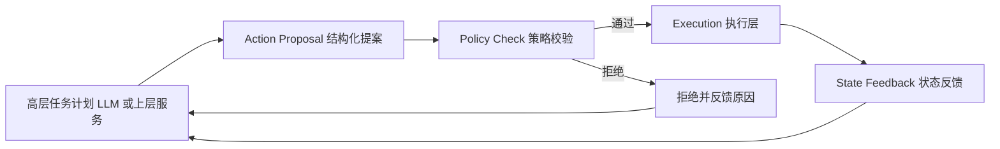

# Agent 与 RAG 八股（LLM Agent & RAG Interview Q&A）

> **定位**：覆盖 LLM Agent 的架构、ReAct、tool calling、LangGraph 状态机编排、记忆、RAG 的完整流程与向量检索、评估与失败模式、安全护栏、人在回路，以及"规则优先的混合架构"。直接对应你的 P4（LangGraph 决策链 + 规则快速路径）与 P6（提案-校验-执行-反馈安全链）；这也是你 PS 的主线："AI 决策如何变成物理动作"。

**本章学完你能：**
- 画出 LLM Agent 的组成（模型、工具、记忆、规划、编排），并解释 ReAct 的循环；
- 讲清 tool calling 的机制、JSON schema 设计与失败处理；
- 说明 LangGraph 的状态、节点、条件边、检查点、中断，并解释它为什么比"一个 while 循环"更适合工程；
- 说出 RAG 每一步（切分、嵌入、索引、检索、重排、生成）的取舍与失败模式；
- 用"提案—校验—执行—反馈"链和"规则优先的混合架构"回答 AI 安全落地问题，并与 P4/P6 对应。

**前置知识**：[05_Transformer_LLM与Agent_LangGraph](../../02_基础知识/10_机器学习与深度学习/05_Transformer_LLM与Agent_LangGraph.md)、[04_Transformer与大模型八股](./04_Transformer与大模型八股.md)。项目：[P4 README](../../01_项目课程/P4_OpenHarmony智能园艺系统/README.md)、[P6 README](../../01_项目课程/P6_深开鸿M-Robots平台软件/README.md)。

**重要说明（事实边界）**：
- CV 中 P4 的相关事实只有：用 LangGraph 构建"环境与视觉事件决策链"，带"极端状态的规则快速路径"，向执行层输出"结构化建议或受约束的请求"；服务器侧 agent 做编排；通过 web 交互和设备端灌溉闭环。
- CV 中 P6 的相关事实：设备发现、能力注册、状态同步、基于 M-DDS 的任务分发，并让任务计划经过"action-proposal → policy-check → execution → state-feedback"链。
- 具体的节点数、使用哪个 LLM、提示词、阈值、数据库、检索是否用了 RAG：CV 均没有。本章涉及这些细节处，一律按“我们的做法是…/本项目通常取…”的典型做法陈述，数值与配置为典型/教学示例，以实机为准。

**优先级**：★★★ 必背，★★ 常问，★ 加分。

## 目录
1. Agent 基础与架构（Q1–Q8）
2. Tool Calling（Q9–Q14）
3. LangGraph 与状态机编排（Q15–Q22）
4. 记忆与上下文管理（Q23–Q26）
5. RAG 流程与向量检索（Q27–Q38）
6. 评估与失败模式（Q39–Q44）
7. 安全、护栏、人在回路（Q45–Q50）
8. 规则优先的混合架构与"提案-校验-执行-反馈"链（Q51–Q56）
9. 速记、自测、链接

---

## 一、Agent 基础与架构

### Q1. 什么是 LLM Agent？它与普通 LLM 调用/Chatbot 有何不同？ ★★★
**答案要点**
Agent = 以 LLM 为"大脑"，能感知环境（输入/工具结果）、做决策、调用工具、观察结果并迭代，直到完成目标的系统。区别：普通调用是"一次输入一次输出"；Agent 是**循环**——可多步、可使用外部工具、有状态、有终止条件。核心要素：(1) 模型（推理/规划）；(2) 工具（动作空间：API、数据库、代码执行、设备控制）；(3) 记忆（短期上下文、长期存储）；(4) 编排/控制流（谁决定下一步）；(5) 护栏与评估。
对应强化学习的术语：Agent-Environment 循环，工具调用是动作，工具返回是观测。区别在于 LLM Agent 通常不经过 RL 训练，策略由提示词和模型能力决定。

**English short answer**
> An LLM agent is a system where a language model decides what to do next, calls tools, observes the results and loops until the goal is met. Unlike a single LLM call, it's multi-step, stateful and can act on the outside world. The key parts are the model, the tools, memory, the orchestration logic, and guardrails.

**追问方向**：Agent 与 workflow（预定义流程）的区别？什么时候不该用 Agent？

### Q2. Workflow 与 Agent：控制流由谁决定 ★★★
**答案要点**
Workflow：控制流由代码预先定义（链式、路由、并行、评估-优化循环），LLM 只在节点内部生成；可预测、易测试、成本和延迟可控。Agent：LLM 动态决定下一步及调用哪个工具，灵活但不确定。原则：**能用确定的流程就不用自主 Agent**；需要灵活性的部分才给 LLM 自主权；自主度越高，越需要护栏、预算、人在回路。机器人/物理世界场景应倾向于"受约束的自主"：LLM 只做提案，执行由确定性系统把关。

**English short answer**
> In a workflow, the control flow is fixed in code and the model fills in steps. In an agent, the model itself decides the next step and which tool to call. Workflows are more predictable, cheaper and easier to test, so I use them wherever the process is known, and give the model autonomy only where flexibility is really needed. For physical systems, I prefer constrained autonomy.

**追问方向**：如何给 Agent 设置预算和步数上限？

### Q3. ReAct（Reasoning + Acting）★★★
**答案要点**
ReAct 提示模型交替产生 **Thought（推理）→ Action（工具调用）→ Observation（工具返回）**，循环直到给出 Final Answer。
```text
Thought: 土壤湿度低，需要查最近一次灌溉时间
Action: get_irrigation_history(zone="A")
Observation: 最近灌溉 26 小时前
Thought: 超过阈值，应建议灌溉
Final: 建议对 A 区灌溉
```
优点：推理可解释、能使用外部信息减少幻觉、可处理需要多步查询的任务。缺点：每步一次 LLM 调用，延迟与成本高；可能陷入循环或选错工具；推理文本不一定"忠实"于真实原因；长轨迹占用上下文。实践：设最大步数、检测重复动作、对工具返回做截断/摘要。现在多数框架用模型原生的 tool calling 实现这一循环，而不是纯文本解析。

**English short answer**
> ReAct interleaves reasoning and acting: the model writes a thought, then calls a tool, reads the observation, and repeats until it can answer. It lets the model gather evidence instead of guessing, and the trace is readable. The downsides are latency and cost from many calls, possible loops, and the reasoning text not always reflecting the true cause. I limit steps and detect repeated actions.

**追问方向**：ReAct 和 Chain-of-Thought 的区别？（CoT 只推理不行动）

### Q4. Plan-and-Execute 与其他模式 ★★
**答案要点**
Plan-and-Execute：先让（强）模型产出完整计划，再由（可较弱/确定性）执行器按步执行，必要时重新规划；减少每步重复推理，适合步骤较明确的长任务。其他模式：Reflexion（执行后自我评估并将反思写入记忆）、Router（分类后路由到专用子流程）、Evaluator-Optimizer（生成-评审循环）、多 Agent（角色分工、辩论、主管-工人）。选型原则：从最简单的开始，只有当简单方案不够用时才增加复杂度。

**English short answer**
> In plan-and-execute, a model first drafts a plan and then the steps are executed, with replanning if something fails, which reduces repeated reasoning. Other patterns include routing to specialized sub-flows, reflection loops where the model critiques its own result, and multi-agent setups. I start with the simplest design and add complexity only when it's needed.

**追问方向**：多 Agent 的主要风险？（沟通开销、错误传播、成本）

### Q5. Agent 的主要失败模式 ★★★
**答案要点**
(1) 工具选择错误/遗漏；(2) 参数幻觉（编造不存在的 ID、越界数值）；(3) 无限循环/重复调用；(4) 错误累积（早期小错在多步中放大）；(5) 目标漂移（忘记原始任务）；(6) 上下文溢出或"中间丢失"；(7) 对工具错误处理不当（吞掉异常、盲目重试）；(8) 提示注入被劫持；(9) 延迟与成本失控；(10) 评估困难，非确定性。对策：schema 约束 + 校验层、步数/预算上限、状态显式化、错误分类与有限重试、日志追踪、人工升级路径。

**English short answer**
> Common failures are picking the wrong tool, hallucinating arguments, looping, compounding errors over many steps, forgetting the goal, overflowing the context, mishandling tool errors, and being hijacked by prompt injection. I address them with strict schemas and validators, step and budget limits, explicit state, bounded retries, tracing, and an escalation path to a human.

**追问方向**：成功率 95% 的单步在 10 步链上整体成功率？（$0.95^{10}\approx0.60$，推算）

### Q6. 为什么多步 Agent 可靠性会快速下降 ★★
**答案要点**
假设每步独立成功概率 $p$，$n$ 步全部成功概率为 $p^n$。$p=0.95$、$n=10$：$0.95^{10}\approx0.599$；$n=20$：约 0.358（推算）。因此：减少步数、让确定性代码做能确定的部分、每步加校验与重试、关键步骤引入人工确认、缩短链路。

**English short answer**
> If each step succeeds with probability p, an n-step chain succeeds with p to the n. At ninety-five percent per step, ten steps give only about sixty percent. So I shorten chains, push deterministic work into code, validate each step, and add human checkpoints at critical points.

**追问方向**：独立性假设的问题？（错误常相关）

### Q7. Agent 与强化学习的关系 ★★
**答案要点**
形式上同为"观察-行动-反馈"的循环，但 LLM Agent 的策略来自预训练+提示，而不是在环境中通过奖励优化。用 RL 训练 Agent（如对工具使用做可验证奖励的强化学习）是近年方向。机器人里，LLM 的作用更多是高层语义规划，低层仍然用控制器（见 [05_强化学习八股](./05_强化学习八股.md)）。

**English short answer**
> Structurally an agent is also an observe-act loop, but its policy comes from a pretrained model plus prompts rather than reward optimization. Training agents with RL on verifiable rewards is a recent direction. In robots, the LLM mostly does high-level semantic planning, while low-level control stays with controllers.

**追问方向**：LLM 做规划相比传统任务规划（PDDL）的优劣？

### Q8. 具身/机器人场景的 Agent 与纯软件 Agent 的差别 ★★★
**答案要点**
(1) 动作有物理后果、不可逆（水泵打开、机械臂动作），不能"试错"；(2) 世界状态是时变的，观测有延迟/过期、噪声；(3) 实时性与安全约束（限位、功率、碰撞）；(4) 感知不确定（检测置信度）；(5) 执行有反馈延迟与失败；(6) 网络可能中断，需本地兜底。因此：LLM 输出只能是**提案**，必须经过确定性的校验与安全层，且有本地规则路径；观测需要带时间戳和置信度；执行后要有状态反馈闭环。

**English short answer**
> In embodied settings actions have physical, often irreversible consequences, observations are noisy and become stale, and there are real-time and safety constraints. So the model's output should be treated as a proposal that passes through deterministic validation and a safety layer before execution, observations carry timestamps and confidence, and a local rule-based path keeps working if the network or the model fails.

**追问方向**：这正是你 PS 的主线，举一个 P4 或 P6 的例子。

---

## 二、Tool Calling

### Q9. Tool calling / Function calling 的机制 ★★★
**答案要点**
流程：(1) 开发者向模型提供工具列表，每个工具有名称、描述、参数的 JSON Schema；(2) 模型根据对话决定是否调用，输出结构化的调用请求（工具名 + JSON 参数），**模型本身不执行**；(3) 宿主程序解析、校验、执行函数；(4) 把结果作为 tool message 返回；(5) 模型据此继续或给出最终回答。模型在训练中学过这种格式；也可以用提示词+解析实现（脆弱）。要点：执行权在宿主程序，不在模型，所以安全控制点在宿主。
```json
{"name":"set_pump","arguments":{"zone":"A","action":"start","duration_s":60}}
```

**English short answer**
> I give the model a list of tools, each with a name, description and a JSON schema for the arguments. The model replies with a structured call request instead of text, but it doesn't execute anything. My program parses and validates the request, runs the function, and sends the result back as a message. Because the host does the execution, the host is where safety checks belong.

**追问方向**：并行工具调用是什么？

### Q10. 设计好的工具与 Schema ★★★
**答案要点**
原则：(1) 名称和描述写清"何时用/不该用"；(2) 参数用强类型、枚举、范围（`minimum/maximum`）、必填；(3) 少而精的工具，避免功能重叠；(4) 返回值精简、可解析，包含错误码与可恢复提示；(5) 读与写分离：只读工具低风险，写/执行类工具高风险需额外校验；(6) 幂等设计（重复调用不产生重复副作用，可带 request_id）；(7) 对执行类工具提供 `dry_run`/确认。示例：
```json
{"name":"request_irrigation",
 "description":"Request irrigation for a zone. Does NOT start the pump directly; the request is checked by the policy layer.",
 "parameters":{"type":"object","properties":{
   "zone":{"type":"string","enum":["A","B"]},
   "duration_s":{"type":"integer","minimum":10,"maximum":300},
   "reason":{"type":"string"}},
  "required":["zone","duration_s","reason"]}}
```
（教学示例，非项目源码。）注意"request"而非"set"：工具语义是"请求"，由下游策略层决定是否执行——这是 P4/P6 理念。

**English short answer**
> A good tool has a clear name and description, strongly typed parameters with enums and numeric bounds, a compact and parseable result, and idempotent behavior. I separate read-only tools from side-effecting ones and make the side-effecting ones request-style, so a policy layer decides whether to execute.

**追问方向**：为什么描述写错会导致模型乱用工具？

### Q11. 参数校验与"幻觉参数"的处理 ★★★
**答案要点**
JSON Schema 校验只保证形状；还需**语义校验**：数值是否在安全范围、引用的 ID 是否存在、当前状态下该动作是否允许（例如水箱空时不能灌溉）、是否与最近动作冲突（频率限制）。校验失败时返回结构化错误让模型修正，限制重试次数，超限则转人工或降级。把约束写进代码而不是只写进提示词，因为提示词是"建议"，代码是"保证"。

**English short answer**
> Schema validation only checks the shape. I also validate semantics: values within safe ranges, IDs that exist, the action being allowed in the current state, and rate limits. On failure I return a structured error so the model can fix it, with a retry limit and escalation. Constraints belong in code, not only in the prompt, because a prompt is a suggestion while code is a guarantee.

**追问方向**：模型反复违规怎么办？（降级、人工升级、记录并回归）

### Q12. 工具错误处理、超时、重试与幂等 ★★
**答案要点**
把错误分类：可重试（超时、临时网络）、不可重试（参数无效、权限）、需人工。重试用指数退避+抖动、有限次数。设置超时，防止工具挂住整条链。非幂等操作（扣款、开泵）重试要带幂等键，或先查询状态再决定。返回给模型的错误信息要简短、有用，不泄露内部细节。

**English short answer**
> I classify tool errors into retryable, non-retryable and needs-human. Retryable ones get bounded retries with exponential backoff, each call has a timeout, and operations with side effects carry an idempotency key or check the state first. Error messages returned to the model are short and don't leak internals.

**追问方向**：指数退避为什么要加抖动？

### Q13. 结构化输出：JSON mode、约束解码、解析校验 ★★
**答案要点**
让模型输出可被程序消费的结果：JSON mode / 结构化输出（按 schema 约束解码）、pydantic 校验、失败重试。注意：语法正确不等于语义正确。关键下游决策不应依赖自由文本，而应使用枚举、数值字段。置信度/理由字段可用于日志与审计。

**English short answer**
> For machine-consumable output I use structured output with a schema, validate with a library like pydantic, and retry on failure. Valid syntax doesn't mean the content is correct, so downstream decisions use enums and numeric fields that I check, not free text.

**追问方向**：自由文本的理由字段能否被信任用于审计？

### Q14. MCP（Model Context Protocol）等工具标准化协议（概念）★
**答案要点**
一种让 LLM 应用以统一协议接入外部工具/数据源的开放协议（客户端-服务器架构，服务器暴露工具、资源、提示）。价值：工具复用、与具体模型/框架解耦。风险：第三方服务器的信任与权限边界。此处只作概念性说明，协议细节以官方规范为准（未核对）。

**English short answer**
> MCP is an open protocol that lets applications connect models to external tools and data sources in a standard way, so tools can be reused across clients. The security concern is trust and permissions for third-party servers.

**追问方向**：工具来源不可信时如何防护？

---

## 三、LangGraph 与状态机编排

### Q15. 为什么用图/状态机编排而不是一个 while 循环 ★★★
**答案要点**
简单 while 循环（"调用模型→执行工具→重复"）易写，但难做：显式状态管理、分支/并行、可视化、断点续跑、人工介入、测试单个步骤、可复现的审计。图/状态机把流程拆为**节点（做事）**与**边（决定下一步）**，状态集中定义，每步可记录检查点。对工程化 Agent 的价值：可控（谁决定下一步一目了然）、可观测、可恢复、可测试。

**English short answer**
> A plain loop is fine for demos, but production agents need explicit state, branching, retries, the ability to pause for a human, resume after a crash, and to test and trace each step. Modeling the flow as a graph of nodes and edges with a shared state makes the control flow explicit, observable and recoverable.

**追问方向**：状态机的缺点？（灵活性受限、图设计成本）

### Q16. LangGraph 的核心概念 ★★★
**答案要点**
LangGraph 是用于构建有状态、多步 LLM 应用的编排库，把应用表示为**有向图**（可含环）：
- **State（状态）**：贯穿图的共享数据结构（TypedDict/pydantic），节点读写它；每个键可指定 reducer（如消息列表用追加合并，而不是覆盖）；
- **Node（节点）**：一个函数，输入当前状态，返回对状态的更新（LLM 调用、工具执行、校验、规则等）；
- **Edge（边）**：普通边（固定下一节点）与**条件边**（conditional edge：根据状态决定走向，函数返回下一节点名）；
- **START / END**：入口与终点；
- **Checkpointer（检查点）**：每步后持久化状态，支持恢复、时间回溯、人在回路；
- **interrupt**：在某节点暂停等待人工输入，之后继续。
```python
# 教学示例，非项目源码（API 以官方文档为准）
from typing import TypedDict
from langgraph.graph import StateGraph, START, END

class S(TypedDict):
    obs: dict
    proposal: dict | None
    verdict: str

def rule_fastpath(s): ...      # 极端状态直接处理
def llm_propose(s): ...        # LLM 给出结构化建议
def policy_check(s): ...       # 确定性校验
def route(s):                  # 条件边
    return "execute" if s["verdict"] == "ok" else END

g = StateGraph(S)
g.add_node("propose", llm_propose); g.add_node("check", policy_check)
g.add_edge(START, "propose"); g.add_edge("propose", "check")
g.add_conditional_edges("check", route)
app = g.compile()
```
P4 的做法是：状态字段包括视觉观测（类别、置信度、时间戳）、土壤湿度等环境读数、用户命令、决策结果；节点划分为观测汇总、规则快速路径判断、LLM 决策、约束校验四类，条件边按“是否极端状态”和“校验是否通过”分支；决策链以单次请求为粒度，不依赖 checkpointer 做长期恢复，状态由系统状态层持久化（典型配置，以实机为准）。

**English short answer**
> LangGraph models an application as a graph. A shared state object flows through nodes, which are functions that read the state and return updates, and edges decide what runs next, including conditional edges that branch on the state. A checkpointer saves the state after each step, which enables resuming, replay and human-in-the-loop interrupts.

**追问方向**：reducer 的作用？节点返回的是整个状态还是增量更新？

### Q17. 条件边与路由：规则 vs LLM 路由 ★★★
**答案要点**
条件边的函数可以是确定性规则（如湿度<阈值→走快速路径）也可以由 LLM 分类。设计原则：**安全相关的分支用规则，语义判断类分支才用 LLM**；路由函数输出受限枚举，非法值走默认安全分支。可测试性：规则路由可单元测试，LLM 路由需评测集。

**English short answer**
> A conditional edge can be a deterministic rule or an LLM classification. I use rules for anything safety-related, and an LLM only for semantic judgments. The router returns a constrained enum, and any unexpected value falls through to a safe default branch.

**追问方向**：路由错误的代价如何评估？

### Q18. 状态设计原则 ★★★
**答案要点**
(1) 状态显式、可序列化、可审计（便于持久化与回放）；(2) 区分**观测**（传感器/视觉事件，带时间戳与置信度）、**意图/提案**（LLM 产出）、**裁决**（校验结果与理由）、**执行结果**（反馈）；(3) 避免把大对象（图像）直接放进状态，放引用；(4) 每个字段有 owner（哪个节点写）；(5) 版本化 schema，便于升级；(6) 状态中带 `trace_id` 贯穿日志。这正对应 P4"统一视觉观测、环境状态、用户命令为可追溯的系统状态"。

**English short answer**
> I keep the state explicit and serializable, separating observations with timestamps and confidence, the model's proposals, the validator's verdict, and the execution result. Large objects like images are stored by reference. A trace ID runs through everything so every decision is auditable.

**追问方向**：为什么要区分提案与裁决？

### Q19. 检查点、持久化与可恢复性 ★★
**答案要点**
每个节点后保存状态快照（内存、SQLite、Postgres 等）。用途：进程重启后从断点恢复；长任务中途失败后重试而非重头；"时间旅行"调试（回到某个检查点修改状态重跑）；人工审批时暂停。设计注意：副作用节点（执行动作）要做到恢复后不重复执行（幂等键或执行结果入状态）。

**English short answer**
> A checkpointer saves a snapshot of the state after each step, so a crashed run can resume where it left off, a human can approve in the middle, and I can replay or edit a past state for debugging. Nodes with side effects must be idempotent so a resumed run doesn't repeat an action.

**追问方向**：恢复后重复执行泵开启怎么避免？

### Q20. 人在回路（Human-in-the-loop）的实现 ★★★
**答案要点**
在高风险节点前设置 interrupt：图暂停、将提案展示给人（Web UI）、等待批准/修改/拒绝，再用检查点恢复继续。设计要点：展示足够上下文（观测、提案、校验结果、风险）、审批超时策略（默认拒绝/保持安全状态）、记录审批人和时间、"人工优先"覆盖自动决策（与 P4 的手动优先覆盖一致）。避免审批疲劳：只在真正高风险或低置信度时升级，常规低风险动作自动通过。

**English short answer**
> I put an interrupt before high-risk actions so the graph pauses, shows the proposal with its context to a person, and resumes from the checkpoint after approval, edit or rejection. A timeout defaults to the safe state, I log who approved what, and to avoid approval fatigue I only escalate for high-risk or low-confidence cases. Manual commands always have priority over automatic ones.

**追问方向**：用户在 P4 的 Web 界面里手动控制与 Agent 冲突时以谁为准？（手动优先，CV：manual-priority override）

### Q21. LangGraph 与 LangChain/其他框架 ★★
**答案要点**
LangChain 提供模型、提示、工具、检索的组件与链（偏线性）；LangGraph 在其之上/旁边提供有状态图编排，适合循环与分支；其他：AutoGen、CrewAI（多 Agent 角色）、Semantic Kernel、自写状态机。选择依据：是否需要持久化、人工介入、可观测；也可以不用框架，自己写简单状态机——重要的是**架构思想**而不是库。

**English short answer**
> LangChain provides components such as models, prompts, tools and retrievers, while LangGraph adds stateful graph orchestration with loops, persistence and interrupts. Other frameworks focus on multi-agent roles. The architecture matters more than the library: you can build the same state machine by hand.

**追问方向**：你为什么在 P4 选 LangGraph？（需要显式分支：规则快速路径 vs LLM 路径；可追溯；状态显式、节点可单独测试和替换）

### Q22. 子图、并行与多 Agent 编排 ★
**答案要点**
子图：把一段流程封装为可复用节点；并行：同时执行多个独立节点（如并行检索），在汇聚节点合并（reducer）；多 Agent：主管（supervisor）路由到专家节点。复杂度上升，只在必要时使用。

**English short answer**
> Subgraphs package a flow as a reusable node, parallel branches run independent steps concurrently and merge via reducers, and a supervisor node can route to specialist agents. I only add this complexity when a single flow isn't enough.

**追问方向**：并行节点写同一状态键怎么办？

---

## 四、记忆与上下文管理

### Q23. Agent 记忆的类型 ★★★
**答案要点**
- 短期/工作记忆：当前对话与工具调用轨迹（上下文窗口内）；
- 长期记忆：跨会话持久化，常见三类——语义记忆（事实/偏好）、情景记忆（过去事件）、程序记忆（技能/规则）；
- 实现：数据库（键值/关系）、向量库（语义检索）、摘要（滚动摘要压缩历史）、知识图谱。
机器人/园艺场景的"记忆"更多是**结构化状态与历史**（最近灌溉记录、传感器趋势），用数据库比向量库更可靠、可校验。

**English short answer**
> Short-term memory is the current context window, including the tool trace. Long-term memory persists across sessions, as facts, past episodes or learned rules, stored in a database, a vector store or summaries. For control-like applications, structured history in a database is more reliable than fuzzy semantic memory.

**追问方向**：什么时候该用向量记忆而不是结构化存储？

### Q24. 上下文窗口管理 ★★★
**答案要点**
上下文有限且越长越贵、越慢、关键信息易被忽略。策略：滑动窗口保留最近 N 轮；滚动摘要旧对话；只放与当前步相关的信息（检索而非全塞）；工具输出截断/摘要；把稳定内容（系统提示、工具定义）放前面利于前缀缓存；结构化状态代替冗长历史。

**English short answer**
> Context is limited and costly, so I keep a sliding window of recent turns, summarize older ones, truncate bulky tool outputs, and retrieve only what's relevant instead of stuffing everything in. Putting stable content like the system prompt and tool definitions first also enables prefix caching.

**追问方向**：摘要会丢失什么？如何保证关键约束不被摘掉？（放入固定的系统约束）

### Q25. 记忆的写入与遗忘策略 ★★
**答案要点**
写入什么：用户偏好、确认过的事实、任务结论；不写：未经验证的推测、敏感信息。去重与冲突处理（新信息覆盖旧）；时间衰减与重要性评分；可由用户查看/删除（隐私合规）。错误记忆会长期污染 Agent，需有校验与来源标注。

**English short answer**
> I only write verified facts and user preferences into long-term memory, with timestamps and sources, handle conflicts by updating or superseding old entries, decay stale items, and let users inspect and delete memories. A wrong memory can mislead the agent for a long time.

**追问方向**：记忆注入攻击（恶意写入）怎么防？

### Q26. 状态与记忆的区别 ★★
**答案要点**
状态（state）：当前运行实例的数据，随任务结束消失或归档；记忆：跨运行持久知识。LangGraph 的 checkpoint 属于线程内状态持久化，长期记忆是另一层（store）。

**English short answer**
> State is the working data of one run, persisted by checkpoints so that run can be resumed. Memory is knowledge that persists across runs and threads. They are stored and managed differently.

**追问方向**：线程（thread）概念是什么？

---

## 五、RAG 流程与向量检索

### Q27. RAG 是什么，解决什么问题 ★★★
**答案要点**
检索增强生成（Retrieval-Augmented Generation）：在生成前先从外部知识库检索相关片段，放入提示词，让模型基于证据回答。解决：(1) 模型知识过时/缺失（私域知识、最新信息）；(2) 幻觉（给证据并要求引用）；(3) 可溯源、可更新（改知识库不必重训）；(4) 权限控制（按用户权限过滤文档）。
流程：
```text
离线: 文档 -> 清洗 -> 切分(chunk) -> 嵌入(embedding) -> 向量索引(+元数据/关键词索引)
在线: 用户问题 -> (改写) -> 嵌入 -> 检索 top-k -> (重排) -> 拼接上下文+问题 -> LLM 生成(带引用) -> (校验)
```

**English short answer**
> RAG retrieves relevant passages from an external knowledge base and puts them into the prompt so the model answers from evidence. It handles private or fresh knowledge, reduces hallucination, supports citations, and lets you update knowledge without retraining. The pipeline is offline indexing — chunk, embed, store — and online retrieval, optional reranking, and generation.

**追问方向**：RAG 与微调如何取舍？（见 Q38）

### Q28. 文档切分（Chunking）策略 ★★★
**答案要点**
切得太大：噪声多、检索不精、占上下文；太小：语义被截断、缺上下文。常用：固定长度（如 200–500 token）+ 重叠（10–20%）、按段落/标题/语义边界切分、层次切分（小块检索、返回其父块/邻近块——parent-child、sentence-window）。表格、代码、PDF 版面需专门解析。给每个块附元数据（来源、标题、时间、权限），便于过滤和引用。没有通用最优值，需在自己的评测集上调。

**English short answer**
> Chunks that are too big add noise and cost; too small lose context. A common start is a few hundred tokens with some overlap, preferably split on natural boundaries like headings. Hierarchical approaches retrieve small chunks but return the surrounding parent text. I attach metadata for filtering and citation and tune the size on my own evaluation set.

**追问方向**：重叠的作用？（避免关键信息在边界被切断）

### Q29. 嵌入模型与相似度 ★★★
**答案要点**
嵌入把文本映射为稠密向量，语义相近的距离近。相似度：余弦相似度 $\cos(u,v)=\dfrac{u\cdot v}{\|u\|\|v\|}$、内积、欧氏距离；向量归一化后余弦=内积，且欧氏距离平方 $\|u-v\|^2=2-2\cos(u,v)$，三者排序等价。选型要点：语言（中文/多语）、维度、最大长度、领域适配、延迟与成本。查询与文档可能需要不同前缀/指令（非对称检索）。双塔（bi-encoder）可预计算文档向量，快；交叉编码器（cross-encoder）精度高但需成对计算，用于重排。更换嵌入模型要重建索引。

**English short answer**
> An embedding model maps text to a dense vector so that semantically similar texts are close. For normalized vectors, cosine similarity, dot product and Euclidean distance give the same ranking. A bi-encoder can precompute document vectors, so retrieval is fast, while a cross-encoder scores query-document pairs jointly and is more accurate but slower, so it's used for reranking. Changing the embedding model requires reindexing.

**追问方向**：为什么检索常用余弦而不是欧氏？

### Q30. 向量检索：精确 vs 近似（ANN），HNSW、IVF、PQ ★★★
**答案要点**
精确（暴力）检索 $O(Nd)$，数据大时太慢。近似最近邻（ANN）以少量召回损失换速度：
- **HNSW**（分层可导航小世界图）：多层邻近图，从顶层稀疏图贪心下降到底层，查询近似 $O(\log N)$；召回高、速度快，内存占用大；参数 $M$（连接数）、`efConstruction`、`efSearch`（越大召回越高越慢）；
- **IVF**（倒排文件）：先用 k-means 把向量分到 `nlist` 个簇，查询只搜最近的 `nprobe` 个簇；
- **PQ**（乘积量化）：把向量切成 $m$ 段，每段用码本量化，压缩存储并加速距离计算，有精度损失；常见组合 IVF-PQ；
- **LSH**：局部敏感哈希。
库：FAISS、HNSWlib、Milvus、Qdrant、pgvector 等（选型因需求而异）。评估 ANN：recall@k 对比暴力结果 + QPS + 内存。小规模（几万条以内）暴力检索即可，无需复杂索引。

**English short answer**
> Exact search is linear in the number of vectors, so large collections use approximate nearest neighbor indexes. HNSW builds a layered proximity graph and searches greedily from coarse to fine layers, giving high recall and speed at the cost of memory. IVF clusters vectors and only searches the nearest clusters, and product quantization compresses vectors. For a small corpus, brute force is perfectly fine.

**追问方向**：`efSearch` 增大对召回和延迟的影响？

### Q31. 混合检索（Hybrid Search）：BM25 + 向量 ★★★
**答案要点**
稠密向量擅长语义同义、但对精确术语、编号、专有名词、罕见词不稳；BM25（稀疏，词频-逆文档频率改进）擅长精确匹配。混合：两路各取 top-k，融合。BM25：
$$\mathrm{score}(D,Q)=\sum_{t\in Q}\mathrm{IDF}(t)\frac{f(t,D)(k_1+1)}{f(t,D)+k_1(1-b+b\frac{|D|}{avgdl})}$$
融合方法：加权求和（先归一化分数）或 RRF（Reciprocal Rank Fusion）$\mathrm{score}(d)=\sum_r\frac1{k+\mathrm{rank}_r(d)}$（$k$ 常取 60），只用排名，免调分数尺度。

**English short answer**
> Dense retrieval handles synonyms and paraphrases, but can miss exact terms, codes and rare names, which BM25 matches well. Hybrid search runs both and merges the results, commonly with reciprocal rank fusion, which uses only ranks and so avoids calibrating the two score scales.

**追问方向**：BM25 公式里 $k_1$ 与 $b$ 的作用？

### Q32. 重排序（Reranking）★★★
**答案要点**
第一阶段（召回）用快速的双塔/BM25 取 top-50–100，第二阶段用交叉编码器（query 与文档拼接输入，输出相关性分）重排取 top-5–10。提升精度，代价是延迟。也可用 LLM 做重排（贵）。多样性：MMR（Maximal Marginal Relevance）$\arg\max_d[\lambda\,\mathrm{sim}(d,q)-(1-\lambda)\max_{d'\in S}\mathrm{sim}(d,d')]$ 减少重复片段。

**English short answer**
> A fast first stage retrieves a few dozen candidates, then a cross-encoder reranker reads each query-passage pair together and reorders them, so only the best few go to the LLM. It improves precision at the cost of some latency. MMR can be used to reduce redundancy among the selected passages.

**追问方向**：为什么不直接用交叉编码器检索全库？（成对计算太贵）

### Q33. 查询改写与高级检索技巧 ★★
**答案要点**
查询改写（把口语化/多轮指代问题改成独立查询）、多查询（生成多个改写并合并）、HyDE（让 LLM 先写假设性答案，用其嵌入去检索）、子问题分解、元数据过滤（时间、来源、权限）、自查询检索（LLM 把问题转成"语义查询+过滤条件"）、父文档/邻居扩展。多跳问题可迭代检索（把上一轮检索结果用于下一轮查询）。

**English short answer**
> I rewrite conversational queries into standalone ones, sometimes generate several variants, and apply metadata filters. HyDE embeds a hypothetical answer instead of the question. For multi-hop questions I retrieve iteratively, using earlier results to form the next query.

**追问方向**：查询改写可能引入哪些错误？

### Q34. 生成阶段：提示构造与引用 ★★★
**答案要点**
提示要点：明确"只依据给定资料回答；资料不足时说不知道"；给每个片段编号并要求引用编号；按相关度排序，重要的放开头/结尾（缓解中间丢失）；控制总长度。输出后可做**引用校验**（引用编号是否存在、断言是否被片段支持，用 NLI 或另一模型判断）。对安全相关应用，答案必须有证据，否则拒答或转人工。

**English short answer**
> The prompt tells the model to answer only from the provided passages and say it doesn't know otherwise, numbers each passage and asks for citations. I put the most relevant passages first and check that the cited passages actually support the claims. For high-stakes uses, an answer without evidence should be refused or escalated.

**追问方向**：如何减少"有检索结果却仍然编造"？

### Q35. 向量库的元数据、权限与更新 ★★
**答案要点**
元数据：来源、时间、版本、权限标签；检索时先过滤（pre-filter）再 ANN，注意过滤与 ANN 的交互可能降低召回。更新：增量写入、软删除、定期重建；文档变更时需重新切分与重嵌入；嵌入模型版本要与索引一致。权限：检索层强制执行，不能靠提示词让模型"不要说"。

**English short answer**
> I store metadata such as source, time, version and access labels, and enforce permissions at the retrieval layer rather than in the prompt. Updates need re-chunking and re-embedding, and the embedding model version must match the index.

**追问方向**：为什么权限不能放在提示词里？

### Q36. 多模态与结构化数据的 RAG ★
**答案要点**
图像/表格/PDF 可用多模态嵌入（如 CLIP 系）或先转文本描述；结构化数据优先用 SQL/API 工具查询（Text-to-SQL）而非向量检索——精确查询用工具，模糊知识用 RAG。机器人场景的传感器时序数据同理：查询数据库趋势比嵌入更可靠。

**English short answer**
> Images and tables can be handled with multimodal embeddings or by converting them to text first. For structured data, I'd rather call a SQL or API tool than embed it, because precise queries need exact answers. Fuzzy knowledge goes to RAG; exact facts go to tools.

**追问方向**：园艺传感器历史数据应该用 RAG 吗？（不，用时序查询工具）

### Q37. GraphRAG 与 Agentic RAG（概念）★
**答案要点**
GraphRAG：先从语料抽取实体关系构建知识图谱，再基于图社区摘要回答全局性问题。Agentic RAG：由 Agent 决定是否检索、检索几次、用什么工具，处理复杂多跳问题，代价是更多不确定性和延迟。属于新近方向，细节以论文为准（未核对）。

**English short answer**
> GraphRAG builds a knowledge graph from the corpus to answer global questions. Agentic RAG lets an agent decide when and how many times to retrieve, which handles multi-hop questions but costs more latency and adds uncertainty.

**追问方向**：何时普通 RAG 不够？

### Q38. RAG、微调、长上下文如何选 ★★★
**答案要点**
| 需求 | 更合适 |
|---|---|
| 知识常变、需引用/溯源、权限隔离 | RAG |
| 改变风格、格式、特定任务行为 | 微调（SFT/LoRA） |
| 文档少且短、一次性分析 | 长上下文直接放入 |
| 需要新知识+行为 | 组合 |
微调不擅长可靠注入大量新事实（易遗忘、易幻觉）；长上下文成本高且中间信息可能被忽略；RAG 的质量上限由检索决定。

**English short answer**
> I use RAG when knowledge changes often or needs citations and access control, fine-tuning when I need a consistent style or behavior, and a long context when the documents are few and short. Fine-tuning isn't a reliable way to inject lots of new facts.

**追问方向**：RAG 质量的上限由谁决定？（检索召回）

---

## 六、评估与失败模式

### Q39. RAG 的评估指标 ★★★
**答案要点**
分两层评估：
- 检索层：Recall@k（相关文档是否在 top-k）、Precision@k、MRR、NDCG、命中率；需要带标注的"问题→相关片段"集；
- 生成层：**忠实度/有据性**（答案是否被检索内容支持）、**答案相关性**、**上下文相关性/精确度**、正确性（对照参考答案）；可用 LLM-as-judge（有偏差）或人工抽检。
工具如 RAGAS 等提供这些指标（以其文档为准）。关键：把检索与生成**分开诊断**——答案错了，先看相关片段是否被检出。

**English short answer**
> I evaluate retrieval and generation separately. For retrieval I measure recall at k, MRR and NDCG against labeled relevant passages. For generation I check faithfulness to the retrieved context, relevance to the question, and correctness against references. When an answer is wrong, the first question is whether the right passage was retrieved.

**追问方向**：没有标注怎么办？（用 LLM 合成问题-片段对 + 人工抽检）

### Q40. RAG 的典型失败模式与对策 ★★★
**答案要点**
| 失败 | 现象 | 对策 |
|---|---|---|
| 切分不当 | 答案被切断、缺上下文 | 调 chunk 大小/重叠、父子块 |
| 召回缺失 | 相关块没进 top-k | 混合检索、增大 k+重排、查询改写、换嵌入模型 |
| 召回噪声 | 无关块干扰 | 重排、元数据过滤、阈值 |
| 嵌入语义漂移 | 术语/编号检索失败 | BM25 混合、领域微调嵌入 |
| 中间丢失 | 关键信息被忽略 | 精简上下文、重要内容靠前/后 |
| 过时/冲突文档 | 答案矛盾 | 版本与时间元数据、去重、来源优先级 |
| 模型不遵循证据 | 仍凭记忆回答 | 强指令、引用校验、拒答 |
| 无答案仍作答 | 幻觉 | 相似度阈值、"不知道"训练/校验 |
| 提示注入 | 文档里夹带指令 | 数据与指令隔离、输出过滤 |

**English short answer**
> RAG fails in a few predictable ways: bad chunking, relevant passages not retrieved, noisy passages, embeddings missing exact terms, stale or conflicting documents, the model ignoring the evidence, answering when it should abstain, and injected instructions in documents. Each has a targeted fix, such as hybrid search, reranking, metadata, or citation checks.

**追问方向**：如何判断问题出在检索还是生成？

### Q41. Agent 的评估 ★★★
**答案要点**
评估维度：任务成功率（端到端）、步骤效率（步数/成本/延迟）、工具选择与参数正确性、安全违规率、鲁棒性（工具失败/噪声输入）、一致性（重复运行方差）。方法：构造场景化测试集（含边界与对抗样本）；对每步记录轨迹，做**轨迹级**检查；回归测试固定种子/温度；模拟环境（mock 工具、仿真）；LLM-as-judge + 人工抽检；上线后监控。对物理系统，另需硬件在环/仿真验证，且校验层本身要有确定性单元测试。

**English short answer**
> I measure end-to-end task success, but also step efficiency, tool and argument correctness, safety violations and robustness to tool failures. I build a scenario test set including edge cases, record full trajectories, use mocked tools or simulation, and run regression tests. The deterministic validators get ordinary unit tests.

**追问方向**：非确定性输出下如何做回归测试？

### Q42. 可观测性与追踪（Observability）★★
**答案要点**
记录每次运行的 `trace_id`、每一步的输入/输出、模型版本与参数、工具调用与耗时、token 与成本、校验结果、人工介入。工具：LangSmith 等追踪平台或自建日志。价值：复盘事故、构建评测集（把线上失败转为测试）、成本优化、审计合规。敏感数据要脱敏。

**English short answer**
> I log a trace ID for each run with every step's inputs and outputs, model version, tool calls, latency, cost, validation results and human interventions. This lets me replay failures, turn them into regression tests, and audit decisions, with sensitive data redacted.

**追问方向**：如何回放一次线上事故？

### Q43. 延迟与成本优化 ★★
**答案要点**
减少 LLM 调用次数（合并步骤、规则替代）、用小模型处理简单步骤并路由、缓存（提示前缀缓存、结果缓存、语义缓存）、并行独立调用、限制输出长度、流式输出、批处理。规则快速路径同时是性能优化：极端状态下不等 LLM。

**English short answer**
> I reduce the number of model calls by replacing steps with rules, route easy steps to smaller models, cache prefixes and results, run independent calls in parallel, and cap output length. A rule-based fast path is also a latency optimization since it doesn't wait for the model.

**追问方向**：语义缓存的风险？（相似但不同的问题返回错误答案）

### Q44. 非确定性与可复现性 ★★
**答案要点**
LLM 输出有随机性（采样），即使温度 0 也可能因批处理/浮点而不同。对策：关键决策不依赖单次自由生成，使用结构化输出+校验；记录完整输入输出以复现；温度低；评测多次运行取统计；对关键路径用规则或多次投票。

**English short answer**
> LLM outputs vary, even at temperature zero, so I don't let a single free-form generation drive critical decisions. I use structured outputs with validators, log every input and output so runs can be reproduced, and evaluate over multiple runs.

**追问方向**：如何用投票提高可靠性？成本如何？

---

## 七、安全、护栏、人在回路

### Q45. 护栏（Guardrails）的分层 ★★★
**答案要点**
输入护栏（过滤恶意/越权请求、PII 脱敏、注入检测）→ 模型层（系统提示、对齐）→ **工具/动作护栏**（schema + 语义校验、权限、速率限制）→ 输出护栏（内容过滤、格式、引用校验）→ 执行层安全（物理限位、急停、独立于 AI）。**纵深防御**：不依赖任何单一层，尤其不依赖"提示词里写了不要做"。对机器人而言，最后一道防线必须是不依赖 LLM 的确定性安全层。

**English short answer**
> Guardrails are layered: input filtering, the model's own alignment and system prompt, validation and permission checks on tool calls, output checks, and finally execution-level safety like limits and emergency stops that don't depend on the AI at all. It's defense in depth, and I never rely on a prompt alone.

**追问方向**：最后一层为什么必须不依赖 LLM？

### Q46. 提示注入（Prompt Injection）与间接注入 ★★★
**答案要点**
直接注入：用户在输入里要求忽略原指令。间接注入：Agent 读取的外部内容（网页、邮件、文档、检索结果、传感器文本标签）里藏着指令，被模型当作命令执行。因为 LLM 无法可靠地区分"指令"和"数据"。防护：(1) 最小权限（Agent 能调用的工具与参数范围尽量小）；(2) 对外部内容标记为不可信数据，并与指令分离；(3) 动作校验不依赖模型自述；(4) 高风险动作人工确认；(5) 限制数据外泄通道（不允许把敏感数据发往任意 URL）；(6) 输出/动作审计；(7) 隔离执行（沙箱）。没有完美的提示级防御，所以靠架构。

**English short answer**
> Prompt injection means untrusted text tries to give the model new instructions. In indirect injection it hides in content the agent reads, like a web page or a retrieved document. Because models can't reliably tell data from instructions, the defense is architectural: least-privilege tools, validation of every action independent of what the model says, human confirmation for risky actions, and limiting exfiltration paths.

**追问方向**：为什么"在提示词里写不要听信文档中的指令"不够？

### Q47. 最小权限与能力边界 ★★★
**答案要点**
给 Agent 的工具只覆盖任务所需；写操作拆成"请求"与"执行"；参数范围收紧；按场景/用户分配令牌；敏感操作需二次认证；沙箱执行代码；网络访问白名单。设备侧：能力注册（capability registry）说明每个设备能做什么及其限制，调用方只能在注册能力内操作（对应 P6 的 capability model 与 capability registration）。

**English short answer**
> I give the agent only the tools the task needs, split write actions into request and execution, constrain parameter ranges, scope credentials, and whitelist network access. On the device side, a capability registry states what each device can do and under what limits, so callers can only act within those declared capabilities.

**追问方向**：能力注册对安全有什么帮助？

### Q48. 数据隐私与本地部署 ★★
**答案要点**
敏感数据（用户图像、位置、设备状态）上云的风险；方案：本地/边缘推理（P4 的 RKNN 视觉就在端侧）、数据最小化、脱敏、加密传输、日志保留策略、可选本地小模型。LLM 若用云 API，要明确哪些数据会发送出去。

**English short answer**
> To protect privacy I run perception on the edge device, send only the minimum structured data to the cloud model, redact sensitive fields, encrypt transport, and define log retention. Which data leaves the device should be explicit.

**追问方向**：P4 的架构里哪些数据上云？我们的做法是：视觉推理在 RK3588 端完成，原始图像不上传；只把结构化观测（类别、置信度、时间戳）、环境读数与用户命令发送给服务器侧 agent，水泵控制留在设备端本地状态机。
English: Inference runs on the RK3588, so raw images stay on the device; only structured observations, sensor readings and user commands go to the server-side agent, and pump control stays local.
中文：推理在端侧，原图不出设备；只上传结构化观测、传感读数和用户命令；水泵控制留在本地。

### Q49. 人在回路的分级策略 ★★★
**答案要点**
按风险分级：低风险/可逆（读取、建议）→ 自动；中风险（可逆但有成本，如一次短时灌溉）→ 校验通过后自动 + 事后通知；高风险/不可逆（大量、持续、影响安全）→ 必须人工确认；极端安全状态 → 规则强制处理，不等人也不等模型。人工可随时接管（手动优先）并写入审计。

**English short answer**
> I tier actions by risk and reversibility. Low-risk reads and recommendations run automatically, medium-risk reversible actions run after validation with notification, and high-risk or irreversible ones require explicit human approval. In extreme safety situations, rules act immediately without waiting for either the model or a person, and a human can always take over.

**追问方向**：如何避免审批疲劳？

### Q50. 失效安全（Fail-safe）与降级 ★★★
**答案要点**
默认安全状态：断网/模型超时/校验失败/传感器无效时，系统回到安全默认（停止泵、保持当前姿态、停车），而不是继续或随机动作。降级路径：LLM 不可用→规则策略；视觉置信度低→请求人工或使用保守策略；数据过期→不基于过期数据执行新动作。看门狗与心跳：上游失联超时自动进入安全态（P6 的状态同步与超时）。

**English short answer**
> When the network, the model, the validator or a sensor fails, the system falls back to a safe default, such as stopping the pump, rather than continuing blindly. There's a degradation ladder from the model to simple rules to a human, and a heartbeat watchdog moves the device into a safe state if the upstream goes silent.

**追问方向**：如何定义"数据过期"？（时间戳 + 允许的最大龄期）

---

## 八、规则优先的混合架构与"提案—校验—执行—反馈"链

### Q51. 什么是规则优先的混合架构？ ★★★
**答案要点**
把系统分为三层：(1) **确定性层（规则/控制/状态机）**——负责安全、实时、强约束，永远优先；(2) **智能层（LLM/视觉/Agent）**——负责语义理解、复杂权衡、自然语言交互，只给出"建议/提案"；(3) **人**——审批和接管。优先级：人工命令 > 安全规则 > 校验通过的智能提案 > 默认策略。极端状态（如土壤极干、温度越界）走规则快速路径，不等待 LLM；非极端状态让 LLM 在约束内做权衡。好处：安全下限由确定性代码保证；LLM 出错的最坏后果被限制；可测试可审计；延迟可控。
对应 P4（CV）："rule-based fast path for extreme states, issuing structured recommendations or constrained requests to the execution layer" 与 "manual-priority override"。

**English short answer**
> In a rule-first hybrid architecture, deterministic rules and state machines own safety and hard constraints and always take priority. The AI layer provides recommendations or proposals for semantic and complex judgments, and humans can approve or override. Extreme states are handled by a rule-based fast path that doesn't wait for the model. This bounds the worst-case effect of a model mistake and makes the system testable and auditable.

**追问方向**：规则和 LLM 的建议冲突时听谁的？（安全规则优先）

### Q52. "提案—校验—执行—反馈"链（P6 的核心）★★★
**答案要点**

四步含义：
1. **Proposal**：高层只能提出结构化的动作请求（谁、做什么、参数、理由、时间戳），不直接下发到驱动；
2. **Policy check**：确定性策略检查——参数范围、当前状态是否允许、能力注册表里设备是否具备该能力、与其他任务冲突、权限、速率；失败则拒绝并给出结构化原因；
3. **Execution**：通过校验的请求才进入执行层，由设备抽象与底层驱动完成，执行层有自己的限幅与保护；
4. **State feedback**：执行后的实际状态（成功/失败/部分完成/超时）回写统一状态，让上层据此重新规划，形成闭环。
意义：把"AI 想做什么"和"系统允许做什么"分开；每一步可记录与审计；LLM 的幻觉/注入不能直接造成物理动作。这条链回答了 PS 的核心问题："AI 决策如何变成物理动作"。
CV 的 P6 事实：在 M-DDS 上实现设备发现、能力注册、状态同步和任务分发，并让任务计划经过该链。我们的做法是：policy-check 典型检查四类规则——参数范围与类型合法、设备已注册的能力是否覆盖该动作、当前统一状态是否有效（时间戳新鲜、坐标系一致）、与正在执行任务是否冲突；执行后设置反馈超时（典型秒级，以实机为准），超时按失败处理并回写状态；被拒绝或失败的提案带上原因回到规划层，由其调整参数或改选动作后重新提案，重试次数设上限，超限转人工（教学示例，以实机为准）。

**English short answer**
> A high-level plan never goes directly to the actuators. First it becomes a structured action proposal. A deterministic policy check then verifies parameters, the current state, the device's registered capabilities and conflicts. Only approved proposals reach the execution layer, and the real outcome is written back as state feedback so the planner can adapt. This separates what the AI wants from what the system allows, and it makes every step auditable.

**追问方向**：被拒绝的提案如何反馈给规划者？反馈迟到怎么办？

### Q53. 校验层应该检查什么（Policy Check 清单）★★★
**答案要点**
1. 语法：schema 合法；
2. 语义范围：数值在物理/安全限内（速度、力、时长、功率）；
3. 状态前置条件：设备在线、非故障、当前模式允许（自动/手动）、水箱/电量足够；
4. 时效：提案基于的观测是否过期（时间戳 + 最大龄期）；观测置信度是否达到阈值；
5. 能力：设备是否声明支持该动作；
6. 冲突与互斥：与正在执行的任务冲突？是否违反速率/冷却（如泵最短间隔）？
7. 权限：来源是否被授权；
8. 优先级：人工命令或安全事件是否占用资源；
9. 可逆性与风险等级：决定是否需要人工确认。
校验的结果是结构化：通过/拒绝/需人工，附原因码。这些都是**确定性代码**，可单元测试和形式化审查。

**English short answer**
> The policy check verifies the schema, that values are within physical limits, that the preconditions hold in the current state, that the observation is fresh and confident enough, that the device declared the capability, that there's no conflict or rate violation, that the source is authorized, and what the risk level is. The result is a structured approve, reject or needs-human, with a reason code, and it's all deterministic code that can be unit-tested.

**追问方向**：为什么观测的新鲜度是校验项？（用过期的观测决策会造成危险）

### Q54. 与 P4 的对应：园艺系统里的这条链 ★★★
**答案要点**
把 P4 的 CV 事实映射成链条（映射为理解框架，具体实现细节需你核对）：
```text
相机帧 -> YOLOv5/RKNN INT8 -> 结构化观测(类别, 置信度, 时间戳)
传感器 -> 土壤湿度/环境数据 -> 状态
用户 -> Web 指令
         |
         v  统一、可追溯的系统状态
   [规则快速路径: 极端状态直接处理]
   [LangGraph 决策链: LLM 在约束内给出建议/受约束请求]
         |
         v  结构化建议 / 受约束请求 (proposal)
   [执行层: Hi3861 上 水泵状态机: 独立启停阈值 + 手动优先覆盖]  <- 本地闭环, 最终把关
         |
         v  设备状态反馈 -> 回写系统状态
```
要点：(1) 最后的水泵控制是本地状态机，有**独立的启动/停止阈值**（迟滞，防止在阈值附近反复启停）和**手动优先覆盖**；Agent 不能绕开它；(2) Agent 输出的是"建议"或"受约束请求"，不是直接控制；(3) 视觉观测带置信度，低置信度时规则或人工介入；(4) 极端状态不等 LLM。
本项目通常取：LLM 输入为结构化系统状态（视觉观测、土壤湿度、近期灌溉记录、用户命令），输出为含动作类型、持续时间、理由的 JSON；受约束请求的约束包括单次灌溉时长上限、最小间隔、手动模式下禁止自动动作；规则快速路径在土壤湿度极低或极高、或传感器失效等极端状态触发，不等待 LLM；Web 界面提供状态查看、手动控制和决策记录查看（典型配置，以实机为准）。

**English short answer**
> In my gardening system the vision model produces timestamped, confidence-scored observations, which together with sensor data and user commands form a traceable system state. A LangGraph decision chain proposes structured recommendations, and a rule-based fast path handles extreme states immediately. The actual pump is controlled by a local state machine on the microcontroller with separate start and stop thresholds and a manual override, so the agent can never bypass the final safety layer.

**追问方向**：为什么启停阈值要分开？（迟滞/滞回，避免水泵在阈值附近抖动，即迟滞/滞回比较器的思想）

### Q55. 与 P6 的对应：多机器人平台里这条链 ★★★
**答案要点**
P6（CV）：在 M-Robots OpenHarmony 平台上，用统一能力模型抽象传感器/执行器/控制器，把 ROS/ROS2 运动指令映射到底层驱动；统一时间戳、坐标系和有效性检查，向运动控制和任务层提供一致可信的机器人状态；基于 M-DDS 做设备发现、能力注册、状态同步、任务分发，并让任务计划通过"提案—策略检查—执行—状态反馈"链。映射关系：
- **能力注册** → 校验层的依据（设备声明自己能做什么）；
- **状态管理（统一时间戳/坐标系/有效性）** → 校验的前置条件与反馈来源，保证校验使用的是可信、新鲜的状态；
- **任务分发（M-DDS）** → 提案被批准后下发到具体设备；
- **统一运动接口** → 执行层，使上层不关心底层硬件差异。
相关基础：[05_DDS与分布式通信](../../02_基础知识/12_机器人软件/05_DDS与分布式通信.md)、[06_时间同步_坐标系一致性与数据有效性](../../02_基础知识/06_状态估计/06_时间同步_坐标系一致性与数据有效性.md)。
我们的做法是：策略检查规则同 Q52/Q53（参数合法、能力已注册、状态有效、无冲突）；提案入口既可来自上层任务服务，也可由 LLM 生成，两者走同一条校验与执行路径；失败时回写状态并带原因返回上层，由其重规划或转人工。

**English short answer**
> On the M-Robots platform, devices register their capabilities, state is standardized with consistent timestamps, frames and validity checks, and tasks are dispatched over a DDS-based middleware. Task plans go through a proposal, policy check, execution and state feedback chain. The capability registry and the trusted state are exactly what the policy check relies on, and the unified motion interface is the execution layer, so upper layers can't send commands that the hardware isn't declared to support.

**追问方向**：如果把 LLM 接到这个平台上，需要改哪里？（只需把 LLM 输出接到提案入口，校验与执行不变）

### Q56. 面试中如何自然地把"AI 安全落地"讲成你的主线 ★★★
**答案要点**
结构（60–90 秒）：
1. 观点：LLM 是很好的"提案者"，但不是"执行者"；物理世界要求确定性与可审计；
2. P4：小规模验证——规则快速路径 + LangGraph 建议 + 本地水泵状态机兜底；
3. P6：平台级抽象——能力注册 + 统一状态 + 提案—校验—执行—反馈；
4. 为什么读研：想系统学习机器学习/具身智能的理论，研究如何让学习型方法在这种安全架构里发挥更大作用（例如更可靠的感知置信度、可验证的约束学习）。
英文范本：
> "My experience is mostly on the engineering side of getting AI decisions safely into physical systems. In my gardening project, a rule-based fast path handles extreme states, an agent proposes structured recommendations, and a local state machine on the microcontroller has the final say. At my current internship, the same idea became a platform pattern: a task plan has to go through proposal, policy check, execution and state feedback before it reaches a device. What I want from a master's program is the theory behind the learning side, so that I can make those proposals better and prove more about them."
>
> 中文：我主要做把 AI 决策安全落入物理系统的工程；P4 里规则快速路径 + 建议 + 本地状态机兜底；P6 里变成平台模式；读研想补学习理论，让提案更好、更可验证。

**English short answer**
> I'd say that models are good proposers but not executors. In my two projects I built the layer between a proposal and a physical action, and now I want the learning theory to make the proposals better.

**追问方向**：面试官追问"你有没有亲自训练过模型"怎么答？（诚实：P4 做的是 YOLOv5 的转换与部署链，我主要负责转换、量化与部署链，训练与标注只做了基础的数据整理与验证；强调想补理论）

---

## 本章要点速记
1. Agent = LLM + 工具 + 记忆 + 编排；Workflow 由代码定流程，Agent 由模型定流程，能用 Workflow 就不用 Agent。
2. ReAct：Thought → Action → Observation 循环；步数/预算上限防循环；$p^n$ 说明链越长越不可靠。
3. Tool calling：模型输出结构化请求，宿主执行；安全控制点在宿主；Schema + 语义校验 + 幂等 + 超时重试。
4. LangGraph：State + Node + Edge（含条件边）+ Checkpointer + interrupt；安全分支用规则，语义判断用 LLM。
5. 记忆：短期（上下文）/长期（语义、情景、程序）；结构化历史优于向量记忆；上下文要管理。
6. RAG：切分 → 嵌入 → 索引（HNSW/IVF/PQ）→ 混合检索（BM25+向量，RRF）→ 重排 → 带引用生成；评估分检索与生成两层。
7. RAG 失败：切分、召回、噪声、过期、不遵循证据、无答案仍答、注入。
8. 安全：纵深防御；提示注入靠架构而非提示；最小权限；高风险人工确认；失效安全默认安全态。
9. 规则优先的混合架构：人工 > 安全规则 > 校验后的智能提案；P4 = 规则快路径 + LangGraph 建议 + 本地水泵状态机；P6 = 提案—校验—执行—反馈 + 能力注册 + 统一状态。

## 自测题
1. 解释为什么工具语义要设计成 `request_irrigation` 而不是 `set_pump`。（提案/执行分离，由策略层裁决。）
2. 写出 RRF 公式，并说明相对加权求和的优势。（只用排名，免分数尺度对齐。）
3. 单步成功率 0.9 的 8 步链整体成功率？（$0.9^8\approx0.43$。）
4. 列出 policy check 的至少 6 项检查内容。
5. 为什么权限控制必须在检索层/工具层强制，而不是写进提示词？（提示词是建议，代码是保证；注入可绕过提示。）

## 相关链接
- 上一章：[06_模型部署与量化八股](./06_模型部署与量化八股.md)；相关：[04_Transformer与大模型八股](./04_Transformer与大模型八股.md)
- 基础：[05_Transformer_LLM与Agent_LangGraph](../../02_基础知识/10_机器学习与深度学习/05_Transformer_LLM与Agent_LangGraph.md)
- 项目：[P4 OpenHarmony 智能园艺系统](../../01_项目课程/P4_OpenHarmony智能园艺系统/README.md)、[P6 深开鸿 M-Robots 平台软件](../../01_项目课程/P6_深开鸿M-Robots平台软件/README.md)
