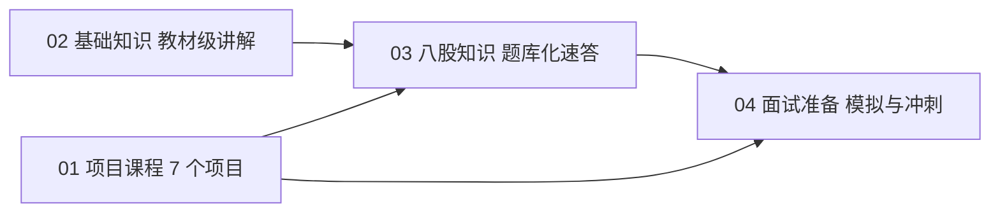

# 八股知识：使用方法与导航

> **定位**：面试的"技术问答环节"会从项目问到基础：计算机基础、AI/机器学习、机器人学。本目录把这些高频题整理成统一格式——**中文讲透原理 + 英文口语速答**——让你既能真正理解，又能开口就说。

**本章学完你能……**
- 看懂每个条目的格式，按优先级分轮复习；
- 用"中文要点 → 自己复述 → 英文速答"的方法备考，而不是背英文；
- 在 3 个子目录里快速找到对应题库，并知道它与你的项目怎么挂钩。

**前置知识**：无。建议先读 [项目总入口](../README.md) 了解整体路线。

**目录**
1. 目录结构与导航
2. 条目格式说明
3. 优先级标注与复习分配
4. 怎样用"中文要点 + 英文速答"备考
5. 回答问题的通用技巧
6. 与项目、基础知识、面试准备的关系
7. 复习计划建议

---

## 一、目录结构与导航

```text
03_八股知识/
├── README.md                      （本文）
├── 01_计算机基础/                  CS 方向必考、AI/机器人方向也会问
├── 02_人工智能/                    机器学习、深度学习、CV、LLM、RL、部署、Agent
└── 03_机器人学/                    运动学、控制、状态估计、规划、ROS、嵌入式、专题
```

### 1. 计算机基础（`01_计算机基础/`）

| 文件 | 内容概要 | 与项目的挂钩 |
|---|---|---|
| [01_数据结构与算法](./01_计算机基础/01_数据结构与算法.md) | 数组/链表/哈希/堆/树/图；排序、二分、BFS/DFS、Dijkstra、A*、DP、贪心；KD 树、栅格 | P5（A*、Hybrid A*、栅格地图） |
| [02_操作系统](./01_计算机基础/02_操作系统.md) | 进程线程、调度、虚拟内存、TLB、同步、死锁、中断、实时性 | OS 课程；P3 / P7（FreeRTOS） |
| [03_计算机网络](./01_计算机基础/03_计算机网络.md) | OSI/TCP-IP、三次握手、拥塞控制、粘包、HTTP/HTTPS/WebSocket、socket | P4（Web 交互）、P6（分布式通信） |
| [04_C语言与嵌入式八股](./01_计算机基础/04_C语言与嵌入式八股.md) | 指针、volatile、const、位操作、内存布局、对齐、ISR、DMA/cache | P3、P7（STM32） |
| [05_C++八股](./01_计算机基础/05_C++八股.md) | RAII、智能指针、vtable、移动语义、模板、STL、内存模型、异常安全 | P6（C++ 能力模型）、ROS |
| [06_Python八股](./01_计算机基础/06_Python八股.md) | GIL、装饰器、生成器、拷贝、asyncio、GC、numpy 广播 | P4（LangGraph）、P2（MuJoCo/Mink） |
| [07_并发多线程与实时系统八股](./01_计算机基础/07_并发多线程与实时系统八股.md) | 线程安全、原子、内存序、线程池、优先级反转、RTOS 调度、抖动 | P3、P7、P6 |
| [08_Linux_Git_编译构建八股](./01_计算机基础/08_Linux_Git_编译构建八股.md) | 命令、信号、权限、Makefile/CMake、链接、Git | 所有项目日常工具链 |
| [09_数据库与系统设计基础](./01_计算机基础/09_数据库与系统设计基础.md) | SQL、索引、事务、缓存、消息队列、系统设计（含机器人日志系统） | P4、P6 的系统状态与追溯 |

### 2. 人工智能（`02_人工智能/`）

| 文件 | 内容概要 |
|---|---|
| [01_机器学习八股](./02_人工智能/01_机器学习八股.md) | 偏差方差、正则化、评估指标、经典模型 |
| [02_深度学习八股](./02_人工智能/02_深度学习八股.md) | 反向传播、优化器、归一化、过拟合 |
| [03_计算机视觉与目标检测八股](./02_人工智能/03_计算机视觉与目标检测八股.md) | CNN、YOLO、NMS、mAP（对应 P4 的 YOLOv5） |
| [04_Transformer与大模型八股](./02_人工智能/04_Transformer与大模型八股.md) | 注意力、位置编码、LLM 训练与推理 |
| [05_强化学习八股](./02_人工智能/05_强化学习八股.md) | MDP、价值/策略方法、PPO、sim-to-real |
| [06_模型部署与量化八股](./02_人工智能/06_模型部署与量化八股.md) | 量化、剪枝、边缘部署（对应 P4 的 RKNN INT8） |
| [07_Agent与RAG八股](./02_人工智能/07_Agent与RAG八股.md) | Agent、工具调用、RAG、LangGraph（对应 P4 / P6 的决策链与安全执行链） |

### 3. 机器人学（`03_机器人学/`）

| 文件 | 内容概要 |
|---|---|
| [01_运动学动力学八股](./03_机器人学/01_运动学动力学八股.md) | 坐标变换、正逆运动学、雅可比、奇异性、动力学 |
| [02_控制八股](./03_机器人学/02_控制八股.md) | PID、LQR、MPC、滑模、前馈、抗饱和 |
| [03_状态估计与SLAM八股](./03_机器人学/03_状态估计与SLAM八股.md) | 卡尔曼/EKF、互补滤波、AMCL、SLAM |
| [04_路径规划与导航八股](./03_机器人学/04_路径规划与导航八股.md) | A*、Hybrid A*、TEB、MPC 跟踪 |
| [05_ROS与机器人软件八股](./03_机器人学/05_ROS与机器人软件八股.md) | ROS2 Humble（ROS1 对比）、TF、DDS、launch |
| [06_嵌入式与机电八股](./03_机器人学/06_嵌入式与机电八股.md) | 电机、编码器、CAN、功率 |
| [07_轮腿_球形机器人_机械臂专题八股](./03_机器人学/07_轮腿_球形机器人_机械臂专题八股.md) | 倒立摆、VMC、ballbot、遥操作 |

> **建议顺序**：先 `01_计算机基础`（尤其 01、02、04、05、07），再 `03_机器人学`（与你的项目重合度最高），最后 `02_人工智能`（按目标专业的比重调整）。AI 方向的项目（人工智能、具身智能）多加 `02_人工智能`，机器人方向多加 `03_机器人学`，计算机科学方向多加 `01_计算机基础`。各校侧重见 [目标项目与面试画像总表](../00_申请画像/05_目标项目与面试画像总表.md)。

---

## 二、条目格式说明

每个技术文件的头部是：一句话定位、**本章学完你能……**、前置知识、目录；中间是 N 个"题目条目"；结尾是**本章要点速记**、**自测题**、**相关链接**。

每个题目条目长这样：

```text
### Q12 题目中文？（English title）
**优先级：★★★**

**答案要点**         <- 中文，有原理或推导，不是一句话；常含代码或表格
**English short answer**   <- 3–6 句口语化英文，可以直接说出口
**追问方向**         <- 面试官下一步可能问什么，用来继续往深处准备
```

字段含义：

| 字段 | 作用 | 怎么用 |
|---|---|---|
| 题目（中英） | 标出问题，并给出英文说法 | 先遮住答案自己回答；英文题目要能听懂 |
| 优先级 | ★★★ / ★★ / ★ | 决定复习顺序（见下一节） |
| 答案要点 | 讲原理、推导、例子 | 这是**真正的学习内容**，要理解而不是背 |
| English short answer | 30 秒内能说完的口语答案 | 练习"说"，不是"读"；按自己的话改写 |
| 追问方向 | 延伸问题清单 | 当你能答对主问题后，再逐个攻克追问 |

另有三个约定：
- **项目细节处**：占位已全部替换为具体内容，以“我们的做法是…”“本项目通常取…”的方式陈述；其中数值为典型/示例，以实机为准，不代表实测结果。
- **"教学示例"**：代码和数字均为说明原理的例子，不是你的项目源码或实测数据，面试时不要当作自己的结果讲。
- **"典型做法"**：行业里通常的做法，不代表你的项目就是这么做的。

---

## 三、优先级标注与复习分配

| 标记 | 含义 | 怎么复习 |
|---|---|---|
| ★★★ 必会 | 几乎一定会被问到，或是回答其他问题的基础 | 必须能用中文讲清原理，并能脱稿说出英文速答；每个文件的 ★★★ 要过 2–3 遍 |
| ★★ 常考 | 经常出现，会在追问中出现 | 理解原理，英文说出 2–3 个要点即可 |
| ★ 了解 | 偶尔问到，或属于拓展 | 看一遍，知道有这回事、一句话能概括 |

**时间紧时的取舍**：
1. 只有 3 天：每个计算机基础文件只做 ★★★，共约 150–200 题，英文只练速答的第一句话。
2. 有 1–2 周：★★★ 全部熟练 + ★★ 过一遍。
3. 有 4 周以上：★★★ 与 ★★ 全部熟练，★ 抽读，每个文件完成自测题，并做追问方向。

不同专业的重点（可按需调整）：

| 申请方向 | 重点文件 |
|---|---|
| 计算机科学（CS） | 01 数据结构与算法、02 操作系统、03 计算机网络、05 C++、06 Python、07 并发、09 数据库 |
| 人工智能 / 具身智能 | 06 Python、01 数据结构、`02_人工智能` 全部、`03_机器人学` 的 01 02 05 |
| 机器人 | `03_机器人学` 全部、04 C 与嵌入式、07 并发与实时、05 C++ |

---

## 四、怎样用"中文要点 + 英文速答"备考

面试是英文的，但你的理解是通过中文建立的。推荐四步法：

1. **读中文要点，把原理讲给自己听**（或纸上画图）。能不看答案复述出"为什么"，才算理解。
2. **读英文速答，抓住骨架**：英文速答通常是"一句定义 + 一两句原理 + 一句应用/权衡"的结构。把这个骨架背下来，而不是背每个单词。
3. **合上文档，用自己的话说一遍英文**（录音更好）。允许说得不一样，但要包含：定义、关键机制、一个例子或权衡。
4. **用追问方向继续往下挖一层**：面试官最爱问"为什么""什么情况下会失效""你怎么验证"。

### 一个可复用的英文回答骨架

```text
1) 一句话定义     "X is ... / X is used to ..."
2) 机制或原因     "It works by ... / The reason is ..."
3) 例子或权衡     "For example, in my ... project / The trade-off is ..."
4) 收尾（可选）   "So in practice I ..."
```

示例（线程与进程）：
- 定义：A process owns its own address space, while threads share one.
- 机制：Threads are cheaper to switch, but need synchronization.
- 权衡：So I use processes for isolation and threads for shared-state parallelism.

### 听不懂 / 不会时的英文话术

- "Could you rephrase the question, please?"
- "Let me think for a moment." （然后停顿几秒整理，比立刻乱说好）
- "I'm not completely sure, but my understanding is ..., and I would verify it by ..."
- "I haven't used that directly, but it's similar to ... which I have used in ..."

> **注意**：不要为了显得会而编造。对不确定的细节，承认边界并说出你会怎么确认，面试官通常更认可。

---

## 五、回答问题的通用技巧

1. **先结论后展开**：先用一句话回答，再补原理，避免面试官等不到重点。
2. **对比式回答**：问"A 与 B 区别"时，用"相同点 → 关键差异 → 什么时候选谁"的结构。
3. **给出复杂度或数量级**：数据结构/算法题要说复杂度；系统题要有数量级。
4. **用项目落地**：能挂钩项目时，用 "In my project, ..." 一句话落地——**但只讲有依据的事实**（见 CV 与各项目 README），不确定的写进自查表。
5. **主动说边界与失败模式**："这在 ... 情况下会失效，我会用 ... 检测。"
6. **代码题**：先说思路与复杂度再写，边写边讲，写完用小例子走一遍，主动提边界条件。

---

## 六、与项目、基础知识、面试准备的关系



- **基础知识**（`../02_基础知识/`）是"教材"：从问题、符号、推导到例子；八股是"题库"：把教材中最可能被问的点压缩成速答。遇到八股里看不懂的地方，回到对应基础章节。
- **项目课程**（`../01_项目课程/`）告诉你项目里**做了什么**；八股告诉你**背后的通用原理**。面试经常是"项目 → 原理 → 追问"链条。
- **面试准备**（`../04_面试准备/`）用八股作素材做模拟面试，高频题可汇总见其中的"高频100问"。

八股与项目的典型挂钩（只是线索，具体做了什么以各项目文档和 CV 为准）：

| 八股主题 | 对应项目 / 经历 |
|---|---|
| 实时系统、FreeRTOS、ISR、DMA | P3 RoboMaster 英雄（STM32F407/FreeRTOS/CAN）、P7 轮腿（STM32H7/FreeRTOS/FDCAN） |
| A*、优先队列、栅格 | P5 导航（Hybrid A*） |
| TCP/WebSocket/HTTP | P4 系统集成与 Web 交互 |
| C++ 接口抽象、RAII | P6 统一能力模型 |
| 并发、状态一致性 | P6 状态管理、P7 状态不一致排查 |
| Python/asyncio/LangGraph | P4 Agent 决策链 |

---

## 七、复习计划建议

**每日节奏（约 1.5–2 小时）**

| 时段 | 内容 |
|---|---|
| 30 分钟 | 选 8–10 道 ★★★ 题，中文要点自测（遮住答案复述） |
| 30 分钟 | 对同一批题口述英文速答（录音，回听一次） |
| 20 分钟 | 做 1 个文件的自测题，或手写一段代码模板（二分、LRU、线程池、SPSC 队列、Dijkstra） |
| 20 分钟 | 追问方向攻坚：挑 3 个追问，查资料补深度 |
| 10 分钟 | 把不会的、卡壳的题记入错题本，次日重做 |

**一次通关清单（每项都应能脱稿讲 1–2 分钟）**
- [ ] TCP 三次握手/四次挥手/拥塞控制
- [ ] 进程与线程、虚拟内存、死锁四条件、优先级反转
- [ ] volatile、DMA 与 cache 一致性、ISR 规则
- [ ] RAII、智能指针、虚函数表、移动语义
- [ ] GIL、asyncio、numpy 广播
- [ ] 内存序与无锁队列、线程池
- [ ] A* 与 Dijkstra 的关系、堆的用途
- [ ] Git 的 merge/rebase/reset/revert

**常见错误**
- 只背英文不理解原理，被追问一层就答不出；
- 英文句子太长太书面，口述时卡壳——用短句；
- 把"教学示例"或"典型做法"当成自己项目的事实说出来；
- 对项目细节不熟悉，面试时被问到“为什么这样取值”无话可说。

---

## 本章要点速记
1. 八股 = 中文理解原理 + 英文口语速答 + 追问深挖。
2. ★★★ 必会，★★ 常考，★ 了解；时间紧先攻 ★★★。
3. 每题格式：题目（中英）→ 优先级 → 答案要点 → English short answer → 追问方向。
4. 回答骨架：定义 → 机制 → 例子/权衡 → 收尾。
5. 项目细节已写成具体做法，数值为典型/示例，以实机为准；"教学示例"不是项目数据。
6. 三个子目录：计算机基础、人工智能、机器人学，按申请方向调整比重。
7. 不会就说出边界与验证办法，不要编造。

## 自测题
1. 一个八股条目由哪几部分组成？各自怎么使用？
2. 你申请的方向应当优先复习哪些文件？列出前 5 个。
3. 用"定义—机制—例子/权衡"的骨架，英文回答"进程与线程的区别"。
4. 为什么要先用中文理解、再练英文口述，而不是直接背英文答案？
5. 遇到不确定的项目细节被追问，应该如何回答？

## 相关链接
- 计算机基础：[01 数据结构与算法](./01_计算机基础/01_数据结构与算法.md) · [02 操作系统](./01_计算机基础/02_操作系统.md) · [03 计算机网络](./01_计算机基础/03_计算机网络.md) · [04 C语言与嵌入式](./01_计算机基础/04_C语言与嵌入式八股.md) · [05 C++](./01_计算机基础/05_C++八股.md) · [06 Python](./01_计算机基础/06_Python八股.md) · [07 并发与实时](./01_计算机基础/07_并发多线程与实时系统八股.md) · [08 Linux/Git/构建](./01_计算机基础/08_Linux_Git_编译构建八股.md) · [09 数据库与系统设计](./01_计算机基础/09_数据库与系统设计基础.md)
- 上级：[项目学习总入口](../README.md)；面试准备：[面试准备总入口](../04_面试准备/README.md)；基础知识：[基础知识总览](../02_基础知识/00_总览与学习路线.md)
